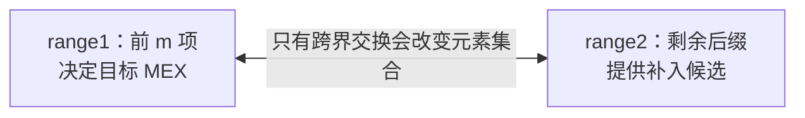
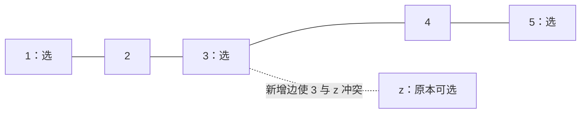

# Codeforces Round 1130（Div. 2）：A–D 复盘

[比赛 2272](https://codeforces.com/contest/2272) · [官方题解](https://codeforces.com/blog/entry/158188) · [整赛索引](../README.md)

本篇按比赛定位题目，重点保留思路中的关键一步。以下个人实现均由本人确认 AC；仅整理排版和注释，省略未改动的公共框架。A 另附简化实现，其余三题沿用原写法。

| 题目 | 核心收获 | 复杂度 |
| --- | --- | --- |
| [A — Maximize One MEX](#a-maximize-one-mex) | 固定目标前缀，分成两侧，再研究跨界交换 | O(n) |
| [B — Frogs Jump](#b-frogs-jump) | 从移动方案中提取奇偶不变量 | O(n) |
| [C — Yet Another Black Cell Problem](#c-yet-another-black-cell-problem) | 固定答案，把染色转成消除孤立点 | O(n log V)，V=10⁹ |
| [D — Connecting the Conflicts](#d-connecting-the-conflicts) | 星形连接只是外形，还要找到不损失最优值的中心 | O(N)，N 为总节点数 |

## A. Maximize One MEX

[原题](https://codeforces.com/contest/2272/problem/A)。排列由 `0..n-1` 构成，至多交换一次，使所有前缀 MEX 中第 k 大的值最大。

### 个人实现

```cpp
void solve() {
    int n, k;
    cin >> n >> k;

    vector<int> a(n), pos(n);
    for (int i = 0; i < n; ++i) {
        cin >> a[i];
        pos[a[i]] = i;
    }

    int mx = n - k + 1; // 目标前缀的长度，不是前缀最大值

    vector<bool> seen(n + 1, false);
    for (int i = 0; i < mx; ++i)
        seen[a[i]] = true;

    int mex = 0;
    while (seen[mex]) ++mex;

    if (mex == mx) {
        cout << -1 << '\n';
        return;
    }

    int tg = mex + 1;
    while (tg < mx && seen[tg]) ++tg;

    for (int i = 0; i < mx; ++i) {
        if (a[i] >= tg) {
            cout << i + 1 << ' ' << pos[mex] + 1 << '\n';
            return;
        }
    }
}
```

原实现先补入 `mex`，再寻找不会破坏更小连续值的换出位置。`tg` 是从 `mex+1` 开始找到的下一个缺口，至多取到前缀长度 `mx`。

### 先固定一个分界，再看两侧怎样交换

**加入元素不会让 MEX 减小。** 设 fᵢ 为前 i 项的 MEX，则：

$$
f_1\le f_2\le\cdots\le f_n.
$$

第 k 大因此固定为 fₙ₋ₖ₊₁。令 m=n−k+1，只需关心前 m 项。



**同侧交换只变顺序，跨侧交换才改变目标集合。** 于是原本任意两位置交换，缩成“从右边补进谁、从左边换出谁”。

若左侧 MEX 为 v，`0..v-1` 都已在左侧；由于整个数组恰为一个排列，右侧最小值就是 v。左侧再选择最大值 x 换出，最不容易破坏这些较小的数。

$$
x=\max(range1),\qquad v=\min(range2).
$$

**x 大于 v 时交换；否则左侧已是 `0..m-1`，MEX 达到长度上限 m。** 若补入 v 后的下一个缺口为 t，换出 x 后的 MEX 为 min(t,x)；选最大 x 正好最大化这个结果。右侧为空时直接不交换。

### 简化实现

沿用[官方题解](https://codeforces.com/blog/entry/158188)的极值交换思路，省去 `pos`、`seen` 和两次缺口扫描。与原实现同为 O(n)，改进在于状态更少；本轮未另行评测此整理版。

```cpp
void solve() {
    int n, k;
    cin >> n >> k;
    vector<int> a(n);
    for (int& x : a) cin >> x;

    int m = n - k + 1;
    if (m == n) {
        cout << -1 << '\n';
        return;
    }

    int p = max_element(a.begin(), a.begin() + m) - a.begin();
    int q = min_element(a.begin() + m, a.end()) - a.begin();

    if (a[p] > a[q]) cout << p + 1 << ' ' << q + 1 << '\n';
    else cout << -1 << '\n';
}
```

**思考入口：由目标确定分界 → 分成保留侧与候选侧 → 排除同侧操作 → 推导跨界交换。** 适用于本题的排列条件，不能推广成任意数组中“后缀最小值就是前缀 MEX”。见[答案结构缩减中的分界交换](../../patterns/04-greedy-and-construction/answer-structure-reduction.md#固定目标范围再研究跨界交换)。

## B. Frogs Jump

[原题](https://codeforces.com/contest/2272/problem/B)。两行棋盘，每列至少一只青蛙；移除最少青蛙后，其余各跳一格，要求每行、每列数量不变。

### 个人实现

```cpp
void solve() {
    int n;
    cin >> n;
    string a, b;
    cin >> a >> b;

    int cnt = 0;
    for (int i = 0; i < n; i++) {
        cnt += (a[i] == 'f');
        cnt += (b[i] == 'f');
    }
    cout << cnt % 2 << '\n';
}
```

**先看不变量，再考虑怎样跳。** 按棋盘黑白相间染色，每次跳跃都会换色；行列数量不变，又保证所有青蛙的“行号＋列号”总和不变，因此青蛙总数必须为偶数。

充分性可从左到右配对：同列两只上下互换，相邻两列各取一只则左右互换；即使它们处于不同行，也仍保持各行各列数量。每列非空保证能接着处理。总数奇数时，从最右非空列移除一只后再配对。

$$
\mathrm{answer}=\mathrm{cnt}\bmod 2.
$$

**收获：看似需要模拟每个对象的动作，最后可能只需维护一个整体不变量。** 原实现已足够简洁。

## C. Yet Another Black Cell Problem

[原题](https://codeforces.com/contest/2272/problem/C)。给定递增的必染位置，最多额外染 x 格；每次选择距离不超过 k 的两格染黑，求最小 k。

### 个人实现

```cpp
bool isolated(const vector<ll>& a, int i, ll k) {
    int n = a.size();
    if (i > 0 && a[i] - a[i - 1] <= k) return false;
    if (i + 1 < n && a[i + 1] - a[i] <= k) return false;
    return true;
}

bool check(const vector<ll>& a, int x, ll k) {
    int n = a.size();
    int need = 0;

    for (int i = 0; i < n; ++i) {
        if (!isolated(a, i, k)) continue;

        if (i + 1 < n && isolated(a, i + 1, k) &&
            a[i + 1] - a[i] <= 2 * k) {
            ++need;
            ++i;
        } else {
            ++need;
        }
        if (need > x) return false;
    }
    return true;
}

void solve() {
    int n, x;
    cin >> n >> x;
    vector<ll> a(n);
    for (ll& v : a) cin >> v;

    ll l = 1, r = 1000000000LL;
    while (l < r) {
        ll mid = l + (r - l) / 2;
        if (check(a, x, mid)) r = mid;
        else l = mid + 1;
    }
    cout << l << '\n';
}
```

**允许重复染黑，所以不要求把所有位置拆成互不重叠的二元组。** 固定 k 后，每个必染位置只需有一个距离不超过 k 的黑色伙伴；已有伙伴的位置不用补，真正消耗资源的是 `isolated`。

一个新增格最多服务两个孤立位置。若同时服务两个，它们必须在原数组中相邻，并且：

$$
a[i+1]-a[i]\le 2k.
$$

这时可在中间补一格，让两者共享伙伴。从左向右能配就配，否则单独补一格，`need` 统计最少新增格数；`need <= x` 即可行。k 增大只会放宽限制，因此二分最小可行值。

**收获：把“执行一串操作”改写成“最终每个位置必须满足什么”，判定就变成局部缺口与资源分配。** 数组已由输入保证递增，无需再排序。见[二分答案的判定拆分](../../patterns/02-sequence-techniques/binary-search-on-answer.md)。原实现无需再附一版。

## D. Connecting the Conflicts

[原题](https://codeforces.com/contest/2272/problem/D)。将 k 棵树用 k−1 条边连成树，使新树的最大独立集尽量大。独立集要求所选节点之间没有边。

### 个人实现

```cpp
void solve() {
    int k;
    cin >> k;
    int centertree = 0, centernode = 1;

    for (int i = 1; i <= k; ++i) {
        int n;
        cin >> n;
        vector<int> deg(n + 1), nei(n + 1);

        for (int j = 1; j < n; ++j) {
            int u, v;
            cin >> u >> v;
            ++deg[u];
            ++deg[v];
            nei[u] = v;
            nei[v] = u;
        }

        if (centertree == 0 && n > 1) {
            for (int u = 1; u <= n; ++u) {
                if (deg[u] == 1) {
                    centertree = i;
                    centernode = nei[u];
                    break;
                }
            }
        }
    }

    if (centertree == 0) centertree = 1;
    for (int i = 1; i <= k; ++i) {
        if (i == centertree) continue;
        cout << centertree << ' ' << centernode << ' '
             << i << ' ' << 1 << '\n';
    }
}
```

### 从星形连接，再追问中心应该是谁

赛时先想到把其他树都挂到同一中心，**还需再问：增加这些边，会不会排除原本最优方案中的节点？** 星形连接描述的是树与树之间的连接方式，原来的树内部仍保留所有边。

**“中心不是叶子”还不够。** 例如五节点链的最大独立集是 `{1,3,5}`；选非叶节点 3 接入孤立点 z，会把原来可选的四个节点压到最多三个。



正确选择是**某个叶子 u 的邻居 v**。总存在一个最大独立集不选 v：若原方案选 v，把 v 换成 u，数量不变，且 u 只有 v 这一个邻居，不会产生新冲突。将其他树任意节点连到 v，就能保留各树原来的最优值。

$$
\text{原森林的最大独立集大小}
=\sum_i\text{第 i 棵树的最大独立集大小}.
$$

加边只能增加限制，无法超过这个上界；上述构造恰好保住上界，因此最优。**不必真的跑树形 DP 求出独立集。** 若所有树都是单点，则连成星形，选除中心外的 k−1 个点。

只有两个节点的树中，叶子的邻居也仍是叶子，因此不能把条件记成“绝不选叶子”。`nei` 虽然只保留最后读到的一个邻居，但这里只查询度数为 1 的节点，保存的恰好是其唯一邻居。原实现逐树读取即可完成构造，无需另附一版。

**收获：先找原问题的最优上界，再找一种允许安全替换的局部结构，让新增限制不损失这个上界。**
