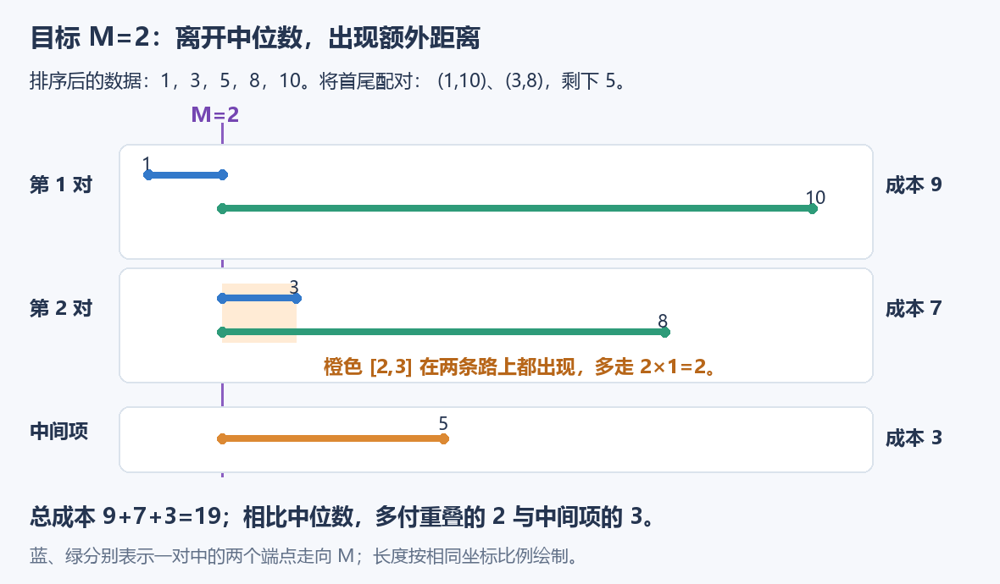
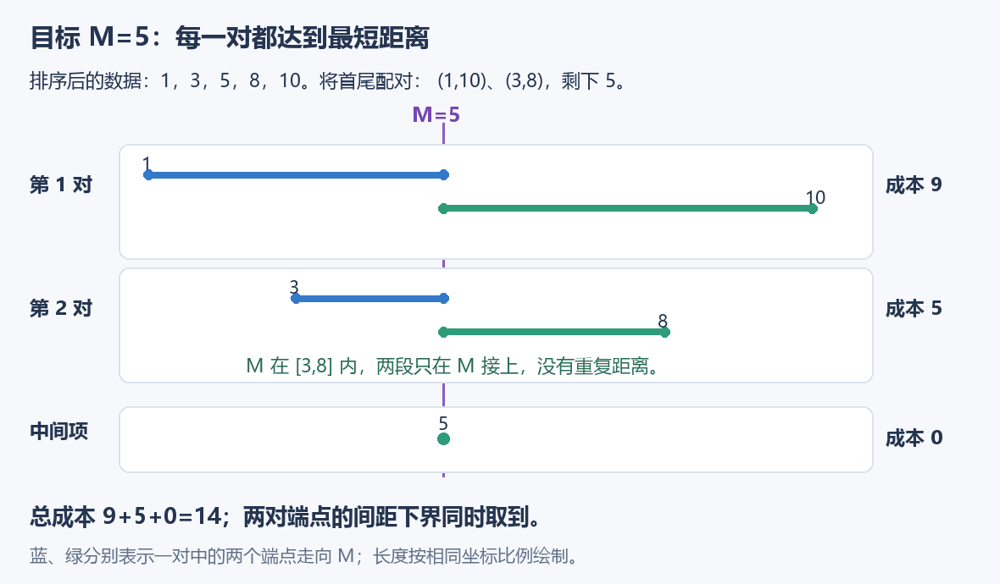
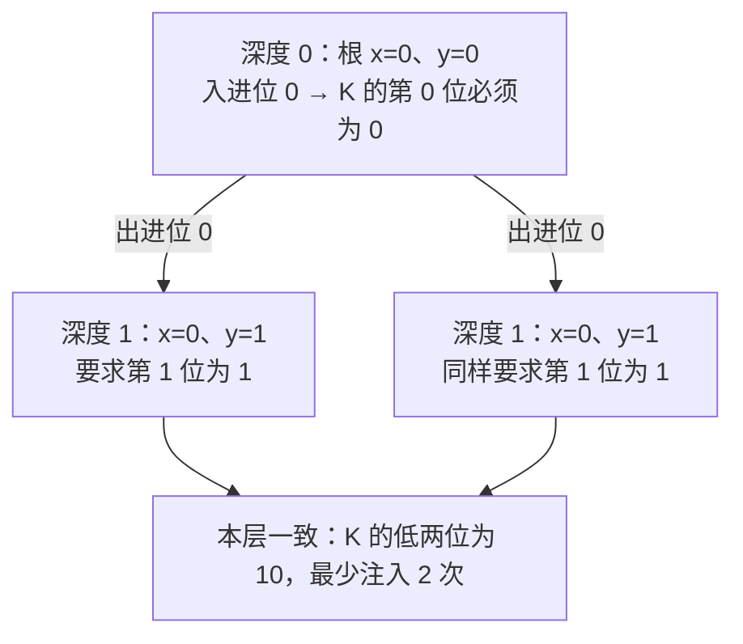

# Codeforces Round 1131（Div. 3）：A–G 完整复盘

[比赛 2278](https://codeforces.com/contest/2278) · [官方 Tutorial](https://codeforces.com/blog/entry/158300) · [整赛索引](../README.md)

**A–E 为赛时实现，F–G 为吸收 Tutorial 后的补题实现。** 个人代码保留逻辑，只统一排版，省略公共框架。A–E 已核对官方实现，另附按官方算法重新整理的单组 `solve()`，不是逐字转载；F–G 只保留补题代码与文档要求的补充。

本篇做题意与逻辑的静态复盘，不重新编译、运行或对拍个人代码，不另补平台评测记录。

| 题目 | 阶段 | 本场最值得保留的收获 |
| --- | --- | --- |
| [A — Fraction and Six](#a-fraction-and-six) | 赛时 | 把消去过程改写为字符数量相等 |
| [B — Stakes and Shapes](#b-stakes-and-shapes) | 赛时 | 先找统一的充分条件，再用下标映射表达克制关系 |
| [C — Math and Physics](#c-math-and-physics) | 赛时 | 找到真正影响损失的位置因素，再分类讨论 |
| [D — Lock and Unlock](#d-lock-and-unlock) | 赛时 | 相对变化与中位数；有序间隙的成本分摊 |
| [E — Swap and Negate](#e-swap-and-negate) | 赛时 | 构造新变量消除变号；追踪初末位置的奇偶关系 |
| [F — Modulo and Counting](#f-modulo-and-counting) | 补题 | 用紧上界限制结构，再用前缀和优化计数 DP |
| [G — 0s and 1s](#g-0s-and-1s) | 补题 | 将传播识别为加法进位，按深度确定同一个整数的各位 |

## A. Fraction and Six

[原题](https://codeforces.com/contest/2278/problem/A)。消去分母全部字符后，分子恰好剩下 `six`，字符可以任意重排。

### 赛时实现

```cpp
void solve() {
    int n, m;
    cin >> n >> m;

    string a, b;
    cin >> a >> b;

    if (n != m + 3) {
        cout << "NO\n";
        return;
    }

    vector<int> cnt(26);

    for (char c : a)
        ++cnt[c - 'a'];

    for (char c : b)
        --cnt[c - 'a'];

    for (char c : string("six"))
        --cnt[c - 'a'];

    for (int x : cnt) {
        if (x != 0) {
            cout << "NO\n";
            return;
        }
    }

    cout << "YES\n";
}
```

**先加分子的数量，再减分母与目标的数量，最后看是否全部归零。** 长度检查用于提前排除不可能情形；真正决定结果的是每种字符的数量。

### Tutorial：把“减掉后剩下”改写成“补上后相等”

```cpp
void solve() {
    int n, m;
    string p, q;
    cin >> n >> m >> p >> q;
    q += "six";

    auto counts = [](const string& text) {
        vector<int> result(26);
        for (char c : text) ++result[c - 'a'];
        return result;
    };
    bool same = counts(p) == counts(q);
    cout << (same ? "YES\n" : "NO\n");
}
```

官方实现给分母追加 `six`，分别统计两边字符后直接比较计数向量；上面按小写字母整理为 26 项，并用一个计数函数复用相同逻辑。

$$
\mathrm{count}(p)-\mathrm{count}(q)=\mathrm{count}(\text{six})
\iff
\mathrm{count}(p)=\mathrm{count}(q+\text{six}).
$$

**两种写法都是 $O(n+m)$ 时间、常数字母表空间。** Tutorial 的收益是更直接地表达条件、复用容器的 `==`，并非原来的加减计数效率不足。

联系：[vector 的整体比较](../../notes/01-basic-problem-solving/04-stl/containers/01-vector.md#整个-vector-可以直接比较c11)。

## B. Stakes and Shapes

[原题](https://codeforces.com/contest/2278/problem/B)。对方分别出 `R、S、P` 共 $x、y、z$ 次，但顺序未知；提前确定自己的出拳序列，保证胜场不少于负场。

### 赛时实现

```cpp
void solve() {
    int x, y, z;
    cin >> x >> y >> z;

    int n = x + y + z;

    if (y >= z)
        cout << string(n, 'R');
    else if (z >= x)
        cout << string(n, 'S');
    else
        cout << string(n, 'P');
    cout << '\n';
}
```

始终出 `R` 时赢 $y$ 次、输 $z$ 次，所以 `y>=z` 就成立。否则尝试 `S`；若还不成立，已有 $x\gt z\gt y$，始终出 `P` 就满足赢 $x$ 次、输 $y$ 次。

### Tutorial：打赢出现最多的那一种

```cpp
void solve() {
    vector<int> freq(3); // 对应 R、S、P 的次数。
    for (int& count : freq) cin >> count;

    const string counter = "PRS";
    int index = (int)(max_element(freq.begin(), freq.end()) - freq.begin());
    int rounds = accumulate(freq.begin(), freq.end(), 0);
    cout << string(rounds, counter[index]) << '\n';
}
```

官方代码也以 `PRS` 表示对 `RSP` 的克制结果。这里先算最大频次的位置，再一次构造输出字符串，避免在输出循环里重复查最大值。

**选对方出现最多的拳的克制拳：自己的胜场是最大频次，负场是另外某个频次，因此必然不输。** 这是统一的充分条件，不要求枚举对方的排列。

| 对方的下标 | 对方出拳 | 自己的克制拳 |
| --- | --- | --- |
| 0 | R | P |
| 1 | S | R |
| 2 | P | S |

`string counter="PRS"` 把关系提前编码成表，之后只需要用相同下标取值。时间 $O(x+y+z)$，主要成本是输出这么长的字符串。

## C. Math and Physics

[原题](https://codeforces.com/contest/2278/problem/C)。选择质量至少为 2 的元素，拆成两个正数交给左右邻居，再删除自身；超出边界的部分损失。希望最后剩一个元素，且质量最大。

### 赛时实现

```cpp
void solve() {
    int n;
    cin >> n;
    vector<int> a(n);

    bool in = false;
    ll sum = 0;
    for (int i = 0; i < n; ++i) {
        cin >> a[i];

        sum += a[i];

        if (i > 0 && i < n - 1 && a[i] > 1)
            in = true;
    }

    if (sum == n)
        cout << -1;
    else if (in)
        cout << sum - 1;
    else
        cout << sum - n + 1;
    cout << '\n';
}
```

### Tutorial：用总和识别“内部全是 1”

```cpp
void solve() {
    int n;
    cin >> n;
    vector<int> mass(n);
    for (int& x : mass) cin >> x;

    ll total = accumulate(mass.begin(), mass.end(), 0LL);
    ll answer = -1;
    if (total != n) {
        bool all_inner_one = total - mass.front() - mass.back() == n - 2;
        answer = all_inner_one ? total - n + 1 : total - 1;
    }
    cout << answer << '\n';
}
```

官方用 `accumulate` 求和，再用总和判断内部是否全部为 1。上面保留这个判断，累加初值用 `0LL`，使累计类型明确为 `ll`。

**真正影响答案的是能否从内部开始拆。** 内部拆分不损失质量，边上拆分至少损失 1；不是逐个模拟怎样拆出左右两份。

令 $S$ 为初始总质量：

$$
\boxed{
\mathrm{ans}=\begin{cases}
-1, & \text{全部为 1},\\
S-1, & \text{内部存在至少为 2 的元素},\\
S-(n-1), & \text{其余情况}.
\end{cases}}
$$

最后两个元素只能从边上拆，因此至少损失 1。若内部能启动，增加后的邻居继续提供内部操作，直到剩两项；若内部全是 1，则只能沿边缘推进，每次损失 1，共操作 $n-1$ 次。

因为每项至少为 1，下面的等式恰好等价于内部全是 1：

$$
S=a_1+a_n+(n-2).
$$

**先找到影响结果的变量，再按它分类讨论。** 两种实现的思路和 $O(n)$ 时间一致；`accumulate` 主要让代码更紧凑。联系：[accumulate 的初值与累计类型](../../notes/01-basic-problem-solving/04-stl/algorithms/04-accumulate.md)。

## D. Lock and Unlock

[原题](https://codeforces.com/contest/2278/problem/D)。每次锁定若干元素，花费为锁定数量；其余元素统一加 1 或减 1。先使全部相等的总花费最少，再在最少花费下使操作次数最少。

### 赛时实现：相对变化，转成中位数

```cpp
void solve() {
    int n;
    cin >> n;
    vector<ll> a(n);
    for (ll& x : a) cin >> x;
    sort(a.begin(), a.end());

    ll m = a[n / 2];
    ll cost = 0;

    for (ll x : a)
        cost += abs(x - m);

    cout << cost << ' ' << a.back() - a.front() << '\n';
}
```

如果所有数一起加减，相对差距不变。一次“其余数加 1、锁定数不动”，扣掉全体加 1 的平移后，就等价于**只让锁定数减 1**；另一种方向同理。

每锁定一个数，就为它付出一个单位的相对移动成本。把剔除整体平移后的共同目标记为 $M$，最少成本转为：

$$
\min_M\sum_{i=1}^{n}|a_i-M|.
$$

这里 $M$ 是相对坐标下的共同基准，不必强迫原数组最终停在这个具体数值。

### 两张图：为什么中位数不会多走一段？

以排序后的 $[1,3,5,8,10]$ 为例，把最外两项配对，再把次外两项配对，剩下中间的 5。



当 $M=2$，它在区间 $[3,8]$ 左侧。两个端点走向 $M$ 时，区间 $[2,3]$ 被走了两次；中间的 5 还要额外走 3。



当 $M=5$，它同时落在每一对端点之间，各对都不多走；中间点的距离也为 0。

对于任意一对 $u\le v$：

$$
|u-M|+|v-M|\ge v-u.
$$

只有 $M$ 位于两者之间时取等号。中位数同时位于每一对首尾配对的区间内，因此让这些下界同时取到。奇数项剩下的中间点也取到 0；偶数项时，两中间数之间的任意目标都最优。

### Tutorial：按排序后的间隙分摊成本

```cpp
void solve() {
    int n;
    cin >> n;
    vector<ll> b(n);
    for (ll& value : b) cin >> value;
    sort(b.begin(), b.end());

    ll cost = 0;
    for (int left_count = 1; left_count < n; ++left_count) {
        ll gap = b[left_count] - b[left_count - 1];
        cost += gap * min(left_count, n - left_count);
    }
    ll steps = b.back() - b.front();
    cout << cost << ' ' << steps << '\n';
}
```

设排序结果为 $b_1\le\cdots\le b_n$。间隙 $b_{i+1}-b_i$ 两侧分别有 $i$ 与 $n-i$ 个数；把一侧作为整体向另一侧靠近，每缩小 1，选择锁定数量较小的一侧。

$$
\boxed{\mathrm{cost}=\sum_{i=1}^{n-1}(b_{i+1}-b_i)\min(i,n-i).}
$$

这与中位数的绝对距离和相同：每个间隙被多少个元素跨过，恰好就是它较小一侧的元素数。两种视角分别适合**识别整体平移可以忽略**和**按有序间隙统计贡献**，不必强行排出谁更通用。

每次操作对所有未锁元素采用同一方向，最大值与最小值的差最多缩小 1，因此操作次数至少是极差。上述整块收拢每步都能让极差缩小 1，最少成本与最少次数可以同时达到：

$$
\boxed{\mathrm{operations}=\max(a)-\min(a).}
$$

两种实现均为 $O(n\log n)$ 时间。排序与各项累计均使用足够宽的类型，不需要模拟逐次操作。

## E. Swap and Negate

[原题](https://codeforces.com/contest/2278/problem/E)。相邻两项可以同时变为 $(-a_{i+1},-a_i)$，希望最终总和最大。

### 赛时实现：奇偶分组，跨组变号

```cpp
void solve() {
    int n;
    cin >> n;
    vector<ll> a(n), odd, even;
    ll sum = 0;
    for (int i = 0; i < n; ++i) {
        cin >> a[i];
        sum += a[i];
        if (i & 1) odd.push_back(a[i]);
        else even.push_back(a[i]);
    }

    sort(odd.begin(), odd.end());
    sort(even.begin(), even.end());

    int m = min((int)odd.size(), (int)even.size());
    for (int i = 0; i < m; ++i) {
        ll add = odd[i] + even[i];
        if (add < 0) sum -= 2 * add;
    }

    cout << sum << '\n';
}
```

代码按 **0 基下标**分组，`odd` 保存奇下标，`even` 保存偶下标。每经过一次相邻交换，元素移动一格、变号一次，因此最终是否变号只取决于初始位置与最终位置的奇偶性是否不同。

两种位置的数量固定。若有 $k$ 项从一组移入另一组，必然也有 $k$ 项反向移动，所以**两组必须各选相同数量的元素变号**。

一个值 $a$ 变为 $-a$，总和增加 $-2a$。对固定的 $k$，应该从两组各选最小的 $k$ 项。两组升序后的第 $j$ 对增益为：

$$
\Delta_j=-2(E_j+O_j).
$$

两组升序使配对和单调不减，因此只取和为负的前缀即可；代码继续扫描也正确，后面不会再出现负配对和。

### Tutorial：构造新数组，把变号吸收掉

```cpp
void solve() {
    int n;
    cin >> n;
    vector<ll> b(n);
    for (int i = 0; i < n; ++i) {
        ll value;
        cin >> value;
        b[i] = (i % 2 == 0 ? value : -value);
    }
    sort(b.begin(), b.end(), greater<ll>());

    int positive_count = (n + 1) / 2;
    ll answer = 0;
    for (int i = 0; i < n; ++i)
        answer += (i < positive_count ? b[i] : -b[i]);
    cout << answer << '\n';
}
```

用 **1 基数学下标**定义：

$$
b_i=(-1)^{i-1}a_i.
$$

`a` 中一次“交换并变号”，在 `b` 中成为：

$$
(b_i,b_{i+1})\longrightarrow(b_{i+1},b_i).
$$

相邻交换可以实现任意排列，所以 `b` 的元素多重集合不变，而且可以任意重排。原总和转为：

$$
\sum a_i=b_1-b_2+b_3-b_4+\cdots.
$$

最大的 $\lceil n/2\rceil$ 项放在正号位置，其余放在负号位置。上面按此逻辑重新整理为读入时变号、降序后一次累加；官方实现是构造数组后升序，把较小一半减去。

| 视角 | 抓住什么 | 如何缩小问题 |
| --- | --- | --- |
| Tutorial | 变换后的不变量与可达性 | 复杂操作变成任意排列 |
| 个人思路 | 初始与最终位置的奇偶关系 | 变号必须跨组配对，再选有利前缀 |

两种思路都保留：**操作复杂时尝试换变量；涉及移动时追踪单个元素从哪里到哪里。** 任意重排的可达性也保证了跨组所选元素可以安排到对应位置，并非只得到了一个必要条件。两种实现均为 $O(n\log n)$ 时间、$O(n)$ 存储。

## F. Modulo and Counting

[原题](https://codeforces.com/contest/2278/problem/F)。以下按代码把题面目标余数和 $m$ 改称 $t$，代码里的 `m=t+2` 则表示值域上界，避免混用。

**这是按长度与末尾值定义的计数 DP，转移里需要区间求和；不是以左右端点为状态的区间 DP。**

### 补题实现

```cpp
const ll MOD = 998244353ll;

void solve() {
    int n, t;
    cin >> n >> t;
    int m = t + 2;

    vector<ll> dp(m + 1), ndp(m + 1), pre(m + 1);
    ll ans = 0;

    dp[m] = 1;

    for (int len = 2; len <= n; ++len) {
        for (int v = 1; v <= m; ++v)
            pre[v] = (pre[v - 1] + dp[v]) % MOD;

        for (int v = 2; v <= m; ++v) {
            int r = min(m, 2 * v - 1);
            ndp[v] = (pre[r] - pre[v - 1] + MOD) % MOD;
        }
        ans = (ans + ndp[2]) % MOD;

        dp.swap(ndp);
    }

    cout << ans << '\n';
}
```

### 先变形，再用上界锁定结构

设 $k_i=\lfloor a_i/a_{i+1}\rfloor$。数组非增，所以每个 $k_i\ge1$。把模运算展开，再把相邻差求和：

$$
\begin{aligned}
t
&=\sum_{i=1}^{n-1}(a_i-k_i a_{i+1})\\
&=a_1-a_n-\sum_{i=1}^{n-1}(k_i-1)a_{i+1}.
\end{aligned}
$$

把额外减去的部分移到一侧：

$$
0\le\sum_{i=1}^{n-1}(k_i-1)a_{i+1}
=a_1-a_n-t\le(t+2)-1-t=1.
$$

**非负整数和只能是 0 或 1。** 原来难处理的模约束，因此只剩极少的合法结构，尤其是末尾只能为 1 或 2。

| 末尾 | 如何限制整个数组 |
| --- | --- |
| 2 | 右边只能为 0，因此首项是 $t+2$，所有商为 1 |
| 1 | 因 $t\ge1$，数组不可能全是 1；进入 1 的那一步已贡献至少 1，所以只能是 $2\to1$，首项仍为 $t+2$，其余项贡献为 0 |

于是统一成：**从 $t+2$ 出发，按“前一项不小于后一项、但小于其两倍”下降到 2；可以在 2 停留，再在剩余位置全部补 1。** 这里“下降”允许相等。

### 状态与转移：固定新的末尾，找上一项范围

令 $f[\mathrm{len}][v]$ 表示：已经选了 len 项，首项为 $m=t+2$、末尾为 $v\ge2$，且此前每对相邻元素的商都为 1 的前缀数量。

$$
f[1][m]=1.
$$

若新末尾为 $v$，上一项 $x$ 必须满足：

$$
v\le x\lt2v
\quad\Longrightarrow\quad
x\in[v,\min(m,2v-1)].
$$

因此：

$$
\boxed{f[\mathrm{len}][v]=\sum_{x=v}^{\min(m,2v-1)}f[\mathrm{len}-1][x].}
$$

每个完整数组都有唯一的**最后一个 2**，它后面只能补 1；全长以 2 结束时则不补。因此：

$$
\boxed{\mathrm{ans}=\sum_{\mathrm{len}=2}^{n}f[\mathrm{len}][2].}
$$

以 $t=1,n=3$ 为例，前缀 `[3,2]` 补一个 1 得 `[3,2,1]`；长度 3 的 `[3,2,2]`、`[3,3,2]` 直接结束，共 3 种。**以最后一个 2 定位，避免把同一个数组按多次到达 2 重复统计。**

### 把连续区间求和降到常数时间

`dp` 表示上一层，先完整计算它的前缀和：

$$
\mathrm{ndp}[v]=\mathrm{pre}[\min(m,2v-1)]-\mathrm{pre}[v-1].
$$

| 代码 | 在完成什么 |
| --- | --- |
| `pre[v] = pre[v-1] + dp[v]` | 每轮覆盖前缀和，`pre[0]` 始终为 0 |
| `ndp[v] = ...` | 每个有效末尾 2..m 都重新赋值，不累加旧层数据 |
| `ans += ndp[2]` | 当场计入这层对应的完整数组 |
| `dp.swap(ndp)` | 本轮结果成为下一轮的上一层 |

**`ndp` 不必清空：所有有效位置 2..m 每轮都会覆盖；位置 0、1 始终是 0。** 先建完上一层的前缀和，再计算本层，也避免了原地更新混用新旧值。

朴素状态数 $O(nt)$，每个状态再枚举上一项需要 $O(t)$，共 $O(nt^2)$；前缀和后为 **$O(nt)$ 时间、$O(t)$ 空间**。题面 $n,t\le4000$，单组最多约 1600 万个状态更新，不能再为每个状态扫描一次值域。

联系：[前缀和](../../notes/02-sequence-techniques/01-prefix-sum.md)与 [DP 从状态到转移、再检查压缩](../../patterns/05-dynamic-programming/dp-modeling-workflow.md)。

## G. 0s and 1s

[原题](https://codeforces.com/contest/2278/problem/G)。对根注入脉冲：0 变 1 后停止；1 变 0，并向每个孩子发送脉冲。求变为目标状态的最少根脉冲数，答案对 998244353 取模。

### 补题实现

```cpp
const ll MOD = 998244353ll;

void solve() {
    int n;
    cin >> n;

    vector<vector<int>> g(n + 1);
    for (int i = 1; i <= n - 1; ++i) {
        int u, v;
        cin >> u >> v;
        g[u].push_back(v);
        g[v].push_back(u);
    }

    string x, y;
    cin >> x >> y;

    vector<int> dep(n + 1), par(n + 1);
    vector<vector<int>> nodes(n + 1);
    int max_depth = 0;

    function<void(int, int)> dfs = [&](int u, int p) {
        par[u] = p;
        dep[u] = dep[p] + 1;
        max_depth = max(max_depth, dep[u]);
        nodes[dep[u]].push_back(u);

        for (int v : g[u]) {
            if (v == p) continue;
            dfs(v, u);
        }
    };

    dep[0] = -1;
    dfs(1, 0);

    vector<int> carry(n + 1);
    ll ans = 0, p2 = 1;
    bool ok = true;

    for (int d = 0; d <= max_depth; ++d) {
        int u = nodes[d][0];
        int bit = (x[u - 1] - '0') ^ (y[u - 1] - '0') ^ carry[par[u]];

        for (int u : nodes[d]) {
            int xb = x[u - 1] - '0';
            int yb = y[u - 1] - '0';
            int cb = carry[par[u]];

            if ((xb ^ yb ^ cb) != bit) {
                ok = false;
                break;
            }

            carry[u] = (xb + bit + cb) / 2;
        }

        if (!ok) break;
        if (bit) ans = (ans + p2) % MOD;
        p2 = p2 * 2 % MOD;
    }

    cout << (ok ? ans : -1) << '\n';
}
```

### 把行为模拟识别为二进制加法

**根是最低位，深度 d 是第 d 位。** 每次 0 变 1 不进位，1 变 0 并向孩子传播，正好对应给每条根路径表示的二进制数加 1。

注入 $K$ 个脉冲，就相当于所有根路径同时加上同一个 $K$。不能给不同分支各选一份 K。

| 代码变量 | 保存什么 |
| --- | --- |
| `par[u]、dep[u]` | 父节点与深度，根深度为 0 |
| `nodes[d]` | 深度 d 的全部节点 |
| `carry[par[u]]` | 节点 u 在这一位收到的进位 |
| `carry[u]` | 节点 u 处理这一位后，交给每个孩子的进位 |
| `bit` | 当前层共同要求的 K 的第 d 位 |
| `p2` | 当前 $2^d$ 的模值，只用于累计答案 |

**DFS 这里只预处理父节点、深度与分层；进位真正是在后续按深度的循环中计算。** `dep[0]=-1` 让根也沿用 `dep[u]=dep[p]+1`，`carry[0]=0` 统一根的入进位。

### 同层必须要求同一个 bit

设当前节点初态为 $x_u$、目标为 $y_u$，收到进位为 $C_u$，则：

$$
y_u=x_u\oplus k_d\oplus C_u
\quad\Longrightarrow\quad
\boxed{k_d=x_u\oplus y_u\oplus C_u.}
$$

先拿该层第一个节点算出 `bit`，再检查整层是否一致。树中从深度 0 到最大深度都有节点，所以访问 `nodes[d][0]` 不会遇到中间空层。



若右侧孩子改成目标 0，它就要求第 1 位为 0，与左侧冲突；**局部都能算出一个 bit，合在同一全局 K 上却可能无解。**

一致后，普通二进制加法的出进位是：

$$
\boxed{\mathrm{carry}[u]=\left\lfloor\frac{x_u+k_d+C_u}{2}\right\rfloor.}
$$

这里的进位是逐位加法中的 0 或 1，不是整轮脉冲数量。父层先处理，所以孩子计算时父亲的出进位已经存在，不需要重新遍历祖先路径。

设最大深度为 H，所有可见的低 $H+1$ 位都已被确定；更高位只会产生额外完整循环，取 0 才得到最小 K。`p2` 逐层翻倍取模即可，无需用 `ll` 存下完整的 K，也不能拿模后的 `ans` 去反推位值。

### 只替换 DFS 预处理的 BFS 版本

题面允许 $2\times10^5$ 个节点，极深链上的递归深度仍需留意。保留原实现，同时可把从 `dep、par、nodes` 定义到 `dfs(1,0)` 的部分整体换成下面这段，后续进位循环不用改：

```cpp
vector<int> dep(n + 1), par(n + 1);
vector<vector<int>> nodes(n + 1);
int max_depth = 0;

queue<int> q;
dep[1] = 0;
par[1] = 0;
q.push(1);

while (!q.empty()) {
    int u = q.front();
    q.pop();
    nodes[dep[u]].push_back(u);
    max_depth = max(max_depth, dep[u]);

    for (int v : g[u]) {
        if (v == par[u]) continue;
        par[v] = u;
        dep[v] = dep[u] + 1;
        q.push(v);
    }
}
```

**BFS 只是替换建立父子关系和分层的方式，核心仍是逐层约束检查。** 时间 $O(n)$，总额外空间 $O(n)$；原递归版还占树高对应的调用栈，BFS 版不依赖递归栈。

## 本场保留的思考入口

| 遇到的现象 | 可以先问什么 | 本场对应 |
| --- | --- | --- |
| 消去、补足、数量差 | 能否移项，变成两个对象直接相等？ | A |
| 很多分类或未知排列 | 能否找到统一的充分条件？ | B |
| 同一操作在不同位置效果不同 | 哪个位置因素真正影响损失？ | C |
| 全体一起变化 | 哪部分只是整体平移，能否改看相对差距？ | D |
| 交换与变号交织 | 能否换变量消掉干扰，或追踪初末位置关系？ | E |
| 复杂等式附带很紧的值域 | 先求上下界，能否把结构压成几种？ | F |
| 状态传播很像熟悉的运算 | 能否识别加法进位，再按位分解全局参数？ | G |

已有 [答案结构缩减](../../patterns/04-greedy-and-construction/answer-structure-reduction.md)和 [DP 建模流程](../../patterns/05-dynamic-programming/dp-modeling-workflow.md)提供相关检查；本场先保留这些具体例证，不为每题新建一篇范式。

[返回整赛索引](../README.md) · [官方 Tutorial](https://codeforces.com/blog/entry/158300)
