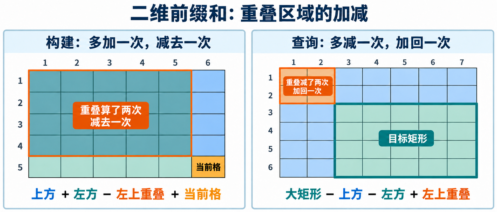

# 2.1 前缀和

**其他解与选型：** [CF 474B 的前缀边界＋二分、离线扫描与直接建表](09-summary-selection.md#2-同题多解cf-474b)，见本章总结。

## 1. 解决什么问题

给定一组**不再修改的数据**，反复询问某个连续区间的元素和。

每次从左到右累加，单次最坏 `O(n)`，`q` 次询问最坏 `O(nq)`。重复计算集中在区间重叠的部分。

> **先保存从起点到每个位置的累加结果，再用两个前缀相减，得到中间一段。**

一维前缀和预处理 `O(n)`，单次查询 `O(1)`，总时间 `O(n+q)`。

本节使用 C++11，统一采用 **1 下标、闭区间**。第 `0` 项留作空前缀。

```cpp
#include <iostream>
#include <vector>

using namespace std;
using ll = long long; // 累加结果通常比单个元素更大
```

## 2. 一维前缀和：状态与推导

定义 `s[i]` 为前 `i` 个元素的和，`s[0]=0`。

$$
s_i = \sum_{j=1}^{i} a_j, \qquad s_0=0
$$

从前一项延伸一步，只需加上当前元素：

$$
s_i=s_{i-1}+a_i
$$

对于闭区间 `[l,r]`，`s[r]` 包含前 `r` 项，其中前 `l-1` 项不属于目标区间，应减去：

$$
\mathrm{sum}(l,r)=s_r-s_{l-1}
$$

> **减的是 `s[l-1]`，不是 `s[l]`。** 前者恰好保留第 `l` 项。

例如：

| 下标 `i` | 0 | 1 | 2 | 3 | 4 | 5 |
| --- | --- | --- | --- | --- | --- | --- |
| `a[i]` | 留空 | 2 | -1 | 3 | 0 | 4 |
| `s[i]` | 0 | 2 | 1 | 4 | 4 | 8 |

区间 `[2,4]` 的和为 `s[4]-s[1]=4-2=2`，与 `-1+3+0` 一致。

**负数不影响公式成立。** 它只会使前缀和不再单调，不能因此直接对前缀和二分。

## 3. 一维实现

### 3.1 读入并构建

```cpp
int n;
cin >> n; // n >= 1，接下来输入 n 个整数

vector<ll> s(n + 1, 0); // s[0] 是空前缀；每组数据重新初始化

for (int i = 1; i <= n; ++i) {
    ll x;
    cin >> x;

    // 前 i 项 = 前 i-1 项 + 当前项。
    s[i] = s[i - 1] + x;
}
```

如果后续只查询区间和，不必再保存原数组；需要原值时，也可以由 `s[i]-s[i-1]` 恢复。

### 3.2 查询闭区间

```cpp
// 前提：1 <= l <= r < s.size()，且中间计算与结果均不溢出 ll。
ll rangeSum(const vector<ll>& s, int l, int r) {
    // 去掉目标区间左侧的整个前缀。
    return s[r] - s[l - 1];
}
```

当 `l=1` 时，减去 `s[0]=0`，无需另写分支。单个元素、整个数组也使用同一公式。

额外空间 `O(n)`；预处理 `O(n)`，每次查询 `O(1)`。

## 4. 二维前缀和：矩形的加减

一维保存“从起点到当前位置”，二维保存“从左上角到当前位置”。

令 `s[i][j]` 表示从 `(1,1)` 到 `(i,j)` 的矩形和；第 `0` 行、第 `0` 列全部为 `0`。



左图展示构建时的重叠区域；右图展示查询时被减去两次的左上区域。行号向下增加，列号向右增加。

### 4.1 构建：加两块，减重叠，再加当前格

$$
s_{i,j}=s_{i-1,j}+s_{i,j-1}-s_{i-1,j-1}+a_{i,j}
$$

上方矩形与左方矩形合起来覆盖目标区域，但左上部分被计算了两次，因此减去一次，再补上当前格。

```cpp
int n, m;
cin >> n >> m; // n、m >= 1，接下来按行输入矩阵

vector<vector<ll>> s(n + 1, vector<ll>(m + 1, 0));

for (int i = 1; i <= n; ++i) {
    for (int j = 1; j <= m; ++j) {
        ll x;
        cin >> x;

        // 上方 + 左方 - 重叠的左上方 + 当前格。
        s[i][j] = s[i - 1][j] + s[i][j - 1]
                - s[i - 1][j - 1] + x;
    }
}
```

### 4.2 查询：大矩形减两边，再补回重叠

查询左上角 `(x1,y1)`、右下角 `(x2,y2)` 的闭合矩形：

$$
\mathrm{sum}=s_{x_2,y_2}-s_{x_1-1,y_2}-s_{x_2,y_1-1}+s_{x_1-1,y_1-1}
$$

从大矩形中减去上方、左方的多余区域时，左上角被减了两次，应加回一次。

> **构建时重叠被多加，减一次；查询时重叠被多减，加一次。**

```cpp
// 前提：矩形非空，端点均在原矩阵内，x 表示行、y 表示列。
// 所有前缀及公式的中间计算都应在 ll 范围内。
ll rectangleSum(const vector<vector<ll>>& s,
                int x1, int y1, int x2, int y2) {
    // 大矩形 - 上方 - 左方 + 左上重叠部分。
    return s[x2][y2] - s[x1 - 1][y2]
         - s[x2][y1 - 1] + s[x1 - 1][y1 - 1];
}
```

例如矩阵两行为 `1 2 3`、`4 5 6`，矩形 `(1,2)` 到 `(2,3)` 的和为 `2+3+5+6=16`。

预处理时间与空间均为 `O(nm)`，单次查询 `O(1)`。二维数组占用明显更大，应先估算内存。

## 5. 如何识别与选型

题目线索通常是：**数据固定、查询很多、查询对象是连续区间或矩形**。

思考过程：重复累加 → 保存累计信息 → 利用减法消掉多余部分。

| 需求 | 处理方向 |
| --- | --- |
| 静态区间求和 | 一维前缀和 |
| 静态子矩阵求和 | 二维前缀和 |
| 区间内满足条件的元素个数 | 满足条件记为 `1`，否则记为 `0`，再累加 |
| 只求整个数组的一次总和 | 直接累加即可，无需保存全部前缀 |
| 修改与查询交替发生 | 普通前缀和不适合直接维护，后续考虑树状数组等工具 |

**前缀信息能够累计，不代表能够恢复任意中间区间。** 求和可以相减；前缀最大值不能靠两个最大值相减恢复区间最大值。

前后缀也能通过合并两侧摘要处理“排除一段”的问题，见 [前后缀分解](../../patterns/prefix-suffix-exclusion.md)。这里查询的是中间一段，依赖减法消去已有贡献。

## 6. 易错边界

- **下标统一**：本节全部采用 1 下标、闭区间；不混入 0 下标或半开区间的公式。
- **空前缀归零**：一维保留 `s[0]`；二维保留第 `0` 行、第 `0` 列，多测时重新初始化。
- **先估算累加范围**：单项能存进 `int`，总和不一定能。二维还要检查 `n × m × 最大绝对值`，以及加减的中间结果；`long long` 也有上限。
- **修改后会过期**：改变 `a[p]` 会影响从 `p` 开始的所有前缀，不能只改 `s[p]`。
- **二维行列别颠倒**：统一让 `x` 表示行、`y` 表示列；查询端点必须有序且不越界。

## 7. 典题与复盘

平台评测结果尚未记录，以下区分原实现与本地核验结果。

| 题目 | 收获 | 状态 |
| --- | --- | --- |
| [洛谷 P8218 — 求区间和](https://www.luogu.com.cn/problem/P8218) | 用累计信息消除重复计算，并用数据范围判断类型 | 复盘完成（本地核验） |
| [洛谷 P2004 — 领地选择](https://www.luogu.com.cn/problem/P2004) | 分离候选枚举与代价计算，从合法候选建立最优答案 | 原实现待修正；修正版已本地核验 |

### 7.1 P8218：原地构建前缀和

给定正整数序列，回答多个闭区间的和。`n,m <= 10^5`，`1 <= a[i] <= 10^4`。

**我的思路：** 读入第 `i` 项后，加上前一项的累计结果，直接把 `a[i]` 改存为前缀和；查询时相减。

#### 原实现

仅整理排版与注释，保留原逻辑。

```cpp
#include <bits/stdc++.h>

using namespace std;

using ll = long long;
using pii = pair<int, int>;
using pll = pair<ll, ll>;

void solve() {
    int n;
    cin >> n;

    vector<int> a(n + 1); // a[0] 初始化为 0，表示空前缀

    for (int i = 1; i <= n; ++i) {
        cin >> a[i];

        // 当前元素读入后，原地改存前 i 项的和。
        a[i] += a[i - 1];
    }

    int m;
    cin >> m;

    while (m--) {
        int l, r;
        cin >> l >> r;

        // 前 r 项减去前 l-1 项，保留闭区间 [l,r]。
        cout << a[r] - a[l - 1] << '\n';
    }
}

int main() {
#ifdef LOCAL
    freopen("input.txt", "r", stdin);
#endif

    ios::sync_with_stdio(false);
    cin.tie(nullptr);

    int T = 1;
    // cin >> T;

    while (T--) {
        solve();
    }

    return 0;
}
```

处理到第 `i` 项时，`a[i-1]` 已经是前 `i-1` 项之和；加上刚读入的值后，`a[i]` 正好成为前 `i` 项之和。这就是循环保持的不变量。

查询再减去区间左侧的整个前缀，留下 `[l,r]`。预处理 `O(n)`，每次查询 `O(1)`，总时间 `O(n+m)`，空间 `O(n)`。

#### 核验与完善

原实现通过本地边界与直接累加对照。最大总和为 `10^5 × 10^4 = 10^9`，在常见竞赛环境的 32 位 `int` 范围内，**本题无需强行改为 `long long`**；迁移到其他题时应重新估算。

原方案已合适，推荐沿用同一实现。可将数组名改为 `s` 或 `pre`，突出它已经保存累计值；这是可读性改进，不改变复杂度。

**如何想到：** 多次区间询问 → 逐次累加会重复访问元素 → 数据不修改 → 预存累计结果，用减法消去多余部分。

> **是否另存原数组，取决于后续是否需要它。** 本题原地覆盖即可，不必同时维护两份数组。

### 7.2 P2004：固定大小矩形的最优选择

在 `N×M` 地图中选择价值和最大的 `C×C` 正方形，输出其左上角。`N,M <= 1000`，`1 <= C <= min(N,M)`，地块价值绝对值不超过 `32767`，最优解唯一。

**我的思路：** 原地构建二维前缀和，枚举每个合法右下角，用四项加减求正方形价值，再更新最大值与左上角。

#### 原实现的问题：把 0 当成已有答案

原初始化为：

```cpp
ll maxx = 0;       // 错误：题目没有保证存在价值和为正的候选
int x = 0, y = 0; // 这也不是合法地图坐标
```

后续只在 `cur > maxx` 时更新。若所有候选都为负数，或唯一候选的价值为 `0`，答案就一直停留在 `(0,0)`。

最小反例：

```text
输入：
1 1 1
-5

原输出：0 0
正确输出：1 1
```

将 `-5` 改为 `0` 也会失败。问题出在**答案初始化**，前缀和与枚举公式本身正确。

> **求最大值时，不能默认 0 是合法下界。先用一个真实候选建立答案，再比较其他候选。**

#### 修正版

保留原枚举与求和逻辑。`g[c][c]` 就是左上角 `(1,1)`、右下角 `(c,c)` 的正方形价值，可直接作为初始答案。

```cpp
#include <bits/stdc++.h>

using namespace std;

using ll = long long;
using pii = pair<int, int>;
using pll = pair<ll, ll>;

ll g[1005][1005]; // 全局初始化为 0；第 0 行、第 0 列作为空前缀

void solve() {
    int n, m, c;
    cin >> n >> m >> c;

    for (int i = 1; i <= n; ++i)
        for (int j = 1; j <= m; ++j) {
            cin >> g[i][j];

            // 读入当前格后，原地改存左上矩形的和。
            g[i][j] += g[i - 1][j] + g[i][j - 1] - g[i - 1][j - 1];
        }

    // 用左上角为 (1,1) 的第一个合法正方形初始化。
    ll maxx = g[c][c];
    int x = 1, y = 1;

    // 枚举右下角：每个合法 c×c 正方形恰好出现一次。
    for (int i = c; i <= n; ++i)
        for (int j = c; j <= m; ++j) {
            // 大矩形减去上方、左方，再补回左上重叠。
            ll cur = g[i][j] - g[i - c][j]
                   - g[i][j - c] + g[i - c][j - c];

            if (cur > maxx) {
                maxx = cur;
                // 从右下角反推出左上角，注意闭区间长度。
                x = i - c + 1;
                y = j - c + 1;
            }
        }

    cout << x << ' ' << y << '\n';
}

int main() {
#ifdef LOCAL
    freopen("input.txt", "r", stdin);
#endif

    ios::sync_with_stdio(false);
    cin.tie(nullptr);

    int T = 1;
    // cin >> T;

    while (T--) {
        solve();
    }

    return 0;
}
```

#### 正确性与复杂度

右下角行号取 `c..n`、列号取 `c..m`，与所有合法 `c×c` 正方形一一对应；左上角为 `(i-c+1,j-c+1)`。

二维前缀和准确返回每个候选的价值。初始答案来自合法候选，之后每次保留已扫描候选中的最大者；全部扫描后得到全局最优。题目保证最优解唯一，使用严格 `>` 即可。

总时间 `O(nm)`。原实现的固定数组占用约 `8 MB`；若按输入尺寸分配，空间为 `O(nm)`。读入地图本身需要 `O(nm)`，当前时间复杂度已合适，无需换算法。

最大整张地图价值的绝对值可达 `1000 × 1000 × 32767 = 32,767,000,000`，因此二维累计结果应使用 `long long`。

#### 核验与进步空间

原实现已复现负数、零值反例；修正版通过本地小矩阵直接枚举对照与大范围累加边界，平台结果未记录。原实现仍标“待修正”，不将修正版追溯记为原 AC。

改进收益是让初始值与坐标从一开始就属于合法方案，覆盖非正数答案；时间、空间复杂度不变。

**如何想到：** 候选位置容易枚举 → 每个候选逐格求和会重复计算 → 二维前缀和让评价变为常数时间 → 从实际候选初始化，再维护最优值。

可迁移结论：**先分清“枚举哪些候选”和“如何快速评价候选”；最优值初始化要来自合法方案，或使用有依据的哨兵值。**

## 8. 自查

- 能从定义推导 `s[r]-s[l-1]`，解释 `s[0]` 的作用。
- 能说明二维构建和查询中，重叠部分为什么分别要减去、加回。
- 能正确处理负数、单点、整段及贴住矩阵边缘的查询。
- 能区分静态查询与动态修改，并估算数值范围和内存。
