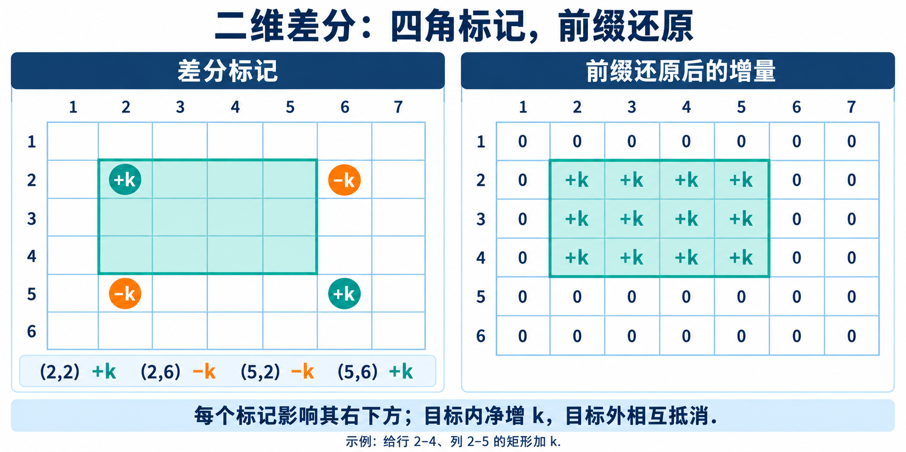

# 2.2 差分

## 1. 解决什么问题

对一个数组反复执行：给闭区间 `[l,r]` 中的每个元素加上 `k`，全部修改结束后再求最终结果。

逐项修改，单次最坏 `O(n)`；`q` 次修改最坏 `O(nq)`。

> **一段整体增加，只有入口和出口处的相邻差值发生变化。先记录这两个变化，最后统一还原。**

差分让单次区间加变为 `O(1)`，构建与最终还原各为 `O(n)`，总时间 `O(n+q)`。

本节使用 C++11，统一采用 **1 下标、闭区间**。前置知识见 [2.1 前缀和](01-prefix-sum.md)。

```cpp
#include <iostream>
#include <vector>

using namespace std;
using ll = long long; // 差值和多次修改的累计量也可能超过 int
```

## 2. 差分与前缀和互相还原

约定 `a[0]=0`，定义 `d[i]` 为当前项与前一项的差：

$$
d_i=a_i-a_{i-1}
$$

把前 `i` 个差值相加，中间项相互抵消，只剩 `a[i]`：

$$
a_i=\sum_{j=1}^{i}d_j
$$

例如：

| 下标 `i` | 1 | 2 | 3 | 4 | 5 |
| --- | --- | --- | --- | --- | --- |
| 原数组 `a[i]` | 2 | 5 | 5 | 1 | 4 |
| 差分 `d[i]` | 2 | 3 | 0 | -4 | 3 |

**差分可以为负数，即使原数组都是正数。** `d[4]=-4` 表示从第 3 项到第 4 项下降了 `4`。

前缀和保存累计结果，差分保存相邻变化；对差分求前缀和，就能恢复原数组。

## 3. 区间加：为什么只修改两处

给 `[l,r]` 每项加上 `k`：

- **入口 `l`**：当前项增加，前一项不变，差值增加 `k`。
- **区间内部**：相邻两项都增加 `k`，差值不变。
- **出口 `r+1`**：当前项不变，前一项增加，差值减少 `k`。

因此只需：

```cpp
// 对闭区间 [l,r] 加 k；k 可以为负数，表示区间减。
// d 至少有 n+2 项，前提为 1 <= l <= r <= n。
void addRange(vector<ll>& d, int l, int r, ll k) {
    d[l] += k;     // 从 l 开始，累计值多出 k
    d[r + 1] -= k; // 从 r+1 开始，取消这次增加
}
```

> **结束标记在 `r+1`，不是 `r`。** 第 `r` 项仍属于需要修改的区间。

在上例中给 `[2,4]` 加 `3`：

```text
原差分： 2   3   0  -4   3
标记：       +3          -3
新差分： 2   6   0  -4   0
还原后： 2   8   8   4   4
```

区间内部的变化不用逐项保存。不同操作的标记可以叠加，因为加法的贡献可以累加，操作之间不要求区间互不相交。

## 4. 一维实现：构建 → 修改 → 还原

### 4.1 读入并构建差分

```cpp
int n, q;
cin >> n >> q; // n >= 1；接下来输入 n 个初值与 q 次区间加

vector<ll> d(n + 2, 0); // 多留 n+1 位置，接收右端结束标记
ll previous = 0;       // 原数组的 a[0]=0

for (int i = 1; i <= n; ++i) {
    ll current;
    cin >> current;

    d[i] = current - previous; // 保存相邻两项的变化
    previous = current;       // 留给下一项计算差值
}
```

构建时只需前一个原值，不必另外保存整个原数组。

### 4.2 记录全部修改

```cpp
while (q--) {
    int l, r;
    ll k;
    cin >> l >> r >> k;

    addRange(d, l, r, k); // 此时 d 仍保存差分，尚未还原
}
```

### 4.3 统一还原最终数组

```cpp
for (int i = 1; i <= n; ++i) {
    // 前 i 个差值之和，就是修改后的第 i 项。
    d[i] += d[i - 1];
    cout << d[i] << (i == n ? '\n' : ' ');
}
```

此时 `d[1..n]` 已经变成最终数组。**不能继续把它当差分使用，也不能再次累加当作还原**；需要继续操作时应明确重建或换用合适的数据结构。

只还原到 `n`，不输出 `n+1` 的边界标记。总时间 `O(n+q)`，空间 `O(n)`。

## 5. 二维差分：用四个角限定矩形

二维中，给左上角 `(x1,y1)`、右下角 `(x2,y2)` 的闭合矩形每格加上 `k`。统一让 `x` 表示行、`y` 表示列。

**先考虑初始全为 `0` 的矩阵。** 二维差分数组也初始化为 `0`。

### 5.1 四个标记如何限制影响范围

还原时采用二维前缀累加，所以在某个位置加上 `k`，会影响该位置及其右下方的所有格子。



图中给行 `2..4`、列 `2..5` 的矩形加 `k`，取消标记写在下一行 `5`、下一列 `6`；左图是差分标记，右图是还原后的增量。

| 标记位置 | 增量 | 作用 |
| --- | --- | --- |
| `(x1,y1)` | `+k` | 开启右下方的影响 |
| `(x2+1,y1)` | `-k` | 从下一行起取消，挡住下方 |
| `(x1,y2+1)` | `-k` | 从下一列起取消，挡住右方 |
| `(x2+1,y2+1)` | `+k` | 右下方被取消两次，补回一次 |

目标矩形内只收到第一个标记，净增 `k`；右侧、下侧及右下方的净增量均为 `0`。

> **左上开启，下方与右方取消，右下补回重复取消。** 三个带 `+1` 的位置都在目标矩形外。

```cpp
// d 有 n+2 行、m+2 列；矩形非空且位于原矩阵内。
// x1 <= x2，y1 <= y2，k 可以为负数。
void addRectangle(vector<vector<ll>>& d,
                  int x1, int y1, int x2, int y2, ll k) {
    d[x1][y1] += k;         // 从左上角开启影响
    d[x2 + 1][y1] -= k;     // 越过下边界后取消
    d[x1][y2 + 1] -= k;     // 越过右边界后取消
    d[x2 + 1][y2 + 1] += k; // 补回右下方重复取消的部分
}
```

### 5.2 记录矩形加并还原

```cpp
int n, m, q;
cin >> n >> m >> q; // n、m >= 1；初始矩阵全为 0

vector<vector<ll>> d(n + 2, vector<ll>(m + 2, 0));

while (q--) {
    int x1, y1, x2, y2;
    ll k;
    cin >> x1 >> y1 >> x2 >> y2 >> k;

    addRectangle(d, x1, y1, x2, y2, k);
}

for (int i = 1; i <= n; ++i) {
    for (int j = 1; j <= m; ++j) {
        // 按行扫描：上方、左方已经还原，减去重复的左上方。
        d[i][j] += d[i - 1][j] + d[i][j - 1] - d[i - 1][j - 1];
        cout << d[i][j] << (j == m ? '\n' : ' ');
    }
}
```

`d[i][j]` 还原后就是该格最终值，**不是从左上角到该格的矩形和**。公式与二维前缀和相同，但这里被累加的是差分标记。

单次矩形加 `O(1)`，初始化与还原 `O(nm)`，总时间 `O(nm+q)`，空间 `O(nm)`。

### 5.3 初始矩阵不是全 0

> **原矩阵就是差分矩阵的二维前缀和。** 因此反求某个差分值时，只需对四个相邻前缀值作加减。

约定原矩阵 `a` 的第 `0` 行、第 `0` 列为 `0`，先构建：

$$
d_{i,j}=a_{i,j}-a_{i-1,j}-a_{i,j-1}+a_{i-1,j-1}
$$

之后仍采用相同的四角修改和二维还原。初始化时使用的是**原矩阵的值**，不能混入已经覆盖成差分的相邻项。

## 6. 与前缀和的选型区别

| 需求 | 常用处理 |
| --- | --- |
| 数据固定，多次询问区间和 | 前缀和 |
| 多次区间加，最后统一查看各项 | 差分 |
| 多次区间加，最后再多次求区间和 | 差分还原后，再对最终数组构建前缀和 |
| 每次修改后立即进行大量查询 | 普通差分需要反复还原，后续考虑树状数组或线段树 |

**普通差分处理的是区间加减。** 区间赋值、乘法、取最大值等操作，不能直接套用这两个或四个加减标记。

## 7. 易错边界

- **边界多开一格**：一维分配 `n+2` 项，二维分配 `(n+2)×(m+2)`，保证 `r+1`、`x2+1`、`y2+1` 可写。
- **负数属于正常情况**：差值、减法操作和结束标记都可能为负，应使用合适的有符号类型。
- **累计量也要估算**：初值、相邻差值、叠加标记和还原过程的中间结果都不能溢出；`long long` 也有上限。
- **原地还原会改变含义**：还原前是差分，还原后是实际值；不能混用两个阶段。
- **多测重新初始化**：包括第 `0` 行/列和额外的结束标记位置，不能残留上一组修改。
- **二维检查内存**：矩阵大小按元素总数计算，不因每次操作只改四处就认为空间为常数。

## 8. 典题与复盘

两题已完成本地核验与复盘，平台评测结果尚未记录。原实现只调整排版与注释，保留原逻辑。

| 题目 | 收获 | 状态 |
| --- | --- | --- |
| [洛谷 P2367 — 语文成绩](https://www.luogu.com.cn/problem/P2367) | 区分初始值与修改贡献，按后续需求压缩保存的信息 | 复盘完成（本地核验） |
| [洛谷 P3397 — 地毯](https://www.luogu.com.cn/problem/P3397) | 用少量边界标记描述整片影响，再统一还原 | 复盘完成（本地核验） |

### 8.1 P2367：初始成绩与修改增量分开维护

给多个学生区间增加分数，全部操作结束后求最低分。`n <= 5×10^6`，修改次数 `q <= n`，初始成绩和单次增加值均不超过 `100`。

**我的思路：** `score` 保存初始成绩；`dif` 从全 `0` 开始，只记录修改贡献的差分。先还原每个位置的累计增分，再加回原成绩并取最小值。

#### 原实现

```cpp
#include <bits/stdc++.h>

using namespace std;

using ll = long long;
using pii = pair<int, int>;
using pll = pair<ll, ll>;

void solve() {
    int n, q;
    cin >> n >> q;

    // 原成绩单独保存，dif 只记录后续增分的变化。
    vector<int> score(n + 1);
    for (int i = 1; i <= n; ++i) cin >> score[i];

    vector<int> dif(n + 2);
    while (q--) {
        int l, r, k;
        cin >> l >> r >> k;

        // 从 l 开始增加，到 r+1 取消。
        dif[l] += k;
        dif[r + 1] -= k;
    }

    int minn = INT_MAX;

    // 第一次扫描：还原每个位置累计增加了多少分。
    for (int i = 1; i <= n; ++i) {
        dif[i] += dif[i - 1];
    }

    // 第二次扫描：初始成绩加增量，再统计最低分。
    for (int i = 1; i <= n; ++i) {
        score[i] += dif[i];
        minn = min(minn, score[i]);
    }

    cout << minn << '\n';
}

int main() {
#ifdef LOCAL
    freopen("input.txt", "r", stdin);
#endif

    ios::sync_with_stdio(false);
    cin.tie(nullptr);

    int T = 1;
    // cin >> T;

    while (T--) {
        solve();
    }

    return 0;
}
```

这里的 `dif` 不需要用初始成绩构建，因为保存的是**增量的差分**。还原后 `dif[i]` 等于第 `i` 位收到的总增分，因此 `score[i]+dif[i]` 正好是最终成绩。

每次操作的贡献独立相加，两个边界标记确保只有 `[l,r]` 收到这次增分。遍历全部最终成绩取最小值，得到答案。

总时间 `O(n+q)`，空间 `O(n)`。按本题增分范围，最终成绩最多为 `100+100q <= 500,000,100`，32 位 `int` 足够；差分标记也在该类型范围内。

#### 改进实现：初值也放入差分

原方案正确。进一步观察：后续只需要最终成绩，不必一直保留原成绩数组。

> **把初始成绩也改存成差分，再叠加修改标记；一次还原就能得到最终成绩。**

还原到一个位置，就能立即更新最小值，无需另扫一遍。

```cpp
#include <bits/stdc++.h>

using namespace std;

using ll = long long;
using pii = pair<int, int>;
using pll = pair<ll, ll>;

void solve() {
    int n, q;
    cin >> n >> q;

    vector<int> dif(n + 2);
    int previous = 0;

    for (int i = 1; i <= n; ++i) {
        int current;
        cin >> current;

        // 初值也改存为差分，后续不再需要整份 score。
        dif[i] = current - previous;
        previous = current;
    }

    while (q--) {
        int l, r, k;
        cin >> l >> r >> k;

        dif[l] += k;
        dif[r + 1] -= k;
    }

    int minn = INT_MAX;

    for (int i = 1; i <= n; ++i) {
        // 还原的已经是最终成绩，可以立即更新最小值。
        dif[i] += dif[i - 1];
        minn = min(minn, dif[i]);
    }

    cout << minn << '\n';
}

int main() {
#ifdef LOCAL
    freopen("input.txt", "r", stdin);
#endif

    ios::sync_with_stdio(false);
    cin.tie(nullptr);

    int T = 1;
    // cin >> T;

    while (T--) {
        solve();
    }

    return 0;
}
```

| 比较项 | 原实现 | 改进实现 |
| --- | --- | --- |
| 保存内容 | 原成绩 + 修改增量的差分 | 最终成绩的差分 |
| 数组个数 | 两个 | 一个 |
| `n=5×10^6` 时数组内存 | 约 40 MB | 约 20 MB |
| 结束后的扫描 | 还原增量，再合并取最小值 | 还原并同时取最小值 |
| 总时间、空间阶数 | `O(n+q)`、`O(n)` | `O(n+q)`、`O(n)` |

内存比较按 4 字节 `int` 计算，仅统计数组。收益是减少一份数组和一次扫描；代价是原成绩不再直接保留，若后续需要原值，应重新考虑存储方式。

**如何想到：** 初始成绩与增量最终只会相加 → 二者都可用差分表达 → 先合并差分，最后一次还原。原实现、改进实现均通过本地逐项修改对照与最大 `n` 边界核验，平台结果未记录。

### 8.2 P3397：矩形覆盖次数

在 `n×n` 网格铺 `m` 张矩形地毯，输出每格的覆盖次数。`n,m <= 1000`；这里 `m` 是地毯数，不是矩阵列数。

**我的思路：** 每张地毯在二维差分中写入四角标记，全部输入后按行累加还原，边还原边输出。

#### 原实现

```cpp
#include <bits/stdc++.h>

using namespace std;

using ll = long long;
using pii = pair<int, int>;
using pll = pair<ll, ll>;

int d[1005][1005]; // 全局初始化为 0；额外空间接收 n+1 的边界标记

void add(int x1, int y1, int x2, int y2) {
    // 开启影响，并在右侧、下侧取消，补回右下的重复取消。
    ++d[x1][y1];
    --d[x1][y2 + 1];
    --d[x2 + 1][y1];
    ++d[x2 + 1][y2 + 1];
}

void solve() {
    int n, m;
    cin >> n >> m;

    while (m--) {
        int x1, y1, x2, y2;
        cin >> x1 >> y1 >> x2 >> y2;
        add(x1, y1, x2, y2);
    }

    for (int i = 1; i <= n; ++i) {
        for (int j = 1; j <= n; ++j) {
            // 二维前缀还原后，当前格就是覆盖次数。
            d[i][j] += d[i - 1][j] + d[i][j - 1] - d[i - 1][j - 1];

            cout << d[i][j] << ' ';
        }
        cout << '\n';
    }
}

int main() {
#ifdef LOCAL
    freopen("input.txt", "r", stdin);
#endif

    ios::sync_with_stdio(false);
    cin.tie(nullptr);

    int T = 1;
    // cin >> T;

    while (T--) {
        solve();
    }

    return 0;
}
```

#### 为什么成立

单张地毯的四角标记，还原后只让目标矩形内的格子增加 `1`。不同地毯的贡献相加，所以最后每格的值就是覆盖该格的地毯数。

按行从左到右扫描时，上方、左方与左上方都已还原，可直接用于计算当前格；无需保存另一张结果矩阵。

总时间 `O(m+n^2)`。原固定数组占用约 `4 MB`，按实际边长分配则空间为 `O(n^2)`。读取所有地毯与输出整张网格分别需要 `O(m)`、`O(n^2)`，当前时间复杂度已合适。

#### 完善与边界

原方案已合适，推荐沿用同一实现，补齐以下约束即可：

- 每格最多被 `m<=1000` 张地毯覆盖，标记与还原的中间量也远小于 32 位 `int` 上限。
- 最大结束标记写到 `n+1`，`1005×1005` 的数组足够；只还原和输出 `1..n`。
- 全局数组默认初始化为 `0`，本程序只有一组数据；若改成多测，必须先清空包括边界标记在内的状态。
- **还原后是覆盖次数，不是覆盖次数的矩形和。** 如果还要查询某个矩形的覆盖次数总和，应再构建一层前缀和。

原实现已通过本地逐格覆盖对照与 `n=m=1000` 的边界核验，平台结果未记录。

**如何想到：** 每张地毯影响连续矩形 → 逐格铺设会重复访问 → 用四角描述影响的开始与停止 → 最后一次前缀累加，同时完成输出。

## 9. 自查

- 能从相邻差值推导区间加只影响入口与出口。
- 能解释为什么结束标记在右端点的下一格。
- 能说明二维右下角为什么要补回一次，并正确处理贴边矩形。
- 能区分差分标记、最终值与最终值的前缀和。
- 能判断哪些问题适合最后统一还原，哪些问题需要动态维护。
