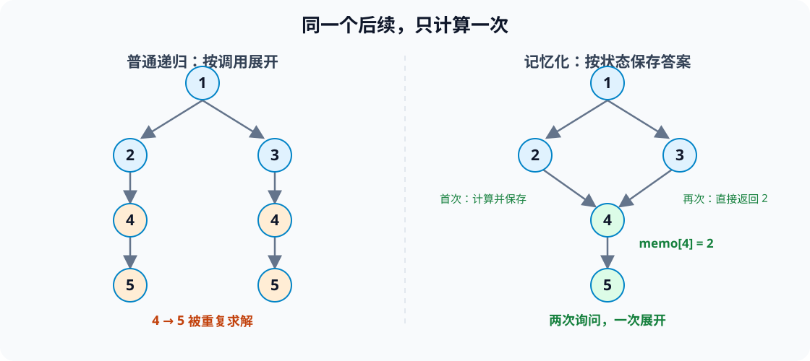
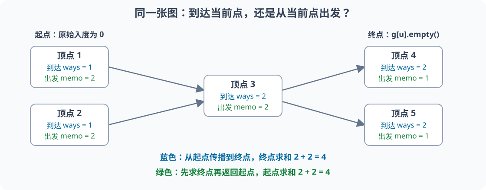

# 3.3 记忆化搜索：同一个子问题，只计算一次

前置：[DFS 与回溯](01-dfs-backtracking.md)、[DP 的状态与计算顺序](../05-dynamic-programming/01-dp-basics.md#5-与-dfs记忆化贪心的关系)、[DAG 与拓扑排序](../06-graph-and-tree/05-topological-sort.md#2-拓扑序到底满足什么)。

**递归负责展开需要的子问题，记忆化负责保存已经算完的答案。** **这是 DP 的一种实现方式**，不是给任意 DFS 加一个 `visited` 就能加速。

## 1. 从两条路线的共同后半段入手

考虑一个有向无环图，边表示可以继续前往的点。目标是：从指定点出发，最多经过多少个点。



普通递归先沿 `1 → 2 → 4 → 5` 计算，再沿 `1 → 3 → 4 → 5` 计算。第二次走到 `4` 时，又会重复求解同一段后续。

但从 `4` 出发，无论之前经过 `2` 还是 `3`，后面都只能走向 `5`：

$$
f(5)=1,\qquad f(4)=1+f(5)=2.
$$

**两个分支询问的是同一个答案，可以保存下来，第二次直接返回。**

这里保存的是“从当前位置出发，还能经过多少个点”，不包括到达当前位置之前已经走过的部分。

## 2. 为什么只用位置作为状态？

本节图和规则固定，后续能走哪些边只由当前点决定。又因为图没有有向环，不会绕回之前走过的点。

因此，**知道当前位置，就足以确定后续选择与答案**。

反过来，若走到同一格时，一条路线还剩一把钥匙，另一条没有，那么后续能否通过门就不同。只保存这个格子的答案会把两种情况混在一起，至少还需要记录钥匙状态。

上节迷宫统计简单路线时，已走过哪些格子也会影响下一步能否进入。**不能仅按坐标缓存答案**，更不能因此把所有路径枚举都改成位置 DP。

> **先判断哪些信息决定后续，再决定缓存的下标。** 同一个位置，不一定是同一个子问题。

## 3. 状态、转移与变量

### 状态句与转移

**`f(u)` 表示从点 `u` 出发，沿有向边前进，最多经过的点数，包括 `u` 本身。**

若 `u` 没有出边，只能停在当前点：

$$
f(u)=1.
$$

若下一步选择前往 `v`，后续最多经过 `f(v)` 个点，再加上当前点：

$$
\text{这条选择的总点数}=1+f(v).
$$

枚举所有下一步，取最大值；也允许在当前点停下：

$$
f(u)=\max\left(\{1\}\cup\{1+f(v):u\to v\}\right).
$$

**不是取第一个邻居的结果，而是等所有候选比较完，才得到 `u` 的最终答案。**

### 变量与容量依据

- `n`：有效顶点数量，编号为 **1-based：`1..n`**。
- `g`：邻接表，外层容量为 `n + 1`；`g[0]` 不使用。每个 `g[u]` 的内部下标仍从 `0` 开始，存储所有出边终点。
- `memo[u]`：`f(u)` 的缓存。分配 `n + 1` 项，容量按**顶点数量**确定，与编号以外的业务数值无关。
- `-1`：这个子问题**尚未算完、没有可复用答案**。本模型合法答案为 `1..n`，所以不会冲突；不是“不可达”。
- `best`：当前这次调用中，已经比较过的选择所能得到的最大点数，初值为 `1`。

本节使用无环前提，不另设“正在计算”标记。若递归再次遇到尚未完成的同一状态，缓存不能阻止循环；不能把这一实现直接用于有环依赖。

## 4. 执行流程：先询问，再保存

1. 进入 `dfs(u)`，若已有缓存，直接返回。
2. 否则从 `best = 1` 开始，依次询问每个邻居的答案。
3. 邻居若还没算过，递归继续深入；若已经算过，直接复用。
4. 所有选择比较完，才把 `best` 写入 `memo[u]`，然后返回。
5. 依次询问每个顶点，共享同一份缓存，得到每个起点的答案。

图中的计算过程：

| 阶段 | 得到的结果 | 缓存行为 |
| --- | --- | --- |
| 首次到达 `5` | 没有出边，答案为 `1` | 保存 `memo[5] = 1` |
| 返回 `4`、`2` | 答案依次为 `2`、`3` | 返回前分别保存 |
| 转向 `3`，再次询问 `4` | 直接得到 `2`，因此 `3` 的答案为 `3` | 不再展开 `4 → 5` |
| 返回 `1` | 两个分支都得到 `1 + 3 = 4` | 保存 `memo[1] = 4` |

最终按顶点 `1..5` 排列的答案是：

$$
[4,3,3,2,1].
$$

## 5. 通用实现：DAG 上的后续最长链

教学模型的前提是：**1-based 图、端点合法、没有有向环，且递归深度在调用栈承受范围内。** 代码不负责检测有向环。

沿用 [C++ 基础框架](../../templates/cpp-contest-template/README.md)。单独使用时需要 `<vector>`、`<functional>` 和 `<algorithm>`。

```cpp
// 返回 memo[u]：从 u 出发最多经过多少个点；下标 0 不使用
vector<int> longest_from(const vector<vector<int>>& g) {
    int n = static_cast<int>(g.size()) - 1;
    vector<int> memo(n + 1, -1);

    // 递归 lambda 用 std::function 声明类型，函数体才能调用 dfs 自身
    // 按引用捕获：本轮所有调用共享 g 和 memo，不复制缓存
    function<int(int)> dfs = [&](int u) -> int {
        if (memo[u] != -1) return memo[u];

        int best = 1; // 至少包含当前点；无出边时直接保留 1

        for (int v : g[u]) {
            best = max(best, dfs(v) + 1);
        }

        memo[u] = best; // 子问题全部比较完后，答案才可供其他调用复用
        return memo[u];
    };

    for (int u = 1; u <= n; ++u) {
        dfs(u); // 不同起点共享结果，不在这里重新初始化 memo
    }

    return memo;
}
```

`function<int(int)>` 表示“接收一个 `int`，返回一个 `int` 的可调用对象”。这里为 C++11 的递归 lambda 写法，不是要求以后每个 DFS 都写成 lambda；普通递归函数也可以保存同样的状态。

**一次完整调用重新创建缓存，适用于新的一张图。** 若图、限制或目标改变，旧缓存不能继续沿用。

### 为什么这样算正确？

没有出边的点，答案显然是 `1`。

对其他点，任何合法路线要么停下，要么先经过某条出边。每个下一步都被枚举，且其后续答案通过相同过程求得；取最大值便不会漏掉更优路线。

**无环保证依赖最终到达没有出边的点，递归可以结束。** 缓存只跳过已经完成的重复计算，不改变各次转移的结果。

### 为什么不是“每条路径都跑一遍”？

每个状态首次求解时扫描自己的出边；此后所有调用只读取缓存。令 `m` 为有向边数量：

$$
\text{总时间}=O(n+m).
$$

**所有点各求解一次，所有出边各扫描一次**；不能把“状态数”单独当作总复杂度，状态内部的枚举也要计入。

缓存占用 `O(n)`，递归栈最坏为 `O(n)`；图本身占用 `O(n+m)`。

**记忆化减少重复计算，不保证递归变浅。** 一条很长的链仍可能耗尽调用栈；深度很大时优先改成**拓扑递推**或**显式栈**，不依赖“时间线性”推断递归安全。

## 6. 与访问标记、拓扑 DP 的区别

### 已访问，不等于已有答案

| 方式 | 保存的含义 | 再次遇到时怎么处理 |
| --- | --- | --- |
| 遍历中的 `vis[u]` | 这个点已经发现 | 跳过重复遍历 |
| 路径回溯中的 `vis[u]` | 当前路径已经用了这个点 | 本条路径不再进入；退出时改回 `false` |
| 记忆化中的 `memo[u]` | 这个子问题已经求解完成 | **把保存的数值返回给调用者** |

**计数时尤其不能把“返回缓存”改成“见过就忽略”。** 不同前半段可以接上同一段后续，各次调用仍要把后续方案数计入；只是不再重新求这个数量。

若合法答案可以为 `0`，不能用 `if (memo[u])` 判断是否完成。可以选择不与答案冲突的哨兵，或另设 `done[u]`；详见 [合法零值与特殊状态](../05-dynamic-programming/01-dp-basics.md#61-标记先区分存在再比较数值)。

### 同一个 DP，可以有不同计算顺序

| 实现 | 由谁安排顺序 | 当前模型的处理方向 |
| --- | --- | --- |
| 记忆化 DFS | 当前问题递归询问所依赖的后续问题 | 先得到邻居答案，返回时算当前点 |
| 拓扑递推 | 显式排列无环依赖 | 按原图拓扑序的**逆序**，先算出边终点 |

本节求的是“**从 `u` 出发**的最长链”；[旅行计划](../06-graph-and-tree/05-topological-sort.md#103-两题共同揭示的建模分工)求的是“**到达 `v`**的最长链”。**两者分别看后续和前驱，不能不改状态句就交换转移方向**。

> **DFS 是计算顺序，DP 是状态与转移，记忆化是结果复用。** 记忆化本身不会自动找出正确状态，也不是枚举所有方案后统一去重。

## 7. 典题与复盘

### 7.1 洛谷 P1434：滑雪

题目：[P1434 [SHOI2002] 滑雪](https://www.luogu.com.cn/problem/P1434)。**状态：复盘完成；原实现本地核验通过，平台结果未单独提供。**

收录原因：**从递归调用中分清当前状态与子问题，让每层只计算自己负责的答案，再通过返回值组合结果。**

行列数均为 `1..100`，高度为 `0..10000`。每次只能走向上下左右严格更低的格子，求经过的最多格子数。

#### 如何识别成记忆化模型？

沿任意路线，高度严格下降：

$$
h_1>h_2>h_3>\cdots.
$$

因此不可能绕回原位置。把合法移动看作边，就是一张**隐式 DAG**，不必真的建立邻接表。

从同一格出发，无论之前从哪边来，后续可走的更低格子都相同。于是只需缓存：

$$
memo[x][y]=\text{从格子 }(x,y)\text{ 出发，最多经过的格子数，包含当前格子}.
$$

缓存按行列数分配；高度仅用于比较，不是缓存下标。严格下降也保证不会回到当前路径中的旧格子，因此无需另设路径访问数组。

#### 原实现：每个起点共享同一份缓存

保留原逻辑，仅调整排版和注释；通用框架不重复展示。

```cpp
int dx[] = {1, -1, 0, 0};
int dy[] = {0, 0, -1, 1};

int get_longest(vector<vector<int>>& g) {
    int n = static_cast<int>(g.size()) - 1;
    int m = static_cast<int>(g[0].size()) - 1;
    vector<vector<int>> memo(n + 1, vector<int>(m + 1, -1));

    function<int(int, int)> dfs = [&](int x, int y) -> int {
        if (memo[x][y] != -1)
            return memo[x][y];

        int best = 1; // 本次调用至少经过当前格子

        for (int i = 0; i < 4; ++i) {
            int nx = x + dx[i];
            int ny = y + dy[i];

            if (nx < 1 || nx > n || ny < 1 || ny > m)
                continue;

            if (g[nx][ny] >= g[x][y])
                continue;

            // 子调用已经算好从邻格出发的长度；再计入当前格子
            best = max(best, dfs(nx, ny) + 1);
        }

        // 当前层明确写入的是当前格子的缓存，随后返回这个数值
        return memo[x][y] = best;
    };

    int ans = 1;
    for (int i = 1; i <= n; ++i)
        for (int j = 1; j <= m; ++j)
            ans = max(ans, dfs(i, j));

    return ans;
}

void solve() {
    int n, m;
    cin >> n >> m;

    vector<vector<int>> g(n + 1, vector<int>(m + 1));
    for (int i = 1; i <= n; ++i)
        for (int j = 1; j <= m; ++j)
            cin >> g[i][j];

    cout << get_longest(g) << '\n';
}
```

行列都采用 **1-based**。`g[0]` 虽不表示有效行，但分配了同样的 `m + 1` 项，所以从它的长度获取列数成立。

#### 重点：不是替下一层写缓存，而是使用它的返回值

以连续下降的三个格子为例：

$$
9\to6\to2.
$$

最深层没有更低的邻格，只包含自己：

$$
f(2)=1.
$$

回到高度为 `6` 的那层，子调用已经返回 `1`，当前层再计入自己：

$$
f(6)=f(2)+1=2.
$$

再回到高度为 `9` 的那层，同样使用子问题的完整答案：

$$
f(9)=f(6)+1=3.
$$

**这里用高度标识例子中的三个格子，实际缓存仍按坐标存储。** 多个邻格时，每个返回值都是候选，取最大值后才得到当前答案。

> **当前调用负责“从当前状态出发”的答案，子调用负责“从子状态出发”的答案。** 当前层不需要替下一层另写缓存，也不把外层总答案塞进子问题。

“本层只写本层缓存”指的是**本层代码明确赋值的位置**；递归期间，子调用当然会分别填好自己的缓存。命中缓存的调用则直接返回，不再赋值。

`return memo[x][y] = best;` 分别完成：

1. 把 `best` 保存到 `memo[x][y]`。
2. 把保存的这个数值返回给调用者。

**`+1` 来自状态中“包含当前格子”的定义，不是因为调用了一次 DFS 就固定加一。** 不经过邻格也能停下，所以 `best` 从 `1` 开始。

#### 核验、复杂度与进步空间

每个格子计算一次、每次检查四个方向，时间为 `O(nm)`；缓存和最坏递归栈均为 `O(nm)`。等高格子不能移动，单格或全等高网格答案为 `1`。

原方案已经合适，无需额外制造另一份相同解法。可将参数改成 `const` 引用来表达只读意图，但不是正确性修复。

**记忆化不会缩短一条下降长链的调用深度。** 若环境栈空间不足，可以按高度安排递推，或用拓扑顺序计算；这是执行方式的取舍，不改变状态本身。

### 7.2 洛谷 P4017：最大食物链计数

题目：[P4017 最大食物链计数](https://www.luogu.com.cn/problem/P4017)。**状态：复盘完成；记忆化原实现与拓扑整理实现均本地核验通过，平台结果未单独提供。**

收录原因：**先从题意确定统计对象，再选择状态方向；同一张依赖图可以维护最优值，也可以维护方案数，计算顺序不能代替建模。**

关系 `u v` 表示 `u` 被 `v` 吃，建边 `u → v`。题目保证无环，顶点数不超过 `5000`，边数不超过 `500000`；答案对 `80112002` 取模。

“最大食物链”是题面定义的**从生产者到最终消费者的完整链**，不是只统计最长的链。

#### 题目线索 → 图模型 → 状态与转移

1. **关系有方向**：被吃的生物指向捕食者。
2. **链必须完整**：入度为 `0` 的点是起点，出度为 `0` 的点是终点。
3. **题目保证无环**：可以先算所依赖的状态，再组合当前答案。
4. **目标是条数**：不同合法分支应当累加，不能取最长长度的 `max`。

从当前点出发的状态定义为：

$$
memo[u]=\text{从 }u\text{ 出发，到任意合法终点的路径数量}.
$$

若没有后继，不需要再选任何边，停在这里就是一种完成方式：

$$
memo[u]=1\qquad\text{当 }g[u]\text{ 为空}.
$$

若仍有出边，完整路径必须选择其中一条作为下一步，再接上对应的后续路径：

$$
memo[u]=\sum_{v\in g[u]}memo[v]\pmod{80112002}.
$$

不同第一步分开统计，所以求和。**不能额外加 `1`：在非终点直接停下不是完整链。** 一条无分支长链，无论多长，都只有一条完整路径。

#### 原实现：从当前点向后询问

保留原逻辑，仅整理排版与注释。函数名 `get_mxcnt` 不改变其实际含义：统计完整链，不是最长链数量。

```cpp
const ll MOD = 80112002;

ll get_mxcnt(vector<vector<int>>& g) {
    int n = static_cast<int>(g.size()) - 1;
    vector<int> indeg(n + 1);

    for (int u = 1; u <= n; ++u)
        for (ll v : g[u])
            ++indeg[v];

    vector<int> s;
    for (int i = 1; i <= n; ++i)
        if (!indeg[i])
            s.push_back(i);

    // -1 为尚未计算；取模后的合法答案可能恰好为 0
    vector<ll> memo(n + 1, -1);

    function<ll(int)> dfs = [&](int u) -> ll {
        if (memo[u] != -1)
            return memo[u];

        if (g[u].empty())
            return memo[u] = 1;

        ll ways = 0;
        for (int v : g[u])
            ways = (ways + dfs(v)) % MOD;

        // 本层汇总所有后继，再保存从 u 出发的方案数
        return memo[u] = ways;
    };

    ll ans = 0;
    for (int u = 1; u <= n; ++u)
        if (indeg[u] == 0)
            ans = (ans + dfs(u)) % MOD;

    return ans;
}

void solve() {
    int n, m;
    cin >> n >> m;

    vector<vector<int>> g(n + 1);
    while (m--) {
        int u;
        ll v;
        cin >> u >> v;
        g[u].push_back(v);
    }

    cout << get_mxcnt(g) << '\n';
}
```

原稿的 `s` 收集了起点，但最后再次扫描入度，没有实际使用它。**可以删去 `s`，或改成遍历 `s` 汇总，二选一即可**，不是答案错误。

顶点编号和入度用 `int` 足够；原稿中的 `ll v` 在本题范围内转入 `vector<int>` 安全，但没有扩大编号类型的必要。路径数用 `ll` 并在每次累加后取模即可。

#### 一个小图，同时看清两种方向



图中起点为 `1、2`，两者都经过 `3`，再选择终点 `4` 或 `5`。

**记忆化状态看后续**，两个终点各提供一种完成方式：

$$
memo[4]=memo[5]=1,\qquad memo[3]=1+1=2.
$$

从起点 `1`、`2` 出发，都有两种后续选择：

$$
\text{答案}=memo[1]+memo[2]=2+2=4.
$$

第二次询问 `3` 时，仍要返回 `2`。**复用计算结果，不等于丢掉经另一个起点到达这里的两条完整链。**

#### 拓扑整理实现：从起点向后传递

这里换一个状态：**`ways[u]` 表示从任意合法起点到达 `u` 的路径数**，不是从 `u` 出发的后续条数。

起点各有一条只包含自身的初始路径：

$$
ways[s]=1\qquad\text{当 }s\text{ 的原始入度为 }0.
$$

沿真实边，把到达前驱的路径继续延伸：

$$
ways[v]\leftarrow\bigl(ways[v]+ways[u]\bigr)\bmod80112002.
$$

例图中两个起点的贡献在 `3` 汇合，再分别传给两个终点：

$$
ways[3]=1+1=2,\qquad ways[4]=ways[5]=2.
$$

最后只在终点汇总，得到同样的 `4` 条完整链。

以下以补充的拓扑写法为基础，**省去冗余的 `outdeg`，直接用 `g[u].empty()` 判断终点**。邻接表仍保留全部出边，拓扑过程中只递减入度，没有删除边。

```cpp
// 沿用上方 MOD；点编号为 1-based
void solve() {
    int n, m;
    cin >> n >> m;

    vector<vector<int>> g(n + 1);
    vector<int> indeg(n + 1);

    for (int i = 0; i < m; ++i) {
        int u, v;
        cin >> u >> v;
        g[u].push_back(v);
        ++indeg[v];
    }

    queue<int> q;
    vector<ll> ways(n + 1);

    for (int u = 1; u <= n; ++u) {
        if (indeg[u] == 0) {
            q.push(u);
            ways[u] = 1; // 每个合法起点提供一种初始路径
        }
    }

    while (!q.empty()) {
        int u = q.front();
        q.pop();

        for (int v : g[u]) {
            ways[v] = (ways[v] + ways[u]) % MOD;

            --indeg[v];
            if (indeg[v] == 0)
                q.push(v); // 所有前驱都贡献完，v 才能继续传播
        }
    }

    ll ans = 0;
    for (int u = 1; u <= n; ++u)
        if (g[u].empty())
            ans = (ans + ways[u]) % MOD;

    cout << ans << '\n';
}
```

**不能在最后用 `indeg[u] == 0` 找原始起点**：Kahn 算法已经修改了入度。终点可用未修改的邻接表判断，初始起点则应在处理前初始化或另存。

#### 两种状态不能混着用

| 对照项 | 记忆化 DFS | 拓扑递推 |
| --- | --- | --- |
| 状态方向 | 从当前点到任意终点 | 从任意起点到当前点 |
| 边界 | 终点答案为 `1` | 起点答案为 `1` |
| 计算方式 | 先递归取得后继答案，再相加 | 前驱把已有路径数累加给后继 |
| 最后答案 | 对所有起点求和 | 对所有终点求和 |

两者都统计同一批完整路径，但**中间数组的意义和数值不相同**。例图中 `memo[3]` 与 `ways[3]` 恰好都为 `2`，不代表它们是同一状态。

不能对所有顶点状态直接求和，否则连未完成的中间路径也被算入。孤立点同时没有前驱和后继，两种实现都会将它作为一条仅含自身的路径计入。

两种实现时间均为 `O(n+m)`，包含图存储的总空间为 `O(n+m)`。记忆化另需最坏 `O(n)` 调用栈；拓扑使用队列，**长依赖链时更稳妥**。这属于本题两种执行方式的比较，整章场景选型仍留到章末。

### 7.3 两题共同的建模顺序

| 先问什么 | 再决定什么 |
| --- | --- |
| 题目求最长长度，还是路径条数？ | `max` 比较候选，还是把互斥分支求和 |
| 状态表示“从这里出发”还是“到达这里”？ | 依赖后继还是前驱，初值放终点还是起点 |
| 每层返回的量包含什么？ | 长度是否加当前点；计数不能因走一步就加一 |
| 哪些点才代表完整答案？ | 对全部起点、全部终点或指定状态汇总 |

**先用完整一句话写清状态，再决定初值、转移和顺序。** 不能因为上一题的 DFS 求长度，就把下一题的目标也默认设成长短比较。

跨题识别与检查顺序统一补充到 [DAG DP 范式](../../patterns/06-graph-and-tree/dag-dp.md#7-从题意到答案的检查顺序)；本节保留两题完整过程与实现，不再独立建立重复范式。

## 8. 自查

1. 两条路线走到同一位置，什么时候能共用答案，什么时候还要增加状态信息？
2. 为什么缓存要等所有候选比较完再写入？若图有环，只靠 `-1` 能否结束递归？
3. 一个后续子问题被两条路线询问，为什么计数时仍要返回两次结果，而不能直接跳过第二次？

下一小节：[序列 DP：以当前位置结尾](../05-dynamic-programming/04-sequence-dp-lis.md)，继续练习“到达当前状态”的含义与前驱汇总。
