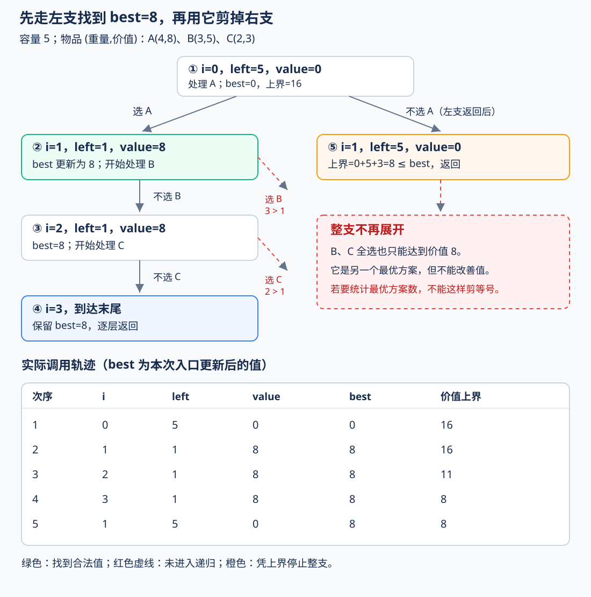
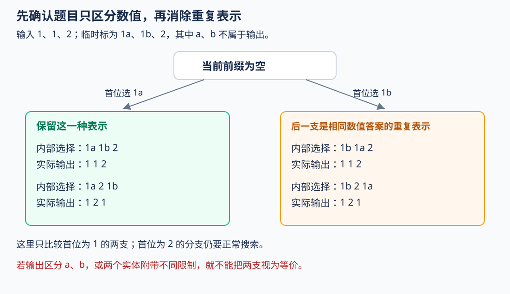
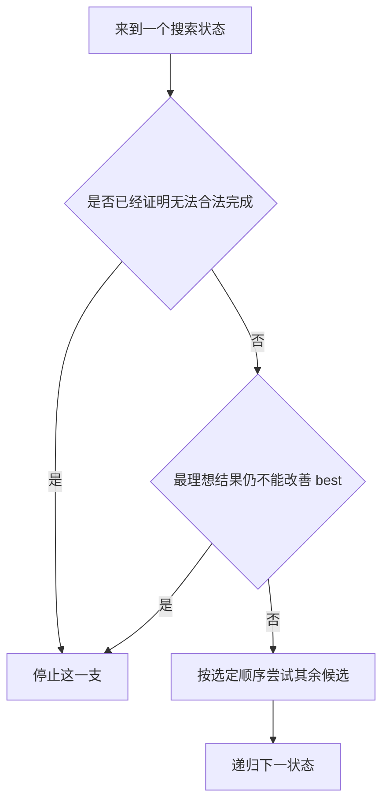
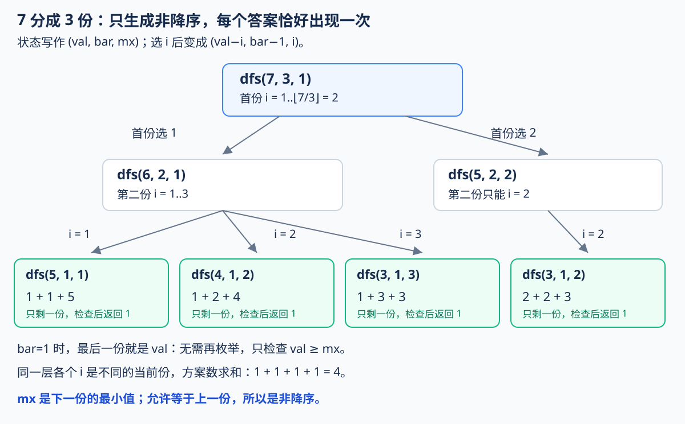
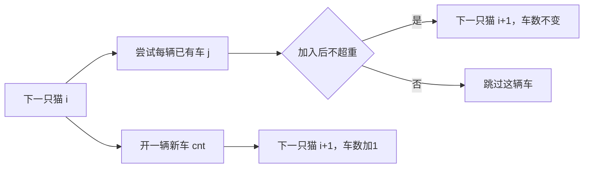
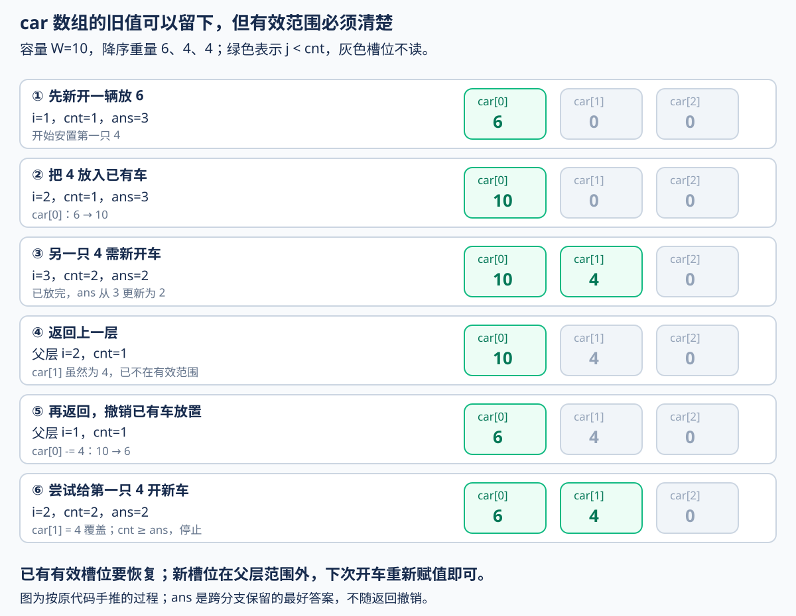

# 3.4 搜索剪枝：证明这一支不必再搜

## 1. 已经会 DFS，为什么还会超时

前置：[DFS 与回溯](01-dfs-backtracking.md)、[0/1 背包](../05-dynamic-programming/02-zero-one-knapsack.md)。[记忆化搜索](03-memoized-search.md)负责复用相同子问题，本节继续处理尚需枚举的分支。

**剪枝是在搜索途中，证明一整支已经没有继续搜索的必要。** 它可以**排除不可能合法的分支**，也可以**排除不可能改善答案的分支**；重复表示的等价方案则可只保留一种。

例如每件物品选或不选，n 件物品就有：

$$
2^n
$$

种选择。只在叶子检查重量和价值，前面已经超重、或者无论如何都追不上最好答案的分支，也会继续生成。

本节沿用“**总重量不超过 cap，最大化总价值**”的 0/1 模型。容量较小时可以用 DP；这里故意保留搜索树，观察如何提前停止无用探索。

## 2. 先看完整实现

每件物品的重量 `cost` 为正，价值 `value` 非负；允许不选、允许没有装满。物品用 0 下标，`cap` 非负；容量、单件重量及全部价值之和不超过 $10^{18}$。

沿用 [C++ 基础框架](../../templates/01-basic-problem-solving/cpp-contest-template/README.md)中的 `ll` 与标准库。

```cpp
struct KnapsackItem {
    long long cost, value;
};

// 每件物品最多选一次，容量为 cap，允许一件都不选。
// cost > 0，value >= 0；cap、cost、全部 value 之和均不超过 1e18。
// 适合物品数量较少的情况，最坏时间复杂度为 O(2^n)。
ll knapsack_bnb(const vector<KnapsackItem>& a, ll cap) {
    int n = (int)a.size();
    
    // ---- 1. 预处理：计算后缀价值和，作为 DFS 的乐观上界 ----
    // suffix[i]：从第 i 件物品到最后一件物品的价值总和。
    // 假设剩余物品全部选取，得到剩余部分能够提供的最大理论价值。
    // 这个上界暂时忽略背包容量限制，因此不会低估实际还能获得的价值。
    vector<ll> suffix(n + 1);

    for (int i = n - 1; i >= 0; --i)
        suffix[i] = suffix[i + 1] + a[i].value;

    ll best = 0; // 当前搜索过程中找到的最大合法价值，初始允许一件都不选。

    // ---- 2. DFS 搜索：对每件物品分别尝试选取或不选取 ----
    // i：当前处理的物品下标。
    // left：背包剩余容量。
    // value：当前已经选取的物品总价值。
    function<void(int, ll, ll)> dfs = [&](int i, ll left, ll value) {

        // 当前方案本身就是一个合法方案：
        // 即使后面的物品全部不选，也可以作为最终答案。
        // 因此在每个搜索节点都尝试更新全局最优值。
        best = max(best, value);

        // 所有物品均已处理，没有继续搜索的必要。
        if (i == n) return;

        // ---- 3. 上界剪枝：判断当前分支是否还有可能超过最优答案 ----
        // 当前价值为 value；
        // 剩余物品即使全部选取，最多还能获得 suffix[i] 的价值。
        // 因此该分支能够达到的理论最大价值为 value + suffix[i]。
        //
        // 如果这个上界仍然不超过 best，
        // 说明该分支无论怎么选择，都不可能产生更优答案，可以直接剪枝。
        if (value + suffix[i] <= best) return;

        // ---- 4. 分支搜索：选当前物品，或者不选当前物品 ----
        // 分支一：选取当前物品。
        // 只有剩余容量足够时，才允许进入这个分支。
        if (a[i].cost <= left)
            dfs(i + 1, left - a[i].cost, value + a[i].value);

        // 分支二：不选取当前物品。
        // 无论当前物品是否放得下，都必须保留这个选择。
        dfs(i + 1, left, value);
    };

    // 从第 0 件物品开始，初始容量为 cap，初始价值为 0。
    dfs(0, cap, 0);

    return best;
}
```

**用途速记：** 输入每件物品的重量、价值与容量上限，返回最多能获得的总价值。DFS 枚举选或不选，用重量条件排除非法选择，再用“当前价值＋剩余全部价值”排除不可能更好的分支；它返回最优值，不统计最优方案数。

竞赛实现见[搜索模板索引](../../templates/03-search/README.md)。这里保留的是**小规模 0/1 选择的具体实现**，不是把所有剪枝题装进同一个函数。

### 变量分别管理什么

| 变量 | 含义 | 如何变化 |
| --- | --- | --- |
| `i` | 前 i 件已经决定，接下来处理第 i 件 | 每层加 1 |
| `left` | 当前方案还剩多少容量 | 选当前物品时扣除重量 |
| `value` | 当前已经选中物品的总价值 | 选当前物品时累加价值 |
| `suffix[i]` | 第 i 件到末尾的全部价值之和 | 搜索前一次算好 |
| `best` | **已经实际找到的合法方案**中的最大价值 | 跨分支保留，只增不减 |

三个递归参数按值传入，各分支互不修改，因此没有撤销操作；`best` 记录全局进展，返回时也不能恢复成旧值。

## 3. 跟着同一个例子，看哪些分支被跳过

容量为 5，依次处理三件物品：

| 物品 | 重量 | 价值 |
| --- | --- | --- |
| A | 4 | 8 |
| B | 3 | 5 |
| C | 2 | 3 |

对应的后缀价值为：

$$
\mathrm{suffix}=[16,8,3,0].
$$



图中编号是实际调用顺序；红色虚线表示**没有进入递归的分支**。

先选 A 后，`left=1`、`value=8`，于是 `best` 更新为 8。B、C 都放不下，各自的“选”分支直接跳过；“不选”分支仍继续。

回到根节点尝试不选 A，此时还有 B、C：

$$
\text{当前价值}+\text{剩余全部价值}=0+5+3=8.
$$

即使把 B、C 全拿到，也只能达到已经找到的 8，不能改善最优值，于是它们下面的整棵子树都不再展开。

**B、C 一起选也是一个最优方案。** 本函数只求最优值，所以可以跳过；若题目要求统计全部最优方案，这个等号就不能直接照搬。

## 4. 可行性剪枝：后面再选也修复不了

对应代码：

```cpp
if (a[i].cost <= left)
    dfs(i + 1, left - a[i].cost, value + a[i].value);
dfs(i + 1, left, value);
```

**装不下当前物品，只排除“选它”，不能连“不选它”也一起返回。**

例如当前还剩 3 的容量，接下来物品重量依次为 4、2。第一件不能选，但跳过它后仍能选第二件。

为什么提前检查不会漏解？设当前总重量为 W，容量为 cap，当前物品重量为 c：

$$
W+c\gt \mathrm{cap}.
$$

再加入的重量都为正，总重量只会增加：

$$
W+c+\text{后续重量}\gt \mathrm{cap}.
$$

因此这次选择一旦超重，后面无法修复。若规则允许后续加入负重量，就不能使用同一证明。

还没违规，也可能已经无法完成任务。例如要求最后**恰好达到总量 T**，当前为 s，剩余最多能补 R：

$$
s+R\lt T.
$$

即使全补上也不够，可以直接停止。T、s、R 分别是目标、当前量、剩余可补量；**这条判断属于恰好／至少达到的模型，本节“至多容量”代码无需补满。**

## 5. 最优性剪枝：最理想的结果也不够好

对应代码：

```cpp
best = max(best, value);
if (i == n || value + suffix[i] <= best) return;
```

### 先有真实答案，再比较理想上限

`best` 不能随便设成一个很大的数。这里空集合法，初值为 0；进入任意状态后，剩余物品全不选也合法，因此可以立即用 `value` 更新它。

若题目要求恰好装满、恰好选 m 件，当前选择未必已经合法，**就不能在每层直接更新答案**。需要先判断完整方案，并用单独标志或哨兵区分“还没找到解”与“合法答案是 0”。

接着考虑这条分支最终可能得到的价值。因为价值非负，选中的剩余物品总价值一定不超过剩余全部价值：

$$
\text{这条分支的任意最终价值}
\le \mathrm{value}+\mathrm{suffix}[i].
$$

右侧暂时忽略了容量限制，可能根本拿不到，但它仍是一个**不会低估的上界**。

若连这个上界都不超过已有答案：

$$
\mathrm{value}+\mathrm{suffix}[i]\le \mathrm{best},
$$

这条分支就不可能改善结果，可以返回。上界很松只会少剪；**上界估小了可能把真正最优解剪掉。**

### 最大值看上界，最小值看下界

| 目标 | 要证明的界 | 只求最优值时，何时可剪 |
| --- | --- | --- |
| 最大化 | 最终结果不会超过 U | $U\le\mathrm{best}$ |
| 最小化 | 最终结果不会低于 L | $L\ge\mathrm{best}$ |

U、L 分别表示这条分支最终结果的上界、下界；`best` 始终来自已找到的合法完整方案。最小化时，若后续代价都非负，当前已花代价就是一个下界；有负代价时不能这样推。

**不能把贪心找到的一个结果当成上界。** 容量为 5，三件物品为 `(4,8)、(3,7)、(2,6)`，按给定顺序能装就装只得到 8，但后两件可得到 13。这个 8 是一个可行结果，不是“最多只能到 8”的证明。

### 整棵树中最优解为什么不会丢

任意被剪掉的分支，都已经证明其中的所有方案不会改善当时的 `best`；而 `best` 来自真实合法方案，之后只会变得更好。

所以，**搜索结束时保留的最优值不会因这些剪枝而变小**。这与只凭“看起来希望不大”就不搜，有本质区别。

## 6. 等价分支：不同编号是否只是重复表示

本节主代码没有按相同数值去重：即使重量、价值相同，两件物品仍可分别选入。下面另看“输出互不重复的数值排列”。

输入 `1、1、2`，为了区分两个实体，临时把两个 1 标成 `1a、1b`；**a、b 只是识别标记，不属于输出**。



以 `1a` 开头和以 `1b` 开头的两棵子树，输出的数值排列完全相同。只保留前一种表示，就没有丢掉新的数值答案。

常用实现是先排序，在同一层枚举候选时，跳过会重复产生同一类分支的相同值。**要证明的是两支的后续选择一一对应，而不只是当前值恰好相同。**

若题目区分实体编号、相同值还带有不同限制，或者要求统计有编号的方案数，就不能这样跳过。对于“从多件相同物品中选若干件”，也不能直接删到只剩一件；多次使用的数量仍要表达。

这与 [3.1 递增生成组合](01-dfs-backtracking.md)一致：先为每个答案选一种统一表示，再只搜索这种表示。

## 7. 调顺序、剪枝、记忆化，分别减少什么



| 方法 | 作用 | 必须核对 |
| --- | --- | --- |
| 调整搜索顺序 | 更早找到好方案，或更早暴露冲突 | 没有据此擅自删除其他候选 |
| 可行性／最优性剪枝 | 跳过无用的整支搜索 | 为什么后续无法修复或改善 |
| 等价分支去重 | 每种答案只保留一个表示 | 题目是否真的把它们视为同一方案 |
| 记忆化 | 相同的完整子问题只计算一次 | 状态、缓存值及计算完成时机 |

本代码先尝试选，再尝试不选，只是固定一种访问顺序；反过来也正确，实际速度可能不同。排序也不一定总会加速，**先看它能帮助哪一种剪枝，再决定排序依据**。

已有范式的[剪枝与缓存对照](../../patterns/05-dynamic-programming/memoization-vs-tabulation.md#剪枝停止探索不等于已经算完子问题)强调另一个坑：**因为追不上 best 而返回，不代表当前子问题的精确答案已经计算完成，不能把这个返回值当作完整答案缓存。**

## 8. 瓶颈、复杂度与适用规模

未剪枝的二叉选择树最多有：

$$
1+2+\cdots+2^n=2^{n+1}-1
$$

个调用节点。本代码的后缀和预处理为 $O(n)$，每次调用只作常数次检查，总时间最坏仍为 $O(2^n)$；后缀数组与递归栈各占 $O(n)$。

| 物品数 n | 叶子方案数 $2^n$ | 未剪枝时的含义 |
| --- | --- | --- |
| 20 | 1,048,576 | 约百万种完整选择 |
| 25 | 33,554,432 | 已有三千多万种，不能忽略常数与时限 |
| 30 | 1,073,741,824 | 已到十亿级，不能只寄希望于剪枝 |

这些是**二叉选／不选**模型的规模，不是所有 DFS 的复杂度。例如一层可选择多个容器时，分支数要重新估算。

本例从 15 个朴素调用节点缩到 5 次实际调用，是因为这组输入很容易找到有用的界。**这个例子的收益不等于所有输入都能缩到同样大小。**

| 题目条件 | 更值得考虑 |
| --- | --- |
| 容量较小，$O(n\cdot\mathrm{cap})$ 可接受 | [0/1 背包 DP](../05-dynamic-programming/02-zero-one-knapsack.md) |
| 物品数少、容量很大，又能写出有效的界 | 搜索＋剪枝，仍按最坏规模评估 |
| 多条历史进入相同后续问题，状态数可控 | [记忆化搜索](03-memoized-search.md)或数组递推 |

剪枝针对的是“少展开分支”，没有把指数级搜索自动变成多项式算法；容量很大时，本实现的内存不随容量增长，但时间仍受物品数控制。

## 9. 典题与复盘

两题原实现均保留原有逻辑，只整理排版和注释。本轮按题意静态复盘，未重新编译、运行或对拍个人代码；平台结果未单独记录。

### 9.1 P1025：数的划分

[洛谷 P1025：数的划分](https://www.luogu.com.cn/problem/P1025)。将 n 分成 k 个正整数，顺序不同但各份相同的方案只算一次。范围为 $6\lt n\le200$、$2\le k\le6$。

#### 原实现：把同一个方案固定为非降序

```cpp
int dfs(int val, int bar, int mx) {
    if (bar == 1)
        return val >= mx ? 1 : 0;
    if (val < bar * mx)
        return 0;

    int cnt = 0;
    for (int i = mx; i <= val / bar; ++i)
        cnt += dfs(val - i, bar - 1, i);

    return cnt;
}

void solve() {
    int n, k;
    cin >> n >> k;

    cout << dfs(n, k, 1) << '\n';
}
```

**用途速记：** `dfs(val,bar,mx)` 返回：把剩余总量 val 分成 bar 个正整数，每份至少为 mx，并按非降序生成时的方案数。每选定一份，就扣掉它的量，把它作为下一份的下界。

| 参数 | 准确含义 |
| --- | --- |
| `val` | 还没分配的总量 |
| `bar` | **还剩几份**，不是隔板数量 |
| `mx` | **下一份最少取多少**；等于已选各份中的最大值，初始用 1 表示每份非空 |

`mx` 可以理解为“前面已经选出的最大一份”，但它对下一层起的是**下界**作用。若另起新实现，`low` 或 `last` 更直观；原实现继续保留命名。

#### 从隔板法联想到顺序，再消除重复

把球分组，会自然联想到隔板法。但正整数隔板法计算的是**有顺序的 k 份**：

$$
\binom{n-1}{k-1}.
$$

本题把 `1,1,5`、`1,5,1`、`5,1,1` 视为同一种分法，不能直接使用这个结果。也不能统一除以 $k!$：前一组只对应 3 个不同排列，而 `1,2,4` 对应 6 个。

换一个方向：**每个无序分法，都唯一对应它排好序后的样子。** 因此只生成：

$$
x_1\le x_2\le\cdots\le x_k.
$$

这里是**非降序**，相邻份可以相等；若强制严格递增，就会漏掉 `1,1,5` 这样的合法答案。

#### 下界、上界与终止条件都围绕同一状态



当前选这一份为 i，前面最大的一份为 mx，所以循环从：

$$
i\ge\mathrm{mx}
$$

开始。选完以后还剩 `bar-1` 份，每份都不能小于 i，所以至少要保留：

$$
\mathrm{val}-i\ge(\mathrm{bar}-1)i.
$$

把当前这一份也算进来：

$$
\mathrm{val}\ge\mathrm{bar}\cdot i.
$$

于是循环到下面的位置即可结束：

$$
i\le\left\lfloor\frac{\mathrm{val}}{\mathrm{bar}}\right\rfloor.
$$

这正是 `for` 的起点与终点。任何合法非降序分法的下一份都落在这个范围内，所以没有漏掉候选；不同分支的当前份不同，又避免了重复。选完之后：

$$
(\mathrm{val},\mathrm{bar},\mathrm{mx})
\longrightarrow
(\mathrm{val}-i,\mathrm{bar}-1,i).
$$

**扣掉本份、少分一份、提高后续下界**，三件事分别对应三个实参。

入口判断也使用同一依据。每份最少为 mx，若：

$$
\mathrm{val}\lt\mathrm{bar}\cdot\mathrm{mx},
$$

则连最小要求都不够，返回 0。当前循环上界已经保证递归下去的状态满足相应下界；这条入口检查也覆盖直接传入不够分的状态，并非每层都会实际触发。

最后只剩一份时，它的数值已被剩余总量完全确定：

$$
\mathrm{bar}=1
\quad\Longrightarrow\quad
\text{最后一份}=\mathrm{val}.
$$

只需检查 `val>=mx`，合法就贡献 1，不能再循环枚举。不同 i 代表当前份不同、对应不同的非降序方案，因此各分支返回值**求和**。

#### 为什么需要保留 mx

同样剩余总量为 6、剩 2 份，下界为 1 时可分为 `1+5、2+4、3+3`；下界为 3 时只剩 `3+3`。

所以按这份搜索的定义，**只记录 val 与 bar，不足以确定后续问题**，还要知道已选部分给下一份留下了什么限制。若以后加记忆化，不能漏掉 mx；换一种 DP 建模则需重新定义状态。

搜索深度为 k，最后一份直接确定，粗略上界可写为 $O(n^{k-1})$ 时间、$O(k)$ 调用栈；非降序与平均值上界会减少实际分支；这是搜索树的估算，不是记忆化后的“状态数 × 转移数”。推广到更大范围时，还要重新评估计数和 `bar*mx` 的类型。

**收获：先为每个答案规定唯一表示，再让参数、枚举范围和结束条件共同维护它。**

### 9.2 P10483：小猫爬山与一维装箱

[洛谷 P10483：小猫爬山](https://www.luogu.com.cn/problem/P10483)。每只猫必须完整分给一辆车，每车总重不超过 W，求最少车辆数；$N\le18$，重量与容量均不超过 $10^8$。

这就是**一维装箱问题**：对象只有重量这一种资源需求，箱子容量相同，全部对象都必须安置，最小化箱子数。[OR-Tools 的模型说明](https://developers.google.com/optimization/pack/bin_packing)也按这三个条件区分装箱与背包；这里只学习小规模精确搜索，不引入求解器。

#### 原实现：依次决定每只猫放在哪辆车

```cpp
int n, W;
int ans;
vector<int> w, car;

// 考虑放第 i 只猫，已经使用 cnt 个缆车。
void dfs(int i, int cnt) {
    if (cnt >= ans)
        return;

    if (i == n) {
        ans = cnt;
        return;
    }

    // 尝试放入已有缆车。
    for (int j = 0; j < cnt; ++j) {
        if (car[j] + w[i] > W)
            continue;

        car[j] += w[i];
        dfs(i + 1, cnt);
        car[j] -= w[i]; // 撤销本次放置，再尝试别的可放入缆车。
    }

    car[cnt] = w[i]; // 猫放入新缆车。
    dfs(i + 1, cnt + 1);
}

void solve() {
    cin >> n >> W;
    w.resize(n);
    car.resize(n);
    for (int& x : w)
        cin >> x;
    sort(w.rbegin(), w.rend());

    ans = n;
    dfs(0, 0);
    cout << ans << '\n';
}
```

**用途速记：** 已有车逐一试放，放不下就跳过；另开一辆车作为额外选择。`car[0..cnt-1]` 保存当前已开车辆的载重，`ans` 保存已知可行方案的最少车数；每次把下一只猫安置后继续递归。

这里 `ans=n` 以**每只猫都能独自乘车**为可行前提：一猫一车就给出了真实上界。原题页面没有另列单件重量不超过容量的保证；通用模板对此显式检查并返回失败，不悄悄改变原题实现。

#### 如何从题意想到这个搜索

单个背包通常问“选哪些”，可以不选部分物品；这道题**每只都要放进去**，选择变成“放到哪辆车”。

把一轮工作固定为“安置一只猫”，便得到两类完整选择：



| 信息 | 表示什么 | 为什么需要 |
| --- | --- | --- |
| `i` | 前 i 只已经安置，接下来放第 i 只 | 确定还剩哪些对象 |
| `cnt` | 已经开出的车数 | 决定可选容器范围与当前代价 |
| `car[0..cnt-1]` | 每辆已有车当前载重 | 判断下一只分别能放到哪里 |
| `ans` | 已找到的最好完整方案的车数 | 给当前分支提供比较标准 |

**函数参数只有 i、cnt，不代表完整状态只有这两个数。** `car` 是共享状态，也属于当前搜索配置；仅按 `(i,cnt)` 缓存会混淆不同的剩余容量分布。

#### 两种剪枝与一种搜索顺序

`car[j]+w[i]>W`：这次放法立即违反容量，只跳过这一辆车，其他车和新车仍可尝试。

`cnt>=ans`：当前已经用了 cnt 辆车，后续只会保留或增加车数，不会减少：

$$
\text{这条分支最终车数}\ge\mathrm{cnt}\ge\mathrm{ans}.
$$

因此不可能找到更小值，可以整支停止。这个判断写在终点之前也正确：即使恰好放完，但车数与已有答案相等，也无需再更新。

`sort(w.rbegin(),w.rend())`：先处理较重的猫，通常更早遇到容量冲突；先试已有车，再开新车，也有助于早些找到少用车的方案。**这两项只改变搜索顺序，原实现仍保留其余放法，不依赖贪心正确性。**

反例：容量 10，重量依次为 `6、5、3、2、2、2`。若按降序“放到第一辆能放的车”且不回头，得到：

$$
(6+3),\quad(5+2+2),\quad(2).
$$

用了 3 辆；但存在：

$$
(6+2+2),\quad(5+3+2),
$$

只用 2 辆。搜索必须允许改掉先前的局部安排。

#### 为什么只开一辆新车，不枚举所有空车

未启用的车完全相同，编号没有特殊意义。放到空车 2 或空车 3，只是给同一个安排换了箱子标签。

因此约定：**每次开新车都使用紧接当前末尾的编号 cnt。** 任意最终分组，都能按“第一次放入猫”的先后给车重新编号，不改变容量与车数，所以不会漏掉最优安排。

已有车若当前载重相同，放入其中任何一辆也会得到等价的后续配置；可以在同一层按载重去重。但原实现没有加这一层优化，**属于可再减少的重复搜索，不是正确性缺陷**。通用主模板保持同一基本结构，不为此额外维护去重容器。

#### 哪些要撤销，哪些只需覆盖

下面按原代码手推，容量 10、重量 `6、4、4`：



| 变量或操作 | 返回后如何处理 | 原因 |
| --- | --- | --- |
| `car[j] += w[i]` | 必须减回 `w[i]` | j 属于当前有效车辆，下一次试放应从原载重开始 |
| `car[cnt] = w[i]` | 此处不必清零 | 返回后父层有效范围仍是 `[0,cnt)`，这个槽位已在范围外；再次开车会重新赋值 |
| `i`、`cnt` | 不用手动减一 | 按值传参，子层不会修改父层参数 |
| `ans` | 保留更好的值 | 跨分支共享搜索成果，不能恢复旧答案 |

**数组里有旧值，不等于它属于当前状态。** 原实现用 cnt 标明有效前缀，循环只读 `j<cnt`；若后续逻辑改为扫描整张 car，或者开车时从赋值改成累加，就要重新检查恢复方式。

这也解释了多次调用时 `car.resize(n)` 未必清空旧值，但本逻辑仍能工作：每个槽位进入有效范围前，都会由 `car[cnt]=w[i]` 覆盖。

#### 规模、类型与可迁移模型

处理了 i 只时，最多已有 i 辆车，下一步最多 i+1 个选择；忽略剪枝，可用 $O(n!)$ 作粗略时间上界，已有车扫描也计入逐层开销。额外数组与调用栈均为 $O(n)$。**阶乘上界很大，实际速度依赖容量、对象大小、搜索顺序与剪枝，不能直接写成 $O(2^n)$。**

当前范围下，一次容量检查中 `car[j]+w[i]` 不超过 $2\cdot10^8$，原 int 表达式足够；推广到更大容量时，载重和重量应一起提升类型。

与 [P1094 纪念品分组](../04-greedy-and-construction/01-sorting-greedy.md#洛谷-p1094--纪念品分组)的差别是：那里每组至多两件，可用轻重配对；这里每辆能装多只，不能直接照搬同一贪心。

本题推荐先保留原搜索：状态含义、回溯与基本剪枝已完整。通用接口另整理为[小规模一维装箱模板](../../templates/03-search/bin-packing/README.md)，独立检查单件超重、输入只读与多测局部清理。

### 9.3 两题共同的思考线索

**先确定一层决定什么，再保留下一层判断合法性所需的信息。**

| 问题 | 本层决定什么 | 额外保留什么 | 怎样避免重复表示 |
| --- | --- | --- | --- |
| 数的划分 | 下一份取多少 | 下一份下界 mx | 只生成非降序 |
| 小猫爬山 | 下一只放在哪辆 | 已有车辆的载重与有效个数 | 新车按首次使用顺序编号 |

第一题不是直接套隔板公式，第二题也不是把已有背包代码换一个最值方向。共同点在于：**先把完整答案拆成确定的一串决策，再用参数和共享容器表达限制，并证明哪些重复表示可以不搜。**

装箱的可迁移识别与检查顺序独立整理在[逐个对象分配容器](../../patterns/03-search/object-to-container-search.md)；本节保留两题的个人实现、推导与回溯细节。

## 10. 衔接与参考

本节先建立剪枝判断的依据；双向 BFS、迭代加深与启发式搜索继续按前置补充，不在这里提前展开。

分类参考 [OI Wiki：搜索优化](https://oi-wiki.org/search/opt/)中的可行性、最优性与重复子问题讨论；具体模型、上界证明、代码及图解按本节约定自行整理。配题范围以对应洛谷原题为准。

[返回搜索索引](README.md)
