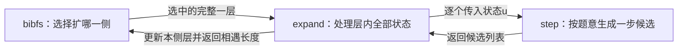
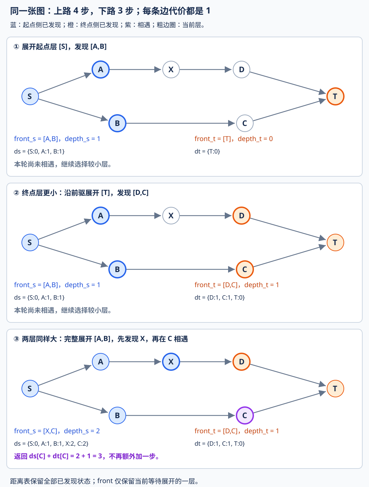
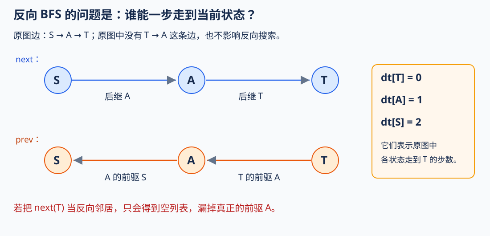
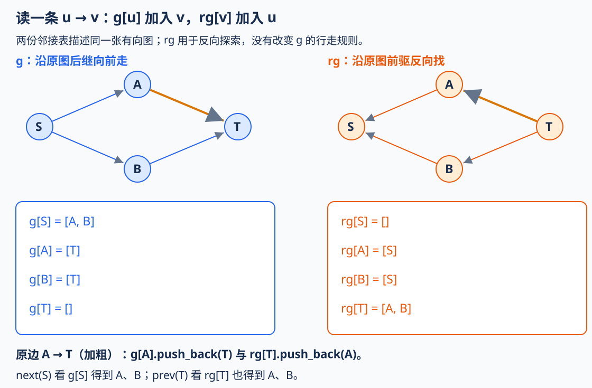
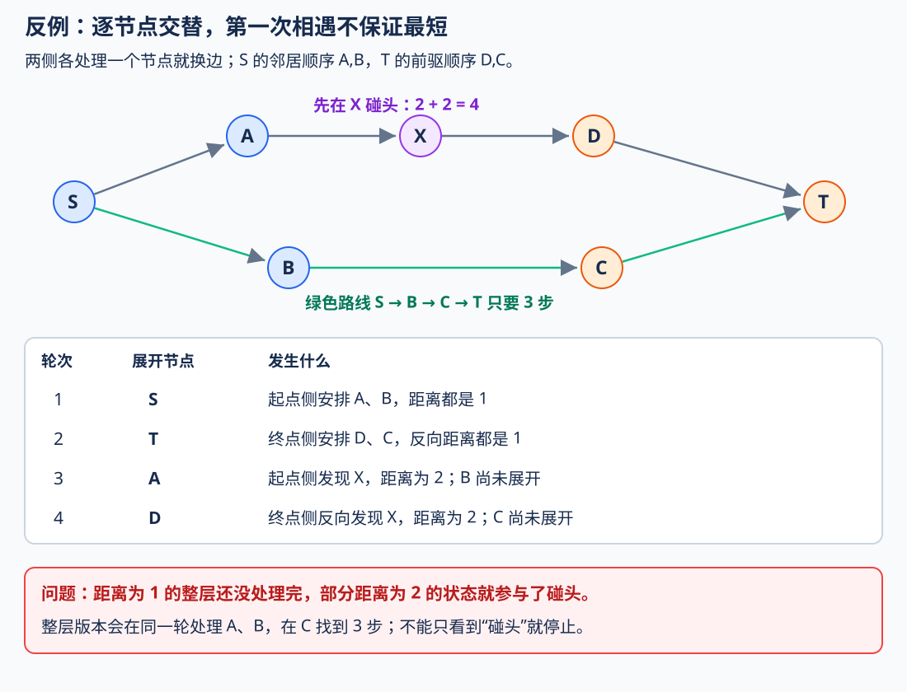
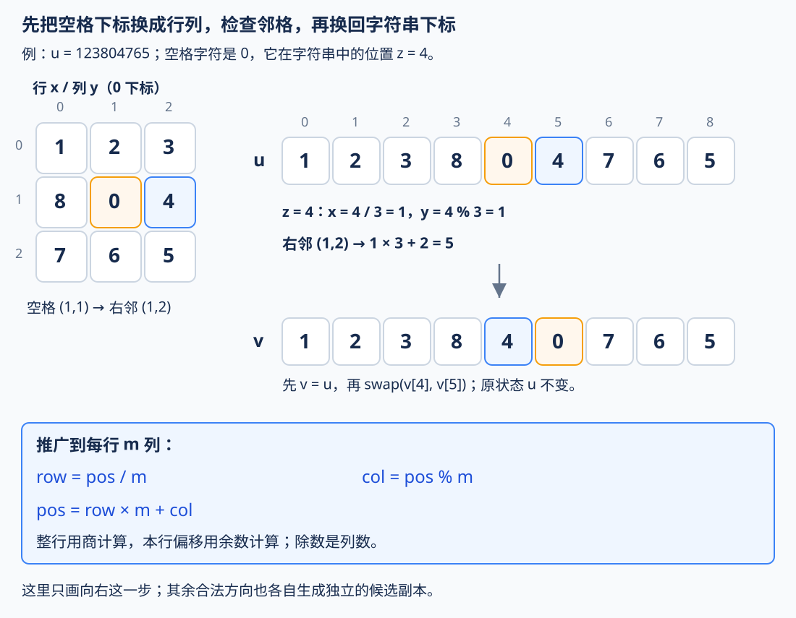
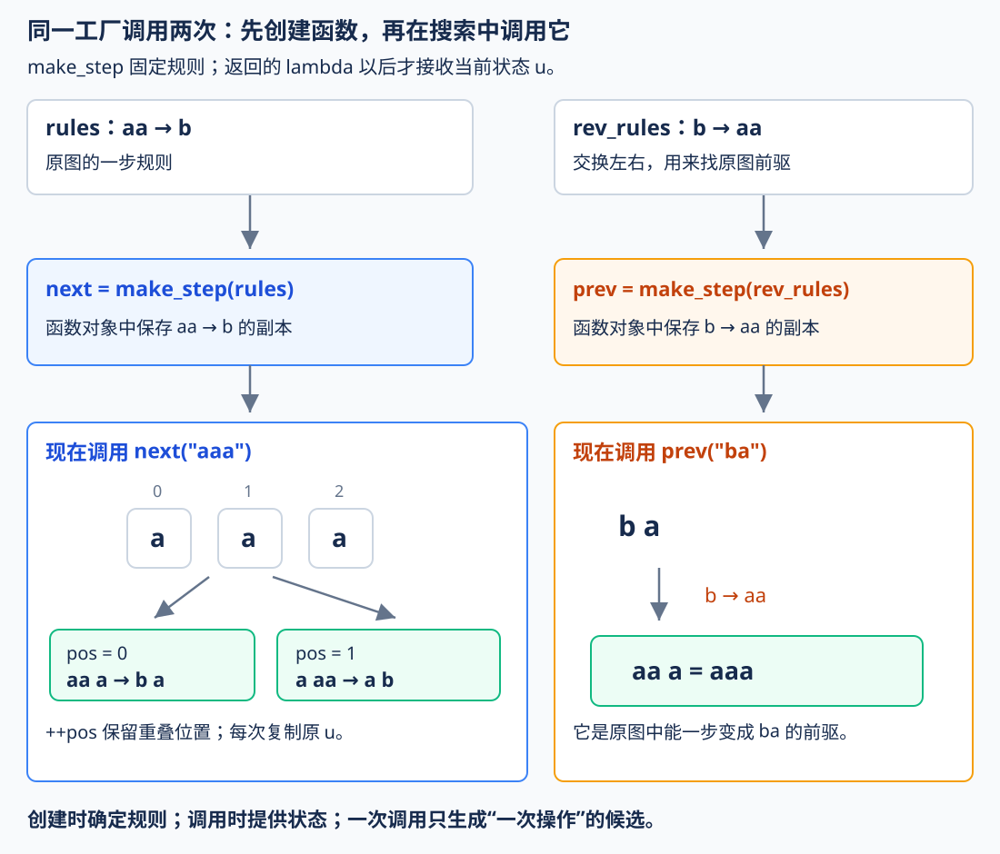

# 3.5 双向 BFS：从起点和终点向中间找

## 1. 普通 BFS 的瓶颈在哪里

前置：[3.2 BFS 与无权最短路](02-bfs-shortest-path.md)、[图的表示](../06-graph-and-tree/01-graph-basics.md)。本节仍然要求**每次转移都算一步，目标是两个指定状态之间的最少步数**。

普通 BFS 能正确求解，但若每层不断产生新状态，为了走到较远的目标，就得保存并处理越来越宽的搜索层。

假设每个状态大约产生 b 个新状态，答案需要 D 步，搜索树的第 D 层可能已有：

$$
b^D
$$

个状态。瓶颈在于**从一端一直扩到答案深度，靠近目标前的宽层已经很大**。

如果目标明确，并且能从目标生成合法前驱，就可以两端各做一份 BFS，在同一个状态相遇：

$$
\text{起点}\longrightarrow\text{相遇状态}\longrightarrow\text{终点}.
$$

**双向 BFS 改变搜索范围，保留每一侧按最短距离分层的规则。** 不要求原操作本身可逆，但必须能准确生成反向前驱。

## 2. 先看完整实现

教学版用 `string` 标识状态，字符串可以只是节点名字，也可以编码完整配置。转移由两个函数提供，不把棋盘或某道题的规则写死。

- `next(u)`：原图中从 u 能一步到达的全部合法状态。
- `prev(u)`：原图中能一步到达 u 的全部合法状态。
- 每次生成的候选有限，两者描述同一张固定状态图；编码相同当且仅当是同一完整状态。
- 返回最少步数，不返回路径。步数和两端深度之和均能用 int 保存。
- 无步数限制时，约定搜索涉及的可达状态有限；无限状态空间可能永不耗尽，不能仅靠 BFS 保证结束。

沿用 [C++11 基础框架](../../templates/01-basic-problem-solving/cpp-contest-template/README.md)中的标准库。

```cpp
// Step：状态转移函数。
// 输入当前状态 u，返回从 u 出发经过一步能够到达的所有状态。
// next 用于正向搜索，prev 用于反向搜索。
using Step = function<vector<string>(const string&)>;


// 扩展一整层 BFS。
// front：当前层的所有状态，保证它们到起点的距离相同。
// dist：本侧已经发现的所有状态及其最短距离。
// other：另一侧已经发现的所有状态及其最短距离。
// step：当前搜索方向的状态转移函数。
//
// 返回值：
// -1：本层没有与另一侧相遇。
// >=0：本层找到相遇路径，返回其中最短的路径长度。
int expand_layer(vector<string>& front,
                 unordered_map<string, int>& dist,
                 const unordered_map<string, int>& other,
                 const Step& step) {

    // 保存下一层的所有新状态。
    vector<string> next_front;

    // 记录本层找到的最短相遇路径长度。
    // -1 表示目前还没有找到相遇点。
    int best = -1;

    // 遍历当前层的所有状态，完整扩展这一层。
    for (const string& u : front) {

        // 当前状态距离起点的距离 + 1，
        // 即从 u 扩展出的下一层状态的距离。
        int nd = dist.at(u) + 1;

        // 枚举从 u 出发一步能够到达的所有状态。
        for (const string& v : step(u)) {

            // 将 v 加入本侧已访问集合。
            // 如果插入失败，说明本侧之前已经发现过 v，
            // BFS 第一次发现时得到的距离就是最短距离，无须重复处理。
            if (!dist.emplace(v, nd).second)
                continue;

            // v 是本侧新发现的状态，加入下一层。
            next_front.push_back(v);

            // 检查另一侧是否也已经发现了 v。
            // 如果存在，说明两侧搜索已经相遇。
            auto it = other.find(v);

            if (it != other.end()) {

                // 起点 -> v -> 终点
                // 总路径长度 = 本侧到 v 的距离 + 另一侧到 v 的距离。
                int length = nd + it->second;

                // 保留当前整层搜索中找到的最短相遇路径。
                if (best == -1 || length < best)
                    best = length;
            }
        }
    }

    // 当前层全部处理完毕后，再切换到下一层。
    // 保证每次调用都完整扩展一层，而不是只扩展一个节点。
    front.swap(next_front);

    return best;
}


// 双向 BFS：从 start 搜索到 target 的最短路径长度。
//
// next(u)：原图中 u 一步能够到达的状态。
// prev(u)：原图中能够一步到达 u 的状态，即反向图的邻接关系。
//
// 对于无向图，next 和 prev 可以使用同一个转移函数。
// 对于有向图，反向搜索必须使用真正的反向边关系。
//
// max_steps：允许的最大路径长度。
// -1 表示不限制路径长度。
// 其他非负值表示只接受长度不超过 max_steps 的路径。
//
// 返回值：
// -1：不存在符合限制的路径。
// >=0：start 到 target 的最短路径长度。
int bidir_bfs(const string& start, const string& target,
              const Step& next, const Step& prev, int max_steps = -1) {

    // 起点和终点相同，不需要搜索。
    if (start == target) return 0;

    // 两侧当前正在扩展的 BFS 层。
    // front_s：从起点正向搜索的当前层。
    // front_t：从终点反向搜索的当前层。
    vector<string> front_s{start}, front_t{target};

    // 分别记录两侧已经发现的全部状态及其距离。
    // ds[u]：起点到 u 的最短距离。
    // dt[u]：u 到终点的最短距离（通过反向图搜索得到）。
    unordered_map<string, int> ds{{start, 0}}, dt{{target, 0}};

    // 两侧当前 frontier 所处的层数，初始均为 0。
    int depth_s = 0, depth_t = 0;

    // 只要两侧都还有状态，就可以继续搜索。
    while (!front_s.empty() && !front_t.empty()) {

        // 两侧已经发现的搜索半径之和达到步数限制，
        // 仍然没有相遇，则不存在长度不超过 max_steps 的路径。
        if (max_steps >= 0 && depth_s + depth_t >= max_steps)
            return -1;

        int answer;

        // 每次优先扩展当前状态数量较少的一侧，
        // 尽量减少本轮需要遍历的状态数量。
        if (front_s.size() <= front_t.size()) {

            // 从起点方向扩展一整层，使用正向转移函数 next。
            answer = expand_layer(front_s, ds, dt, next);

            // 正向搜索半径增加一层。
            ++depth_s;

        } else {

            // 从终点方向扩展一整层，使用反向转移函数 prev。
            answer = expand_layer(front_t, dt, ds, prev);

            // 反向搜索半径增加一层。
            ++depth_t;
        }

        // 本轮扩展过程中两侧已经相遇，
        // 返回找到的最短路径长度。
        if (answer != -1) return answer;
    }

    // 某一侧已经没有可扩展状态，搜索无法继续。
    // 说明两侧搜索范围无法相遇。
    return -1;
}
```

**用途速记：** 输入起点、终点、正向后继与反向前驱的生成规则，返回等代价状态图中的最少步数。每次从较小的一侧完整扩展一层，新状态若在另一侧已经发现，就用两边距离相加；返回 −1 表示没有找到符合步数限制的路径，无限制且搜索耗尽时表示不可达。

竞赛模板见[双向 BFS](../../templates/03-search/bidirectional-bfs/README.md)，将字符串类型泛化为支持哈希与相等比较的状态类型；分层和终止规则相同。

### 三个函数，各负责哪一层工作

个人实现将开篇的 `expand_layer`、`bidir_bfs` 分别命名为 `expand`、`bibfs`，职责相同；`Step` 是生成函数的类型名，不是第四个算法函数。

1. **`step(u)`：只管当前这一个状态。** 按题目规则，列出从 u 一步能到达的全部合法候选，返回一个 `vector<string>`。它不知道当前搜索层有多少状态，也不负责距离、全局判重或两侧相遇。
2. **`expand(...)`：处理选定一侧的完整一层。** 对层内每个 u 调用 `step(u)`，给首次发现的状态记距离、汇总到 `next_front`，并检查是否能与另一端接上。最后 `swap`，为本侧下一次扩展准备新的完整一层；返回本轮找到的最短拼接长度，没有相遇就返回 −1。
3. **`bibfs(...)`：组织两端搜索。** 初始化起终点、距离表和层；每轮选择当前层较小的一侧，交给 `expand`，再判断相遇、步数上限与是否耗尽。**可能连续扩展同一侧，不是固定左右轮流。**



**`step(u)` 返回的是“一个状态的一步邻居”，不是“当前整层的下一层”。** 同层所有状态的候选经过 `expand` 汇总、判重，才组成下一层。

使用这份写法时，**BFS 主体负责怎么搜，主要的个人设计放在“一个完整状态是什么、一步能变成什么”**。正反规则相同就传同一个 `step`；不同则分别准备 `next`、`prev`。这三项职责可以写成函数或 lambda，不要求所有实现都必须恰好使用三个命名函数。

### 变量怎样对应两份 BFS

| 变量 | 保存什么 | 不要混淆 |
| --- | --- | --- |
| `front_s` | 起点侧当前等待展开的一整层 | 不包含前面所有层 |
| `front_t` | 终点侧当前等待展开的一整层 | 按反向边继续找前驱 |
| `ds[x]` | 原图中起点到 x 的最少步数 | 仅对已经发现的状态有记录 |
| `dt[x]` | 原图中 x 到终点的最少步数 | 由终点侧反向 BFS 算出 |
| `depth_s`、`depth_t` | 两个当前层的距离，也就是本侧已发现范围的半径 | 两者不必相等 |
| `next_front` | 本轮新发现的下一层 | 旧层全部处理完才换过去 |
| `best` | 本次整层扩展中发现的最短拼接长度 | 没有相遇时为 −1 |

`Step` 只是“输入一个状态，返回邻居列表”的函数类型；`const Step&` 允许调用时传入捕获题目规则的 lambda。状态图既可提前建表，也可在调用时生成邻居。

## 3. 用同一张图跟踪两边的层

图中所有边都只算一步，箭头表示允许的方向。两条路线分别需要 4 步和 3 步。



初始时，两侧分别只发现 S、T，距离都为 0。

第一轮两侧一样大，先展开 S，发现 `A、B`；第二轮终点侧只有一个 T，较小，反向发现 `D、C`。

第三轮展开起点侧的**整层 `A、B`**：处理 A 发现 X；处理 B 发现 C，而 C 已在终点侧距离表中：

$$
\mathrm{ds}[C]=2,\qquad \mathrm{dt}[C]=1.
$$

因此拼成的路线长度为：

$$
\mathrm{ds}[C]+\mathrm{dt}[C]=2+1=3.
$$

两段在同一个状态接上，**不需要额外再加一步**。代码里的 `nd` 已经包含从当前 u 走到新状态 v 的这一步。

## 4. 反向搜索，找的是谁能走到我

对应主函数传入的 `prev`：

```cpp
answer = expand_layer(front_t, dt, ds, prev);
```



原图若有边：

$$
u\longrightarrow v,
$$

就应当在反图中建立：

$$
v\longrightarrow u.
$$

从终点反向走到 x，累计的步数才对应原图中“x 走到终点”的距离。

| 原问题 | 两个生成函数的关系 |
| --- | --- |
| 无向图、每个操作可原样撤销 | 常可复用同一生成函数，仍须核对规则 |
| 有向邻接表 | **正向遍历后继，反向遍历原图前驱** |
| 隐式状态转移 | 分别写出后继与合法前驱生成规则 |

### 具体建图与调用

给定四条有向边 `S→A、S→B、A→T、B→T`。每读到一条 `u→v`，同时记录“u 的后继有 v”和“v 的前驱有 u”。对应本节的字符串接口：

```cpp
void example() {
    vector<pair<string, string>> edges = {
        {"S", "A"}, {"S", "B"}, {"A", "T"}, {"B", "T"}
    };
    unordered_map<string, vector<string>> g, rg;

    // 包括没有后继／前驱的节点，也先准备好空列表。
    for (const string& u : {string("S"), string("A"), string("B"), string("T")}) {
        g[u] = {};
        rg[u] = {};
    }

    for (const auto& e : edges) {
        const string& u = e.first;
        const string& v = e.second;

        g[u].push_back(v);  // 原边 u→v：从 u 出发，可以走到 v。
        rg[v].push_back(u); // 同一条原边：能够走到 v 的前驱是 u。
    }

    auto next = [&](const string& u) { return g.at(u); };
    auto prev = [&](const string& u) { return rg.at(u); };

    cout << bidir_bfs("S", "T", next, prev) << '\n'; // 2
}
```

**用途速记：** `g[u]` 回答“从 u 能走到谁”，`rg[u]` 回答“谁能走到 u”。`next`、`prev` 只需分别读取这两份列表，再交给开篇的双向 BFS。



例如输入原边 `A→T` 时：

```cpp
g["A"].push_back("T");  // 正向站在 A，下一步可到 T。
rg["T"].push_back("A"); // 反向站在 T，可以回溯到原图前驱 A。
```

因此正向调用 `next("S")` 得到 `A、B`；反向调用 `prev("T")` 也得到 `A、B`，但两者的含义分别是 **S 能走到它们、它们能走到 T**。反向再从 A 或 B 查 `rg`，都会找到 S。

**反图单独保存在 rg 中，原图 g 的方向不变。** 不要把反边也补进 g，否则改变了原问题允许的行走方向。这里所有节点都先初始化空列表，因此 T 的 `g[T]` 与 S 的 `rg[S]` 为空，调用 `at()` 也有效。

例如只有 `S→A→T` 时，T 的正向后继为空，但 A 是它的合法前驱；若终点侧仍沿原图出边，就会漏掉 A 这个合法前驱，不能正确描述反向可达关系。

> **准确生成全部前驱**比“操作看起来对称”更重要。逆向可以有多个候选，也不要求原图真有一条反着走的边。

## 5. 完整一层为什么重要

### 不能随意各弹一个节点，碰头就立即返回

仍看上面的图。设 S 的后继顺序为 `A、B`，T 的反向邻居顺序为 `D、C`。



若两侧各处理一个节点就换边：

1. 展开 S，安排 A、B。
2. 展开 T，安排 D、C。
3. 只展开 A，发现 X，起点侧到 X 为 2。
4. 只展开 D，反向发现 X，终点侧到 X 也为 2。

这时第一次碰头得到 4，但 B、C 之间还藏着 3 步路线。**一侧尚未处理完距离为 1 的整层，却已经让部分距离为 2 的状态参与了碰头判断。**

本实现用 `front` 保存当前待扩展的**完整一层**，`next_front` 单独收集下一层；必须把 `front` 中的全部节点处理完，才通过 `swap` 切换到下一层。关键是**每轮完整处理一层，而不是只处理其中一个节点就换边**。逐节点调度若想正确提前结束，需要额外的距离下界与停止判定，不能直接套“第一次相遇”。

### 本实现为什么相遇后可以结束

在每轮开始时，两侧已经分别发现了距离不超过 `depth_s`、`depth_t` 的**全部状态**，并且尚未相遇。

设真正最短路的长度为 D。若：

$$
D\le\mathrm{depth}_s+\mathrm{depth}_t,
$$

则沿这条路，起点侧覆盖的前段和终点侧覆盖的后段必然已经接上，至少一个状态被两边发现；这与“尚未相遇”矛盾。因此：

$$
D\gt\mathrm{depth}_s+\mathrm{depth}_t.
$$

现在起点侧完整再扩一层。新发现状态的距离是 `depth_s+1`，对方记录的距离不超过 `depth_t`。若发现拼接路径，其长度至多为：

$$
\mathrm{depth}_s+1+\mathrm{depth}_t.
$$

最短距离是整数，一边已经证明它大于两端旧半径之和，另一边又找到只多一步的真实路径，所以两者必然相等。扩终点侧同理。

**证明依赖完整分层、正确反向边和每条边等代价。** 本实现还在整层内取最小拼接长度，邻居的枚举顺序不承担正确性责任。

## 6. 小的一侧先扩，距离表仍然各自保存

```cpp
if (front_s.size() <= front_t.size()) {
    // 完整扩展起点侧这一层。
} else {
    // 完整扩展终点侧这一层。
}
```

**选择较小的一层，希望本次少处理一些状态；**不要求机械地左右各扩一次，也不强迫两侧深度相同。每个状态生成邻居的代价差异很大时，层大小也只是一种工作量估计。

本侧是否访问过，用本侧 `dist.emplace(v,nd).second` 判断；它相当于**首次发现时立即标记**。对方是否访问过，用 `other.find(v)` 判断，两种职责分开。

不能共用一个不区分方向的访问标记，否则可能把相遇误当作普通重复而跳过。也不要用 `if (other[v])` 判断出现性：距离 0 也是合法值，而且 `operator[]` 会为不存在的键插入默认值。

相遇查询针对对方的**全部已发现状态**，保存在**距离表**中；**当前层列表**主要负责安排**下一轮展开**，不代替距离记录。

## 7. 总步数上限怎样处理

`max_steps<0` 不设限制；否则上限针对**整条路径**，不是让两侧各走这么多步。

仍然尚未相遇时，上一节已经证明：

$$
D\gt\mathrm{depth}_s+\mathrm{depth}_t.
$$

若两端覆盖半径之和已经达到上限：

$$
\mathrm{depth}_s+\mathrm{depth}_t\ge\mathrm{max\_steps},
$$

就不可能有上限以内的路径，可以返回 −1。这是主循环扩层之前那条判断的依据。

若尚差一层，仍必须让它扩完：例如上限为 3，前两轮覆盖半径之和为 2，第三轮找到的 3 步路径仍然合法。起终点相同则直接返回 0，上限为 0 也允许。

| 情况 | 返回值的含义 |
| --- | --- |
| 找到路径 | 最少步数，若有限制则不超过上限 |
| 有步数限制，返回 −1 | 上限以内不可达，不代表任意步数都不可达 |
| **无步数限制，一侧搜索耗尽仍未相遇** | **原图中起点不能到达终点** |

状态空间可能无限时，有限步数加有限分支能保证本次搜索有限，但状态数仍可能很大。只设步数限制，没有自动解决指数膨胀。

## 8. 复杂度：减少的是深层状态，不是把最坏情况改成对数

若分支数约为 b、两侧增长接近且在答案中间相遇，原来的估计：

$$
O(b^D)
$$

可缩为：

$$
O\!\left(b^{\lceil D/2\rceil}+b^{\lfloor D/2\rfloor}\right).
$$

这里估计的是树状扩展下的状态数量，b 大于 1 时通常由最宽层主导。下面用偶数 D 对比最宽层的近似规模：

| 每层分支 b | 最短距离 D | 单端约 $b^D$ | 理想两端约 $2b^{D/2}$ |
| --- | --- | --- | --- |
| 4 | 8 | 65,536 | 512 |
| 10 | 8 | 100,000,000 | 20,000 |
| 10 | 10 | 10,000,000,000 | 200,000 |

**这是适用情形下的估算，不是任意图保证。** 链状图没有指数扩张，两端可能增长不均；选择较小层也不保证恰好各走一半深度。

### 实际时间与空间怎么估

以下按哈希表的**平均性能**估算：

| 状态形式 | 时间 | 保存搜索记录的空间 |
| --- | --- | --- |
| 整数编号：V 个点、E 条边 | $O(V+E)$ | $O(V)$ |
| 字符串：发现 N 个状态、生成 M 个候选，每个最长 L（**N 数访问记录，M 数邻居生成**） | $O((N+M)L)$ | $O(NL)$ |

**整数图：** 每侧每个点最多发现一次，每条边最多处理一次；做两份 BFS 只增加常数倍。

**字符串：** 复制和计算哈希需要扫描字符，因此要把长度 L 算进去。表中假设每个候选也能在 $O(L)$ 内生成；生成规则更复杂时，再加上这部分开销。

**额外存储单独计算：** 上表只统计距离表和搜索层。若建立反图，建表时间与空间为 $O(V+E)$；生成候选时使用的临时列表也要计入实际内存。

## 9. 典题与复盘

两题共用个人实现的 `Step`、`expand`、`bibfs`，与开篇分层主体的算法一致，只是函数名不同。以下只保留各自的转移规则与 `solve()`；直接拼接开篇主体时，将调用名 `bibfs` 统一为 `bidir_bfs` 即可，不重复粘贴同一段 BFS。

个人代码只整理排版和注释，本轮依据题意静态复盘，**未编译、运行或对拍个人实现，也不补写平台 AC 结果**。此前通用模板的独立验证与个人配题记录分开。

### 9.1 P1379：八数码难题

[洛谷 P1379：八数码难题](https://www.luogu.com.cn/problem/P1379)。3×3 棋盘有数字 0 到 8，空格记为 0；给定初始布局，目标固定为 `123804765`，求最少移动次数。原题保证可以到达目标。

#### 原实现：把整个棋盘放进一个字符串

```cpp
void solve() {
    string s;
    cin >> s;

    string t = "123804765";

    Step step = [](const string& u) -> vector<string> {
        vector<string> res;

        auto z = (int)u.find('0');
        int x = z / 3;
        int y = z % 3;

        int dx[] = {1, -1, 0, 0};
        int dy[] = {0, 0, -1, 1};

        for (int d = 0; d < 4; ++d) {
            int nx = x + dx[d];
            int ny = y + dy[d];

            if (nx < 0 || nx > 2 || ny < 0 || ny > 2)
                continue;

            string v = u; // 每个候选都从原状态复制，不污染其他方向。
            swap(v[z], v[nx * 3 + ny]);
            res.push_back(v);
        }

        return res;
    };

    cout << bibfs(s, t, step, step) << '\n';
}
```

**用途速记：** `step(u)` 找到当前空格，依次尝试与四邻格交换，返回每种合法的一步布局。每种布局都由原字符串复制后再交换；移动能原样撤销，因此正反两端共用同一个 `step`。

状态是**整盘的九个字符**，不是空格坐标。空格位置相同而其他棋子不同，后续可到达的布局仍可能不同。用字符串输入也保留了可能位于首位的字符 `0`。

#### 一维下标与二维行列怎样互换

`z` 是字符 `0` 在字符串中的**下标**。例如目标布局中 `z=4`，不是说字符 `0` 的数值变成了 4。



每行恰好有 3 个格子。字符串在 z 前面能放满多少行，就得到行号；除完剩下几个格子，就得到列号：

$$
x=\left\lfloor\frac z3\right\rfloor,\qquad y=z\bmod3.
$$

这里 **x 表示行，y 表示列，均从 0 开始**；并非固定的笛卡尔横纵坐标。第 x 行前面已有 `3*x` 个格子，因此反过来：

$$
z=3x+y.
$$

例如空格下标为 4：

$$
4=1\times3+1\quad\Longrightarrow\quad(x,y)=(1,1).
$$

向右到 `(1,2)`，对应的一维下标为：

$$
1\times3+2=5.
$$

所以代码交换的是 `v[4]` 与 `v[5]`。**先用行列判断四邻格是否合法，再换回字符串下标**；不能把一维 `z+1` 永远当作向右，例如下标 2 加一已经换到了下一行。

通用的“每行 m 列”换算及使用前提，统一积累在[模拟：一维下标与二维行列](../01-basic-problem-solving/03-simulation.md#24-一维下标与二维行列)。

#### 为什么没有回溯交换，也不重复评估历史路径

每个方向都从 `string v=u` 开始，只修改候选副本，其他方向继续读取原状态 u，所以不需要再交换回来。`expand` 对完整布局判重，同一侧第一次发现时记录的就是最短距离。

棋盘布局最多 $9!=362880$ 种，每种最多生成 4 个候选，编码长度固定为 9；有限状态保证搜索可结束。双向搜索通常提前相遇，但不把“各搜一半”的理想估算当成所有输入的实际状态数。

### 9.2 P1032：字串变换

[洛谷 P1032：字串变换](https://www.luogu.com.cn/problem/P1032)。给定起终字符串及至多 6 条子串替换规则，求 **10 步以内，包含恰好 10 步**的最少变换数；否则输出 `NO ANSWER!`。题面字符串长度上限为 20，字符均为小写字母。

#### 原实现：同一工厂，创建正反两个生成函数

```cpp
Step make_step(const vector<pair<string, string>>& rules) {
    return [rules](const string& u) -> vector<string> {
        vector<string> res;

        for (int i = 0; i < (int)rules.size(); ++i) {
            const string& from = rules[i].first;
            const string& to = rules[i].second;
            size_t pos = 0;

            while ((pos = u.find(from, pos)) != string::npos) {
                string v = u; // 每次只在原状态的一个位置应用一条规则。
                v.replace(pos, from.size(), to);
                res.push_back(v);
                ++pos; // 向右挪一格，继续找，包括重叠出现的位置。
            }
        }

        return res;
    };
}

void solve() {
    string s, t;
    cin >> s >> t;

    vector<pair<string, string>> rules, rev_rules;
    string u, v;

    while (cin >> u >> v) {
        rules.push_back({u, v});
        rev_rules.push_back({v, u});
    }

    Step next = make_step(rules);
    Step prev = make_step(rev_rules);

    int ans = bibfs(s, t, next, prev, 10);
    if (ans == -1)
        cout << "NO ANSWER!\n";
    else
        cout << ans << '\n';
}
```

**用途速记：** `make_step(rules)` 返回一个记住 rules 的生成函数，以后每次传入当前字符串 u，就列出“选择一条规则、选择一个出现位置、替换一次”的所有候选。正向用原规则，反向用左右交换后的规则，再复用同一份双向 BFS。

输入只有一组，故读规则到 EOF 符合题面；若以后改成多组输入，需要根据新的格式确定规则结束位置，不能原样让第一组读到文件末尾。

#### 工厂调用和真正执行一步，是两个时刻

```cpp
Step next = make_step(rules);     // 现在固定正向规则，创建函数对象。
Step prev = make_step(rev_rules); // 再创建一个对象，固定反向规则。

// 搜索到某个状态 u 时，才会执行 next(u) 或 prev(u)。
```

这两次调用使用同一段 lambda 代码，但分别创建**保存不同规则副本的函数对象**。`[rules]` 是按值捕获，返回对象中保存一份规则；工厂返回后，仍可继续调用它。`Step` 则是用 `std::function` 保存这种可调用对象的统一类型。

**工厂负责先固定规则，返回的函数负责以后接收状态并执行规则。** 不需要为正反向分别复制两份替换代码。通用语法例子见 [Lambda：函数工厂](../01-basic-problem-solving/04-stl/algorithms/15-lambda-comparators.md#函数工厂先固定规则再返回函数)；引用捕获仍需由调用方保证被引用数据活到调用结束，不能认为返回一个 lambda 就自动延长原数据寿命。



#### 正反不是名字不同，而是转移方向真的相反

若原规则是 `aa→b`，则正向某一步可以：

$$
\texttt{aaa}\longrightarrow\texttt{ba}.
$$

反向规则交换左右，使用 `b→aa`，便能从这个结果找到原来的前驱：

$$
\texttt{ba}\longrightarrow\texttt{aaa}.
$$

这条反向边用于寻找“谁能按原规则走到当前状态”，**不表示原题允许正向把 b 改回 aa**。对每条原规则都建立相反规则，枚举其全部出现位置，就能列出一步合法前驱；同一候选重复产生也没关系，`expand` 会统一判重。

#### 一条规则可能产生多个邻居，重叠位置也要算

`u="aaa"`、规则 `aa→b` 时，`aa` 在下标 0 和 1 都出现，因此一步候选有：

$$
\text{位置 }0:\ \texttt{aaa}\longrightarrow\texttt{ba},
$$

$$
\text{位置 }1:\ \texttt{aaa}\longrightarrow\texttt{ab}.
$$

所以代码每次 `++pos`，继续从下一个下标查找。若写成 `pos+=from.size()`，就会跳过重叠的第二处。

每个候选都先复制 `u`，再只替换一个位置；`find` 始终查找原状态 u。**不能在刚生成的 v 上继续连着替换，并把结果仍当作一步。** 规则由字符串输入，`from` 非空，查找位置持续右移，当前这次候选生成会结束。

`size_t` 与 `string::npos` 配套判断查找结果；相关 API 见 [string 的 find](../01-basic-problem-solving/04-stl/containers/03-string.md#33-find-返回-npos不是一个有效下标)。

#### 上限与开销，对应代码里的哪些量

`bibfs(...,10)` 限制的是正反拼接后的**总步数**。返回 −1 后再映射成题目的 `NO ANSWER!`，否则输出真实最少步数；不用为恰好第 10 步单独补特判。

本题不额外给中间字符串加长度剪枝；是否能删掉某类中间状态，仍要先证明不会漏掉 10 步内答案。

最多 6 条规则，**不代表一个状态最多只有 6 个邻居**：每条规则可能在多个位置出现。复杂度沿用本节的 N、M、L：N 数两侧保存的状态记录，M 数生成的候选，L 计入复制、哈希和替换的字符串长度；查找过程的额外开销也需计算。原页提示数据较弱，评测通过不能替代完整性论证。

### 9.3 两题共用骨架，题目决定一步怎么走

| 要设计的部分 | 八数码 | 字串变换 |
| --- | --- | --- |
| 完整状态 | 九位棋盘字符串 | 当前整个字符串 |
| 一步是什么 | 空格与一个合法四邻格交换 | 在一个出现位置应用一条规则 |
| 正反向生成 | 相同移动函数 | 原规则与左右交换后的规则 |
| 候选的独立性 | 复制 u 后交换 | 复制 u 后替换 |
| 主要个人工作 | 下标与行列、边界、交换 | 规则、出现位置、反向规则、工厂捕获 |
| 共用主体 | `expand` 处理完整层，`bibfs` 调度两端 | 同一主体，另传总步数上限 10 |

**先写清“当前局面由什么唯一决定、一次操作到底做什么”，再把候选生成交给 step；层次、距离与相遇由 BFS 主体管理。** 坐标换算与工厂语法分别归入基础笔记，本节保留题目推导与实际实现，不另造重复范式。

## 10. 衔接与参考

本节处理两个指定状态之间的等代价最短路；需要起点到全部状态时，普通 BFS 通常更直接。一般带权图不能套这份“两侧距离按步数加一”的实现。

检索[已有搜索范式](../../patterns/03-search/README.md)后，本节保留标准算法本身及其适用边界，不另建重复模式。下一节 [3.6 迭代加深](06-iterative-deepening.md)比较另一种节省宽层状态存储的办法：逐次提高深度上限。启发式搜索继续留待后续。

参考 [OI Wiki：双向搜索](https://oi-wiki.org/search/bidirectional/)中的两端搜索思路；本文自行整理整层扩展、总步数限制及证明，未照搬其中逐节点调度的示例代码。本节不将双向 BFS 与“枚举两半再合并”的折半枚举混为同一种实现。

[返回搜索索引](README.md)
