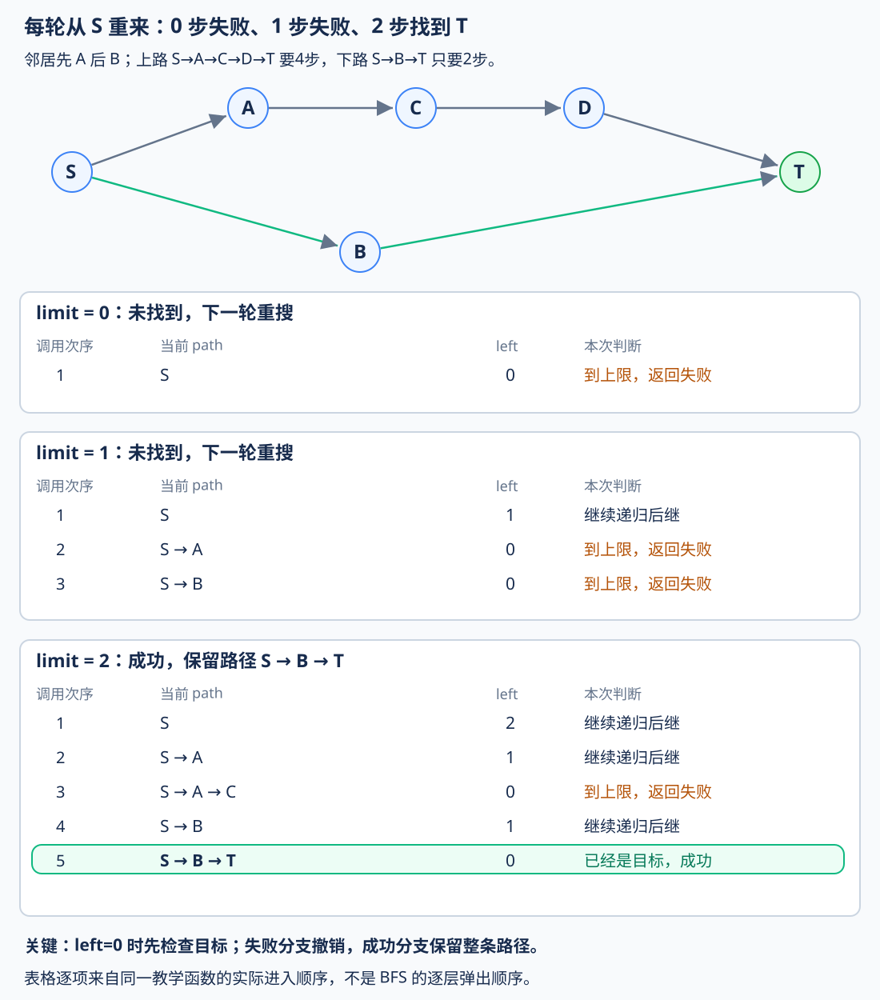
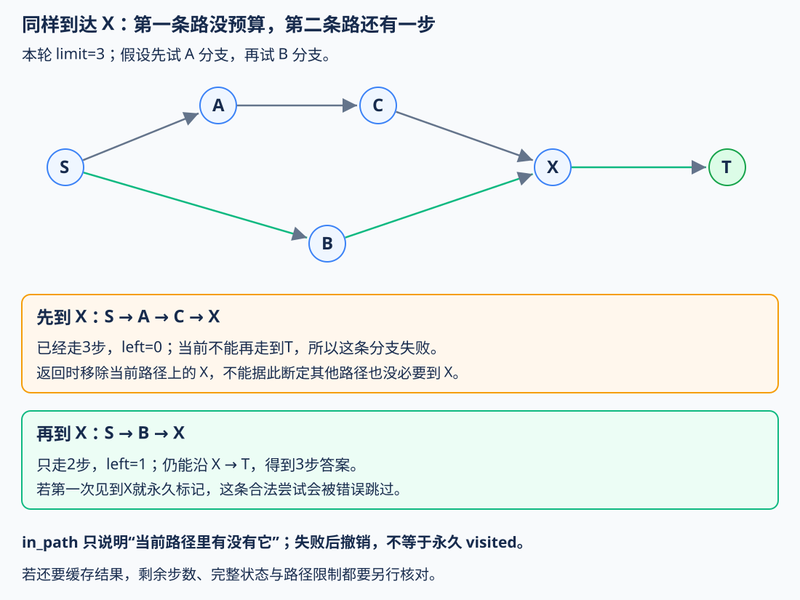
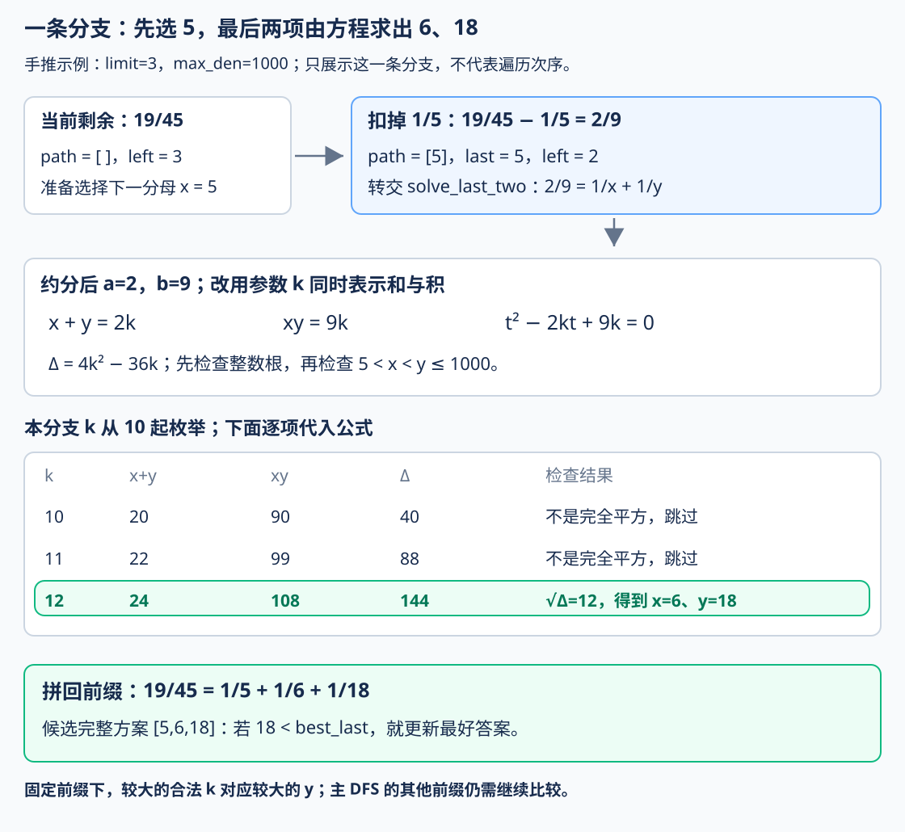
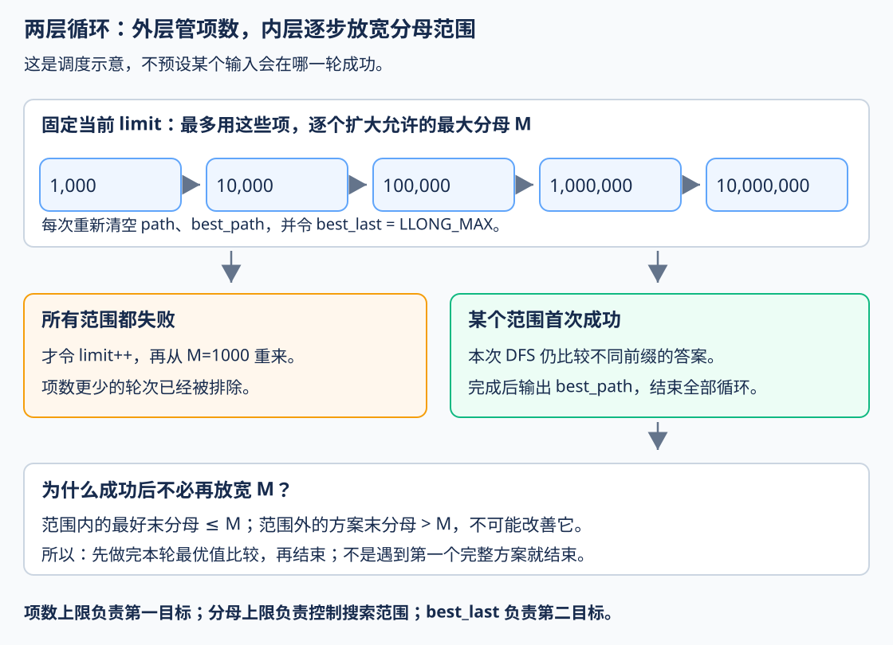

# 3.6 迭代加深：逐次提高 DFS 的深度上限

## 1. 为什么在 BFS 之后，还要回到 DFS

前置：[DFS 与回溯](01-dfs-backtracking.md)、[BFS](02-bfs-shortest-path.md)、[搜索剪枝](04-search-pruning.md)。本节仍以**每次操作算一步，求最少操作次数**为目标。

普通 DFS 按分支深入，先找到的答案可能很深；BFS 按层找最少步数，但搜索很宽时，距离表和等待展开的状态会占较多内存。

上一节的[双向 BFS](05-bidirectional-bfs.md)能从两端缩小范围，但需要目标明确、能生成前驱，也仍要保存两端的状态记录。

另一种办法是：**保留 DFS 的逐条路径探索方式，先只允许走 0 步，失败后再允许 1 步、2 步……** 每个上限内都重新从起点搜索，第一次成功时就得到了最少步数。

> 这叫**迭代加深深度优先搜索**，简称 **IDDFS**。这里“迭代”指外层反复提高深度上限，内部仍然可以用递归。

## 2. 先看完整实现

沿用上一节的接口思路：`next(u)` 生成一个完整状态的一步合法邻居；`is_goal(u)` 判断当前状态是不是答案。教学版用 string 表示状态，不提前写入配题的特定规则。

本实现要求状态图规则固定、每次候选有限、每步代价为 1；`max_depth` 是**最多走几步**，非负且小于 `INT_MAX`，实际深度还需适合递归栈。

```cpp
using Step = function<vector<string>(const string&)>;
using Goal = function<bool(const string&)>;

// 返回包含起点、终点的最短状态路径；在 max_depth 内无解返回空 vector。
// 前提：所有转移代价均为 1，状态有限，每个状态的候选转移有限。
vector<string> iddfs(const string& start, const Goal& is_goal,
                     const Step& next, int max_depth) {
    vector<string> path;       // 当前 DFS 路径，保存经过的状态。
    unordered_set<string> in_path; // 标记当前路径上的状态，防止重复经过同一状态。

    // left：当前路径还允许向下走的步数。
    // 返回 true 表示已经找到目标，path 保留完整答案。
    function<bool(int)> dfs = [&](int left) -> bool {

        // ---- 1. 判断是否到达目标 ----
        // 必须先判断目标，再判断深度上限：
        // 即使 left == 0，当前状态也可能恰好就是目标。
        if (is_goal(path.back()))
            return true;

        // 已经没有剩余步数，但当前状态不是目标，无法继续搜索。
        if (left == 0)
            return false;

        // ---- 2. 枚举下一步，递归搜索 ----
        // 从当前状态出发，枚举所有一步可达的状态。
        for (const string& v : next(path.back())) {

            // 当前路径已经经过 v，再走就会形成环。
            // 不需要重复经过同一状态，因为环只会增加路径长度。
            if (in_path.count(v))
                continue;

            // 选择当前候选状态，将其加入路径。
            path.push_back(v);
            in_path.insert(v);

            // 递归搜索，剩余可走步数减 1。
            if (dfs(left - 1))
                return true; // 找到答案，保留当前路径，不再回溯。

            // ---- 3. 当前分支失败，恢复现场 ----
            // 删除刚才加入的状态，恢复到尝试该候选之前的路径。
            in_path.erase(v);
            path.pop_back();
        }

        // 所有候选状态都尝试过，仍未找到目标。
        return false;
    };

    // ---- 4. 逐步增加深度上限（迭代加深）----
    // 每轮重新进行一次深度受限 DFS。
    // 从 0 开始递增，保证第一次找到的就是最短路径。
    for (int limit = 0; limit <= max_depth; ++limit) {

        // 每轮从起点重新搜索，清空上一轮的路径状态。
        path = {start};
        in_path.clear();
        in_path.insert(start);

        // 本轮最多允许走 limit 步。
        if (dfs(limit))
            return path;
    }

    // 所有深度限制都尝试过，仍未找到目标。
    return {};
}
```

**用途速记：** 输入起点、目标判断、一步转移和最大步数，返回上限以内的一条最短状态路径。每轮用 DFS 搜索当前深度以内的方案，失败就提高上限、从头重搜；空 vector 表示上限内没有找到答案。

路径包含起终点，因此成功时：

$$
\text{操作次数}=\mathrm{path.size()}-1.
$$

起点已经满足目标时，路径只有起点，操作次数为 0；**不能用“路径长度为 0”表示这种成功**。竞赛泛型实现见 [IDDFS 模板](../../templates/03-search/iterative-deepening/README.md)。

### 变量分别负责什么

| 名称 | 含义 |
| --- | --- |
| `limit` | 本轮从起点出发，总共最多走几步 |
| `left` | 当前路径还剩几步可用；每次递归减 1 |
| `path` | 当前正在尝试的状态路径，不保存其他分支 |
| `in_path` | 哪些状态已经出现在当前路径上 |
| `max_depth` | 外层尝试到哪里停止，由题意或已证明的界确定 |

当前已走步数也能从路径长度得到：

$$
\mathrm{left}=\mathrm{limit}-(\mathrm{path.size()}-1).
$$

它们描述的是**同一轮、当前这一条路径**，不是全局已经访问过多少个状态。

## 3. 同一张图，分别限制 0、1、2 步

S 到 T 有两条路线：上面经过 A、C、D，需 4 步；下面经过 B，只需 2 步。假设邻居顺序先 A 后 B，普通 DFS 可能先走完整条上路。



迭代加深每轮都从 S 开始：

| 上限 | 这一轮允许做什么 | 结果 |
| --- | --- | --- |
| 0 | 只检查 S | 不是目标，失败 |
| 1 | 尝试 `S→A`、`S→B` | 到上限时都不是目标，失败 |
| 2 | 上路到 C 就停，回头再尝试 `S→B→T` | 找到 2 步路径 |

第三轮中，DFS 仍然先试 A；只是**深度上限阻止它沿上路继续钻到 D、T**，于是能回头检查另一条较浅路线。

**不要求每轮像 BFS 那样按层处理节点。** 每轮内部仍是 DFS，跨轮则依次排除“0 步以内无解、1 步以内无解……”。

## 4. 两个判断的顺序：到上限时仍可能已经成功

```cpp
if (is_goal(path.back())) return true;
if (left == 0) return false;
```

图中的 `S→B→T` 正好用了 2 步，到达 T 时 `left=0`。它已经是答案，因此**必须先检查目标，再判断能否继续走**。

如果先写 `left==0` 就返回 false，会错误地拒绝**恰好用完上限**的答案；起点就是目标、上限为 0 时也会被误判。

本轮搜索的是：

$$
\text{是否存在步数}\le\mathrm{limit}\text{的合法路径},
$$

而非要求恰好走满 limit。每次进入递归都能判断是否已经达到目标。

### 为什么第一次成功就是最少步数

设真正最少需要 D 步。前面的每轮都完整检查了更小上限：

$$
0,1,\ldots,D-1.
$$

它们均失败；上限为 D 时，一条 D 步的最短路径不会因步数不足被排除。因此这一轮必能找到答案，第一次成功的上限就是 D。

**保证来自“逐个尝试上限＋每轮完整搜索”，不是 DFS 的邻居顺序。**

每一步代价不同时，最少步数不一定代表最小费用；若同样步数还要比较第二目标，也不能直接找到一个目标就结束，需在最小深度内继续完成相应比较。

## 5. 回溯标记只约束当前路径

```cpp
if (in_path.count(v)) continue;
path.push_back(v);
in_path.insert(v);
if (dfs(left - 1)) return true;
in_path.erase(v);
path.pop_back();
```

`in_path` 防止当前路径绕回已经经过的完整状态，例如 `S→A→S→A`。失败后撤销，其他路径仍能尝试同一状态。

为什么可以排除这种循环？在固定状态图、每步代价为 1 的模型中，**绕回同一个完整状态并不会提供新的后续选择**；删掉这段循环仍能沿后面相同的边到达目标，且步数更少。**至少有一条最短路径不含重复状态**，所以这样剪不会漏掉最少步数答案。

如果问题还有资源、已选集合等信息，必须先把它们放进完整状态，不能只按“当前位置”判断是否绕圈。

### 不能把首次到达永久标记成“以后都不用再搜”



本图上限为 3。DFS 先经 `S→A→C→X`，到 X 时没有剩余步数；但经 `S→B→X` 到达时，还剩一步，可以走到 T。

若第一次见到 X 就永久标记，第二条路会被跳过，导致漏解。**到达相同状态时，剩余预算未必相同。**

本实现只维护当前路径，失败就撤销；**每轮提高上限时，又重新初始化路径与标记**。缓存若要跨路径或跨轮复用，需另外证明状态、剩余步数与缓存含义，不能直接使用一张全局 bool。相关边界复用[记忆化与递推范式](../../patterns/05-dynamic-programming/memoization-vs-tabulation.md#剪枝停止探索不等于已经算完子问题)。

### 成功后为什么不撤销

- 成功分支通过 `return true` 一层层返回，保留 path 作为最终答案，外层立即返回它，不再枚举其他分支。

- 失败分支则必须 `erase` 与 `pop_back`，恢复到尝试前。两者的目的不同，不能要求每个 return 前都把路径清空。

## 6. 明明重复搜索，为什么还可能划算

设每个状态最多产生 b 个候选，第一轮成功的深度为 D。暂按完整搜索树估算，不计剪枝带来的减少。

单次搜索到 D 层，需要处理的节点数为：

$$
1+b+b^2+\cdots+b^D.
$$

迭代加深会重复浅层，但深层重复次数少：

$$
(D+1)+D\cdot b+(D-1)\cdot b^2+\cdots+1\cdot b^D.
$$

根节点每轮重来，处理 D+1 次；最深的第 D 层只在最后一轮搜索一次。分支增长快时，主要工作集中在最深层，因此浅层重搜常能接受。

| 分支数 b | 深度 D | 单次完整搜到 D 层 | 依次尝试 0..D 的总节点数 |
| --- | --- | --- | --- |
| 2 | 6 | 127 | 247 |
| 3 | 4 | 121 | 179 |
| 10 | 4 | 11,111 | 12,345 |
| 1 | 6 | 7 | 28 |

**这些是完整树的计数，不是实际程序必须访问的数量。** 对固定 $b\gt1$，上述重复搜索仍为 $O(b^D)$ 量级；**b=1 的长链则是 $O(D^2)$**，不能说重复搜索总能忽略。

### 简明时间与空间表

| 项目 | 本实现的估算 |
| --- | --- |
| 搜索时间 | 分支上界 b 大于 1 时，成功到 D 层为 $O(b^D)$；无解则 D 取最大尝试深度 |
| 路径、路径标记、递归层 | $O(D)$ 个状态记录 |
| 邻居临时列表 | 每层最多保留 b 个候选，最多再占 $O(bD)$ 个状态 |
| 字符串或复杂状态 | 复制、哈希和候选生成另计，不能都当作常数 |

这里的 `for (... : next(...))` 生成的列表会在递归期间继续存在，因此**不能只写空间 O(D)，就忽略所有候选副本**。总体按固定大小状态计为 $O((b+1)D)$；图本身的存储另计。

虽然不保存 BFS 的整张已访问状态表，却会在不同路径、不同深度上限下反复处理同一状态，所以**不能把时间写成 $O(V+E)$**。

## 7. 怎样选择，与已有搜索有什么关系

| 情况 | 优先考虑 |
| --- | --- |
| 单步等代价，状态规模能容纳，容易判重 | 普通 BFS，通常更直接 |
| 起终点明确，反向前驱容易生成 | 双向 BFS，比较实际搜索范围 |
| **DFS 容易写，想找浅层最少步数，又不适合保存很宽的搜索层** | **迭代加深，再据题加入合法剪枝** |
| 本来只是遍历全部节点、统计全部方案或求最长路径 | 不能仅为“最优”二字改用本节首个目标即停的代码 |

迭代加深只管理“本轮允许多深”，**具体状态、合法候选和剪枝仍由题目决定**。不能因为外层换成 limit 循环，就假设巨大候选集合也变得容易搜索。

通用模板适合完整状态图；某些题的递归状态、候选上下界和目标比较更自然，直接写定制 DFS 即可复用这个外层思想，不必先构造一大份邻居列表。实际深度太大时，也要考虑调用栈，不把“节省宽层内存”理解成可以无限递归。

本节只用深度限制；“还至少需要几步”的估计与 IDA* 留到后续启发式专题，不混入本节代码。

## 8. 典题与复盘

### 8.1 P1763：埃及分数——限项数，再化简搜索末端

[原题：洛谷 P1763](https://www.luogu.com.cn/problem/P1763)。真分数拆成**互不相同的单位分数**：先让项数最少，同项数时，让最小的单位分数尽量大。题面保证最优解的最小单位分数不小于 $1/10^7$。

按分母递增生成，既去掉排列重复，也让第二目标落到最后一项：

$$
\frac ab=\frac1{x_1}+\cdots+\frac1{x_q},\qquad
x_1\lt\cdots\lt x_q.
$$

$$
\text{先最小化 }q,\qquad\text{再最小化 }x_q.
$$

**尝试中的瓶颈：** 只限制项数，单层分母仍有很大范围；再逐步放宽最大分母，仍可能把大量时间花在末尾枚举。因此本实现把最后两项改成代数求解。这是本题的强化技巧，不是所有 IDDFS 都需要韦达定理。

**本题定位：搜索与数论结合的综合应用。** 同时涉及两级目标、分数状态与末端优化，明显重于单纯练习限深 DFS；应将 IDDFS 基础与本题的强化技巧分别理解。

#### 原实现

以下保留实际搜索逻辑，只调整排版和个别注释；公共别名与 main 复用竞赛框架。

```cpp
ll best_last;
vector<ll> path, best_path;
const ll MAX_DEN = 10000000ll;

// 当前剩余分数 a/b，要求拆成 1/x + 1/y
// last：前一个分母
// max_den：当前允许的最大分母
bool solve_last_two(ll a, ll b, ll last, ll max_den) {
    // k 的下界：判别式必须大于 0
    ll k_low = 4 * b / (a * a) + 1;

    // x > last 且 y > x，因此 x+y >= 2*last+3
    ll k_need = (2 * last + 3 + a - 1) / a;
    k_low = max(k_low, k_need);

    // k 的上界
    ll k_high1 = (2 * max_den - 1) / a;
    ll k_high2 = max_den * (max_den - 1) / b;
    ll k_high = min(k_high1, k_high2);

    for (ll k = k_low; k <= k_high; ++k) {
        ll sum = a * k;
        // 判别式
        ll delta = sum * sum - 4 * b * k;
        if (delta <= 0)
            continue;

        // 求整数平方根，并校正浮点误差
        ll s = (ll)sqrt((long double)delta);
        while ((s + 1) * (s + 1) <= delta)
            ++s;
        while (s * s > delta)
            --s;

        // 必须是完全平方数
        if (s * s != delta)
            continue;

        // 求两个根
        if ((sum - s) % 2 != 0)
            continue;
        ll x = (sum - s) / 2;
        ll y = (sum + s) / 2;

        // 检查分母是否合法
        if (x <= last || x >= y || y > max_den)
            continue;

        // 第二目标：最小化最后一个分母
        if (y < best_last) {
            best_last = y;
            best_path = path;
            best_path.push_back(x);
            best_path.push_back(y);
        }

        // y 随 k 严格递增，第一个合法解就是本分支最优解
        return true;
    }
    return false;
}

bool dfs(ll a, ll b, ll last, int limit, ll max_den) {
    int left = limit - (int)path.size();
    if (left == 0)
        return false;

    // ---- 1. 最后一项直接完成 ----
    if (a == 1 && b > last) {
        if (b <= max_den) {
            if (b < best_last) {
                best_last = b;
                best_path = path;
                best_path.push_back(b);
            }
            return true;
        }
        return false;
    }
    if (left == 1)
        return false;

    // ---- 2. 最优性剪枝 ----
    if (best_last != LLONG_MAX &&
        last + left >= best_last)
        return false;

    // 最后一个分母至少为 last + left
    if (last + left > max_den)
        return false;

    // ---- 3. 最后两项直接求解 ----
    if (left == 2)
        return solve_last_two(a, b, last, max_den);

    // ---- 4. 枚举下一项 ----
    ll low = max(last + 1, b / a + 1);

    // 后面还要留出 left-1 个严格递增的分母
    ll high = max_den - left + 1;

    // 最终分母必须严格优于当前答案
    if (best_last != LLONG_MAX)
        high = min(high, best_last - left);
    if (low > high)
        return false;

    bool found = false;
    for (ll x = low; x <= high; ++x) {
        // left>1；后续严格递增，即使使用全部名额，总和也严格小于 left/x。
        if (a * x >= left * b)
            break;

        // a/b - 1/x
        ll na = a * x - b;
        ll nb = b * x;
        // 约分
        ll g = __gcd(na, nb);
        na /= g;
        nb /= g;

        path.push_back(x);
        if (dfs(na, nb, x, limit, max_den))
            found = true;
        path.pop_back();
    }
    return found;
}

void solve() {
    ll a, b;
    cin >> a >> b;
    ll g = __gcd(a, b);
    a /= g;
    b /= g;

    // 第一目标：最少单位分数数量
    for (int limit = 1; ; ++limit) {
        // 搜索范围优化：逐步放宽最大分母
        for (ll max_den = 1000; ; ) {
            path.clear();
            best_path.clear();
            // LLONG_MAX 表示尚未找到答案
            best_last = LLONG_MAX;

            if (dfs(a, b, 0, limit, max_den)) {
                for (int i = 0; i < (int)best_path.size(); ++i) {
                    if (i) cout << ' ';
                    cout << best_path[i];
                }
                cout << '\n';
                return;
            }
            if (max_den == MAX_DEN)
                break;
            max_den = min(max_den * 10, MAX_DEN);
        }
    }
}
```

**用途速记：** 输入真分数，递增尝试最多项数与分母范围；DFS 记录剩余分数，比较合法答案的末分母。剩一项直接判断，剩两项枚举一个整数参数、由二次方程还原两个分母，其余层继续回溯。

#### 8.1.1 先看状态：每层只确定下一个分母

| 变量 | 本轮含义 |
| --- | --- |
| `a,b` | 还没有拆完的正分数，始终约分 |
| `last` | 前一个分母；下一项必须大于它 |
| `path` | 已经选好的递增分母 |
| `limit` | 本轮最多允许几项 |
| `left` | 剩余项数名额：`limit - path.size()` |
| `max_den` | 当前允许的最大分母，下面记作 M |
| `best_last`、`best_path` | 已找到的最小末分母及对应完整方案 |

选分母 x，就从剩余分数扣除一项：

$$
\frac ab-\frac1x=\frac{ax-b}{bx}.
$$

约分后交给下一层；返回后只弹出本次加入的 x。**path 要撤销，全局最好答案不撤销。**

以题面的 $19/45$ 为例，下面只手推其中一条分支，不表示完整程序的实际访问次序：



#### 8.1.2 两层上限：一个保证项数，一个收紧范围

```cpp
for (int limit = 1; ; ++limit)
    for (ll max_den = 1000; ; /* 放宽到 10^7 */)
```



**先完成当前 limit 的全部分母范围，再进入下一个 limit。** 每轮的 path、best_path 与 best_last 都重新初始化，避免把不同搜索轮的答案混在一起。

为什么第一次成功就能满足两个目标？

1. **项数更少的轮次已搜到题面上界。** 若存在更少项的解，就也存在不劣的最优表达式，其末分母不超过 $10^7$，不可能全部错过。
2. 固定项数后，某个范围首次成功。DFS 仍比较其中所有可能改进答案的分支，得到末分母 best_last，且：

$$
\mathrm{best\_last}\le M.
$$

3. 被范围 M 排除的方案必有某个分母大于 M；分母递增，所以其末分母也大于 M，无法比 best_last 更小。

**分母上限按十倍放宽，不是在二分第二目标；第一次找到的任意方案也不一定最优。** 真正完成第二目标的是这一轮内部维护 best_last。

#### 8.1.3 分母上下界怎样从题意推出

**一项能直接结束时，先处理。** 约分后 a=1，且 b 大于 last、没有超过 M，就可以把 b 放入完整答案；否则进入需要继续拆分的情况。

下一分母 x 必须更大，且扣除后仍为正：

$$
x\gt\mathrm{last},\qquad \frac1x\lt\frac ab.
$$

因此代码的下界为：

$$
\boxed{\mathrm{low}=\max\left(\mathrm{last}+1,
\left\lfloor\frac ba\right\rfloor+1\right)}.
$$

这里用严格大于，是因为**恰好扣完的一项情况已在前面处理**。

再看最重要的可行性剪枝。若接下来首项为 $1/x$，其余分母必须更大，单位分数就更小；当 left 大于 1 时，即使把剩余名额全部用上，总和仍严格小于：

$$
\frac1x+\frac1{x_2}+\cdots
\lt\frac{\mathrm{left}}x.
$$

要凑出 a/b，至少需要：

$$
\frac ab\lt\frac{\mathrm{left}}x
\quad\Longleftrightarrow\quad
ax\lt\mathrm{left}\cdot b.
$$

这就是 `a*x >= left*b` 时停止的原因。**x 继续增大后，left/x 只会更小，所以是 break，不是 continue。**

剩余剪枝都来自严格递增，把两个出发点并排看：

$$
\mathrm{last}+1,\ \mathrm{last}+2,\ldots,
\mathrm{last}+\mathrm{left}.
$$

它给出最终分母的下界；若已经选定下一项 x，则最终分母至少为 $x+\mathrm{left}-1$。

| 条件 | 对应判断 |
| --- | --- |
| 最终分母不能超过 M | `last + left > max_den` 则剪掉 |
| 最终分母必须改善已有答案 | `last + left >= best_last` 则剪掉 |
| 给后面留下 left−1 个位置 | `x <= max_den - left + 1` |
| 这些位置还必须严格优于已有答案 | `x <= best_last - left` |

**这里有个语义前提：** limit 是“至多项数”，但上述位置界按用满 left 推导。它们用于外层逐一排除更短答案后的当前轮；第一次成功的最小项数轮中，任何合法完成都恰好用满剩余名额。不能把这个 dfs 抽出来，任给一个偏大的 limit，就当作通用的“至多 limit 项是否有解”函数。

#### 8.1.4 核心优化：最后两项用和、积还原

对固定前缀，剩两项时只需要求：

$$
\frac ab=\frac1x+\frac1y,\qquad \mathrm{last}\lt x\lt y\le M.
$$

通分得到：

$$
axy=b(x+y).
$$

**为什么能引入一个整数 k？** 因为 a、b 已约分，a 与 b 互质；a 整除右边 $b(x+y)$，就必须整除 $x+y$。

$$
x+y=ak.
$$

代回原等式，约去 a：

$$
xy=bk.
$$

于是两个未知分母成了同一个二次方程的两根：

$$
(t-x)(t-y)=t^2-(x+y)t+xy
=t^2-akt+bk.
$$

韦达定理负责“根的和、积与系数的对应”，再用求根公式得到：

$$
\Delta=a^2k^2-4bk.
$$

$$
\boxed{x=\frac{ak-\sqrt\Delta}{2},\qquad
y=\frac{ak+\sqrt\Delta}{2}}.
$$

**从继续搜索 x、y，改成枚举 k 后直接计算 x、y。** k 只是这个两项子问题的参数，不是总项数 limit。

图中的剩余分数为 $2/9$，last=5：

$$
k=12\quad\Longrightarrow\quad x+y=24,\ xy=108.
$$

$$
\Delta=24^2-4\cdot108=144,
\qquad (x,y)=(6,18).
$$

拼回前缀就得到：

$$
\frac{19}{45}=\frac15+\frac16+\frac1{18}.
$$

这一步仍有 k 的循环，**不是不做枚举，也不保证它对每种输入都比枚举 x 更快**；本实现利用等式换参数，并将搜索末端的递归与合法性判断集中到一个求根过程。

#### 8.1.5 k 也要有界：分别限制差、和、积

首先，两分母不同，因此判别式必须严格为正。k 是正数，可以约去一个 k：

$$
\Delta=k(a^2k-4b)\gt0
\quad\Longrightarrow\quad
k\gt\frac{4b}{a^2}.
$$

所以第一个下界是 $\lfloor4b/a^2\rfloor+1$。

再由最小的两个递增整数 last+1、last+2：

$$
ak=x+y\ge2\mathrm{last}+3.
$$

两条要求同时满足，下界取最大值：

$$
\boxed{k_{\mathrm{low}}=
\max\left(\left\lfloor\frac{4b}{a^2}\right\rfloor+1,
\left\lceil\frac{2\mathrm{last}+3}{a}\right\rceil\right)}.
$$

上界则从最大的两个不同整数 M−1、M 出发：

$$
ak=x+y\le2M-1,\qquad bk=xy\le M(M-1).
$$

两条上界都不能越过，因此取最小值：

$$
\boxed{k_{\mathrm{high}}=
\min\left(\left\lfloor\frac{2M-1}{a}\right\rfloor,
\left\lfloor\frac{M(M-1)}b\right\rfloor\right)}.
$$

| 求根检查 | 在排除什么 |
| --- | --- |
| `delta > 0` | 两根必须不同，不能重复单位分数 |
| `s*s == delta` | 根号必须是整数；sqrt 后上下校正，不能只信浮点截断 |
| `(sum-s)%2 == 0` | 分母必须是整数；sum+s 同时也是偶数 |
| `last < x < y <= max_den` | 接得上当前前缀，且没有越过分母范围 |

这些和、积的界只是必要条件，**仍需最后一行完整检查，不能算出根就直接接受。**

#### 8.1.6 两处返回策略不同：本分支可停，整棵树不能停

`solve_last_two` 按 k 从小到大枚举，找到第一个合法解就返回。为什么安全？在 $k\gt4b/a^2$ 的范围内，k 变大时，ak 和判别式都会严格变大。

对两个候选 $k_2\gt k_1$，有：

$$
\Delta(k_2)-\Delta(k_1)
=(k_2-k_1)\left[a^2(k_2+k_1)-4b\right]\gt0.
$$

因此较大的根也严格变大：

$$
y(k)=\frac{ak+\sqrt{\Delta(k)}}2.
$$

所以**第一个合法 k 给出固定前缀下最小的 y**。如果它已经不能改善 best_last，后面的 k 也不可能改善。

但不同前缀之间没有这个单调结论，DFS 不能在找到第一条完整方案时直接返回：

```cpp
if (dfs(na, nb, x, limit, max_den))
    found = true;
path.pop_back();
// 继续试其他 x，让 best_last 还有机会变小。
```

**同项数、同末分母的多个最优解都允许输出**，所以这里只保留严格改善的方案，不需要额外比较字典序。

#### 8.1.7 复杂度、实现边界与本题收获

本题仍是带剪枝的组合搜索，不因为“双重迭代加深＋韦达”就成为多项式算法。

| 部分 | 成本如何看 |
| --- | --- |
| 分母范围逐次放宽 | 每个 limit 最多尝试 5 个范围；不是对每个分母值试一轮 |
| 普通 DFS 层 | 实际枚举的候选总数，另计每次约分的 gcd 成本 |
| 最后两项 | 每次调用枚举 `k_low..k_high`，不是常数时间 |
| 额外存储 | 当前路径、最好路径与递归栈，随项数增长 |

原实现用 ll 计算剩余分数和中间乘积。**最大分母不超过 $10^7$，不代表剩余分母 b 也不超过 $10^7$**；`b*x`、`a*a`、`4*b` 等要独立考虑范围，先乘后约分不能防止乘法溢出。这里保留原稿，不据输入分母小于 1000 就宣称所有中间值已证明安全。

最值得迁移的思考顺序是：

1. **先按目标控制搜索。** 项数优先，便逐次限制项数；同深度的第二目标另行比较。
2. **把限制写成上下界。** 递增、总和不够、当前最优值，分别对应可行性或最优性剪枝。
3. **搜索接近末端时，再看剩余方程。** 变量变少后，能否用整除、和积或直接求根代替继续递归？
4. **提前退出必须有单调性依据。** 本题 x 的总和界支持 break，k 对 y 的单调性支持末端 return；外层 DFS 没有同样的首解即停依据。

这与[枚举降维：搜索末端改用方程](../../patterns/01-basic-problem-solving/enumeration-dimension-reduction.md#搜索末端变量少了可以换成方程)属于同一思路；本题的韦达细节留在这里，通用 IDDFS 模板仍维护标准深度限制与路径返回，不塞入专属分母搜索。


## 9. 衔接与参考

基础分工仍是：`next` 管合法一步，限深 DFS 管当前路径和剩余步数，外层循环管逐步提高上限。检索[已有搜索范式](../../patterns/03-search/README.md)后，本节以标准算法和边界为主，不另建重复篇章。

参考 [OI Wiki：迭代加深搜索](https://oi-wiki.org/search/iterative/)的限深、重搜和内存动机；代码、完整状态约定、返回路径、标记反例与复杂度表按本节自行整理。下一步衔接 [3.7 启发式搜索](07-heuristic-search.md)，把剩余步数下界加入优先顺序或限深剪枝，尚不据此标记搜索整章完成。

[返回搜索索引](README.md)
