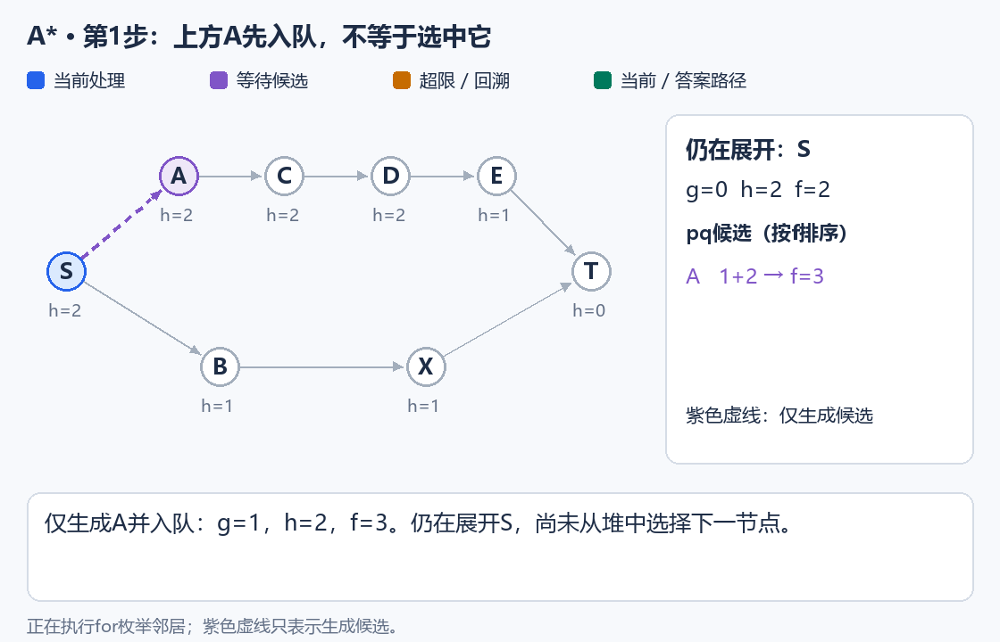
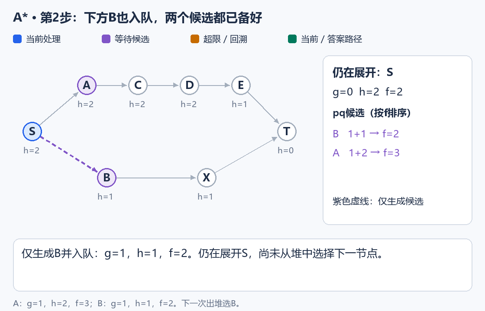
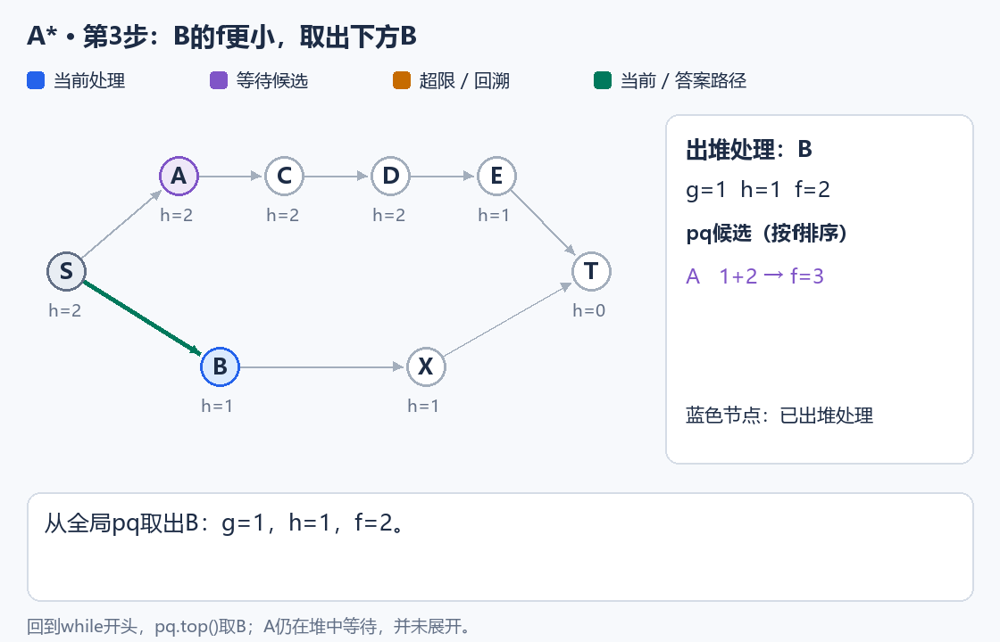
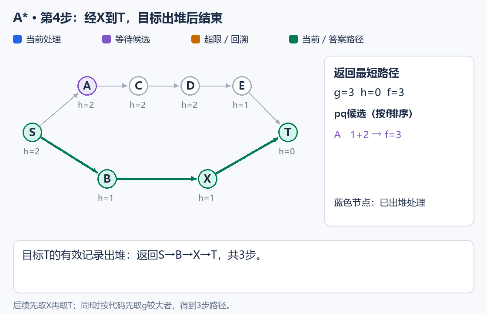
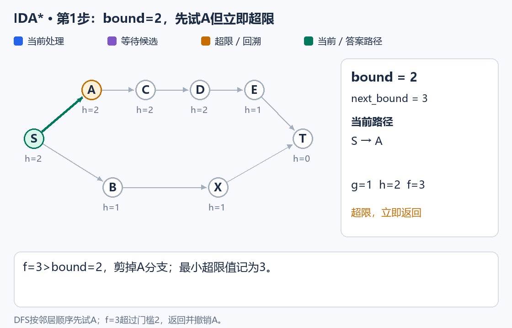
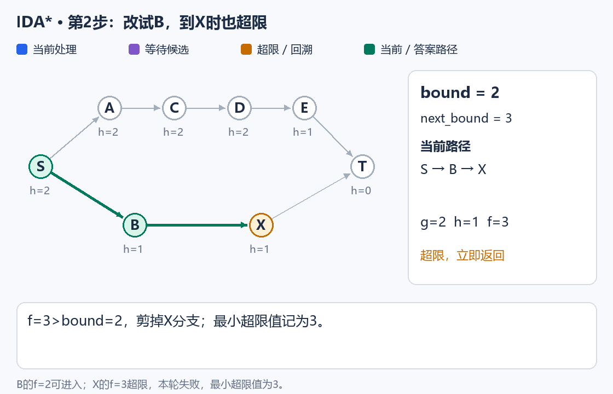
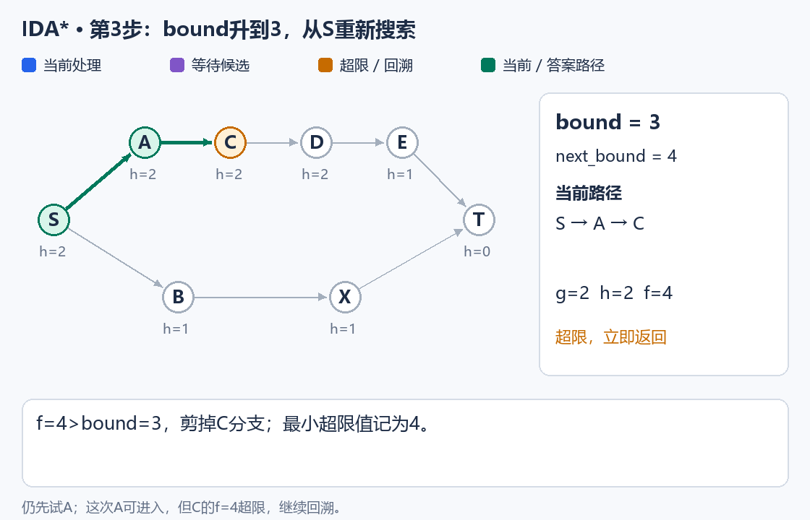
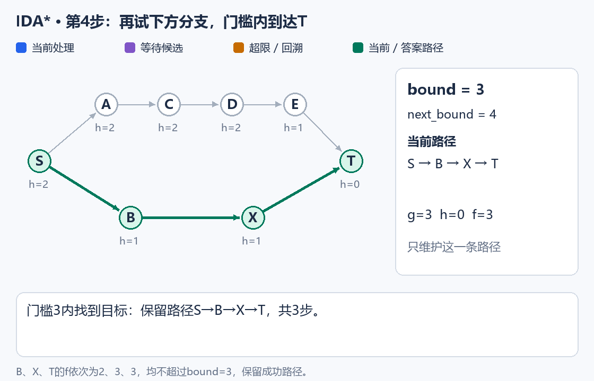
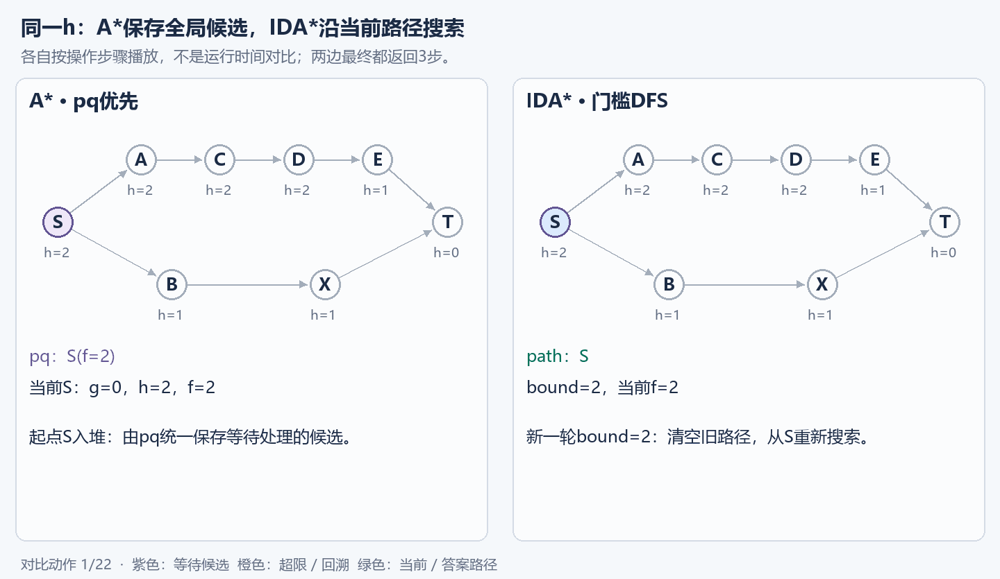

# 3.7 启发式搜索：A* 与 IDA*

前置：[BFS](02-bfs-shortest-path.md)、[Dijkstra](../06-graph-and-tree/04-dijkstra.md)、[迭代加深](06-iterative-deepening.md)。本节只处理**每步代价为 1，求最少操作次数**。

## 1. 启发式搜索的基本思想

已经走了 2 步，至少还需要 5 步，就不可能在 6 步内完成。与其走到上限再返回，不如提前利用“剩余至少几步”指导搜索。

| 记号 | 含义 |
| --- | --- |
| g | 已经走过的实际步数 |
| h | 从当前状态到目标，剩余步数的下界 |
| f=g+h | 沿当前路线完成时，总步数的下界 |

**BFS 按 g 分层；A* 按 f 排序；IDA* 按 f 的门槛进行 DFS。**

下面分步图使用同一张小图，每条边算一步，节点旁标出 h。前两段采用静态图片，可以随时停下来对照代码；最后保留并排对比 GIF。

**蓝色节点表示当前处理，紫色节点表示等待候选；紫色虚线只表示生成候选，不表示已经选中它继续搜索。** 橙色表示超限或回溯，绿色表示当前路径或最终答案。

## 2. A* 算法

```cpp
using Step = function<vector<string>(const string&)>;
using Goal = function<bool(const string&)>;
using Heuristic = function<int(const string&)>;

// A*：寻找起点到目标状态的最短路径。
// 前提：每步代价为 1；状态及每个状态的后继有限；
// h(u) 为非负、可采纳的距离下界，且目标处 h = 0。
// g+h须小于INT_MAX；若另给max_steps，取非负整数上限。
// 返回包含起终点的最短路径；搜索耗尽或给定上限内无解返回空vector。
vector<string> astar(const string& start, const Goal& is_goal,
                     const Step& next, const Heuristic& estimate,
                     int max_steps = -1) {

    struct Item {
        int f;       // f (Evaluation Function，评价函数) = g + h：预计总代价
        int g;       // g (Path Cost，路径代价)：起点到当前状态的实际代价
        string u;    // 当前状态；h (Heuristic，启发式估价) = estimate(u)
    };

    // 小根堆：优先 f 小的状态；f 相同时优先 g 大的状态（优先较大的 g：倾向于深入搜索）。
    struct Cmp {
        bool operator()(const Item& a, const Item& b) const {
            if (a.f != b.f) return a.f > b.f;
            return a.g < b.g;
        }
    };

    priority_queue<Item, vector<Item>, Cmp> pq;

    unordered_map<string, int> best_g;       // 起点到各状态的最短已知距离
    unordered_map<string, string> pre;       // 前驱状态，用于恢复路径

    // 初始化起点：g = 0，f = g + h。
    int first = estimate(start);
    if (max_steps >= 0 && first > max_steps) return {};

    best_g[start] = 0;
    pq.push({first, 0, start});

    while (!pq.empty()) {
        auto cur = pq.top();
        pq.pop();

        // 丢弃旧距离快照：该状态后来已经找到更短路径。
        if (cur.g != best_g.at(cur.u)) continue;

        // 目标在出堆时判断，而不是生成时判断，保证最短路径。
        if (is_goal(cur.u)) {
            vector<string> path{cur.u};

            while (path.back() != start)
                path.push_back(pre.at(path.back()));

            reverse(path.begin(), path.end());
            return path;
        }

        // 达到步数上限，不再扩展。
        if (max_steps >= 0 && cur.g == max_steps) continue;

        for (const string& v : next(cur.u)) {
            int ng = cur.g + 1;

            // 已有路径不长于当前路径，无须更新。
            auto it = best_g.find(v);
            if (it != best_g.end() && it->second <= ng)
                continue;

            // f = g + h；乐观估计仍超过预算，直接剪枝。
            int f = ng + estimate(v);
            if (max_steps >= 0 && f > max_steps) continue;

            // 找到更短路径，更新距离、前驱并重新入堆。
            best_g[v] = ng;
            pre[v] = cur.u;
            pq.push({f, ng, v});
        }
    }

    return {};
}
```

**用途速记：** 输入起点、目标判断、一步转移和剩余步数下界，小根堆按 f=g+h 选出下一状态，返回包含起终点的最短路径。第五个参数是可选步数上限，省略时不设人为上限；空 vector 表示搜索耗尽或给定上限内无解。

**对照代码分四步看：生成候选与出堆扩展是两件事。**

**① 先生成 A，放入堆中。** `for` 恰好先枚举上方邻居，还没有执行下一次 `pq.top()`。



**② 再生成 B，两个候选都入堆。** 它们的 g 都是 1，但：

$$
f(A)=1+2=3,\qquad f(B)=1+1=2.
$$

**因此下一次出堆一定先选下方 B。** 邻居的枚举顺序不决定搜索的扩展顺序。



**③ 回到 `while`，取出 B，再展开它的邻居。** A 继续留在堆中等待。



**④ B 生成 X；随后取出 X，生成 T，最后取出目标 T。** X 与 A 的 f 都为 3，本代码的并列规则先取 g 更大的 X；T 与 A 并列时同理。最后返回 3 步路径。



**三个注意事项：**

1. **目标有效记录出堆时结束**，不要第一次生成目标就返回。
2. **允许更短路线重新更新状态**，不能简单加永久 visited。
3. **用 best_g 丢弃旧队列记录**，堆里的旧快照不会自动改变。

当前实现允许状态重新展开，因此只要求 h **可采纳，即不高估**，不额外要求一致性。相同 f 时先取 g 较大的候选只是并列规则，不保证路径字典序。

## 3. 启发函数设计

设 $d(u,\mathrm{goal})$ 为从 u 到目标的真实最少步数，要求：

$$
\boxed{0\le h(u)\le d(u,\mathrm{goal})}.
$$

**设计方法：放松原问题的部分限制，求解一个更容易的问题，把它的最优代价作为原问题的下界。** 目标处 h=0，不需要先求出真实最短距离。

| 场景 | 常用下界 |
| --- | --- |
| 四方向、每步一格的网格 | 忽略障碍后的曼哈顿距离：行差绝对值＋列差绝对值 |
| 八数码 | 忽略数字之间的阻挡，把每个非零数字到各自目标位置的曼哈顿距离相加 |

**八数码不计空格 0。** 每次只把一个非零数字移动一格，距离总和最多减少 1，所以不可能用比这个和更少的步数完成。

## 4. IDA* 算法

```cpp
using Step = function<vector<string>(const string&)>;
using Goal = function<bool(const string&)>;
using Heuristic = function<int(const string&)>;

// IDA*：迭代加深 A*，使用 DFS 搜索并逐步放宽 f 值上限。
// 前提：每步代价为 1；状态及每个状态的后继有限；
// h(u) 为非负、可采纳的距离下界，且目标处 h = 0。
// max_steps可省略；-1表示不设人为步数上限。
// 返回包含起终点的最短路径；搜索耗尽或给定上限内无解返回空vector。
vector<string> idastar(const string& start, const Goal& is_goal,
                       const Step& next, const Heuristic& estimate,
                       int max_steps = -1) {

    const int INF = INT_MAX;

    vector<string> path;             // 当前 DFS 路径
    unordered_set<string> in_path;   // 当前路径上的状态，防止重复经过

    int bound = estimate(start);     // 当前轮 f 值上限
    int next_bound;                  // 下一轮需要尝试的最小 f 值

    function<bool(int)> dfs = [&](int g) -> bool {

        // f = g + h：实际路径代价 + 启发式估计。
        int f = g + estimate(path.back());

        // 超出当前阈值，记录最小超界 f，留待下一轮搜索。
        if (f > bound) {
            next_bound = min(next_bound, f);
            return false;
        }

        // 到达目标，保留当前路径并结束搜索。
        if (is_goal(path.back()))
            return true;

        // 只有调用者另给上限时，才在这里限制实际步数。
        if (max_steps >= 0 && g == max_steps)
            return false;

        // 枚举下一步状态。
        for (const string& v : next(path.back())) {

            // 当前路径已经经过 v，跳过以避免形成环。
            if (in_path.count(v))
                continue;

            // 选择状态，加入路径。
            path.push_back(v);
            in_path.insert(v);

            // 递归搜索，实际路径长度增加 1。
            if (dfs(g + 1))
                return true; // 成功时保留完整路径。

            // 当前分支失败，恢复现场。
            in_path.erase(v);
            path.pop_back();
        }

        return false;
    };

    // 逐步提高 f 值上限，第一次找到的就是最短路径。
    while (max_steps < 0 || bound <= max_steps) {

        // 每轮从起点重新搜索。
        path = {start};
        in_path.clear();
        in_path.insert(start);

        // 初始化下一轮阈值。
        next_bound = INF;

        if (dfs(0))
            return path;

        // 没有产生任何超界状态，说明搜索空间已经耗尽。
        if (next_bound == INF)
            return {};

        // 跳到刚才搜索中遇到的最小超界 f，而不是简单 +1。
        bound = next_bound;
    }

    return {};
}
```

**用途速记：** 输入与 A* 相同，内部用 DFS 枚举路径，只进入 g+h 不超过 bound 的分支。失败后放宽门槛、从起点重搜，返回含起终点的最短路径；第五个上限参数同样可以省略。

**对照同一张图，观察门槛如何控制 DFS。** `next(S)` 仍先返回 A、再返回 B；这里没有优先队列，不会先比较两个邻居的 f 来决定顺序。

**① 第一轮 `bound=2`，先试上方 A。** A 的 f 为 3，立即超限返回；随后撤销 A，才能改试 B。



**② B 可以进入，但走到 X 又超限。** 本轮两次超限值都是 3，所以 `next_bound=3`；回溯完仍未找到目标，就把门槛提高到 3。



**③ 从 S 重新搜，仍先试 A。** 这次 A 通过门槛，但它的孩子 C 的 f 为 4，又被剪掉。



**④ 回溯后再试 B → X → T。** 三者的 f 都不超过 3，到达目标，保留路径并返回。



只抓住三个动作：

- **第一轮：** `bound = h(start)`。
- **本轮：** `g+h > bound` 就剪掉，失败分支撤销路径标记。
- **下一轮：** 取本轮遇到的最小超限 f，不是机械地加 1。

next_bound 不是答案，只表示“下一轮至少要放宽到哪里”。完整状态不能在同一路径绕圈，但别的路径仍可再尝试；没有新门槛且搜索已经耗尽时，返回无解。

## 5. 本质与横向对比

**核心只有一个：用不高估的 h，把“已经走了多少”与“至少还要多少”合起来。**

- **A* 交给 pq 管理：** 保存全局候选，下一步可以从另一条路径接着展开。
- **IDA* 交给限深 DFS 管理：** 沿当前路径尝试；超出 f 门槛就回溯，本轮失败再提高门槛。它保留 IDDFS 的逐轮搜索方式，但限制的是 g+h。

| 对比 | A* | IDA* |
| --- | --- | --- |
| 选择下一步 | 从全局小根堆取 f 最小的候选 | 按 DFS 邻居顺序尝试，f 超限就返回 |
| 时间 | 取决于 h，较短路线仍可能重开状态 | 可能跨路径、跨门槛重复搜索 |
| 空间 | 较大，保存候选堆、距离表与前驱 | 较小，主要保存当前路径、栈及生成的邻居 |
| 适用 | 内存允许，希望保留全局候选 | 内存较紧，适合逐条路径探索 |



动画按操作步并排演示，**不是实际运行时间对比**。A* 的紫色虚线表示“生成并入队”，真正选择下一状态发生在出堆时；IDA* 则按 DFS 邻居顺序尝试、用门槛剪枝。两边都得到 3 步答案。

估价的影响记三条即可：

- **h=0：** A* 退化为 Dijkstra 的距离优先方式，单位边权下相当于 BFS；IDA* 退回逐深搜索。
- **h 过小：** 仍正确，但搜索效率可能较低。
- **h 高估：** 可能失去最优性保证。

启发函数本身也有计算成本，不能只为了减少节点数而设计过于昂贵的 h。两者最坏仍可能搜索大量状态，不保证一定比 BFS 快。

## 6. 典题：P1379 八数码

[洛谷 P1379](https://www.luogu.com.cn/problem/P1379)：完整九格字符串是一个状态，空格与相邻数字交换算一步，目标是 `123804765`。原来的[双向 BFS 复盘](05-bidirectional-bfs.md#91-p1379八数码难题)继续保留。

本次实际代码使用 IDA*。下面保留题目逻辑与注释，只按当前接口省略原稿的 MAX_STEPS；共用的搜索函数见上文，不再重复 main。

```cpp
void solve() {
    string start;
    cin >> start;

    const string target = "123804765";

    // Step：枚举空格0的上下左右移动。
    Step next = [](const string& u) -> vector<string> {
        vector<string> res;
        int z = (int)u.find('0');
        int x = z / 3;
        int y = z % 3;

        const int dx[] = {-1, 1, 0, 0};
        const int dy[] = {0, 0, -1, 1};

        for (int d = 0; d < 4; ++d) {
            int nx = x + dx[d];
            int ny = y + dy[d];

            if (nx < 0 || nx >= 3 || ny < 0 || ny >= 3)
                continue;

            // 交换空格与相邻数字，生成新状态。
            string v = u;
            swap(v[z], v[nx * 3 + ny]);
            res.push_back(v);
        }
        return res;
    };

    // Goal：判断是否达到目标布局。
    Goal is_goal = [target](const string& u) -> bool {
        return u == target;
    };

    // Heuristic：所有非零数字到各自目标位置的曼哈顿距离之和。
    Heuristic estimate = [target](const string& u) -> int {
        int h = 0;
        for (int i = 0; i < 9; ++i) {
            if (u[i] == '0')
                continue;

            int j = (int)target.find(u[i]);
            h += abs(i / 3 - j / 3)
               + abs(i % 3 - j % 3);
        }
        return h;
    };

    // 本题有限且保证有解，不必另给31步这样的上限。
    vector<string> path = idastar(start, is_goal, next, estimate);
    // 也可直接换成：astar(start, is_goal, next, estimate)

    cout << (path.empty() ? -1 : (int)path.size() - 1) << '\n';
}
```

**用途速记：** Step 生成一步能到的棋盘，Goal 判断是否到达目标，Heuristic 给出剩余步数下界；写好三者后，交给 A* 或 IDA* 管理搜索。

| 题目部分 | 只负责什么 |
| --- | --- |
| 状态字符串 | 保存整个棋盘，不是只保存空格位置 |
| Step／next | 找 0，换算行列，复制后交换，返回所有一步邻居 |
| Goal／is_goal | 与目标棋盘比较 |
| Heuristic／estimate | 对每个非零数字计算到其目标位置的距离，再求和 |

**同一套 Step、Goal、Heuristic，可以原样交给两种模板：**

```cpp
auto a = astar(start, is_goal, next, estimate);
auto b = idastar(start, is_goal, next, estimate);
// 都返回最短路径，size()-1相同；具体路径、搜索次序与资源消耗可能不同。
```

templates 中对应名称为 `astar_path` 与 `idastar_path`，参数顺序和返回含义相同，只需替换函数名。

**本题不需要事先给步数上界。** 棋盘状态有限，且题面保证可达，A* 会搜索到目标，IDA* 会逐步提高 f 门槛直到成功；不要把“不设人为上限”与“不做 bound 剪枝”混淆。

“八数码可达状态间最短距离不超过 31 步”只是[背景上界](https://cs.gmu.edu/~zduric/cs580/Games.pdf)，本实现不依赖它，**不要求记忆或证明，也不表示每个固定目标的最远距离都恰好是 31**。

参考：[CS188 启发式搜索](https://inst.eecs.berkeley.edu/~cs188/textbook/search/informed.html)、[OI Wiki IDA*](https://oi-wiki.org/search/idastar/)。实现与简短契约见[本节模板](../../templates/03-search/heuristic-search/README.md)。

[返回搜索索引](README.md)
