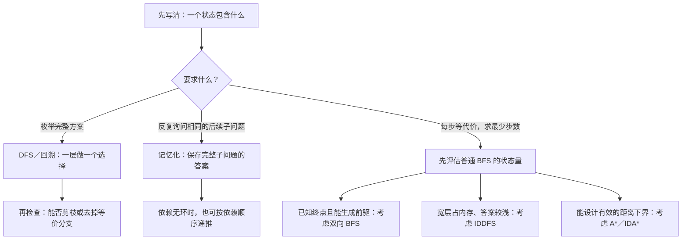

# 3.8 本章总结与选型

覆盖 3.1–3.7：DFS／回溯、BFS、记忆化搜索、剪枝、双向 BFS、IDDFS、A* 与 IDA*。

**本页集中比较“遇到什么问题选什么、保存什么、现场写起来有多难”。** 完整代码与典题过程继续保留在原节；知识整理完成不等于所有变式都已掌握。

## 1. 先明确状态，再选择搜索方式

在有钥匙和门的迷宫里，两条路线走到同一个格子，一条拿到了钥匙，另一条没有，后面能走的路不同。因此不能只用格子坐标判重：

$$
\text{状态}=(\text{当前位置},\text{已持有的钥匙}).
$$

**状态要包含决定后续选择与收益的全部信息。** 当前路径、剩余次数、容器载重即使放在共享数组里，也可能是状态的一部分。

状态明确后，再看题目目标：

图中后面的几种最短路方法是**结合条件比较的候选**，不是必须逐项升级。小状态图用普通 BFS 已经足够时，继续使用熟悉的写法。

一般非负带权最短路见 [Dijkstra](../06-graph-and-tree/04-dijkstra.md)；本章的等步长模板不能直接处理不同代价。

## 2. 各种方法分别解决哪一层问题

| 方法 | 主要作用 | 需要确认的条件 |
| --- | --- | --- |
| [DFS／回溯](01-dfs-backtracking.md) | 沿一条分支深入，枚举方案或判断能否完成 | 一层做什么、何时结束、哪些共享修改要恢复 |
| [BFS](02-bfs-shortest-path.md) | 按实际步数分层，求单源最少步数 | 每条转移等代价，完整状态能判重 |
| [记忆化搜索](03-memoized-search.md) | 相同的后续子问题只计算一次 | 缓存键完整，当前递归依赖无环，返回的是已经求完的子问题答案 |
| [剪枝](04-search-pruning.md) | 不再探索不合法、不会更优或重复表示的分支 | 能证明不会丢掉所需答案；单纯改枚举顺序不等于剪枝 |
| [双向 BFS](05-bidirectional-bfs.md) | 从指定起点与终点两端搜索，减少深入的层数 | 等代价，能生成原图前驱，按完整层处理 |
| [IDDFS](06-iterative-deepening.md) | 逐步提高深度上限，用 DFS 找最少步数 | 等代价、答案较浅；本章通用接口需给最大尝试深度 |
| [A*](07-heuristic-search.md#2-a-算法) | 用小根堆优先处理 g+h 较小的全局候选 | h 非负且不高估；当前实现允许更短路线重新展开 |
| [IDA*](07-heuristic-search.md#4-ida-算法) | 在 g+h 的门槛内做 DFS，失败后提高门槛 | 同样需要合法下界；接受重搜，以减少全局候选存储 |

**DFS／BFS 管理搜索顺序，记忆化减少重复子问题，剪枝排除不必继续的分支。** 它们可以组合，不是互相替换的同一件事。

例如，装箱用 DFS 决定每只猫放哪辆车，再用当前箱数剪枝；DAG 路径计数用 DFS 询问后继答案，再用 memo 避免重算。

## 3. 写法成本与时间、空间怎样比较

### 现场需要写什么

| 方法 | 写法成本 | 主要需要自己推导什么 |
| --- | --- | --- |
| DFS／回溯 | 通常短到中等；按题定义参数与共享数组 | 分支、结束条件、现场恢复 |
| BFS | 通常较低；队列、距离、一步邻居 | 完整状态、首次发现时判重 |
| 记忆化 | 在递归外增加缓存，代码往往不长 | 缓存维度、边界、返回值含义 |
| 剪枝 | 代码可能只有一个 if，证明成本可能更高 | 界是否安全，等价方案是否确实无需重复 |
| 双向 BFS | 较高；两份距离、两层列表、正反生成 | 反向规则、整层扩展、相遇停止条件 |
| IDDFS | 中等；外层重搜，内层限深与回溯 | 深度预算、路径标记、成功时保留路径 |
| A* | 较高；堆、最短已知距离、旧记录与前驱 | 合法且有效的 h，目标出堆才结束 |
| IDA* | 中等到较高；DFS 路径与两轮门槛 | h、最小超限值、失败后的撤销 |

**允许复用模板时，双向 BFS、A*、IDA* 的主要改题工作都落在状态与生成规则上。** A*／IDA* 还需提供估价；两者可使用同一组 Step、Goal、Heuristic，但各自的搜索次序与内存消耗不同。

### 估算时别只数最外层循环

| 模型 | 时间怎样估 | 主要额外空间 |
| --- | --- | --- |
| 图遍历或普通 BFS | 显式邻接表上为 O(V+E) | 访问／距离数组；DFS 栈或 BFS 队列 |
| 回溯枚举 | 实际搜索树节点数，加上生成与输出成本；可能指数或阶乘增长 | 当前路径、共享状态与调用栈；保存全部答案另计 |
| DAG 记忆化 | 每个状态算一次，再加全部转移；显式 DAG 上为 O(V+E) | 缓存与递归栈 |
| 双向 BFS | 有限显式图上仍可用 O(V+E) 作最坏上界 | 两份距离与当前层，反图另计 |
| IDDFS | 分支上界 b 固定且大于 1 时，搜到深度 D 的树模型为 O(b^D) | 路径与栈为 O(D)，本章逐层生成的邻居列表还可能占 O(bD) |
| A*／IDA* | 取决于 h 与实际展开量；IDA* 可能反复重搜 | A* 保存堆和全局记录；IDA* 主要保存当前路径、栈与逐层邻居 |

V 是状态数，E 是转移数，b 是每层分支上界，D 是最大尝试深度。表中按固定大小状态、常数生成成本估计；**字符串的复制、哈希和估价都要另算**。

双向 BFS 的“各搜一半”是接近均匀树状扩展时的收益，不是所有图的保证。IDDFS 在每点只有一个后继的长链上会反复走前缀，时间可到 O(D²)；剪枝和启发式也不保证消除指数搜索。

## 4. 标记相似，含义不同

| 记录 | 表示什么 | 分支结束后怎么处理 |
| --- | --- | --- |
| 普通图遍历的 visited | 这个完整状态已经发现过 | 保留，避免重复遍历 |
| BFS 的 dist | 这个状态第一次发现时的最少步数 | 保留，同一侧不重复入队 |
| 回溯／IDDFS／IDA* 的 in_path | **这个状态正在当前路径上** | 失败返回时撤销，让其他路径仍可尝试 |
| 记忆化的 memo | 这个后续子问题的完整答案已算好 | 保留，以后直接返回答案 |
| A* 的 best_g | **当前找到的最短到达步数** | 更短时更新并重新入堆，不能用永久 visited 阻止它 |

距离怎样更新、旧记录怎样跳过，见 [A* 的距离更新机制](07-heuristic-search.md#a-的距离更新机制)；门槛怎样放宽、失败后怎样撤销，见 [IDA* 的门槛与回溯机制](07-heuristic-search.md#ida-的门槛与回溯机制)。

**“这个点见过了”“这个点现在在路径上”“这个点的答案算完了”是三种信息。** 不能因为都能用数组记录，就混成同一个布尔值。

尤其要区分：

- **计数中的缓存复用：** 两条前缀到达同一后续子问题，可以各使用一次它的路径数量，不能把第二次请求直接跳过。
- **限深中的重复到达：** 同一位置还可能带着不同剩余步数，不能把一次深路径的失败当成永久失败。
- **剪枝后的返回：** 只证明这一支无需继续，不一定求出了该状态的精确最优值，不能随意写入精确 memo。

完整对照见[记忆化与数组递推](../../patterns/05-dynamic-programming/memoization-vs-tabulation.md#剪枝停止探索不等于已经算完子问题)。

## 5. 用已有题目横向比较

### P1379：同一套棋盘转移，不同搜索管理

棋盘字符串与一步移动规则不变，只改变怎样组织待搜索状态。已有[双向 BFS 实现](05-bidirectional-bfs.md#91-p1379八数码难题)和 [IDA* 实现及 A* 同接口调用](07-heuristic-search.md#6-典题p1379-八数码)继续在原节维护。

| 方法 | 这道题要额外提供什么 | 比较重点 |
| --- | --- | --- |
| 普通 BFS | 起点、目标、一步移动 | 最直接的基线，保存已发现棋盘 |
| 双向 BFS | 从目标反向移动；本题与正向规则相同 | 两端按完整层相向搜索；现有模板返回步数 |
| A* | 不计空格的曼哈顿距离之和 | 保存全局候选，用 f 选下一个出堆状态 |
| IDA* | 同一份曼哈顿估价 | 按邻居顺序 DFS，用 f 门槛阻止无望深入 |

**先生成哪个邻居，不等于下一步先扩展哪个邻居。** A* 先把邻居放进堆，再按 f 取出；IDA* 可以先试 f 较大的邻居，但若超出门槛就立即返回。

本题状态有限且保证可达，当前 A*／IDA* 接口无须手填 31。两种算法都求最少步数，**不是保证走相同路线或一样快**；普通 BFS 在本页仅作选型基线，不新增个人提交记录。

### P4017：同一个计数问题，两种计算方向

| 方式 | 状态含义 | 哪些点先有答案 |
| --- | --- | --- |
| 记忆化 DFS | 从 u 出发到任意终点的路径数 | 终点为 1，后继先算，结果返回前驱 |
| 拓扑 DP | 从任意起点到达 u 的路径数 | 起点为 1，前驱先算，再累加给后继 |

两者都是 O(V+E)，**中间状态不是同一种含义，但最后统计同一批完整路径**。长链时拓扑写法避开深递归；规则复杂、只想按需求某些状态时，记忆化通常更容易从递归定义写起。见[两种实现与方向图](03-memoized-search.md#72-洛谷-p4017最大食物链计数)。

### P1025、P10483、P1763：搜索骨架之外，突破仍在题目里

- **数的划分：** 选定非降序这一种表示，用上一份大小限制下一份，避免同一划分被排列重复计数。见 [P1025](04-search-pruning.md#91-p1025数的划分)。
- **小猫装箱：** 一层安置一只猫，枚举已有车和一辆新车；车内载重也是状态。见 [P10483](04-search-pruning.md#92-p10483小猫爬山与一维装箱)与[逐对象分配容器](../../patterns/03-search/object-to-container-search.md)。
- **埃及分数：** 外层限制项数，内层仍要设计分母界和最后两项求解；同项数还要比较末分母，不能把第一条完整方案直接当最终答案。见 [P1763](06-iterative-deepening.md#81-p1763埃及分数限项数再化简搜索末端)。

**模板管理搜索，不替题目决定状态、候选和安全剪枝。** 尤其 P1763 叠加了数论与末端优化，不能用它的实现长度代表 IDDFS 基础框架本身的难度。

## 6. 写题时按这个顺序落笔

1. **写状态句：** 当前处理到哪里，哪些信息会影响以后？
2. **写一步转移与终点：** 本层枚举什么，何时得到一个完整答案？
3. **选搜索管理：** 枚举方案、最少步数，还是重复子问题的答案复用？
4. **逐项证明优化：** 判重是否安全，能否剪枝，h 是否不高估？
5. **核对完整成本：** 状态量、转移量、复制／哈希、递归深度、是否保存所有候选。

**现场优先使用足够通过范围、自己能检查的实现。** 复用代码时，把精力放在状态与回调；手写时，先确保基本转移和恢复正确，再加入有依据的优化。

现成入口：[本章模板](../../templates/03-search/README.md)、[本章范式](../../patterns/03-search/README.md)。这是一份全章基础方法总结，不新增万能搜索函数，也不据此补记尚未提供的个人评测或独立掌握。

[返回搜索索引](README.md)
