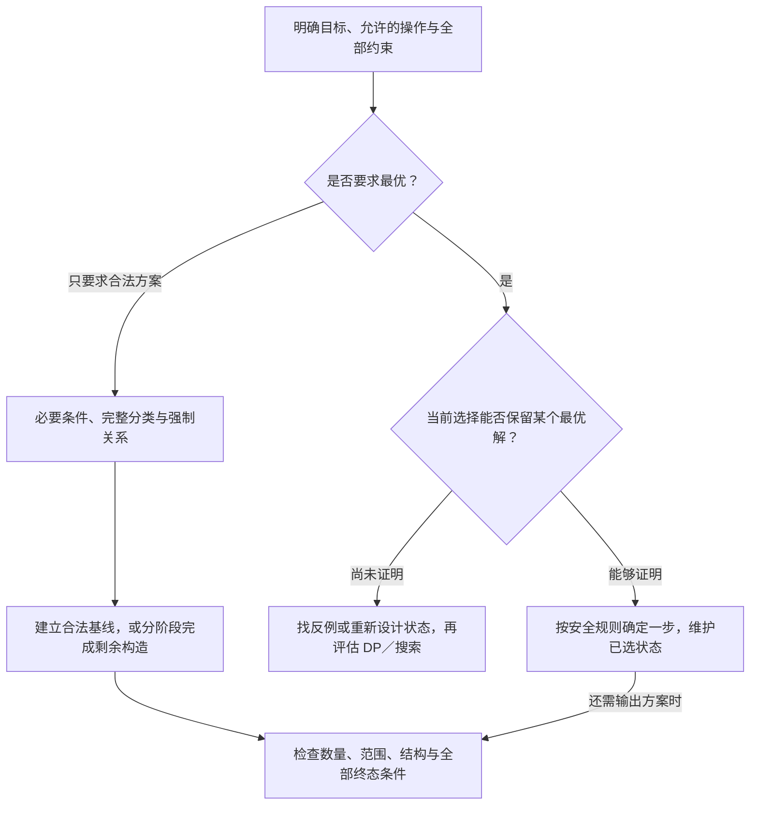

# 4.4 本章总结与选型

覆盖 4.1–4.3：排序选择、区间选择与基础构造，以及本章已有的基值与剩余量、分阶段处理、答案结构缩减范式。

**本页集中比较“为什么能直接决定、要维护什么、现场怎样写更稳”。** 六道典题的实际实现和完整推导保留在原节；本章现有基础模型收尾，不代表所有贪心变式都已覆盖，也不改变个人题目与掌握状态。

## 1. 先分清目标，再寻找可以确定的选择

同样给一组数字，目标可能是“最多选几件”“最少分几组”，也可能是“只需输出一组满足条件的数”。先明确目标，才能知道当前选择要保住什么。

**排序只组织候选，贪心证明才允许确定选择。** 构造可以使用贪心，也可以直接填固定布局；没有优化目标时，重点是证明每一步能完成、最后满足全部条件。

| 问题线索 | 当前已有模型 | 决策依据 |
| --- | --- | --- |
| 各项收益相同、成本非负、预算内最多选件数 | [便宜优先](01-sorting-greedy.md#2-导引模型预算内最多选多少件) | 用更便宜的一件替换，数量不变且成本不增加 |
| 所有对象都要分组，每组至多两件且总量有上限 | [轻重配对](01-sorting-greedy.md#从最重的一件确定本组) | 最重的一件本轮一定处理；能配最轻时可交换成这种配法 |
| 允许重排全部人，最多让多少人满意 | [构造满意前缀](01-sorting-greedy.md#第一层转化满意的人可以集中在前面) | 不满意者可后移；选短者不增加后续等待 |
| 等收益活动，最多选多少个互不冲突区间 | [最早结束](02-interval-greedy.md#3-为什么按结束时间排序) | 同样选一段，较早结束给后续留下的候选不更少 |
| 固定项数、总和给定、每项属于少数合法类别 | [基值与剩余量](03-basic-construction.md#核心思路必要条件筛选--基值分类--剩余量构造) | 类别穷尽后，检查合法基线与可分配余量 |
| 对称、数量等约束混在一起，部分位置被强制确定 | [分阶段构造](03-basic-construction.md#分阶段解耦让每一步交出更简单的状态) | 先传播强制信息，再核算资源，最后处理同质自由部分 |

原顺序属于约束时，不能直接排序改变问题；要最小字典序或最大收益时，也不能把“找到任意合法方案”的方法直接当成最优方案。

## 2. 贪心证明：当前合法、目标不差、后续仍能完成

考虑一个最优方案没有采用当前候选。尝试把候选换进去，至少需要同时检查：

| 要检查什么 | 本章例子 | 常见漏项 |
| --- | --- | --- |
| 当前选择合法 | 区间能接在已选边界之后；轻重总量不超限 | 只比较结束时间，却忘了当前起点是否可接入 |
| 替换后目标不更差 | 一件换一件、一区间换一区间，数量不变 | 收益不同，却仍只比较数量或价格 |
| 后面的原方案仍可使用 | 结束边界更早；总花费或等待不增加 | 眼前合法，但消耗了后面无法替代的资源 |

**只需存在一个最优方案采用当前选择，不要求所有最优方案都长这样。** 换入后，剩余问题仍满足原规则，才可以逐步重复。

例如，区间选择用结束更早的区间替换最优后续方案的**第一段**，才能保证替换前的前缀与替换后的后继都合法；不能随意换掉中间一段。完整交换见 [4.2](02-interval-greedy.md#结束早可以保留更多后续候选)。

P1094 中两件能配在一起，只说明这一步合法；将最优方案中的原搭档重新配对、证明组数不增加，才说明它安全。见[轻重配对的交换](01-sorting-greedy.md#为什么轻重配对不会吃亏)。

> **样例通过用于检查，交换或结构证明用于说明一般性。** “每次尽量多取、尽量早开始、尽量选短”都只是需要验证的候选规则。

## 3. 状态必须对应已经确定的决策

CF545D 的 `sum` 和区间选择的 `last_r` 都只代表**已经选入的对象**。扫描到一个候选，不等于让它进入状态。

| 写法位置 | 真正记录的内容 | 跳过候选后 |
| --- | --- | --- |
| 预算选件的 `used` | 已选物品的总价格 | 不增加价格 |
| CF545D 的 `sum` | 已确定满意前缀的服务时间 | 保持不变，未选者放到后面 |
| 区间选择的 `last_r` | 最后一段已选区间的终点 | 保持不变，不把冲突段的终点写进去 |
| CF1512C 的 `a,b` | 当前阶段尚未消耗的字符数量 | 按阶段定义扣减，不能重复计算原字符与补出的字符 |

### 都按升序扫描，为什么一个能 break，一个只能 continue？

| 模型 | 当前失败意味着什么 | 后面的候选是否也必然失败 |
| --- | --- | --- |
| 价格升序，预算内选最多件 | 当前价格已经超过剩余预算 | 后面更贵，也买不起，因此可以结束 |
| 服务时间升序，构造满意前缀 | 当前人的容忍等待时间太小 | 后面服务时间更大，仍可能接纳，必须继续检查 |

CF545D 的序列 `1、1、1、2`：前两人选入后 `sum=2`，第三个 1 跳过且不增加 sum，后面的 2 仍能选入。原错误片段和状态表见[满意前缀复盘](01-sorting-greedy.md#最初误区排序以后仍让所有人影响后续)。

区间也一样：只因一个区间起点太早，不能推断按终点排序的后续区间也都冲突。**能提前结束，需要额外证明所有后继候选都不可能改善当前判断。**

## 4. 构造证明：必要条件之外，还要保证补得完

构造通常有三层检查：

1. **为什么明显无解：** 必须满足的总量、奇偶、位置或结构限制。
2. **为什么条件足够：** 满足这些条件时，给出的生成方法一定能完成。
3. **为什么代码与证明一致：** 每阶段维持什么关系，结束时是否恰好满足全部目标。

### 基值与剩余量：把很多自由选择压成一个差额

CF1352B 的全奇与全偶是两类完整分类。每项先放最小合法基值 1 或 2，再看剩余量是否非负且为偶数；没有单项上限或其他耦合时，可以由一项吸收余量。

这里 `n>=k` 只是“总量足够放正数”的必要条件；**具体构造成功，才证明相应分类的条件充分**。判断 O(1)，真正输出 k 个数仍需 O(k)。原实现与合并分支的整理版见[同奇偶拆分](03-basic-construction.md#cf-1352b--same-parity-summands)。

### 分阶段：先减少情况，再统一处理

CF1512C 不适合把所有余额塞进一个位置：每个位置只能放一个字符，镜像对又必须成对消耗。

完成中心后，剩余位置都是同质自由对，两类余额非负、为偶数且总和等于未填位置数。这时先填一些 00 不会堵死后续，因为需要的 00 对数和 11 对数已经恰好确定。具体证明见[为什么先填 0 的自由对不会堵死后续](03-basic-construction.md#为什么先填-0-的自由对不会堵死后续)。

**当前没违反条件，还不足以保证能完成。** 阶段结束要交出下一步需要的保证；若强制信息会连锁传播或后续选择会反过来影响前面，一次顺序扫描未必足够，见[分阶段解耦的限制](../../patterns/04-greedy-and-construction/staged-constraint-decoupling.md#什么时候不能只按阶段扫一遍)。

## 5. 写法成本、复杂度与场景推荐

### 已有实现实际花在哪里

下表区分输入输出存储与工作状态；排序内部开销按具体实现另计，不把“只有两个指针”说成整个程序只占常数内存。

| 模型 | 时间 | 存储与副作用 | 现场主要负担 |
| --- | --- | --- | --- |
| 预算内最多件数 | O(n log n) | 教学函数按值复制 O(n)，保留原数组 | 排序、剩余预算和选中数量；目标必须等收益 |
| P1094 轻重配对 | O(n log n) | 输入数组 O(n)，原地排序；扫描只需常数状态 | 每轮处理最重者、能否带走最轻者、最后单件 |
| CF545D 满意前缀 | O(n log n) | 输入数组 O(n)，原地排序；累计状态常数 | sum 用 ll，仅选入时更新；失败不能直接结束 |
| 最多不冲突区间 | O(n log n) | 教学/模板按值复制 O(n)，返回数量，不返回方案 | 终点排序、首段标记、端点是否相接 |
| 固定间隔放 1 | O(n) | 输出字符串 O(n)，其他状态常数 | 长度与数量条件、写入位置是否越界 |
| CF1352B 基值与余量 | 判断 O(1)，输出 O(k) | 可以边生成边输出，工作状态常数 | 分类完整、余量步长、每项正数与恰好 k 项 |
| CF1512C 阶段构造 | O(n) | 字符串 O(n)；原版辅助 pos 为 O(n)，整理版辅助为 O(1) | 强制传播、统一计数、中心、镜像对与余额 |

**判断成本与输出成本分开算。** 两次或三次线性扫描仍为 O(n)；省去一个位置表是空间收益，不等于渐进时间更快。

### 手写与模板复用怎么选

| 场景 | 建议 | 仍须自己决定什么 |
| --- | --- | --- |
| 排序后只有少量累计/指针状态 | 用熟悉的短循环，贴近题意命名 | 排序依据、接纳条件、退出条件与数值范围 |
| 标准等收益区间选择 | 可复用[现有区间模板](../../templates/04-greedy-and-construction/interval-scheduling/README.md) | 端点语义；输入是否满足模型；是否需要方案编号 |
| 需要原输入顺序或原编号 | 明确保留副本，或将编号与对象一起排序 | 复制成本和排序副作用是否可接受 |
| 条件分支多、多个计数同步变化 | 先拆阶段、写每阶段保证，再实现 | 哪些是强制信息，哪些仍需选择；后续是否依赖前面的新信息 |
| 只要一个合法方案，类别很少 | 先按必要结构分类，再尝试固定布局或基线 | 分类是否穷尽，余量分配是否破坏上限/位置关系 |

CF1512C 原版中心最后处理也成立；整理版先处理中心，是让剩余对象统一成“对”，并省去 pos 表。**两版都是 O(n)，重点是实现职责更清楚，不必为了多解而复制一份相同算法。** 原代码和整理代码继续维护在[同一题复盘](03-basic-construction.md#cf-1512c--a-b-palindrome)。

当前本章模板索引只收录稳定的区间选择接口；其他模型保留短实现或问题自己的构造，不建立万能贪心/构造模板。

## 6. 相近问题，哪条条件改变后要换方法

| 看起来相近 | 真正改变的条件 | 应怎样重新考虑 |
| --- | --- | --- |
| 便宜优先选最多件 → 最大总价值 | 每件收益不再相同，交换后目标可能下降 | 看[0/1 背包](../05-dynamic-programming/02-zero-one-knapsack.md#3-按最后一件物品分类推出转移)等状态模型，并检查容量规模 |
| 每次取最大面值 → 最少硬币 | 大面值未必保留最少枚数 | `{1,3,4}` 凑 6 是反例；见[完全背包最少硬币](../05-dynamic-programming/03-complete-knapsack.md#61-最少硬币) |
| 每组至多两件 → 每组能放更多件 | 两指针配对的交换依据不再自动成立 | 重新分析；已有[小规模装箱搜索](../03-search/04-search-pruning.md#92-p10483小猫爬山与一维装箱)仅是满足其条件时的一个候选 |
| 最多不冲突区间 → 区间并集长度 | 前者可以丢区间，后者必须保留全部覆盖 | 使用[排序合并](../02-sequence-techniques/03-discretization.md#另一种做法排序合并区间)，不能共用决策规则 |
| 最多活动数量 → 最大总收益 | 不同区间的目标贡献不再相同 | 带权区间调度仍为按题补充，当前不把最早结束当答案 |
| 任意合法方案 → 最小字典序或最优方案 | 允许输出的答案中还要择优 | 重新证明每次填值安全，不能只检验最终合法 |

贪心失效不自动意味着某个 DP 一定可行；搜索、DP 仍各有状态量与时间限制。这里比较边界，不增加新的必学专题。

## 7. 用已有典题回顾，不重复粘贴代码

| 题目入口 | 最值得回顾的一点 |
| --- | --- |
| [P1094 纪念品分组](01-sorting-greedy.md#从最重的一件确定本组) | 先决定最重的一件，再证明能配最轻时组数不增加 |
| [CF545D Queue](01-sorting-greedy.md#状态只维护已经选入的满意前缀) | 允许重排先改变方案形态；状态只累计真正进入前缀的人 |
| [P1803 线段覆盖](02-interval-greedy.md#洛谷-p1803--凌乱的yyy--线段覆盖) | 结束早留下的后续选择不更少；首段不受虚构的时间 0 限制 |
| [CF597B Restaurant](02-interval-greedy.md#cf-597b--restaurant) | 同算法、不同端点语义，共享时刻是否冲突必须重读题意 |
| [CF1352B 同奇偶拆分](03-basic-construction.md#cf-1352b--same-parity-summands) | 先把合法答案分为全奇/全偶，再由基线和余量证明有解 |
| [CF1512C A-B Palindrome](03-basic-construction.md#cf-1512c--a-b-palindrome) | 强制关系、资源数量、中心与自由对分开处理，减少状态混用 |

跨章的[答案结构缩减](../../patterns/04-greedy-and-construction/answer-structure-reduction.md)也可回顾：先证明哪些外层能安全保留或哪些类别可以排除，再把剩余部分交给合适工具。CF1326D2 的 Manacher 实现仍在[字符串原节](../08-strings/03-manacher.md#cf-1326d2前后缀回文)，不在本章重讲算法或另记一次题目完成。

## 8. 落笔顺序与自查

写题时先把目标和允许操作写清，再提出选择或完整分类，证明不损失最优值/能够完成，最后才确定状态更新与代码细节。若证明依赖“自由且同质的槽位”“等收益”“允许任意重排”，把这条条件写在选择旁边。

1. 同样按升序扫描，预算选件为什么能 break，CF545D 为什么不能？它们的累计量分别包含谁？
2. 区间收益改变、分组容量从两件改变、构造增加字典序要求时，原证明哪一步失效？
3. CF1352B 的余量为何能由一项吸收，CF1512C 的余额为何必须按对分配？每阶段如何保证能完成？

本章现有基础内容的总结已整理，区间覆盖/选点、带权调度等原有按题补充继续保留；不因收尾而加入新题单或标记全部掌握。完整思想继续查[本章范式](../../patterns/04-greedy-and-construction/README.md)，代码接口查[本章模板](../../templates/04-greedy-and-construction/README.md)。

[返回本章索引](README.md)
