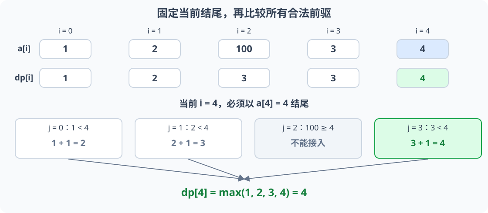
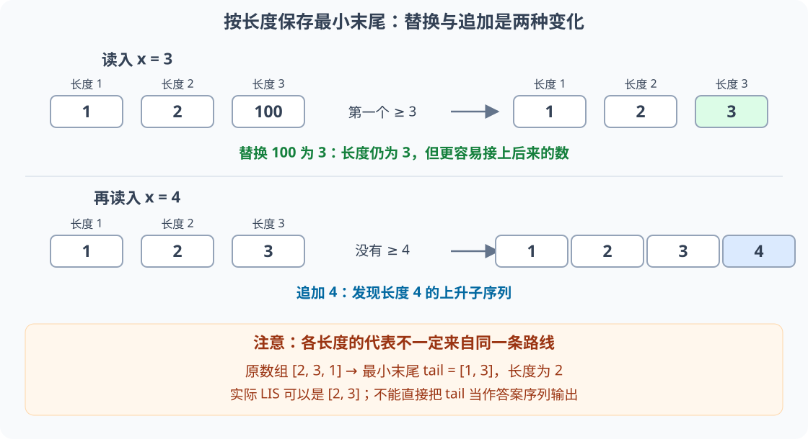
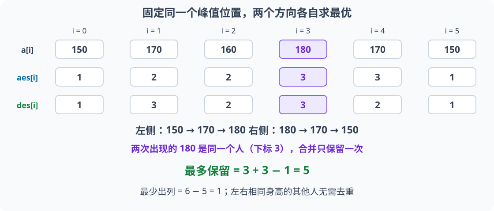

# 5.4 序列 DP：以当前位置结尾

前置：[DP 的状态与初值](01-dp-basics.md)、[记忆化搜索的每层职责](../03-search/03-memoized-search.md#71-洛谷-p1434滑雪)、[DAG 上的状态汇总](../../patterns/06-graph-and-tree/dag-dp.md)。

本节以**最长严格上升子序列（LIS）**为模型，先建立 `O(n²)` 的基础写法，再推导 `O(n log n)` 的最小末尾与二分优化。重点不是背转移，而是说明：**为什么要固定结尾，前面的哪些状态能够接上，最终答案在哪里。**

## 平方写法：先看完整代码

下面只返回长度，不保存具体选取方案。沿用 [C++ 基础框架](../../templates/01-basic-problem-solving/cpp-contest-template/README.md)；单独使用需包含 `<vector>` 和 `<algorithm>`。

```cpp
// a 使用 0-based；返回严格上升子序列的最大长度
int lis_length(const vector<int>& a) {
    int n = static_cast<int>(a.size());
    vector<int> dp(n, 1);
    int ans = 0; // 空数组没有元素可选，答案为 0

    for (int i = 0; i < n; ++i) {
        for (int j = 0; j < i; ++j) {
            if (a[j] < a[i]) {
                dp[i] = max(dp[i], dp[j] + 1);
            }
        }

        // 所有前驱都比较完，才得到当前结尾的最终答案
        ans = max(ans, dp[i]);
    }

    return ans;
}
```

随后围绕代码中的 `dp` 初始化、`i/j` 枚举、合法条件、`max` 更新与 `ans` 汇总，逐步解释状态和原理。

## 1. 子序列可以跳过元素，但不能改变顺序

例如原数组：

$$
[1,2,100,3,4].
$$

取出 `1、2、3、4`，保持原来的先后顺序，得到长度为 `4` 的上升子序列；不要求这些数在原数组中连续。

| 名称 | 位置要求 | 值的要求 |
| --- | --- | --- |
| 子数组／连续子段 | 必须连续 | 取决于题目 |
| 子序列 | 可以跳过，但保留相对顺序 | 取决于题目 |
| 严格上升子序列 | 可以跳过，但保留相对顺序 | 后一个数必须严格更大 |

**不能先排序原数组再求本题答案。** `[3,2,1]` 的答案为 `1`；排序成 `[1,2,3]` 后，原有的位置限制已经被改变。

## 2. 为什么不能只留前面最长的一条？

先处理到 `[1,2,100]`。当前最长路线是 `1 → 2 → 100`，长度为 `3`；但后面出现 `3` 时，不能接到 `100` 后面。

较短的 `1 → 2` 却可以继续接 `3`，再接后来的 `4`。

> **长度更大，不代表对所有未来元素都更容易扩展；还要知道结尾是什么。**

**因此先按结尾位置区分状态。固定结尾后，后续能否接入一个数，就能直接比较它与这个结尾的大小**。

## 3. 状态、变量与转移

### 先写完整状态句

**`dp[i]` 表示：只使用下标 `0..i` 中的元素，且必须以 `a[i]` 结尾的严格上升子序列，最多有多少个元素。**

它不是“前 `i + 1` 个元素中的全局最优长度”。后者未必以 `a[i]` 结尾，不能直接拿来追加当前数。

### 变量、容量与下标

- `a`：原数组，**0-based**，有效下标为 `0..n-1`，不排序、不修改。
- `n`：元素数量；数组长度需要能够用 `int` 表示。
- `dp`：分配 `n` 项，按**位置数量**开表，与元素值有多大无关。
- `i`：当前准备求解的结尾位置。
- `j`：当前数前面可能衔接的最后一个位置，范围为 `0..i-1`。
- `ans`：已经处理过的所有结尾中，最大的子序列长度。

**这里 `dp[0]` 是以第一个元素结尾的答案，不是空前缀。** 下标语义由状态定义决定，不能沿用前缀和中“第 0 项代表空前缀”的约定。

### `vector<int> dp(n, 1)`：只选当前数，也是合法子序列

$$
dp[i]=1.
$$

即使前面没有可衔接的位置，也能只选择 `a[i]`。所有位置都天然可达，不需要使用不可达哨兵。

### 双层循环与 `if`：枚举倒数第二个位置

若一条上升子序列在 `a[i]` 前还有一个数，设它的位置为 `j`。先后顺序要求：

$$
j\lt i.
$$

严格上升要求：

$$
a[j]\lt a[i].
$$

这两个条件同时满足时，任何以 `a[j]` 结尾的上升子序列，都可以追加 `a[i]`。其中最长的一条提供：

$$
dp[j]+1.
$$

这里的 `+1` 只代表新加入的当前元素。逐个比较合法前驱：

$$
dp[i]\leftarrow\max\bigl(dp[i],dp[j]+1\bigr).
$$

> **固定结尾 `a[j]` 后，只保留最长长度就够了**：后续能否接上只取决于这个结尾；同结尾的较短路线不会更有利。

## 4. 把序列看成隐式 DAG

把每个位置看作一个点。若 `j < i` 且 `a[j] < a[i]`，就把 `j → i` 看作一条可以衔接的边。

**边只从较小下标指向较大下标，不会形成有向环。** 因而按 `i = 0,1,...,n-1` 计算时，所有需要的前驱都已经求完。

$$
\text{位置先后}\quad\Longrightarrow\quad\text{天然的拓扑顺序}.
$$

这与旅行计划的“到达当前点的最长路线”相同，只是合法边通过条件判断生成，**无需存邻接表，也无需再跑一次拓扑排序**。

相关识别见 [DAG DP 中的序列依赖](../../patterns/05-dynamic-programming/dp-modeling-workflow.md#从序列中识别隐式-dag)。

## 5. 执行流程与手推

1. 每个结尾先设为长度 `1`。
2. 按原顺序枚举当前结尾 `i`。
3. 检查所有 `j < i`；只有 `a[j] < a[i]` 才能提供候选。
4. 比较完所有候选，`dp[i]` 才是以当前位置结尾的最优长度。
5. 用 `dp[i]` 更新全局答案，再处理下一个结尾。



对于 `[1,2,100,3,4]`，处理最后的 `4` 时：

| 前驱位置 `j` | 前驱值 | 是否能接 `4` | 提供的候选长度 |
| --- | --- | --- | --- |
| `0` | `1` | 可以 | `1 + 1 = 2` |
| `1` | `2` | 可以 | `2 + 1 = 3` |
| `2` | `100` | 不可以 | 不参与比较 |
| `3` | `3` | 可以 | `3 + 1 = 4` |

所以最终状态为：

$$
dp=[1,2,3,3,4],\qquad ans=4.
$$

## 6. 正确性与复杂度

### 为什么没有漏掉最优子序列？

任何以 `a[i]` 结尾的合法方案，要么只有自己，要么存在倒数第二个位置 `j`。

前一种由初值 `1` 覆盖。后一种的 `j` 必须满足下标在前、值更小，这些位置全部被枚举；用对应的最长前驱再追加当前数，不会更差。

因此每个 `dp[i]` 正确。任何非空最优子序列又一定在某个位置结束，对全部结尾取最大值即可。

### 从题意到状态，再到转移

1. **先确定目标：** 在原有顺序中选元素，使值严格上升且长度尽量大；不能排序后破坏原位置。
2. **尝试描述更小的问题：** 一条方案的最后一个数选在何处？固定结尾 `i`，就能根据末尾值判断以后能否继续接数。
3. **写完整状态句：** `dp[i]` 必须包含 `a[i]`，不是前 `i + 1` 项的整体最优。
4. **拆最后一步：** 要么只选自己，要么从某个满足 `j < i`、`a[j] < a[i]` 的结尾追加当前项。
5. **比较全部合法来源：** 每个前驱提供 `dp[j] + 1`，取最大；不是仅凭前驱值或当前长度挑一个位置。
6. **最后决定顺序与答案：** 按下标递增求解，再对所有结尾取最大值。

**这与[编辑距离的推导](05-two-sequence-dp-lcs.md#如何想到操作选择--两个前缀--最少代价)相同：先确定每个状态到底完成了什么，再用最后一次选择把问题缩小。** LIS 固定一个结尾；编辑距离需要固定两个前缀，维度由所需信息决定。

### 为什么固定同一结尾后，只需要保留最长前段？

例如 `[1,2,3,4]` 中，固定以前三项最后的 `3` 结尾：

$$
[1,3],\qquad [1,2,3].
$$

两条方案都能接上后面的 `4`，但第二条更长。**它们能否接入后续元素都只受同一个末尾 `3` 限制，较短方案没有额外优势。**

一般地，假设某个整体最优方案使用了以 `a[j]` 结尾的前段，长度为 `r`，但：

$$
r\lt dp[j].
$$

换成以**同一个位置 j** 结尾的最长前段后，结尾值和位置不变，后面的选取仍然合法：

$$
r+1\lt dp[j]+1.
$$

再接同一组后续元素，整个方案会更长，与原方案已经最优矛盾。因此只保留 `dp[j]` 足够。

> **这个结论只针对同一状态。** 不同结尾之间仍要检查合法性并比较，不能只保留前面整体最长的一条；第 2 节的 `[1,2,100,3,4]` 正是反例。

平方写法是在求出各前驱最优值后取 `max`，属于 DP；后面的二分版能丢掉同长度的较大末尾，还依赖另一套“较小末尾更容易扩展”的证明，不能混成未经论证的局部选择。

### 复杂度由候选前驱数量决定

$$
0+1+2+\cdots+(n-1)=\frac{n(n-1)}2.
$$

每对位置只做常数次判断，时间为 `O(n²)`，额外空间为 `O(n)`。表值最多为 `n`，当前长度计算用 `int` 足够；没有对元素本身求和。

**序列 DP 指状态按序列位置组织，不代表时间一定为 `O(n)`。** 每个状态需要枚举多少前驱，仍要单独计算。

`n = 5000` 时约检查一千二百五十万对位置；若 `n` 到十万级，不能继续照搬平方写法。下文通过[按长度保存最小末尾](#8-二分优化同长度只保留最小结尾)继续推导二分优化；它不是直接在原来的 `dp[i]` 上二分。

## 7. 状态含义决定易错边界

### 答案不一定以最后一个元素结尾

例如 `[1,2,3,0]`：

$$
dp=[1,2,3,1].
$$

最后一个状态只表示“必须选最后的 `0` 作为结尾”，因此是 `1`；整体答案仍为 `3`。

**`dp[i]` 不一定随 `i` 增大；全局最优 `ans` 才不会因后面多一个元素而变小。**

| 已有模型 | 下标代表什么 | 最后一个表项是否就是答案 |
| --- | --- | --- |
| 容量不超过上限的背包 | 可使用的容量上限 | 按该模型取总容量项 |
| 本节 `dp[i]` | 必须以第 `i` 个元素结尾 | 需要比较全部结尾 |

### 相等能不能接，必须服从题意

- **严格上升**使用 `<`；`[2,2,2]` 的答案为 `1`。
- **不下降**允许相等，使用 `<=`；同一数组的答案为 `3`。

不能只因为两个版本代码相近，就忽略这个条件变化。

### 不需要回溯撤销，也不需要路径访问标记

每个 `dp[i]` 保存已经求完的结果；较早结尾可以为多个较晚结尾提供候选，不存在“用了就不能再供其他方案使用”的限制。

但这仍只保留最大长度。若改成统计最长子序列条数或输出方案，需要增加相应信息，不能把返回长度直接当作方案数。

## 8. 二分优化：同长度，只保留最小结尾

平方写法按**结尾位置**保存长度。若只求 LIS 长度，可以反过来：**按长度保存最有利的结尾**。

`tails[len-1]` 表示长度为 `len` 的上升子序列所能达到的**最小结尾值**；维护它，就是让每种长度的子序列尽可能容易延长。

`tails` 的每个位置对应一种长度，且长度从 1 到 `tails.size()` 都存在合法子序列，因此 `**tails.size()**` **就是 LIS 的长度**。二分找到的位置若在末尾，就扩展了可达长度；若在中间，只是用更小的结尾替换旧值，不影响已有长度的可达性。**这种替换不会立即增加 LIS 长度，但可能让后续元素接上更长的子序列**。注意，`tails` 本身不一定是一条真实的上升子序列。

### 8.1 C++11 二分实现

```cpp
// 与平方版本接口相同：原数组 0-based、只读，仅返回严格 LIS 长度
int lis_length_fast(const vector<int>& a) {
    vector<int> tail;

    for (int x : a) {
        auto it = lower_bound(tail.begin(), tail.end(), x);

        if (it == tail.end()) {
            tail.push_back(x); // 所有末尾都小于 x，可以新增长度
        } else {
            *it = x; // 同长度换成更小或相等的末尾，不增长长度
        }
    }

    return static_cast<int>(tail.size());
}
```

`lower_bound` 在有序的 `vector` 中找到第一个大于等于 `x` 的元素；下面按 `tail` 的含义、查找依据、替换与追加分支解释这段循环。

函数要求数组长度可用 `int` 表示，元素可以为任意 `int`；空数组返回 `0`，多次调用各自重新建表。无需设置正负无穷哨兵，也不会对元素进行加减。

每个数查找并更新一次；追加的总成本为线性摊还，因此总时间为 `O(n log(n+1))`，额外空间为 `O(n)`。

### 8.2 `vector<int> tail`：新状态与下标

**处理完当前前缀后，`tail[p]` 表示：长度恰好为 `p + 1` 的严格上升子序列，其结尾能够达到的最小值。**

- `p` 为 **0-based** 下标，代表的长度为 `p + 1`；不是原数组下标。
- 表值是**元素值**，不再是长度。原数组仍按原顺序读取。
- `tail` 初始为空，只保存已经能够达到的长度，不预填无穷大；最多存 `n` 项，与元素值域无关。
- `tail.size()` 是当前已能达到的最大长度；`tail.back()` 则是这个长度的最小末尾，不能拿它当长度输出。

例如处理完 `[1,2,100]`：

$$
tail=[1,2,100].
$$

含义依次是：长度 `1、2、3` 的最小末尾为 `1、2、100`，当前 LIS 长度为 `3`。

### 8.3 为什么较大的结尾可以被替代？

已经处理的元素中，若长度为 `3` 的上升子序列分别以 `100`、`3` 结尾，那么对于后来的数 `x`：

$$
100\lt x\quad\Longrightarrow\quad3\lt x.
$$

能接在 `100` 后面的数，一定也能接在 `3` 后面；而 `4` 这样的数，只能接在较小结尾后面。

**相同长度下，结尾越小，后续选择只会更多，不会更少。** **因而只需保留这一长度的最小结尾，不必同时保存所有候选**。

这不与第 2 节矛盾：第 2 节不能把**不同长度**只压成一条当前最长路线；这里仍按**每个长度**分别保存状态。

### 8.4 为什么能对 `tail` 做二分查找？

假设已经存在长度为 `k + 1` 的子序列，其最小结尾为 `tail[k]`。取出实现它的一条实际子序列，去掉最后一个元素。

剩下长度为 `k` 的前半段，设它的末尾为 `y`。严格上升意味着：

$$
y\lt tail[k].
$$

而 `tail[k-1]` 是所有长度为 `k` 的末尾中的最小值，不会比这个 `y` 更大：

$$
tail[k-1]\le y\lt tail[k].
$$

因此：

$$
tail[0]\lt tail[1]\lt \cdots\lt tail[L-1],\qquad L=tail.size().
$$

**有序性来自状态定义，不需要另对 `tail` 排序。** 也正因为有序，才可以用二分寻找更新位置。

### 8.5 `lower_bound` 与 `if/else`：新数应该放在哪里？

找到 `tail` 中**第一个大于等于 `x` 的位置 `p`**。若不存在，令 `p = tail.size()`。

在这个位置之前，所有末尾都小于 `x`。若 `p > 0`，就有：

$$
tail[p-1]\lt x.
$$

它对应一条已经存在的长度为 `p` 的子序列；`x` 是后来读入的，因此可以追加在它后面，得到长度 `p + 1`。若 `p = 0`，则只选 `x` 自己即可。

**情况一：`p` 仍在表内，替换末尾，长度不增加。**

$$
tail[p]\leftarrow x.
$$

旧值大于等于 `x`，所以这一步让长度为 `p + 1` 的末尾更小，或保持相同。较短长度原本已有更小的末尾，不需要改。

为什么不更新更长长度？若希望用 `x` 得到至少 `p + 2` 个元素，之前必须已有长度 `p + 1`、末尾小于 `x` 的路线；但该长度的**最小末尾**都已经大于等于 `x`，因此不存在这样的前驱。

**情况二：`p` 恰好在表尾之后，追加，新增长度。**

执行 `tail.push_back(x)`，最大长度随之增加：

$$
L\leftarrow L+1.
$$

此时已有所有末尾都小于 `x`，最长的一条也能追加它。新读入一个数，长度最多增加 `1`。

> **替换是在改善某个长度的后续扩展条件；追加才表示发现了更长的子序列。** 这不是修改原数组，也不是删除已经存在的合法方案。



### 8.6 按 `for (int x : a)` 走同一个例子

| 读入的数 | 更新后的 `tail` | 本次变化 |
| --- | --- | --- |
| `1` | `[1]` | 新增长度 `1` |
| `2` | `[1,2]` | 新增长度 `2` |
| `100` | `[1,2,100]` | 新增长度 `3` |
| `3` | `[1,2,3]` | 改善长度 `3` 的末尾 |
| `4` | `[1,2,3,4]` | 新增长度 `4` |

两种方法都得到长度 `4`，但中间数组不同：

$$
dp=[1,2,3,3,4],\qquad tail=[1,2,3,4].
$$

前者每个位置存一个结尾长度；后者每个长度存一个最小末尾。

### 8.7 严格上升与不下降，二分边界不同

| 目标 | 前驱末尾要求 | 更新位置 | STL 查找 |
| --- | --- | --- | --- |
| 严格上升 | 小于当前值 | 第一个大于等于当前值 | `lower_bound` |
| 不下降 | 小于等于当前值 | 第一个严格大于当前值 | `upper_bound` |

严格版本读入 `[2,2,2]` 时，每次都替换长度 `1` 的末尾，答案为 `1`；不下降版本允许相等接续，答案为 `3`。

### 8.8 `tail` 不一定是一条实际子序列

对 `[2,3,1]`：

$$
[2]\to[2,3]\to[1,3].
$$

最后的长度为 `2`，实际 LIS 可以是 `[2,3]`。但 `tail` 中的 `[1,3]` 不能从原数组按顺序取出，因为 `1` 在 `3` 后面。

**表中每个末尾分别有实际方案作为依据，不保证这些代表拼在一起也是同一条方案。** 输出具体 LIS 需要另外保存位置与前驱，不能直接输出 `tail`。

处理 `a[i]` 时，若二分位置为 `p`，则**以当前数结尾的最长长度为 `p + 1`**；需要各位置长度时，可以在替换或追加前记录它。本节短函数只返回总长度，路径恢复与计数不在这里展开。

### 8.9 两种写法放在一起比较

| 对照项 | 平方 DP | 二分维护最小末尾 |
| --- | --- | --- |
| 下标代表什么 | 原数组结尾位置 | 子序列长度减一 |
| 表值代表什么 | 以该位置结尾的最大长度 | 同长度能够达到的最小末尾 |
| 答案在哪里 | 所有结尾长度取最大值 | `tail.size()` |
| 时间 | `O(n²)` | `O(n log(n+1))` |
| 学习作用 | 展开合法前驱与状态转移，便于理解和修改 | 利用同长度的末尾比较减少状态，适合更大规模 |

先用平方写法说明每个候选为何合法，再理解二分写法如何保留足够信息。**二分只负责快速定位，最关键的优化依据是“同长度保留最小末尾”。** 这只是本模型的比较，整章场景选型仍留到章末。

参考：[LIS 的两种状态与二分优化](https://cp-algorithms.com/dynamic_programming/longest_increasing_subsequence.html#solution-in-on-log-n-with-dynamic-programming-and-binary-search)。本节采用无哨兵的最小末尾写法，代码与上述不变量对应。

## 9. 典题与复盘

### 9.1 洛谷 B3637：最长上升子序列

题目：[B3637 最长上升子序列](https://www.luogu.com.cn/problem/B3637)。**状态：复盘完成；原实现本地核验通过，平台结果未单独提供。**

收录原因：**把“以当前位置结尾”的状态完整落实到前驱枚举、严格比较与全部结尾取最优。**

`n <= 5000`，元素为不超过 `10^6` 的正整数。保留原逻辑，仅调整排版与注释；框架不重复展示。

```cpp
int lis(const vector<int>& a) {
    int n = static_cast<int>(a.size());
    vector<int> dp(n, 1);
    int ans = 0;

    for (int i = 0; i < n; ++i) {
        for (int j = 0; j < i; ++j) {
            if (a[j] < a[i]) {
                dp[i] = max(dp[i], dp[j] + 1);
            }
        }

        ans = max(ans, dp[i]); // 答案可能在任意位置结束
    }

    return ans;
}

void solve() {
    int n;
    cin >> n;

    vector<int> a(n);
    for (int& x : a) cin >> x;

    cout << lis(a) << '\n';
}
```

原实现与本节平方教学函数的状态和转移相同，仅函数名不同。初值 `1`、条件 `<`、取全部结尾的最大值都符合题意；不需要逻辑修正。

时间为 `O(n²)`，额外空间为 `O(n)`，在本题规模下可以使用。需要处理更大序列时，可直接复用 [8.1 的二分实现](#81-c11-二分实现)，无需在这里重复相同代码。

本题用来核对基本模型，不额外制造一份相同的“改进平方解”。

### 9.2 洛谷 P1091：合唱队形

题目：[P1091 [NOIP 2004 提高组] 合唱队形](https://www.luogu.com.cn/problem/P1091)。**状态：复盘完成；平方原实现与二分整理实现均本地核验通过，平台结果未单独提供。**

收录原因：**让两个方向的状态围绕同一位置组合；组合前先确认各自包含什么，再处理重复贡献和最终目标。**

要求保留的身高先严格上升、后严格下降，求最少出列人数。`2 <= n <= 100`，身高为 `130..230`；剩余同学的相对顺序不能改变。

#### 原实现：两个方向都固定在同一个位置

保留原逻辑，仅整理排版与过程注释。

```cpp
void solve() {
    int n;
    cin >> n;

    vector<int> a(n);
    for (int& x : a) cin >> x;

    vector<int> aes(n, 1), des(n, 1);

    for (int i = 0; i < n; ++i) {
        for (int j = 0; j < i; ++j) {
            if (a[j] < a[i])
                aes[i] = max(aes[i], aes[j] + 1);
        }
    }

    for (int i = n - 1; i >= 0; --i) {
        for (int j = n - 1; j > i; --j) {
            if (a[j] < a[i])
                des[i] = max(des[i], des[j] + 1);
        }
    }

    int ans = 0;
    for (int i = 0; i < n; ++i)
        ans = max(ans, aes[i] + des[i] - 1);

    cout << n - ans << '\n';
}
```

**两个数组都使用 0-based，下标 `i` 始终对应原数组的同一个人。**

| 状态 | 完整含义 | 依赖已经求完的哪一侧 |
| --- | --- | --- |
| `aes[i]` | 在 `0..i` 中，以 `a[i]` 结尾的最长严格上升子序列长度 | 左侧 `j < i` |
| `des[i]` | 在 `i..n-1` 中，以 `a[i]` 开始的最长严格下降子序列长度 | 右侧 `j > i` |

`des` 从右向左计算，但它描述的路线仍按原数组从左向右行走：从较高的 `a[i]` 走向右侧较低的 `a[j]`。

$$
des[i]=\max\bigl(des[i],des[j]+1\bigr),\qquad j\gt i,\ a[j]\lt a[i].
$$

先算右侧，是为了先得到“从 `j` 开始还能下降多长”；当前层再在前面接上 `a[i]`。

#### 为什么以 `i` 为峰时一定减一？



例图选择下标 `3` 的 `180` 为峰。左侧上升与右侧下降分别可以取：

$$
150\to170\to180,\qquad180\to170\to150.
$$

两侧长度均为 `3`，但其中的 `180` 是**同一个位置**，不能算两遍：

$$
\text{保留人数}=aes[i]+des[i]-1=3+3-1=5.
$$

左侧选取位置都不超过 `i`，右侧都不小于 `i`；除峰值位置外，两侧下标没有交集，因此只需要扣掉这一个重复位置。

**不是遇到相同数值就去重。** 左右两侧的 `170`、`150` 分别对应不同的人，可以同时保留。

任何合法队形都有一个峰值位置，枚举全部 `i` 就覆盖了所有可能：

$$
\text{最多保留}=\max_i\bigl(aes[i]+des[i]-1\bigr).
$$

题目要的是最少出列人数，所以最后才从总人数中减去最多保留人数：

$$
\text{最少出列}=n-\text{最多保留}.
$$

允许峰值位于端点，此时一侧长度为 `1`；全升、全降都能保留全部人。相同身高不能在同一侧直接衔接，所以两个判断都必须是严格小于。

#### 二分整理实现：逐位保存当前位置的长度

保留每个位置的长度后，峰值合并部分不变。下面用参数选择扫描方向，**不排序或反转原数组**。

```cpp
// 从左扫：len[i] 为以 a[i] 结尾的上升长度
// 从右扫：len[i] 为以 a[i] 开始、向右下降的长度
vector<int> get_lengths(const vector<int>& a, bool from_right = false) {
    int n = static_cast<int>(a.size());
    vector<int> len(n);
    vector<int> tail;

    for (int step = 0; step < n; ++step) {
        int i = from_right ? n - 1 - step : step;
        auto it = lower_bound(tail.begin(), tail.end(), a[i]);

        // 在 push_back 可能使迭代器失效之前，记录当前元素的结尾长度
        int p = static_cast<int>(it - tail.begin());
        len[i] = p + 1;

        if (it == tail.end()) {
            tail.push_back(a[i]);
        } else {
            *it = a[i];
        }
    }

    return len;
}

void solve() {
    int n;
    cin >> n;

    vector<int> a(n);
    for (int& x : a) cin >> x;

    auto aes = get_lengths(a);
    auto des = get_lengths(a, true);

    int ans = 0;
    for (int i = 0; i < n; ++i)
        ans = max(ans, aes[i] + des[i] - 1);

    cout << n - ans << '\n';
}
```

`step` 只负责控制循环次数，`i` 才是原数组下标。两次调用各自创建空 `tail`，所以左右扫描不会混用状态；两份结果都写回原位置 `len[i]`，合并时无需再转换下标。

从右向左扫描时，扫描顺序中的上升子序列，翻回原顺序就是向右下降的子序列。因此相同的 `<` 关系与 `lower_bound` 仍然适用。

**若保持原来 `aes/des` 的逐位置定义，记录的是二分位置 `p + 1`，不是 `tail.size()`。**

例如 `[1,2,3,0]` 处理最后的 `0`：

$$
p=0,\qquad\text{以当前 }0\text{ 结尾的长度}=p+1=1.
$$

但前面的 `[1,2,3]` 仍然存在，已处理前缀的最优长度为：

$$
tail.size()=3.
$$

**当前位置的结尾长度，与整个已处理部分的最优长度，是两种状态。** 不能把它们写进同一个数组，却仍沿用相同的解释。

#### 补充：直接记录 `tail.size()` 在本题能否成立？

可以，但必须**另换状态和证明**，不能再说“两个状态都固定在峰值 `i`”。

- `A[i]`：整个前缀 `0..i` 中的最长上升子序列长度，不要求在 `i` 结束。
- `B[i]`：整个后缀 `i..n-1` 中的最长下降子序列长度，不要求从 `i` 开始。

两侧扫描时记录 `tail.size()`，得到的正是这组前缀／后缀整体状态。对本题仍有：

$$
\text{最多保留}=\max_i\bigl(A[i]+B[i]-1\bigr).
$$

为什么成立？先选任意切分位置 `i`，取实现 `A[i]` 的上升序列和实现 `B[i]` 的下降序列。

- 若两者共享位置，只可能共享 `i`，扣掉它就能衔接。若不共享位置，上升序列全部在下降序列之前：比较前者末尾与后者开头，较大的那个可作峰；若两值相同，去掉其中一个即可。**因此至少能构成 `A[i]+B[i]-1` 人的合法队形，这个候选不会超过真正最优值。**

> 反过来，对真正最优队形的峰值位置 `i`，前缀与后缀整体最优不会短于它的两侧，故这个位置的候选也不会小于真正最优值。两边合起来，最大值必然相等。

即：

> 最优队形一定存在一个峰值位置 `i`。 以 `i` 为中间点拼接时，两段都包含 `i`，因此减 1；即使存在不共享位置的拼接情况，也可以通过调整边界构造出至少同样长的合法队形。因此，只需枚举峰值并统一计算 `A[i] + B[i] - 1`，不会遗漏最优答案。

这是本题额外成立的另一种建模。**若希望直接复用原解“围绕同一个峰值、重复一次所以减一”的解释，优先使用 `p + 1` 版本；其他逐位置 DP 不能自动照搬 `tail.size()`。**

#### 核验与写法取舍

原实现时间为 `O(n²)`、额外空间为 `O(n)`；二分版时间为 `O(n log(n+1))`、额外空间仍为 `O(n)`。

本题只有 `n <= 100`，原实现已经足够，且状态与峰值关系直接。二分版的价值是把同一模型扩展到更大规模，并练习**总最优与逐位置结果的区别**，不是修复原解。

峰值扣重、正反向状态、重复身高、纯单调序列及两种二分状态均已本地核验；平台结果仍以实际提交记录为准。

## 10. 自查

1. 为什么“前面最长的一条”不一定适合接当前数，而固定结尾后能只留最长长度？
2. `dp[0]`、`dp[n-1]` 各代表什么，为什么不能把后者直接当整体答案？
3. 序列没有显式给边，为什么仍然可以按 DAG DP 理解？
4. `tail[p]` 的下标与表值各表示什么，为什么严格 LIS 找第一个大于等于当前值的位置？
5. 为什么 `[2,3,1]` 的 `tail=[1,3]` 没有破坏长度答案，却不能作为具体方案输出？

下一节：[双序列 DP：同时处理两个前缀](05-two-sequence-dp-lcs.md)。

竞赛短写法见 [LIS 模板](../../templates/05-dynamic-programming/lis/README.md)：同一算法提供整体长度与逐位置长度，默认严格上升，可切换非下降；模板元素统一使用 ll。
