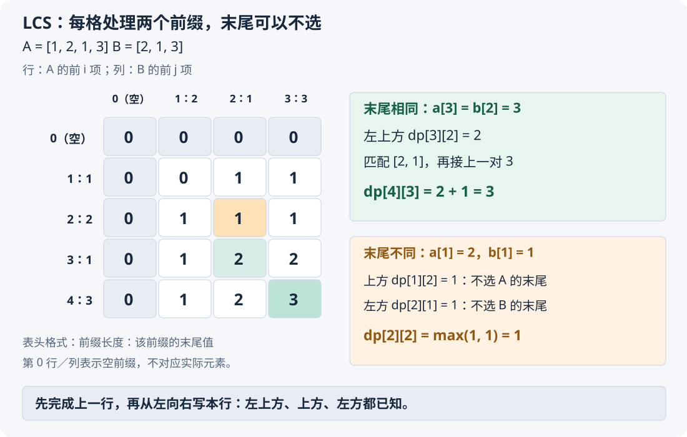
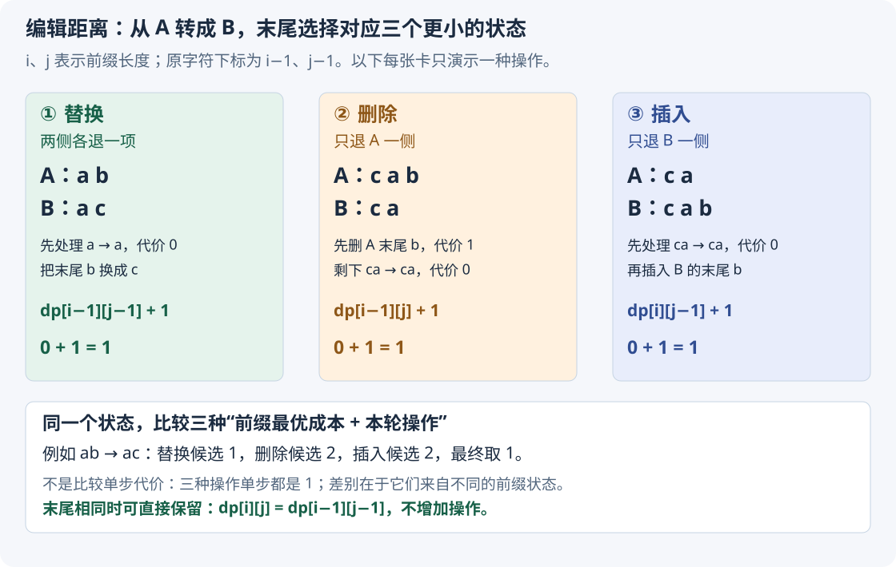

# 5.5 双序列 DP：LCS 与编辑距离

承接 [LIS 的固定结尾状态](04-sequence-dp-lis.md#3-状态变量与转移)。这次同时处理两个序列，练习**两个前缀如何组成状态**，以及二维表怎样压缩成两行。

**公共子序列可以不连续，但在两个原序列中都要保持相对顺序。** LCS 部分只求长度，不恢复具体方案；通过编辑距离复盘，再练习同一双前缀框架下的目标、操作与初值变化。

## 1. 先看代码：两个前缀的最优长度

原数组采用 **0-based**；DP 的两个下标表示**前缀长度**，包含长度为 `0` 的空前缀。

```cpp
// 只读两个序列，返回 LCS 长度；允许空序列与重复元素
int lcs_length(const vector<int>& a, const vector<int>& b) {
    int n = static_cast<int>(a.size());
    int m = static_cast<int>(b.size());

    vector<vector<int>> dp(n + 1, vector<int>(m + 1));

    for (int i = 1; i <= n; ++i) {
        for (int j = 1; j <= m; ++j) {
            if (a[i - 1] == b[j - 1]) {
                // 末尾相同：较短的两个前缀先匹配，再接上这一对
                dp[i][j] = dp[i - 1][j - 1] + 1;
            } else {
                // 末尾不同：至少放弃一侧的末尾，比较两种选择
                dp[i][j] = max(dp[i - 1][j], dp[i][j - 1]);
            }
        }
    }

    return dp[n][m];
}
```

字符串也可以按相同方式处理：把参数换成 `const string&`，仍比较下标 `i - 1`、`j - 1` 的字符。

## 2. 变量与状态：为什么需要两个维度？

先看一个例子：

$$
A=[1,2,1,3],\qquad B=[2,1,3].
$$

公共子序列可以选 `[2,1,3]`，长度为 `3`；其中在 A 中跳过了第一个 `1`。

**只知道 A 已处理多少项还不够。** 例如固定 A 的前两项 `[1,2]`：

$$
\mathrm{LCS}([1,2],[1])=1.
$$

若 B 的可用前缀变成 `[1,2]`，结果就变了：

$$
\mathrm{LCS}([1,2],[1,2])=2.
$$

因此要同时记住**两边各能使用多少项**，才能确定子问题。

> **`dp[i][j]`：只使用 A 的前 i 项与 B 的前 j 项，能够得到的最长公共子序列长度。**
>
> 不要求一定使用这两个前缀的最后一项。

- `n、m`：两个输入序列的元素个数。
- `i、j`：当前两个前缀的长度，分别为 `0..n`、`0..m`。
- `a[i - 1]、b[j - 1]`：这两个非空前缀的最后一项。
- `dp`：有 `n + 1` 行、`m + 1` 列；容量由**位置数量**决定，与元素值有多大无关。
- 表值：匹配出的长度，最多为 `min(n, m)`；元素本身不参与加法。

与上一节对照：

| 模型 | 状态是否必须使用末尾 | 答案位置 |
| --- | --- | --- |
| LIS 的 `dp[i]` | 必须以 `a[i]` 结尾 | 所有结尾取最大值 |
| LCS 的 `dp[i][j]` | 两侧末尾都可以不选 | `dp[n][m]` |

## 3. 初始化：空前缀的答案为什么是 0？

```cpp
vector<vector<int>> dp(n + 1, vector<int>(m + 1));
```

两边只要有一边没有元素，就只能选空子序列：

$$
dp[0][j]=0,\qquad dp[i][0]=0.
$$

**这里的 0 是合法答案，不是不可达。** 这与[恰好剪完彩带时的不可达状态](01-dp-basics.md#82-codeforces-189acut-ribbon)不同：空公共子序列始终合法。

其余格子会在循环中逐个赋值；不需要使用 `-1` 哨兵。

## 4. 围绕 `if` 推导：最后一项相同或不同



图中行、列都是**前缀长度**；行头 `a[i - 1]` 只是该前缀最后一项，不表示必须选它。

### 4.1 末尾相同：为什么可以直接接上？

图中最后一格对应两个末尾都是 `3`。先去掉这两个末尾：

$$
[1,2,1],\quad [2,1]\quad\Longrightarrow\quad dp[3][2]=2.
$$

两边都追加一个 `3`，原来的匹配还能保留：

$$
[2,1]\ \longrightarrow\ [2,1,3].
$$

于是得到长度为 `3` 的公共子序列：

$$
dp[4][3]=dp[3][2]+1=3.
$$

**为什么不存在更长的方案？** 任取一条公共子序列，分两种情况：

1. 两侧最后位置都没有使用：它已经属于去掉末尾后的子问题，长度不超过 `dp[i - 1][j - 1]`。
2. 至少使用一侧最后位置：这条子序列的最后一项必是当前相同值；去掉这一项后，剩下的部分能放进两个较短前缀，长度不超过 `dp[i - 1][j - 1]`。

第二种最多比较短前缀多一项，而“追加相同末尾”又确实能达到这个长度。因此：

$$
a[i-1]=b[j-1]
\quad\Longrightarrow\quad
dp[i][j]=dp[i-1][j-1]+1.
$$

**相同末尾在两边各用一次，只贡献一项公共子序列，所以加 1。**

### 4.2 末尾不同：为什么比较上方与左方？

例如图中的 `dp[2][2]`，比较的是 `[1,2]` 与 `[2,1]`。

末尾分别为 `2`、`1`，不能把它们作为同一对匹配。因此至少有一侧的末尾没有使用：

$$
\text{不使用 A 的末尾}\quad\Longrightarrow\quad dp[i-1][j].
$$

这时 B 的整个前缀仍可使用。

$$
\text{不使用 B 的末尾}\quad\Longrightarrow\quad dp[i][j-1].
$$

这时 A 的整个前缀仍可使用。比较两种合法选择：

$$
a[i-1]\ne b[j-1]
\quad\Longrightarrow\quad
dp[i][j]=\max\bigl(dp[i-1][j],dp[i][j-1]\bigr).
$$

> **不能只退到左上角。** 那相当于同时放弃两侧末尾，会漏掉只需放弃一侧的方案。

例如 `[1,2]` 与 `[1]`：末尾不同，但丢掉 A 的 `2` 后仍能匹配 `1`；同时丢掉两侧末尾则会得到错误的 `0`。

## 5. 循环顺序与返回值

按行向下、每行从左向右填写：

1. 外层取 A 的前缀长度 `i`。
2. 内层依次取 B 的前缀长度 `j`。
3. 比较当前两个末尾，从已完成的上方、左方或左上方取值。
4. 全表完成后，返回两个完整序列对应的 `dp[n][m]`。

每次依赖都减少至少一个前缀长度，因此：

$$
\text{被依赖状态的 }i+j < \text{当前状态的 }i+j.
$$

依赖不会绕回来。它也属于[DAG DP 的隐式依赖](../../patterns/05-dynamic-programming/dp-modeling-workflow.md#两个前缀也能组成隐式-dag)，但本题无需建图，按行填写已经满足顺序。

**答案不必再扫描全表取最大值。** 扩大任意一边的前缀，都可以保留原方案；完整的两个前缀已经包含全部候选。

时间为 **`O(nm)`**，额外空间为 **`O(nm)`**。返回的是长度，不能直接由这个整数还原具体子序列。

## 6. 滚动数组：只保留上一行与当前行

若只需要长度，可以保留两行。接口与二维版本相同：

```cpp
int lcs_length_rolling(const vector<int>& a, const vector<int>& b) {
    int n = static_cast<int>(a.size());
    int m = static_cast<int>(b.size());

    vector<int> prev(m + 1), cur(m + 1);

    for (int i = 1; i <= n; ++i) {
        cur[0] = 0; // 当前行与空前缀匹配的边界

        for (int j = 1; j <= m; ++j) {
            if (a[i - 1] == b[j - 1]) {
                cur[j] = prev[j - 1] + 1;
            } else {
                cur[j] = max(prev[j], cur[j - 1]);
            }
        }

        prev.swap(cur); // 本行完成，作为下一轮的上一行
    }

    return prev[m];
}
```

### 每次读取的值属于哪一行？

| 代码 | 原二维状态 | 当前时刻的含义 |
| --- | --- | --- |
| `prev[j - 1]` | `dp[i - 1][j - 1]` | 上一行的左上方 |
| `prev[j]` | `dp[i - 1][j]` | 上一行的正上方 |
| `cur[j - 1]` | `dp[i][j - 1]` | 本轮刚求出的左方 |
| `cur[j]` | `dp[i][j]` | 本轮准备写入的位置 |

**`j` 必须递增，左方才是本轮结果。** 不能因为做过 0/1 背包，就默认一切滚动数组都应倒序。

### `swap` 后，为什么不必整行清零？

本行完成后交换两个容器：

$$
\mathrm{prev}\ \longleftarrow\ \text{刚完成的第 i 行}.
$$

此后 `prev` 提供下一轮需要的旧状态。**`cur` 留着更早的行，并不会自动变成全 0**；但下一轮：

- 先把 `cur[0]` 重新设为边界 `0`。
- `cur[1..m]` 每格都会直接赋值，不会把原值累加进去。
- 读取 `cur[j - 1]` 时，该位置已经在本轮更新过。

因此旧内容不会混入新答案。最后完成的一行保存在 **`prev`** 中，所以返回 `prev[m]`。

时间仍为 **`O(nm)`**，额外空间变为 **`O(m)`**。把较短序列放在列方向，还可使用 `O(min(n,m))` 空间。

例如两边长度都为 `5000`，二维 `int` 表约占 `100 MB`，两行约占 `40 KB`（按每个 `int` 为 4 字节，仅计元素）。**先估算状态数量，再选保存方式；压缩空间不等于减少转移次数。**

## 7. 常见混淆

| 容易混淆的地方 | 应当如何区分 |
| --- | --- |
| 公共子序列与公共子串 | 子序列可跳过元素；本节失配时保留上方／左方，不能清零 |
| 前缀长度与元素下标 | `dp[i][j]` 使用前 i、j 项；当前元素是 `a[i - 1]`、`b[j - 1]` |
| 末尾相同就加两次 | 匹配一对只增加一项公共子序列 |
| 空前缀与不可达 | 空公共子序列合法，长度为 0 |
| 同一问题只改成 `min` | 优化目标变了，状态句、初值和转移都要重新推导 |

重复值不需要去重：`[1,1]` 与 `[1,1]` 的答案为 `2`，两个位置可以分别匹配。

长度计算的两种通用实现已本地核验；配套两题的原实现与完整复盘见下文，**本地核验与平台评测、个人掌握分别记录**。

## 8. 典题与复盘

### 8.1 洛谷 B2175：最长公共子序列

题目：[B2175 最长公共子序列](https://www.luogu.com.cn/problem/B2175)。两个整数序列长度均不超过 `5000`，元素不超过 `10^9`，允许重复；只输出 LCS 长度。

收录原因：**把两个可用前缀组织成状态，并在空间压缩后继续跟踪每个容器的实际含义。**

#### 原实现：两行滚动

保留原逻辑，只调整排版与注释；通用框架不再重复。

```cpp
void solve() {
    int n, m;
    cin >> n >> m;

    vector<int> a(n), b(m);
    for (int& x : a) cin >> x;
    for (int& y : b) cin >> y;

    vector<int> prev(m + 1), cur(m + 1);

    for (int i = 1; i <= n; ++i) {
        cur[0] = 0;

        for (int j = 1; j <= m; ++j) {
            if (a[i - 1] == b[j - 1]) {
                cur[j] = prev[j - 1] + 1;
            } else {
                cur[j] = max(prev[j], cur[j - 1]);
            }
        }

        prev.swap(cur); // 刚完成的第 i 行，现在由 prev 保存
    }

    cout << prev[m] << '\n';
}
```

#### 易错点：最后输出 `prev`，不是 `cur`

以 A、B 都为 `[1,2]` 为例：

| 时刻 | `prev` 的内容 | `cur` 的内容 |
| --- | --- | --- |
| 初始化 | 第 0 行：`[0,0,0]` | `[0,0,0]` |
| 第 1 行写完、尚未交换 | 第 0 行：`[0,0,0]` | 第 1 行：`[0,1,1]` |
| 第 1 次交换后 | 第 1 行：`[0,1,1]` | 第 0 行：`[0,0,0]` |
| 第 2 行写完、尚未交换 | 第 1 行：`[0,1,1]` | 第 2 行：`[0,1,2]` |
| 最后交换后 | **第 2 行：`[0,1,2]`** | 第 1 行：`[0,1,1]` |

循环内的“当前行”与循环结束后的容器名称不能混为一谈：

$$
\text{第 n 行写完}\ \longrightarrow\ \text{交换容器}\ \longrightarrow\ \mathrm{prev}=dp[n].
$$

**最后再交换一次并非多余操作，而是每轮统一执行的步骤；输出位置也必须服从这个步骤。**

原实现已经适合本题：时间 `O(nm)`、额外空间 `O(m)`。可把较短序列放在列方向进一步节省空间，但不必为了制造另一种解法重写。

**状态：复盘完成。** 原实现已本地核验，平台结果未单独提供。重点保留“交换前后重新核对容器语义”的经验。

### 8.2 洛谷 P2758：编辑距离

题目：[P2758 编辑距离](https://www.luogu.com.cn/problem/P2758)。两个小写字符串长度均不超过 `2000`；允许插入、删除、替换字符，求把 A 转为 B 的最少操作数。

收录原因：**从操作选择反推更小的前缀问题，理解状态不变时为什么只需保留最少代价。**

#### 原实现：先保留完整代码

保留原逻辑，只整理排版与面向过程的注释。

```cpp
void solve() {
    string a, b;
    cin >> a >> b;

    int n = static_cast<int>(a.size());
    int m = static_cast<int>(b.size());

    vector<int> prev(m + 1), cur(m + 1);

    for (int i = 1; i <= m; ++i)
        prev[i] = i; // 空 A 变成 B 的前 i 项，需要插入 i 次

    for (int i = 1; i <= n; ++i) {
        cur[0] = i; // A 的前 i 项变成空 B，需要删除 i 次

        for (int j = 1; j <= m; ++j) {
            if (a[i - 1] == b[j - 1]) {
                cur[j] = prev[j - 1]; // 相同末尾保留，本轮不增加操作
            } else {
                // 左上：替换；上方：删除；左方：插入，额外代价均为 1
                cur[j] = 1 + min(prev[j - 1], min(prev[j], cur[j - 1]));
            }
        }

        prev.swap(cur);
    }

    cout << prev[m] << '\n';
}
```

#### 如何想到：操作选择 → 两个前缀 → 最少代价

1. **目标是最少操作数。** 需要比较不同操作带来的总成本，不能只看某一步是否方便。
2. **处理的是两个有顺序的字符串。** 尝试从末尾的一次匹配或操作，退回更短的前缀问题。
3. **记录两侧各处理多少项。** 只记 A 的长度，无法说明要把它转成 B 的哪一段，因此保留两个维度。
4. **固定前缀后，只留最少代价。** 后续允许的操作不取决于此前具体怎样修改，已有较贵方案没有额外优势。
5. **枚举末尾的所有合法处理。** 各自接上更小子问题的最优值，再取最小。

有多个选择只是尝试 DP 的线索，**还要能拆成更小、会重复出现、且状态足够描述的子问题**；不能仅凭“可以选择操作”就断定一定能用这份递推。

#### 状态：下标是长度，不是字符已经逐位相等

> **`dp[i][j]`：把 A 的前 i 个字符，转换为 B 的前 j 个字符，所需的最少操作数。**

字符采用 **0-based**：两个末尾是 `a[i - 1]` 与 `b[j - 1]`。

`dp[i - 1][j]` 不表示某两个末尾字符相等；它表示**整个 A 前 i−1 项已经能够转换成整个 B 前 j 项，并记录最少代价**。两边长度甚至可以不同。

同一对 `(i,j)` 下，两段前缀已经确定。**只要没有剩余次数、特殊操作限制等额外条件，不必把转换过程也放进状态。**

#### 初值：空串也需要操作，不能沿用 LCS 的整行 0

例如空串变为 `abc`，需要依次插入三个字符：

$$
dp[0][j]=j.
$$

反过来，`abc` 变为空串，需要删除三个字符：

$$
dp[i][0]=i.
$$

两边都是空串时不需要操作，所以 `dp[0][0] = 0`。代码中的 `prev[j] = j` 与每轮 `cur[0] = i`，分别落实这两条边界。

#### 末尾相同：保留这一对字符

例如 `cat → cut`，两侧最后的 `t` 相同，只需先处理 `ca → cu`，再保留末尾的 `t`。

$$
a[i-1]=b[j-1]\quad\Longrightarrow\quad dp[i][j]=dp[i-1][j-1].
$$

相同末尾可以直接对齐，**存在最优方案保留这一对字符**；不必另做一次无收益的替换。

也可从代价比较理解：

- 先完成 `dp[i - 1][j]`，再删掉目标的最后一项，就完成了左上方的子问题。
- 从 A 的前 i−1 项出发，先补回它的最后一项，再执行 `dp[i][j - 1]` 对应的方案，也能完成左上方的子问题。

因此两种方案都给左上方提供了一个合法代价上界：

$$
dp[i-1][j-1]\le dp[i-1][j]+1,\qquad
dp[i-1][j-1]\le dp[i][j-1]+1.
$$

所以，上方／左方再付一次操作不会比直接保留相同末尾更便宜。

#### 末尾不同：三种操作分别从哪里来？



**以下操作方向统一为 A 转成 B。** 插入和删除不能交换解释。

**① 替换：先转好两侧较短的前缀，再处理这一对末尾。**

先把 A 的前 i−1 项转为 B 的前 j−1 项，再把剩下的 `a[i - 1]` 改成 `b[j - 1]`：

$$
\text{替换候选}=dp[i-1][j-1]+1.
$$

例如 `ab → ac`：先处理 `a → a`，再把 `b` 替换成 `c`，总共一次。

**② 删除：A 的最后一个字符不保留。**

删掉 `a[i - 1]` 后，只需把 A 的前 i−1 项转成 B 的前 j 项：

$$
\text{删除候选}=dp[i-1][j]+1.
$$

例如 `cab → ca`：删掉末尾 `b`，剩下的前缀 `ca → ca` 不需要操作。**删除只减少 A 一侧的前缀长度，目标 B 的长度 j 不变。**

**③ 插入：B 的最后一个字符由新插入的字符提供。**

先把 A 的前 i 项转成 B 的前 j−1 项，再在末尾插入 `b[j - 1]`：

$$
\text{插入候选}=dp[i][j-1]+1.
$$

例如 `ca → cab`：先完成 `ca → ca`，再插入末尾 `b`。**插入不消耗原 A 的字符，所以来源仍使用 A 的前 i 项。**

这里是在按末尾的**对齐方式**拆解，不要求原始操作记录恰好按这个时间顺序执行。删除、插入引起的位置变化，已经由两个前缀长度分别承担。

#### 合起来：状态转移方程

初值仍为 `dp[0][j] = j`、`dp[i][0] = i`。对于两个非空前缀：

$$
dp[i][j]=
\begin{cases}
dp[i-1][j-1], & a_{i-1}=b_{j-1}\\
1+\min\begin{cases}
dp[i-1][j]\\
dp[i][j-1]\\
dp[i-1][j-1]
\end{cases}, & a_{i-1}\ne b_{j-1}
\end{cases}
$$

内层大括号从上到下依次对应：**删除、插入、替换**。

每一种候选都能构造合法方案；反过来，末尾要么与源字符对齐，要么对应一次插入／删除，三种来源覆盖了不同末尾的全部情况。

#### 为什么使用子问题最优值？这不是贪心

固定同一个前缀状态，假设两种方案都完成了相同的转换，代价分别为 `c` 与 `d`，且：

$$
d<c.
$$

从这个相同状态继续采用同一组后续操作，额外代价记为 `k`：

$$
d+k<c+k.
$$

**起点状态相同、后续操作仍合法时，较贵的前段可以替换成较便宜的前段。** 若最终最优方案使用了不最优的子问题方案，就能这样得到更便宜的完整方案，产生矛盾。这是**最优子结构**。

> **DP 的 `min` 比较的是“不同子问题的最优总成本＋当前操作”，不是只选眼前最便宜的一步。** 三种不同的前缀状态都要先算，不能只沿一条当前看起来最好的路线继续。

例如 `abc → bc`：若遇到首个不同字符就替换，得到 `bbc`，还要再删除一次；直接删除开头 `a` 只需一次。**局部操作看起来合适，并不能证明完整方案最少。**

关于同一状态下替换较差历史的共同依据，也可对照 [LIS 的前驱替换论证](04-sequence-dp-lis.md#为什么固定同一结尾后只需要保留最长前段)。

#### 为什么不能用 `n + m - 2LCS`？

该公式适用于**只允许插入、删除，每次代价均为 1**：保留一条最长公共子序列，删除 A 的其他字符，再插入 B 缺少的字符。

$$
\text{只允许增删的最少次数}=(n-\mathrm{LCS})+(m-\mathrm{LCS}).
$$

允许替换后，例子 `a → b` 的 LCS 为 0，公式给出：

$$
1+1-2\times0=2.
$$

但直接替换只需一次。**LCS 已经考虑相对顺序；这里失效的原因是操作集合变了，替换可能比“先删再插”更省。**

进一步看，两组问题的长度都是 2，LCS 都是 1：

| 转换 | 真正的编辑距离 | 原因 |
| --- | --- | --- |
| `ab → ac` | 1 | 替换一次 |
| `ab → bc` | 2 | 一次替换无法同时改变两个位置，可删除后插入 |

因此仅知道两侧长度与 LCS 长度，还不足以确定本题答案。

#### 滚动优化与核验

| 来源 | 滚动数组中的位置 | 额外操作 |
| --- | --- | --- |
| 左上方 | `prev[j - 1]` | 相同则 0，否则替换加 1 |
| 上方 | `prev[j]` | 删除加 1 |
| 左方 | `cur[j - 1]` | 插入加 1 |

仍按 `j` 递增，最后交换；因此与第一题一样，答案是 **`prev[m]`**。不同之处是**边界随长度变化**，`cur[0]` 每轮必须设为 `i`，不能固定为 0。

原实现时间 `O(nm)`、额外空间 `O(m)`，已适合题目规模；无需另造一份“优化解”。`prev/cur` 都按前缀长度分配，字符集大小不决定表长。

**状态：复盘完成。** 原实现、边界及转移已本地核验，平台结果未单独提供。

### 8.3 从 LIS、LCS 到编辑距离：共同的推导顺序

这几题不只是学习三个函数，而是在练习**从目标到状态，再从最后一次选择反推来源**：

| 步骤 | LIS | LCS | 编辑距离 |
| --- | --- | --- | --- |
| 明确目标 | 最长严格上升长度 | 最长公共子序列长度 | 最少转换次数 |
| 固定状态 | 以位置 i 结尾 | 两侧各取前 i、j 项 | A 前 i 项转成 B 前 j 项 |
| 拆最后一步 | 接在哪个合法前驱后 | 匹配末尾，或不选一侧末尾 | 保留、替换、删除、插入 |
| 合并候选 | 各合法前驱取 `max` | 两个前缀来源取 `max` | 三种操作总成本取 `min` |
| 边界 | 单个元素长度为 1 | 空公共子序列长度为 0 | 空串需要逐项增删 |
| 最终答案 | 所有结尾取最大值 | 完整的两个前缀 | 完整字符串的转换成本 |

**不能只因为用了 `max/min`，就把 DP 当成贪心。** 先证明同一状态只留最优值是安全的，再确认所有必要来源都已考虑，最后才讨论滚动等实现优化。

相同方法在 [LIS 的建模顺序](04-sequence-dp-lis.md#从题意到状态再到转移)与[DAG DP 的状态合并条件](../../patterns/06-graph-and-tree/dag-dp.md#5-为什么能只保留前驱的最优值)中继续对照。

## 9. 自查

1. 为什么必须记录两个前缀长度？它与 LIS 的“固定结尾”有什么区别？
2. 两侧末尾不同时，为什么不能只取左上方？
3. 滚动版的三个来源各属于哪一行，为什么交换后不用把整行清零？

[返回本章索引](README.md) · [本章范式](../../patterns/05-dynamic-programming/README.md)

下一节：[区间 DP：从最后一次合并倒推](06-interval-dp.md)。
