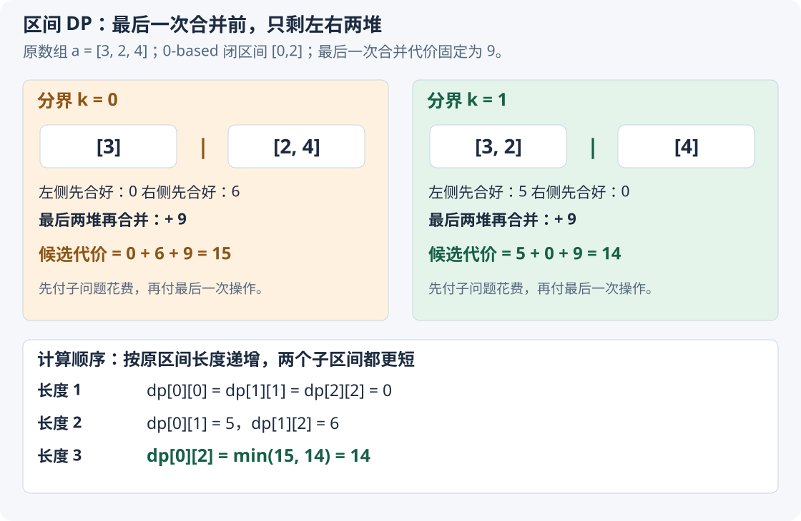
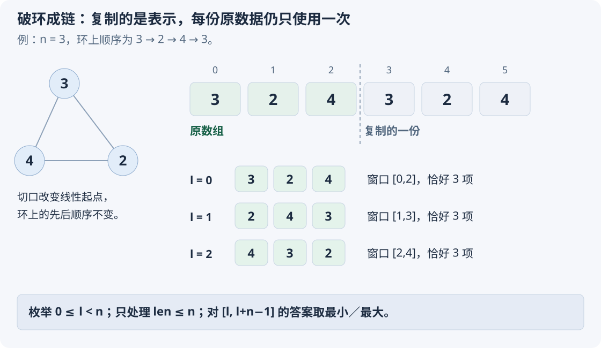
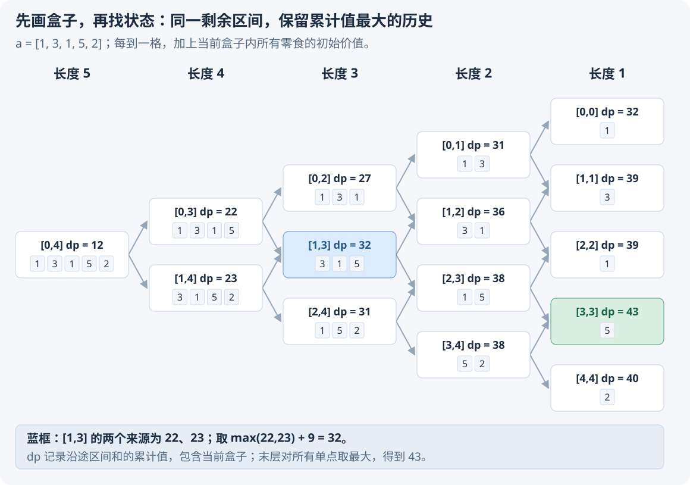

# 5.6 区间 DP：合并、收缩与破环成链

前置：[DP 的状态与最优子结构](05-two-sequence-dp-lcs.md#为什么使用子问题最优值这不是贪心)、[前缀和](../02-sequence-techniques/01-prefix-sum.md)。

本节以**只能合并相邻两堆，代价等于两堆总质量**为模型。原序列保持顺序，目标是合成一堆的最少总代价。

重点是：**从最后一次操作拆出两个更小的区间，而不是猜第一次应该合并哪两堆。** 再通过环形合并与区间收缩，对照问题转换、状态含义和依赖方向；[DP 三步走](#9-dp-三步走找到状态推导转移写成代码)汇总这几题的推导主线。

## 1. 先看代码：按区间长度递增

原数组采用 **0-based**，`dp[l][r]` 对应**闭区间 `[l,r]`**。沿用 C++11 框架中的 `using ll = long long;`。

```cpp
// a 为非负质量，只读；返回相邻二元合并的最少总代价
// 约定前缀和与所有合法方案的总代价均小于 INF
ll min_merge_cost(const vector<ll>& a) {
    int n = static_cast<int>(a.size());
    if (n == 0) return 0;

    vector<ll> pre(n + 1);
    for (int i = 0; i < n; ++i)
        pre[i + 1] = pre[i] + a[i];

    const ll INF = LLONG_MAX / 4;
    vector<vector<ll>> dp(n, vector<ll>(n));

    for (int len = 2; len <= n; ++len) {
        for (int l = 0; l + len <= n; ++l) {
            int r = l + len - 1;
            ll total = pre[r + 1] - pre[l];

            dp[l][r] = INF; // 本格尚未比较候选，不能用默认的 0 取最小值

            for (int k = l; k < r; ++k) {
                // 先分别合好左右两段，再付最后一次合并的 total
                ll cost = dp[l][k] + dp[k + 1][r] + total;
                dp[l][r] = min(dp[l][r], cost);
            }
        }
    }

    return dp[0][n - 1];
}
```

## 2. 状态：为什么一个连续区间就能描述子问题？

例如三堆质量为：

$$
[3,2,4].
$$

合并前两堆后，得到 `[5,4]`。其中质量为 `5` 的新堆代表**原序列第 0、1 堆合成的连续段**。

原本每堆都是单点区间；每次只合并相邻两堆，相邻连续段合起来仍是连续段。因此，**任意中间堆都对应原序列中的一个连续区间**。

> **`dp[l][r]`：把原序列闭区间 `[l,r]` 内的全部堆，合成一堆所需的最少总代价。**
>
> 区间外的堆不参与这次子问题。

合好之后，这一堆的质量只取决于区间总和，不取决于内部采用了哪种合并顺序。**同一区间先合得更贵，不会让后续合并更便宜。**

### 变量、容量与下标

- `n`：原始堆数，要求可以用 `int` 表示。
- `l、r`：同一序列中的左右端点，满足 `0 <= l <= r < n`。
- `len`：本轮区间的元素个数，满足 `len = r - l + 1`。
- `k`：最后一次合并前，左侧一堆的原始右边界；取 `l..r-1`。
- `pre`：前缀和，`pre[t]` 保存前 t 堆的总质量，分配 `n + 1` 项。
- `dp`：按**端点数量**分配 `n × n`，只使用 `l <= r` 的部分，不按质量值域开表。
- `total`：当前整个区间的总质量，也是**最后一次合并**的代价。

区间和与合并代价可能累加，使用 `ll`；端点仍使用 `int`。

## 3. 初值：已经是一堆，不需要再合并

只有一堆时，即使质量为 `100`，合并操作数也是零，总代价也是零：

$$
dp[i][i]=0.
$$

**这里保存的是合并花费，不是堆的质量，所以不能初始化为 `a[i]`。**

长度从 `2` 开始枚举，正是因为单点区间已经求好。

表中的其余 `0` 只是容器初始化，不是已经得到的答案。每次真正求解一个非单点区间，先设为 `INF`，再比较候选。

> 本模型每个合法区间都能合成一堆。**这里的 `INF` 是取最小值时的初始上界，不表示某些区间不可达。** 求完后，该格会被有限的候选值更新。

## 4. 转移：最后一次合并之前，一定剩下哪两堆？



### 先用 `[3,2,4]` 拆开两种情况

最后一次操作前，整个区间一定恰好剩两堆。第一种切法是：

$$
[3]\quad\big|\quad[2,4].
$$

右侧先合成质量为 `6` 的一堆，花费为 `6`；左侧本来就是一堆，花费为 `0`。

$$
0+6+(3+2+4)=15.
$$

最后把两堆合成一堆，再花费总质量 `9`。

另一种切法是：

$$
[3,2]\quad\big|\quad[4].
$$

左侧先合并，花费为 `5`；右侧不需合并：

$$
5+0+(3+2+4)=14.
$$

比较全部可能的最后切分，答案为 `14`。

### 一般情况：枚举分界点 `k`

最后两堆分别对应两个非空、相邻、覆盖原区间的连续段：

$$
[l,r]=[l,k]\ \cup\ [k+1,r],\qquad l\le k<r.
$$

先各自合好，分别付出两侧子问题的最少代价。最后一次合并再付出整个区间的质量：

$$
\text{当前切分的候选代价}
=dp[l][k]+dp[k+1][r]+\sum_{t=l}^{r}a[t].
$$

遍历所有合法的 `k`，取最小值：

$$
dp[l][r]=\min_{l\le k<r}
\left\{dp[l][k]+dp[k+1][r]+\sum_{t=l}^{r}a[t]\right\}.
$$

**不能漏掉最后一项。** 两侧合并花费只负责得到“最后的两堆”，不包括把这两堆合在一起的那次操作。

### 为什么只保存两侧的最少代价就够？

固定同一个分界 `k`。若左侧内部合并得更贵，最终得到的质量仍然是同一个区间和，最后合并的代价也不变。

把左侧换成更便宜的合法方案，右侧与最后操作都能照常执行，完整方案只会更便宜；右侧同理。

**两侧内部怎样交替合并不影响总成本；在最后两堆合并前，它们始终各在自己的连续段内。** 因而可以分别取最优，再相加。

任意完整方案都有一个最后分界，这些分界全部被枚举；反过来，每个候选都能实际合成一堆。因此转移既不遗漏，也不会产生不合法方案。

## 5. 为什么按长度递增，而不是直接双循环端点？

先沿着状态定义，把计算顺序自然推出来：

$$
\text{求当前区间最优值}
\ \longrightarrow\ \text{需要两侧子区间最优值}.
$$

两侧结果必须先算好，才有完整的候选代价可比较。**先看依赖，再决定循环顺序。**

两个被依赖区间都比当前区间短：

$$
k-l+1<r-l+1,\qquad r-k<r-l+1.
$$

所以先处理长度 `1`，再处理 `2、3、…`，两侧答案一定已经存在。

**“被包含”只是区间的几何关系，“已经算出”需要由遍历顺序保证。** 本题子问题严格更短，于是按 `len` 递增，是由状态和转移自然推出的代码顺序。

以三堆为例：

$$
dp[0][0],\ dp[1][1],\ dp[2][2]
\quad\longrightarrow\quad
dp[0][1],\ dp[1][2]
\quad\longrightarrow\quad
dp[0][2].
$$

若直接按 `l` 从小到大、`r` 从小到大，求 `dp[0][2]` 时可能需要尚未计算的 `dp[1][2]`，默认的 `0` 就会冒充答案。

**不是说端点循环一定不行，而是循环方向必须满足依赖。** 本节采用最直观的“区间长度递增”；这也是[隐式 DAG 的另一种顺序](../../patterns/05-dynamic-programming/dp-modeling-workflow.md#区间状态按长度组织依赖)。

### 对照上一节：二维表不意味着相同顺序

| 模型 | 两个下标是什么 | 依赖怎样缩小 | 本节采用的顺序 |
| --- | --- | --- | --- |
| LCS／编辑距离 | 两个序列各自的前缀长度 | 至少一侧前缀变短 | 按行，再从左到右 |
| 区间合并 | 同一个序列的左右端点 | 两个子区间都变短 | 按区间长度递增 |

**顺序由状态转移决定，不由“有几层循环”决定。** 本节[两端出售的到达状态](#83-洛谷-p2858treats-for-the-cows)反过来依赖更大的父区间，需要长度递减；不是所有区间 DP 都统一从短到长。

## 6. 前缀和负责什么，三重循环花在哪里？

对 **0-based 闭区间 `[l,r]`**：

$$
\sum_{t=l}^{r}a[t]=\mathrm{pre}[r+1]-\mathrm{pre}[l].
$$

前缀和只负责用常数时间提供当前区间的总质量；`dp` 才负责比较不同合并顺序。**两张表保存的量不同，不能互相替代。**

执行流程：

1. 读取原序列，建立前缀和。
2. 令全部单点区间的代价为 `0`。
3. 枚举长度，再枚举所有该长度区间。
4. 取当前区间和，枚举最后分界 `k`，更新最少总代价。
5. 最后返回整个闭区间的 `dp[0][n - 1]`。

有 `O(n²)` 个区间，每个区间最多枚举 `O(n)` 个分界：

$$
\text{时间}=O(n^3),\qquad\text{额外空间}=O(n^2).
$$

前缀和避免每个候选再扫描原区间，但**不会把三重循环变成平方时间**。

普通两行滚动也不能直接照搬：`dp[l][r]` 可能同时依赖多种长度、多个端点的子区间，不是只读取上一行。

## 7. 两个容易误判的地方

### 每次合并当前最小的相邻两堆，不一定最优

例如：

$$
[4,3,3,4].
$$

先合并中间最小的 `3+3`，之后最少也要付出：

$$
6+10+14=30.
$$

但分别合并两端的 `4+3` 与 `3+4`，再合并两大堆：

$$
7+7+14=28.
$$

> **眼前便宜会改变后续堆的结构。** 不能把局部代价最小直接当成完整代价最小；本节用全部最后分界的子问题来比较。

### 相邻限制决定了本模型，不能删掉

| 问题 | 允许合并哪些堆 | 基础方法 |
| --- | --- | --- |
| [合并果子](https://www.luogu.com.cn/problem/P1090) | 任意两堆 | 小顶堆，每次取最小两堆 |
| 本节线性／环形石子合并 | 当前相邻两堆 | 按顺序保留连续区间，比较合法方案 |

例如 `[1,100,1]`，全局最小的两个 `1` 不相邻，不能先合并。**因此不能直接套用“每次弹出全局最小两堆”的小顶堆贪心。** 前一小节进一步说明，即使改成取最小相邻对，也未必正确。

本节默认始终保持原顺序，只合并相邻两堆。若允许任意两堆合并，子问题不再天然是连续区间，不能继续直接使用本节转移。

同样，题目若改成每次合并三堆、环形排列或其他代价，需要重新检查状态、可达性与边界，不能只换一个常量。

## 8. 典题与复盘

### 8.1 洛谷 P1775：石子合并（弱化版）

题目：[P1775 石子合并（弱化版）](https://www.luogu.com.cn/problem/P1775)。最多 `300` 堆排成一排，每堆质量不超过 `1000`；每次合并相邻两堆，求最少总代价。

收录原因：**从最后一次操作拆分子问题，并由依赖关系自然推出枚举顺序。**

#### 原实现：保留闭区间与前缀和的配合

保留原逻辑，只整理排版与注释；通用框架不再重复。

```cpp
void solve() {
    int n;
    cin >> n;

    vector<ll> pre(n + 1);
    for (int i = 1; i <= n; ++i) {
        cin >> pre[i];
        pre[i] += pre[i - 1];
    }

    vector<vector<ll>> dp(n, vector<ll>(n));
    const ll INF = LLONG_MAX / 4;

    for (int len = 2; len <= n; ++len) {
        for (int l = 0; l + len <= n; ++l) {
            int r = l + len - 1;
            ll total = pre[r + 1] - pre[l];

            dp[l][r] = INF;

            for (int k = l; k < r; ++k) {
                ll cost = dp[l][k] + dp[k + 1][r] + total;
                dp[l][r] = min(dp[l][r], cost);
            }
        }
    }

    cout << dp[0][n - 1] << '\n';
}
```

#### 怎样从思路落到循环？

1. **找到状态：** 原顺序不变，每个中间堆都是连续段，因此固定 `[l,r]`，求内部合成一堆的最少花费。
2. **推导转移：** 最后一次合并前恰好剩两堆，枚举分界 `k`，先付两侧最优花费，再付区间总质量。
3. **写成代码：** 单点花费为 `0`；依赖的两段更短，所以按 `len` 递增；对 `k` 的全部候选取最小，最后读取完整区间。

**`pre` 的下标是前缀长度，`dp` 的下标是原数组位置。** 读入从 `pre[1]` 开始，不代表 DP 改成了 1-based；原闭区间 `[l,r]` 的和仍为 `pre[r + 1] - pre[l]`。

原实现已适合本题，时间 `O(n³)`、额外空间 `O(n²)`，不必另造一份重复写法。只有一堆时循环不执行，答案自然为 `0`。

**状态：复盘完成。** 原实现已本地核验，平台结果未单独提供。

### 8.2 洛谷 P1880：环形石子合并

题目：[P1880 [NOI1995] 石子合并](https://www.luogu.com.cn/problem/P1880)。石子排成环，每次合并相邻两堆，分别求最小、最大总代价；`n <= 100`，每堆为 `0..20`。

收录原因：**通过改变表示消除首尾跨界，再枚举切口覆盖原来的全部选择。**

#### 原 AC：复制数组，分别维护最小与最大值

保留原逻辑，整理注释；这里的方法称为**破环成链**。

```cpp
void solve() {
    int n;
    cin >> n;

    vector<ll> a(2 * n);
    for (int i = 0; i < n; ++i) {
        cin >> a[i];
        a[i + n] = a[i]; // 延长表示，让跨原末尾的连续段也能直接取出
    }

    vector<ll> pre(2 * n + 1);
    for (int i = 0; i < 2 * n; ++i)
        pre[i + 1] = pre[i] + a[i];

    vector<vector<ll>> dpi(2 * n, vector<ll>(2 * n, 0));
    vector<vector<ll>> dpx(2 * n, vector<ll>(2 * n, 0));
    const ll INF = LLONG_MAX / 4;

    for (int len = 2; len <= n; ++len) {
        for (int l = 0; l + len <= 2 * n; ++l) {
            int r = l + len - 1;
            ll total = pre[r + 1] - pre[l];

            dpi[l][r] = INF;

            for (int k = l; k < r; ++k) {
                ll costi = dpi[l][k] + dpi[k + 1][r] + total;
                dpi[l][r] = min(dpi[l][r], costi);

                ll costx = dpx[l][k] + dpx[k + 1][r] + total;
                dpx[l][r] = max(dpx[l][r], costx);
            }
        }
    }

    ll ans_min = INF;
    ll ans_max = 0;

    for (int l = 0; l < n; ++l) {
        int r = l + n - 1; // 每个窗口只包含原来的 n 堆，各一次
        ans_min = min(ans_min, dpi[l][r]);
        ans_max = max(ans_max, dpx[l][r]);
    }

    cout << ans_min << '\n' << ans_max << '\n';
}
```

#### 为什么复制一份就能表达所有环形起点？

例如环上依次为 `3、2、4`，线性展开为：

$$
[3,2,4,\ 3,2,4].
$$

从原环的三个不同位置开始，分别读取长度为 `3` 的窗口：

$$
[3,2,4],\qquad[2,4,3],\qquad[4,3,2].
$$

每个窗口都保留环上的顺序，且每个原始位置恰好出现一次。



一般地，只需枚举：

$$
[l,l+n-1],\qquad 0\le l<n.
$$

**数组长度是 `2n`，问题中的堆数仍然是 `n`。** 因此 DP 只处理 `len <= n`；若把 `2n` 堆全合并，就重复使用了原来的堆。

#### 为什么枚举切口不会漏掉环形最优方案？

任意环形合并方案，在最后一步之前都只剩两个连续块。沿两块之间的一条原始边界切开，在这之前的操作都没有跨越这条边界，因而能在线性窗口中完成；最后两块在线性序列中也相邻。

**所以任意环形方案，都能在某个切口对应的线性窗口中表示。** 反过来，窗口中的相邻合并在原环上也合法；枚举所有起点后取最小／最大，就覆盖了两个目标。

这个转换适用于本题，因为**切开不改变内部顺序，且每份原数据只用一次**。它不是任意带环问题都能套用的规则。

#### 状态与实现边界

- `dpi[l][r]`：该线性窗口合成一堆的最少总代价。
- `dpx[l][r]`：相同区间的最大总代价；不能在取最大时混用 `dpi` 的子问题。
- 两张表的单点初值都为 `0`，一堆不需要合并。
- 本题质量非负，最大花费也非负，所以 `dpx` 与 `ans_max` 初始化为 `0` 合适。
- `n = 1` 时，两种合并代价都是 `0`。

时间仍为 `O(n³)`、额外空间 `O(n²)`，复制数组只改变常数规模。原实现已足够，不为同一转移再写一份等价代码。

**状态：复盘完成。** 环形实现有个人 AC 反馈，本地核验通过。

### 8.3 洛谷 P2858：Treats for the Cows

题目：[P2858 [USACO06FEB] Treats for the Cows G/S](https://www.luogu.com.cn/problem/P2858)。每天从零食序列的一端出售一份，售价为初始价值乘出售天数，求最大总收益；`n <= 2000`，初始价值为 `1..1000`。

收录原因：**画出状态变化，从多条路线到达同一区间中发现可复用的最优结果，再把时间权重改写成逐轮累计。**

#### 原 AC：从完整区间向单点收缩

保留原逻辑，只整理排版和解释状态含义的注释。

```cpp
void solve() {
    int n;
    cin >> n;

    vector<ll> pre(n + 1);
    for (int i = 1; i <= n; ++i) {
        cin >> pre[i];
        pre[i] += pre[i - 1];
    }

    vector<vector<ll>> dp(n, vector<ll>(n));
    dp[0][n - 1] = pre[n]; // 第一天售前，给全部仍在盒子里的零食各记一次价值

    for (int len = n - 1; len >= 1; --len) {
        for (int l = 0; l + len <= n; ++l) {
            int r = l + len - 1;
            ll total = pre[r + 1] - pre[l];

            if (l == 0)
                dp[l][r] = dp[l][r + 1] + total;
            else if (r == n - 1)
                dp[l][r] = dp[l - 1][r] + total;
            else
                dp[l][r] = max(dp[l][r + 1], dp[l - 1][r]) + total;
        }
    }

    ll ans = 0;
    for (int p = 0; p < n; ++p)
        ans = max(ans, dp[p][p]);

    cout << ans << '\n';
}
```

#### 先画盒子：哪些路线会到达同一个状态？

只从两端出售，剩余零食必然仍是一个连续区间。以 `[1,3,1,5,2]` 为例，从完整盒子向右画状态变化：



完整区间 `[0,4]` 可以到达 `[0,3]`、`[1,4]`；两者继续收缩，都可能到达 `[1,3]`。

**到达 `[1,3]` 的过程不同，但剩下的零食和接下来允许的选择相同。** 当前天数也由剩余数量确定，因此不需要另存完整出售顺序。

从图中就能发现：相同剩余区间可以合并历史，只保留累计值最大的来源。**图不只是帮助看懂代码，也可以先于状态定义，帮助发现状态。**

#### 关键转换：第 t 天出售，就是被累计了 t 次

本实现没有在每次出售时直接加“天数 × 价值”，而是**每天出售前，给所有还留着的零食各加一次初始价值**。

例如初始价值为 `5` 的零食，第 3 天才卖出：

$$
5+5+5=3\times5.
$$

它在前 3 个售前区间中都还存在，所以被计入 3 次。第 t 天卖出的任意一份同理：

$$
\underbrace{v+v+\cdots+v}_{t\text{ 次}}=t\,v.
$$

因此，把沿途的所有剩余区间和相加，恰好等于最终销售收益。这不是额外收费，而是**把每份零食的时间倍数拆成逐日的一份贡献**。

#### 第一步：准确写出状态

> **`dp[l][r]`：从完整区间收缩到剩余 `[l,r]`，把沿途每个剩余区间的价值总和累加，能够得到的最大值。包含起始区间和当前区间。**

它不是已经售出零食的实际收益：最初还没卖出任何东西，`dp[0][n-1]` 就已经为全部价值之和。

设当前是第 d 天出售前，可以进一步核对：

$$
d=n-(r-l+1)+1.
$$

剩余区间确定后，天数也随之确定，无需增加一个独立维度。

此时的累计值等于：

$$
\text{此前已售收益}+d\times\text{当前剩余零食的价值总和}.
$$

**尚未售出的零食，本轮贡献也已预先记入。** 因此不能把这个状态改称“当前已卖出的最大收益”后仍沿用原代码。

#### 第二步：从两个更大区间推到这里

当前剩余 `[l,r]`，刚才只能发生两种操作：

| 来源 | 刚才出售了哪一份 | 当前增加什么 |
| --- | --- | --- |
| `[l-1,r]`，要求 `l > 0` | 左侧下标 `l - 1` | 当前 `[l,r]` 的价值总和 |
| `[l,r+1]`，要求 `r < n - 1` | 右侧下标 `r + 1` | 当前 `[l,r]` 的价值总和 |

把当前区间和记为 `S(l,r)`。除完整初始区间外，只比较存在的父区间：

$$
dp[l][r]=S(l,r)+\max
\begin{cases}
dp[l-1][r], & l>0,\\
dp[l][r+1], & r<n-1.
\end{cases}
$$

两条路线到达同一区间后，当前贡献完全相同，今后的合法选择也相同，所以累计值更大的历史始终不会更差。

例如图中的 `[1,3]`，来源累计值为 `22` 与 `23`，当前区间和为 `9`：

$$
dp[1][3]=\max(22,23)+9=32.
$$

**这里是同一状态下保留最优历史，不是只凭当前端点价值作贪心选择。**

#### 第三步：把关系写成初值、循环与答案

- **初值：** 第一天售前所有零食都在，因此 `dp[0][n - 1] = pre[n]`。
- **顺序：** 当前状态依赖长度大一项的父区间，所以 `len` 从 `n - 1` 递减到 `1`。
- **边界：** `l == 0` 时不存在左侧父区间；`r == n - 1` 时不存在右侧父区间，分别只取合法来源。
- **答案：** 收缩到单点时，最后一天对最后一份零食的贡献已经计入。它可能是任意位置，故对所有 `dp[p][p]` 取最大。

例子中单点结果分别为：

$$
32,\ 39,\ 39,\ 43,\ 40.
$$

最终取最大值 `43`，不能只返回某个固定端点。

这与前面的石子合并形成对照：**合并题从两侧内部子问题汇总，长度递增；本题从更大的剩余区间走到这里，长度递减。** 区间的包含关系相同，状态所问的问题不同，依赖方向也就不同。

#### 核验与进步空间

原实现时间 `O(n²)`、额外空间 `O(n²)`，已适合本题。每格只比较两个父区间，不需要枚举所有分界点；因此不能把“区间 DP”固定理解为三重循环。

本题可由剩余区间确定当前天数；若未来遇到额外冷却、跳过天数或其他限制，需重新判断原状态是否足够。画出区间只是起点，仍需说明**同一状态是否具有相同后续选择、累计贡献是否与原目标等价**。

**状态：复盘完成。** 个人反馈一次 AC；原实现及逐状态含义已本地核验。保留这份通过画状态图独立推出的写法，不为制造另一份解法改掉原模型。

## 9. DP 三步走：找到状态、推导转移、写成代码

> **找到状态 → 推导转移 → 把数学关系写成代码。**

先写清每格回答什么，再确认合法来源和组合规则，最后落实初值、计算顺序与答案位置。完整方法及已学模型对照见[通用范式：DP 三步走](../../patterns/05-dynamic-programming/dp-modeling-workflow.md)。

## 10. 自查

1. 为什么最后两个中间堆，一定对应原区间的一次连续切分？
2. 为什么单点初值为 `0`，但非单点取最小值前不能沿用默认 `0`？
3. 同是区间 DP，为什么石子合并长度递增，而两端出售的到达状态长度递减？

通用实现、三题原代码与正文例子已本地核验；平台依据见各题复盘，不以复盘完成代替已经熟练。

[返回本章索引](README.md) · [本章范式](../../patterns/05-dynamic-programming/README.md)
