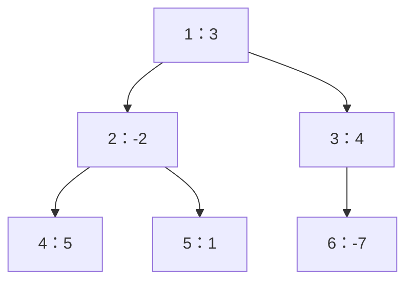
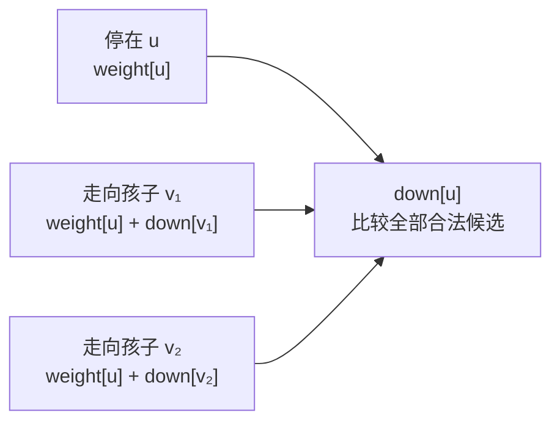

# 5.7 树形 DP：先算孩子，再汇总父亲

前置：[DFS 与回溯](../03-search/01-dfs-backtracking.md)、[DP 入门](01-dp-basics.md)、[固定根与 DFS 序](../06-graph-and-tree/07-dfs-order.md)。

**树形 DP 是把子问题放在树上：先说清一个节点的状态回答什么，再看它怎样依赖父亲或孩子。** 常见的子树模型，要等孩子算完，再组织当前节点的结果。

## 0. 从已经会的根路径前缀出发

[上一节的机房复盘](../06-graph-and-tree/08-lca-binary-lifting.md#92-洛谷-p8805机房)计算根到 u 的点权和：**父亲先有结果，孩子再继承**。

现在换一个问题：**每个节点有一个点权，从某个节点出发，只能向孩子走，也可以随时停下，最大能得到多少点权和？路径至少包含一个点。**

逐个起点枚举全部向下路径可以解决，但会反复处理同一段后续；链上所有起点合计，最坏需要 O(n²) 时间。

**无论从哪个祖先走进 u，从 u 继续向下的最好结果都相同。** 因而可以为每个 u 只计算一次，再交给父亲使用。

> 这次依赖方向反过来了：**父亲需要孩子的答案，所以先算孩子。** 不需要用 LCA 查询祖先。

## 1. 主实现：复用遍历结果，逆序处理

节点编号 **1-based**，g[0]、weight[0] 留空；图是非空连通无向树，每条边双向存储，根合法，权值可以为负数。

直接复用 [DFS 序模板](../../templates/06-graph-and-tree/dfs-order/README.md)的 tree_order；已有的 parent、order 就够了，不再写第二套遍历。复制单文件时先放 DFSOrder/tree_order，再放以下函数。

```cpp
#include <algorithm>
#include <vector>

using ll = long long;

// 前置：已有 DFSOrder/tree_order(g, root)，返回 parent、order。
// 1-based 非空连通无向树；weight 长度 n+1，权值与所有候选和能用 ll 表示。
// 返回 down[u]：从 u 出发，只向孩子走、至少包含 u 的最大路径点权和。
std::vector<ll> max_down_paths(const std::vector<std::vector<int>>& g,
                             const std::vector<ll>& weight, int root = 1) {
    int n = static_cast<int>(g.size()) - 1;
    auto t = tree_order(g, root);
    std::vector<ll> down(n + 1);

    // 前序里父亲在前；倒着处理，就能保证每个孩子先算好。
    for (int i = n; i >= 1; --i) {
        int u = t.order[i];
        down[u] = weight[u]; // 只停在 u，也是一条合法的非空路径

        for (int v : g[u]) {
            if (v == t.parent[u]) continue;

            ll candidate = weight[u] + down[v]; // 从 u 走进孩子 v
            down[u] = std::max(down[u], candidate);
        }
    }

    return down;
}
```

得到 down 后，若问题允许从任意节点出发，再取所有真实节点中的最大值：

```cpp
auto down = max_down_paths(g, weight, root);
ll ans = *std::max_element(down.begin() + 1, down.end()); // 排除占位下标 0
```

**这里只解决“固定根下的向下路径”。** 不能同时走进两个孩子，也不是一般的任意两点路径、连通点集或整棵子树求和；这些问题需要重新设计组合方式。

> **复用的是依赖顺序：先算孩子，再算父亲。** 本例最多接一个孩子；能否同时接多个分支，要重新按状态定义判断。

## 2. 变量与状态：一个格子在回答什么？

| 变量 | 含义 | 下标与范围 |
| --- | --- | --- |
| `g[u]` | 与 u 相邻的节点，包括无向边中的父亲 | 外层 n+1；全部邻接记录共 2(n-1) 条 |
| `weight[u]` | 节点 u 的点权 | n+1 项，按原节点编号保存，使用 ll |
| `t.parent[u]` | 固定根下 u 的直接父亲 | n+1 项，根的父亲为 0，用于跳过反向边 |
| `t.order[i]` | DFS 前序第 i 个访问的节点 | n+1 项，使用 1..n；把处理位置换回节点编号 |
| `down[u]` | 从 u 出发，仅向孩子走，且必须包含 u 的最大路径点权和 | n+1 项，按原节点编号保存 |
| `candidate` | 先选 u，再沿某个孩子的最佳向下路径继续的总权值 | 一个候选，不一定优于停在 u |

**状态要固定“从 u 出发”，不能只写“u 的最大值”。** 不同起点的答案分别保留，最后根据题目要求汇总。

**数组分配时虽然默认是 0，但每个真实节点都先执行 `down[u]=weight[u]`，再计算候选；不把默认 0 当成一条合法空路径**。

## 3. 先手推一棵树，再看转移

以 1 为根，括号里是点权，按左侧孩子优先访问：



叶子没有下一步，只能停在自身：

$$
\mathrm{down}[4]=5,\qquad \mathrm{down}[5]=1,\qquad \mathrm{down}[6]=-7.
$$

**叶子的负权也要保留。** 从 6 出发且非空，答案就是 -7。

处理节点 2，有三种合法选择：停在 2、走向 4、走向 5。

$$
\mathrm{down}[2]=\max(-2,\ -2+5,\ -2+1)=3.
$$

选中的是路径 2→4。**不能把两个孩子的结果相加**，因为这里要求从 2 只向下走成一条路径。

处理节点 3，继续到 6 会变差，所以停在 3：

$$
\mathrm{down}[3]=\max(4,\ 4-7)=4.
$$

最后处理节点 1：

$$
\mathrm{down}[1]=\max(3,\ 3+3,\ 3+4)=7.
$$

选择路径 1→3，点权和为 7。

### 找到状态 → 推导转移 → 写成代码

**状态已经固定起点 u。** 合法路径要么停在 u，要么选择一个孩子 v，接上从 v 出发的向下路径。



因此对每个孩子 v，尝试：

$$
\mathrm{down}[u]
\leftarrow
\max\bigl(\mathrm{down}[u],\ \mathrm{weight}[u]+\mathrm{down}[v]\bigr).
$$

**“停在自身”对应初值，“走向某个孩子”对应循环中的候选。** 数学上有哪些选择，代码就逐项比较哪些选择。

更完整的建模检查见 [DP 三步走](../../patterns/05-dynamic-programming/dp-modeling-workflow.md)。

## 4. 为什么倒着遍历 order 就够了？

上图的一种前序与处理顺序为：

| 顺序 | 节点序列 |
| --- | --- |
| DFS 前序 order[1..n] | 1、2、4、5、3、6 |
| 反向读取 order | 6、3、5、4、2、1 |

看节点 2：它的孩子 4、5 都排在它前面，计算候选时结果已经就绪。节点 3 也在孩子 6 之后处理。

顺序表中父亲排在孩子前面；倒着读取后，孩子先算，父亲再读取孩子的结果：
$$
\mathrm{down}[v]\text{ 先算好}
\quad\Longrightarrow\quad
\mathrm{down}[u]\text{ 可以读取它}.
$$

**逆前序不一定等于原递归 DFS 的后序序列，但都能保证孩子先于父亲。** 孩子之间谁先谁后不影响本例，所以不必强求某一种后序。

**关键不在遍历叫什么，而在 order 正向是否保证“父亲在孩子前面”。** DFS 前序满足，BFS 访问顺序也满足；把这些顺序倒着读取，都能让孩子先算。

循环从 n 到 1，枚举的是**顺序表的位置 i**，再由 `u=order[i]` 找到本轮节点。**不是直接按节点编号 n、n-1……1 计算**；order 必须先提供上述先后保证，随便排列后再倒读并不成立。

例如根是 3，孩子是 1、2：order 可以是 `[3,1,2]`，倒读为 `[2,1,3]`，父亲最后计算；若直接按编号 `[3,2,1]`，反而先算父亲，孩子结果尚未就绪。

整个循环的行为是：

1. **用 order[i] 找到本轮要处理的节点 u**。
2. 初始化只选 u 的答案。
3. 跳过父边，只读取已经完成的孩子状态。
4. 当前节点的全部候选比较结束，down[u] 就固定下来，等待它的父亲使用。

**本轮只写自己的 down[u]，孩子的状态由孩子那一轮负责。** 不需要边算孩子、边猜父亲最终值。

### 与根路径前缀的方向对照

| 状态在问什么 | 当前点依赖谁 | 合适顺序 |
| --- | --- | --- |
| 从根到 u 的累计点权 | 父亲的前缀结果 | 前序／BFS，父亲先算 |
| 从 u 向下继续的最优值 | 各孩子的后续结果 | 孩子先算：后序，或逆前序／逆 BFS 序 |

**顺序由状态依赖决定，不由“用了 DFS”决定。** 对照原题见 [P8805 根路径前缀](../06-graph-and-tree/08-lca-binary-lifting.md#92-洛谷-p8805机房)，通用关系见 [DAG DP 中的父子依赖](../../patterns/06-graph-and-tree/dag-dp.md#树上的根路径前缀父亲先于孩子)。

## 5. 为什么每个孩子只保留最好的一条？

假设一条最优的 u 起点路径，第一步走向孩子 v。它在 v 后面的部分，也是“从 v 出发，只向下走”的合法路径。

若这部分不是 v 的最优结果，就换成 down[v] 对应的路径。**新路径仍在同一棵孩子子树内，仍从 v 开始，不会走回 u，接到 u 后依然合法，权值也不会更小。**

因此每个孩子只需提供自己的最优值。u 的所有合法路径又都属于“停下”或“走向某个孩子”，循环没有漏掉其他可能。

**这里是先计算全部孩子的最优子问题，再完整比较候选；不是从 u 出发，只贪心走向当前点权最大的孩子。**

树上分成多棵孩子子树，提供了清楚的子问题边界。但若题目还有总预算、恰好选若干点、颜色数量等限制，一个 down[u] 未必足够，仍需补状态或新的合并方式。

## 6. 换题时，先检查能否只用一个状态

当前模型中，从父亲走进 u 后，后面能做什么已经确定，所以一个 down[u] 足够。

如果题意中，**u 采用不同选择，会改变孩子允许采用的选择**，父亲就可能需要询问多个带条件的结果。例如：

$$
dp[u][s]=\text{在 u 采用状态 s 的条件下，u 子树内的最优结果}.
$$

这里的 s 必须有具体含义，例如一种颜色、是否采用某种选择；**不是只因为答案不好算，就随意增加一维。**

**先画小树，检查两种结果能否被父亲无差别使用：若一个合法、另一个不合法，就不能提前把它们合并成一个最优值。**

> **树形 DP 没有统一的“把孩子全相加”。** 当前题只允许选一条后续，用 max 比较；其他题能否同时采用多个分支、是否共享预算，需要重新按题意判断。

## 7. 复杂度与边界

| 操作 | 时间 | 原因 |
| --- | --- | --- |
| 固定根并获得 parent、order | O(n) | 复用显式 DFS，每点与邻接记录处理常数次 |
| 逆序计算全部 down | O(n) | 每点一次初始化，所有邻接记录合计 2(n-1) 条 |
| 从全部起点中取最大值 | O(n) | 只扫描真实节点 1..n |

**总时间 O(n)，额外空间 O(n)**，计入遍历结果、显式栈与 down；没有使用递归栈。

新增一个状态维度、逐对合并孩子方案或加入容量枚举后，要重新计算复杂度；不能把所有树形 DP 都写成 O(n)。

- **单点树：** down[root]=weight[root]。
- **全负权：** **路径要求非空，不能让最终答案默认是 0**，否则会错误地允许空路径。例如，权值为 `-5、-2` 时，最优答案是 `-2`。
- **答案位置：** 只问从根出发时读 down[root]；允许任选起点时，才在全部 down[u] 中取最大值。
- **数值范围：** 点权、候选与累计值使用 ll，并确认所有中间结果也能表示。
- **根的作用：** 本例的“向下”由固定根决定，改变根可能改变合法路径与答案；一般树形 DP 也要分清题目是否指定根。
- **输入结构：** 只跳父边适用于树；一般有环图不能直接使用这套遍历和依赖。
- **多测：** 每次调用重新建立局部状态；图或点权改变后重新计算，旧 down 不会自动更新。

## 8. 典题与复盘

两份实际实现已本地核验并完成复盘，平台通过结果未单独提供。代码保留原逻辑，只整理排版与注释；通用 main 不重复展示。

### 8.1 洛谷 P1122：最大子树和

[题目链接](https://www.luogu.com.cn/problem/P1122)。修剪后保留的是**非空连通块**，可以有多条分支，并不是前文那种只接一个孩子的向下路径。

#### 原实现

```cpp
struct DFSOrder {
    vector<int> parent, depth;
    vector<int> order;

    explicit DFSOrder(int n)
        : parent(n + 1), depth(n + 1), order(n + 1) {}
};

DFSOrder tree_order(const vector<vector<int>>& g, int root = 1) {
    int n = static_cast<int>(g.size()) - 1;
    vector<int> next(n + 1);
    stack<int> st;
    st.push(root);

    DFSOrder t(n);
    int timer = 0;
    t.parent[root] = 0;
    t.depth[root] = 0;
    t.order[++timer] = root;

    while (!st.empty()) {
        int u = st.top();

        if (next[u] == (int)g[u].size()) {
            st.pop();
            continue;
        }

        int v = g[u][next[u]++];
        if (t.parent[u] == v) continue;

        t.parent[v] = u;
        t.depth[v] = t.depth[u] + 1;
        t.order[++timer] = v;
        st.push(v);
    }

    return t;
}

void solve() {
    int n;
    cin >> n;

    vector<int> w(n + 1);
    for (int i = 1; i <= n; ++i) cin >> w[i];

    vector<vector<int>> g(n + 1);
    for (int i = 1; i < n; ++i) {
        int u, v;
        cin >> u >> v;
        g[u].push_back(v);
        g[v].push_back(u);
    }

    auto t = tree_order(g);
    vector<int> dp(n + 1);

    for (int i = n; i > 0; --i) {
        int u = t.order[i];
        dp[u] = w[u]; // 必须包含 u，先放入自身贡献

        for (int v : g[u]) {
            if (v == t.parent[u]) continue;
            dp[u] += max(dp[v], 0); // 整个孩子连通块有收益，才接到 u 上
        }
    }

    int ans = INT_MIN; // 至少保留一个节点，全负时也不能返回 0
    for (int i = 1; i <= n; ++i) ans = max(ans, dp[i]);
    cout << ans << '\n';
}
```

#### 先固定“必须包含 u”，分支才能接起来

**dp[u] 表示 u 子树内，必须包含 u 的最大连通块点权和。** 它不要求保留全部后代，也不要求最后方案包含整棵树的根。

连接一个孩子分支时，要么整个不接，贡献 0；要么接上必须包含 v 的最佳连通块，贡献 dp[v]：

$$
dp[u]=w[u]+\sum_{v\in\mathrm{child}(u)}\max(0,dp[v]).
$$

**取舍的是孩子整块的收益，不是孩子节点自身的正负。** 一个负权孩子仍可能连接着更有价值的后代，先把它的子问题算完，才能决定接不接。

沿用前文六点树，节点 2 的两个正收益分支可以同时保留：

$$
dp[2]=-2+5+1=4.
$$

节点 3 放弃负收益分支，得到 4；根再连接两侧：

$$
dp[1]=3+4+4=11.
$$

前文向下单路径的答案是 7，**本题连通块可以分叉，所以变成 11**。不同模型不能共用“孩子怎么合并”的结论。

> **本题的写法：逆序读取 order，先放自身，再累加各孩子的正贡献，最后在所有节点中取最大值。**

每个非空连通块都有一个最靠近固定根的节点 u，这块一定包含在 u 的子树里，并包含 u。因此最后要比较所有 dp[u]；只读 dp[1] 会漏掉不包含根的最优方案。

#### 边界与写法

- **非空：** dp[u] 从 w[u] 开始，最终 ans 从 INT_MIN 开始；全负时保留最大的单个节点。
- **建图：** 无向边双向存储，需要 parent 跳过父边；depth 在本题中没有参与转移，可省略，但原实现保留。
- **int：** 原题保证最终答案不超过 int 范围；每个 dp[u] 都是一个合法连通块的权值，不超过全局最大答案，而且只累加非负贡献。因此原代码在题目保证下可用 int。脱离这项保证，通用模板使用 ll。
- **复杂度：** 时间 O(n)、空间 O(n)，显式栈处理长链。

### 8.2 洛谷 P1352：没有上司的舞会

[题目链接](https://www.luogu.com.cn/problem/P1352)。输入一对 u、v 表示 **v 是 u 的直接上司**，直接上下级不能同时参加；快乐值可以为负。

#### 原实现

```cpp
struct DFSOrder {
    vector<int> order;

    explicit DFSOrder(int n) : order(n + 1) {}
};

// g 只存上司指向下属，没有反向边，因此无需 parent 或跳父判断。
DFSOrder tree_order(const vector<vector<int>>& g, int root = 1) {
    int n = static_cast<int>(g.size()) - 1;
    vector<int> next(n + 1);
    stack<int> st;
    st.push(root);

    DFSOrder t(n);
    int timer = 0;
    t.order[++timer] = root;

    while (!st.empty()) {
        int u = st.top();

        if (next[u] == (int)g[u].size()) {
            st.pop();
            continue;
        }

        int v = g[u][next[u]++];
        t.order[++timer] = v;
        st.push(v);
    }

    return t;
}

void solve() {
    int n;
    cin >> n;

    vector<int> h(n + 1);
    for (int i = 1; i <= n; ++i) cin >> h[i];

    vector<vector<int>> g(n + 1);
    vector<bool> p(n + 1); // p[u]：u 是否有直接上司

    for (int i = 1; i < n; ++i) {
        int u, v;
        cin >> u >> v; // v 是 u 的直接上司
        g[v].push_back(u);
        p[u] = true;
    }

    int root = 1;
    for (int i = 1; i <= n; ++i) {
        if (!p[i]) {
            root = i;
            break;
        }
    }

    auto t = tree_order(g, root);
    vector<array<int, 2>> dp(n + 1, array<int, 2>{0, 0});

    for (int i = n; i > 0; --i) {
        int u = t.order[i];
        dp[u][1] = h[u]; // 参加时先计自身；不参加的初值保持为 0

        for (int v : g[u]) {
            dp[u][0] += max(dp[v][0], dp[v][1]);
            dp[u][1] += dp[v][0];
        }
    }

    cout << max(dp[root][0], dp[root][1]) << '\n';
}
```

#### 从“同时影响上下级”，转为“固定当前点，先解子树”

**树本身就是递归结构：u 的每个孩子 v，都是同类子问题的根。** 先不决定上级是否参加，只计算 u 子树在两种条件下的结果：

| 状态 | 完整含义 |
| --- | --- |
| dp[u][0] | u 子树内，u 不参加时的最大快乐值 |
| dp[u][1] | u 子树内，u 参加时的最大快乐值 |

**当前点不参加，孩子可以自由选更优状态：**

$$
dp[u][0]=\sum_{v\in\mathrm{child}(u)}\max(dp[v][0],dp[v][1]).
$$

**当前点参加，直接孩子必须不参加：**

$$
dp[u][1]=h[u]+\sum_{v\in\mathrm{child}(u)}dp[v][0].
$$

先写自身贡献 0、h[u]，再合并孩子。代码中的 dp[u][0] 从数组初始化时就是 0，且每个 u 只计算一次，因此不必重复清零；若复用数组做新一轮计算，需要重新初始化。

**父亲稍后根据自己的状态，决定读取孩子哪一种结果。** 子树内部具体选了哪些人不必向上保存，但“子树根选不选”必须保留；完整图解与独立性论证已提炼为 [固定节点状态范式](../../patterns/05-dynamic-programming/subtree-boundary-state.md)。

#### 根、建图与答案位置

- **按输入找根：** p[u] 只标记是否有上司，不是父亲编号；唯一没有上司的节点才是 root，不能默认是 1。
- **只存上司→下属：** 因此遍历不可能走回父亲，不需要 parent、depth 或跳父判断；order 就够了。
- **只看根的两种状态：** 根的子树就是所有职员，且没有上级继续限制它，因此取 max(dp[root][0],dp[root][1])，不对所有节点的 dp 相加。
- **负值与空方案：** 可以不邀请任何人，全负时答案为 0；这与第一题必须保留至少一朵花不同。
- **范围：** n≤6000，快乐值在 [-128,127]，原实现 int 足够；时间、空间均为 O(n)。

### 三种模型，顺序相同，转移不同

| 模型 | 当前状态固定什么 | 孩子如何合并 | 最后读哪里 |
| --- | --- | --- | --- |
| 向下单路径 | 必须从 u 出发 | 最多接一个孩子，比较候选 | 任意起点时比较全部节点 |
| 最大连通块 | 必须包含 u | 可以接多个孩子，累加正收益块 | 比较全部节点 |
| 舞会／最大权独立集 | u 参加或不参加 | 按当前状态选择兼容的孩子结果，再相加 | 根的两种状态取优 |

两种稳定竞赛实现见 [树形 DP 基础模型模板](../../templates/05-dynamic-programming/tree-dp/README.md)；它们各自对应明确问题，不是把所有树形 DP 统一成同一转移。

## 9. 自查与衔接

1. 为什么 order 正序适合根路径前缀，反序适合本例？反序是否必须等于递归后序？
2. 为什么 down[u] 初始化为 weight[u]？为什么不能把两个孩子的结果直接相加？
3. 题目若问“从根出发”与“任选起点”，最终应该分别读哪里？

本节先建立**孩子子树作为子问题、按依赖计算、按条件设计状态**的基础。换根 DP、树上背包等组合模型后续再按需要补；全章写法成本与场景推荐仍留到章末。

[返回本章索引](README.md) · [复用 DFS 序模板](../../templates/06-graph-and-tree/dfs-order/README.md)
