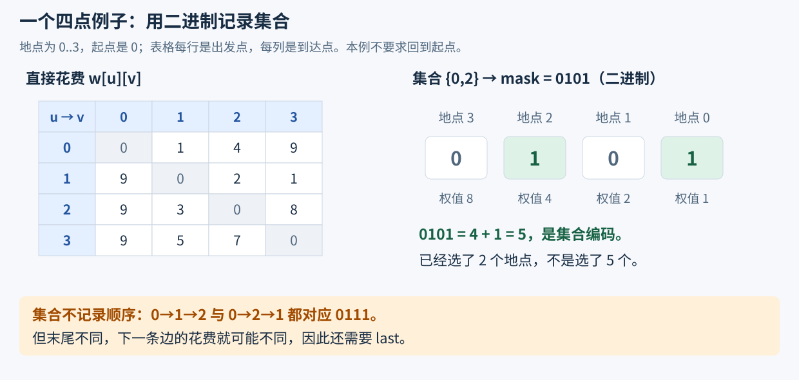
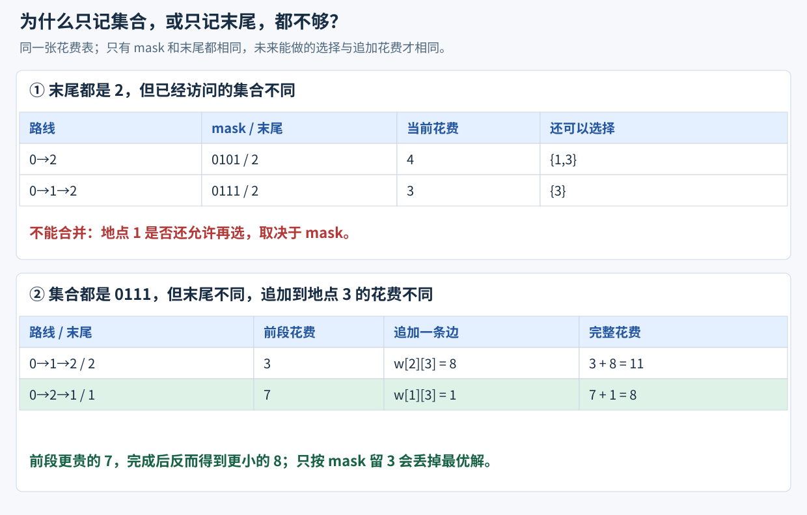
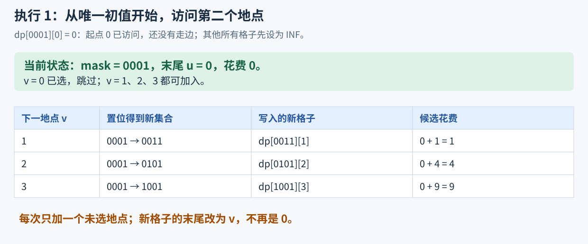
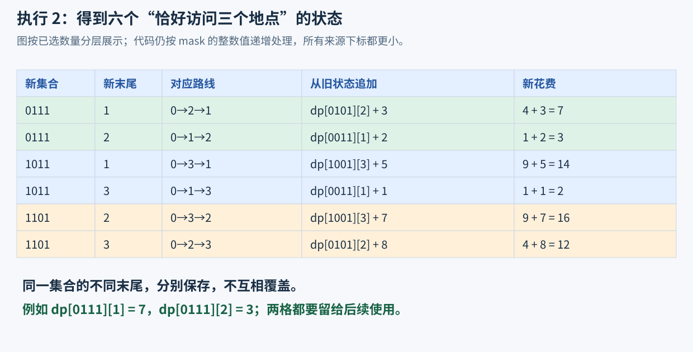
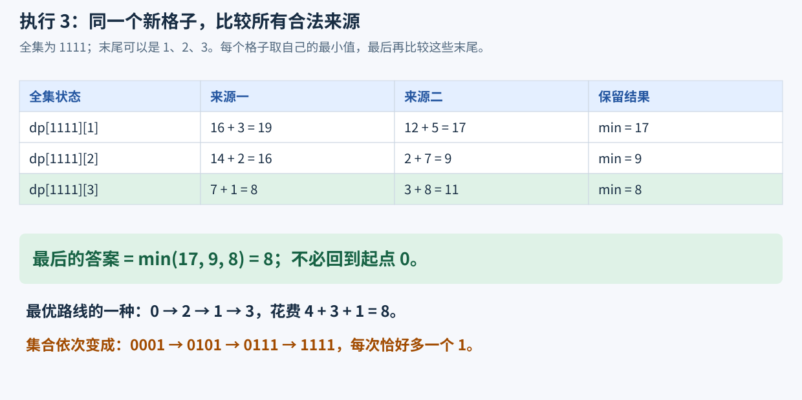
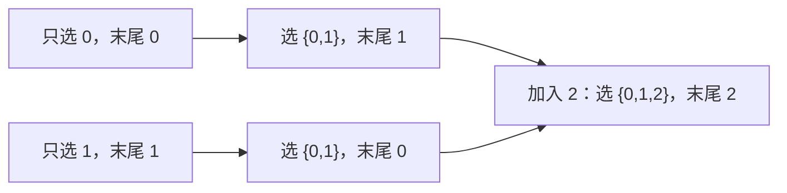

# 5.8 状态压缩 DP：用集合记录已经选过什么

前置：[位掩码与小集合](../01-basic-problem-solving/05-bit-operations.md#4-位掩码用整数表示小集合)、[DP 入门](01-dp-basics.md)、[记忆化搜索](../03-search/03-memoized-search.md)。

**状态压缩 DP 用整数的二进制位保存一组选择状态，再围绕这组信息做递推。** 本节先建立“集合＋最后位置”的基础模型，不展开棋盘逐行状压或子集划分优化。

## 0. 从“不允许重复选择”遇到的问题出发

有 n 个地点，编号 0..n−1，已知从 u 到 v 的直接花费 $w[u][v]$。从指定起点出发，**每个地点恰好访问一次，最后停在哪里都可以，不要求返回起点**，求最少总花费。

枚举访问顺序能求解，但固定起点后仍有 (n−1)! 种顺序。已经知道“当前在哪”，也不能直接合并搜索过程：**后面还能去哪里，取决于之前已经去过哪些地点。**

因此需要同时保留：

- **已经访问的集合**：决定哪些地点还可以选。
- **最后停留的位置**：决定接下来使用哪一条边、追加多少花费。

> **先把影响后续选择的信息保留下来，再比较到达同一完整状态的历史花费。** 集合很小时，可以用一个整数保存，不必把整个访问顺序放进状态。

## 1. 先给代码：集合与末尾位置共同构成状态

沿用通用框架和 `using ll = long long;`。所有地点均为 **0-based**。

本实现约定 n≤18，w 是 n×n 的直接花费表；不存在的边填 INF。有限边权的绝对值≤10¹²，保证所有候选和能安全用 ll 表示。非空时 start 合法；空表返回 0。

```cpp
const ll INF = LLONG_MAX / 4;

// 状态定义：dp[mask][u] 表示从 start 出发，
// 恰好访问 mask 中的所有地点、最后停在 u 的最小花费。
// 前提：每个地点恰好访问一次，固定起点，不要求回到起点。
// 返回最少花费；若无法完成，返回 INF。
ll shortest_visit_path(const vector<vector<ll>>& w, int start = 0) {
    int n = (int)w.size();
    if (n == 0) return 0;

    int limit = 1 << n; // 共 2^n 个访问状态；适用于 n 较小的情况。
    vector<vector<ll>> dp(limit, vector<ll>(n, INF));

    // 初始状态：只访问起点 start，当前位于 start，花费为 0。
    // 尚未访问其他地点，也尚未走过任何边。
    dp[1 << start][start] = 0;

    // 枚举当前已经访问的地点集合。
    for (int mask = 0; mask < limit; ++mask) {
        // 枚举当前所在地点 u。
        for (int u = 0; u < n; ++u) {
            // 当前完整状态尚不可达，无需继续转移。
            if (dp[mask][u] == INF) continue;

            // 枚举下一个要访问的地点 v。
            for (int v = 0; v < n; ++v) {
                // 每个地点恰好访问一次，因此不能再次访问已选地点。
                if ((mask >> v) & 1) continue;

                // w[u][v] 表示 u 到 v 的直接边权；INF 表示没有这条边。
                if (w[u][v] == INF) continue;

                // 将 v 加入已访问集合，得到新的状态。
                int next_mask = mask | (1 << v);

                // 从 u 走到 v，更新访问 next_mask 且停在 v 的最小花费。
                ll cost = dp[mask][u] + w[u][v];
                dp[next_mask][v] = min(dp[next_mask][v], cost);
            }
        }
    }

    // 全集表示所有地点都已访问。
    // 终点没有固定，因此枚举所有可能的最后一个地点，取最小花费。
    // 若所有状态均不可达，结果仍为 INF。
    return *min_element(dp[limit - 1].begin(), dp[limit - 1].end());
}
```

> **用途速记：** 输入地点间的直接花费和起点，返回每个地点恰好访问一次的最少总花费。用 mask 记录已访问集合，u 记录末尾；每步加入一个未访问地点，再把到达同一集合、同一末尾的较贵方案淘汰。

## 2. 围绕同一个四点例子，看状态怎样变化

下面始终从地点 0 出发。表格的**行表示从哪里走，列表示走到哪里**；各条有向边的花费已经给定。



**二进制最右边是第 0 位。** 例如 0101 表示已经访问地点 0、2，十进制值为 5；不是“访问了五个地点”，也不表示先后顺序。

### 先看为什么集合与末尾都不能省



- **只记录末尾会混淆“还剩哪些地点”；**
- **只记录集合则会混淆“下一步从哪个地点出发”。**

图中的两条路线都访问了 {0,1,2}，但分别停在 2、1：花费 3 的前段，追加到 3 后总花费为 11；花费 7 的前段，追加后反而只需 8。**不能只按同一个 mask 留下较便宜的前段。**

### 初始状态与第一轮：只访问起点，再加入一个地点



只有 `dp[1 << 0][0]=0` 合法，其他位置先保持 INF。**图中的四位掩码均是二进制标签**，代码仍用 mask 的整数值作为数组下标，不把带前导 0 的标签直接粘进 C++ 表达式。

### 下一轮：不同访问顺序，落到各自完整状态



例如 $(0111)_2=7$ 表示已访问 {0,1,2}，但 `dp[7][1]` 与 `dp[7][2]` 是不同的格子。**表值是最少花费，mask 是已选集合，二者不是同一个量。**

### 最后一轮：同集合、同末尾的来源，才能取 min 合并



本例答案为 **8**，路线可以是 0→2→1→3。函数只返回花费；图中路线用于说明结果，不表示代码额外保存了前驱。

## 3. 一个格子的完整含义与容量

$$
dp[\mathrm{mask}][u]
=\text{从 start 出发，恰好访问 mask 中的地点、最后停在 u 的最少花费}.
$$

这里的“恰好”很重要：**集合外的地点没有访问过，集合内的每个地点访问一次**。合法状态必然包含起点，也必然包含末尾 u。

| 变量或容器 | 保存什么 | 容量／范围依据 |
| --- | --- | --- |
| n | 地点数量 | 本实现约定 0..18 |
| w[u][v] | 从 u 到 v 的直接花费 | n×n，不存在的边为 INF；不默认对称 |
| mask | 已访问集合的整数编码 | 0..2ⁿ−1，每位对应一个地点 |
| limit | 集合状态总数 | 2ⁿ，写作 `1 << n`；不是最大有效下标 |
| dp | 每个集合、每种末尾的最优值 | 2ⁿ 行、n 列；有些组合不可达，仍预留存储 |
| u、v | 当前末尾与准备新选的地点 | 都在 0..n−1 |
| next_mask | 加入 v 后的新集合 | 比 mask 多一个 1 |

**空集合不代表已访问起点。** 所以非空输入从 `1 << start` 初始化，而不是从 `dp[0][start]` 开始。

**0 是合法花费，不代表不可达。** 所有边都免费时，答案确实可以为 0；因此不可达用 INF，与合法零值分开。

## 4. 把状态转移逐项写成代码

### 查询某个地点是否已经访问

```cpp
if ((mask >> v) & 1) continue;
```

把第 v 位移到最低位，再与 1 相与；结果为 1 就说明 v 已经在集合中，本轮不能重复选它。

### 加入未访问的 v，同时把末尾改成 v

```cpp
int next_mask = mask | (1 << v);
```

**1 左移 v 位，只标记地点 v；按位或把这一位设为 1，其他地点不变。** 因为前面已经排除 v 在集合内的情况，本轮恰好新增一个地点。

例如从已经访问 0、2 的状态，加入地点 1：

$$
(0101)_2\ \text{加入第 1 位}\ \longrightarrow\ (0111)_2.
$$

再追加从 u 到 v 的直接花费：

$$
dp[\mathrm{next\_mask}][v]
\leftarrow\min\bigl(dp[\mathrm{next\_mask}][v],\ dp[\mathrm{mask}][u]+w[u][v]\bigr).
$$

**旧格子保存已经走过的花费，新边贡献 $w[u][v]$；新末尾是 v，不能仍写成 u。**

### 为什么同一完整状态可以只保留最少花费？

两条历史到达相同的 mask、u 时，**剩余可选地点相同，下一步的直接花费也相同**。把较贵前段换成较便宜前段，之后照走同一段后续，仍然合法，而且总花费不会增加。

因此不必区分此前的具体访问顺序。**省掉的是已经不再影响未来的历史顺序，保留的是仍然影响未来的集合与末尾。** 若题目还有依赖更早历史的限制，这两个量也可能不够。

## 5. 为什么按 mask 从小到大，就能满足依赖？

本轮只向一个原本为 0 的位写入 1。因为没有进位混淆，新掩码等于：

$$
\mathrm{next\_mask}=\mathrm{mask}+2^v>\mathrm{mask}.
$$

> 所以**所有转移都从较小的整数下标走向较大的下标**。处理 mask 时，可能更新它的前驱掩码都已经处理；本轮写到的 next_mask 则留给后面的外层循环继续传播。

图解按“已选 1 个、2 个、3 个、4 个地点”分层，便于观察依赖；代码不必额外按数量分层，按数值递增就够了。

> **原地点图即使有环，集合状态的依赖也没有环：每次都多选一个地点，不会回到旧集合。** 这里与[隐式 DAG 的计算顺序](../../patterns/06-graph-and-tree/dag-dp.md#从序列中识别隐式-dag)相通。

因此可以在同一张 dp 表里向后更新，不必另开一张“下一轮”表。

但**不能随便改成 mask 倒序：新状态可能在获得正确值前就已经被扫过，后续便无法继续传播**。

## 6. 为什么叫“压缩”，时间却仍然是指数级？

> **把 n 个是否已选的布尔值装进一个整数，是表示方式的压缩，不是把 2ⁿ 种集合变成 n 种。**

只记录完整访问顺序，固定起点后有 (n−1)! 种排列；合并为“集合＋末尾”后，表项上界为 n×2ⁿ，每个表项再枚举下一个地点。

| 工作 | 时间／空间 | 原因 |
| --- | --- | --- |
| 创建并初始化 dp | 时间 O(n·2ⁿ)，空间 O(n·2ⁿ) | 每个集合预留 n 个末尾 |
| 全部转移 | 时间 O(n²·2ⁿ) | 枚举集合、当前末尾与下一地点 |
| 汇总答案 | 时间 O(n) | 固定全集，比较所有末尾 |
| 位查询、置位 | 本实现中 O(1) | n≤18，整数位宽固定 |

常见 8 字节 ll 下，仅 dp 数值部分：n=16 约 **8 MiB**，n=18 约 **36 MiB**；二维 vector 还包含每行对象与分配开销，不能只算这些数值。

**能用整数编码，不等于能分配或枚举全部集合。** 把 int 换成更宽类型，只是扩展表示范围，不会消除指数增长；实际能否通过仍取决于时间与内存限制。

## 7. 与已学模型的联系、适用边界

| 情况 | 需要保存的信息 | 注意 |
| --- | --- | --- |
| 只关心选了哪些，未来贡献与顺序无关 | 可能只需 $dp[mask]$ | 仍需根据题目证明集合信息已经足够 |
| 后续贡献取决于最后一个对象 | $dp[mask][last]$ | 本节的直接花费正属于这种情况 |
| 01 背包：任意物品共享一个容量上限 | 物品处理范围与容量 | 常能按物品顺序处理，不必额外枚举所有已选集合 |
| 普通图最短路，允许经过中间节点 | 顶点距离及相应算法状态 | 与本节“每点恰好一次”不是同一约束 |

> **不能先对 w 跑 Floyd，再无条件套入本函数。** 一条最短路可能已经穿过其他地点，甚至重复经过某点；而本节一次转移只允许新增 v。这会让 mask 与真实访问情况不一致。

其他边界：

- **n=1**：起点已经是全部地点，不走边，答案为 0。
- **不存在完整路线**：全集一行都是 INF，返回 INF，由调用处决定怎样输出。
- **缺边与负边**：缺边必须跳过；有限负边可以参与本模型，因为每步新增地点，不会无限绕负环。数值仍需满足前面的安全范围。
- **先判断不可达，再相加**：不要让 INF 参与普通花费运算，也不要把所有初值设成 0。
- **位编号从 0 开始**：第 v 位对应地点 v。`1 << n` 的移位与有符号范围由 n≤18 保证，不能直接照抄到任意大 n。
- **多测**：函数内部重新创建 dp；w 只读，各次调用互不影响。

状态完整性与计算顺序的通用总结，补入已有 [DP 三步走](../../patterns/05-dynamic-programming/dp-modeling-workflow.md#集合状态保留已选对象与必要的末尾)，不再建立一个重复的“万能状压”范式。

## 8. 典题与复盘

两题实际实现已整理并做本地核验，**平台评测结果未单独提供**。

### 8.1 P1433：把原点也当作一个地点

[原题：吃奶酪](https://www.luogu.com.cn/problem/P1433)。从 (0,0) 出发，吃完 n 块奶酪，求最少路程；n≤15，坐标为实数，输出保留两位小数。

**原实现：** 保留把原点加入集合、边读点边建距离表的做法，仅整理排版和注释。沿用框架中的 `using pdd = pair<double, double>;`。

```cpp
const double DINF = 1e18;

double dist(pdd a, pdd b) {
    return hypot(a.first - b.first, a.second - b.second);
}

double shortest(const vector<vector<double>>& w, int start = 0) {
    int n = (int)w.size(); // 这里包含原点，比奶酪数量多 1。
    if (n == 1) return 0.0;

    int limit = 1 << n;
    vector<vector<double>> dp(limit, vector<double>(n, DINF));
    dp[1 << start][start] = 0.0;

    for (int mask = 0; mask < limit; ++mask) {
        for (int u = 0; u < n; ++u) {
            if (dp[mask][u] == DINF) continue; // 当前完整状态尚不可达。

            for (int v = 0; v < n; ++v) {
                if ((mask >> v) & 1) continue; // v 已经访问，不能重复加入。
                if (w[u][v] == DINF) continue; // 这条直接边不存在。

                int next_mask = mask | (1 << v);
                dp[next_mask][v] = min(dp[next_mask][v],
                                     dp[mask][u] + w[u][v]);
            }
        }
    }

    return *min_element(dp[limit - 1].begin(), dp[limit - 1].end());
}

void solve() {
    int n;
    cin >> n;

    vector<pdd> pos;
    pos.push_back({0.0, 0.0}); // 地点 0 是起点，不是额外要吃的奶酪。
    vector<vector<double>> w(n + 1, vector<double>(n + 1, DINF));

    for (int i = 0; i < n; ++i) {
        pdd p;
        cin >> p.first >> p.second;
        pos.push_back(p);

        for (int j = 0; j < (int)pos.size(); ++j) {
            if (j == i + 1) continue;
            w[i + 1][j] = w[j][i + 1] = dist(pos[i + 1], pos[j]);
        }
    }

    cout << fixed << setprecision(2) << shortest(w) << '\n';
}
```

**用途速记：** 把原点编为 0、奶酪编为 1..n，欧氏距离填入直接花费表，就能复用“固定起点、访问全集、末尾任意”的模型。不需要回原点。

这里有两种不同的“数量”：

| 代码中的量 | 表示什么 | 最大值 |
| --- | --- | --- |
| solve 中的 n | 奶酪数量 | 15 |
| shortest 中的 n | 参加状态编码的地点数量，包含原点 | 16 |

初值已把原点标为访问过，后续不会再次选择它；吃完全部奶酪时，mask 就是包含原点的全集。

$$
dp[1][0]=0,
\qquad
\mathrm{answer}=\min_u dp[2^{n+1}-1][u].
$$

公式中的 n 指奶酪数量，移位共保留 n+1 个地点的位。**实现函数内部已经把这个数量命名为 n，不要再多加一次 1。**

每读入一个新点，只需连接它与之前已经读入的点，并同时填写两个方向；最后所有不同点间的距离都已建好。对角线保留 DINF 没有影响，因为下一地点不能已经在 mask 内。

坐标与距离全程用 double；**零距离也是合法边**，例如两个奶酪坐标相同，不能把 0 当作缺边。DINF 是专门赋给不可达格子的哨兵，这里的相等判断不是对计算所得浮点距离做近似比较。

时间 O((n+1)²·2ⁿ⁺¹)，空间 O((n+1)·2ⁿ⁺¹)。原点占一个额外的位，但本题范围足够；没有必要为了少一个位而把起点初始化复杂化。

### 8.2 CF 580D：恰好选 m 道，且起点任意

[原题：Kefa and Dishes](https://codeforces.com/problemset/problem/580/D)。n≤18，恰好选 m 道不同菜；每道有基础收益，某些**有向、紧邻**的次序另有加分，求最大总收益。

**原实现：** 枚举第一道菜 s，每次单独建表。保留收益预先合入 w 的写法；移除未使用的 mn，错误的终态遍历单独放在后文对照。

```cpp
const ll INF = LLONG_MAX / 4;

ll get_mx(const vector<vector<ll>>& w, int m, int s, int sv) {
    int n = (int)w.size();
    if (n == 1) return sv; // 原题此时 m 只能为 1。

    int limit = 1 << n;
    vector<vector<ll>> dp(limit, vector<ll>(n, -INF));
    dp[1 << s][s] = sv;

    for (int mask = 0; mask < limit; ++mask) {
        for (int u = 0; u < n; ++u) {
            if (dp[mask][u] == -INF) continue; // 当前状态不存在，不能从它转移。

            for (int v = 0; v < n; ++v) {
                if ((mask >> v) & 1) continue;

                // 没有额外加分规则，也可以选择 v；不需要“缺边”判断。
                int next_mask = mask | (1 << v);
                dp[next_mask][v] = max(dp[next_mask][v],
                                     dp[mask][u] + w[u][v]);
            }
        }
    }

    ll mx = -INF;
    for (int mask = 0; mask < limit; ++mask) {
        if (__builtin_popcount((unsigned)mask) != m) continue;
        mx = max(mx, *max_element(dp[mask].begin(), dp[mask].end()));
    }
    return mx;
}

void solve() {
    int n, m, k;
    cin >> n >> m >> k;

    vector<ll> base(n);
    for (ll& x : base) cin >> x;

    vector<vector<ll>> w(n, vector<ll>(n, 0));
    while (k--) {
        int u, v;
        cin >> u >> v;
        cin >> w[--u][--v];
    }

    // 每次选入 v，都得到它的基础收益；加分仍按 u→v 区分方向。
    for (auto& row : w)
        for (int v = 0; v < n; ++v)
            row[v] += base[v];

    ll mx = -INF;
    for (int s = 0; s < n; ++s)
        mx = max(mx, get_mx(w, m, s, base[s]));

    cout << mx << '\n';
}
```

**用途速记：** mask 记录已经选了哪些菜，u 记录最后一道；每次加入未选的 v，得到基础收益与紧邻加分。最后只汇总**恰有 m 个 1** 的集合，末尾任意，取最大值。

#### 从最小路程切换到最大收益：一起检查四处

| 位置 | 第一题 | 第二题 |
| --- | --- | --- |
| 不可达初值 | DINF | −INF |
| 第一个合法状态 | 只在原点，距离 0 | 只选第一道菜，收益 $base[s]$ |
| 一次转移的贡献 | 两点间距离 | $base[v]＋bonus[u][v]$ |
| 最终答案位置 | 全集一行取 min | 恰有 m 个 1 的集合中取 max |

原实现提前把 base[v] 加进 w 的每一行：

$$
w[u][v]=\mathrm{bonus}[u][v]+\mathrm{base}[v].
$$

因此第一道菜在初值中计入，后续每道在“进入它”的转移中计入，**每道基础收益恰好计算一次**。不能又在转移里重复加 base[v]。

原题基础收益与加分都可达 10⁹，m 道菜含 m−1 对相邻关系，总收益可能达到：

$$
m\cdot10^9+(m-1)\cdot10^9\le35\cdot10^9.
$$

**dp、边贡献与答案用 ll。** 原函数的 sv 只接收单道基础收益，原题范围内 int 足够；更通用的接口可直接改为 ll。

#### 两个“不可达”不同：状态不存在，不等于边不存在

通用访问路径代码中，有三类独立判断：

| 判断 | 在问什么 | 是否适用于第二题 |
| --- | --- | --- |
| $dp[mask][u]$ 等于哨兵 | 能否从合法初值走到“已选 mask、末尾 u”这个状态？ | 需要，哨兵改为 −INF |
| mask 的第 v 位为 1 | v 是否已经使用，不能再次选择？ | 需要 |
| $w[u][v]$ 表示缺边 | u 到 v 是否根本不允许转移？ | 不需要，任意未选菜都可接在 u 后面 |

**“mask 和 u 冲突”只是状态不可达的一种原因。** 例如 u 根本不在 mask 中，就不可能以 u 结尾。但即使 u 在 mask 中，固定起点不在集合内、或缺边使路线无法形成，也都可能让这个格子仍是 INF／−INF。

所以代码检查的是**这个完整状态有没有合法来源**，不是只检查两个下标看起来是否相容。

> **没有加分规则＝额外收益为 0，不是禁止相邻。** 原题 bonus 默认填 0；预加基础收益后，w[u][v] 默认就是 base[v]。不能把它误设为缺边而跳过。

同样，合法最大收益可以是 0；本模型用 −INF 将**不存在的方案**与**存在但收益为 0 的方案**分开，再在相加前跳过不可达格子。这不表示所有求 max 的 DP 都必须这样初始化，仍应服从各自状态含义。

#### 踩坑：mask 落在数值范围内，不保证恰有 m 个 1

原先尝试：

```cpp
int mn = (1 << m) - 1;
for (int mask = mn; mask < (mn << (n - m)); ++mask) {
    // 错误：范围里并不都是恰好选 m 个的集合。
}
```

确实，最小的 m 位集合把 1 放在最低 m 位，最大的把 1 放在最高 m 位。但**两个端点之间还夹着其他大小的集合**；原来的 `<` 还漏掉了最大端点本身。

例如 n=3、m=2：

| mask 的十进制值 | 二进制 | 1 的数量 | 能否作为终态 |
| --- | --- | --- | --- |
| 3 | 011 | 2 | 能 |
| 4 | 100 | 1 | 不能，但在数值范围内 |
| 5 | 101 | 2 | 能 |
| 6 | 110 | 2 | 能，但原来的 `< 6` 漏掉它 |

**整数大小决定扫描顺序，1 的数量决定选了几道，这是两件事。** 应按题意筛选：

```cpp
for (int mask = 0; mask < (1 << n); ++mask) {
    if (__builtin_popcount((unsigned)mask) != m) continue;
    // 只在这些集合中比较最后一道菜。
}
```

这一筛选只限制最终答案。**数量小于 m 的集合仍是转移所必需的中间状态，不能一起删掉。**

#### 推荐改进：一次初始化所有起点，不重复运行 n 次

```cpp
// base[v] 是单道收益；bonus[u][v] 是紧邻加分，没有规则时填 0。
ll max_dishes(const vector<ll>& base, const vector<vector<ll>>& bonus, int m) {
    int n = (int)base.size();
    int limit = 1 << n;
    vector<vector<ll>> dp(limit, vector<ll>(n, -INF));

    for (int u = 0; u < n; ++u)
        dp[1 << u][u] = base[u]; // 任意菜都可以单独成为起点。

    ll ans = -INF;
    for (int mask = 1; mask < limit; ++mask) {
        int cnt = __builtin_popcount((unsigned)mask);
        if (cnt > m) continue;

        for (int u = 0; u < n; ++u) {
            if (dp[mask][u] == -INF) continue;

            if (cnt == m) {
                ans = max(ans, dp[mask][u]);
                continue; // 已选够，只收答案，不再向外添加。
            }

            for (int v = 0; v < n; ++v) {
                if ((mask >> v) & 1) continue;

                int next_mask = mask | (1 << v);
                ll value = dp[mask][u] + base[v] + bonus[u][v];
                dp[next_mask][v] = max(dp[next_mask][v], value);
            }
        }
    }
    return ans;
}

void solve() {
    int n, m, k;
    cin >> n >> m >> k;

    vector<ll> base(n);
    for (ll& x : base) cin >> x;

    vector<vector<ll>> bonus(n, vector<ll>(n));
    while (k--) {
        int u, v;
        ll c;
        cin >> u >> v >> c;
        bonus[u - 1][v - 1] = c;
    }

    cout << max_dishes(base, bonus, m) << '\n';
}
```

> **所有合法单点都成为初始状态。** 不同起点最终若到达同一 mask、同一末尾，后续选择与新增收益就相同，仍然可以只留最大值，无需在状态中保留起点。



两条历史的第一道不同，但到达 E 后，**已选对象与末尾已经相同，只比较累计收益即可**。若另一道题的后续规则还依赖第一道，例如最终必须返回原起点，就不能直接省略这项信息。

| 写法 | 最坏时间 | 空间 | 差别 |
| --- | --- | --- | --- |
| 原实现逐个 s 调用 | O(n³·2ⁿ) | O(n·2ⁿ) | 每次重建表并重复传播，空间可复用，时间多一个 n |
| 一张表初始化全部单点 | O(n²·2ⁿ) | O(n·2ⁿ) | 合法来源一起进入同一张表，选够 m 个就停止添加 |

原实现的状态、贡献与终态筛选逻辑成立，但最大规模下重复运算较多，**推荐采用一次初始化所有起点的版本**。本地逻辑核验不能代替平台时限评测。

### 8.3 这两题共同需要重审的地方

**不是把 min 改成 max 就完成了迁移。** 还要重新确定：哪些状态一开始就合法、没有规则意味着 0 贡献还是不许转移、需要选全集还是恰好 m 个，以及答案是否允许任意起点。

通用检查补入 [DP 三步走：集合状态](../../patterns/05-dynamic-programming/dp-modeling-workflow.md#集合状态保留已选对象与必要的末尾)。配套 [小集合访问与有序选择模板](../../templates/05-dynamic-programming/subset-dp/README.md)保留两个具体模型，题目坐标读取、输出精度与历史踩坑仍放在本节。


## 9. 自查

1. 同一个末尾、不同 mask，为什么不能合并？同一个 mask、不同末尾，又为什么不能合并？
2. mask=0101 加入地点 1，为什么得到 0111？二进制书写方向与地点编号怎样对应？
3. 起点为什么是已访问状态，而不是空集合？INF 与合法花费 0 有什么区别？
4. 原图有环时，为什么这张状态表仍能按 mask 正序计算？

概念可对照 [OI Wiki：状压 DP](https://oi-wiki.org/dp/state/)；本节围绕小集合访问模型展开，不照搬该页的棋盘模型或其他状态定义。

[本章索引](README.md) · [配套模板](../../templates/05-dynamic-programming/subset-dp/README.md)
