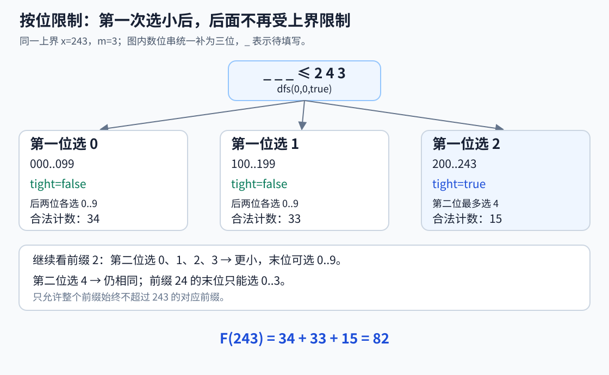
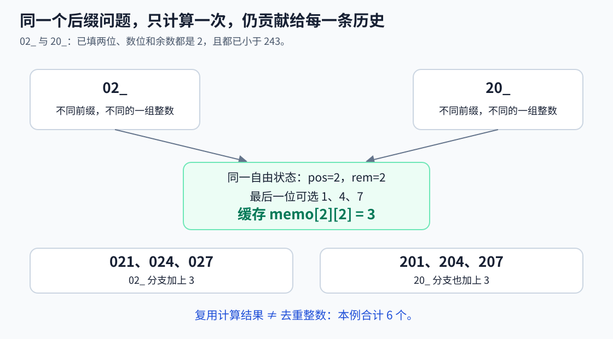
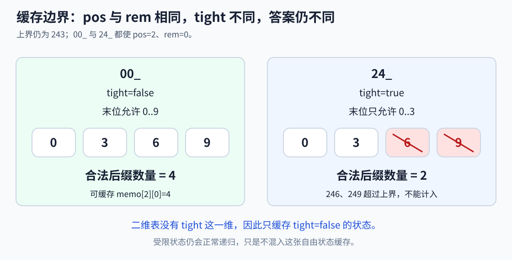
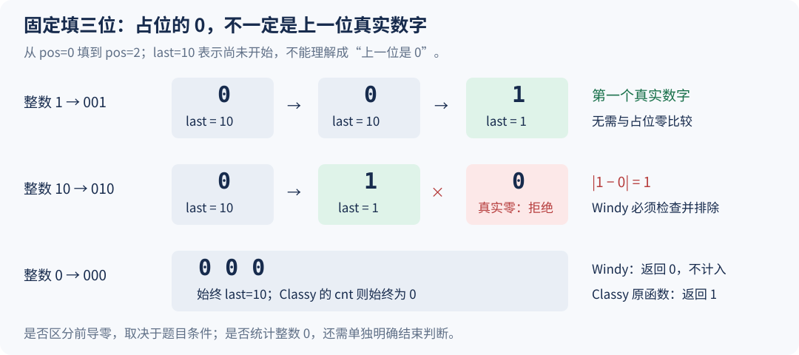

# 5.9 数位 DP：按位统计，不逐个枚举整数

前置：[记忆化搜索](../03-search/03-memoized-search.md)、[DP 状态与初值](01-dp-basics.md)、[同余与余数](../07-math/02-congruence-modulo.md)。

> **数位 DP 把一个整数拆成若干数位，从高位到低位选择，再复用剩余数位的计数结果。** 适合区间很大、条件却能随数位逐步维护的计数问题。

## 0. 遇到的问题：区间太大，但数位很少

给定非负上界 x 和正整数 m，统计 **0..x 中，十进制数位和能被 m 整除**的整数数量。

逐个枚举整数、拆位求和可以解决，但 x 若达到 10¹⁸，就无法逐个扫描。另一方面，x 最多只有 19 位。

直接枚举全部数位组合，依然可能有指数数量；关键是：**不同前缀，能否共享后面这些位的统计结果？**

本模型只需保留“选到第几位、已有数位和的余数、是否仍贴着上界”，而不必保存前缀的完整数值。

**瓶颈不只是“每个数拆位要时间”，更在于要检查的整数太多。** 只把逐数枚举换成逐位 DFS，仍会走到每一个整数；真正降低复杂度的是：不再重复展开后续条件相同的前缀，而是复用一份后缀计数。

## 1. 先给代码：统计 0..x 的合法整数

沿用 `using ll = long long;`。约定 x≤10¹⁸、1≤m≤100；x<0 时返回 0，方便区间相减。**本模型把整数 0 也统计在内。**

```cpp
// 统计 [0, x] 中数位和能被 m 整除的整数个数
// 前提：m >= 1，且答案不超过 ll 的表示范围
ll count_digit_sum(ll x, int m) {
    if (x < 0) return 0;

    string digits = to_string(x); // 按从高位到低位的顺序处理
    int n = (int)digits.size();

    // memo[pos][rem]：已经不受 x 的上界限制时，
    // 从第 pos 位开始填，且当前数位和余数为 rem 的合法填法数
    // -1 表示尚未计算；只缓存 tight=false 的状态
    vector<vector<ll>> memo(n, vector<ll>(m, -1));

    // pos：当前要填写的位置
    // rem：已经填入的数位之和 % m
    // tight：此前的前缀是否与 x 完全相同
    // 返回从当前位置填到末尾，最终数位和能被 m 整除的方案数
    function<ll(int, int, bool)> dfs =
        [&](int pos, int rem, bool tight) -> ll {

        // 所有数位填完：余数为 0，说明数位和能被 m 整除
        if (pos == n)
            return rem == 0 ? 1 : 0;

        // 前缀已经小于 x，后续每一位都可自由选择 0~9
        // 此时结果只由 pos 和 rem 决定，可以记忆化
        if (!tight && memo[pos][rem] != -1)
            return memo[pos][rem];

        // 当前位的选择上限：
        // 前缀仍与 x 相同时，不能超过 x 的当前数位；
        // 前缀已经更小时，当前位可以取到 9
        int bound = digits[pos] - '0';
        int up = tight ? bound : 9;

        ll ways = 0;

        // 枚举当前位的所有合法数字
        for (int d = 0; d <= up; ++d) {
            // 将当前数字加入数位和，只需记录对 m 取模的余数
            int next_rem = (rem + d) % m;

            // 只有此前仍与 x 相同，且当前位也取 bound，
            // 才继续受到 x 的上界限制
            bool next_tight = tight && (d == bound);

            // 累加当前位取 d 时，后续所有合法填法的数量
            ways += dfs(pos + 1, next_rem, next_tight);
        }

        // 只有脱离上界限制的状态可以直接复用缓存
        if (!tight)
            memo[pos][rem] = ways;

        return ways;
    };

    // 从最高位开始，初始数位和为 0，且前缀与 x 相同
    // 允许前导零，因此位数不足 n 的非负整数也会被统计
    return dfs(0, 0, true);
}
```

> **用途速记：** 输入上界 x 和除数 m，返回 0..x 中数位和模 m 为 0 的整数个数。逐位选择保证不超过 x；余数保存条件所需的信息，记忆化复用不受上界限制的后缀计数。

**这里维护的是数位和的余数，不是整个整数的余数。** 加入数字 d 后用 `(rem+d)%m`，不是 `(rem*10+d)%m`；后者 回答另一个问题。

例如数字 14，在 m=5 时：

$$
(1+4)\bmod5=0,
\qquad
14\bmod5=4.
$$

本模型会把 14 计为合法，因为检查的是数位和；不能把它误当成统计 5 的倍数。

## 2. 同一个例子：从 0 到 243，数位和模 3 为 0

统一把每个候选写成三位：000、001、…、243。图中 `_` 表示还没填的数位。

### 先按第一位分支：小于上界后，后续位就自由了



第一位选 0 或 1，已经比上界第一位 2 小，剩余两位都可以选 0..9。第一位选 2，第二位就不能超过 4；继续选 4，最后一位不能超过 3。

$$
F(243)=34+33+15=82.
$$

三项对应 0..99、100..199、200..243 的合法数量；每个整数恰好属于一个分支，不重不漏。

### 不同前缀，可以共享同一个后缀答案



已经填好 02 或 20 后，都到了 pos=2，已有数位和余数都是 2，而且都不再受 243 限制。最后一位只能选 1、4、7，因此两次 dfs 都返回 3。

**缓存只省去重复计算，没有把两组整数合并成一组。** 调用处仍分别把 3 加到自己的分支上，对应 021、024、027 与 201、204、207，共 6 个不同整数。

### 同 pos、同 rem，但上界限制不同，不能直接共用缓存



前缀 00 与 24 都使 rem=0，但 00 已经小于上界，可补 0、3、6、9；24 仍贴着上界，只能补 0、3。

$$
dfs(2,0,\mathrm{false})=4,
\qquad
dfs(2,0,\mathrm{true})=2.
$$

**如果把受限状态也无条件存进 $memo[pos][rem]$，这两个答案就可能互相污染。** 本实现只缓存 tight=false，避免混用。

## 3. 变量与状态：每一项为什么需要保留？

| 变量／容器 | 含义与职责 | 范围／容量依据 |
| --- | --- | --- |
| digits | 上界 x 的十进制表示，高位在前 | n 个字符，n≤19 |
| pos | 下一步要填写的位置，前 pos 位已确定 | 0..n；pos=n 是结束状态 |
| rem | 已填数位之和模 m 的余数 | 0..m−1，不保存完整数位和 |
| tight | 已填前缀是否与上界前缀完全相同 | true 受限；false 已严格小于上界 |
| up | 当前位最多能选到几 | 受限时为 digits[pos]，否则为 9 |
| ways | 当前状态下，剩余位置的合法填法数 | 非负 ll，可能合法地等于 0 |
| $memo[pos][rem]$ | 不受限状态已经算好的剩余填法数 | n×m；−1 表示尚未计算 |

> **完整状态句：** 已确定前 pos 位，已填数位和模 m 等于 rem，并知道此前是否与上界相同；dfs 返回把剩余 n−pos 位填完、最终余数为 0 且不超过上界的方案数。

> **pos 表示“已经填了几位”，也正好是下一位的下标。** n 位全部填完时先返回，不访问 digits[n] 或 memo[n]，所以 memo 只开 n 行就够了。

## 4. 围绕循环推导：上界怎样随选择变化？

```cpp
int up = tight ? bound : 9;
bool next_tight = tight && (d == bound);
```

> 只要此前已经更小，当前位即使碰巧等于上界这一位，也不能重新变成受限状态。**比较的是整个前缀，不是只看这一位。**

| 此前 tight | 本位选择 | 下一层 | 原因 |
| --- | --- | --- | --- |
| true | `d < bound` | false | 第一处差异已更小，后面任意填写也不会超过 x |
| true | `d == bound` | true | 前缀仍相同，继续受限 |
| true | `d > bound` | 不枚举 | 本位已超过上界，后面无法补救 |
| false | 任意 0..9 | false | 更高位已经保证整个数更小 |

以 243 为例，前缀 1 已更小，因此 199 也合法；前缀 24 仍相同，246 则不合法。

### 条件怎样传给下一位？

已有数位和记作 S，新选数字为 d。只保留余数仍然足够：

$$
(S+d)\bmod m=((S\bmod m)+d)\bmod m.
$$

所以 next_rem 只需要 rem 和 d，不需要完整 S，更不需要保存已经构造出的整个整数。

### 为什么是求和，而不是取 max／min？

```cpp
ways += dfs(pos + 1, next_rem, next_tight);
```

> **不同 d 给出当前位不同的整数，彼此不会重复；**因此把每种合法选择的后缀数量相加。

填完全部位置后，没有更多数字可选，此时只判断已经形成的这一个数：

$$
dfs(n,rem,tight)=
\begin{cases}
1, & rem=0,\\
0, & rem\ne0.
\end{cases}
$$

**返回 1 表示这条完整填法贡献一个答案，不是再新增一个数位。** 若这里始终返回 0，前面的所有求和也只会得到 0。

### 哪些可以背板，哪些必须按题改

下面是**注释伪代码**。`State`、`initial_state` 等只是待替换的名称，不是可以直接编译的通用接口。

```cpp
ll F(ll x) {
    if (x < 0) return 0;                 // 通常固定：保护 F(l - 1)
    string digits = to_string(x);
    int n = (int)digits.size();
    // 按题定义 State、初始值、缓存维度，memo 初值为 -1

    dfs(pos, state, tight) {
        if (pos == n) return accept(state); // 按题：全零是否算、条件是否满足
        if (!tight && cached(pos, state)) return memo[pos][state];

        int bound = digits[pos] - '0';   // 通常固定
        int up = tight ? bound : 9;
        ll ways = 0;
        for (int d = 0; d <= up; ++d) {
            bool next_tight = tight && (d == bound); // 通常固定
            // 按题：前导零是否需特殊处理？这一位是否合法？
            if (!legal(state, d)) continue;
            auto next_state = advance(state, d);    // 按题：传什么状态
            ways += dfs(pos + 1, next_state, next_tight);
        }
        if (!tight) memo[pos][state] = ways;
        return ways;
    }
    return dfs(0, initial_state, true);
}
```

**空前缀也与上界的空前缀相同，所以初始 tight=true。** pos=0 时自然限制最高位，不必额外写“第一位特殊判断”。之后只有选择恰好等于 bound，才继续贴着上界；已经更小后永远不会恢复受限。

| 几乎固定的控制部分 | 每题真正需要重新设计的部分 |
| --- | --- |
| 从高位到低位，pos 每次加 1 | 前缀需要留下什么：次数、余数、上一位、集合等 |
| up 由 tight 决定 | 数位 d 的合法性、条件状态怎样更新 |
| next_tight 同时检查旧 tight 和本位相等 | 前导零是否影响条件、用 started 还是哨兵表达 |
| 计数模型累加各 d 的后缀结果 | 结束时接受哪些状态、0 是否计入 |
| 缓存可复用的完整状态 | 缓存容量、是否剪枝、值域和多测清理 |

**数位 DP 的专门之处，是把十进制上界的比较转成逐位的前缀限制，再合并后续问题相同的前缀。** 只维护 up 与 tight，仍会枚举每个数；只有题目条件被压成足够小的状态并复用结果，才真正减少工作。

## 5. 为什么可以记忆化，为什么只缓存不受限状态？

```cpp
if (!tight && memo[pos][rem] != -1)
    return memo[pos][rem];
```

固定一次调用中的 n、m 后，tight=false 表示剩余各位都可以选 0..9。只要 pos、rem 相同，**剩余长度相同、后续选择相同、最终判断也相同**，前缀具体是什么已经不影响答案。

> 每个状态先算完全部 d 的贡献，再缓存 ways；这与[记忆化搜索中每层只负责自身答案](../03-search/03-memoized-search.md)一致。

有两点要分清：

- **−1 是未计算，0 是已经算过但没有合法填法。** 不能用 `if (memo[pos][rem])` 判断缓存是否存在。
- **不是 tight=true 绝对不能缓存。 也可以把 tight 纳入键，并在同一上界内使用；当前二维表省略了这个维度，因此只保存不受限结果。**

本实现每次 count_digit_sum 都新建 memo。**上界改变后，n 可能改变；m 改变后，余数语义也会改变，不能直接保留旧二维表跨调用复用。**

## 6. 前导零：是统一长度的占位，不是多算一份整数

同样统计 0..243，数字 7 在递归中写为 007，24 写为 024。每个整数都恰好补到三位，因此仍只有一种表示。

$$
7\leftrightarrow007,
\qquad
24\leftrightarrow024,
\qquad
0\leftrightarrow000.
$$

**本模型中，前面补 0 不改变数位和，因此不需要另外记录“真正的数字是否已经开始”。** 全零填法对应整数 0，数位和为 0，所以计入一次。

换成其他条件时，不能机械照抄：

| 条件 | 前导零为什么可能需要区别处理 |
| --- | --- |
| 数位和、数位和余数 | 补 0 没有贡献，本模型可直接统一长度 |
| 统计数字 0 出现几次 | 占位的 0 与整数表示中的真实 0 不应混为一谈 |
| 相邻真实数位的关系 | 第一个真实数位之前，没有真实的上一位 |
| 数字长度或必须为正 | 要区分尚未开始与整个数始终为 0 |

此时可考虑增加 started（是否已出现第一个非零位），或用其他状态统一表达。**先看条件是否受前导零影响，再决定要不要增加状态，不能为了套板固定多开或少开。** 两道配题在第 9 节对照这两种处理方向。

### 为什么从一位整数开始，也能共用同一棵搜索树

**这里每次都从 pos=0 填到 pos=n−1，短整数就必须先用 0 占住高位。** 例如上界有三位，数字 1 通过 `001` 这条分支被统计；并不是从第一层就提前结束，也不是把 1、01、001 各算一次。

前导零是这种“统一长度、从高位开始填”的表示方法带来的，**并非 DFS 本身必然要求**。换成三维递推，若仍采用同一表示，也要处理它；另一种做法是单独枚举整数长度，但会多出首位与上界的分类。



### 两种处理方向：零没有影响，或必须区分是否开始

| 题目关心什么 | 补在高位的 0 是否影响条件 | 合适的处理 |
| --- | --- | --- |
| 数位和、非零位个数 | 没有贡献 | 直接当作 0 参与转移，无需 started |
| 相邻真实数字之差 | 会制造不存在的“上一位” | 用 started，或上一位的特殊值表示尚未开始 |
| 统计真实数字 0 的出现次数 | 前导零不应计入 | 尚未开始时的 0 不累计；开始后的 0 才累计 |
| 正整数、有效位数、至少出现一次 | 全零或长度需要额外判定 | 保存开始信息，或从其他状态推导，结束时处理全零 |

**这是前导零对条件是否有影响的两种方向，不是两种互不相关的数位 DP 算法。** “无需单独维护前导零”指零对条件中性；像 Windy 使用 `last=10`，则是已经把“尚未开始”合并进上一位状态，仍在显式区分前导零。

### Windy 的哨兵不表示“上一位数字是 0”

`last=10` 表示**整个前缀尚未出现真实数字，所以根本没有上一位**。此时再选 0，仍是占位；选 1..9 才开始比较真实相邻数字。

$$
\text{尚未开始}+0\longrightarrow\text{尚未开始}.
$$

$$
\text{尚未开始}+d\ (1\le d\le9)\longrightarrow\text{上一真实位为 }d.
$$

开始之后再选 0，0 就是真实数位，也必须满足相邻差的条件。例如 `001` 表示一位数 1，应合法；`010` 表示 10，真实相邻位 1 与 0 的差为 1，应排除。**不能把所有 0 都跳过。**

## 7. 区间答案、复杂度与边界

先定义 F(x) 为 **0..x 的合法数量**，F(−1)=0。闭区间 [l,r] 的答案为：

$$
\mathrm{count}[l,r]=F(r)-F(l-1).
$$

前者包含 0..r，减掉 0..l−1，剩下的正好是 l..r；不是减 F(l)。这是数量的前缀相减，**不需要真的建立到 r 的前缀数组**。

```cpp
// 前提：0 <= l <= r <= 1e18，1 <= m <= 100。
ll count_digit_sum_range(ll l, ll r, int m) {
    return count_digit_sum(r, m) - count_digit_sum(l - 1, m);
}
```

### 原本慢在哪里，优化具体省掉了什么？

令 D 为上界位数，先对比三种做法：

| 做法 | 重复工作与瓶颈 | 时间规模 |
| --- | --- | --- |
| 逐个枚举 0..x，再拆位求和 | 每个整数都重新检查一次，共 x+1 个候选 | O((x+1)D) |
| 改成逐位 DFS，但不记忆化 | 可以边选边维护余数，却仍走到每个完整整数；大量前缀重复展开同类后缀 | D 位满范围最坏 O(10ᴰ)，仍是指数规模 |
| 按完整状态记忆化 | 自由前缀若 pos、rem 相同，剩余问题相同，只完整计算一次 | O(10Dm)，另有同阶以内的受限分支开销 |

**第一步，逐位维护余数，省去每到一个整数末尾再重新拆位的工作；但只做这一步，候选数仍然太多。**

**第二步，把不同前缀压成同一种后续问题，才省掉了反复枚举整棵后缀搜索树的工作。** 例如 02_ 与 20_，都需要“还剩一位、余数为 2”的答案：第一次算出 3，第二次直接返回 3，不再枚举末位。

不受上界限制时，前缀具体是什么已经不重要，因此需要完整计算的自由状态最多为：

$$
\underbrace{D}_{\text{下一位的位置}}
\times
\underbrace{m}_{\text{已有数位和的余数}}
=Dm.
$$

每个状态最多尝试十个数字，而不是再分别枚举全部剩余整数：

$$
\text{自由状态的总转移工作}\le Dm\times10.
$$

受限分支也不会形成另一棵指数搜索树：**每一位只有选中上界对应数字的那一条分支继续受限**；其余分支变为自由状态，交给上面的缓存处理。因此受限部分另花 O(10D)。

例如 x=10¹⁸ 时，逐数枚举有 10¹⁸+1 个候选；D=19、m=100 时，自由状态最多 1900 个，各尝试至多 10 个数字，候选转移上界为 19000，另有初始化与受限分支的工作。

> **优化的核心：从“分别走完每个整数”，转为“每种剩余问题算一次，再把计数返回给所有需要它的前缀”。** 不是漏掉整数，也不是只因为最多 19 位就自然变快。

### 各部分的开销

令 D 为 x 的十进制位数，本实现 D≤19。

| 部分 | 复杂度 | 原因 |
| --- | --- | --- |
| 创建 memo | 时间 O(Dm)，空间 O(Dm) | 每个位置预留 m 个余数，填 −1 |
| 不受限状态 | 时间 O(10Dm) | 每个状态完整计算一次，每次最多尝试 10 个数字 |
| 受限状态 | 时间 O(10D) | 每一位只有“与上界相同”的一条分支继续受限，其余转入可复用状态 |
| 递归栈与上界串 | 空间 O(D) | 每层 pos 增加 1，最多填 D 位 |
| 一个区间查询 | 两次前缀计数 | 同阶，不随区间含有多少个整数线性增长 |

**总时间 O(10Dm)，辅助空间 O(Dm+D)。** 省下的不是十进制数本身的存储，而是不同前缀下反复枚举同一类后缀的工作。

### 代入数据：究竟需要处理多大规模？

先区分三个量：**x+1 是区间内的整数数量，Dm 是缓存表的格子数量，10Dm 是自由状态尝试下一位的次数上界。** 它们不能混为一谈。

| 上界 x | 逐数枚举的候选数量 x+1 | 位数 D | m | 缓存格子 Dm | 自由状态候选转移上界 10Dm |
| --- | --- | --- | --- | --- | --- |
| 243 | 244 | 3 | 3 | 9 | 90 |
| 99,999 | 100,000 | 5 | 3 | 15 | 150 |
| 999,999,999 | 1,000,000,000 | 9 | 3 | 27 | 270 |
| 10¹⁸ | 10¹⁸+1 | 19 | 3 | 57 | 570 |
| 10¹⁸ | 10¹⁸+1 | 19 | 100 | 1900 | 19,000 |

**这些是按状态容量估计的保守上界，不是程序实际访问了这么多个状态。** 一些余数根本不会出现，pos=0 也只会以受限状态进入；缓存命中后直接返回，不会再次枚举十个数字。

注意 10¹⁸ 是“1 后面跟 18 个 0”，所以有 **19 位**；不是 18 位。上界的数值增长很多，位数却只增加一点，这正是按数位处理有用的原因。

#### 同一个巨大上界，条件状态越多，开销也越大

表中后两行的 x 完全相同，但 m 从 3 变成 100，需要区分的余数种类也随之增加。**复杂度不是只看位数，还要乘条件状态的数量。**

以 D=19、m=100 为例，再把受限分支的最多 10D 次候选尝试计入：

$$
10Dm+10D=10\times19\times100+10\times19=19\,190.
$$

也就是**单次前缀查询，候选数字的尝试次数在这个估算下不超过约 1.92 万次**，此外还有建表、递归调用、缓存查询等工作；不是在枚举 10¹⁸ 个整数。

#### 多组区间，要把查询次数也乘进去

一个闭区间需要计算两个前缀。若有 Q=100 组区间，每次都按上述最大范围估算：

$$
2Q\times(10Dm+10D)
=2\times100\times19\,190
=3\,838\,000.
$$

这是大约 **384 万次候选数字尝试**的上界估算，再加各次建表等成本；不能用单次的 1.92 万直接判断整组输入的开销。

> **这些数字用于判断计算规模，不等于精确耗时。** 实际访问状态可能更少；每次尝试也不只是一个机器指令，运行时间还受实现、编译器与评测环境影响。

其他边界：

- **x=0：** 仍有一位 `"0"`，全零填法贡献 1；x<0 则直接返回 0。
- **m=1：** 所有数位和都合法，F(x)=x+1，可用于自查。
- **最大计数：** x≤10¹⁸，答案最多 x+1，可安全放入 ll。不能无条件把上界放宽到 LLONG_MAX，否则全体整数个数可能超出 ll。
- **多测：** 当前实现每次创建自己的缓存，不会继承上个上界或 m 的状态。
- **状态改变：** 若新增上一位、出现次数等条件，复杂度还要乘相应维度；“数位少”不等于任意状态都便宜。

## 8. 与已学 DP 的联系

| 模型 | 历史中仍需保留什么 | 依赖怎样向前推进 |
| --- | --- | --- |
| 小集合访问 | 已选集合、末尾 | 加入一个新对象 |
| 本节数位统计 | 已填位置、条件状态、上界限制 | 填入一个新数位 |
| 记忆化搜索 | 足以决定后续选择与结果的状态 | 沿合法依赖递归，完成后缓存 |

> **数位 DP 的重点不是把整数写成字符串，而是证明：保留这些信息后，不同前缀的后续问题已经相同。**

通用思路继续复用 [DP 三步走](../../patterns/05-dynamic-programming/dp-modeling-workflow.md#数位状态保留条件与上界限制)：先定义状态和合法分支，再明确计数边界与缓存范围。不新增一套重复的 DP 总流程。

配套 [数位 DP 模板](../../templates/05-dynamic-programming/digit-dp/README.md)保存数位和余数、非零位计数与相邻位约束三个具体模型，并标注固定控制部分与按题修改部分；不提供省略状态设计的万能接口。

### DFS 与三维递推逐项对应

同一数位和模型完全可以改成数组递推。下面保留 DFS 的**后缀计数**定义：`dp[pos][rem][tight]` 与 `dfs(pos,rem,tight)` 意义相同；不是“有多少前缀到达这里”。使用 `array`，需包含 `<array>`。

```cpp
// 统计 [0, x] 中，数位和能被 m 整除的整数个数。
// x < 0 时返回 0。
ll count_digit_sum_dp(ll x, int m) {
    if (x < 0) return 0;

    string digits = to_string(x);
    int n = (int)digits.size();

    // dp[pos][rem][tight]：
    // 从第 pos 位开始填数字，当前数位和的余数为 rem 时，
    // 最终满足数位和 % m == 0 的方案数。
    //
    // tight = 1：此前各位均与 x 相同，当前位不能超过 digits[pos]。
    // tight = 0：此前某位已经小于 x，当前位可以取 0~9。
    vector<vector<array<ll, 2>>> dp(
        n + 1,
        vector<array<ll, 2>>(m, array<ll, 2>{0, 0})
    );

    // 递归终点：所有位都已填完。
    // 此时只有数位和余数为 0，才算一种合法方案。
    // tight 此时不再影响合法性。
    dp[n][0][0] = dp[n][0][1] = 1;

    // 从后往前递推：当前层依赖 pos + 1 层。
    for (int pos = n - 1; pos >= 0; --pos) {
        int bound = digits[pos] - '0';

        for (int rem = 0; rem < m; ++rem) {
            for (int tight = 0; tight < 2; ++tight) {

                // 只需要计算最终会被访问的入口状态 dp[0][0][1]。
                //
                // pos == 0 时：
                //   rem 必须为 0，因为还没有处理任何数位；
                //   tight 必须为 1，因为一开始必然受 x 的上界约束。
                //
                // 其他 pos == 0 的状态不会被任何前一层转移访问，
                // 因为 pos == 0 已经是递推的第一层。
                //
                // 因此，只要 rem != 0 或 tight == 0，
                // 这个状态就不是我们需要的入口状态，直接跳过。
                if (pos == 0 && (rem != 0 || tight == 0))
                    continue;

                // 仍然受上界约束，只能取到当前位的 bound；
                // 否则当前位可以取 0~9。
                int up = tight ? bound : 9;

                for (int d = 0; d <= up; ++d) {
                    // 只有原本 tight == 1 且当前位恰好取 bound，
                    // 后续才继续受上界约束。
                    bool next_tight = tight && (d == bound);

                    // 把当前数位 d 加入数位和，更新余数。
                    int next_rem = (rem + d) % m;

                    // 枚举当前位 d，累加后续所有合法填法。
                    dp[pos][rem][tight] +=
                        dp[pos + 1][next_rem][next_tight];
                }
            }
        }
    }

    // 从最高位开始，初始数位和余数为 0，
    // 且必须与 x 的位数相同并受 x 的上界约束。
    return dp[0][0][1];
}
```

**用途速记：** 输入同样的上界 x 与模数 m，返回同一批整数的数量；把“需要后继时递归计算”改为“预先按位置倒序填好后继”。本整理版用于理解对应关系，本轮仅作编译检查，未另做数值评测。

| DFS 中的部分 | 三维 DP 中的对应部分 |
| --- | --- |
| pos、rem、tight 三个参数 | 三个数组下标；完整状态仍是三维 |
| 按调用需要进入某个状态 | 外面三层 for 枚举位置、余数、受限标志 |
| 函数里的 for 枚举 d | 最内层 for 仍枚举当前位数字，并确定后继 |
| `dfs(pos+1,...)` 返回后才能累加 | pos 倒序，读取已经算完的下一层 |
| 结束时返回 1／0 | dp[n] 的边界初始化 |
| 只缓存 tight=false，表只有二维 | 此处把 tight 两种情况都存入第三维 |

**d 是转移选择，不是第四个状态维度。** 一个状态只需求所有 d 的结果之和，不必在缓存中分别保留“这次试了哪个 d”。

三维递推需 O(10Dm) 时间、O(Dm) 空间，常数上会完整枚举两种 tight；进一步可以压缩位置层，但要分清当前层与下一层。DFS 也分配了二维缓存，不能只因按需调用就声称空间必然更小。

> **数组版还要检查额外枚举的状态是否会溢出。** 上界为 10¹⁸ 时有 19 位；若在 m=1 时无条件计算 `dp[0][0][0]`，它会统计全部 19 位填法，数量为 10¹⁹，超过 ll。真实入口只有 `dp[0][0][1]`，因此第 0 层仅计算它；其他层最多剩 18 位，计数不超过 10¹⁸。DFS 原版不会进入这个虚构的自由入口。

本节优先用 DFS，是因为“选一位 → 判断合法 → 传状态 → 填完检查”的过程更容易顺着写；Windy 加入上一位与前导零后，也能继续沿用同一控制框架。**数组递推同样可行，三维是这类单条件状态的直观起点，并非所有数位题固定只能三维。**

更一般的循环对应、正反向状态区别和场景选择，统一见[记忆化搜索与数组递推](../../patterns/05-dynamic-programming/memoization-vs-tabulation.md)。

## 9. 典题与复盘

两题原实现按本人确认的 AC 版本记录，本轮保留逻辑，仅整理排版、下标转换与注释；未重复运行评测或对拍。先用不需区分前导零的计数模型，再扩展上一位状态。

### 9.1 CF 1036C：Classy Numbers

[原题](https://codeforces.com/problemset/problem/1036/C)。统计非零数位不超过 3 个的正整数；T≤10⁴，1≤L≤R≤10¹⁸。

```cpp
ll classy(ll x) {
    if (x < 0) return 0;
    string digits = to_string(x);
    int n = (int)digits.size();
    vector<vector<int>> memo(n, vector<int>(n + 1, -1));

    function<ll(int, int, bool)> dfs =
        [&](int pos, int cnt, bool tight) -> ll {
        if (pos == n) return cnt <= 3;
        if (!tight && memo[pos][cnt] != -1)
            return memo[pos][cnt];

        int bound = digits[pos] - '0';
        int up = tight ? bound : 9;
        ll ways = 0;
        for (int d = 0; d <= up; ++d) {
            bool next_tight = tight && (d == bound);
            if (d == 0)
                ways += dfs(pos + 1, cnt, next_tight);
            else
                ways += dfs(pos + 1, cnt + 1, next_tight);
        }
        if (!tight) memo[pos][cnt] = ways;
        return ways;
    };
    return dfs(0, 0, true);
}

void solve() {
    ll a, b;
    cin >> a >> b;
    cout << classy(b) - classy(a - 1) << '\n';
}
```

**状态句：** 前 pos 位已经填完，其中 cnt 位非零；dfs 返回剩余各位能补出多少个符合条件、且不超过上界的整数。选 0 不增加 cnt，因此前导零与真实零在本题中的贡献相同，无需额外 started。

原函数把全零串也计入 F(x)，所以 `classy(0)=1`。原题区间从 1 开始，做 F(b)−F(a−1) 时，0 被两边同时包含并抵消；若迁移到包含 0、却仍只统计正整数的区间，就要另外排除它。

#### 复杂度按实际缓存和剪枝计算

令 D 为上界位数，最多 19。原实现没有在 cnt 超过 3 后剪枝，而是一直允许它增长，到末尾才判定，因此不能直接说只维护 0..3 四种状态。

$$
\text{缓存容量}=D(D+1),\qquad
\text{单次前缀查询时间}=O(10D^2).
$$

每个自由状态最多枚举十个数字，受限分支另外是 O(10D)；辅助空间 O(D²)，含表与递归栈。

| 估算项 | 代入 D=19 |
| --- | --- |
| 原缓存格子 | 19×20=380；实际只有 cnt≤pos 的状态会被访问 |
| 按表容量估计自由状态的候选尝试 | 至多 3800 次，另计受限分支约 190 次 |
| T=10⁴、每个区间算两个前缀 | 按上述容量上界估计约 7980 万次候选尝试；不是精确指令数或耗时 |

**memo 用 int 在本题范围内足够。** 最宽松地看，19 位中最多三位非零的填法，包括全零，最多为：

$$
\sum_{j=0}^{3}\binom{19}{j}9^j=720\,424.
$$

因此缓存结果不会超过 int；函数返回 ll 仍可保留。可复用模板统一用 ll，减少换题后忘记重估缓存类型的问题。

#### 可选优化：不可挽回的状态提前返回

```cpp
if (cnt > 3) return 0; // 必须放在读取 memo[pos][cnt] 之前
if (pos == n) return 1;
```

一旦超过 3，之后添加数字也不可能减少非零位数量。加入这项剪枝，才可把缓存列缩成 4，时间降为 O(10D×4)、空间 O(D×4+D)。这里只列改动核心，原 AC 实现保留；配套模板采用这版。

**收获：计算规模由“位置数 × 条件状态数 × 本位选择数”决定；真正压缩的是能共享后续结果的前缀，不是把巨大区间逐个扫描一遍。**

### 9.2 P2657：Windy 数

[原题](https://www.luogu.com.cn/problem/P2657)。统计正整数中，相邻真实数位之差至少为 2 的数量；1≤a≤b≤2×10⁹。

```cpp
ll windy(ll x) {
    if (x < 0) return 0;
    string digits = to_string(x);
    int n = (int)digits.size();
    vector<vector<ll>> memo(n, vector<ll>(11, -1));

    function<ll(int, int, bool)> dfs =
        [&](int pos, int last, bool tight) -> ll {
        // last==10：前缀全是占位零，还没有上一位真实数字
        if (pos == n) return last != 10; // 排除整个数始终为 0
        if (!tight && memo[pos][last] != -1)
            return memo[pos][last];

        int bound = digits[pos] - '0';
        int up = tight ? bound : 9;
        ll ways = 0;
        for (int d = 0; d <= up; ++d) {
            bool next_tight = tight && (d == bound);
            if (last == 10 && d == 0) // 仍未开始，本位继续用 0 占位
                ways += dfs(pos + 1, 10, next_tight);
            else if (last == 10 || abs(d - last) >= 2)
                ways += dfs(pos + 1, d, next_tight);
        }
        if (!tight) memo[pos][last] = ways;
        return ways;
    };

    // 空前缀与上界相同，所以最高位自然受限；10 表示尚未开始
    return dfs(0, 10, true);
}

void solve() {
    ll a, b;
    cin >> a >> b;
    cout << windy(b) - windy(a - 1) << '\n';
}
```

**状态句：** 前 pos 位已处理，last 保存上一位真实数字，或用 10 表示尚未开始；dfs 返回从这里继续填完能形成多少个 Windy 正整数。

| 代码分支 | 真实含义 |
| --- | --- |
| `last==10 && d==0` | 此前没有真实数字，本位仍是占位零，last 保持 10 |
| `last==10` 且 d 非零 | 第一个真实数字，无需与占位零比较，last 变为 d |
| 已经开始且差至少为 2 | 本位可以接在上一真实位后；d=0 也必须检查 |
| 填完时 `last!=10` | 至少选过一个非零数字，排除整数 0 |

例如 1 在三位表示中走 `0→0→1`，前两个 0 不参与相邻差判断；10 则走 `0→1→0`，最后的 0 是真实数字，必须检查。图与完整语义见[前导零处理](#6-前导零是统一长度的占位不是多算一份整数)。

**每个前缀不必保留完整数值，只需保留下一位仍会用到的信息。** 本题是 last；Classy 是 cnt；通用例子是 rem。up 与 next_tight 的框架几乎相同，真正要重新设计的是这些条件状态、合法转移与结束判断。

last 有 11 种值，缓存 D×11，每个状态最多尝试十个数字，因此时间 O(10D×11)、辅助空间 O(D×11+D)。原题 D≤10，表最多 110 格，按容量估计自由状态最多 1100 次候选尝试，另计受限分支。

### 两题共同的边界：F(−1) 必须有定义

```cpp
if (x < 0) return 0;
```

当区间左端允许为 0 时，F(a−1) 会调用 F(−1)。必须在转字符串之前返回 0，否则负号会被误当成数位。原题两者左端均至少为 1，但保留这项保护，接口迁移到 [0,b] 时仍然清楚。

**这个保护只定义负前缀没有整数，不决定数字 0 是否合法。** Windy 用终态排除 0；Classy 原函数计入 0，依靠原题区间相减抵消；这两件事不能混为一谈。

## 10. 自查

1. 上界 243，选出前缀 1 后，为什么下一位可以是 9？后来某位恰好等于上界对应位，为何也不能恢复 tight？
2. 前缀 02 与 20 共享哪个状态？缓存返回 3，为何两次相加仍应计入 6 个整数？
3. 前缀 00 与 24 同样 rem=0，为什么不能直接共享二维缓存？
4. 为什么结束时返回 1 或 0，而不是返回 rem？什么时候需要区别对待前导零？
5. DFS 有三个参数，memo 为什么只有二维？函数内枚举 d 的 for，对应递推的哪一层循环？
6. Windy 的 last=10 与真实数字 0 有什么区别？为什么 Classy 原版不能直接按四种 cnt 估算复杂度？

下一小单元：[6.10 负权最短路与负环](../06-graph-and-tree/10-negative-shortest-path.md)，继续对照状态阶段、松弛传播与计算顺序，为差分约束建立前置。

[本章索引](README.md) · [配套模板](../../templates/05-dynamic-programming/digit-dp/README.md)
