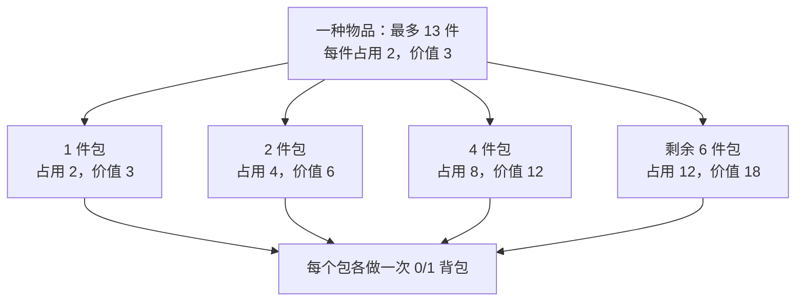
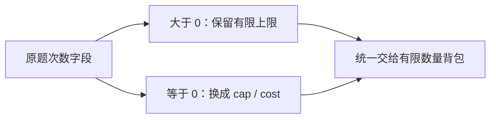

# 5.10 多重背包：有限数量与二进制拆分

前置：[0/1 背包](02-zero-one-knapsack.md)、[完全背包](03-complete-knapsack.md)、[二进制拆分](../01-basic-problem-solving/05-bit-operations.md)。本节仍求**容量不超过上限时的最大总价值**，变化在于每种物品有数量上限。

## 1. 原来的瓶颈：相同物品太多

某种物品每件占用 2、价值 3，最多有 13 件。既不能只做一次 0/1 转移，也不能按完全背包无限取。

可以把它展开成 13 件普通物品，每件各做一次 0/1 背包。**这能正确解决，但运行次数跟总件数一起增长。** 若总件数为 $10^5$、容量为 $4\times10^4$，按件处理约有 $4\times10^9$ 次容量检查。

需要保留的其实是**选 0、1、2……13 件的可能性**，不必真的做 13 轮。把若干相同物品打成一个只能选一次的包，就能减少轮数。

## 2. 先给代码：把有限数量变成若干个 0/1 包

物品数组为 **0-based**；容量是非负整数，单件占用为正，数量非负，价值非负。采用 `ll` 保存价值。每个包只能整体选或不选。

```cpp
using ll = long long;

struct BoundedItem {
    int cost;   // 单件物品的占用（体积 / 重量）。
    ll value;   // 单件物品的价值。
    int count;  // 最多可选数量，0 表示不可选。
};

// dp[j]：已处理物品中，总占用不超过 j 时的最大价值。
// 每次加入一种有限数量物品，直接在原 dp 上更新。
void add_bounded(vector<ll>& dp, int cost, ll value, int count) {
    int cap = (int)dp.size() - 1;

    // 受背包容量限制，最多只能选择 cap / cost 件。
    count = min(count, cap / cost);

    // 二进制分组：将 count 件物品拆成若干个数量为
    // 1、2、4、...、剩余数量的物品包，将多重背包转化为 01 背包。
    for (int block = 1; count > 0; block *= 2) {
        int take = min(block, count);
        count -= take;

        // 当前物品包的总占用和总价值。
        int weight = take * cost;
        ll gain = take * value;

        // 每个物品包只能选择一次，因此容量倒序遍历，
        // 防止同一物品包在本轮被重复选择。
        for (int j = cap; j >= weight; --j)
            dp[j] = max(dp[j], dp[j - weight] + gain);
    }
}

// 多重背包：每种物品有数量限制，求容量不超过 cap 时的最大价值。
ll bounded_knapsack(int cap, const vector<BoundedItem>& items) {
    // 初始不选任何物品，所有容量下的最大价值均为 0。
    vector<ll> dp(cap + 1, 0);

    // 逐种加入物品，每种物品通过二进制分组转化为若干个 01 物品包。
    for (const auto& x : items)
        add_bounded(dp, x.cost, x.value, x.count);

    return dp[cap];
}
```

**用途速记：** 输入每种物品的单件占用、价值和数量上限，求容量上限内的最大价值。先把一种物品拆成少量整包，再把每包当作一件 0/1 物品；不是让包重复使用。

| 变量 | 本轮的含义 |
| --- | --- |
| `cap`、`dp[j]` | 总容量、容量上限 j 下的最优价值，允许不装满 |
| `count` | 还没有分配到包中的件数；函数参数按值传入，不改原物品 |
| `block` | 下一包计划装的件数，依次为 1、2、4、8…… |
| `take` | 这一包实际装几件；最后不足一包时取剩余数 |
| `weight`、`gain` | 这一整包的总占用、总价值 |

数组开 `cap+1` 项；每次调用包装函数重新填 0，空数组、容量 0、数量 0 都返回或保留合法的空方案。`add_bounded` 则**继承已有 dp**，适合连续处理不同种类。

本实现约定 $0\le C\le2\times10^5$、单件占用为正 `int`、数量为非负 `int`（可以取 `INT_MAX`）、单件价值不超过 $10^9$。总价值不超过 $C\times10^9\le2\times10^{14}$；实际可处理的种数还须按后面的时间复杂度估算。

## 3. 状态没变，先看朴素转移在枚举什么

定义：**$f[i][j]$ 表示只使用前 i 种物品，总占用不超过 j 的最大价值。** 当前种类的占用、价值、数量上限分别记作 w、v、m；q 表示本次选几件。

$$
f[i][j]=\max_{0\le q\le\min(m,\lfloor j/w\rfloor)}
\bigl(f[i-1][j-qw]+qv\bigr).
$$

每个容量都在重复枚举**“这一种取几件”**。把各件展开为 0/1 物品也正确，但仍需按件更新。

**二进制拆分没有删掉某个可选数量，而是用少量包的组合覆盖这些数量。** DP 的容量语义与优化目标不变；中间轮次从“原种类”细化为“已经处理的包”。

## 4. 13 件怎样拆？为什么所有件数都能选到？

假设容量至少为 26，不会提前截掉这 13 件：

$$
13=1+2+4+6.
$$

先分出 1、2、4 件，剩下 6 件直接成为最后一包；**最后一包不一定是 2 的幂，也不要求比前一包大**。



**这四个包可以组合选择，选中包的件数相加，就是实际取走的物品数量。**

假设想取 9 件，就选“6 件包”“2 件包”和“1 件包”，把“4 件包”留下不选：

$$
6+2+1=9.
$$

这样仍然取到了 9 件原物品。每件占用 2、价值 3，所以总占用为 18，总价值为 27。**这个例子说明：拆成整包后，“取 9 件”这个选择仍然能实现。**

另一方面，**每个包最多选一次**。即使四个包全部选走，也只有原来的 $1+2+4+6=13$ 件，不会超过库存上限。

取 9 件只是一个例子；下面还要证明，0 到 13 的每个件数都能用这些包组合出来。

### 不漏选：已有区间与新包怎样接上

先看实际变化：


一般地，假设旧包已经能组合出 0..S 件，新包有 b 件。

$$
\text{不选新包：}[0,S],\qquad
\text{选新包：}[b,b+S].
$$

只要 $b\le S+1$，两段就重叠或刚好相接，中间没有缺口，能覆盖 0..S+b。

完整的倍增包满足：

$$
S=1+2+\cdots+2^{t-1}=2^t-1,
\qquad b=2^t=S+1.
$$

剩余包不超过下一包计划值，同样满足 $b\le S+1$。因此从 0 开始，每加入一包都没有缺口，直到覆盖全部允许数量。

**正向看，每个原可选件数都有包组合；反向看，任意包组合都不超过原数量，且占用、价值相同。** 这才保证最优值保持不变。

### 本质：用倍增减少轮数，用 DP 组合这些选择

原来面对一种有 m 件的物品，需要逐个考虑“选 0 件、1 件、2 件……m 件”。**倍增拆包把一次线性枚举件数，改成对少量包分别考虑选或不选。**

$$
\text{逐个枚举件数：}O(m)
\quad\longrightarrow\quad
\text{倍增后的包数：}O(\log(m+1)).
$$

这里 m 是**这一种物品的可用件数**，不是种类数 n。减少的是处理数量选择的轮数；每包仍需扫描容量，因此一种物品的主要转移开销由 $O(Cm)$ 降为 $O(C\log(m+1))$。

对照代码，`take` 是**一个包里装的件数**。本轮 DP 考虑的是：不取这个包，或整体取走这 `take` 件物品；后续包继续做相同的两种选择。

例如先处理 1、2 件包，DP 已经考虑了取 0、1、2、3 件的结果；再处理 4 件包，就在这些结果上分别考虑“不加 4 件”和“加上 4 件”，覆盖取 0..7 件的可能性。最后加入剩余包，继续补齐到数量上限。

**倍增让包数少，前面的区间接合证明保证数量不遗漏，DP 则比较这些包组合的价值。** 在相同已处理包和容量上限下，只保留最大价值，因此不必显式枚举全部包组合。

**时间复杂度速记：** 共有 n 种物品，容量为 C；若每种可用数量都不超过 M，则主要转移为：

$$
\underbrace{n}_{\text{物品种数}}
\times\underbrace{O(\log(M+1))}_{\text{每种拆出的包数}}
\times\underbrace{O(C)}_{\text{每包扫描容量}}
=O(nC\log(M+1)).
$$

**变成对数的是每种的包数，整个算法还要乘种数和容量。** 读入／遍历种类与初始化数组另需 $O(n+C)$；各类数量不同时的精确写法见[第 6 节](#6-到底省了多少先截数量再减少轮数)。


## 5. 包只能用一次：为什么容量仍须倒序

每个包就是一件更大的 0/1 物品：

$$
dp[j]\gets\max\bigl(dp[j],dp[j-\mathrm{weight}]+\mathrm{gain}\bigr).
$$

**容量倒序时，较小的 `dp[j-weight]` 还没被当前包更新，读到的是处理当前包之前的值。** 一种原物品可以通过多个不同包累计，但同一个包不能在本轮重复使用。

只允许一件“占用 2、价值 3”，容量为 4：

| 扫描方式 | 更新过程 | 结果 |
| --- | --- | --- |
| 正序 | 先让 `dp[2]=3`，再读取它更新 `dp[4]=6` | 把唯一一件用了两次，错误 |
| 倒序 | 先更新 `dp[4]`，此时旧 `dp[2]=0`；之后才更新 `dp[2]` | `dp[4]=3`，正确 |

再回看 13 件、容量 26 的例子，手推几个容量上限：

| 已处理的包 | `dp[6]` | `dp[12]` | `dp[18]` | `dp[26]` |
| --- | --- | --- | --- | --- |
| 1 件包 | 3 | 3 | 3 | 3 |
| 再加 2 件包 | 9 | 9 | 9 | 9 |
| 再加 4 件包 | 9 | 18 | 21 | 21 |
| 再加 6 件包 | 9 | 18 | 27 | 39 |

**本节全部初始化为 0，因为容量是“不超过”，每格都有空方案。** 若改成恰好装满，要重新设置不可达状态并检查转移来源；本模板不直接支持这种语义。

## 6. 到底省了多少？先截数量，再减少轮数

单件占用 w，容量 C，无论库存多大，最多只能装：

$$
m'=\min\bigl(m,\lfloor C/w\rfloor\bigr).
$$

截掉的数量原本就不可能装入，不会改变答案，也避免构造巨大且必定装不下的包。`cost>cap` 时得到 0，整种跳过。

| 一种物品的有效数量 | 按件展开的轮数 | 二进制拆分的包数 |
| --- | --- | --- |
| 1 | 1 | 1 |
| 13 | 13 | 4 |
| 1000 | 1000 | 10 |
| 100000 | 100000 | 17 |

第 i 种经过容量截断后有 $m'_i$ 件。把总开销按步骤列出来：

| 步骤 | 时间开销 |
| --- | --- |
| 遍历 n 种物品，截掉装不下的数量 | $O(n)$ |
| 初始化容量数组 | $O(C)$ |
| 每种拆成对数个包，每包扫描容量 | $O\!\left(C\sum_{i=1}^{n}\log(m'_i+1)\right)$ |

完整时间复杂度为：

$$
O\!\left(n+C+C\sum_{i=1}^{n}\log(m'_i+1)\right).
$$

若统一用 M 表示各类有效数量的最大值，主要转移通常简写为 $O(nC\log(M+1))$。数量全为 0 时仍要遍历种类并初始化数组，因此完整写法保留了前面的 $O(n+C)$。

**辅助空间为 $O(C)$。** 程序边拆边更新，只维护一维 dp，不额外保存全部包。若把总包数记作 B，上面的时间也等价写作 $O(n+C(B+1))$。

减少的是**处理物品的轮数**，每个包的容量扫描仍为线性，不是整个背包都变成对数时间。

例如 100 种、每种 1000 件、容量 40000：按件约 $4\times10^9$ 次容量检查；拆成约 1000 个包后，至多约 $4\times10^7$ 次。实际还会因包的占用而少扫一些，这里只估量级，不保证运行时间。

### 与已经学过的模型对照

| 数量限制 | 处理单位 | 主要容量方向 |
| --- | --- | --- |
| 每件一次 | 原物品 | 倒序 |
| 每种无限次 | 原种类 | 正序，允许本轮重复取 |
| 每种有限次 | 拆出的整包 | 每个包倒序 |

单调队列还可以进一步优化有限数量的转移，但需要另推按余数分组后的窗口。本节先把**数量上限、拆分等价性、倒序读写**讲清，不同时引入另一套实现。

## 7. 边界：能覆盖数量，不等于每种表示都唯一

- **不能直接拿来统计方案数。** 13 件拆成 1、2、4、6，选 6 件可以选“6 件包”，也可以选“4+2 件包”；原问题同一种取 6 件只有一个数量选择，拆包计数会重复。求最大值时，相同占用和价值的重复表示不改变最优值。
- **包必须可整体替代原物品。** 同一种每件成本、价值相同且可累加，才能合并；整批折扣、物品间依赖等需另行建模。
- **先截数量，再算乘积。** `take*cost<=cap`；价值乘积使用 `ll`，不要先在 int 中溢出再赋给 ll。
- **数量 0 在本模板表示没有物品。** 若题目用 0 表示无限次，那是输入约定，必须先区分，不能原样传入。
- **不要每处理一种就清空 dp。** 需要继承此前种类的组合；只有开始一组新问题时重新初始化。

## 8. 典题与复盘

两题复用同一份二进制拆分板子。原实现中的 `Item`、`getans(cap, items)`，分别对应开篇的 `BoundedItem`、`bounded_knapsack(cap, items)`；字段仍是 `cost`、`value`、`count`，不重复粘贴公共主体。

**以下只整理排版，不改变原逻辑。** 两份实际实现已静态复盘，未编译、运行或对拍个人代码；平台结果未单独提供。

### P1776 宝物筛选

[洛谷 P1776](https://www.luogu.com.cn/problem/P1776)

**收录原因：** 物品的有限库存直接对应数量上限，输入适配后就能调用通用板子；不需要再为题目重写 DP。

```cpp
void solve() {
    int n, cap;
    cin >> n >> cap;

    vector<Item> items(n);
    for (auto& x : items)
        cin >> x.value >> x.cost >> x.count;

    cout << getans(cap, items) << '\n';
}
```

**注意输入顺序是“价值、重量、数量”**，与结构体字段声明顺序无关；读入时明确写到对应字段即可。

原题 $n\le100$、$C\le4\times10^4$、总件数不超过 $10^5$。令 B 为拆出的总包数，时间为 $O(n+C(B+1))$；DP 辅助空间为 $O(C)$，连同读入物品的总空间为 $O(n+C)$。

### P1833 樱花

[洛谷 P1833](https://www.luogu.com.cn/problem/P1833)

**收录原因：** 先把不同的时间与次数表达转成统一输入，就能复用同一份有限数量板子。关键在于区分“题目用 0 表示无限次”与“板子用 0 表示不能选”。

```cpp
int getcap(const string& t) {
    int p = (int)t.find(':');
    return stoi(t.substr(0, p)) * 60 + stoi(t.substr(p + 1));
}

void solve() {
    string s, t;
    cin >> s >> t;
    int cap = getcap(t) - getcap(s);

    int n;
    cin >> n;

    vector<Item> items(n);
    for (auto& x : items) {
        cin >> x.cost >> x.value >> x.count;
        x.count = (x.count ? x.count : cap / x.cost);
    }

    cout << getans(cap, items) << '\n';
}
```

#### 先把时间统一成分钟

`getcap` 找到冒号，把小时与分钟分开，再计算：

$$
\text{当天已过分钟}=60\times\text{小时}+\text{分钟}.
$$

结束时间减开始时间，得到背包容量。原题保证两者在同一天，可用时间不超过 1000 分钟；无需额外处理跨天。输入中的冒号由字符串解析，不能把 `hh:mm` 直接作为一个整数读取。

#### 无限次为什么也能交给多重背包？

总容量有限、单次占用为正，因此“无限次”也有容量允许的最大次数。若取 q 次，则：

$$
q\times\mathrm{cost}\le\mathrm{cap}
\quad\Longrightarrow\quad
q\le\left\lfloor\frac{\mathrm{cap}}{\mathrm{cost}}\right\rfloor.
$$

**超过这个次数，哪怕只选这一种物品也装不下。** 其他种类只会占用容量，不会让这个上限变大，所以可以把无限次改成这个有限上限，不丢失任何合法选择。

例如还剩 30 分钟，每次耗时 7 分钟，即使允许无限次，也至多看 4 次；第 5 次需要 35 分钟。



原句的处理顺序是：**先解释输入中的次数含义，再交给公共板子处理。** 若单次耗时超过可用时间，`cap / cost` 为 0，转换后表示这棵树一次也来不及看，含义正确。

#### 为什么保留显式上限，而不直接写 INT_MAX？

当前板子在拆包前已经执行 `count = min(count, cap / cost)`。因此，输入中的无限次也可以先替换为 `INT_MAX`，进入板子后仍会被截成容量允许的次数；**必须先截数量，才谈得上后续拆包与乘法安全**。

原实现直接写 `cap / cost`，把“无限次实际最多能用几次”显式表达出来，保留这种写法。板子中的再次截断也不冲突：输入适配说明题意，公共函数则统一约束所有种类的有效数量。

这题也可以分别按 0/1、完全、多重的次数限制处理；当前写法选择统一接口，代价是无限种类也走二进制拆分，而不使用完全背包的一轮正序更新。两者模型等价，不必为了区分种类重写当前实现。

#### 复杂度

种数不超过 10000，容量 C 不超过 1000；转换并截断后，每种有效数量都不超过 C。主要转移为 $O(nC\log(C+1))$，另计 $O(n+C)$ 的读入与初始化。DP 辅助空间 $O(C)$，包含物品数组的总空间 $O(n+C)$。

**两题的共同流程：读入并转换题目字段 → 得到 cost、value、有限 count → 调用同一份板子。** 状态与转移不变，变化集中在输入适配。


## 9. 自查与衔接

1. 为什么最后剩余的一包不是 2 的幂，仍能覆盖所有件数？
2. 包已经代表多件物品，为什么还不能正序更新？
3. 求最值允许重复表示，求方案数为什么不能直接照搬？

本节优化的是转移轮数；滚动数组优化的是存储量，LIS 二分优化则更换了保留状态。**先明确瓶颈，再判断优化依赖什么性质。** 参见 [DP 建模与优化检查](../../patterns/05-dynamic-programming/dp-modeling-workflow.md#时间优化先找重复枚举的选择)、[背包识别范式](../../patterns/05-dynamic-programming/resource-limited-selection.md#有限数量压缩转移轮数不改变容量语义)。

[本章知识索引](README.md) · [多重背包模板](../../templates/05-dynamic-programming/bounded-knapsack/README.md)
