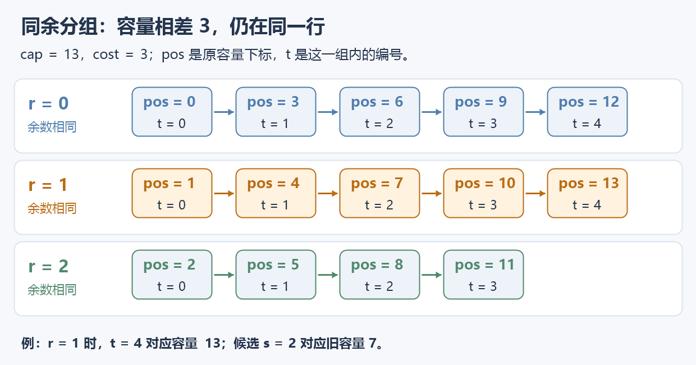
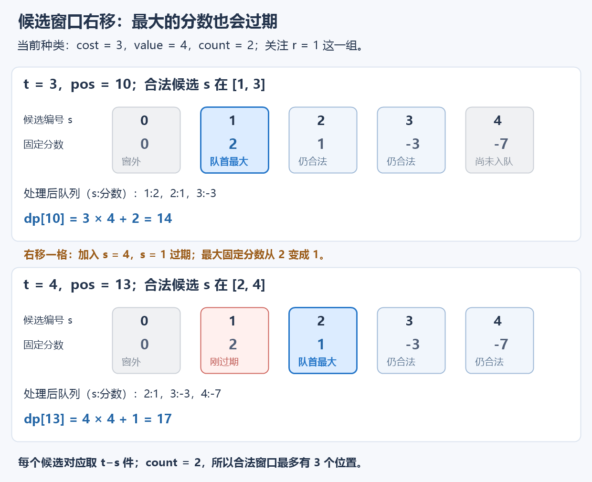
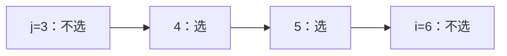
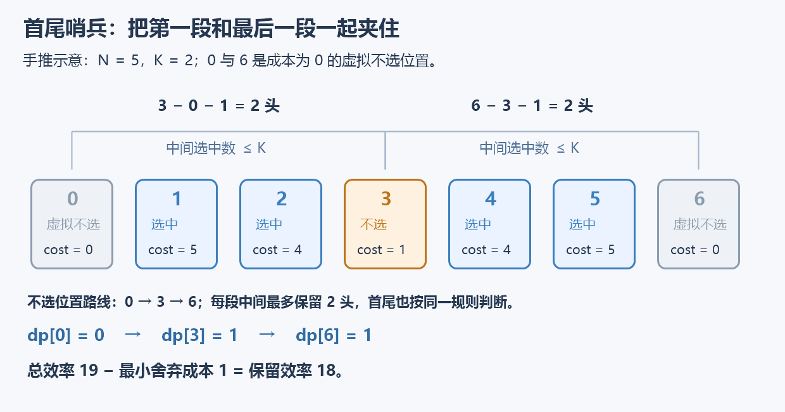
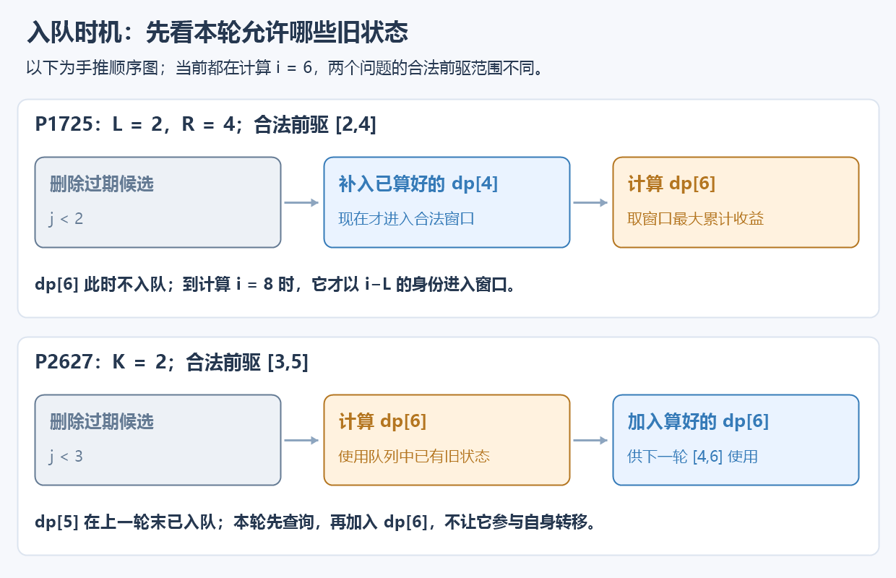

# 5.11 单调队列优化 DP：把候选转移变成滑动窗口

前置：[多重背包与二进制拆分](10-bounded-knapsack.md)、[单调队列](../09-data-structures/03-monotonic-queue.md)。**DP 负责定义最优值，单调队列负责快速找到本轮最好的转移来源。**

## 1. 瓶颈在哪里？已经拆包，还能继续减少转移吗？

上节把每种的 m 件物品拆成对数个包，主要时间降到 $O(nC\log(M+1))$。但每包仍要扫描容量；种数、容量、件数一起变大时，这些扫描仍可能昂贵。

回到原始转移：每个容量都比较“当前种类取 0、1、2……件”对应的候选。相邻容量用到的候选大量重合，**能否像滑动窗口最值一样，只增删变化的部分？**

需要先解决两个问题：不同候选的容量下标相隔 w；候选价值还带着“取了几件”的加成。下面先给实现，再用分组与移项把这两个问题拆开。

## 2. 先给代码：保存旧行，按同余组维护候选

仍是**总占用不超过容量的最大价值**。物品数组 0-based；占用为正 int、价值非负、数量为非负 int。容量不超过 200000、单件价值不超过 $10^9$，与上节约定一致。

```cpp
using ll = long long;

struct BoundedItem {
    int cost;   // 单件物品占用
    ll value;   // 单件物品价值
    int count;  // 最多可选数量
};

// dp[j]：此前物品种类中，总占用不超过 j 的最大价值。
// 使用单调队列优化多重背包，直接更新 dp。
void add_bounded_queue(vector<ll>& dp, int cost, ll value, int count) {
    int cap = (int)dp.size() - 1;

    // 容量内最多只能选择 cap / cost 件。
    count = min(count, cap / cost);
    if (count == 0) return;

    vector<ll> old = dp; // 保存上一种类处理完毕的结果，避免本轮更新相互影响。

    // q：单调递减队列，存储 {组内编号 s, old[r+s*cost]-s*value}。
    // 队首保存当前窗口内最大的候选值。
    deque<pair<int, ll>> q;

    // 按容量对 cost 取模的余数分组。
    // 同一组内，相邻容量相差 cost，可以进行状态转移。
    for (int r = 0; r < cost; ++r) {
        q.clear(); // 每个余数组独立维护自己的候选窗口。

        // 当前容量 pos = r + t * cost，t 为组内编号。
        for (int t = 0, pos = r; pos <= cap; ++t, pos += cost) {

            // 最多选择 count 件，因此候选编号必须满足 s >= t - count。
            // 移除已经超出选择数量限制的旧候选。
            while (!q.empty() && q.front().first < t - count)
                q.pop_front();

            // 加入当前候选 s = t，对应本种物品选择 0 件。
            // 将原转移式：
            // max(old[r+s*cost] + (t-s)*value)
            // 变形为：
            // t*value + max(old[r+s*cost] - s*value)。
            ll score = old[pos] - (ll)t * value;

            // 维护队列中的 score 单调递减。
            // 队尾不优于当前候选，直接删除。
            // 当前候选编号更大，过期时间更晚，因此可以替代旧候选。
            while (!q.empty() && q.back().second <= score)
                q.pop_back();

            q.push_back({t, score});

            // 队首是当前合法窗口内的最大 score，恢复 t*value 即为最优转移。
            dp[pos] = q.front().second + (ll)t * value;
        }
    }
}

// 多重背包：每种物品有数量限制，求容量不超过 cap 时的最大价值。
ll bounded_knapsack_queue(int cap, const vector<BoundedItem>& items) {
    vector<ll> dp(cap + 1, 0); // 初始不选任何物品。

    // 逐种处理物品，每种物品通过单调队列优化转移。
    for (const auto& x : items)
        add_bounded_queue(dp, x.cost, x.value, x.count);

    return dp[cap];
}
```

**用途速记：** 输入与上一节相同，返回容量内最大价值；每种物品不再拆包，而是按容量余数分组，用单调队列维护变形后的最佳旧状态。`add_bounded_queue` 在原 dp 上加入一种，包装函数则从空方案开始。

| 变量 | 含义 |
| --- | --- |
| `old[j]` | 处理当前种类之前，容量上限 j 的最优值；本轮只读 |
| `dp[j]` | 正在写入的、允许使用当前种类的新结果 |
| `r` | 容量除以 cost 的余数，范围为 0..cost−1 |
| `t`、`pos` | 当前容量在本组的编号，以及原容量下标；`pos=r+t*cost` |
| `s` | 某个旧容量的组内编号；旧容量为 `r+s*cost` |
| `score` | 旧结果减去组内编号乘单件价值；用于比较候选 |
| `q` | 保存仍合法、可能成为最大值的候选；第一项是编号，第二项是 score |

**r、t、s 都不是原物品编号，也不直接表示以前选了几件。** 它们用来定位容量；当前种类本次取的件数是 `t-s`。

### 本质：从瓶颈到单调队列的思考链

**先找浪费：相邻状态在重复比较同一批候选。** 固定余数组、最多取 m=2 件时，t=3 的候选为 `{1,2,3}`，t=4 变成 `{2,3,4}`。旧候选 2、3 刚比较过，却又被整段重扫。

$$
[1,3]\ \longrightarrow\ [2,4].
$$

**窗口只右移一步，最多新增、移出各一个候选，其余候选仍然相同。** 因此想到的不是继续逐个比较，而是复用窗口最值；初始阶段左端截在 0，完整候选范围为 $[\max(0,t-m),t]$。

**再检查分数：能否把当前 t 的影响单独拿出去？** 原候选值带着 $(t-s)v$，展开后：

$$
\mathrm{old}[r+sw]+(t-s)v
=tv+\bigl(\mathrm{old}[r+sw]-sv\bigr).
$$

所有候选共同增加 tv，彼此的相对优劣没有改变。**减去这个公共项后，队列就能保存只依赖 s 的固定分数；取到最大分数，再加回 tv。** 移项是在显式分离共同变化，不是为了让公式更好看。

**再整理下标：怎样让候选窗口容易移动？** 原容量相隔 w，按余数分组后，把 `r+s*w` 换成组内编号 s；相隔 w 的容量就对应相邻编号。分组把已有转移关系整理成便于维护的一维窗口，不要求原数组下标本来就相邻。

**前提满足后，才落到单调队列：** 固定分数、边界单调右移、查询最大值。队首删过期，队尾删被新候选压过的旧候选；加入本轮合法来源后，队首就是最优来源。

每个候选只入队一次、出队至多一次；所有余数组合计只遍历 C+1 个容量。于是单种物品的主要转移从 $O(Cm)$ 降到 $O(C)$，n 种通常写作 $O(nC)$，完整开销见第 7 节。

> **看转移中的重复比较 → 识别滑动窗口最值 → 移项分离固定分数 → 分组整理候选下标 → 用单调队列维护。**
>
> 不是看到 max 就套队列，而是先认出哪些工作可以复用，再检查候选优劣和过期规则能否一直成立。后面的第 3–5 节分别把分组、移项和维护过程对应到代码。

## 3. 第一步：为什么按余数分组？

固定一种物品，占用 w=3。当前容量若为 13，取 0、1、2……件后，给此前种类留下的容量上限是：

$$
13,\ 10,\ 7,\ 4,\ 1.
$$

**每次都减去 3，所以这些容量的余数始终相同。** 其他余数组不会参与当前格的转移，可以分开处理：



组内编号用 t 表示，原容量就能写成：

$$
j=r+tw.
$$

原下标每次增加 w，组内编号只增加 1。**不是漏算其他容量，而是把全部容量分到几条互不重叠的序列里。**

## 4. 第二步：把随取件数变化的加成拆开

这一种物品最多取 $m$ 件，每件占用容量 $w$、价值 $v$。原始转移为：

$$
\mathrm{new}[j]
=\max_{\substack{0\le k\le m\\ kw\le j}}
\bigl(\mathrm{old}[j-kw]+kv\bigr),
$$

其中 $k$ 表示当前种类取几件。

对当前容量 $j$，记它在同一组内的位置为 $t$，即把容量写成：

$$
j=r+tw.
$$

如果当前取 $k$ 件，那么对应的旧容量的组内位置就是：

$$
s=t-k.
$$

因此取件数 $k$ 也可以写成：

$$
k=t-s.
$$

又因为最多取 $m$ 件，所以候选的旧位置 $s$ 要满足：

$$
\max(0,t-m)\le s\le t.
$$

把 $k=t-s$ 代回转移式，就把“当前取 $k$ 件”改写成“选择旧容量位置 $s$”：

$$
\mathrm{new}[r+tw]
=\max_s\bigl(\mathrm{old}[r+sw]+(t-s)v\bigr).
$$

对当前固定的 $t$ 来说，$tv$ 与候选 $s$ 无关，因此可以提到最大值外面：

$$
\mathrm{new}[r+tw]
=tv+\max_s\bigl(\mathrm{old}[r+sw]-sv\bigr).
$$

**此时每个候选 $s$ 对应的分数只取决于它自己，在本轮处理过程中不会改变。** 代码中的 `score` 正是括号里的部分：
$$
\mathrm{old}[r+sw]-sv.
$$

这样，转移就变成了“在当前候选窗口内取最大值”的问题，可以用单调队列维护。

## 5. 第三步：候选范围就是一个滑动窗口

固定 r，随着 t 增长，候选区间 `[max(0,t-m),t]` 不断向右移动，最多包含 m+1 个旧位置。

**为什么是 m+1 个候选？** 当前种类可以取 0、1、……m 件，共 m+1 种；不是只能保留 m 个位置。

继续用同一例子：容量 C=13，此前只有“占用 2、价值 3、最多 3 件”的物品。现在加入“占用 3、价值 4、最多 2 件”的新种类，关注余数 r=1 的组。

| 组内编号 s | 0 | 1 | 2 | 3 | 4 |
| --- | --- | --- | --- | --- | --- |
| 旧容量 `1+3*s` | 1 | 4 | 7 | 10 | 13 |
| `old` 的最大价值 | 0 | 6 | 9 | 9 | 9 |
| 固定分数 `old-4*s` | 0 | 2 | 1 | −3 | −7 |

从 t=3 移到 t=4，窗口由 `[1,3]` 变成 `[2,4]`；原来分数最大的 s=1 过期，必须换下一个候选：



### 对照代码看完整的一轮

先去掉过期候选，再把新的 s=t 放入队列。新候选还表示**当前种类取 0 件**，所以不能漏掉它；加入后再取队首。

| 当前 t | 原容量 pos | 合法 s 区间 | 处理后的队列（s:分数） | 新 `dp[pos]` |
| --- | --- | --- | --- | --- |
| 0 | 1 | [0,0] | 0:0 | 0 |
| 1 | 4 | [0,1] | 1:2 | 6 |
| 2 | 7 | [0,2] | 1:2，2:1 | 10 |
| 3 | 10 | [1,3] | 1:2，2:1，3:−3 | 14 |
| 4 | 13 | [2,4] | 2:1，3:−3，4:−7 | 17 |

最后一轮队首是 s=2，当前 t=4，因此当前种类取 2 件：

$$
\mathrm{old}[7]+2\times4=9+8=17.
$$

旧状态的容量是“不超过 7”，并非必须用满 7；不影响与新选物品合并。

### 两种弹出为什么都安全？

- **队首过期：** `s<t-count` 表示要取的 `t-s` 件超过上限，已经不能使用；以后 t 更大，也不会重新合法。
- **队尾劣势：** 新候选分数不小、编号更晚，价值至少一样好，又更晚过期；旧候选不再有成为最优的机会。同分时删旧留新。

这与[窗口最值的队首／队尾职责](../09-data-structures/03-monotonic-queue.md)相同；本次维护的数组是变形后的候选分数。

## 6. 为什么显式保留 old？

**允许当前种类最多取 m 件，必须从此前种类的结果出发，再一次性加上 0..m 件。** 公式中的 `old` 不是本轮已经更新过的结果。

本实现先复制 `old=dp`，之后从 old 读、向 dp 写，读写职责直接对应数学式。不会把已选过当前种类的新状态再次当成旧候选，从而偷偷突破数量限制。

因此这里的组内容量正序，不是完全背包的正序复用。**不能只看循环方向判断使用次数，还要看读取的是 old 还是新 dp。**

如果只存下标，之后用被覆盖的 dp 重新计算队列分数，就可能读错轮次。本实现同时保存候选分数，并保留旧行，不混入进一步的原地覆盖技巧。

## 7. 时间复杂度：有余数循环，为什么仍是每种线性？

一共有 n 种物品，容量为 C。对一种物品：

| 工作 | 开销依据 |
| --- | --- |
| 复制旧行 | C+1 个数，$O(C+1)$ |
| 按余数遍历所有容量 | 每个下标 j 只属于唯一的 `j % cost` 组，合计 C+1 次 |
| 队列入队／弹出 | 每个候选进队一次、出队至多一次，合计 $O(C+1)$ |

**外面的余数组数乘组内长度，合起来只是容量总数，不是再乘一次 C。** `while` 也按每个候选的总进出次数分析，不能直接数循环层数。

所以总时间为：

$$
O\bigl(n(C+1)+C\bigr),
$$

通常简写为 **$O(nC)$**；这里保留 +1 是为了同时说明容量 0 时仍需遍历物品。输入物品不计入辅助空间，旧行、DP、队列都为 $O(C+1)$。

| 处理方式 | 主要转移时间 | 额外维护 |
| --- | --- | --- |
| 逐件展开 | $O(C\sum m'_i)$ | 一维 DP |
| 二进制拆分 | $O(C\sum\log(m'_i+1))$ | 一维 DP、每个整包 |
| 本节单调队列 | $O(nC)$ | 旧行、同余组内候选队列 |

例如 100 种、容量 40000、每种有效数量 1000：逐件约 $4\times10^9$ 次容量检查；二进制约 $4\times10^7$；本节约 $4\times10^6$ 个容量状态，再加复制与摊还队列操作。只是规模估算，不是固定运行时间。

**二进制版本更短、更容易现场改动；队列版本适合转移次数成为瓶颈时。** 两者结果相同，不因新版本时间更优就删除原实现。

## 8. 怎样识别其他单调队列优化 DP？

尝试把转移整理成：

$$
F[i]=B(i)+\max_{L(i)\le j\le R(i)}A(j).
$$

B(i) 是只依赖当前状态的部分；A(j) 是候选 j 已经算好的固定分数。再依次检查：

1. **候选已经算好。** 不能把同一层尚未确定的未来状态直接入队。
2. **分数与当前 i 分离。** 若候选间优劣会随 i 改变，不能直接用普通队尾比较淘汰。
3. **左右边界都向右移动。** 已经过期的候选不必回来；新候选按顺序加入。
4. **写清什么时候加新候选、什么时候取答案。** 本节允许取 0 件，要先加入 s=t；其他题目的合法前驱可能更早，不能照搬入队时刻。

满足这些条件，才可以把“每格扫描所有候选”改成队列维护。**不是看到 DP 求最大，就可以套单调队列。** 通用识别归入[既有 DP 优化流程](../../patterns/05-dynamic-programming/dp-modeling-workflow.md#滑动候选区间用单调队列减少转移枚举)，具体状态与转移仍按题目推导。

## 9. 典题与复盘

[P1776／P1833 的实际实现](10-bounded-knapsack.md#8-典题与复盘)仍保留二进制版。下面两题不直接调用多重背包接口，而是重新定义状态，再复用单调队列维护合法前驱的最优值。

**两份个人代码只整理排版、保留原逻辑及注释；本轮只做静态复盘，不编译、运行或对拍，不补记平台结果。**

### P1725 琪露诺：已算好，还要等到合法时才入队

[洛谷 P1725](https://www.luogu.com.cn/problem/P1725)

**收录原因：** 将“状态已计算”和“状态已进入当前合法前驱范围”分开；同时明确不可达、合法零值、合法负值的不同含义。

```cpp
const ll INF = LLONG_MAX / 4;

void solve() {
    int n, l, r;
    cin >> n >> l >> r;

    vector<ll> a(n + 1);
    for (ll& x : a)
        cin >> x;

    vector<ll> dp(n + 1 + r, -INF);
    dp[0] = 0;

    deque<pair<int, ll>> q;
    ll mx = -INF;

    for (int i = l; i <= n + r; ++i) {
        while (!q.empty() && q.front().first < i - r)
            q.pop_front();

        ll j = i - l;

        if (dp[j] != -INF) {
            while (!q.empty() && q.back().second <= dp[j])
                q.pop_back();

            q.push_back({i - l, dp[j]});
        }

        if (!q.empty())
            dp[i] = q.front().second + (i <= n ? a[i] : 0);

        if (i > n)
            mx = max(mx, dp[i]);
    }

    cout << mx << '\n';
}
```

#### 先确定来源，再决定入队时刻

河内的 `dp[i]` 表示：**从 0 出发，恰好停在 i 时能得到的最大累计冰冻指数**。合法前驱 j 满足：

$$
l\le i-j\le r
\quad\Longrightarrow\quad
i-r\le j\le i-l.
$$

因此本轮需要的是这个区间内、已经可达的状态最大值：

$$
dp[i]=a[i]+\max_{\max(0,i-r)\le j\le i-l}dp[j].
$$

从 i=l 开始枚举，保证新候选 `i-l` 非负；此前的 1..l−1 无法从起点落入，保持不可达。

**队列保存的是前驱状态的累计答案，不是原始 a[j]，也不是不受窗口约束的历史最大值。** 最大的旧状态一旦过期，也必须删除。

每轮右端从 `i-1-l` 移到 `i-l`，新进入合法范围的候选是 `i-l`。因为 l 至少为 1，它早已计算完成；**本轮只是把它移入队列，不是在这里才计算它**。加入后，才能用完整合法候选更新当前 dp[i]。

#### 不可达不是累计为 0

| 表值 | 含义 | 能否加入候选 |
| --- | --- | --- |
| `-INF` | 不存在到达这个位置的合法路径 | 不能 |
| 0 | 已可达，累计收益恰好为 0；起点就是例子 | 能 |
| 合法负数 | 已可达，只是途中的损失超过收益 | 能 |

例如 N=3、L=R=2，四格分数为 `[0,7,-5,100]`。从 0 只能落在 2，再跳到 4 出岸；1、3 都不可达，正确收益为 −5。

若把所有 dp 默认填 0，就会把不可达的 1 当作免费起点，虚构 `1→3→5`，错误获得 100。**先判断有没有这个状态，再判断它的值是多少；合法零值不能充当“不存在”。**

#### 岸外零收益位置：统一收集答案

原题以跳到编号大于 n 为结束。最后一次从河内跳出，最远落在 n+r，因此原实现把 DP 开到 `0..n+r`，岸外收益统一视为 0，再取所有 `i>n` 的最大值。

`a` 仍只开 `n+1` 项；条件表达式在 i 大于 n 时直接取 0，不读取越界的 a[i]。岸外辅助状态即使继续向右传递，也不再加收益、不能回到河内，不会改善原答案。

原题 $N\le2\times10^5$、$1\le L\le R\le N$。时间、空间为 $O(n+r)$，在本题范围内就是 $O(n)$；不要求最终答案非负。

### P2627 修剪草坪：算完当前状态，再交给后面的状态

[洛谷 P2627](https://www.luogu.com.cn/problem/P2627)

**收录原因：** 用补集把连续选择约束改成相邻舍弃位置的间距；首尾哨兵统一边界，再与 P1725 对照入队时机。

```cpp
void solve() {
    int n, k;
    cin >> n >> k;

    vector<ll> cost(n + 2), dp(n + 2);
    ll sum = 0;

    for (int i = 1; i <= n; ++i) {
        cin >> cost[i];
        sum += cost[i];
    }

    // 0：虚拟起点；n+1：虚拟终点，成本为 0。
    deque<int> q;
    q.push_back(0);

    for (int i = 1; i <= n + 1; ++i) {
        // 移除超出合法前驱区间 [i-k-1, i-1] 的状态。
        while (!q.empty() && q.front() < i - k - 1)
            q.pop_front();

        // 使用队首最小值，计算当前删除位置的最小成本。
        dp[i] = cost[i] + dp[q.front()];

        // 维护 DP 值单调递增，删除不优于当前状态的候选。
        while (!q.empty() && dp[q.back()] >= dp[i])
            q.pop_back();

        // 当前状态计算完成，加入队列供后续位置转移。
        q.push_back(i);
    }

    // 总效率减去最小删除成本。
    cout << sum - dp[n + 1] << '\n';
}
```

#### 正难则反：改为最少舍弃多少

所有奶牛的总效率固定。与其直接安排哪些要选，不如决定在哪些位置不选，用它们打断连续段：

$$
\text{最大保留效率}
=\text{总效率}-\text{最小舍弃成本}.
$$

这是**补集建模**，状态仍按 i 递增计算；不表示必须倒着枚举或反向运行 DP。

#### 先固定两个位置，再由间距找到前驱范围

**先设 j、i 是相邻的两个不选位置。** 暂时不想队列，只数它们中间连续选中了多少头：



图中 k=2，中间恰好选了 2 头。一般地，去掉两端的不选位置，中间共有：

$$
i-j-1\le k.
$$

固定当前 i，把这个关系整理成**上一个不选位置 j 可以在哪里**：

$$
j\ge i-k-1,\qquad j\lt i.
$$

所以合法前驱范围是：

$$
\boxed{\max(0,i-k-1)\le j\le i-1}.
$$

**i-k-1 是最早允许的上一个不选位置。** 例如 i=6、k=2，只要上一个不选位置在 `[3,5]` 中，接到当前不选位置 6，中间就最多连续选 2 头；若上一个是 2，中间的 3、4、5 全选，便超限。

不是必须在左端 `i-k-1` 不选，而是这个范围里有一个不选位置，就能打断当前这段连续选择。**此前各段是否合法，则交给前驱状态保证**，不能只检查最后一段就认为全局合法。

于是状态也自然清晰：**dp[i] 表示已处理前 i 个位置、且 i 必须不选时，保证此前连续选中段合法的最小舍弃成本。**

枚举合法 j，继承此前最少舍弃成本，再加上本次舍弃成本：

$$
dp[i]=cost[i]+\min_{\max(0,i-k-1)\le j\le i-1}dp[j].
$$

**先举两个下标 → 写出间距约束 → 解出 j 的范围 → 枚举前驱并转移。** 这是由题目关系推导 DP 的入口；前驱范围随 i 滑动，才进一步想到用单调队列维护最小值。

正难则反的价值也在这里：改为记录“不选位置”后，一段连续选择的长度就能用两个位置相减表示，状态与转移都更容易写清。通用思路见[从两位置关系推出前驱范围](../../patterns/05-dynamic-programming/dp-modeling-workflow.md#先固定两个位置把题目约束解成前驱范围)。

#### 0 与 n+1：把第一段、最后一段也夹起来



图为手推示意：N=5、K=2，效率 `[5,4,1,4,5]`。不选位置 3，两侧各保留 2 头；总效率 19，舍弃成本 1，保留效率 18。

- **0 是成本为 0 的虚拟不选位置。** 第一段前面也有一个边界，`dp[0]=0` 且先入队；第一次真实舍弃位置 i 只要满足 i−1 不超过 k，就能按同一条转移计算。
- **n+1 也是成本为 0 的虚拟不选位置。** 处理它时，最后一个真实舍弃位置 j 后面保留的 n−j 头，也必须不超过 k；因此最后一段自动受到同一条件限制。

$$
dp[n+1]=\min_{\max(0,n-k)\le j\le n}dp[j].
$$

所以直接输出 `sum-dp[n+1]`，不再另外扫描终态。k=n 时，虚拟位置 0 可直接接到 n+1，舍弃成本为 0，可以全选。

#### 为什么这里不需要 −INF？

**每个“i 不选”的状态都存在合法方案：此前全部不选即可。** 而且队列只接收计算完成的位置，未计算的数组零值不会被读取，所以可以统一开零初始化的数组。

算 i 时，i−1 已在上一轮末加入队列，且不会过期；初始的 i=1 则有位置 0。因此清除过期状态后队列仍有候选，原实现直接读取队首。

原题 $N\le10^5$、$1\le K\le N$、效率为 0..$10^9$。总效率和 DP 均用 ll；每个位置只进出队一次，时间、空间都是 $O(n)$。

### 两题对照：候选算好，不等于已经可以入队

**这里的“旧／新”指前几轮已经算好、本轮正在计算，不是多重背包按种类复制的 old／dp 两行。** 两题都在同一个数组里从小下标往大下标递推。



图以当前 i=6 为手推示意。P1725 取 L=2、R=4，新候选是早已算好的位置 4；P2627 取 K=2，位置 5 已在上一轮末入队，算完 6 后才把 6 交给下一轮。

| 对照 | P1725 | P2627 |
| --- | --- | --- |
| 当前优化目标 | 最大累计收益 | 最小累计舍弃成本 |
| 合法前驱范围，左端至少为 0 | `[i-r,i-l]` | `[i-k-1,i-1]` |
| 本轮新进入合法范围的位置 | `i-l`，已算好，本轮补入 | `i-1`，上一轮末已经入队 |
| 本轮处理顺序 | 去过期 → 补入 `i-l` → 计算 dp[i] | 去过期 → 计算 dp[i] → 入队 i |
| 当前 dp[i] 何时作为候选 | 到计算位置 `i+l` 时，才轮到它入队 | 本轮算完就入队，供下一轮使用 |
| 不能省略的判断 | 新候选可达，才加入队列 | 当前 i 不能参与自己的转移 |

**P1725：旧状态早已算好，但要等到它进入允许的跳跃范围，才补入队列，用这些旧状态计算本轮新状态。**

**P2627：本轮所需的旧状态已经在队列里，先用它们计算当前新状态；算完后，再让这个新状态入队，给后面的轮次当旧状态。**

因此不要背“先入队”或“后入队”。写代码前先问：

1. 本轮合法前驱区间是什么？
2. 哪个旧状态刚进入这个区间，它是否已经算好、是否可达？
3. 本轮新结果从哪一轮开始，才能合法地帮助后面的状态？

完整通用检查见[DP 范式中的入队时机](../../patterns/05-dynamic-programming/dp-modeling-workflow.md#候选入队的时刻由合法前驱决定)。


## 10. 自查与衔接

1. 为什么同余组内要比较 `old[r+s*w]-s*v`，而不能只比较 old 本身？
2. s=t 的候选对应取几件？漏加它会失去什么？
3. 有负分数就能当作不可达删掉吗？本例 −3、−7 为什么仍是合法候选？

随后接入 [5.12 分组背包](12-group-knapsack.md)：回到决策约束，比较同组多个候选怎样只选一种；不继续扩展更高级优化。

[本章索引](README.md) · [单调队列知识](../09-data-structures/03-monotonic-queue.md) · [两种多重背包模板](../../templates/05-dynamic-programming/bounded-knapsack/README.md)
