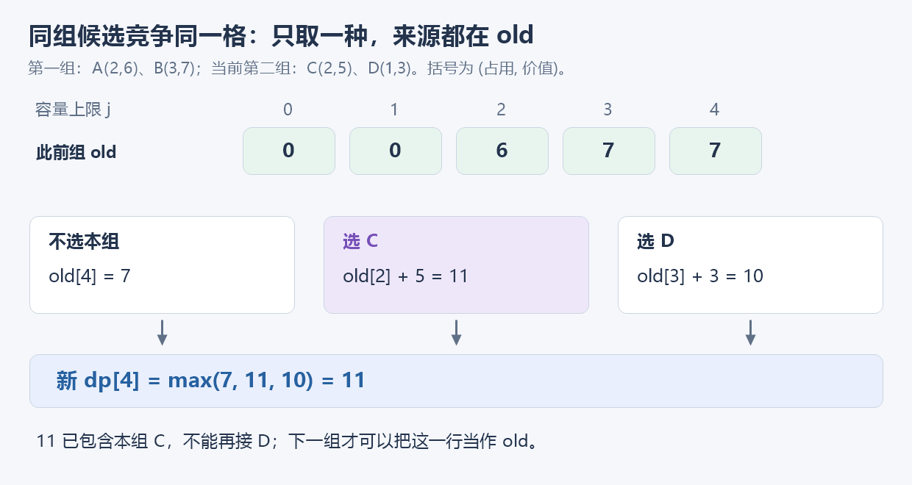
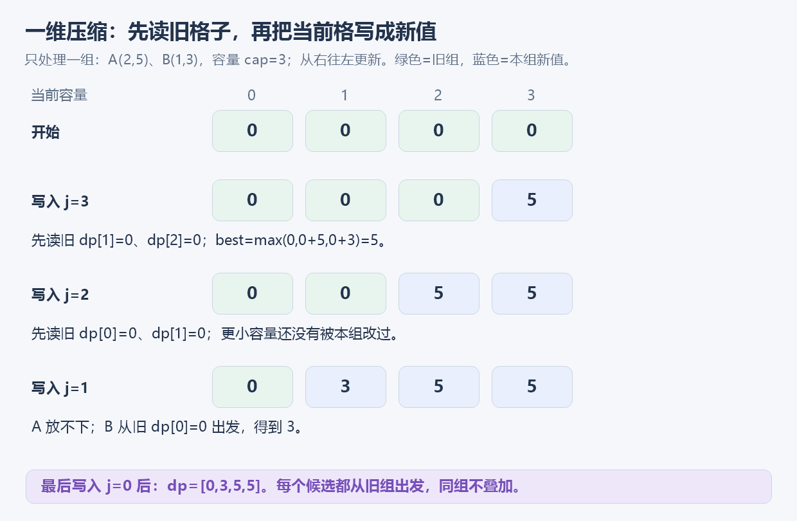

# 5.12 分组背包：同组候选，只能选一个

前置：[0/1 背包](02-zero-one-knapsack.md)、[DP 的状态与压缩检查](../../patterns/05-dynamic-programming/dp-modeling-workflow.md#0-从识别到压缩五项检查)。本节增加**同组互斥**，只处理每组至多选一，以及每组恰好选一。

## 1. 遇到什么问题？普通 0/1 为什么不够？

容量为 3，同一组有两件物品：A 占用 2、价值 5；B 占用 1、价值 3。

普通 0/1 只限制**每件最多一次**，会把 A、B 一起装入，得到 8。但若同组只能选一件，合法答案是 5。

**需要保留的限制从“这一件有没有用过”，变成了“这一组有没有做过选择”。** 因此把组当作处理阶段，在每组的多个候选之间取最好的一种。

## 2. 先给代码：本组所有候选都读 old

输入已整理为 `groups[g]`：第 g 组的候选数组，组与组互相独立。每项提供非负占用和可累加的价值，容量为非负整数。

```cpp
using ll = long long;
const ll GROUP_NEG = -(1LL << 60);

struct GroupItem {
    int cost;  // 选择这一项的占用，可以为 0
    ll value;
};

// 默认每组至多选一；must_pick=true 时，每组恰好选一。
// 始终是总占用不超过 cap；恰好选一无解时返回 GROUP_NEG。
ll group_knapsack_rows(int cap, const vector<vector<GroupItem>>& groups,
                       bool must_pick = false) {
    vector<ll> dp(cap + 1, 0); // 还没处理组时，各个容量上限都允许空方案。

    for (const auto& group : groups) {
        vector<ll> old = dp; // 此前所有组的答案，本轮只读。
        if (must_pick)
            fill(dp.begin(), dp.end(), GROUP_NEG); // 不允许直接继承“不选本组”。

        for (int j = 0; j <= cap; ++j) {
            for (const auto& x : group) {
                if (x.cost > j || old[j - x.cost] == GROUP_NEG)
                    continue;

                dp[j] = max(dp[j], old[j - x.cost] + x.value);
            }
        }
    }

    return dp[cap];
}
```

**用途速记：** 给出已经分好的组、每个候选的占用与价值，返回容量上限内的最大价值。每轮固定一组，所有候选都从 old 出发，因此不会把同组两个候选叠加。

| 变量 | 含义 | 后续作用 |
| --- | --- | --- |
| `groups[g]` | 第 g 组可以互相替代的候选 | 外层每轮只处理这一组 |
| `x.cost / x.value` | 选择候选 x 的占用、价值 | 确定前驱容量与增加的收益 |
| `j / cap` | 当前容量上限 / 总容量上限 | 范围为 `0..cap`，不要求装满 |
| `old[j]` | 仅用此前组的最优值 | 本组所有选择共同读取的旧行 |
| `dp[j]` | 加入当前组后的最优值 | 收集各个候选，交给下一组 |
| `must_pick` | 是否要求每组恰好选一 | 决定能否继承“不选本组” |
| `GROUP_NEG` | 不存在合法选法 | 只作标记，不能参与加法 |

组、候选与容量数组均 **0-based**。通用实现约定 `cap≤200000`、实际组数与候选总数均不超过 200000，**`cost` 为非负 int**，价值绝对值不超过 $10^{12}$。累计值绝对值不超过 $2\times10^{17}$，与哨兵分开。这些是数值边界，**不表示同时取最大规模时还能在时限内跑完**，时间仍需按第 7 节估算。

## 3. 找到状态，再把“本组选哪件”写成转移

先用完整的二维语义理解：

$$
F[g][j]=\text{只处理前 }g\text{ 组，总占用不超过 }j\text{ 的最大价值}.
$$

g 表示已经处理多少组，j 表示**容量上限**；表值才是价值。

对于本组，只有两类合法选择：

$$
\text{不选本组：}\quad F[g-1][j].
$$

没有增加占用，也没有增加价值，沿用此前组的方案。

$$
\text{选本组候选 }x\text{：}\quad F[g-1][j-x.cost]+x.value.
$$

先为 x 留出占用，剩余容量只交给**此前的组**；要求 `x.cost≤j` 且前驱可达。

因此默认“至多选一”的转移是：

$$
F[g][j]=\max\left\{
\begin{array}{l}
F[g-1][j],\\
\displaystyle\max_{\substack{x\in\text{本组}\\x.cost\le j}}
\bigl(F[g-1][j-x.cost]+x.value\bigr).
\end{array}
\right\}.
$$

**一次只在这些完整候选方案中取最大值，不是先选 A，再继续加上同组的 B。**

### 同一格，可以比较多个候选，但来源必须相同

例如处理完第一组后，旧行为 `old=[0,0,6,7,7]`。本组候选为 C `(2,5)`、D `(1,3)`，当前计算容量 4。



$$
dp[4]=\max(7,\ 6+5,\ 7+3)=11.
$$

三个来源分别是不选、选 C、选 D。**取到 11 之后，也不能再往它上面接 D**；11 已经包含本组 C，不能再作为本组其他候选的前驱。

在代码中，`old` 整轮不变，正好把这个限制落地。由于读取的是独立数组，教学版容量正序、倒序都可以；关键是读取哪一行。

## 4. 为什么能省掉 old？先证明读写，再压缩

下面沿用前面的 `GroupItem` 和 `GROUP_NEG`，省掉每组的复制；这是[竞赛模板](../../templates/05-dynamic-programming/group-knapsack/README.md)的主写法。

```cpp
ll group_knapsack(int cap, const vector<vector<GroupItem>>& groups,
                  bool must_pick = false) {
    vector<ll> dp(cap + 1, 0);

    for (const auto& group : groups) {
        for (int j = cap; j >= 0; --j) {
            // 初始化当前组的最优值：
            // 允许不选当前组时，保留上一组的 dp[j]；
            // 必须选择当前组时，不能跳过，因此从负无穷开始。
            ll best = must_pick ? GROUP_NEG : dp[j];

            for (const auto& x : group) {
                if (x.cost > j || dp[j - x.cost] == GROUP_NEG)
                    continue;

                best = max(best, dp[j - x.cost] + x.value);
            }

            dp[j] = best; // 这一格的所有候选比较完后，才写入新值。
        }
    }

    return dp[cap];
}
```

**用途速记：** 与前一版返回相同结果，用容量倒序保留需要读取的旧行位置；`best` 暂存本格的竞争结果，最后才覆盖 `dp[j]`。

### 正占用：读的是还没轮到更新的左边

固定本组，容量 j 从大到小处理。若 `x.cost>0`：

$$
j-x.cost\lt j.
$$

当前处理 j 时，更小的容量还没改过，所以 `dp[j-x.cost]` 仍属于上一组。



图中只处理一组 A `(2,5)`、B `(1,3)`，容量为 3。计算 3 时读取的 1、2 还都是 0；计算 2 时读取的 0、1 也还是 0。最后得到 `[0,3,5,5]`。

**组内所有候选竞争同一格的 best，比较完毕才写回。** 这相当于把旧行“从右往左”逐格替换为新行，而不是让本组物品互相接力。

### 正占用时，best 可以省略

**若所有候选都满足 `cost>0`，容量倒序已经保证来源是上一组，可以直接更新 `dp[j]`，不必使用 best。** 下列写法同时支持至多选一与恰好选一，前提是费用严格为正：

```cpp
for (const auto& group : groups) {
    for (int j = cap; j >= 0; --j) {
        // 必选时，清除“不选当前组”；较小容量的旧值尚未被覆盖。
        if (must_pick)
            dp[j] = GROUP_NEG;

        for (const auto& x : group) {
            if (x.cost > j || dp[j - x.cost] == GROUP_NEG)
                continue;

            dp[j] = max(dp[j], dp[j - x.cost] + x.value);
        }
    }
}
```

这里反复改变的只是收集答案的 `dp[j]`；各候选仍读取更小下标的旧值，因此不会互相叠加。**best 不是分组背包必需的变量，模板保留它是为了同时支持零费用。**

### 零占用：还会读到自己，暂存 best 就有用了

> **若 `x.cost=0`，来源是 `dp[j]` 本身。它不能在比较完所有候选之前被改掉。**

同一组有 `(0,5)` 和 `(0,7)`，旧 `dp[j]=0`：

$$
best=\max(0,\ 0+5,\ 0+7)=7.
$$

最后只写入 7，不会得到 12。**因此模板把新值放在 best 中，遍历完本格全部候选才写回**；不能删掉 best、在组内直接反复覆盖 `dp[j]`，再声称支持零占用。

## 5. 三层循环，为什么不能随便换？

下面两种错误都用同一组 A `(2,5)`、B `(1,3)`、容量 3。

| 循环组织 | 会发生什么 | 错误结果 |
| --- | --- | --- |
| 组 → 组内物品 → 容量倒序 | 先用 A 更新 `dp[2]=5`，再让 B 读取它 | `dp[3]=8`，同组 A+B |
| 组 → 容量正序 → 组内物品，读同一个 dp | `dp[1]=3` 后立刻帮助 `dp[2]`，新值再帮助 `dp[3]` | `dp[3]=9`，B 被选三次 |

> 第一种虽然每件都倒序，但它只保证**每件至多一次**，没有保证整组至多一次。

本节的一维原地组织为：

$$
\boxed{\text{组}\ \longrightarrow\ \text{容量倒序}\ \longrightarrow\ \text{组内候选}}
$$

**这里首先对应表格第二种写法：容量正序并非本身错误，错误在于读取同一个 dp 时，读到了本组刚更新的新值。** 教学版始终读取独立的 old，因此仍可按“组 → 容量正序 → 组内物品”计算，不会发生表格中的重复选择。

**更本质的检查是“每个候选是否读到了上一组”。** 同理，**第一种顺序若也让全部候选只读固定的 old、向同一新行取最大值，也可以正确计算。**因为选 B 时仍读取上一组的 old，读不到选 A 后的新结果，同组物品就不会叠加；新行只是比较各个独立候选，先比较谁不影响最大值。上述顺序限制针对本节省去 old 的一维原地写法，不能说成所有实现的定律。

## 6. 每组恰好选一：取消继承，不是把容量改成恰好

两版函数都可传 `must_pick=true`。区别只有：**不再允许本组不选的旧方案直接留下**。

- 教学版：先把新行清为 `GROUP_NEG`，再从 old 中接入本组候选。
- 一维版：先令本格 `best=GROUP_NEG`，但仍保留旧 dp 供读取。

没有处理任何组时，各容量上限都允许空方案，因此初始 `dp[j]=0`；之后每组必须实际接入一个候选。

例如第一组只有 `(2,-3)`，第二组只有 `(1,0)`：

| 要求 | 容量 4 的结果 | 原因 |
| --- | --- | --- |
| 每组至多一件 | 0 | 可以全部不选 |
| 每组恰好一件 | −3 | 两组都必须选，总占用 3，允许剩余容量 |
| 每组恰好一件，容量改为 2 | `GROUP_NEG` | 无法同时容纳两组 |

**负价值可能是合法答案，不能把所有负数当成无解。** 只判断是否等于指定哨兵；**若输入确实包含空组，恰好选一也无解。组号之间没出现的编号不自动构成一个必选空组。**

“每组恰好一件”和“总占用恰好等于 cap”是不同约束。本节不扩展恰好装满、方案计数或选法恢复。

## 7. 复杂度：三层循环，不一定是三个规模相乘

设 G 为实际组数、M 为**所有组的候选总数**、C 为容量。

$$
M=|groups[0]|+|groups[1]|+\cdots+|groups[G-1]|.
$$

每个候选在各个容量上比较一次，因此候选比较总量为：

$$
(C+1)\sum_g|groups[g]|=(C+1)M.
$$

此外，一维版每组要写回 C+1 个容量结果；教学版每组要复制 old，必选时还要清空新行。这些固定工作每组都是 $O(C+1)$，当前实现遇到空组也会发生。

计入最开始创建 dp 的 $O(C+1)$，两版总时间均为：

$$
O\bigl((C+1)(G+M)+C+1\bigr).
$$

若只保留非空组，`G≤M`，每组固定开销可以被候选比较的同阶界吸收，常写作 **O(CM)**；不能再把 M 当作每组候选数，多乘一个 G。

| 规模 | 主要候选比较量 | 如何理解 |
| --- | --- | --- |
| M=1000，C=1000 | 约 $10^6$ | 基础模型适合直接做 |
| M=10000，C=10000 | 约 $10^8$ | 已明显增大，需要结合时限与实现估算 |
| M=100000，C=100000 | 约 $10^{10}$ | 不能因为模板能开数组就照搬枚举 |

教学版保存 old 和 dp，额外空间 O(C)；竞赛版只保留 dp，仍为 O(C)，但少一份容量数组及每组复制。输入的嵌套向量另占 O(G+M)。这次压缩主要减少存储与复制，**没有改变候选比较量的数量级**。

## 8. 与已学模型的边界

| 模型 | 限制的是什么 | 每轮怎样选择 |
| --- | --- | --- |
| 0/1 背包 | 每件最多一次 | 当前物品选/不选 |
| 多重背包 | 每种相同物品最多若干件 | 当前种类取几件 |
| 分组背包 | 同组候选互斥 | 当前组选哪个，或不选 |
| [多维费用背包](13-two-cost-knapsack.md) | 多种资源分别有上限 | 分别记录各项资源占用，压缩物品阶段后仍需两个容量 |

**分组背包中的“组数＋容量”两维，是处理阶段与一种资源。它不等于两种资源的二维费用背包。** “分组”也不是上一节按余数分组的含义，后者只是把转移下标分成独立序列。

识别与旧行读写的通用检查补入[背包建模范式](../../patterns/05-dynamic-programming/resource-limited-selection.md#同组互斥把整组当作一个处理阶段)，不另建重复范式。

## 9. 典题与复盘

### 洛谷 P1757：通天之分组背包

[题目链接](https://www.luogu.com.cn/problem/P1757)

- **练习目的：** 把输入约束对应到阶段、状态与候选选择，练习容量压缩时的旧值读取。
- **范围核对：** 题面给出容量与物品数不超过 1000；管理员备注允许零重量、零价值，组号可能为 0 且可到 10000，不能只按旧的较小组号假设开数组。
- **状态：已收到个人实现并静态复盘；未重复编译、运行或对拍，未补记平台结果。**

#### 个人实现：组、容量倒序、组内候选

保留原逻辑，仅整理排版。该写法直观体现了**正费用时可省去 best**，完整输入范围的两个注意点列在代码后。

```cpp
void solve() {
    int m, n;
    cin >> m >> n;

    vector<vector<pii>> groups(n + 1);

    for (int i = 0; i < n; ++i) {
        int c, v, g;
        cin >> c >> v >> g;
        groups[g].push_back({c, v});
    }

    vector<int> dp(m + 1);

    for (const auto& group : groups) {
        for (int j = m; j >= 0; --j) {
            for (const auto& x : group) {
                if (x.first <= j)
                    dp[j] = max(dp[j], dp[j - x.first] + x.second);
            }
        }
    }

    cout << dp[m] << '\n';
}
```

**两处边界要与通用模型分开：**

- **组号不受物品数 n 限制。** `groups(n+1)` 不能覆盖所有合法组号；可按已知组号上限开数组，或读入 g 后先将 `groups` 扩容到至少 `g+1`，再访问 `groups[g]`。编号之间的空组在“至多选一”模式下可以跳过。
- **题面允许零费用。** 直接原地更新不覆盖这一边界；例如同组 `(0,5)`、`(0,7)` 会叠加成 12。需要覆盖完整范围时，改用前面的 best 暂存写法或固定 old 的教学版；通用模板已经支持，无需另造板子。

本题原实现说明了简洁循环的使用条件，**不能据此把“费用严格为正”的结论扩大成“只要倒序就始终能删 best”**。

## 10. 自查与衔接

1. 同组两个候选可以先后更新同一个 dp[j]，为什么不能用更新后的值互相转移？
2. 教学版为什么可以容量正序，省去 old 后为什么改成倒序？
3. 如果要求每组恰好选一，初值和“不选本组”这条边分别怎样处理？

模型和循环顺序对照 [OI Wiki 的分组背包](https://oi-wiki.org/dp/knapsack/advanced/#分组背包)；本节自行整理两种实现，并用暂存 best 处理零占用候选。题面范围以原站为准。

[本章索引](README.md) · [竞赛模板](../../templates/05-dynamic-programming/group-knapsack/README.md) · [DP 建模流程](../../patterns/05-dynamic-programming/dp-modeling-workflow.md)

[本章总结与选型](14-summary-selection.md)
