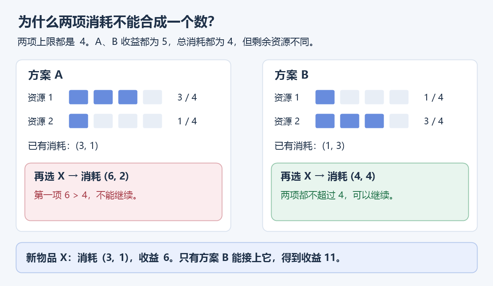
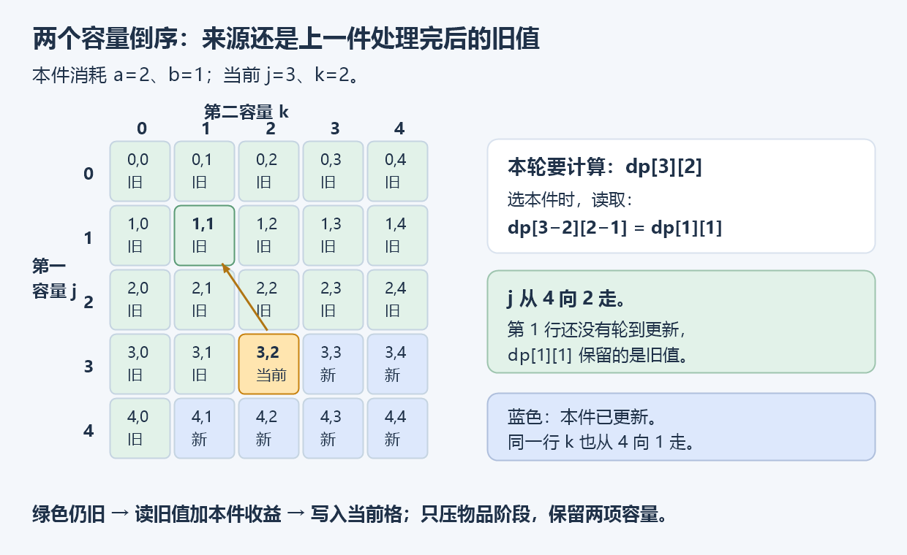

# 5.13 多维费用背包：同时受两种资源限制

前置：[0/1 背包](02-zero-one-knapsack.md)、[分组背包的旧值读取](12-group-knapsack.md#4-为什么能省掉-old先证明读写再压缩)。本节只处理**每件至多选一次、两种资源分别有上限、最大化总收益**。

## 1. 一种容量不够描述什么？

普通 0/1 背包只问重量能否放下。若现在**重量、体积都有限**，只记重量，就不知道体积是否已经超限。

也不能直接把两种消耗相加：重量、体积上限都是 4，某件消耗 `(1,5)`，合计 6 虽然不超过合计上限 8，体积却已超限。

**每一种独立限制，都要能从状态中单独检查。** 因此在原容量之外，再记录另一种资源的容量。

## 2. 先给代码：两个容量都倒序

```cpp
using ll = long long;

struct BiItem {
    int cost1, cost2; // 选择这一件时，同时消耗的两种资源
    ll value;
};

// 每件至多一次；两种资源的总占用分别不超过 cap1、cap2。
ll knapsack_2d(int cap1, int cap2, const vector<BiItem>& items) {
    vector<vector<ll>> dp(cap1 + 1, vector<ll>(cap2 + 1, 0));

    for (const auto& x : items) {
        // 任意一种资源都放不下，这件就不能选。
        if (x.cost1 > cap1 || x.cost2 > cap2) continue;

        for (int j = cap1; j >= x.cost1; --j) {
            for (int k = cap2; k >= x.cost2; --k) {
                dp[j][k] = max(dp[j][k],
                               dp[j - x.cost1][k - x.cost2] + x.value);
            }
        }
    }

    return dp[cap1][cap2];
}
```

**用途速记：** 输入每件的两种消耗、收益与两项容量上限，返回两项都不超限时的最大收益。每件仍是选／不选；多出来的容量下标负责检查第二项资源，倒序负责保留上一件处理完后的旧值。

| 变量 | 表示什么 | 用来做什么 |
| --- | --- | --- |
| `items` | 可独立选择的物品列表 | 每件只处理一轮，不是互斥组 |
| `x.cost1 / x.cost2` | 本件的两项消耗 | 必须同时扣除，缺一项资源也不能选 |
| `x.value` | 选本件增加的收益 | 与旧方案的收益相加 |
| `cap1 / cap2` | 两种资源的总上限 | 决定二维表的大小 |
| `j / k` | 当前考虑的两个容量上限 | **都不是已经花掉的资源量** |
| `dp[j][k]` | 已处理物品中，两项占用分别不超过 j、k 的最大收益 | 最后读 `dp[cap1][cap2]` |

物品数组 0-based；容量下标含 0。两项费用允许为 0，价值允许为负；可以不选，因此答案至少为 0。没有“必须选一件”或“恰好用满”的要求。

[竞赛模板](../../templates/05-dynamic-programming/two-cost-knapsack/README.md)约定物品数不超过 200000、价值绝对值不超过 $10^{12}$，累计值绝对值不超过 $2\times10^{17}$，用 ll；容量与数组大小还须满足模板契约及第 7 节的时间估算。

## 3. 为什么不能把两个消耗合成一个？

先看两种已有选法：A 消耗 `(3,1)`，B 消耗 `(1,3)`，收益都是 5。它们总消耗都等于 4，但留下的资源不同。



两项上限都是 4，再来一件 X，消耗 `(3,1)`、收益 6。A 无法接 X，B 却可以。

**相同的“消耗总和、当前收益”，未来仍可能有不同选择，不能合并成同一状态。** 分别保留两个容量后，同一阶段、同一容量对中的所有方案才面对相同的后续选择，可以只留最大收益。

## 4. 状态与转移：一次选择，同时扣掉两项消耗

先把物品阶段也写出来：

$$
F[i][j][k]=\text{只用前 }i\text{ 件，两项占用分别不超过 }j,k\text{ 的最大收益}.
$$

**i 是已经处理的物品数，j、k 是两个容量上限。** 这是三维状态；之后只压缩物品阶段，两个资源维度仍要保留。

处理第 i 件时，设它的两项消耗为 a、b，收益为 v。不选它：

$$
F[i-1][j][k].
$$

原方案不增加消耗，直接保留。

若 `j≥a` 且 `k≥b`，选择它：

$$
F[i-1][j-a][k-b]+v.
$$

先给当前物品留出两份资源，剩余容量交给前 i−1 件；收益只加一次。

$$
F[i][j][k]=
\begin{cases}
\max\bigl(F[i-1][j][k],\ F[i-1][j-a][k-b]+v\bigr),
& j\ge a\text{ 且 }k\ge b,\\
F[i-1][j][k], & \text{否则}.
\end{cases}
$$

只有两项都放得下，才有“选”这条转移；不能两项消耗分别做两次背包后再拼答案。

### 初值为什么全是 0？

$$
F[0][j][k]=0.
$$

还没处理物品时，每个容量上限下都允许空方案，收益为 0。**这不是把不可达状态当成 0，而是这里每一个“容量上限状态”都有空方案。** 若改成恰好消耗，才需要另设不可达标记。

## 5. 压掉物品阶段，为什么这样倒序？

转移只读取上一轮 `F[i-1]`，于是考虑用一张二维表反复覆盖：

$$
\underbrace{F[i][j][k]}_{\text{物品阶段＋两种容量}}
\quad\longrightarrow\quad
\underbrace{dp[j][k]}_{\text{只保存两个容量}}.
$$

但必须先确认：**算当前格时，`dp[j-a][k-b]` 还是上一轮吗？**



图中正在处理 `j=3、k=2`，本件消耗 `(2,1)`，所以来源为 `dp[1][1]`。蓝色已更新，绿色尚未更新；来源仍在绿色旧区。

### 对照代码，分三种情况

1. **a>0：** `j-a<j`。外层 j 倒序，更小的那一行还没处理，来源一定是旧值。
2. **a=0、b>0：** 来源在当前行，但 `k-b<k`。内层 k 倒序，更小的列还没处理，仍是旧值。
3. **a=b=0：** 来源就是当前格。每件对每格只执行一次赋值，右边先读取旧值再写入，所以这件仍只加一次；负收益则不选。

> **两维都倒序，是覆盖非负费用的统一写法。** 若已保证 a 严格为正，外层倒序就已保护来源，内层不一定非要倒序；但模板不依赖这个额外前提。交换两种资源的内外层也可以，统一保持倒序即可。

这与分组背包的零费用情形不同：**这里每件只给每格一个新候选；分组背包是一整组多个候选竞争同一格，不能让后一个读到前一个的新值。** 后者保留 best 的原因见[零占用与暂存](12-group-knapsack.md#零占用还会读到自己暂存-best-就有用了)。

### 为什么不能两维都正序？

只有一件消耗 `(1,1)`、收益 5，容量为 `(2,2)`。正序先写 `dp[1][1]=5`，再算 `dp[2][2]` 时读到这个新值，得到 10，**相当于同一件用了两次**。

**错误来自读到了本件的新结果。** 若另存固定 old，则正序也可以；本节倒序针对省掉 old 的原地实现。

## 6. 一个小例子：两项预算要一起检查

容量 `(3,3)`，A 消耗 `(2,1)`、收益 5；B 消耗 `(1,2)`、收益 6。

| 选法 | 第一项占用 | 第二项占用 | 收益 |
| --- | --- | --- | --- |
| 都不选 | 0 | 0 | 0 |
| 只选 A | 2 | 1 | 5 |
| 只选 B | 1 | 2 | 6 |
| A+B | 3 | 3 | 11 |

处理完 A 后，再处理 B，当前容量 `(3,3)` 的来源为：

$$
dp[3-1][3-2]+6=dp[2][1]+6=5+6=11.
$$

这里 `dp[2][1]` 尚未被 B 更新，表示此前选 A 的方案。返回 `dp[3][3]=11`。

若第一项容量不变，第二项改为 2，则 A+B 不合法，答案变成 6；只检查第一项会漏掉这个限制。

## 7. 复杂度：看两个容量的乘积

设 n 为物品数，两项容量为 $C_1,C_2$。每件至多扫描整张容量表：

$$
O\bigl(n(C_1+1)(C_2+1)\bigr).
$$

创建初始表还需 $O((C_1+1)(C_2+1))$，故含空输入的完整时间上界为：

$$
O\bigl((n+1)(C_1+1)(C_2+1)\bigr).
$$

压缩前保存全部阶段，空间为 $O((n+1)(C_1+1)(C_2+1))$；现在只存一张二维表：

$$
O\bigl((C_1+1)(C_2+1)\bigr).
$$

**压缩减少空间，不减少物品轮数与候选比较的数量级。** 输入另外占 O(n)。

| n、两项容量 | 转移次数上界约为 | ll 表数据约占 | 观察 |
| --- | --- | --- | --- |
| 50、400、400 | $8.04\times10^6$ | 1.23 MiB | 基础模型的常见规模 |
| 100、200、200 | $4.04\times10^6$ | 0.31 MiB | 容量乘积仍较小 |
| 1000、1000、1000 | $10^9$ | 7.65 MiB | 能存下，不代表能及时算完 |
| 100、10000、10000 | $10^{10}$ | 763 MiB | 时间与空间都明显增大 |

表中是扫描量与纯 ll 数据估算，未计向量开销；实际耗时取决于限制与实现。**增加资源维度后，容量规模相乘，不能只看 n 小就开表。**

## 8. 与分组背包区分：维度的含义不同

| 模型 | 完整状态 | 本节与上一节的区别 |
| --- | --- | --- |
| 单费用 0/1 | `F[物品数][容量]` | 一种资源，每件选／不选 |
| 分组背包 | `F[组数][容量]` | 一种资源，同组候选互斥 |
| 两种费用 0/1 | `F[物品数][容量1][容量2]` | 两种资源，每件仍选／不选 |

物品阶段可以滚动掉，是因为只依赖上一轮；两项容量留下，是因为后续还要分别检查它们。**有几个数组下标，不等于消耗了几种资源。**

两项费用不能为负；超出任一总容量的物品可以跳过。空物品列表返回 0；容量为 0 时，仍要处理对应费用为 0 的物品。本节不同时展开多重／分组与两种费用的组合，也不加入恰好装满、计数或选法恢复。

通用识别归入已有[背包建模范式](../../patterns/05-dynamic-programming/resource-limited-selection.md#多种独立资源分别保留容量)，不另建重复 Pattern。

## 9. 典题与复盘：同一转移，更换输入与目标

两份个人实现保留原逻辑，仅统一排版；共用下面的 Item，通用 main 不重复粘贴。**本轮只静态检查，未编译、运行或对拍个人代码，平台结果未单独记录。**

```cpp
struct Item {
    int cost1, cost2;
    ll value;
};
```

### P1507 NASA 的食物计划

[洛谷 P1507](https://www.luogu.com.cn/problem/P1507)

**收录原因：** 先把每次选择的两个消耗与一个收益分开，再直接复用两个容量的 0/1 转移。

```cpp
void solve() {
    int a, b, n;
    cin >> a >> b >> n;

    vector<Item> items(n);
    for (int i = 0; i < n; ++i) {
        Item& it = items[i];
        cin >> it.cost1 >> it.cost2 >> it.value;
    }

    vector<vector<ll>> dp(a + 1, vector<ll>(b + 1));
    for (const auto& x : items) {
        if (x.cost1 > a || x.cost2 > b) continue;

        for (int j = a; j >= x.cost1; --j) {
            for (int k = b; k >= x.cost2; --k)
                dp[j][k] = max(dp[j][k],
                               dp[j - x.cost1][k - x.cost2] + x.value);
        }
    }

    cout << dp[a][b] << '\n';
}
```

这里 a、b 分别是体积、质量上限，value 是卡路里。**输入顺序是 a、b、n**；虽然题面将 n 放在下一行，`cin` 按空白分隔读取，连续写在同一条输入语句中即可。

$$
dp[j][k]=\text{已处理食品中，体积不超过 }j\text{、质量不超过 }k\text{ 的最大卡路里}.
$$

容量允许剩余，因此全零初始化并返回 `dp[a][b]`。一件食品只处理一轮，两个容量倒序，来源仍属于此前食品。

原题两项容量及单件消耗不超过 400，食品数不超过 50，单件卡路里不超过 500。原实现使用 ll 保存收益，范围足够；时间、空间按第 7 节的容量乘积估算。

### P1855 榨取 kkksc03

[洛谷 P1855](https://www.luogu.com.cn/problem/P1855)

**收录原因：** 资源仍是两个独立上限，但优化目标变成完成数量；每项贡献 1，即可沿用同一个最大收益转移。

```cpp
void solve() {
    int n, a, b;
    cin >> n >> a >> b;

    vector<Item> items(n);
    for (int i = 0; i < n; ++i) {
        Item& it = items[i];
        cin >> it.cost1 >> it.cost2;
        it.value = 1;
    }

    vector<vector<ll>> dp(a + 1, vector<ll>(b + 1));
    for (const auto& x : items) {
        if (x.cost1 > a || x.cost2 > b) continue;

        for (int j = a; j >= x.cost1; --j) {
            for (int k = b; k >= x.cost2; --k)
                dp[j][k] = max(dp[j][k],
                               dp[j - x.cost1][k - x.cost2] + x.value);
        }
    }

    cout << dp[a][b] << '\n';
}
```

这里 a、b 分别是金钱、时间上限；**输入顺序改为 n、a、b**。每个愿望只读两项费用，再设置 `it.value=1`。

$$
\text{一组选中愿望的总收益}=1+1+\cdots+1=\text{选中愿望数}.
$$

因此最大收益就是最多完成数量，`dp[j][k]` 的值不再是卡路里，而是两个预算上限内最多完成的愿望数。

**这不是统计“有多少种选法”。** 本题仍在所有合法方案之间取 max，只是每个选中对象的贡献固定为 1；不需要改成方案数相加。

原题愿望数为 1..100，两项预算为 0..200。预算可能为 0，所以循环需要保留第 0 行／列；只有对应费用为 0 的物品，才能在这样的上限内参与转移。

### 对照：统计合法选法数量

如果改问“两个预算内，共有多少种物品子集”，传统写法是**选法数相加，不再取 max**。这里每件仍至多选一次，按物品编号区分不同子集，允许空方案。

```cpp
// 各物品按编号区分，每件至多一次；允许空方案，答案模 1e9+7。
// Item 沿用上文结构，统计选法时不使用 value。
ll count_ways(int a, int b, const vector<Item>& items) {
    const ll MOD = 1000000007;
    vector<vector<ll>> ways(a + 1, vector<ll>(b + 1));
    ways[0][0] = 1; // 尚未选物品：只有空方案。

    for (const auto& x : items) {
        if (x.cost1 > a || x.cost2 > b) continue;

        for (int j = a; j >= x.cost1; --j) {
            for (int k = b; k >= x.cost2; --k) {
                ways[j][k] = (ways[j][k]
                           + ways[j - x.cost1][k - x.cost2]) % MOD;
            }
        }
    }

    ll ans = 0;
    for (int j = 0; j <= a; ++j)
        for (int k = 0; k <= b; ++k)
            ans = (ans + ways[j][k]) % MOD;

    return ans;
}
```

**用途速记：** 输入仍是两项预算和物品列表；返回所有合法子集的数量，包含空集。用每项的“选／不选”累加方案数，数值可能很大，这个对照版按 $10^9+7$ 取模。

先把状态改为**恰好消耗**，不是“容量上限内的最优值”：

$$
ways[j][k]=\text{已处理物品中，两项总消耗恰好为 }j,k\text{ 的子集数量}.
$$

只有空集在开始时存在，所以 `ways[0][0]=1`，其余为 0；不能照搬最大收益的全零初始化。

$$
\text{本轮}[j][k]
=\underbrace{\text{上一轮}[j][k]}_{\text{不选本件}}
+\underbrace{\text{上一轮}[j-cost1][k-cost2]}_{\text{选本件}}.
$$

两类子集以“是否包含本件”区分，互不重复，因此相加。两个容量仍倒序，保证每件只使用一次；两项费用均为 0 时，同格翻倍一次，恰好对应每个旧子集的选／不选两种选择。

$$
\text{预算内选法数}=\sum_{j=0}^{a}\sum_{k=0}^{b}ways[j][k].
$$

每个子集只落入一个“恰好消耗”格子，所以最后求和不重不漏。若要求恰好用满两个预算，直接返回 `ways[a][b]`；若预算内不允许空集，则从总答案减 1，并规范取模。

**例：** 两件物品费用都是 (1,1)，预算也是 (1,1)。最多只能选 1 件；合法子集却有“空集、仅第一件、仅第二件”，共 3 种。费用相同不表示两件物品是同一个对象。

| 比较 | 最多完成数量 | 合法选法数量 |
| --- | --- | --- |
| 表值 | 预算上限内，最多选几件 | 恰好消耗这两项资源的子集数 |
| 初始值 | 全 0：允许什么都不选 | 仅 `ways[0][0]=1` |
| 选／不选的合并 | `max(不选, 选前最优值+1)` | `不选的方案数+选本件的方案数` |
| 预算内答案 | `dp[a][b]` | 累加所有 `ways[j][k]` |

两者状态和合并方式不同，**不是只把 max 换成加号就结束**。对照版仍为 $O((n+1)(a+1)(b+1))$ 时间、$O((a+1)(b+1))$ 额外空间；计数按题意选择模数或足够大的数值类型。本节竞赛模板继续只提供最大收益模型。

### 两题对照：两项消耗不变，收益含义可变

| 对照 | P1507 | P1855 |
| --- | --- | --- |
| 头部输入顺序 | `a b n` | `n a b` |
| 第一种资源 | 体积 | 金钱 |
| 第二种资源 | 质量 | 时间 |
| 每项收益 | 输入的卡路里 | 固定为 1 |
| 优化目标 | 最大总卡路里 | 最多完成愿望数 |
| 共同转移 | 扣除两项费用，加本件收益 | 同左 |

**两题的 DP 主体相同，区别在于先把题意翻译成 cost1、cost2、value。** 当前写法已适合这两个范围，不额外制造重复的“优化版”；现场也可直接调用[本节模板](../../templates/05-dynamic-programming/two-cost-knapsack/README.md)，个人 Item 对应模板的 BiItem。

两份原实现都另存 items，输入占 O(n)，DP 额外空间为 $O((a+1)(b+1))$。固定收益 1 的通用认识并入[背包建模中的目标增量](../../patterns/05-dynamic-programming/resource-limited-selection.md#3-cost--value-不必是两个不同数)。

## 10. 自查与参考

1. 两种消耗总和相同，为什么不能只记这个和？
2. 费用第一项为 0 时，来源为什么仍是上一轮？两项都为 0 呢？
3. 这里全零初始化为何合法？换成恰好消耗时还能照搬吗？

模型对照 [OI Wiki：二维费用背包](https://oi-wiki.org/dp/knapsack/advanced/#二维费用背包)，代码与本节示例自行整理；题意与范围以两道原题为准。通用实现核验不代表典题已经通过或个人已经掌握。

[本章索引](README.md) · [竞赛模板](../../templates/05-dynamic-programming/two-cost-knapsack/README.md) · [背包建模范式](../../patterns/05-dynamic-programming/resource-limited-selection.md)
