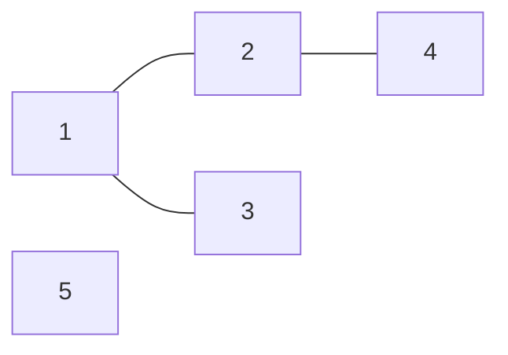

# 6.1 图的表示与基本模型

## 1. 从状态转移到图

[BFS 与无权最短路](../03-search/02-bfs-shortest-path.md)中的格子、楼层都是**点**，一次合法移动就是一条**边**。

此前根据当前位置生成下一步；如果题目直接给出对象之间的关系，就可以先把边存下来，再沿边搜索。

> **建图先回答：点代表什么，边代表什么，关系是否有方向。** 图不要求题面出现地图，只要对象之间存在可利用的联系，就可能适合建图。

本节使用 C++11，沿用 [竞赛基础框架](../../templates/cpp-contest-template/README.md)。所有图代码采用 **1-based 点编号：`1..n`**，下标 `0` 留空。

## 2. 需要区分的概念

| 概念 | 含义与实现影响 |
| --- | --- |
| 有向边 | $u\to v$ 只表示从 $u$ 可以到 $v$，反向关系需另行给出 |
| 无向边 | $u$ 与 $v$ 相连，两端都能沿这条边到达对方 |
| 边权 | 一次转移的费用、长度等；无权图通常按每条边一步处理 |
| 邻居 | 从当前点沿一条边可到达的点；有向图通常枚举出边终点 |
| 路径 | 沿边从一个点走向另一个点；有向图必须遵守边的方向 |
| 环 | 沿边走一圈回到出发点，不能靠无向边的立即折返就认定有环 |
| 度 | 无向图中与点相接的边数；有向图分别统计入度、出度 |

**自环**连接一个点与自身；

**重边**是同一对端点之间重复出现的边。除非题面排除，否则不能默认不存在。

无向自环对度贡献 $2$。普通可达性搜索能用访问标记跳过重复到达，但重边对计数、边权或判环的影响需要另行分析。

### 可达与连通

- **可达**：从某个起点出发，能沿边走到目标。
- **无向图的连通分量（连通块）**：内部任意两点互相可达，且无法再加入其他点的最大点集。孤立点也单独构成一个连通块。
- **有向图不能直接照搬这个划分。** $u$ 能到 $v$，不代表 $v$ 能到 $u$；强连通分量后续单独整理。

> 从一个起点搜索，只覆盖它能到达的点。题目要求“从起点可达”还是“处理全图”，决定是否需要补搜其他起点。

## 3. 邻接表：按起点存邻居

这里用 `vector<vector<int>>` 实现邻接表，不需要手写链表。

### 变量、容器与范围

- `n`：点数，编号保证为 `1..n`；外层分配 `n + 1` 个容器。
- `m`：输入边数，决定读入次数；不决定外层数组长度。
- `g[u]`：点 `u` 的出边终点列表，或无向图中与 `u` 相邻的点列表。
- `g[u][i]`：`u` 的第 `i` 个邻居的**点编号**。`i` 是列表位置，采用 `0-based`，不是点编号。
- `directed`：是否为有向图；同一份读入代码按此决定是否存反向边。

**外层按点编号索引，内层只存实际存在的邻接记录。** 内层长度通常各不相同，不是一个 $n\times n$ 的矩形。

如果原编号很大且不连续，先做映射或[离散化](../02-sequence-techniques/03-discretization.md)，不能只按点数开数组后直接使用大编号。

### 建图流程与实现

1. 读取 `n、m`，建立 `n + 1` 个空邻居列表。
2. 对每条输入关系读取端点 `u、v`。
3. 将 `v` 加入 `g[u]`；若是无向图，再将 `u` 加入 `g[v]`。

```cpp
// 前提：端点均在 1..n；输入流中接下来有 m 对端点
vector<vector<int>> read_graph(int n, int m, bool directed) {
    vector<vector<int>> g(n + 1);

    for (int i = 0; i < m; ++i) {
        int u, v;
        cin >> u >> v;

        g[u].push_back(v);

        if (!directed) {
            g[v].push_back(u); // 无向关系需要两个方向的邻接记录
        }
    }

    return g;
}
```

函数消耗输入并返回新的图，不排序、不去重，每次调用重新建图。无向图存了 $2m$ 条邻接记录，但原图仍是 $m$ 条边。

### 一个小例子

有 $5$ 个点，无向边为 $(1,2)、(1,3)、(2,4)$，点 $5$ 孤立：



对应的邻接表：

| 点 `u` | `g[u]` |
| --- | --- |
| 1 | 2，3 |
| 2 | 1，4 |
| 3 | 1 |
| 4 | 2 |
| 5 | 空 |

`g[2][1] == 4` 表示“点 2 的第 2 个邻居是点 4”，**不表示点 2 与点 1 相连**。

## 4. 存储方式怎么选

| 方式 | 保存什么 | 空间 | 常见用途 |
| --- | --- | --- | --- |
| 邻接表 | 每个点实际连接的邻居 | $O(n+m)$ | 枚举出边、DFS/BFS，大图优先考虑 |
| 邻接矩阵 | 每对点之间是否有边或相应边权 | $O(n^2)$ | 点数小、经常查询两点关系 |
| 边列表 | 每条边的端点和可选边权 | $O(m)$ | 对全部边排序或逐条处理，例如后续 Kruskal |

邻接表遍历 `g[u]` 的成本取决于它的长度；**普通 `vector` 邻接表查询某条边是否存在，需要扫描该列表**。矩阵能直接查询，但遍历一个点的邻居仍要检查整行。

> **存图与搜索是两个选择。** 换成邻接表后，DFS/BFS 的核心规则不变，只是“生成下一步”变成“枚举当前点的邻居”。

有权图的邻接表还需保存边权，例如每条记录包含 `to、w`。**零权边也是边**，矩阵不能不加区分地把 `0` 同时当作“无边”和合法权值；带权算法到对应章节再展开。

## 5. 在邻接表上做 BFS

### 状态与执行流程

- `g`：已经建好的图，所有邻居编号合法；搜索中只读。
- `s`：合法起点，范围为 `1..n`。
- `dist`：长度与外层 `g` 相同；`-1` 表示尚未发现，非负值表示最少边数，`dist[0]` 不使用。
- `q`：保存已发现、尚未处理的点。每点最多入队一次。

起点距离设为 `0` 并入队；每次取出一个点，遍历 `g[u]`。邻居尚未发现时，先写距离，再入队。队列耗尽后返回全部距离。

```cpp
// 前提：1-based 图，起点合法；每条边按一步计算
vector<int> bfs(const vector<vector<int>>& g, int s) {
    vector<int> dist(g.size(), -1);
    queue<int> q;

    dist[s] = 0;
    q.push(s);

    while (!q.empty()) {
        int u = q.front();
        q.pop();

        for (int v : g[u]) {
            if (dist[v] != -1) continue;

            dist[v] = dist[u] + 1; // 先标记，避免多个点重复安排同一邻居
            q.push(v);
        }
    }

    return dist;
}
```

函数不修改图，每次调用独立初始化；有向、无向图均可使用。距离不含起点本身，起点仍为 `0`；不可达点保持 `-1`。

对上面的无向图从点 `1` 出发：

| 取出的点 | 本次新发现的点及距离 | 操作后的队列 |
| --- | --- | --- |
| 初始化 | 点 1：0 | 1 |
| 1 | 点 2：1，点 3：1 | 2，3 |
| 2 | 点 4：2 | 3，4 |
| 3 | 无 | 4 |
| 4 | 无 | 空 |

最后 `dist[1..5]` 为 `0、1、1、2、-1`。检查点 `2` 的邻居 `1` 时，由于它已发现，直接跳过。

正确性依据仍是[队列按距离非降序处理](../03-search/02-bfs-shortest-path.md#6-为什么首次发现就是最短距离)：**先处理近点，首次发现即确定最少边数**。新增邻接表不改变等代价前提。

## 6. DFS：递归与显式栈

[递归 DFS](../03-search/01-dfs-backtracking.md#5-通用导引实现)可以沿邻接表深入一个未发现的邻居，再返回继续枚举。

> 做可达性遍历时，发现点后标记，**本轮不再改回未访问**；与枚举全部简单路径的标记操作不同。

点数多时，一条长链可能造成 $O(n)$ 层函数调用。递归栈容量依赖运行环境；必要时用显式栈保存“当前点，以及回来后继续检查哪个邻居”。

### 显式栈保存什么

- `st`：用 `stack<int>` 保存当前 DFS 路径，从栈顶继续深入，最多保存 `n` 个点；这里只需入栈、出栈和读取栈顶。
- `next[u]`：点 `u` 下一次要检查的**邻居列表下标**，初值为 `0`，可推进到 `g[u].size()`。
- `vis[u]`：本轮是否已经发现点 `u`；入栈前设为真，出栈后仍保持真。
- `order`：首次发现各点的顺序，独立于当前栈；退出某个点时不删除历史记录。

邻居检查完就出栈；否则先推进游标，再决定是否进入邻居。这样从子节点返回后，不会重复检查同一条邻接记录。

> **点编号采用 1-based，邻居列表位置采用 0-based。** `g[0]` 留空只影响外层点编号，不会让每个 `g[u]` 的第一个位置也留空。

例如 `g[2] = {1, 4}`，有两个邻居，合法位置为 `0、1`。`next[2]` 从 `0` 推进到 `2` 时，正好等于 `g[2].size()`，表示两个位置都已检查；它是**最后有效位置加一，即尾后位置，等于有效数量**。空列表则从一开始就满足 `0 == 0`。

```cpp
// 前提：1-based 图、起点合法，每个邻接列表长度可用 int 表示
// 返回首次发现顺序，与按同一邻接顺序执行的递归 DFS 一致
vector<int> dfs_order(const vector<vector<int>>& g, int s) {
    vector<bool> vis(g.size(), false);
    vector<int> next(g.size(), 0);
    stack<int> st;
    vector<int> order;

    vis[s] = true;
    st.push(s);
    order.push_back(s);

    while (!st.empty()) {
        int u = st.top();

        // 邻居位置从 0 开始；size() 是数量，也是尾后位置
        // next[u] 到达这里，说明该顶点所有邻居已检查完；与外层 g[0] 留空无关
        if (next[u] == static_cast<int>(g[u].size())) {
            st.pop(); // 回到上一层；访问标记不撤销
            continue;
        }

        int v = g[u][next[u]++]; // 先记住回来后从哪里继续
        if (vis[v]) continue;

        vis[v] = true;
        st.push(v);
        order.push_back(v);
    }

    return order;
}
```

以上图从 `1` 出发，首次发现顺序为 `1、2、4、3`。函数不修改图，重复调用互不影响。

**本实现只返回首次发现顺序。** 若要在子节点处理完后计算父节点结果，还需在退出阶段增加对应操作，**不能直接把首次发现顺序当作后序**。

### next：保存每个点的邻居枚举进度

**栈保存“当前走到了哪些点”，`next` 保存“每个点的邻居检查到哪里”。** 只有点编号，返回父节点后还不知道应该从哪个邻居继续。

`next[u]` 是 `g[u]` 中下一条待检查记录的位置，既不是下一个点的编号，也不是当前路径长度。

- `next[u] == 0`：还没检查过点 `u` 的邻居。
- `next[u] == k`：前 `k` 条邻接记录已经取出检查，下一条是 `g[u][k]`。
- `next[u] == g[u].size()`：已经没有下一条记录，当前点可以出栈。

> **“邻接记录已检查”不等于“对应子树已处理完”。** 选中一个新邻居后，父节点的游标已经向前，子节点的搜索才刚开始；父节点要等再次回到栈顶，才能继续使用这个游标。

#### 一行代码包含三个动作

`int v = g[u][next[u]++];` 可以按下面的过程理解：

```cpp
int i = next[u]; // 保存本次使用的邻居位置
int v = g[u][i]; // 取出这个位置存放的点编号
++next[u];      // 下次从后一个位置继续，无论 v 是否已经访问过
```

先推进进度，再判断 `vis[v]`：已经访问过的邻居虽然不用深入，但这条记录仍然检查过了。若把递增放在 `if (vis[v]) continue;` 后面，遇到已访问邻居时就可能一直停在原位置。

例如 `g[2] = {1, 4}`，从点 `1` 进入点 `2` 后，邻居 `1` 已访问。跳过它的同时必须把 `next[2]` 从 `0` 推到 `1`，下一轮才能检查点 `4`。

**深入前推进父节点游标，就是提前保存返回后的位置。** 子节点出栈后，父节点重新成为栈顶，直接继续检查下一个邻居，不需要从头扫描。

#### 沿用小图逐轮观察

邻接列表为：

```text
g[1] = {2, 3}
g[2] = {1, 4}
g[3] = {1}
g[4] = {2}
g[5] = {}
```

从点 `1` 出发，初始所有游标均为 `0`；下表中的栈按**栈底 → 栈顶**排列，最后一个点是下一轮处理对象。

| 步骤 | 本轮动作 | 游标变化 | 操作后的栈 | 新记录的点 |
| --- | --- | --- | --- | --- |
| 初始化 | 点 1 标记并入栈 | 无 | 1 | 1 |
| 1 | 点 1 取出邻居 2，进入新点 | `next[1]`：0 → 1 | 1，2 | 2 |
| 2 | 点 2 取出邻居 1，已访问，跳过 | `next[2]`：0 → 1 | 1，2 | 无 |
| 3 | 点 2 取出邻居 4，进入新点 | `next[2]`：1 → 2 | 1，2，4 | 4 |
| 4 | 点 4 取出邻居 2，已访问，跳过 | `next[4]`：0 → 1 | 1，2，4 | 无 |
| 5 | 点 4 的游标为 1，等于邻居数量，出栈 | 无 | 1，2 | 无 |
| 6 | 回到点 2，游标为 2，邻居也已检查完，出栈 | 无 | 1 | 无 |
| 7 | 回到点 1，从位置 1 取出邻居 3 | `next[1]`：1 → 2 | 1，3 | 3 |
| 8 | 点 3 取出邻居 1，已访问，跳过 | `next[3]`：0 → 1 | 1，3 | 无 |
| 9 | 点 3 的邻居检查完，出栈 | 无 | 1 | 无 |
| 10 | 点 1 的邻居检查完，出栈 | 无 | 空 | 无 |

**关键是第 1 步到第 7 步：** 搜索点 `2、4` 时，`next[1]` 一直保持为 `1`；返回点 `1` 后，能直接取出 `g[1][1] == 3`。点 `5` 不可达，始终没有入栈，其游标也保持为 `0`。

#### 为什么每个点都要有自己的游标

> 父节点暂停时，子节点也需要记录自己的进度，因此不能让所有点共用一个位置变量。
>
> **递归会为每层调用保存循环现场；这里本质是把现场分成 `st` 中的点编号和 `next[u]` 中的邻居位置。**

**本轮不重置 `next[u]`。** 返回父节点时重置会丢失进度；点出栈后仍保持已访问，本轮也不会重新进入它。下一次独立搜索重新建立全零 `next` 和全未访问的 `vis`。

每次取邻居时，恰好推进一个点的游标；游标只向前，每条邻接记录最多取出一次。这也是显式栈 DFS 保持 $O(n+m)$ 时间的原因。若改成每次返回都从列表开头重新扫描，虽然有访问标记，仍可能产生大量重复检查。

这里的一点一游标依赖**每个点只进入一次的遍历目标**。枚举所有简单路径会在不同分支重新进入同一点，不能把这套永久标记与游标状态直接照搬过去。

### 递归写法与行为对照

同一过程也可以交给函数调用栈保存现场。下面的 `vis、order` 由调用者初始化并按引用共享；入口先记录当前点，再依次进入尚未发现的邻居。

```cpp
// 前提与 dfs_order 相同；vis 长度为 g.size()，初始全 false，order 初始为空
void dfs_recursive(const vector<vector<int>>& g, int u,
                   vector<bool>& vis, vector<int>& order) {
    vis[u] = true;
    order.push_back(u); // 对应显式栈版发现点时记录顺序

    for (int v : g[u]) {
        if (vis[v]) continue;

        dfs_recursive(g, v, vis, order);
        // 子调用结束后，继续本层的下一个邻居；不撤销 vis[v]
    }
    // 邻居枚举结束，函数返回；对应显式栈版 st.pop()
}
```

调用前建立全为 `false` 的 `vis` 与空 `order`，再执行 `dfs_recursive(g, s, vis, order)`。每次独立搜索重新初始化；不修改图。时间为 $O(n+m)$，辅助空间为 $O(n)$，递归调用深度最坏可达 $O(n)$。

> **显式栈的 `next[u]` 保存了递归中“本层循环下一步从哪里继续”的位置。** 子调用返回后，本层循环变量仍在；显式写法必须自己保留这份进度。深图优先使用上面的显式栈，递归版用于对照理解。

| 行为 | 递归 DFS | 显式栈 DFS | BFS |
| --- | --- | --- | --- |
| 当前处理谁 | 当前函数参数 `u` | `st.top()` | `q.front()` |
| 发现一个新点 | 进入子调用时标记并记录 | 标记、入栈并记录 | 设置距离、入队 |
| 发现后何时处理它 | 立即进入子调用 | 下一轮处理新栈顶 | 等排在前面的点处理完 |
| 当前点何时离开待处理容器 | 函数返回时 | 所有邻居检查完后 `pop()` | 取出并保存队首值后 `pop()`，再扫描其邻居 |
| 如何记住邻居枚举进度 | 调用栈保留本层循环现场 | `next[u]` 显式保存 | 本轮 `for` 一次扫描当前点的全部邻居 |
| 访问状态是否撤销 | 本轮不撤销 | 本轮不撤销 | 本轮不改回 `-1` |

`top()` 与 `front()` 都只读取元素，不会自动弹出。DFS 保留当前点是为了从更深处分支返回后继续；BFS 将已取出的点保存在局部变量里，扫描完它的邻居即可完成这次处理。

### 遍历顺序与全图范围

邻接表默认保持插入顺序，遍历顺序可能随输入改变。若题目要求按邻居编号访问，可先分别排序各列表；排序不是图算法的默认必要步骤，且会增加成本。

无向图统计全部连通块时，可以扫描 `1..n`，每遇到一个尚未发现的点，就从它启动搜索；**这些搜索共享同一份访问状态**，已经处理的块不会再搜。

上面两个函数每次都初始化状态，适合独立单源搜索；若逐点调用它们并重新搜索，就不是上述“一次覆盖全图”的做法。连通块写法应把状态提到外层统一维护。

## 7. 树：限制更强的图

**这里的树指连通、无环的无向简单图。** $n$ 个点的树有 $n-1$ 条边，任意两点之间恰有一条简单路径。

可以先沿已有路径从一个点不断接入新点：每接入一个点需要一条边，共需 $n-1$ 条；再加边会形成环。若存在两条不同的简单路径，也会围出一个环，所以路径必须唯一。

仅有 $n-1$ 条边不能直接判为树，还需连通等条件。一个三角形加一个孤立点有 $4$ 个点、$3$ 条边，却不是树。

### 选定根之后

无根树先只记录连接关系；选定根 `root` 后，才得到相对于这个根的父子关系。

```text
        1（根）
       / \
      2   3
      |
      4
```

- **父节点**：走向根的唯一路径上的前一个点。本例中点 `4` 的父节点是 `2`。
- **子节点**：以当前点为父节点的点；不是所有相邻点都属于子节点。
- **深度**：本节按到根的边数计，根深度为 `0`，子节点深度为父节点加 `1`。题目若按层数从 `1` 计，需要统一换算。
- **祖先**：沿父节点不断向上能到达的点；**本节讨论严格祖先，不包含自己**。
- **子树**：**当前点及其全部后代**，本例中点 `2` 的子树是 `2、4`。
- **森林**：若干棵互不相连的树，可能有多个根，孤立点也可视为一棵树。

树仍可用无向邻接表保存。

> **遍历时，传入父节点并跳过它，就能避免沿原边返回**；这依赖**输入确实是树。 **
>
> 一般图中只跳过父节点不能阻止绕环，仍需访问状态等机制。

> **存储方向与关系含义要一致。无向树存双向边；若输入已经给定父子方向，且只需向下遍历，也可以只保存父到子的边。 **无向存储不会让树失去根，根是遍历时选定的参照。

## 8. 复杂度与边界

- 建邻接表：时间、空间均为 $O(n+m)$；有向存 $m$ 条记录，无向存 $2m$ 条。
- 单次 BFS 或上述 DFS：每点至多发现一次，每条可达邻接记录检查一次，加上状态初始化，时间为 $O(n+m)$，辅助空间为 $O(n)$。
- 排序邻接表：额外成本为 $O(\sum_u d_u\log(d_u+1))$，$d_u$ 表示列表长度；不计入纯遍历的线性成本。
- 树的边数为 $n-1$，遍历时间和图存储空间均为 $O(n)$。

易错检查：

1. **点编号与邻居位置分开。** `g[u][i]` 的 `i` 从 `0` 开始，存进去的点编号仍为 `1..n`。
2. **关系方向按题意判断。** 单向引用、先后依赖不能自动补反向边；无向关系也不能只存一个方向。
3. **发现时标记。** 避免自环、重边或多条路径导致重复安排；不同目标的访问状态含义不能混用。
4. **多次搜索与多测分清。** 独立搜索重新初始化；同一次全图遍历跨连通块共享状态；新测试重新建图，不能残留旧边。
5. **数量和值域分清。** `n` 决定外层长度，`m` 决定边记录数，边权大小不决定邻接表容量。

## 9. 典题与复盘

### 洛谷 P5318 — 查找文献

题目：[P5318 查找文献](https://www.luogu.com.cn/problem/P5318)。

- 文章间有引用关系，从编号 `1` 出发，分别输出 DFS 与 BFS 的遍历结果；有多个可访问邻居时优先编号较小者。
- 范围：$1\le n\le10^5$，$1\le m\le10^6$，点编号为 `1..n`。
- **练习目的**：把已学搜索迁移到显式关系，区分单源范围、访问状态和输出顺序，关注大图的空间与调用深度。

#### 原思路与实现

先按引用方向建图，将每个邻居列表升序排列；DFS 用栈和游标保留分支进度，BFS 用距离数组判重。两种遍历都在首次发现时输出，搜索期间不撤销访问状态。

下面保留原实现逻辑，只整理排版与注释。**原版有起点选择错误，不能作为正确提交版本。** 通用框架沿用[竞赛基础框架](../../templates/cpp-contest-template/README.md)，只列辅助函数与 `solve()`。

```cpp
vector<vector<int>> build_g(int n, int m) {
    vector<vector<int>> g(n + 1);

    int u, v;
    while (m--) {
        cin >> u >> v;
        g[u].push_back(v); // 引用是单向关系，只存 u -> v
    }

    for (int i = 1; i <= n; ++i)
        sort(g[i].begin(), g[i].end());

    return g;
}

void dfs(const vector<vector<int>>& g, int s) {
    vector<bool> vis(g.size(), false);
    vis[s] = true;
    vector<int> next(g.size(), 0);

    stack<int> st;
    st.push(s);
    cout << s << ' ';

    while (!st.empty()) {
        int u = st.top(); // 先保留当前点，深入子节点后还要回来继续

        if (next[u] == g[u].size()) {
            st.pop(); // 所有邻居检查完，才退出这一层
            continue;
        }

        int v = g[u][next[u]++]; // 先推进进度，返回后接着检查下一个
        if (vis[v]) continue;

        vis[v] = true;
        st.push(v); // 下一轮立即处理新栈顶，向深处走
        cout << v << ' ';
    }
}

void bfs(const vector<vector<int>>& g, int s) {
    vector<int> dist(g.size(), -1);
    dist[s] = 0;

    queue<int> q;
    q.push(s);
    cout << s << ' ';

    while (!q.empty()) {
        int u = q.front();
        q.pop(); // 已保存 u，本轮会一次扫描它的所有邻居

        for (int v : g[u]) {
            if (dist[v] != -1) continue;

            dist[v] = dist[u] + 1; // 入队前标记，防止重复安排
            q.push(v); // 排到队尾，等更早发现的点先处理
            cout << v << ' ';
        }
    }
}

void solve() {
    int n, m;
    cin >> n >> m;
    vector<vector<int>> g(build_g(n, m));

    int s = 0;
    for (int i = 1; i <= n; ++i) {
        if (!g[i].empty()) {
            s = i; // 错误：题目固定从 1 出发，不能按是否有出边挑起点
            break;
        }
    }

    dfs(g, s);
    cout << '\n';
    bfs(g, s);
    cout << '\n';
}
```

#### 起点反例与修正版

```text
2 1
2 1
```

点 `1` 没有出边，但仍是题目指定的起点。正确的两行结果都只有 `1`；原版会选择点 `2`，两行都输出 `2 1`。

> **没有下一步，不等于不能作为起点。** 起点本身也是一个可达状态；固定起点任务更不能补搜它到不了的其他点。

保留上面的三个辅助函数，只需将入口改为：

```cpp
void solve() {
    int n, m;
    cin >> n >> m;
    auto g = build_g(n, m);

    dfs(g, 1); // 按题意固定起点，哪怕 g[1] 为空也要输出 1
    cout << '\n';
    bfs(g, 1);
    cout << '\n';
}
```

原版的 `next[u]` 与 `g[u].size()` 类型不同；沿用通用实现中的 `static_cast<int>(g[u].size())` 可统一比较类型，前提是列表长度能用 `int` 表示。这个调整不改变遍历逻辑。

#### 正确性、复杂度与如何想到

- **邻居排序**落实较小编号优先；只排序邻居列表，不改变引用方向。
- **DFS 游标先自增再深入**，等价于递归子调用结束后继续本层循环；递归对照见[递归写法与行为对照](#递归写法与行为对照)，无需复制整份题解。
- **BFS 在发现时输出**与按 FIFO 出队时的顺序一致，因为每点只入队一次，入队先后也就是出队先后。
- 两个函数各自初始化访问状态，DFS 的标记不会干扰后面的 BFS。自环或重边遇到已发现点时跳过。

建图、两次遍历均为 $O(n+m)$；邻居排序另需 $O(\sum_u d_u\log(d_u+1))$。图和辅助状态占 $O(n+m)$ 空间，显式栈避免长链造成深递归。

发现过程是“文章可看哪些引用 → 点与单向边 → 从指定起点遍历可达状态”。本题已经明确给出 DFS/BFS，主要训练在于把数据范围、访问顺序和搜索范围准确落实到实现。

状态：**待修正**（原实现起点选择错误；修正版已完成本地核验，个人修正后的平台结果未记录）。

### CF 115A — Party

题目：[CF 115A Party](https://codeforces.com/problemset/problem/115/A)。

- 每位员工至多有一个直属上司；上级关系包含间接上级。要求分成尽量少的组，同组不能出现互为上级与下级的两人。
- 范围：$1\le n\le2000$；`p[i] == -1` 表示没有直属上司，否则是 `1..n` 中另一位员工；保证没有管理环。
- **练习目的**：从数组输入理解层级关系，区分直接关系与传递关系，将树的基础概念用于建模。

#### 原思路：每棵树分别求最大层数

每位员工最多有一个父节点且没有管理环，因此整体是一片森林。保存父到子的有向边，把没有上司的员工记入 `bosses`；分别从每个根做 BFS，用全局 `ans` 累积所有树的最大层数。

**下标仍为 1-based，层数也从 1 计，但两者是独立约定。** 根本身就需要一组，因此这里 `dist[s] = 1、ans = 1`；不是“根的边数距离变成了 1”。

原实现仅整理排版与注释，逻辑保持：

```cpp
int ans = 1;

int bfs(const vector<vector<int>>& g, int s) {
    vector<int> dist(g.size(), -1);
    dist[s] = 1; // 本题记录层数；只有根的一棵树也有一层

    queue<int> q;
    q.push(s);

    while (!q.empty()) {
        int u = q.front();
        q.pop(); // 本轮扫描完 u 的所有子节点，无需把 u 留在队列

        for (int v : g[u]) {
            if (dist[v] != -1) continue;

            dist[v] = dist[u] + 1;
            ans = max(ans, dist[v]); // 跨多棵树取最大值，不把层数相加
            q.push(v);
        }
    }

    return ans;
}

void solve() {
    int n;
    cin >> n;
    vector<vector<int>> g(n + 1);
    vector<int> bosses;

    int u;
    for (int v = 1; v <= n; ++v) {
        cin >> u;
        if (u == -1) {
            bosses.push_back(v);
            continue;
        }

        g[u].push_back(v); // 上司指向直属下属，便于从根向下遍历
    }

    for (int s : bosses)
        bfs(g, s);

    cout << ans << '\n';
}
```

#### 为什么最大层数就是最少组数

设所有根到后代的链中，最多包含 $H$ 个员工。

1. **至少需要 $H$ 组。** 这条链上的任意两人都存在上下级关系，必须分在不同组。
2. **恰好 $H$ 组足够。** 按层数分组，同一棵树中同层员工不互为祖先；不同树之间也没有上下级关系，可以共用同一层对应的组。

因此最少组数就是 $H$。例如一棵树有 $3$ 层，另一棵有 $2$ 层，可以共用前两组，总共仍为 $3$ 组。

> 若采用根深度为 `0` 的边数定义，最终答案应为最大深度加一。**两种计数都可行，关键是状态含义与答案换算一致。**

单员工、所有人都没有上司时，答案均为 `1`。这些情况说明为什么只在发现子节点时更新答案还不够，初始答案必须包含根。

#### 复杂度中的隐藏初始化

设根的数量为 $R$。每个点属于一棵树，实际扫描点和边的总成本为 $O(n)$；但每次 `bfs` 都新建长度为 `n+1` 的 `dist`，初始化会重复 $R$ 次。

**原实现总时间为 $O(Rn+n)$，最坏 $O(n^2)$，空间为 $O(n)$。** 题目 $n\le2000$，这个规模可用；不能只根据“每个点访问一次”就把整个实现算作线性。

`ans` 在原单测中初始化一次并跨根累积，是正确的。若以后开启多测，需要在每组重新设为 `1`。函数返回当前全局答案，而调用者没有使用返回值；接口上可改为 `void`，或让每棵树返回自己的结果再由外层合并。

#### 改进实现：所有根统一入队

所有根都处于第 `1` 层，可以初始化一次距离数组，把根一起放入队列，再统一向下处理。各树的状态互不冲突，队列可以交错处理它们。

```cpp
void solve() {
    int n;
    cin >> n;
    vector<vector<int>> g(n + 1);
    vector<int> dist(n + 1, -1);
    queue<int> q;

    for (int v = 1; v <= n; ++v) {
        int u;
        cin >> u;

        if (u == -1) {
            dist[v] = 1;
            q.push(v); // 每棵树的根都从第 1 层开始
        } else {
            g[u].push_back(v);
        }
    }

    int ans = 1; // 局部状态，每次 solve 都重新初始化
    while (!q.empty()) {
        int u = q.front();
        q.pop();

        for (int v : g[u]) {
            if (dist[v] != -1) continue;

            dist[v] = dist[u] + 1;
            ans = max(ans, dist[v]);
            q.push(v);
        }
    }

    cout << ans << '\n';
}
```

距离只初始化一次，每点入队一次，森林的边数不超过 $n-1$，时间和空间均为 $O(n)$。这是多源 BFS 的一个基础用法：多个起点使用相同初值，一起安排处理；本题中具体状态是层数。

改进来自“遍历本身已经不重复 → 重复的是整张状态表初始化 → 所有根初始层数相同 → 合并初始化与队列”。无需另建父数组或重新改变树的表示。

状态：**复盘完成**（原实现与改进实现已完成本地核验，平台结果未单独记录）。

## 10. 自查与衔接

- `n=5、m=3` 时，邻接表外层、每个内层分别由什么决定？`g[2][1]` 中的三个数字各表示什么？
- 一个起点的搜索结束后，其他点没有访问过，是否说明程序有错？怎样区分单源任务和全图任务？
- 为什么无向树能只跳过父节点，而一般无向图不行？深度从 `0` 或从 `1` 开始会影响什么？

本节建立图的存储、遍历与树的基本关系。先修正 P5318 的固定起点，再衔接**二分图染色与判定**，按基础轮路线进入其他主题。

概念补充参考：[Hello 算法 · 图](https://www.hello-algo.com/chapter_graph/graph/)。
