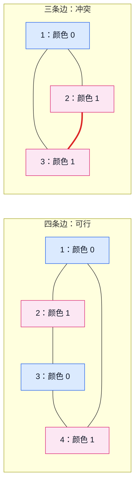
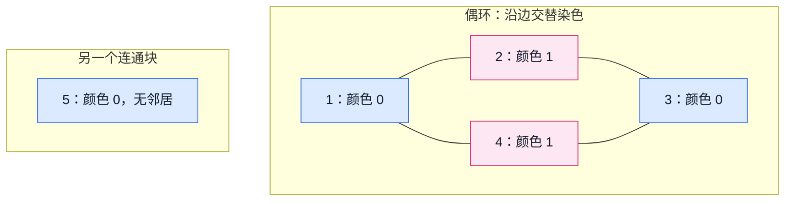

# 6.2 二分图染色与判定

## 1. 解决什么问题

给定一张无向图，能否把全部点分成两组，使**每条边的两个端点属于不同组**？

若可以，这张图就是二分图。两组内部都没有边，但不是要求两组之间任意两点都有边；没有边的点也可以归组。

> **“不能同组”的关系可以成为边。** 点代表对象，边代表两端必须分开的约束，再用两种颜色表示两组。

这里的“二分”是分成两个点集，与[二分答案](../02-sequence-techniques/06-binary-search-on-answer.md#1-解决什么问题)没有算法上的对应关系。

前置：[邻接表与图遍历](01-graph-basics.md#3-邻接表按起点存邻居)、[BFS](../03-search/02-bfs-shortest-path.md#3-队列与距离数组各做什么)。本节采用 C++11，沿用[竞赛基础框架](../../templates/cpp-contest-template/README.md)。

**点编号采用 1-based，颜色使用 `0、1`；颜色 `0` 不表示“未访问”。** 未染色另用 `-1` 表示。

## 2. 从分组变成沿边传播

设点 `u` 已染色。对于它的每个邻居 `v`，只有两种情况：

1. **`v` 未染色**：它必须取与 `u` 相反的颜色。
2. **`v` 已染色**：检查两端是否异色；同色表示当前约束发生冲突。

由于颜色只有 `0、1`，相反颜色可以写成：

$$
\mathrm{color}[v]=1-\mathrm{color}[u]
$$

某个连通块的起点可以任取一种颜色，例如 `0`。之后每条边都要求换色，沿路径就会持续传播约束。

**起点颜色没有特殊含义。** 将同一连通块全部颜色翻转，边的两端仍然异色。

不同连通块之间没有边，可以各自确定起点与颜色。

## 3. 奇环为什么产生矛盾

沿一条边换一次颜色：走偶数条边回到原颜色，走奇数条边变成相反颜色。

因此绕一圈回到同一个点时，若环有奇数条边，就会要求这个点同时取两种颜色。



右图从点 `1` 出发，它的两个邻居都只能取颜色 `1`；再检查点 `2、3` 之间的边时，就出现同色冲突。

> **无向图是二分图，当且仅当它不含奇环。** 有环未必失败，偶环可以合法染色；树和森林没有环，因此一定可以二染色。

实现时不必先枚举所有环，传播颜色并检查每条边即可。**失败的原因是约束矛盾，不是搜索顺序选得不好。**

## 4. 导引模型：给全部点分组

### 变量、容器与范围

- `g`：无向邻接表，外层长度为 `n+1`，下标 `0` 留空。每个邻居编号均在 `1..n`，每条输入边存两个方向。
- `color`：长度与 `g` 相同，`-1` 表示未染色，`0、1` 表示所属组；同时承担访问标记和约束状态两项职责。
- `s`：外层枚举的候选起点；只有尚未染色时，才从它启动一个新连通块。
- `q`：保存已染色、尚未扫描邻居的点，每点最多入队一次。
- `u、v`：当前出队点与它的某个邻居。`v` 是点编号，不是邻居列表下标。

容量按**点数和边数**分配，与颜色值只有两种没有关系。不能因为只有两组，就把 `color` 只开两个位置。

### 执行流程

1. 将所有点初始化为未染色。
2. 扫描 `1..n`，跳过已经染色的点。
3. 遇到未染色起点，设为颜色 `0` 并入队。
4. 出队一个点，检查它的全部邻居；未染色就取反色并入队，已染色就验证约束。
5. 发现同色边立即返回失败；本块队列耗尽后，继续寻找其他未染色点。
6. 所有点均处理完而没有冲突，返回成功及颜色方案。

## 5. 通用实现

可直接复用的接口与输入输出契约见[全图二染色模板](../../templates/bipartite-coloring/README.md#接口与约定)；下方保留理解颜色传播所需的教学实现。

输入前提：`g` 至少包含留空的下标 `0`，点数及外层长度可用 `int` 表示；

邻接关系无向且编号合法。允许孤立点、自环和重边；*自环必然判失败，重边不改变二染色可行性。

函数不修改图，调用时会**覆盖并重新初始化输出参数 `color`**。返回 `true` 时，`color[1..n]` 是完整合法方案；返回 `false` 时，可能只染了一部分点，这份状态不能当成合法分组输出。`color[0]` 始终不用。

```cpp
bool bipartite_color(const vector<vector<int>>& g, vector<int>& color) {
    int n = static_cast<int>(g.size()) - 1;
    color.assign(g.size(), -1); // 一次初始化，跨连通块保留已染颜色
    queue<int> q;

    for (int s = 1; s <= n; ++s) {
        if (color[s] != -1) continue;

        color[s] = 0; // 本块的两组可以整体翻转，起点任取 0
        q.push(s);

        while (!q.empty()) {
            int u = q.front();
            q.pop();

            for (int v : g[u]) {
                if (color[v] == -1) {
                    color[v] = 1 - color[u]; // 先染色，再入队，防止重复安排
                    q.push(v);
                } else if (color[v] == color[u]) {
                    return false; // 已染色点仍要检查，不能一律跳过
                }
            }
        }
    }

    return true;
}
```

### 为什么已访问点还要检查

[普通 BFS](01-graph-basics.md#5-在邻接表上做-bfs)遇到已经发现的点，可以跳过重复入队。本题不仅要遍历，还要验证每条边两端的颜色关系。

**已染色只说明不必再次入队，不说明这条边满足约束。** 若直接写成“已访问就 `continue`”，三角形中的冲突边也会被跳过。

也不能因为邻居已访问就判失败：无向边回到父节点，以及偶环中的再次相遇，都可能是合法的。判断依据始终是两端是否同色。

## 6. 小例子：偶环与孤立点

有 $5$ 个点，前四个组成环 $1-2-3-4-1$，点 $5$ 孤立。



图中只有四条无向边，点 `5` 不与环相连。**位置只帮助看清连接关系，颜色由边约束决定，与编号和画图位置无关。**

```cpp
vector<vector<int>> g = {
    {},         // 下标 0 留空
    {2, 4},     // 点 1 的邻居
    {1, 3},     // 点 2 的邻居
    {2, 4},     // 点 3 的邻居
    {1, 3},     // 点 4 的邻居
    {}          // 点 5 没有邻居
};

vector<int> color;
bool ok = bipartite_color(g, color);
// ok 为 true；color[1..5] 为 0、1、0、1、0
```

| 处理阶段 | 染色或检查行为 | 操作后的队列 |
| --- | --- | --- |
| 启动点 1 | 点 1 染 0 | 1 |
| 出队点 1 | 点 2、4 都染 1 | 2，4 |
| 出队点 2 | 点 1 异色；点 3 未染，染 0 | 4，3 |
| 出队点 4 | 点 1、3 都已染，但两条边均异色 | 3 |
| 出队点 3 | 点 2、4 均异色，本块完成 | 空 |
| 外层扫描到点 5 | 未染色，设为 0；出队后没有邻居 | 空 |

点 `5` 也要得到所属组，但它染 `0` 或 `1` 都不会违反任何边约束。函数选择 `0` 只是统一约定。

## 7. 为什么必须检查全部连通块

假设点 `1、2` 之间只有一条边，而点 `3、4、5` 组成三角形。

只从点 `1` 搜索，会顺利完成染色，却完全没检查到另一块中的奇环。因此全图判定需要外层扫描，不能沿用固定起点任务的范围。

> **跨连通块共享颜色数组，每个块只启动一次。** 不是每枚举一个点就重建整张状态表，否则会重复初始化或重复搜索。

这与上一节[重复初始化的复杂度问题](01-graph-basics.md#复杂度中的隐藏初始化)有关。此处 `color.assign` 只执行一次，各块接着使用已有状态。

也不能把所有点同时染成 `0` 入队：相邻点的颜色应由边约束传播决定。上一节森林把所有已知根同时入队，与这里寻找未染色连通块起点的条件不同。

## 8. 正确性、复杂度与适用边界

### 正确性

**返回成功时：** 所有点都已染色，每条边都在扫描邻居时检查过，两端异色，因此颜色 `0、1` 构成合法划分。

**发现冲突时：** 每个点的颜色由搜索树中到根的路径奇偶性决定。同色两点之间的树路径长度为偶数，再加上连接它们的冲突边，就得到奇环；自环则直接构成长度为 `1` 的矛盾。因此不存在合法二染色，翻转起点颜色也无法修复。

BFS 只是组织遍历的工具；DFS 也能传播相同约束。本节使用队列以避免长链造成递归过深，不需要额外保存距离，也不依赖最短距离数值作为答案。

### 复杂度

外层枚举全部点，每点最多入队一次，每条无向边检查两个方向：

$$
\text{时间}=O(n+m),\qquad \text{辅助空间}=O(n)
$$

算上图的存储，总空间为 $O(n+m)$。无需排序，邻居次序可以改变处理顺序，不改变是否可行。

### 易错边界

- **颜色 `0` 已经是有效状态。** 判断未染色必须用 `color[v] == -1`，不能用 `!color[v]`。
- **不要用点编号的奇偶性当颜色。** 编号没有关系语义，例如边 $(1,3)$ 的两个奇数端点也必须异色。
- **遇到冲突不能直接覆盖旧颜色。** 旧颜色已经参与其他边的约束，任意修改可能破坏之前的关系。
- **自环失败，重边可重复检查。** 孤立点合法；无边图也可二染色，除非具体题目另有组大小等要求。
- **需要按无向约束建图。** 本函数要求双向邻接记录，不能只存一个方向后原样套用。
- **新测试重新建图并初始化。** 同一测试的不同连通块共享颜色，独立调用则由函数重新初始化。
- **不是任意“分两组”都适用。** 同组/异组混合约束、额外人数限制，或需要选择最优划分时，还需分析新增条件。

## 9. 典题与复盘

### CF 687A — NP-Hard Problem

题目：[CF 687A NP-Hard Problem](https://codeforces.com/problemset/problem/687/A)。

- 无向图中，若一个点集包含每条边至少一个端点，就称它为点覆盖。要求找两个互不相交的点集，且两者各自都能覆盖全部边；允许部分点不分给任何一方。
- 范围：$2\le n\le10^5$，$1\le m\le10^5$，没有自环和重边；无解输出 `-1`，有解按要求输出两份点集。
- **练习目的**：从题面条件确定边两端的关系，落实全图检查与方案输出，不依赖题目标题猜难度或算法。

**收录原因：** 将文字中的双重要求合并成一条边约束；区分“没有约束的对象”与“不合法的对象”，并让输出统计与实际参与的状态一致。

**状态：复盘完成。** 原实现的平台 AC 依据本人反馈；原实现与下列整理实现另经本地核验，未独立查询平台提交。

#### 从题意得到模型

对任意一条边，第一份点覆盖必须包含至少一个端点，第二份也必须包含至少一个端点。两份点集不能相交，因此这条边的两个端点只能**各属于一份点集**。

于是“两份互不相交的点覆盖”转化为“每条边两端异色”，直接二染色。**孤立点没有边需要覆盖，可以不输出，也可以放进任意一组。**

#### 原实现：单独排除不输出的孤立点

以下保留原 AC 逻辑，只调整排版与注释。`-2` 表示本方案选择不输出该点，不能理解成图中的非法点。

```cpp
bool bfs(const vector<vector<int>>& g, vector<int>& color, int s) {
    queue<int> q;
    q.push(s);
    color[s] = 0; // 连通块可整体翻色，起点取 0 或 1 都可

    while (!q.empty()) {
        int u = q.front();
        q.pop();

        for (int v : g[u]) {
            if (color[v] == -1) {
                color[v] = 1 - color[u];
                q.push(v);
            } else if (color[u] == color[v]) {
                return false; // 不重复入队，但仍要检查边约束
            }
        }
    }

    return true;
}

void solve() {
    int n, m;
    cin >> n >> m;

    vector<vector<int>> g(n + 1);
    vector<bool> valid(n + 1); // 是否至少与一条边相连

    for (int i = 0; i < m; ++i) {
        int u, v;
        cin >> u >> v;

        g[u].push_back(v);
        g[v].push_back(u); // 无向边必须记录两个方向
        valid[u] = valid[v] = true;
    }

    vector<int> color(n + 1, -1);
    for (int i = 1; i <= n; ++i) {
        if (!valid[i]) color[i] = -2; // 孤立点合法，本方案不输出
    }

    for (int s = 1; s <= n; ++s) {
        if (color[s] != -1) continue;

        if (!bfs(g, color, s)) {
            cout << "-1\n";
            return;
        }
    }

    int c1 = 0, c0 = 0;
    for (int i = 1; i <= n; ++i) {
        c1 += (color[i] == 1);
        c0 += (color[i] == 0); // 排除了 -2，不能直接用 n - c1
    }

    cout << c1 << '\n';
    for (int i = 1; i <= n; ++i) {
        if (color[i] == 1) cout << i << ' ';
    }
    cout << '\n';

    cout << c0 << '\n';
    for (int i = 1; i <= n; ++i) {
        if (color[i] == 0) cout << i << ' ';
    }
    cout << '\n';
}
```

#### 两处踩坑

1. **无向图漏存反向边。** 外层按编号启动搜索时，若只能沿输入方向传播，本来连通的点可能被误当成另一块，任意设为 `0`，随后产生假冲突。例如只存 `2 → 1`，先从点 `1` 染 `0`，再从点 `2` 染 `0`，就会错误拒绝这条合法边。
2. **人数统计漏掉第三种状态。** 原实现结束后，所有点分成颜色 `0`、颜色 `1` 与不输出的 `-2` 三类。因此 `n - c1` 包含了孤立点；只有全部点都归入两组时，才能用总数减一组得到另一组。

> **补集计数的前提是分类完整、互斥且统计范围一致。** 新增排除状态后，先重新检查“总数”到底包括哪些对象。

#### 整理实现：全部染色，只收集与边相连的点

复用[通用染色函数](#5-通用实现)，先完成全图染色，再在收集输出时跳过孤立点。**是否参与输出与是否已经染色是两件事。** 邻接表为空就说明没有关联边，不必额外维护 `valid` 和 `-2`。

**点覆盖要求每条边至少有一个端点在集合中，不要求集合中的每个点都有边。** 加入孤立点仍然合法，但不会多覆盖任何边，本实现选择省略。

若要求“最小点集”，需要先明确最小化的对象：

- **两份点集的总人数最少：** 每个非孤立点都必须分给其中一方；**孤立点全部省略**即可达到最少总人数。
- **其中一份点集的人数最少：** 除了省略孤立点，还**应逐连通块选择较小色类放入这一份，另一色类放入另一份**；不能只比较全图两种颜色的总数。见下题[逐块取小的论证](#为什么逐块取小能得到全局最小)。

这里始终保留“两份互不相交且各自覆盖全部边”的要求；普通的单份最小点覆盖是另一个问题，不能直接套用较小色类的结论。

```cpp
// 复用本节 bipartite_color；点编号仍为 1-based，输出省略孤立点
void solve() {
    int n, m;
    cin >> n >> m;

    vector<vector<int>> g(n + 1);
    for (int i = 0; i < m; ++i) {
        int u, v;
        cin >> u >> v;
        g[u].push_back(v);
        g[v].push_back(u);
    }

    vector<int> color;
    if (!bipartite_color(g, color)) {
        cout << "-1\n";
        return;
    }

    vector<int> group[2];
    for (int i = 1; i <= n; ++i) {
        if (g[i].empty()) continue; // 孤立点无需覆盖边，不纳入输出
        group[color[i]].push_back(i);
    }

    for (int c = 1; c >= 0; --c) { // 与原实现一致，先输出颜色 1 的点集
        cout << group[c].size() << '\n'; // 数量直接来自实际输出容器
        for (int x : group[c]) cout << x << ' ';
        cout << '\n';
    }
}
```

原题第一组样例为边 `1—2、2—3`，点 `4` 孤立。本实现依次输出点集 `{2}` 和 `{1,3}`，与样例展示一致。

> **方案题应验证约束，不能只与样例输出逐字比较。** `{1,3,4}` 和 `{2}` 也互不相交，且两份均覆盖这两条边；原题样例说明明确允许将点 `4` 分给任意一方。省略它是更精简的选择，
>
> 并不是加入它会导致错误。

两版时间均为 $O(n+m)$，总空间均为 $O(n+m)$。整理版新增分组容器，但减少了特殊状态与独立计数；收益在于状态更少、输出数量自然一致，不是复杂度改善。

### 洛谷 P1330 — 封锁阳光大学

题目：[P1330 封锁阳光大学](https://www.luogu.com.cn/problem/P1330)。

- 在无向图的点上安排封锁，某点被封锁后，其相连道路都会被封锁；相邻两点不能同时安排封锁。求封锁全部道路的最少用量，无解输出 `Impossible`。
- 范围：$1\le n\le10^4$，$1\le m\le10^5$，题面保证没有重边。
- **练习目的**：同时处理合法性与数量目标，留意多个互不相连部分的关系。

**收录原因：** 区分“全图合法”与“全图最优”；识别互不影响的部分，将整体最小化拆成各部分独立选择，再累加贡献。

**状态：复盘完成。** 修正版的平台 AC 依据本人反馈；WA 关键错误已用反例复现，原 AC 与整理实现另经本地核验，未独立查询平台提交。

#### 从封锁道路到二染色

- 一条路必须被封锁：至少一个端点被选。
- 相邻点不能同时封锁：至多一个端点被选。
- 合并条件：**每条边恰好选择一个端点。** 用颜色表示选与不选，就是沿边取反。

若出现奇环则无解。若一个连通块可以二染色，确定其中一个点是否被选后，沿路径传播便确定整个块；翻转全块就得到另一种方案。

因此，该块只有“选全部颜色 `0`”和“选全部颜色 `1`”两种选择，取人数较少的一侧。

#### WA：把独立选择合并成一次全局选择

最初沿用上一题全图染色后的统计，关键错误是：

```cpp
// 错误片段：先合并所有连通块，再选全图较少的一种颜色
int c1 = 0, c0 = 0;
for (int i = 1; i <= n; ++i) {
    c1 += (color[i] == 1);
    c0 += (color[i] == 0);
}

cout << min(c1, c0) << '\n';
```

反例：

```text
6 4
1 2
1 3
4 5
5 6
```

按编号依次启动 BFS、起点染 `0`，得到：

| 连通块 | 颜色 0 | 颜色 1 | 本块最少选择 |
| --- | --- | --- | --- |
| 点 1、2、3 | 1 | 2、3 | 选点 1，共 1 个 |
| 点 4、5、6 | 4、6 | 5 | 选点 5，共 1 个 |
| 全图合并 | 3 个 | 3 个 | 全局取小错误得到 3 |

实际答案为 `2`。两块之间没有边，第一块选颜色 `0`、第二块选颜色 `1`，不会产生任何冲突。

**颜色编号只在本块内部区分两侧，没有“全图都必须选同一种颜色”的含义。**

设第 $i$ 块两侧人数分别为 $a_i,b_i$，正确答案为：

$$
\mathrm{ans}=\sum_i\min(a_i,b_i)
$$

而不是 $\min(\sum_i a_i,\sum_i b_i)$。后者额外限制了所有块统一选同一颜色，可能多选。

#### 原 AC：每个连通块内统计，返回本块贡献

以下保留修正后 AC 逻辑，只调整排版与注释。`color` 由全图共享，`cnt` 在每次 BFS 内重新建立，不能跨块累加后再取小。

```cpp
// 返回本块最少用量；-1 表示染色冲突，0 也可能是合法答案
int bfs(const vector<vector<int>>& g, vector<int>& color, int s) {
    queue<int> q;
    q.push(s);
    color[s] = 0;

    array<int, 2> cnt{};
    ++cnt[0]; // 起点也在本块中，不能只统计后来发现的邻居

    while (!q.empty()) {
        int u = q.front();
        q.pop();

        for (int v : g[u]) {
            if (color[v] == -1) {
                color[v] = 1 - color[u];
                ++cnt[color[v]]; // 首次染色时计数，避免重复统计
                q.push(v);
            } else if (color[u] == color[v]) {
                return -1;
            }
        }
    }

    return min(cnt[0], cnt[1]); // 本块可独立翻色，选人数少的一侧
}

void solve() {
    int n, m;
    cin >> n >> m;

    vector<vector<int>> g(n + 1);
    vector<bool> valid(n + 1);

    for (int i = 0; i < m; ++i) {
        int u, v;
        cin >> u >> v;
        g[u].push_back(v);
        g[v].push_back(u);
        valid[u] = valid[v] = true;
    }

    vector<int> color(n + 1, -1);
    for (int i = 1; i <= n; ++i) {
        if (!valid[i]) color[i] = -2; // 无路需要封锁，直接省略
    }

    int ans = 0;
    for (int s = 1; s <= n; ++s) {
        if (color[s] != -1) continue;

        int ret = bfs(g, color, s);
        if (ret == -1) {
            cout << "Impossible\n";
            return;
        }

        ans += ret;
    }

    cout << ans << '\n';
}
```

#### 整理实现：让孤立点自然贡献零

孤立点本身也是一个连通块，**染色后两侧人数为 `1、0`，较小侧恰好为 `0`。因此不必特判排除它**，复用上面的 `int bfs`，只简化 `solve()`：

```cpp
// 复用上一段按连通块计数的 int bfs，不是 CF 题的 bool bfs
void solve() {
    int n, m;
    cin >> n >> m;

    vector<vector<int>> g(n + 1);
    for (int i = 0; i < m; ++i) {
        int u, v;
        cin >> u >> v;
        g[u].push_back(v);
        g[v].push_back(u);
    }

    vector<int> color(n + 1, -1);
    int ans = 0;

    for (int s = 1; s <= n; ++s) {
        if (color[s] != -1) continue;

        int ret = bfs(g, color, s);
        if (ret == -1) { // 不能用 !ret：孤立点贡献 0，也属于成功
            cout << "Impossible\n";
            return;
        }

        ans += ret;
    }

    cout << ans << '\n';
}
```

**返回值含义随任务改变。** 上题 `bool bfs` 只回答是否合法；这里 `int bfs` 同时携带数量，`-1` 表示失败，非负数表示本块贡献。复用时必须重新核对契约，不能只改输出语句。

#### 为什么逐块取小能得到全局最小

每个合法连通块都必须完整选择其中一侧，所以任何方案在该块至少使用 $\min(a_i,b_i)$ 个点。各块之间没有边，分别取较小侧可以同时实现所有下界，因此累加就是全局最优。

这一步依赖**选择之间没有跨块约束，且目标是各块用量之和**。若新增“某组总人数必须恰好为某值”等条件，各块选择就会互相牵制，不能直接逐块取小。

两版时间均为 $O(n+m)$，总空间均为 $O(n+m)$。整理版不提高渐进复杂度，而是用统一模型覆盖孤立点，省去额外标记、特殊颜色与预处理。

> **题目线索 → 模型 → 选择：** 每条道路恰有一个端点被选 → 二染色检查可行性 → 连通块可以独立翻色 → 每块取较小侧并累加。

## 10. 自查与衔接

- 已染色邻居为什么仍要检查？无向边返回父节点时会不会误判？
- 若第一个连通块合法、第二个连通块含奇环，只从点 `1` 开始会发生什么？
- 将整个连通块的 `0、1` 对调，为什么仍合法？点编号奇偶性与颜色有没有必然关系？

两题分别要求输出合法划分、逐块选择较小侧。自查：孤立点为什么合法？两题中为什么分别可以归组、贡献零？为什么不能先合并全部块再取小？

本节建立二分图的判定、合法划分与连通块独立选择。**二分图最大匹配是另一个问题**：在边之间挑选互不共用端点的尽量多配对，后续再学。

本节代表题已完成复盘，后续按基础轮路线进入 [4.1 排序贪心与交换论证](../04-greedy-and-construction/01-sorting-greedy.md)；图的其他算法在相应前置齐备后继续整理。

进一步阅读：[CP-Algorithms · Bipartite Graph Check](https://cp-algorithms.com/graph/bipartite-check.html)。
