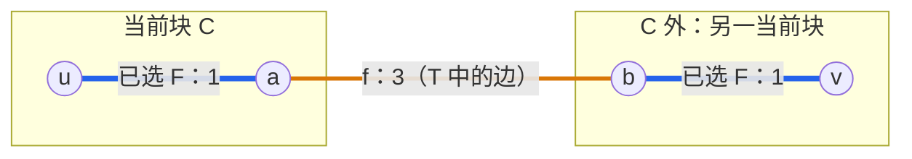
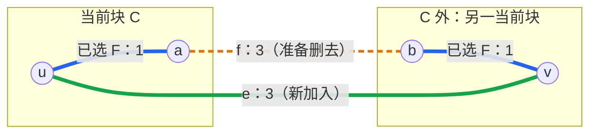
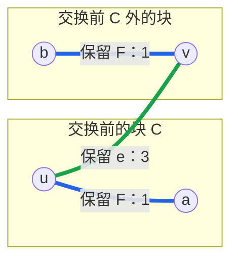
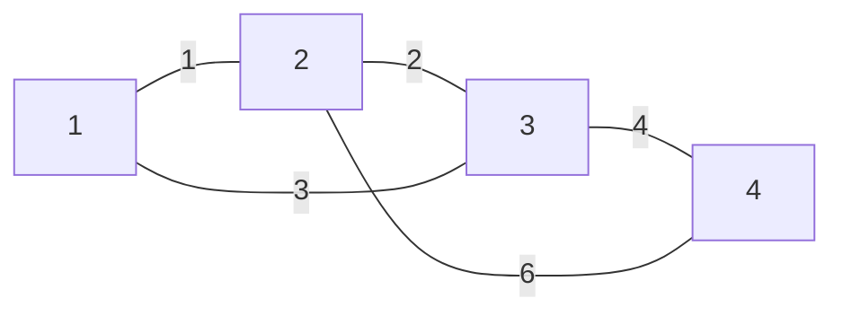

# 6.3 最小生成树与 Kruskal

前置：[图的表示与基本模型](01-graph-basics.md)、[并查集主写法](../09-data-structures/01-dsu.md#5-c11-主写法)、[贪心与交换论证](../04-greedy-and-construction/01-sorting-greedy.md)。

> **在所有点必须连通的前提下，选择一棵总边权最小的树。** Kruskal 负责按代价考虑边，并查集负责判断这条边能否连接两个不同的块。

## 1. 解决什么问题

给定一个**无向带权图**，有 $n$ 个点、$m$ 条候选边。每条边连接两个点，并有一个代价。

需要从原图中选出若干条边，满足：

- **包含所有点**，不能只连接其中一部分。
- **连通且无环**，即形成一棵树。
- 在满足前两项的方案中，**所选边权之和最小**。

这样的树叫作**最小生成树**，简称 MST。连通图至少有一棵生成树；**不连通图没有覆盖全部点的生成树**。

### 为什么恰好选 n - 1 条边

一开始有 $n$ 个独立的点。每次连接两个不同的连通块，块数恰好减少 1，也不会形成环。

连接成一块需要成功合并 $n-1$ 次，因此选出 $n-1$ 条边。

**仅仅凑够边数并不够。** 若允许成环，可能有些点仍被留在外面；这里还依赖“每次都连接两个不同块”的保证。

### 与最短路区别在哪

| 目标 | 最小生成树 | 最短路 |
| --- | --- | --- |
| 优化什么 | 连接全部点的树，总边权最小 | 指定起点到目标的路径长度最小 |
| 是否依赖起点 | 不需要起点 | 通常需要指定起点 |
| 输出的距离是否逐点最短 | 不保证 | 按目标保证相应最短距离 |

例如三角形的边权为：$w(1,2)=2$、$w(2,3)=2$、$w(1,3)=3$。

最小生成树选择前两条，总权重为 4，但其中从 1 到 3 要走 4；原图直接走第三条只需 3。

**“修路的总造价最少”与“从某地出发走得最短”是两个目标。** 带权最短路留到后续专题，不能用生成树代替。

## 2. 从便宜边入手，但不能成环

直觉是先选便宜的边。问题在于：最便宜的几条边可能围成一个环，没有连到剩下的点。

因此规则是：

1. 将**全部候选边按权重从小到大排序**。
2. 依次考虑边 $(u,v)$，若两端目前不连通，就选入并合并两块。
3. 若两端已连通，这条边会形成环，跳过。
4. 成功选择 $n-1$ 条边后结束；边用完仍未连通，则不存在生成树。

这就是 **Kruskal：全局排序 + 不成环地合并**。

> **判断的是“当前已选边形成的图”是否连通，不是原图是否存在路径。** 原图若连通，并不意味着一开始就应把所有点合成一组。

并查集正好保存当前已选边形成的连通块。`unite(u, v)` 返回 `true` 时，才说明这条边确实连接了两块，应该计入答案。

## 3. 为什么这次选择不会吃亏

“便宜且不成环”说明了规则，还需要证明：当前选入的边不会破坏最优解。

### 先把一块与外面分开

假设原图连通。设已经选出的边为 $F$，并且**存在一棵最小生成树 $T$，包含 $F$ 中的全部边**。开始时 $F$ 为空，这显然成立。

现在考虑下一条可以选入的边 $e=(u,v)$，令 $C$ 是当前包含 $u$ 的连通块。因为两端不同块，$v$ 在 $C$ 外。

**先用同一个四点例子看清这些符号：** 原图有 $u-a$、$b-v$ 两条权重为 1 的边，还有 $a-b$、$u-v$ 两条权重为 3 的边。

- 已选集合 $F$：$u-a$ 和 $b-v$，因此当前是**两块**。
- 当前块 $C$：只包含 $u,a$；另一块包含 $b,v$。
- 准备选入的边 $e$：$u-v$，权重为 3。
- 用来对照的最优树 $T$：已经包含 $F$，但选的是 $a-b$，还没有选 $e$。

**图①：先看最优树 T。** 蓝色粗线是此前已选的 $F$；橙色的 $f$ 也是 $T$ 中的边，但尚未被当前算法选入。框表示由 $F$ 形成的当前两块，不是 $T$ 的连通块。



这棵 $T$ 已经通过 $f$ 连通全部四点，总权重为 $1+3+1=5$。**当前算法还只选了两条蓝边，所以仍有两块**；不能把对照用的完整最优树当作当前已选状态。

回到一般情况，**$e$ 是连接 $C$ 内外的最便宜边之一。**

1. 如果还有一条更便宜的跨块边，它早就被处理过了；
2. 它的两端现在都还不同块，当时更不可能同块，因此早该被选入、把两边合起来。这与当前 $C$ 的划分矛盾。

### 把最优树中的一条边换掉

若 $T$ 已经包含 $e$，直接保留即可。否则：

1. 在 $T$ 中加入 $e$，会产生一个环：原来的 $u$ 到 $v$ 路径加上 $e$。
2. 这条路径从 $C$ 内走到外面，必然经过另一条跨越 $C$ 边界的边 $f$。
3. 因为 $e$ 是最便宜的跨块边之一，所以 $w(e)\le w(f)$。
4. 删除 $f$，环被打断，但所有点仍连通，重新得到一棵生成树。
5. **$f$ 不在已选集合 $F$ 中**，因为 $F$ 中的边不会跨越它自己形成的连通块边界。因此之前的选择全部保留。

**图②：给 T 加入 e，出现一个环。** 绿色边是新加入的 $e$；原来从 $u$ 到 $v$ 的路径为 $u\to a\to b\to v$，现在再接上 $v\to u$，形成环。



从 $C$ 内的 $u$ 沿旧路径走向外面的 $v$，一定要跨出框；这里跨出的边就是 $f=a-b$。**删除它不会删掉蓝色的已选边，而且环上的另一侧仍能把两端接起来。**

**图③：删掉 f，得到包含 e 的最优树 T′。** 此时所有点仍连通，环消失，两条蓝边都保留；$u$ 到 $v$ 直接使用 $e$，其余点通过蓝边接入。



> **框在三张图中固定不变，用来比较交换前的两块。** 算法真正选入 $e$ 后，它们在并查集中就合成了一块。

例子特意让 $w(e)=w(f)=3$：**最优树可以有多棵，交换后仍为最优。** 一般推理只需证明 $w(e)\le w(f)$；若真能严格降低权重，就说明原来的 $T$ 本来不是最优树，与假设矛盾。

替换后的总权重为：

$$
w(T')=w(T)-w(f)+w(e)\le w(T).
$$

$T$ 本来已经最优，所以 $T'$ 也最优，并且包含 $F$ 与新选入的 $e$。

**每一步都还能找到一棵包含当前全部选择的最优树。** 因此选择完成时，得到的就是最小生成树；不是必须猜中某一棵预先固定的最优树。

### 怎么想到这个证明

贪心选了一条边，就尝试把它放进最优方案，观察破坏了什么：

**加入一条边 → 多出一个环 → 从环里删掉一条不更便宜的边 → 连通性与最优性都保留。**

把一块与外面分开，通常称为一个**割**。这里对应割性质的安全选边思想，参考 [MIT 最小生成树讲义](https://ocw.mit.edu/courses/6-046j-design-and-analysis-of-algorithms-spring-2012/6baf48ebe3babed294c31a907a916e08_MIT6_046JS12_lec03.pdf)。重点是会说明替换后的合法性、代价及已选边为何都能保留。

## 4. 变量、容器与执行流程

### 变量各自保存什么

点编号采用 **1-based：`1..n`**；边在 `vector` 中按 **0-based** 存放，两者不要混淆。

| 变量 | 含义与容量依据 |
| --- | --- |
| `n`、`m` | 点数、输入边数；不是点编号或权重的最大值 |
| `Edge {u, v, w}` | 一条无向候选边的两端和边权 |
| `edges` | 保存 `m` 条边；按**边的记录数量**分配，不按权重分配 |
| `dsu` | 保存已选边形成的连通块；内部数组为 `n + 1`，0 占位 |
| `used` | 已成功选择的边数，初始为 0 |
| `weight` | 已选边权之和，初始为 0，使用 `ll` |

**无向边在边表里存一次即可。** 邻接表需要双向加入，是为了从两端都能遍历；本算法只需把这条候选边考虑一次。

权重可以为 0，也可以为负；相同权重不需要额外按端点排序。权重相同时，选出的具体树可能不同，但最优总权重相同。

### 执行顺序

1. 输入 `n`、`m` 和每条边的两端、权重，建立边表。
2. 按 `w` 升序排序，建立一个全新的 `DSU(n)`。
3. 扫描候选边，尝试 `unite`；失败则不改变选边数和总权重。
4. 合并成功才累加 `w`，并让 `used` 加一。
5. `used == n - 1` 时完成；否则边表扫描结束后判定失败。

**同一时刻始终有：**

$$
\mathrm{used}+\mathrm{components}=n.
$$

两者只是记录同一次成功合并的不同侧面，无需另外遍历图检查连通性。

## 5. C++11 主写法

下面保留按值传参的教学实现，复用[并查集 `DSU`](../09-data-structures/01-dsu.md#5-c11-主写法)，将其定义放在函数之前。沿用[竞赛基础框架](../../templates/cpp-contest-template/README.md)与 `using ll = long long;`。

实际复用优先使用 [Kruskal 竞赛模板](../../templates/kruskal/README.md)：采用原地排序，支持目标块数 `k`，不复制边表；与下方教学代码的接口差异见[典题复盘](#83-推荐竞赛主版本)。

**契约：** $1\le n\le10^6$，边端点均在 `1..n`，边数可用 `int` 表示；边权及累加过程均可用 `ll` 表示。

```cpp
struct Edge {
    int u;
    int v;
    ll w;
};

struct MSTResult {
    ll weight; // 已选边的权重和；失败时不能当作整图 MST 答案
    int used;  // 成功选入多少条边，用它判断是否覆盖全部点
};

// 按值传入边表：内部排序，不改变调用者的原始顺序
MSTResult kruskal(int n, vector<Edge> edges) {
    sort(edges.begin(), edges.end(), [](const Edge& a, const Edge& b) {
        return a.w < b.w; // 相同权重无需再比较端点
    });

    DSU dsu(n); // 每次调用重新初始化，各点最初单独一组
    MSTResult res{0, 0};

    for (const auto& e : edges) {
        if (res.used == n - 1) break; // 包括 n == 1 时无需选边

        if (!dsu.unite(e.u, e.v))
            continue; // 已经同块，选入会成环；自环也在这里跳过

        res.weight += e.w; // 只有合并成功，才计入这条原图边
        ++res.used;
    }

    return res; // 调用者检查 used == n - 1，不能只看 weight
}
```

返回值不使用 `-1` 表示失败，因为**负权图的合法答案也可能是 `-1`**。用 `used` 独立判断，权重与可行性不混在一起。

本函数只返回权重和选边数。若题目要求输出具体方案，可在合并成功时另外保存 `e`；**不能把并查集的 `parent` 当成所选树边**，它只是内部合并关系。

按值传参会复制边表，代价为 $O(m)$。这样调用后原表不变；若允许原地排序，也可改为引用传参，并说明副作用。

## 6. 小例子：成环的便宜边也要跳过

下图的点编号是 1–4，线上数字是边权，全部为无向边：



| 考虑的边 | 选入前两端关系 | 行为 | used | components | weight |
| --- | --- | --- | --- | --- | --- |
| 初始 | 各点独立 | 未选边 | 0 | 4 | 0 |
| 1–2，权重 1 | 不同块 | 合并 | 1 | 3 | 1 |
| 2–3，权重 2 | 不同块 | 合并 | 2 | 2 | 3 |
| 1–3，权重 3 | 已同块 | 跳过，避免成环 | 2 | 2 | 3 |
| 3–4，权重 4 | 不同块 | 合并，完成 | 3 | 1 | 7 |

权重 6 的边不必继续处理。**不是选排序后的前三条边，而是选前三条能够成功合并的边。**

## 7. 复杂度与易错边界

- 初始化并查集：$O(n)$。
- 边排序：$O(m\log(m+1))$。
- 至多尝试 $m$ 次合并：均摊 $O(m\alpha(n))$。

合计为 $O(n+m\log(m+1)+m\alpha(n))$，通常由排序主导。写成 `log(m+1)` 是为了覆盖 `m = 0`；有重边时，直接保留按边数计算的排序复杂度。

额外空间为 $O(n+m)$，包括并查集与边表副本。

| 情况 | 处理与原因 |
| --- | --- |
| `n = 1` | 不用选边，权重为 0；单点本身就是树 |
| 多点但没有边，或边不足以连接全图 | `used < n - 1`，必须报告无生成树 |
| 自环 | 两端同根，不计入答案 |
| 重边 | 可以全部保留；按权重排序，后续同块边自然跳过 |
| 重复权重 | 不影响最优权重，具体方案可能不唯一 |
| 总权重较大 | 边权和累加都用 `ll`，还需核对题目范围 |
| 多测 | 每次重新读入边表并构造并查集，不沿用上一组状态 |

若原图不连通，扫描全部候选边后得到的是**每个原连通块内的最小生成树，合起来叫最小生成森林**；这不能充当“连接全部点”的成功答案。

**Prim** 也能求最小生成树：它从一个点出发，不断扩展当前连通部分；Kruskal 则允许多个块同时形成，再逐步合并。本节先熟悉适合边表输入的 Kruskal，不同时增加第二份实现；完整图算法选型留到章末。

## 8. 典题与复盘

两题已提供实际实现，**本地核验通过，平台结果未单独记录**。以下只调整代码排版和说明性注释，不改变原选边逻辑；通用框架不重复展示。

两题共用第 9.1 节的双数组 DSU。原稿额外保留的 `same` 越界检查并不完整，而且与 `size()` 比较会产生符号警告，见[既有说明](../09-data-structures/01-dsu.md#9-典题与复盘)。**这两题只调用合法编号的 `unite`，不使用 `same`，不因此判原解错误。**

### 8.1 洛谷 P3366：【模板】最小生成树

[题目链接](https://www.luogu.com.cn/problem/P3366)。

无向图求最小生成树总权重；不连通时输出 `orz`。规模为 $1\le n\le5000$、$1\le m\le2\times10^5$、边权 $1\le w\le10^4$。

**收录原因：** 把连通性维护嵌入贪心选择，用成功合并次数同时约束结构与判断完成；可行性与代价分别保存。

#### 原实现：成功合并才计入答案

```cpp
// 两题共用；DSU 定义复用 9.1 节，点编号为 1-based
struct Edge {
    int u;
    int v;
    ll w;
};

struct MSTRes {
    int used;
    ll w;
};

MSTRes kk(int n, vector<Edge>& edges) {
    sort(edges.begin(), edges.end(), [](const Edge& a, const Edge& b) {
        return a.w < b.w;
    });

    DSU d(n);
    MSTRes r{0, 0};

    for (auto& e : edges) {
        if (r.used == n - 1) break;

        if (!d.unite(e.u, e.v))
            continue; // 已同块就不选，也不能累加权重

        r.w += e.w;
        ++r.used;
    }

    return r;
}

void solve() {
    int n, m;
    cin >> n >> m;

    vector<Edge> edges(m);
    for (auto& e : edges)
        cin >> e.u >> e.v >> e.w;

    auto r = kk(n, edges);
    if (r.used != n - 1) {
        cout << "orz";
    } else {
        cout << r.w;
    }
}
```

`unite` 同时完成“是否已连通”的检查和真正合并，不需要先调用一次 `same`。

**结束条件与成功条件是两件事：** 达到 `n-1` 条边可以提前结束，但也可能因为候选边用完而退出。因此循环结束后仍须检查 `r.used`，不能直接输出当前权重。

原实现已合适，不强造第二种算法。它按引用传入，原地排序，不复制边表；与第 5 节按值接收的教学实现相比，节省一份 $O(m)$ 副本，但会改变原表顺序。

时间 $O(n+m\log(m+1)+m\alpha(n))$；包含输入边表的总空间为 $O(n+m)$。权重累加使用 `ll`，计数与编号使用 `int`。

### 8.2 洛谷 P1195：口袋的天空

[题目链接](https://www.luogu.com.cn/problem/P1195)。

要求将全部点连成恰好 $k$ 个非空块，代价最小；无法做到时输出 `No Answer`。规模为 $n\le1000$、$m\le10^4$、$1\le k\le10$，费用非负。

**收录原因：** 从最终结构反推需要的有效操作数；目标改变时重审终止与可行条件，而不是重写整套算法。

#### 从一块推广到 k 块：恰好需要 n-k 条边

初始有 $n$ 块，每成功加入一条连接不同块的边，块数减少 1。选入 $t$ 条边后：

$$
\mathrm{components}=n-t.
$$

要求最终恰好为 $k$ 块，则：

$$
n-t=k\quad\Longrightarrow\quad t=n-k.
$$

**森林的 n-k 条边，来自每次都连接不同块；不是任意选 n-k 条边就够。** 若选出了环，部分边并未减少块数，这个推导就不成立。

例如 `n=5,k=2`，成功合并过程为：

| 成功选边数 | 0 | 1 | 2 | 3 |
| --- | --- | --- | --- | --- |
| 连通块数 | 5 | 4 | 3 | 2 |

因此以下两种成功条件等价：

- `d.components == k`。
- `r.used == n-k`。

**原实现循环内看前者，返回后看后者，是同一个不变量的两种表达。**

#### 为什么提前停在 k 块仍然最优

不只是选边数变了，还需确认贪心仍适用。设 $F$ 是已选边，$S$ 是包含 $F$ 的最优目标森林，共有 $n-k$ 条边。

当前边 $e$ 是还能连接不同块的最便宜候选。若 $S$ 不包含它：

1. **加入后成环：** 从环中删除一条不属于 $F$ 的边 $f$。
2. **加入后未成环：** 它连接了 $S$ 的两棵树；再删除任意一条 $S$ 中不属于 $F$ 的边 $f$，块数便恢复为 $k$。尚未达到目标，所以这样的边存在。

由于 $S$ 是包含 $F$ 的森林，**$S$ 中任何不属于 $F$ 的边，都不可能把同一个 $F$ 连通块内部再接一次，否则会成环**。因此 $f$ 原本也是有效候选，$w(e)\le w(f)$。

替换保留全部 $F$、仍有 $n-k$ 条边且无环，代价不增加。这样每步都能保留一个最优目标森林，选够 `n-k` 条即可停止。

本题费用非负，即使允许额外连线，也能删去环上的多余边而不增加费用，所以可以只考虑森林。

#### 原实现：根据连通块数停止

共用上一题的 `Edge`、`MSTRes` 与双数组 DSU。

```cpp
MSTRes kk(int n, int k, vector<Edge>& edges) {
    sort(edges.begin(), edges.end(), [](const Edge& a, const Edge& b) {
        return a.w < b.w;
    });

    DSU d(n);
    MSTRes r{0, 0};
    vector<bool> used(n + 1); // 原稿保留：后续没有使用，不影响选边

    for (auto& e : edges) {
        if (d.components == k) break; // 目标已有 k 块，不再继续连边

        if (d.unite(e.u, e.v)) {
            r.w += e.w;
            ++r.used;
        }
    }

    return r;
}

void solve() {
    int n, m, k;
    cin >> n >> m >> k;

    vector<Edge> edges(m);
    for (auto& e : edges)
        cin >> e.u >> e.v >> e.w;

    auto r = kk(n, k, edges);
    if (r.used != n - k) {
        cout << "No Answer\n";
    } else {
        cout << r.w << '\n';
    }
}
```

`vector<bool> used` 与结果里的 `r.used` 是不同对象：前者未参与计算，可以删去；后者统计成功选边数，必须保留。竞赛模板不再创建这个无用数组。

若把原图能用的边都连上，最终仍有 $c$ 个连通块：

- `c>k`：已有边不够，无法实现。
- `c<=k<=n`：只选择必要的边即可形成 $k$ 块。
- `k=n`：每个点各自一块，选 0 条边，答案为 0。
- `k>n`：不可能形成比点数更多的非空块；原实现最终也会因 `n-k<0` 判失败。

时间复杂度与上一题相同。提前停止减少部分扫描，但仍要排序全部候选边，不因此改变排序复杂度。

**本地核验：** 两份原实现的选边数和代价均与小图枚举结果一致，覆盖重边、自环、不连通、零费用、单点、`k=n` 及 `k>n` 等边界，并核验大规模输入。保留原稿 `same` 后，两份程序各有两条符号比较警告，原因见本节开头；推荐模板无此警告。本地通过不补记平台 AC。

### 8.3 推荐竞赛主版本

可复用实现分别放在 [DSU](../../templates/dsu/README.md) 与 [Kruskal](../../templates/kruskal/README.md)，主代码按固定版本的 ei1333/library 适配，并记录来源与变更。

- **并查集：** 用一个负值数组合并父指针与根处大小，保留 `bool unite` 和 `components`；比双数组版少一份数组，但必须理解正负值的两种含义。
- **Kruskal：** 一个入口支持目标 `k`，默认 `k=1`；保留原地排序，只在合并成功后计数。
- **完成判定：** 检查 `res.used == n-k`。失败时当前权重只是已选部分的代价，不能输出成成功答案。
- **不改变原解历史：** 原稿的 `MSTRes::w` 与模板的 `MSTResult::weight` 命名不同；原函数、双数组 DSU 及其不足均留在各自复盘中。

**如何想到这次推广：** 一开始有 $n$ 个对象 → 每次有效连线只减少一块 → 先反推需要几次成功合并 → 按最便宜且不成环的顺序完成这些合并。

## 9. 自查与后续

1. “原图中可达”与“当前已选边中可达”有什么区别？为什么要用后者判断能否选边？
2. 为什么同根就要跳过，而不是只检查两个端点此前是否出现过？
3. 交换证明中，为什么删掉的 $f$ 不会破坏之前已经选出的边？
4. 函数返回一个负权重时，怎样区分合法答案与未连通？

完成两题及复盘后，再衔接带权最短路；不能将最小生成树正文完成当成图与树整章完成。
