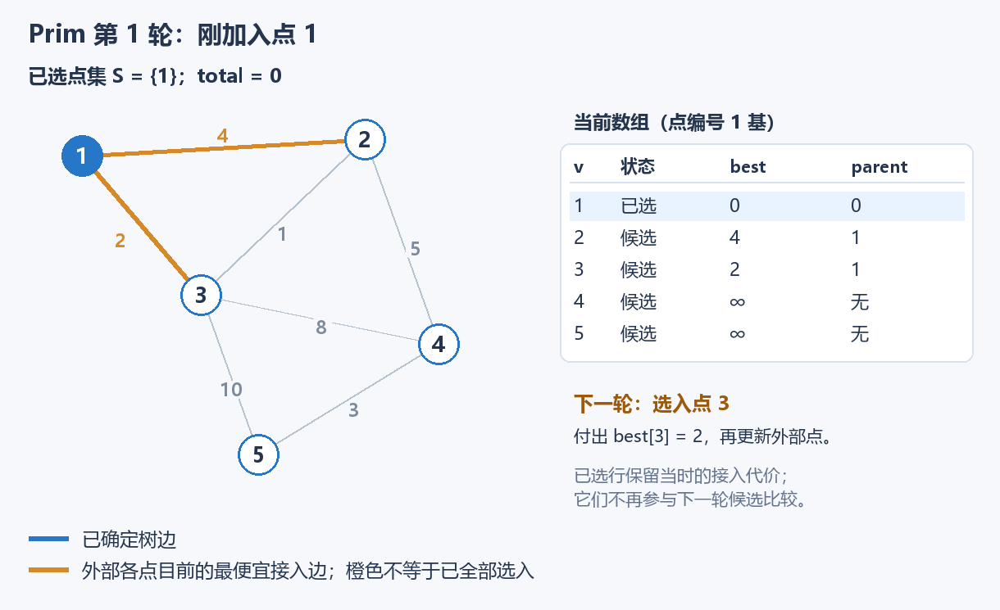
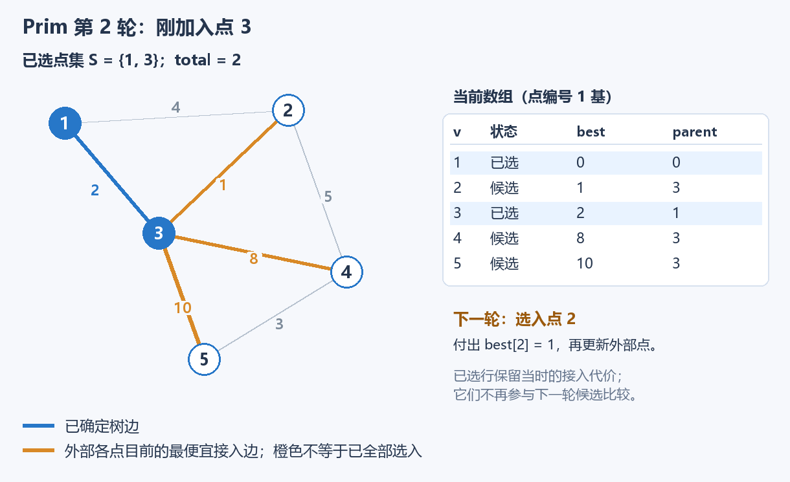
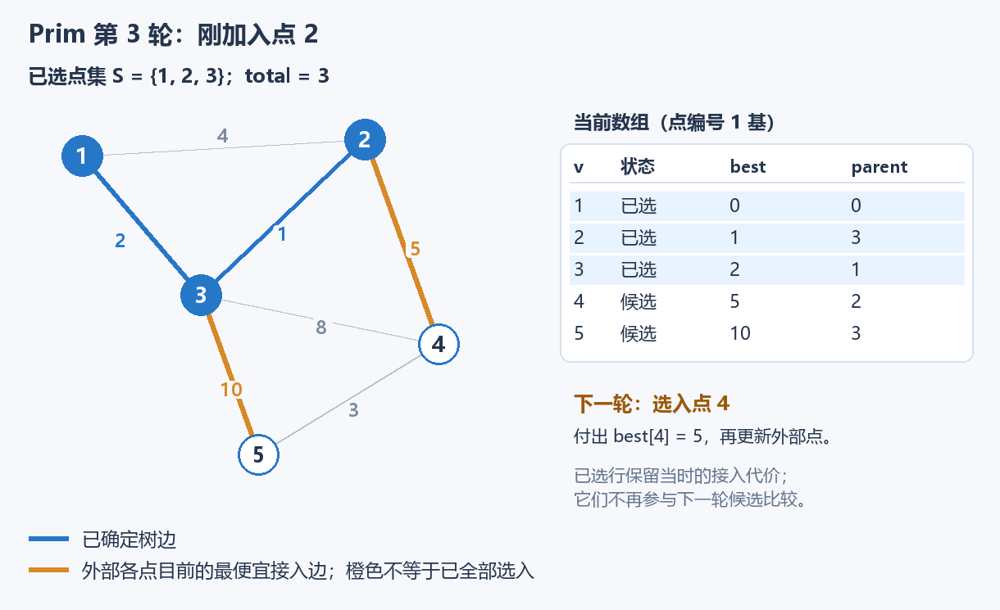
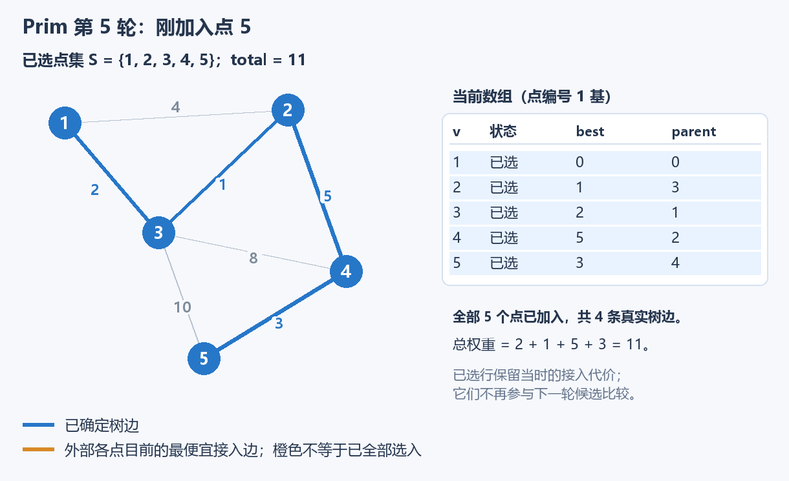

# 6.3 补充：Prim 与最小生成树选型

前置：[最小生成树与 Kruskal](03-kruskal-mst.md)、[邻接矩阵](01-graph-basics.md)。这里仍求**连接全部点、边权总和最小的生成树**，换一种组织选边的方式。

## 1. 为什么还需要 Prim？

Kruskal 已经能解决最小生成树：把边排序，用并查集逐条合并。若题目直接给出一张很密的邻接矩阵，就需要先把接近 $n^2$ 条候选边转成边表，再排序。

**不是 Kruskal 不能做，而是可以利用“已经连成一块”的信息，省掉全局边排序。**

Prim 从任意一个点开始，只维护一棵逐渐变大的树。每轮选择**从已选点集连向外部的最便宜边**，把它连接的新点加入，再更新外部各点的接入代价。

下面主讲 $O(n^2)$ 的矩阵写法；稀疏边表继续优先考虑已有 Kruskal，最后统一比较选择依据。

## 2. 先给代码：每轮接入一个新点

图和点编号采用 **1-based**。`w[u][v]` 是无向边权，矩阵必须对称；没有边写 `PRIM_INF`，**0 可以是合法边权**。`n>=1`，起点 s 合法。

```cpp
using ll = long long;
const ll PRIM_INF = LLONG_MAX / 4;

struct PrimResult {
    bool ok;            // 是否成功生成最小生成树（原图是否连通）
    ll weight;          // 最小生成树的总权值
    vector<int> parent; // MST 中每个节点的父节点，根节点的父节点为 0
};

// Prim 稠密图版本：邻接矩阵存图，时间复杂度 O(n^2)。
// w[u][v] 表示边权；不存在的边用 PRIM_INF 表示。
PrimResult prim_dense(const vector<vector<ll>>& w, int s = 1) {
    int n = (int)w.size() - 1;

    vector<ll> best(n + 1, PRIM_INF); // best[v]：当前 MST 到未加入节点 v 的最小连接边权
    vector<int> parent(n + 1, -1);    // parent[v]：取得 best[v] 的边所连接的 MST 内节点
    vector<bool> in(n + 1, false);    // in[v]：节点 v 是否已经加入 MST

    best[s] = 0;  // 起点直接加入，不代表选择了一条权重为 0 的真实边。
    parent[s] = 0;
    ll total = 0;

    // 每轮选择一个尚未加入 MST、且连接代价最小的节点。
    for (int step = 0; step < n; ++step) {
        int u = -1;

        for (int v = 1; v <= n; ++v) {
            if (!in[v] && (u == -1 || best[v] < best[u]))
                u = v;
        }

        // 最小连接代价仍为 INF，说明剩余节点无法接入当前 MST。
        if (u == -1 || best[u] == PRIM_INF)
            return {false, 0, {}};

        // 将 u 正式加入 MST，并累计其连接边权。
        in[u] = true;
        total += best[u];

        // 利用 u 更新其他未加入节点的最小连接代价。
        for (int v = 1; v <= n; ++v) {
            if (!in[v] && w[u][v] < best[v]) {
                best[v] = w[u][v];
                parent[v] = u;
            }
        }
    }

    return {true, total, parent};
}
```

**用途速记：** 输入无向带权邻接矩阵，得到是否存在生成树、最小总权重，以及一棵最小生成树的父节点。它每轮选一条跨出当前点集的最便宜边，不需要并查集，也不进行全局排序。

| 变量 | 保存什么 | 怎样使用 |
| --- | --- | --- |
| `in[v]` | 点 v 是否已经加入当前树 | 已加入的点不再重复选择 |
| `best[v]` | 未选点 v 与**整个已选点集之间**最小的一条边权 | 本轮以它比较哪个点最便宜；不是根到 v 的路径长度 |
| `parent[v]` | 这条最便宜接入边的已选端点 | v 真正加入时，确定边 `parent[v]—v` |
| `u` | 本轮要加入的未选点 | 扫描全部未选点，取 best 最小者 |
| `total` | 已经选定的真实边权之和 | 每个新点只计入一次接入代价，起点贡献 0 |
| `step` | 已经进行到第几次选点 | 共选 n 个点，其中只有 n−1 条真实接入边 |

每个辅助数组都开 `n+1` 项，0 号仅作起点父节点的标记。矩阵占 $(n+1)^2$ 项，算法不会修改它。

## 3. 跟着同一张图看 best 怎样变化

以下 `∞` 表示没有找到接入边；蓝色表示已选树边，橙色表示外部各点**目前最便宜的接入边**，橙边尚未全部选入答案。

### 第一步：选入起点 1



点 2 可以花 4 接入，点 3 可以花 2 接入。点 4、5 还没有直连当前树的边。下一轮选择 3，因为其 `best[3]=2` 最小。

### 第二步：树里已有 1、3



现在点 2 可以通过 3 接入，代价从 4 降到 1；点 4、5 也有了候选。**更新要看新点 u 能否给外部 v 提供更便宜的接入边，不要求 v 接在上一轮加入的点后面。**

### 第三步：树里已有 1、3、2



点 4 的接入代价从 8 降到 5，父节点也从 3 改成 2。此后选入 4，又把点 5 的接入代价从 10 降到 3，最后选入 5。

### 最终结果与整轮记录



| 选入顺序 | 本次确定的边 | 本次计入代价 | 累计 total |
| --- | --- | --- | --- |
| 1 | 起点，无真实边 | 0 | 0 |
| 3 | 1—3 | 2 | 2 |
| 2 | 3—2 | 1 | 3 |
| 4 | 2—4 | 5 | 8 |
| 5 | 4—5 | 3 | 11 |

**尚未选入的点，best 和 parent 可以继续改变；点一旦加入，接入边就确定。** 已选点保留的 best 是当时付过的代价，后续不再拿它参与候选比较。

## 4. 更新只取边权，为什么就够了？

代码对应：

```cpp
best[v] = min(best[v], w[u][v]);
```

**旧的 `best[v]` 已经考虑了此前所有已选点；本轮只新加入 u，因此只要再比较一次 `w[u][v]`，就覆盖了新的整个点集。**

把已选点集记作 $S$，正常扩展阶段对每个外部点维护：

$$
\mathrm{best}[v]=\min_{x\in S}w(x,v).
$$

再从所有未选点的 best 中取最小，就等价于从**所有一端在 S、一端在外部的边**中取最便宜的一条：

$$
\min_{v\notin S}\mathrm{best}[v]
=\min_{x\in S,\ v\notin S}w(x,v).
$$

**起点的 `best[s]=0` 只是启动特例。** 选入起点并扫描它的边后，上述状态才开始适用于其余外部点。

### 为什么这条边可以安全加入？

**S 把图分成已选和未选两侧，新边 e 是跨两侧的最轻边。**若某棵包含此前已选边的最优树没有 e，加入 e 后出现环；环上还存在另一条跨两侧的边 f。
$$
w(e)\le w(f).
$$

删掉 f，仍是生成树，总权重不会增大；此前已选边都在 S 内，不会被删掉。于是每轮都能保留某棵包含当前选择的最优树。**同权时保证存在这样的最优树，不表示这条边必须出现在所有最优树中。**

这就是 [Kruskal 中已经讲过的割与交换论证](03-kruskal-mst.md#3-为什么这次选择不会吃亏)；两种算法用不同方式找到一条安全边。

## 5. 与 Dijkstra 很像，但 best 的含义不同

| 对照 | Prim | Dijkstra |
| --- | --- | --- |
| 目标 | **生成树的全部边权总和最小** | **起点到各点的路径长度最小** |
| 候选值 | **当前树到 v 的最小接入边权** | **起点到 v 的已知最短路径长度** |
| 用新点 u 更新 v | `min(best[v], w[u][v])` | `min(dist[v], dist[u]+w[u][v])` |
| 负边 | 允许 | 标准 Dijkstra 不允许 |

同一个例子里，选入 3 后，Prim 给点 2 的候选值是 1，因为边 `3—2` 只需付 1；Dijkstra 的候选距离是 $2+1=3$，因为必须计算整条 `1→3→2` 的长度。

**不要因为“每轮找最小、再更新其他点”的循环相似，就把状态和公式也照搬。** 相关实现见 [Dijkstra](04-dijkstra.md)。

## 6. 怎样选 Kruskal、矩阵 Prim 或堆 Prim？

| 方法 | 常用输入组织 | 时间 | 辅助空间（不含原图） | 更自然的场景 |
| --- | --- | --- | --- | --- |
| Kruskal | 无向边表 | $O(n+m\log(m+1)+m\alpha(n))$ | DSU 为 $O(n)$；另计边排序开销 | 稀疏边表，或已按边权排序 |
| 本节朴素 Prim | 邻接矩阵 | $O(n^2)$ | $O(n)$ | 点数适中、图稠密、输入已经是矩阵 |
| 堆 Prim | 邻接表与小根堆 | 普通惰性记录写法为 $O(n+m\log(m+1))$ | 最坏 $O(n+m)$ | 已有邻接表，希望用堆找最小接入代价 |

堆 Prim 仍维护相同的 `best`，只是用堆替代每轮扫描最小值。普通 `priority_queue` 保留旧记录，最坏可存 O(m) 项；支持原地减小键值的索引堆是另一种实现，不能混用其空间结论。

**稠密图的边数接近 $n^2$，朴素 Prim 能省下边排序；稀疏图不应为了 Prim 强造一个大矩阵。**

- 本节的竞赛主模板采用矩阵版，已有边表模板继续复用 Kruskal。

### 把规模代进去，而不是只看复杂度字母

| n | 两次线性扫描组成的 n 轮 | ll 邻接矩阵约占内存 |
| --- | --- | --- |
| 1000 | $n^2=10^6$ 量级 | 8 MB |
| 5000 | $n^2=2.5\times10^7$ 量级 | 200 MB |
| 200000 | $n^2=4\times10^{10}$ 量级 | 320 GB，不适合保存矩阵 |

这里只给操作与存储量级，不是运行时间保证；实际矩阵还有 0 号行列及容器开销。即使扫描次数能接受，也要单独检查内存。

若恰好要求 k 个连通块，优先复用 [Kruskal 的目标块数版本](03-kruskal-mst.md#82-洛谷-p1195口袋的天空)。**不能把 Prim 在选了 n−k 条边时随意停下：它只长大一棵树，不保证得到全局最便宜的 k 块森林。**

例如 `1—2`、`1—3` 都重 10，`2—3` 重 1。要保留两块时，从 1 开始的 Prim 第一条边花 10；真正最优的是只选 `2—3`，让 1 单独一块，代价为 1。

## 7. 初始化与易错边界

由边表建矩阵时，重边保留较小权重：

```cpp
vector<vector<ll>> w(n + 1, vector<ll>(n + 1, PRIM_INF));
for (int u = 1; u <= n; ++u) w[u][u] = 0;

// 对每条输入的无向边 u、v、cost：
w[u][v] = w[v][u] = min(w[u][v], cost);
```

| 情况 | 本实现如何处理 |
| --- | --- |
| `n=1` | 免费选入起点，成功，树权重为 0 |
| 不连通 | 某轮所有剩余 best 都为 INF，返回 `ok=false` |
| 合法总权重是 -1 或 0 | 都可以，用 ok 区分成功与失败，不拿权重充当哨兵 |
| 零权、负权、同权边 | 都允许；证明不依赖边权非负 |
| 自环 | 当前点已选入后才扫描邻点，`!in[v]` 会排除自己 |
| 选择其他起点 | 连通图仍能得到相同最小总权重，具体树可以不同 |

失败返回 `{false,0,{}}`，此时不读取 weight 或 parent 作为生成树；**成功时 `parent[s]=0`，其余每个点与 parent 组成一条树边。**

真实边权必须与 `PRIM_INF` 区分，且总和不能溢出 `ll`。例如约定真实边权绝对值不超过 $10^{12}$、$n\le10^6$，累计绝对值不超过 $10^{18}$，便足够安全；这只是算术范围，**实际可处理点数还受矩阵内存与二次时间约束**。

### 起点不同，为什么最小总权值相同？

**本质是 [MST 的最小总权值与根无关](03-kruskal-mst.md#mst-的最小总权值与根无关)，并非 Prim 独有的性质。** 生成树不指定根，换根不改变可选边与优化目标；Kruskal 更是直接从全图选边，没有起点参数。

Prim 的起点只决定从哪里开始扩展。无论从哪个点开始，都按割性质安全选边，最后得到同一张连通图的最优总权值；**不需要枚举所有起点再取最小值**。

例如前面五点图，从 1 或 5 开始，最终总权值都为 11；选点顺序可以不同。同权时甚至可能得到不同边集，而 parent 还会随根改变。**固定的是最小总权值，不是某一棵树或某一组 parent。**

多测每次调用都会重新初始化 best、parent、in，没有共享状态；输入矩阵不变。

## 8. 典题与复盘

### P1546 最短网络 Agri-Net

[洛谷 P1546](https://www.luogu.com.cn/problem/P1546)

**收录原因：** 费用矩阵直接对应稠密 Prim，也能进一步区分“起点影响扩展过程”与“起点不影响最优总权值”。

原实现的算法与本节通用代码相同，命名对应如下，主体不重复粘贴：

| 原实现 | 本节通用实现 |
| --- | --- |
| `PrimRes`、`prim(w, s)` | `PrimResult`、`prim_dense(w, s)` |
| 结果的 `w` 字段 | 结果的 `weight` 字段 |
| `INF` | `PRIM_INF`，表示尚无可用接入边 |

```cpp
void solve() {
    int n;
    cin >> n;

    vector<vector<ll>> w(n + 1, vector<ll>(n + 1));
    for (int i = 1; i <= n; ++i)
        for (int j = 1; j <= n; ++j)
            cin >> w[i][j];

    auto ans = prim(w);

    cout << ans.w << '\n';
}
```

**矩阵已经给全，直接读入后运行 Prim。** 本题保证可以连接全部农场，所以原实现直接输出 `ans.w`；若换成可能不连通的图，须先检查 `ans.ok`。

- 矩阵中实际使用的 1..n 行列都被输入覆盖，因此这里默认初始化为 0 没有问题；由稀疏边表建图时，缺边仍须初始化为 INF。
- 默认从 1 开始足够，不需要枚举所有起点再取最小值；理由见[起点与总权值](#起点不同为什么最小总权值相同)。
- $3\le n\le100$，边权不超过 $10^5$；时间、矩阵空间均为 $O(n^2)$。n=100 时，选点扫描与候选更新各约 $10^4$ 次。

**状态：** 实际实现已静态复盘；仅整理排版，保留原逻辑。未编译、运行或对拍个人代码，平台结果未单独提供。

P3366 已在 [Kruskal 原节](03-kruskal-mst.md#81-洛谷-p3366模板最小生成树)完成复盘；它的边表输入与较大点数正好用于比较选型，不新增重复必做任务。

## 9. 自查与衔接

1. 为什么 best 里不用加上“起点到 u 的距离”？
2. parent 在什么时候还可以变，什么时候确定为树边？
3. 图很稀疏但点很多时，为什么不能只因 Prim 不用排序就选择矩阵版？

参考：[Princeton Algorithms：Minimum Spanning Trees](https://algs4.cs.princeton.edu/43mst/index.php)与 [PrimMST 接口说明](https://algs4.cs.princeton.edu/code/javadoc/edu/princeton/cs/algs4/PrimMST.html)。这里自行整理矩阵 C++11 实现，失败时报告未连通；与参考实现自动求多分量森林的契约不同。

[图与树索引](README.md) · [Prim 模板](../../templates/06-graph-and-tree/prim/README.md) · [Kruskal 模板](../../templates/06-graph-and-tree/kruskal/README.md)

[本章总结与选型](15-summary-selection.md)
