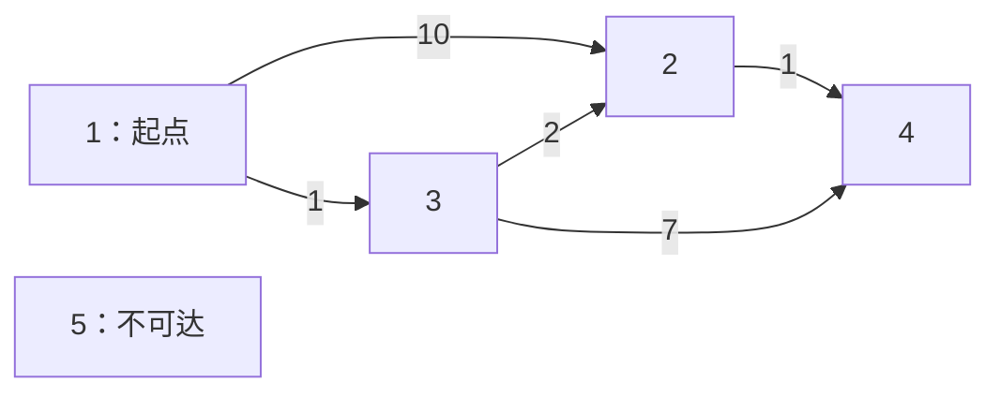

# 6.4 Dijkstra：非负权图的单源最短路

前置：[邻接表与有向边](01-graph-basics.md)、[BFS 的首次发现与最短距离](../03-search/02-bfs-shortest-path.md#6-为什么首次发现就是最短距离)、[priority_queue](../01-basic-problem-solving/04-stl/containers/07-priority-queue.md)。

> **BFS 按步数逐层处理；Dijkstra 每次处理当前距离最小的点。** 边权非负时，这个点的最短距离才可以确定。

## 1. 解决什么问题

给定一个有向或无向带权图，从起点 $s$ 出发，求到每个点的**最短路径长度**。

**本节要求边权非负，允许权重为 0。** 不可达点保留为 `INF`，如何输出由具体题目决定。

| 方法 | 优化目标 | 本节需要区分的条件 |
| --- | --- | --- |
| BFS | 最少经过多少条边 | 无权图，或所有边权相同 |
| Dijkstra | 从起点出发的最短路程 | 所有边权非负 |
| [Kruskal](03-kruskal-mst.md#与最短路区别在哪) | 连接全部点的树，总边权最小 | 不保证树中每条起点路径都最短 |

**Dijkstra 选的是“到哪个点的当前距离最小”，不是“哪条边最便宜”。** 经过这条边以前的路程也必须算上。

## 2. 从 BFS 过渡：首次发现不一定最短

下面是有向图，从 1 出发；点 5 孤立，无法到达。



从 1 第一次发现 2，可以走长度为 10 的直达边；但经过 3 后，可以把距离改成：

$$
1+2=3.
$$

所以**不能在第一次把 2 放入容器时，就禁止它以后更新**。这与 BFS 在无权图中“首次发现即可确定最少步数”不同。

### 松弛：尝试借助 u 改善到 v 的距离

假设目前知道一条到 $u$ 的路径，长度为 $dist[u]$；再走边 $u\to v$，代价为 $w$。

这提供了一个新的候选路径：

$$
\mathrm{candidate}=dist[u]+w.
$$

若它比原来的 $dist[v]$ 小，就更新：

$$
dist[v]\leftarrow\min(dist[v],\ dist[u]+w).
$$

这一步叫作**松弛**。名字不重要，实际就是“找到更短的走法，便替换旧记录”。

**`dist[v]` 在计算过程中表示当前已经找到的最短距离，不一定已经是最终答案。** 有限值对应真实找到的一条路径，未找到路径则为 `INF`。

## 3. 为什么处理距离最小的点，就能确定它

先不考虑用什么容器：每轮从尚未确定距离的点中，取**当前 `dist` 最小的点 `u`**，再用它更新邻居。

假设之前确定的距离都正确，现在却存在一条到 `u` 的路径，比 `dist[u]` 更短。

沿这条更短路径，从起点向 `u` 走：

1. 找到路径上**第一个还没确定距离的点 `y`**，它前面的点记为 `x`。
2. `x` 已经处理过，最短距离正确，也已经尝试沿边 `x→y` 更新 `y`。
3. 因此，`dist[y]` 不会大于这条路径到 `y` 为止的长度。
4. **剩下的边权都非负**，到 `y` 为止的长度，不会超过整条路径到 `u` 的长度。
5. 这就得到一个尚未确定、却比 `u` 当前距离更小的候选 `y`，与本轮选择 `u` 矛盾。

所以在**按当前最小距离取出**时，`u` 的距离可以确定。起点距离为 0，是推理的起点。


图中箭头表示沿假设的更短路径前进；有些箭头可以代表多条边。`x→y` 是跨过“已确定 / 未确定”边界的一条实际边。

> **关键不是“先发现”，而是“当前最小，并且后面不能靠负权把路程再降下来”。**

证明思路参考 [MIT Dijkstra 讲义](https://ocw.mit.edu/courses/6-006-introduction-to-algorithms-fall-2011/6277a1f06100c26a7ff21031af6757b5_MIT6_006F11_lec16.pdf)，本节按当前距离与实际更新过程展开。

### 为什么不能有负权边

例如，考虑以下三条边：

- $1\to 2$，权重为 $2$
- $1\to 3$，权重为 $5$
- $3\to 2$，权重为 $-10$

从点 $1$ 出发，点 $2$ 的当前距离为 $2$，点 $3$ 的当前距离为 $5$。因此，Dijkstra 会先取出点 $2$，并将距离 $2$ 视为最终结果。

然而，之后处理点 $3$ 时，可以通过边 $3\to 2$ 得到一条更短的路径，其长度为 $5+(-10)=-5$。

这说明：**存在负权边时，即使某个点当前距离最小，也不能保证已经找到了它的最短路径。** 因此，Dijkstra 算法中“取出时即可确定最短距离”的关键性质不再成立。

与 Floyd 的中转阶段、以及本篇堆写法可能重复入堆的区别，见[为什么 Dijkstra 不能直接用于负边，而 Floyd 可以](09-floyd.md#为什么-dijkstra-不能直接用于负边而-floyd-可以)。

**不增加永久标记、允许反复更新，有时也能算对某些负权输入，但已不能套用本节的正确性与复杂度保证。** 负权图的反复松弛与负环判定见 [6.10 Bellman–Ford／SPFA](10-negative-shortest-path.md)，不靠删掉某个判断来扩大适用范围。

## 4. 变量与容器：点、边和候选记录

本节点编号为 **1-based：`1..n`**，图的外层分配 `n+1` 项，0 留空。

| 变量 | 含义与范围 |
| --- | --- |
| `g[u]` | 从点 `u` 出发的所有边；内部 `vector` 仍为 0-based |
| `Edge {to,w}` | 一条出边的终点和权重；起点由所在的 `g[u]` 表示 |
| `dist[v]` | 从 `s` 到 `v`，当前已经找到的最短距离 |
| `pre[v]` | 当前最优路径上，`v` 的前一个点；初始为 `-1` |
| `pq` | 候选记录的小根堆，每项是 `{当时的距离, 点编号}` |
| `INF` | 表示尚未找到路径，不是题目要求直接输出的数值 |

**图的容量由点数和边数决定，不按权重最大值分配。** 设存入邻接表的有向边记录共有 $m$ 条，图占 $O(n+m)$ 空间；无向输入的每条边要存正反两条记录。

`pre` 只为还原一条最短路径服务，**不参与最短距离比较**。只求距离时可以省去它，但教学实现保留，便于看清“距离改变时，路线也随之改变”。

### 小根堆里放的是快照，不是自动更新的引用

`priority_queue` 默认大根堆，本节使用：

```cpp
using State = pair<ll, int>; // 先比较距离，相同时再比较编号
priority_queue<State, vector<State>, greater<State>> pq;
```

堆顶距离最小。**同距离时编号的先后不影响距离正确性，也不保证字典序最小的整条路径。**

普通 `priority_queue` 不方便直接找到并修改已有元素，所以每次距离变短，就**再放入一条新记录**。

例如点 2 的距离从 10 改成 3，堆里可能同时存在 `{10,2}` 和 `{3,2}`。旧记录不会跟着 `dist[2]` 自动变成 3。

## 5. 执行流程

1. 读入图：有向边只加入 `g[u]`；无向边还需反向加入。
2. 初始化全部距离为 `INF`，`dist[s]=0`，将 `{0,s}` 入堆。
3. 取出堆顶 `{d,u}`，并立即弹出。
4. 若 `d != dist[u]`，说明这份距离已经过期，跳过。
5. 遍历 `u` 的出边，计算新的候选距离；**严格更短**才更新 `dist`、`pre` 并入堆。
6. 堆为空后，所有可达点的最短距离已经求出；不可达点仍为 `INF`。

**只求某个终点时，可以在它以有效记录出堆后提前结束。** 不能在第一次入堆、第一次发现它时结束；本节主实现求所有点，不提前退出。

## 6. C++11 教学实现

沿用[竞赛基础框架](../../templates/01-basic-problem-solving/cpp-contest-template/README.md)及 `using ll = long long;`。使用普通邻接表，按过程展开，不依赖外部图框架。

**前提：** 起点和所有端点合法，`g[0]` 留空，边权非负。定义 `INF=LLONG_MAX/4`，要求每条边权及所有有限最短距离都小于 `INF`；按题目规模先核对数值上限。

```cpp
struct Edge {
    int to;
    ll w;
};

const ll INF = LLONG_MAX / 4;

struct DijkstraResult {
    vector<ll> dist;
    vector<int> pre;
};

// 要求所有边权非负
DijkstraResult dijkstra(const vector<vector<Edge>>& g, int s) {
    vector<ll> dist(g.size(), INF);
    vector<int> pre(g.size(), -1);

    using State = pair<ll, int>; // {入队时的距离, 点编号}
    priority_queue<State, vector<State>, greater<State>> pq; // 小顶堆，距离小的先出队

    dist[s] = 0;
    pq.push({0, s});

    while (!pq.empty()) {
        auto cur = pq.top();
        pq.pop();

        ll d = cur.first;
        int u = cur.second;

        // 入队后，dist[u] 可能又被更新为更小的值
        // 此时 d 是旧距离快照，已经过期，直接跳过
        if (d != dist[u])
            continue;

        for (const auto& e : g[u]) {
            ll next_dist = d + e.w;

            // 只接受更短的路线；相同距离也不重复入队,零权环不会反复触发更新
            if (next_dist >= dist[e.to])
                continue;

            dist[e.to] = next_dist;
            pre[e.to] = u; // 记录这条更短路线的前驱点
            pq.push({next_dist, e.to}); // 新距离入队，旧记录不会自动删除
        }
    }

    return {dist, pre};
}
```

`d` 是旧堆记录中的距离，`dist[u]` 是当前数组中的距离。**二者比较不是检查点编号，也不是判断是否首次访问，而是判断记录是否仍有效。**

当前有效的 `d` 与边权均小于 `INF`，所以它们的和小于 `2*INF`，仍在 `ll` 范围内；不会直接拿 `INF` 当实际路程去相加。

此处没有套用 BFS 的“第一次入队就永久标记”。**对非负图，取出有效最小记录时即可确定距离；跳过过期记录便足以避免重复扫描已经被替代的状态。**

## 7. 手推：新距离入堆，旧距离留到以后丢弃

继续使用第 2 节的五点图。`dist[1]=0` 始终不变，表中的 `∞` 表示 `INF`。

| 取出的记录 | 本次行为 | dist[2] | dist[3] | dist[4] | dist[5] |
| --- | --- | --- | --- | --- | --- |
| 初始 | 仅 `{0,1}` 入堆 | ∞ | ∞ | ∞ | ∞ |
| `{0,1}` | 更新 2、3，分别入堆 | 10 | 1 | ∞ | ∞ |
| `{1,3}` | 2 改成 3，4 改成 8 | 3 | 1 | 8 | ∞ |
| `{3,2}` | 4 改成 4 | 3 | 1 | 4 | ∞ |
| `{4,4}` | 无出边 | 3 | 1 | 4 | ∞ |
| `{8,4}` | `8 != dist[4]`，过期 | 3 | 1 | 4 | ∞ |
| `{10,2}` | `10 != dist[2]`，过期 | 3 | 1 | 4 | ∞ |

最终到 4 的距离为 4，前驱依次为：

$$
pre[4]=2,\quad pre[2]=3,\quad pre[3]=1.
$$

最短路径是 **`1 → 3 → 2 → 4`**。距离变短时，`pre[2]` 也从 1 改成了 3，保留下来的路线才与最终距离对应。

## 8. 通用补充：怎样还原一条路径

已知终点 `t`，沿 `pre[t]` 一直往前找，得到的是**终点到起点**的顺序，最后反转。

下面要求 `pre` 来自同一次、同一起点的计算，且 `s,t` 都是合法编号：

```cpp
vector<int> restore_path(int s, int t, const vector<int>& pre) {
    vector<int> path;

    for (int v = t; v != -1; v = pre[v]) {
        path.push_back(v);
        if (v == s) {
            reverse(path.begin(), path.end());
            return path;
        }
    }

    return {}; // 没能回到起点，说明终点不可达
}
```

- `s==t` 时，路径只包含起点，长度为 0。
- 不可达点的 `pre[t]` 保持 `-1`，不能把单独一个终点当成已经找到路线。
- 这里只保存**一条**最短路径，不统计最短路条数；也不自动满足额外的字典序要求。

## 9. 复杂度与易错边界

本节使用“更新后重新入堆、弹出时丢弃旧记录”的写法：

- 数组初始化为 $O(n)$。
- 每个点的出边只在其有效记录出堆时扫描，合计至多 $m$ 次。
- 每次成功松弛产生一条新记录，入堆、出堆次数为 $O(m+1)$。
- 堆最多保存 $O(m+1)$ 条记录，因此合计时间为 **$O(n+m\log(m+1))$**，空间为 **$O(n+m)$**。

简单图中常写为 $O((n+m)\log n)$；保留重边的一般边表，按 `m` 估计重复记录更直接。不要把本节写法的堆容量当成固定只有 `n` 项。

| 易错点 | 正确处理 |
| --- | --- |
| 用普通队列处理任意非负权 | 先进先出不保证当前距离最小，应使用小根堆 |
| 第一次发现就标记完成 | 距离以后可能变短，入堆不等于定值 |
| 旧记录仍扫描邻居 | 先比较 `d` 与 `dist[u]`，过期则跳过 |
| 相同距离也入堆 | 使用严格变短条件，避免零权环反复更新 |
| 无向图只加入一条记录 | 两个方向都存；有向图不能擅自加反边 |
| 边权是 `ll`，距离却是 `int` | 按整条路径的最大和选择类型 |
| 直接输出 `INF` | 按题目要求处理不可达，例如输出 `-1` |
| 有负权仍套用 Dijkstra | 非负前提失效，另选负权算法 |
| 多测忘记清理 | 每次重新建图，函数内重新初始化距离、前驱和堆 |

想理解朴素版时，可以把小根堆换成“每轮扫描所有未确定点、选最小距离”，时间为 $O(n^2+m)$。**堆优化的是找下一个点的过程，不改变松弛与贪心定值的依据。** 本节不重复给第二套完整实现。

## 10. 典题与复盘

两题均已收到实际实现。以下只调整排版与说明性注释，**保留原算法和函数接口**；通用头文件、多测框架不重复展示。

**核验状态：两题本地核验通过，平台结果未单独记录。**

### 两题共用的原实现

原代码的 `Edge {v,d}` 对应第 6 节的 `Edge {to,w}`，`DRes` 对应 `DijkstraResult`。命名不同，功能相同；这里按原代码保留。

```cpp
struct Edge {
    int v;
    ll d;
};

struct DRes {
    vector<ll> dist;
    vector<int> pre;
};

DRes dijkstra(vector<vector<Edge>>& g, int s) {
    const ll INF = LLONG_MAX / 4;

    vector<ll> dist(g.size(), INF);
    vector<int> pre(g.size(), -1);

    using State = pair<ll, int>;
    priority_queue<State, vector<State>, greater<State>> pq;

    dist[s] = 0;
    pq.push({0, s});

    while (!pq.empty()) {
        auto cur = pq.top();
        pq.pop();

        int u = cur.second;
        ll d = cur.first;

        // 堆中保存入队时的距离；与当前距离不同，说明已被更短路线替代
        if (d != dist[u])
            continue;

        for (const auto& e : g[u]) {
            ll nd = d + e.d;

            // 只有严格变短才更新，相同距离不重复入堆
            if (nd >= dist[e.v])
                continue;

            dist[e.v] = nd;
            pre[e.v] = u; // 改善距离时，同时记下这条路线从哪里过来
            pq.push({nd, e.v});
        }
    }

    return {dist, pre};
}
```

**不是从旧记录中删除某个点，而是将新距离再次入堆。** 旧记录以后出堆时，再由 `d != dist[u]` 排除。

原函数不修改 `g`，参数也可以改为 `const vector<vector<Edge>>&`；第 6 节已采用这种写法，原实现无需为此重写。

### 10.1 洛谷 P4779：【模板】单源最短路径（标准版）

[题目链接](https://www.luogu.com.cn/problem/P4779)。

有向非负权图，求给定起点到各点的距离，**题目保证全部可达**。规模为 $n\le10^5$、$m\le2\times10^5$，全部边权之和不超过 $10^9$。

#### 原实现：有向建图，按点编号输出距离

```cpp
void solve() {
    int n, m, s;
    cin >> n >> m >> s;

    vector<vector<Edge>> g(n + 1);
    while (m--) {
        int u;
        Edge e;
        cin >> u >> e.v >> e.d;

        g[u].push_back(e); // 有向边，只存从 u 到 e.v 的方向
    }

    auto res = dijkstra(g, s);

    for (int i = 1; i <= n; ++i)
        cout << res.dist[i] << ' ';

    cout << '\n';
}
```

**点编号为 1-based，`g[0]` 留空；输出顺序是点编号顺序，与出堆顺序无关。**

#### 复盘重点：题目保证决定输出方式

本题保证所有点可达，最终每个 `dist[i]` 都是实际距离，因此可以直接输出。

若换成允许不可达的题目，则要按要求把 `INF` 转换成对应输出，**不能把这份输出循环不加检查地套过去**。

这里只问距离，`pre` 不影响结果。保留它是为了与下一题共用同一份实现；不必为了本题再维护第二份算法。

### 10.2 Codeforces 20C：Dijkstra?

[题目链接](https://codeforces.com/problemset/problem/20/C)。

无向正权图，输出从 1 到 $n$ 的一条最短路径；**不可达时输出 `-1`，有多条最短路径时任选一条**。

规模为 $2\le n\le10^5$、$0\le m\le10^5$、$1\le w\le10^6$，允许自环与重边。

#### 先看例子：距离正确，还要找回经过的点

原题样例的一条最短路径为：

$$
1\longrightarrow4\longrightarrow3\longrightarrow5.
$$

这三条边的权重分别为 1、3、1，因此总长度为：

$$
1+3+1=5.
$$

距离数组只告诉终点距离是 5，不能单独说明经过哪些点。更新距离时记录的 `pre` 则保留了路线：

$$
\mathrm{pre}[5]=3,\quad \mathrm{pre}[3]=4,\quad \mathrm{pre}[4]=1.
$$

从终点开始，沿着前驱查找，得到的是反向顺序：

$$
5\longrightarrow3\longrightarrow4\longrightarrow1.
$$

**回到起点后反转，才是题目要求的行走顺序。**

#### 原实现：沿前驱回溯

```cpp
vector<int> get_path(vector<int>& pre, int s, int t) {
    vector<int> path;

    for (int v = t; v != -1; v = pre[v]) {
        path.push_back(v);

        if (v == s) {
            reverse(path.begin(), path.end());
            return path; // 确实回到起点，才承认这是一条完整路线
        }
    }

    return {}; // 前驱走到 -1 仍没找到起点，说明不可达
}
```

例如，没有任何边时，从终点开始只能先放入终点本身，接着就遇到 `pre[t]==-1`。

**函数会丢弃这段未能回到起点的记录，返回空数组；不能把“记录里有一个终点”误当成存在路径。**

原函数只读取 `pre`，也可以使用 `const vector<int>&`。它与[第 8 节的通用还原函数](#8-通用补充怎样还原一条路径)逻辑相同，不另造一套路径算法。

#### 原实现：无向建图，输出路径或 -1

```cpp
void solve() {
    int n, m;
    cin >> n >> m;

    vector<vector<Edge>> g(n + 1);
    while (m--) {
        int u, v;
        ll d;
        cin >> u >> v >> d;

        g[u].push_back({v, d});
        g[v].push_back({u, d}); // 无向边的两个方向都能走
    }

    auto res = dijkstra(g, 1);
    auto path = get_path(res.pre, 1, n);

    if (path.empty()) {
        cout << "-1\n";
        return;
    }

    for (int x : path)
        cout << x << ' ';

    cout << '\n';
}
```

#### 复盘重点：保存前驱时，要与距离更新同步

假设后来找到一条更短的路线到达某个点，**距离与前驱都要改**。否则距离虽然正确，回溯出来的却可能仍是旧路线。

相同距离时不修改前驱，也不影响本题：题目允许输出任意一条最短路径，不要求字典序最小。

**重边正常参与松弛；正权自环不会让路线更短，无需另外删除。**

#### 整条路径的和，需要 ll

单条边不超过 $10^6$，但一条最短路径可能经过接近 $10^5$ 条边。

$$
(10^5-1)\times10^6=99\,999\,000\,000.
$$

这是整条路径可能达到的数量级，已经超过 `int`。因此边权、候选距离 `nd` 和 `dist` 均使用 `ll`，不能只在输出时转换类型。

### 10.3 两题放在一起看

| 对比项 | P4779 | CF 20C |
| --- | --- | --- |
| 图的方向 | 有向，只加一条记录 | 无向，加正反两条记录 |
| 起点与终点 | 输入起点，求各点距离 | 固定从 1 到 n |
| 输出内容 | 按编号输出距离 | 沿 pre 回溯后反转 |
| 不可达 | 题目保证不会出现 | 空路径输出 -1 |

**算法核心没有变，变化的是建图方式和答案整理。** 两份原实现已适合对应题目，不需要为了形式上的“改进解”再复制另一套 Dijkstra。

## 11. 自查与后续

1. 为什么点 2 已经入堆，距离仍能从 10 改成 3？第一次入堆时标记完成会丢掉什么？
2. 堆中的 `{10,2}` 为什么不会随着数组改变？跳过它会不会漏掉路线？
3. 非负边权在证明的哪一步起作用？权重为 0 为什么仍然允许？
4. `pre` 用来还原路线，为什么不等同于并查集的父指针？

下一节：[拓扑排序与依赖关系](05-topological-sort.md)。后续负权算法等专题仍保留，全章选型在图与树主题收尾时完善。

若起点不固定、需要小图的任意点对距离，见 [6.9 Floyd](09-floyd.md)；两者按起点数量、图规模与边权条件选择。

竞赛短写法与路径还原见 [Dijkstra 模板](../../templates/06-graph-and-tree/dijkstra/README.md)；模板使用 WeightedEdge 区分最小生成树的边类型，前提和下标约定保持一致。
