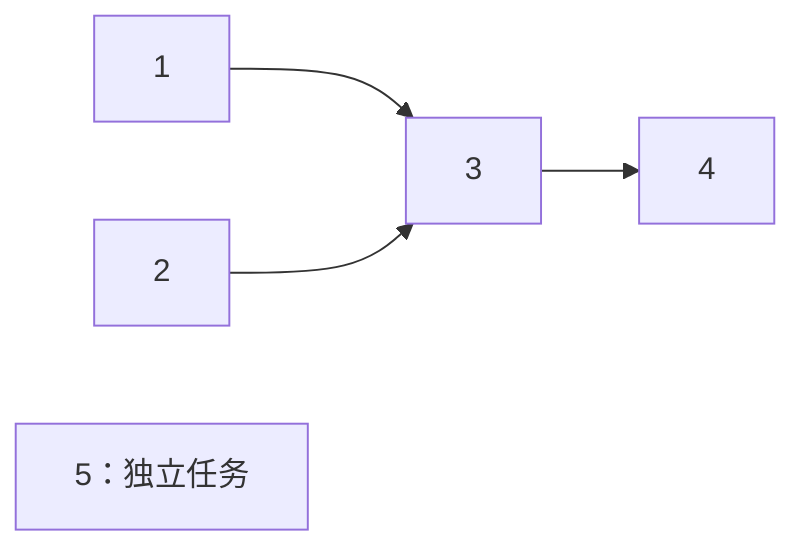
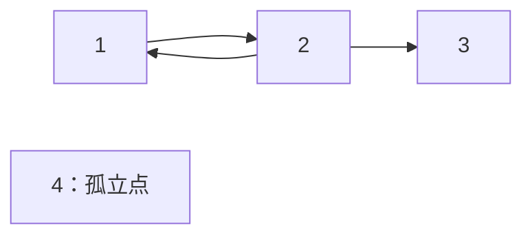
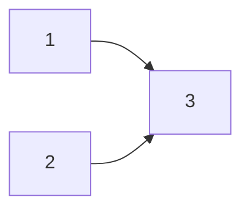

# 6.5 拓扑排序与关键路径

本单元分为两篇：**本篇讲拓扑排序、判环与基础 DAG DP；[应用篇讲关键路径与项目工期](05a-critical-path.md)**。先确定合法的依赖顺序，再用它计算工期和可延期的余量。

前置：[有向图与邻接表](01-graph-basics.md)、[BFS 的队列处理](../03-search/02-bfs-shortest-path.md)、[Dijkstra 的取点规则](04-dijkstra.md#5-执行流程)。

> **拓扑排序安排的是“谁必须在谁前面”，不是按编号或距离排序。**
>
> 本节先学入度与队列的 Kahn 写法，理解依赖解除和有向环判定。

## 1. 从任务先后关系入手

假设有五项任务：

- 任务 1、2 都完成后，才能开始任务 3。
- 任务 3 完成后，才能开始任务 4。
- 任务 5 没有前置任务，也不影响其他任务。

把任务作为点，**前置任务指向后续任务**。



### 情况一：多个任务都能先处理

任务 1、2、5 都可以先处理。例如：

$$
1,\ 2,\ 5,\ 3,\ 4.
$$

每条边的起点，都排在终点前面，因此这是一个合法顺序。

也可以先处理任务 5：

$$
5,\ 2,\ 1,\ 3,\ 4.
$$

这仍然满足全部依赖。**拓扑序不一定唯一，多个任务同时可处理时，可以选择不同的先后。**

### 情况二：不能只完成一个前置任务就继续

处理任务 1 后，还不能处理任务 3，因为任务 2 没完成。

**需要的是“所有直接前置任务都处理完”，不是“已经有一个前置任务处理完”。**

这正是下面要记录入度的原因。

### 情况三：依赖绕成一圈，谁都无法先开始

若关系为：

$$
1\longrightarrow2\longrightarrow3\longrightarrow1.
$$

1 要等 3，3 要等 2，2 又要等 1。三个点都无法成为第一个处理的点。

**这就是有向环：它会阻止完整拓扑序的产生。**

## 2. 拓扑序到底满足什么？

对图中每一条有向边：

$$
u\longrightarrow v.
$$

拓扑序都必须让 **u 出现在 v 前面**。边表示先后要求，不表示两点必须紧挨着。

**有向无环图**简称 **DAG**。只有不存在有向环，才能给全部点排出拓扑序；后面通过算法说明原因。

这里讨论的是有向图，不能将无向边照常存成两条方向相反的边，再期待得到同样的依赖顺序。

## 3. 入度：还剩多少个前置要求？

**入度**是指向一个点的边数。对上面的例子：

| 点 | 初始入度 | 原因 |
| --- | --- | --- |
| 1、2、5 | 0 | 没有前置任务 |
| 3 | 2 | 等待 1 和 2 |
| 4 | 1 | 等待 3 |

在处理过程中，入度会变化，含义也要写清：

> **`indeg[v]` 表示：从还没处理的点指向 v 的边，还剩多少条。**
>
> 因而入度为 0，表示当前已经没有未完成的前置要求，可以安全处理。

处理任务 1 时，把它指向任务 3 的那条依赖视为解除：

$$
\mathrm{indeg}[3]:\ 2\longrightarrow1.
$$

此时还剩一个前置要求，不能入队。

处理任务 2 后：

$$
\mathrm{indeg}[3]:\ 1\longrightarrow0.
$$

现在才能把任务 3 放入队列，等待处理。

**不必真的从邻接表里删边。** 遍历已处理点的出边，将对应入度减 1，就相当于从剩余问题中删除这些依赖。

## 4. 变量、容器与下标

本节统一使用 **1-based 点编号：`1..n`**。外层容器分配 `n+1` 项，0 留空；每个 `g[u]` 内部仍是普通 0-based `vector`。

| 变量 | 完整含义与容量依据 |
| --- | --- |
| `g[u]` | u 指向的全部后续点；外层按点数分配，内部合计存 m 条边 |
| `indeg[v]` | 当前未解除的入边数；长度 n+1，由全部边统计 |
| `q` | 当前入度已经为 0、等待处理的点；最多保存 n 个点 |
| `order` | 已按合法先后处理的点，每个点最多出现一次 |

**容器按点数、边数分配，与任务编号之外的业务数值或任务耗时无关。**

初始入度在函数内从图统计，随后使用这份局部数组递减；**原图不修改，多次调用也不会沿用上次减过的入度。**

## 5. 执行流程与手推

1. 扫描全部有向边，统计每个点的初始入度。
2. 扫描 `1..n`，把**所有入度为 0 的点**加入队列，包括孤立点。
3. 取出队首并弹出，将它加入结果顺序。
4. 遍历它的所有出边，将每个后续点的入度减 1。
5. **某个后续点的入度刚好降到 0 时，才将它入队。**
6. 队列为空后，检查结果中是否包含全部 n 个点。

仍使用五项任务的例子，初始按编号从小到大入队。

| 本次处理 | 入度变化 | 处理后的队列 |
| --- | --- | --- |
| 初始 | 3 为 2，4 为 1 | 1、2、5 |
| 1 | 3：2 → 1，继续等待 | 2、5 |
| 2 | 3：1 → 0，3 入队 | 5、3 |
| 5 | 无出边 | 3 |
| 3 | 4：1 → 0，4 入队 | 4 |
| 4 | 无出边 | 空 |

最后得到：

$$
1,\ 2,\ 5,\ 3,\ 4.
$$

**任务 3 的入队时刻由“最后一项依赖解除”决定，不由首次遇到它决定。**

## 6. C++11 实现：Kahn 算法

沿用[竞赛基础框架](../../templates/01-basic-problem-solving/cpp-contest-template/README.md)。下方只展示通用函数。

**前提：** `g` 至少有留给 0 的一项，端点均在 `1..n`；点数及每个点的入度可以用 `int` 表示。允许重边、自环，二者的处理见后文。

```cpp
// g[u] 中的 v 表示 u 必须在 v 前面；点编号 1-based
// 成功返回 true，order 为完整拓扑序；失败返回 false，order 仅包含已处理的点
bool topo_sort(const vector<vector<int>>& g, vector<int>& order) {
    int n = static_cast<int>(g.size()) - 1;
    vector<int> indeg(n + 1);

    // 1. 统计每个点的入度
    for (int u = 1; u <= n; ++u) {
        for (int v : g[u]) {
            ++indeg[v];
        }
    }

    // 2. 收集所有入度为 0 的点，作为初始可处理点
    queue<int> q;
    for (int u = 1; u <= n; ++u) {
        if (indeg[u] == 0) {
            q.push(u);
        }
    }

    order.clear();

    // 3. 逐个处理当前可处理的点
    while (!q.empty()) {
        int u = q.front();
        q.pop();

        // 3.1 将当前点加入拓扑序
        order.push_back(u);

        // 3.2 移除当前点对后继点的依赖
        for (int v : g[u]) {
            --indeg[v];

            // 3.3 后继点的所有前置依赖均已解除，可以处理
            if (indeg[v] == 0) {
                q.push(v);
            }
        }
    }

    // 4. 判断是否处理完所有点：未处理完则图中存在有向环
    return static_cast<int>(order.size()) == n;
}
```

调用时，**先检查是否成功，再使用完整顺序**：

```cpp
vector<int> order;
if (!topo_sort(g, order)) {
    // 有向环导致无法处理全部点；按具体题目输出无解
} else {
    // order 已包含全部点，可按此顺序输出或计算状态
}
```

这里不需要额外的 `visited`：入度只会递减，每个点只会在初始为 0，或后来首次降到 0 时入队一次。

**统计入度与减少入度，必须基于同一份边记录。** 不能统计时去重、遍历时却保留重复边，反过来也不行。

## 7. 为什么完整处理等价于没有有向环？

### 已经排出的部分，为什么合法？

一个点入队时，所有指向它的前置点都已处理。因此把它放在这些点后面，不会违反任何依赖。

**每一步都只追加当前可处理的点，已经排出的部分始终合法。**

### 队列空了，却还有点没处理，说明什么？

这时剩下的每个点，都还至少有一条来自剩余点的入边；否则它早已入队。

从任意一个剩余点开始，不断沿入边往前找前置点。剩余点有限，而查找可以一直继续，**必然重复遇到某个点，形成有向环**。

所以，若不能排出全部点，就一定存在有向环。

### 有环时，为什么排不完？

环上的每个点都至少要等待环中的另一个点。**谁都不能先从这个环中出来**，因此环上点无法被全部排出。

由此得到判定：

$$
\mathrm{order.size()}=n
\quad\Longleftrightarrow\quad
\text{图中没有有向环}.
$$

代码比较的是**已处理点数与总点数**，不是只看最初是否存在入度为 0 的点。

### 没处理的点，不一定全都在环上

例如：



任务 4 可以先处理；任务 1、2 形成环，任务 3 受这个环阻挡，也处理不了。

> **剩余点既可能在环上，也可能只是依赖于环。** 不能把失败时未输出的全部点直接当成“环上的点”。

## 8. 顺序不唯一，与按编号优先不是一回事

只有三个点，关系为 `1→2`，点 3 独立。

初始队列为 1、3；处理 1 后，才把 2 加到队尾。普通队列得到：

$$
1,\ 3,\ 2.
$$

它满足全部依赖，却不是编号字典序最小的 `1,2,3`。

> **普通队列只保证拓扑合法，不保证当前能选的点中总选最小编号。** 若题目要求字典序最小，可以把队列换成[小根堆](../01-basic-problem-solving/04-stl/containers/07-priority-queue.md)，每次选当前可处理点中的最小者。

此时按编号选取的时间为 $O(m+n\log n)$，不能误写成仍然是线性。

在**已知为 DAG**的前提下，如果某一步同时有多个可处理点，就可以产生不同拓扑序；每一步都只有一个可选点，拓扑序才唯一。本节先理解，不另加第二套完整实现。

## 9. 与 BFS、Dijkstra 的区别及边界

| 方法 | 为什么某个点现在可以处理？ |
| --- | --- |
| BFS | 按最少经过边数逐层扩展 |
| Dijkstra | 非负权下，当前距离最小的有效记录可定值 |
| 拓扑排序 | 这个点的全部前置依赖都已解除 |

**虽然都可能使用队列或堆，但维护的条件不同，不能只因为容器相同就套用访问标记和更新方式。**

拓扑排序只给出顺序，**不会自动算出最长路、最早完成时间或方案数**。需要这些结果时，要另外写清状态含义，再按这个顺序计算；后续结合典题练习。

| 易错点 | 应注意的含义 |
| --- | --- |
| 把“后续”指向“前置” | 本节约定前置 → 后续，建边方向要与目标一致 |
| 只从一个点开始 | 要加入全部零入度点，处理整个图 |
| 第一次遇到后续点就入队 | 必须等全部前置依赖解除 |
| 入度减完一次就认为处理过 | 一个点可能有多个前置，减到 0 才就绪 |
| 初始有零入度点，就认定无环 | 其他连通部分仍可能有环，要检查处理点数 |
| 忽略孤立点 | 没有依赖也是合法任务，应进入完整顺序 |
| 出现自环 | 自己等待自己，不存在完整拓扑序 |
| 出现重边 | 可以保留，但入度统计与递减次数必须一致 |

所有点扫描与队列操作合计 $O(n)$，全部边统计、处理各一次，合计 $O(m)$。

**时间复杂度为 $O(n+m)$；图占 $O(n+m)$，函数额外空间为 $O(n)$。** 局部入度数组与 `order.clear()` 也便于多次调用；返回失败时，原图仍然不变。

## 10. 典题与复盘

### 10.1 洛谷 P1137：旅行计划

[题目链接](https://www.luogu.com.cn/problem/P1137)。

每条道路给出从西向东的关系，求以每个城市为终点，**一条路线最多经过多少个城市**。规模为 $n\le10^5$、$m\le2\times10^5$。

**收获：拓扑顺序负责让前驱先算完，DP 负责汇总路径上的最优值；处理了多少点，不等于一条路经过多少点。**

#### 初版问题：全局处理编号混入了无关分支

最长路径的方向没有错，本题就是 **DAG 上按城市数计的最长路径**。最初的问题在于：每弹出一个点就执行 `++r`，后继入队时赋值 `round[v]=r`。

在一条链上，这种写法碰巧正确：

$$
1\longrightarrow2\longrightarrow3.
$$

出队先后与路径前进恰好一致，得到的数值也是 1、2、3。

但换成两条路汇入同一个终点：



初始队列为 1、2，两者都被赋值为 1。

- 弹出 1，`r` 从 1 变成 2，3 仍有一个前置点未处理。
- 弹出 2，`r` 从 2 变成 3，此时 3 入队，被赋值为 3。

然而真正能走的路线只有：

$$
1\longrightarrow3
\quad\text{或}\quad
2\longrightarrow3.
$$

两条路线都只经过 **2 个城市**。不能把先后出队的 1、2、3 拼成一条并不存在的路线。

> **拓扑排序可以依次处理不同分支；路径长度只能从某一条真实前驱路线延伸。**

#### 怎样自然转成 DP？

先看终点 3：最后一条路要么来自 1，要么来自 2。

因此先比较“到达每个前驱，最多经过几个城市”，选最大的一条，再把当前城市算进去。

定义：

$$
dp[v]=\text{以城市 v 为终点的一条路线，最多经过的城市数}.
$$

这里求的是节点数，不是道路数，也不是所有能到达 v 的城市总数。

对于一条道路：

$$
u\longrightarrow v.
$$

若已经有一条以 u 结尾的最优路线，再走到 v，就多经过一个城市。

$$
dp[v]=\max(dp[v],\ dp[u]+1).
$$

逐个前驱比较，只保留最长的一条路线，不能把不同分支的城市数相加。

#### 为什么全部初始化为 1？

题目允许自行选择起点。即使没有前驱，**只游览当前城市，也是一条包含 1 个城市的路线**。

$$
dp[v]=1.
$$

因此所有实际城市都从 1 开始；孤立点的答案也是 1。数组的第 0 项不对应城市，不参与输出。

若题目改成“只能从指定城市出发”，就不能再把所有点都视为可达；初始化与不可达判断也要相应改变。

#### 为什么每条边都更新，而不只在入度为 0 时更新？

状态定义要求比较全部前驱，代码就沿每条真实入边取最大值。这样不需要把数值含义绑定到某个前驱恰好排在第几个处理。

**每处理一条边，都先尝试改善后继的 DP；入度降到 0，只表示这些候选都已经比较完，可以处理后继的出边了。**

两种行为分工不同：

- `dp[v] = max(...)`：保存目前见过的最好路线。
- `--indeg[v]`：记录还有多少个前驱没处理。
- `indeg[v] == 0`：确认 v 的状态已经完整，可以继续向后传递。

若严格按队列当前大小分批处理，每批统一算一层，本题也可以得到最长依赖链的层级；因为后继必须等最晚一层的前驱完成。**这是按整层计数，与每弹出一个点就增加 r 不同。** 当前 DP 直接对应路径含义，更便于继续扩展，不另列分层实现。

#### 修正后的个人 AC

以下只调整排版与解释性注释，保留原 `topo` 和 `solve()` 逻辑。通用框架不重复展示。

```cpp
vector<int> topo(const vector<vector<int>>& g) {
    int n = g.size() - 1;
    vector<int> indeg(n + 1);
    vector<int> dp(n + 1, 1); // 以 v 为终点，最多经过多少个城市；允许从任意城市出发

    for (int u = 1; u <= n; ++u)
        for (int v : g[u])
            ++indeg[v];

    queue<int> q;

    for (int u = 1; u <= n; ++u)
        if (!indeg[u])
            q.push(u);

    while (!q.empty()) {
        int u = q.front();
        q.pop();

        for (int v : g[u]) {
            dp[v] = max(dp[v], dp[u] + 1); // 先比较经由 u 到达 v 的路线
            --indeg[v]; // 再解除这一条依赖；不要把状态更新藏在入度为 0 的条件里

            if (!indeg[v])
                q.push(v);
        }
    }

    return dp;
}

void solve() {
    int n, m;
    cin >> n >> m;

    vector<vector<int>> g(n + 1);
    while (m--) {
        int u, v;
        cin >> u >> v;

        g[u].push_back(v);
    }

    auto dp = topo(g);

    for (int i = 1; i <= n; ++i)
        cout << dp[i] << '\n';
}
```

**为什么不单独判断有环？** 每条道路都严格向东，绕一圈回到原城市不可能成立，题意已经保证 DAG。复用到其他输入时，仍要按第 7 节检查处理点数。

**为什么这个 DP 不会遗漏？** 每条以 v 结尾、包含至少两个城市的路线，都有最后一条入边；枚举全部前驱就覆盖了全部候选。前驱在拓扑顺序中先处理，其最优结果已经确定，再接上 v 即可。

时间和图空间均为 $O(n+m)$，额外数组与队列为 $O(n)$。原实现已合适，不另造第二份“更优算法”。

**核验状态：个人反馈平台 AC，本地核验通过。**

可迁移模型见 [DAG 上的 DP：先满足依赖，再汇总状态](../../patterns/06-graph-and-tree/dag-dp.md)。

### 10.2 Codeforces 510C：Fox And Names

[题目链接](https://codeforces.com/problemset/problem/510/C)。

给出一列名字，寻找一种英文字母顺序，使名字按这个新字典序排列。存在时输出全部 26 个字母的任意合法排列，否则输出 `Impossible`。

名字数量、每个名字长度均不超过 100，名字互不相同。

**收获：题目未必直接给图；当目标是安排整体顺序，而条件不断给出“谁必须在谁前面”，就应考虑拓扑模型。**

#### 如何从字符串题识别成拓扑排序？

先区分两个对象：

- **名字的顺序已经固定，不能重新排序名字。**
- **字母的先后顺序未知，需要求出来。**

题目要求一个包含全部字母的顺序；比较名字后，又能得到若干字母之间的先后要求。

这与拓扑排序的模型对应：

| 题意中的对象 | 图中的含义 |
| --- | --- |
| 26 个字母 | 26 个点 |
| 字母 u 必须先于字母 v | 有向边 u → v |
| 求一种符合全部要求的字母排列 | 求完整拓扑序 |
| 先后要求互相矛盾 | 有向环，无法排出完整顺序 |

> **识别线索：要求整体排列，条件却只给局部先后关系。**
>
> 不必等到题面出现“图”“入度”“任务依赖”，才想到拓扑排序。

直接调用 `sort` 还缺少已经确定的字母比较规则；本题要先求出这套规则，再判断它是否能同时满足全部条件。

#### 例子一：只看第一个不同字符

相邻名字为 `az`、`ba`。第一个位置就已经不同：

$$
a\lt b.
$$

为了让前一个名字在后一个名字前面，只需要求 a 在 b 前，因此加边 `a→b`。

**后面的 z 与 a 不再参与这次比较。** 第一个不同位置已经决定两个名字的先后，不能继续把后续字符也当成约束。

例如再出现 `bz`，由 `ba`、`bz` 得到：

$$
a\lt z.
$$

两组要求是 a 在 b、z 前面，可以同时满足。若错误地从 `az`、`ba` 的第二位再推出 `z<a`，反而会制造不存在的矛盾。

#### 例子二：前缀冲突，甚至不需要出现环

相邻名字为 `abc`、`ab`。

没有不同字符，但前一个名字更长。无论怎样排列字母，较短前缀都应该在前，因此这里直接无解。

反过来，`ab`、`abc` 是合法顺序，**无需增加字母之间的新约束**。

所以完整判断必须包含两部分：

1. **字符串自身的前缀关系是否合法。**
2. **提取出的字母先后关系能否排成拓扑序。**

不能只检查图有没有环，就漏掉前缀这一类不可能情况。

#### 为什么只比较相邻名字？

如果某个字母顺序下，每一对相邻名字都按字典序递增，那么整列名字就有序。

$$
s_1\lt s_2,\quad s_2\lt s_3
\quad\Longrightarrow\quad
s_1\lt s_3.
$$

字典序具有传递性，因此检查全部相邻对就足够，不必枚举任意两份名字。

反过来，整列有序时，每对相邻名字必然有序。于是相邻比较提取的要求既没有漏掉必要条件，也没有凭空增加无关条件。

#### 原实现

保留原 `solve()` 的判断和去重方式，只调整排版与注释。这里字母编号为 **0-based：`0..25`**，与本节通用函数的 1-based 不同；不能把 `g(26)` 原样传给那个函数。

```cpp
void solve() {
    int n;
    cin >> n;

    vector<string> s(n);
    for (auto& x : s)
        cin >> x;

    vector<vector<int>> g(26);
    vector<int> indeg(26);
    bool vis[26][26] = {}; // 标记某条字母约束是否已经存过，不是点的访问标记

    for (int i = 0; i + 1 < n; ++i) {
        const string& a = s[i];
        const string& b = s[i + 1];

        int j = 0;

        while (j < min(a.size(), b.size()) && a[j] == b[j])
            ++j;

        if (j == min(a.size(), b.size())) {
            if (a.size() > b.size()) {
                cout << "Impossible\n";
                return;
            }
            continue; // 前一个是较短前缀，没有新的字母关系
        }

        int u = a[j] - 'a';
        int v = b[j] - 'a';

        if (!vis[u][v]) {
            vis[u][v] = true;
            g[u].push_back(v);
            ++indeg[v]; // 边去重后，入度也只增加一次
        }
    }

    queue<int> q;

    for (int u = 0; u < 26; ++u) {
        if (!indeg[u]) {
            q.push(u); // 全部字母都参与，包括没有出现在名字中的字母
        }
    }

    string ans;

    while (!q.empty()) {
        int u = q.front();
        q.pop();

        ans += char('a' + u);

        for (int v : g[u]) {
            --indeg[v];

            if (!indeg[v]) {
                q.push(v);
            }
        }
    }

    if (ans.size() != 26) {
        cout << "Impossible\n";
    } else {
        cout << ans << '\n';
    }
}
```

#### 为什么这个实现充分？

前缀冲突已经单独排除。若随后得到完整拓扑序，它就满足所有提取出的“第一个不同字符”的先后要求，因此每对相邻名字都满足字典序，整列也就有序。

若无法排出全部字母，说明这些必要关系形成有向环，不存在能满足它们的完整字母排列。

**答案是全部 26 个字母，不只是实际出现过的字母。** 没有约束的字母也必须保留，普通队列得到任意合法拓扑序即可，无需特意改成小根堆。

`vis[u][v]` 是**边去重表**。保留重复边也能做，但入度统计与删除次数必须一致；当前去重写法已经清晰，无需更换。

#### 一个可做的代码整理

原稿的 `j` 为 `int`，而字符串长度是无符号类型，两个长度比较会产生有符号/无符号比较警告。

本题长度至多 100，且 j 从 0 单调增加，原逻辑没有因此出错。若整理这两处比较，可只把声明改为：

```cpp
size_t j = 0; // 与字符串长度类型一致；后面的比较和索引逻辑不变
```

这是类型整理，不是算法修复，也不需要再复制整份程序。

设名字数为 n、最大长度为 L，比较相邻名字耗时 $O(nL)$；字母图至多有 $26^2$ 条记录。总时间为 $O(nL+26^2)$，空间为 $O(nL+26^2)$，其中包含保存的名字。

**核验状态：原实现与仅调整 j 类型的版本均已本地核验；平台结果未单独记录。**

### 10.3 两题共同揭示的建模分工

- **CF 510C：先从题意提取依赖，再求符合依赖的整体顺序。**
- **P1137：图已给出，拓扑序安排计算先后，DP 另外保存路径上的最优值。**

**拓扑排序回答“现在轮到谁”，状态转移回答“轮到它时，应算出什么”。** 具体状态、初始化和汇总方式不能由队列出队编号代替。

一般识别与变式见 [DAG 上的 DP](../../patterns/06-graph-and-tree/dag-dp.md)；两题完整原解仍留在本节。

## 11. 自查与后续

1. 为什么任务 3 不能在处理完任务 1 后立即入队？
2. 图中有一个孤立点，同时另一部分有环，算法会返回什么？
3. 重边保留两次时，入度与解除次数应怎样对应？
4. 普通队列得到合法拓扑序后，为什么还不能声称它是字典序最小？

拓扑排序两题已完成实际实现复盘；进一步计算工期、最迟时间与关键活动，见[6.5 关键路径应用篇](05a-critical-path.md)。应用篇 P1113 已按实际实现静态复盘，重点是虚拟起点统一无前置任务的计时，既有待修正题继续保留；具体推进以本地学习计划为准。DFS 逆后序与全章选型仍按需要补充。

竞赛短写法见[拓扑排序模板](../../templates/06-graph-and-tree/topological-sort/README.md)：只返回顺序与是否成功，具体 DAG DP 更新继续留在题目中。
