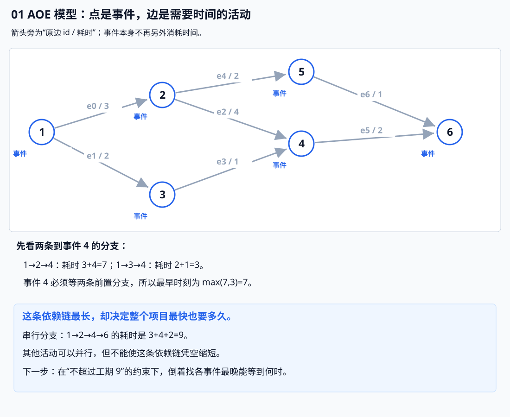
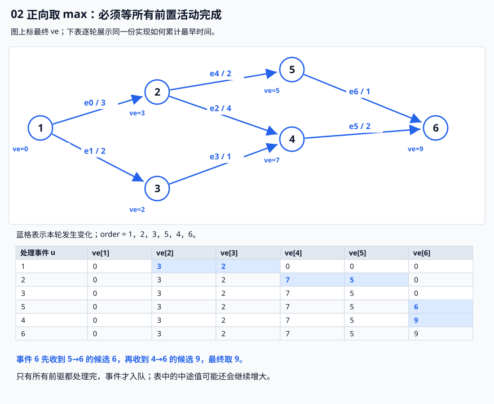
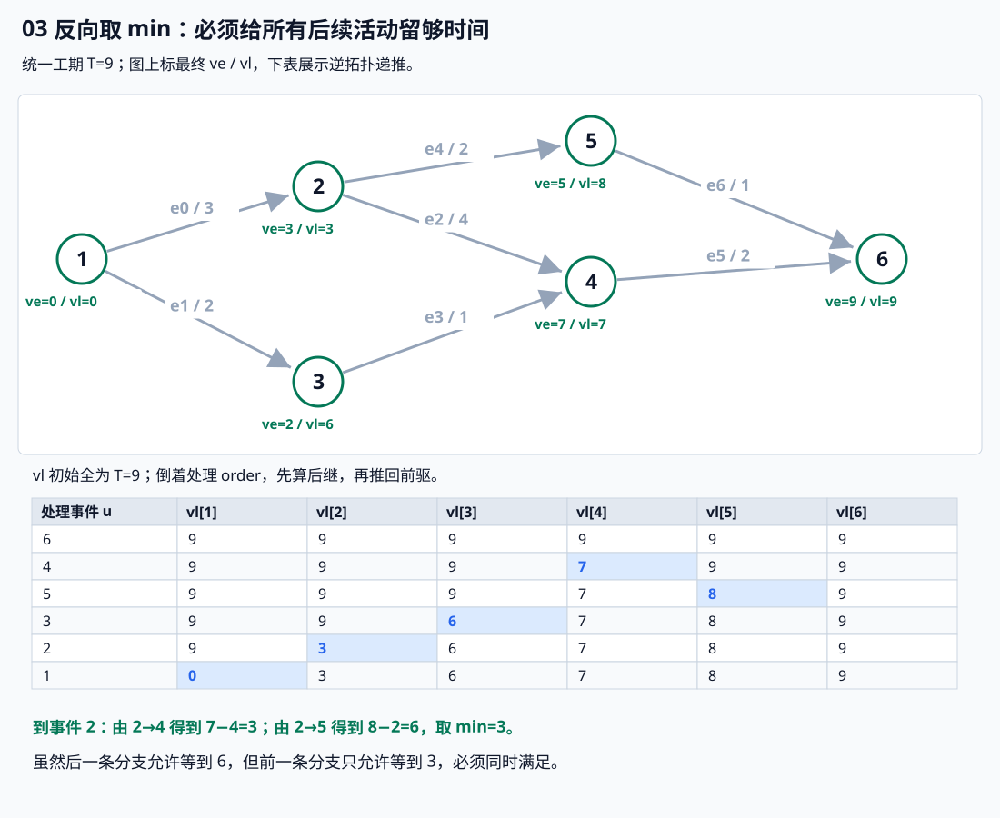
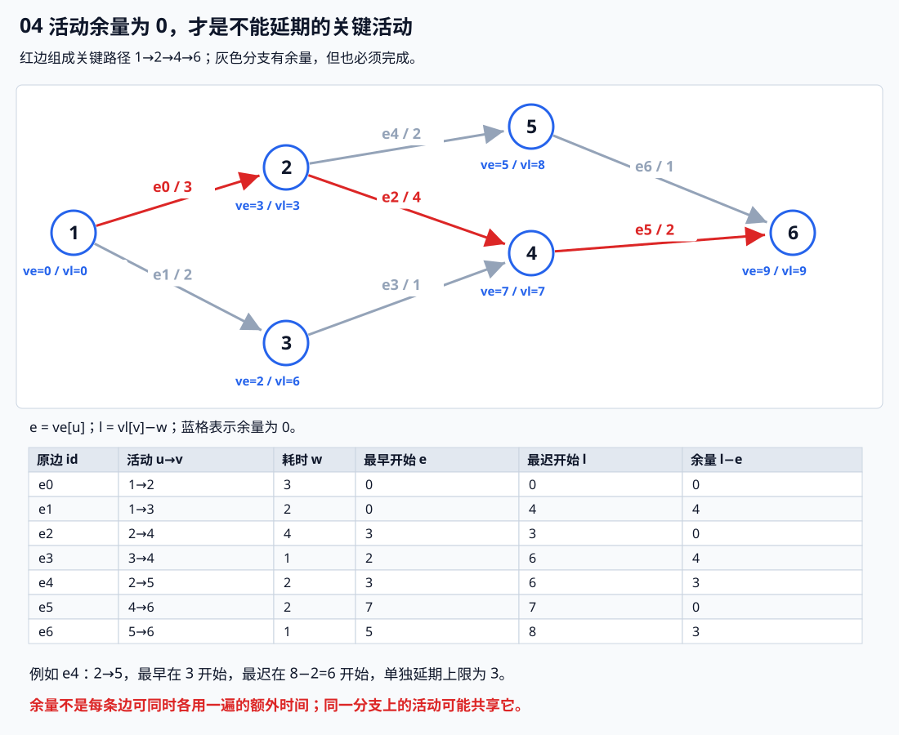
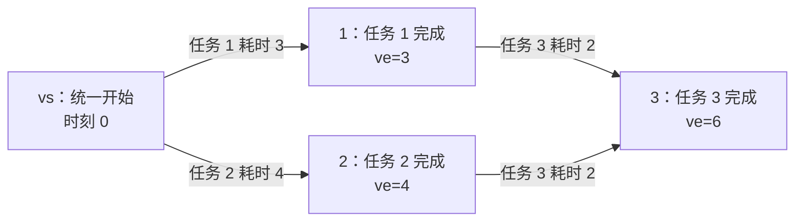

# 6.5 补充：关键路径与项目工期

所属单元：[6.5 拓扑排序与关键路径](05-topological-sort.md)。本篇是应用部分，先熟悉基础篇的拓扑序与 DAG DP，再把同一份顺序用于正向和反向的时间递推。

## 0. 从依赖顺序，到工期与延期余量

已有的拓扑排序告诉我们谁先谁后，DAG DP 还能求最长依赖链。现在把它放进一个项目：**各活动耗时不同，互不依赖的活动可以并行，怎样最快完成？哪些活动不能延期？**

把耗时全部相加会把并行部分也算成串行；只输出一份拓扑序，又没有计算实际时间。因此需要在顺序之外保存**最早能到达的时间，以及不拖延项目时最晚允许的时间**。

本小节使用 **AOE 网：点表示事件，边表示活动，边权表示耗时**。事件本身不额外耗时；只有指向它的活动全部完成，这个事件才可以发生。前文“任务作为点、任务耗时挂在点上”的模型也能处理工期，但状态含义不能直接混用。

## 1. 先给代码：正向算最早，反向算最迟

前提：**1-based、非负活动耗时、活动不能中断、资源充足且允许并行，全部活动都要完成。** 多个源事件都可在时刻 0 开始，多个终点共同受一个项目工期约束；无边时工期为 0。

```cpp
struct Activity {
    int u, v;
    long long w; // 活动 u -> v 的耗时
};

struct CriticalPathResult {
    bool ok;                 // 是否成功：图无环且活动耗时非负
    long long duration;      // 完成全部活动所需的最短项目工期
    vector<long long> ve;    // ve[u]：事件 u 最早能发生的时间
    vector<long long> vl;    // vl[u]：事件 u 最晚允许发生的时间
    vector<long long> slack; // slack[id]：活动 id 的总时差
    vector<int> critical;    // 总时差为 0 的活动原边 id
};

// 1..n 的 AOE 网；所有源事件最早从 0 开始。
// 项目要求全部活动完成；多个终点共用同一个项目截止时间。
// 有环或负耗时返回 ok=false，结果数组为空。
CriticalPathResult critical_path(
    int n, const vector<Activity>& edges) {

    CriticalPathResult r{};
    int m = (int)edges.size();

    vector<vector<int>> g(n + 1); // g[u] 存储从 u 出发的活动 id
    vector<int> indeg(n + 1), order; // 入度、拓扑序

    for (int id = 0; id < m; ++id) {
        const auto& e = edges[id];

        if (e.w < 0) return {}; // 本模板要求活动耗时非负

        g[e.u].push_back(id);
        ++indeg[e.v];
    }

    // 第一遍：拓扑排序，同时计算每个事件的最早发生时间 ve。
    // 所有源事件最早在时间 0 发生，因此 ve 初始全为 0。
    queue<int> q;
    for (int u = 1; u <= n; ++u)
        if (!indeg[u]) q.push(u);

    r.ve.assign(n + 1, 0);

    while (!q.empty()) {
        int u = q.front();
        q.pop();

        order.push_back(u); // u 的所有前驱都已处理，可以处理它的出边

        for (int id : g[u]) {
            const auto& e = edges[id];

            // 活动 u -> v 要在 u 发生后耗时 w 才能完成。
            // v 必须等待所有前驱活动完成，因此取所有候选时间的最大值。
            r.ve[e.v] = max(r.ve[e.v], r.ve[u] + e.w);

            if (--indeg[e.v] == 0)
                q.push(e.v);
        }
    }

    // 无法将所有事件加入拓扑序，说明图中存在有向环。
    // 此时不能使用只计算了一部分的 ve。
    if ((int)order.size() != n) return {};

    // 项目必须完成所有活动，因此以最晚发生的事件时间作为统一工期。
    // 在耗时非负的 DAG 中，这等于最长活动路径的总耗时。
    r.duration = *max_element(r.ve.begin() + 1, r.ve.end());

    // 第二遍：逆拓扑序，计算每个事件最晚允许发生的时间 vl。
    // 所有终点共用项目截止时间 duration，因此先统一初始化为 duration。
    r.vl.assign(n + 1, r.duration);

    for (int i = n - 1; i >= 0; --i) {
        int u = order[i];

        for (int id : g[u]) {
            const auto& e = edges[id];

            // 活动 u -> v 耗时 w。
            // 若 v 最晚在 vl[v] 发生，u 最晚必须在 vl[v] - w 发生。
            // u 有多个后继时，必须满足所有后继的要求，所以取最小值。
            r.vl[u] = min(r.vl[u], r.vl[e.v] - e.w);
        }
    }

    // 计算每项活动的总时差，并找出关键活动。
    r.slack.resize(m);

    for (int id = 0; id < m; ++id) {
        const auto& e = edges[id];

        // 活动最晚开始时间 = vl[v] - w
        // 活动最早开始时间 = ve[u]
        // 总时差 = 最晚开始时间 - 最早开始时间
        r.slack[id] = r.vl[e.v] - e.w - r.ve[e.u];

        // 总时差为 0：该活动不能延迟，否则项目工期会受影响。
        if (r.slack[id] == 0)
            r.critical.push_back(id);
    }

    r.ok = true;
    return r;
}
```

**用途速记：** 给出事件数和活动边，返回项目最短工期、每个事件的最早／最迟时间、每条活动的余量与零余量活动编号。Kahn 顺序中先取 max；再倒着读同一份 order 取 min；最后按原边编号提取关键活动。

**先检查 ok，再读取其他结果。** 有环或负耗时会返回 ok=false、工期 0 与空数组；工期 0 本身也可能是无边或全零耗时的合法结果，不能用它代替成功标志。

代码把已有 Kahn 的入队与正向 DP 放在同一轮内，不修改前文 topo_sort；反向阶段也只需原邻接表，**不必另外建立反向图**。

## 2. 同一张图：事件、活动和状态对应起来



例如事件 4 有两条前置分支，它需要**两边都准备好**；不是任选一条到达就算完成。图上的 e0..e6 是原活动编号，箭头旁还标出活动耗时。

| 变量 | 表示什么 | 容量／范围 |
| --- | --- | --- |
| edges[id] | 一项活动的起点事件 u、终点事件 v、耗时 w | m 项，原边编号 0..m−1 |
| g[u] | 从事件 u 出发的活动 id 列表 | n+1 个列表，总计 m 项 |
| indeg[u] | 尚未处理的前驱活动数量 | n+1 项，重边分别计数并减少 |
| order | Kahn 得到的完整拓扑序 | n 个事件，不含 0 号占位 |
| ve[u] | 全部前置依赖满足后，事件 u **最早**能发生的时刻 | n+1 项，时间用 ll |
| duration | 使全部活动完成的**最短总工期**，下文记为 T | 一个 ll 值 |
| vl[u] | 在不超过 T 的前提下，事件 u **最迟**允许发生的时刻 | n+1 项，时间用 ll |
| slack[id] | 该活动最迟与最早开始时间之差，即总余量 | m 项 |
| critical | 总余量为 0 的原活动 id | 不一定只组成一条路径 |

**ve、vl 的下标是事件编号，slack、critical 处理的是活动编号。** 0 号事件占位不使用，不要把它的数值当成项目起点状态。

## 3. 正向取 max：所有前置都完成，才能继续



先看事件 4。通过 2→4，最早能准备好的时刻是：

$$
\mathrm{ve}[2]+4=3+4=7.
$$

通过 3→4，对应时刻是：

$$
\mathrm{ve}[3]+1=2+1=3.
$$

必须两边都完成，取较晚者：

$$
\mathrm{ve}[4]=\max(7,3)=7.
$$

所以每条活动 u→v，耗时 w，都给 v 提供一个“至少要等到”的时间下界：

$$
\boxed{\mathrm{ve}[v]=\max(\mathrm{ve}[v],\ \mathrm{ve}[u]+w)}.
$$

代码先更新候选时间，再减入度；**只有所有前驱都处理完，v 才入队，届时 ve[v] 才完整确定。** 数组初始为 0 是非负耗时下的时间下界，不表示未处理事件的答案已经算完；所有源事件的合法开始时刻为 0。

全部事件的最早时间为：

$$
(0,3,2,7,5,9).
$$

因此全部活动最快在时刻 9 完成，T=9。代码对所有事件取最大值：非负耗时下，前驱的最早时间不会大于后继，最大值总能在某个终点取得。

**为什么最短工期却在算最长路径？** 路径上的活动必须依次完成，任何安排都不能快于最长依赖链；按 ve 尽早安排又确实能满足全部前置条件，所以这个下界可以达到。

## 4. 反向取 min：给每条后续活动留够时间

工期已经确定为 9，现在问：**事件能推迟到什么时候，才不影响全部活动在 9 之前完成？**



事件 6 是终点，最迟为 9。4→6 还要花 2，所以事件 4 不能晚于：

$$
\mathrm{vl}[4]=9-2=7.
$$

同理，5→6 要花 1，所以 vl[5]=8。接着回推事件 2：

$$
2\to4:\quad \mathrm{vl}[2]\le7-4=3.
$$

这是第一条后续活动给出的最晚限制。

$$
2\to5:\quad \mathrm{vl}[2]\le8-2=6.
$$

第二条分支虽然允许等到 6，第一条却只允许等到 3；两者必须同时满足：

$$
\mathrm{vl}[2]=\min(3,6)=3.
$$

因此对活动 u→v，耗时 w：

$$
\boxed{\mathrm{vl}[u]=\min(\mathrm{vl}[u],\ \mathrm{vl}[v]-w)}.
$$

**正向取 max，是必须等完所有前置；反向取 min，是必须赶上所有后续。** 二者都在同时满足限制，不是随意选一个分支。

vl 初始全设为 T，表示所有事件都先受到项目截止时间限制；终点没有后续活动，保留 T，其他点再被后续要求收紧。倒着遍历 order 时，每个后继的 vl 已经算完，所以上式不会读到尚未确定的后继状态。

最终最迟时间为：

$$
(0,3,6,7,8,9).
$$

注意 ve[3]=2、vl[3]=6：事件 3 可以较早准备好，也允许留出一些等待时间；**最迟时间不是实际安排一定要采用的时刻**。

## 5. 从事件时间，推出活动时间与关键活动

对活动 u→v，耗时 w，先定义 e 为它的最早开始时间、l 为它的最迟开始时间。

起点事件最早在 ve[u] 发生，因此：

$$
e=\mathrm{ve}[u].
$$

终点事件最迟在 vl[v] 发生，必须提前留出 w 的活动时间，因此：

$$
l=\mathrm{vl}[v]-w.
$$

两者相减，就是本活动的总余量：

$$
\boxed{\mathrm{slack}[id]=l-e=\mathrm{vl}[v]-w-\mathrm{ve}[u]}.
$$



例如 2→5 耗时 2，最早在 3 开始，最迟在 8−2=6 开始，余量为 3。**这里用终点的 vl 减耗时，不能直接拿起点 vl[2]=3 当作该活动的最迟开始时间**：事件已经发生后，这一条活动仍可以等待再开始。

**总余量为 0 的活动叫关键活动：它没有可以独立推迟的时间。** 图中 e0、e2、e5 是关键活动，形成关键路径 1→2→4→6，耗时 9。

关键路径是源事件到终点事件的最长耗时依赖路径，可能不止一条。**若两条分支同为最长，只缩短其中一条，不一定能缩短总工期**；另一条仍然会限制完成时刻。因此代码返回全部关键活动，不只回溯任意一条最长路。

**余量不是每条边都能同时独享的额外时间。** 例如 2→5 和 5→6 都有余量 3；若把两项耗时各增加 3，原来长 6 的分支就变成 12，超过原工期 9。讨论余量时，要分清单项变动与多项同时变动。

## 6. 多源、多终点与复杂度边界

本实现把全部活动视为一个项目：**所有源事件可从 0 开始，所有终点都必须在同一个 T 前完成**。这相当于添加耗时为 0 的统一起点和统一终点，但代码不必真的加入它们。

因此多个终点的 vl 都从 T 开始，而不是各自的 ve。比如两个互不依赖的分支分别耗时 3、8，统一项目工期为 8，短分支允许占用剩下的 5 个时间单位；若每个项目有自己的独立截止时间，就不能直接套本约定。

| 阶段 | 时间 | 原因 |
| --- | --- | --- |
| 建图与统计入度 | O(n+m) | 每条活动只存一次出边 id |
| Kahn＋正向求 ve | O(n+m) | 每点入队一次，每条边更新一次 |
| 逆拓扑求 vl | O(n+m) | 倒着读同一份 order，每条边再处理一次 |
| 提取活动余量和关键 id | O(m) | 按输入活动表扫描 |
| 总时间／空间 | O(n+m)／O(n+m) | 不枚举所有拓扑序、所有路线或所有安排 |

例如 n=10⁵、m=2×10⁵，核心只是对这些事件和活动做几次线性扫描，**不会生成 n² 张时间状态表**。

边界：n≥1，端点合法，n+1、m 和入度可由 int 表示；所有路径累计耗时须能由 ll 表示，例如以最大边耗时 W 估算 (n−1)W。允许重边，代表多条同时必须满足的活动；零耗时边合法，自环作为有向环拒绝。重复调用状态重建，不修改输入活动表。

## 7. 典题复盘：P1113 杂务

题目：[P1113 杂务](https://www.luogu.com.cn/problem/P1113)。有前置要求的任务可以并行，工人足够，求全部任务完成的最短时间。题目保证前置任务编号较小，因此依赖图无环。

实际实现已按原题静态复盘，**不重复运行或对拍个人代码，不另补平台评测结论**。共享 critical_path 与开篇算法相同，个人类型名 Act、CPRes 对应 Activity、CriticalPathResult；下面保留 solve 的逻辑，只整理排版和注释。

```cpp
using Act = Activity; // 与开篇通用实现拼接时使用此别名

void solve() {
    int n;
    cin >> n;

    vector<Act> edges;
    int vs = n + 1; // 统一虚拟起点，初始时刻为 0

    for (int i = 0; i < n; ++i) {
        int v;
        ll w;
        cin >> v >> w;

        int u;
        bool haspre = false;
        while (cin >> u && u != 0) {
            edges.push_back({u, v, w}); // w 是当前任务 v 的耗时
            haspre = true;
        }

        if (!haspre)
            edges.push_back({vs, v, w}); // 无前置任务也要计入自身耗时
    }

    auto ret = critical_path(n + 1, edges); // 顶点总数必须包含 vs
    cout << ret.duration << '\n';
}
```

**用途速记：** 将任务 v 的完成时刻作为节点 v 的事件时间，把自身耗时 w 放到指向它的约束边上。没有前置任务时，用虚拟起点补一条入边，从而让所有任务的耗时都能交给同一份边权模板计算。

### 7.1 虚拟起点补上的，正是无前置任务的自身耗时

假设任务 1、2 没有前置，分别耗时 3、4；任务 3 必须等两者完成，自身耗时 2。

若只为原有前置关系建边，图里只有 1→3、2→3，权值都是 2。通用模板会将无入边点的 ve 初始化为 0，于是任务 1、2 自身的耗时就漏掉了。

补上虚拟起点后：



因此没有前置任务的 v，也能使用同一条转移：

$$
\mathrm{ve}[v]=\mathrm{ve}[vs]+w_v=0+w_v.
$$

**vs 不是一项额外任务，不额外耗时；vs→v 的边权是任务 v 的耗时，不能随手填成 0。** 这里补的是原任务缺失的开始计时环节。

代码中两处必须配套：`vs=n+1` 创建新编号，调用 `critical_path(n+1, edges)` 将它纳入顶点范围。只增加边却仍传 n，会让模板按错误的顶点数量分配数组和判断拓扑完成。

### 7.2 多个前置都挂 w，为什么不把任务算多次

任务 3 的两条入边都挂耗时 2，但转移取 max，不是把两条边的贡献相加：

$$
\mathrm{ve}[3]=\max(\mathrm{ve}[1]+2,\ \mathrm{ve}[2]+2)=\max(5,6)=6.
$$

因为同一任务的耗时固定，可以从 max 中提出来：

$$
\max(\mathrm{ve}[1]+2,\ \mathrm{ve}[2]+2)=\max(\mathrm{ve}[1],\mathrm{ve}[2])+2.
$$

**先等最晚完成的前置任务，再做一次当前任务。** 两条入边表达两项都必须满足的时间限制，不表示任务 3 实际做了两遍。

因此 w 始终属于当前读入的任务 v；即使 u 是它的前置，建 u→v 时也不能误用 u 的耗时。

### 7.3 把不同输入情况，统一交给同一条转移

| 任务 v 的情况 | 建图方式 | 得到的完成时间 |
| --- | --- | --- |
| 没有前置 | vs→v，权值为 w_v | 0+w_v |
| 只有一个前置 u | u→v，权值为 w_v | ve[u]+w_v |
| 有多个前置 | 每个 u→v 都挂 w_v | 最晚的前置完成时间+w_v |

**虚拟起点的价值是统一边权模板的输入：把“没有前置”的任务，也变成有一条开始约束可递推的任务。** 若直接用任务点权 DP，也可以从自身耗时初始化；本实现采用虚拟起点，是为了复用已经写好的通用函数。

本题只要求总工期，因此只读取 ret.duration。其他 ve／vl／余量结果仍由通用函数生成，但不需要为本题额外输出；建图后的边 id 表示前置时间约束，不必把每条入边都当成不同的实体任务。

题目保证合法的前置关系且耗时为正，因此原实现直接读取 duration。复用到不保证无环或允许非法耗时的输入时，仍应按通用接口先检查 ret.ok。

设原前置关系共 m 条、无前置任务共 z 个，建图后有 n+1 个点、m+z 条边，z≤n，所以**总时间与空间仍为 O(n+m)**。

来源：[Princeton Algorithms：关键路径法与 DAG 最长路](https://algs4.cs.princeton.edu/44sp/index.php)。本小节的 AOE 最迟时间推导、例图和 C++11 实现按仓库模型自行整理；不引入有限机器调度、资源冲突或不确定工期。

[DAG DP：正推与反推的方向](../../patterns/06-graph-and-tree/dag-dp.md#关键路径同一拓扑序正向取-max反向取-min) · [关键路径竞赛模板](../../templates/06-graph-and-tree/topological-sort/critical_path.hpp)

[返回 6.5 基础篇](05-topological-sort.md) · [本章索引](README.md)
