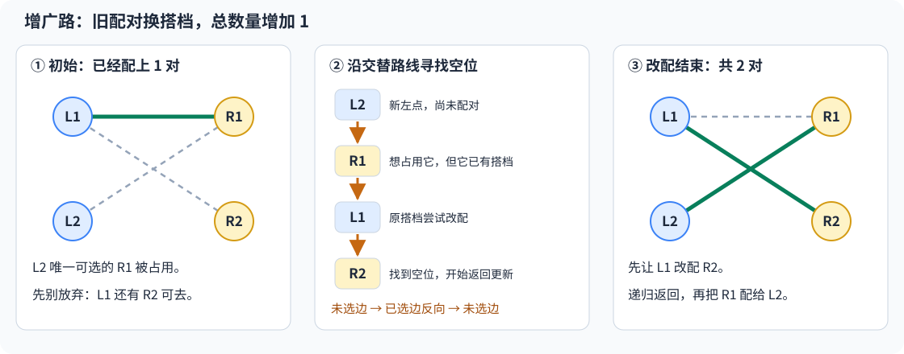
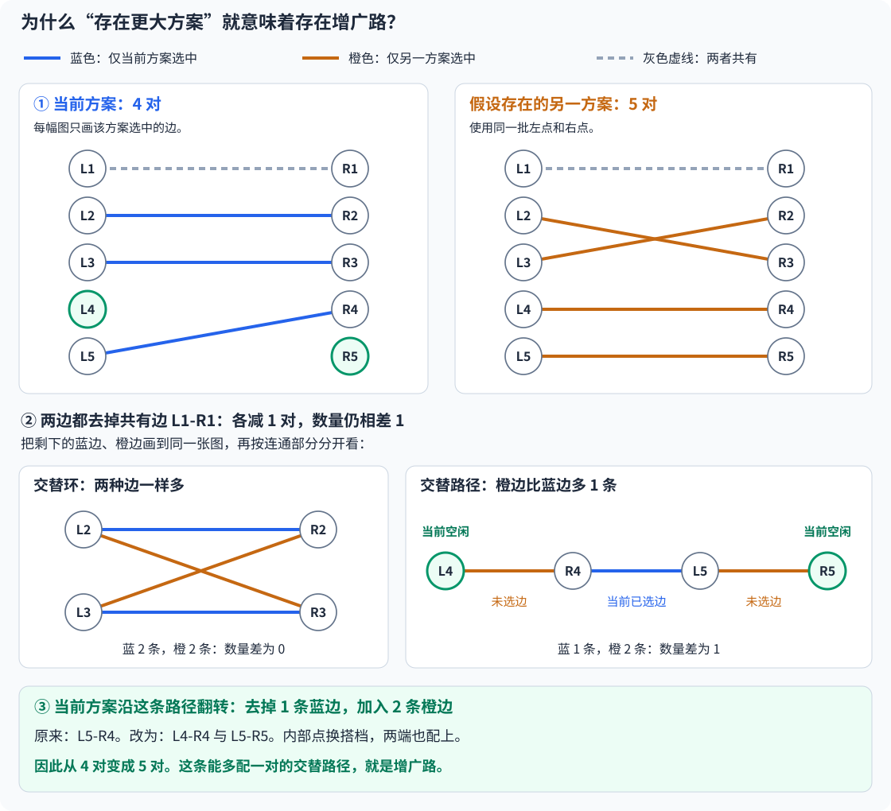
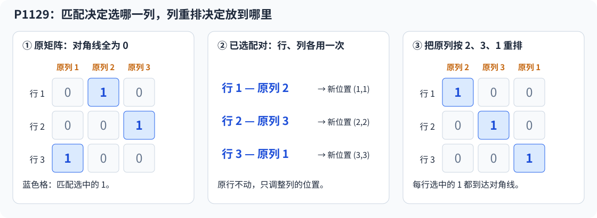

# 6.6 二分图最大匹配：沿增广路重新安排配对

前置：[DFS 与回溯](../03-search/01-dfs-backtracking.md)、[邻接表](01-graph-basics.md)、[二分图染色](02-bipartite-coloring.md)。

> **两类对象之间有兼容关系，每个对象最多使用一次，要求配出尽量多对。**
>
> 已经配上的对象不一定要固定不动。**让旧对象换一个位置，可能就能多安排一个新对象。**

## 0. 前置概念：先弄清什么是增广路

### 匹配：从“可以配”中选出“已经配”的关系

把左侧看作人，右侧看作岗位。**一条边表示这个人可以担任这个岗位，不表示已经安排好了。**

从这些边中选出一些，让每个人、每个岗位都最多出现在一条选中边里，这组**互不共用端点的边**就称为一个**匹配**。选中一条边，就安排好一对。

- **已选边／匹配边：**当前方案已经采用的配对。
- **未选边：**图中存在、但当前方案还没采用的配对；不代表它不合法。
- **已匹配点：**当前已经有搭档的点。
- **未匹配点：**当前还没有搭档的点，也称空闲点。

例如，选中 `L1-R1` 后，`L1` 与 `R1` 都已匹配，不能再直接选 `L2-R1`，因为这样会让 `R1` 同时配给两个人。

**最大匹配**就是选中边数最多的合法方案。它可能有多种具体配法，目标先看数量。

### 小例子：已有搭档，并不表示不能重新安排

左侧有 `L1、L2`，右侧有 `R1、R2`，兼容关系为：

$$
L1\longleftrightarrow R1,\qquad
L1\longleftrightarrow R2,\qquad
L2\longleftrightarrow R1.
$$

按邻接顺序，先把 `L1` 配给 `R1`。轮到 `L2`，它唯一可选的 `R1` 已经被占用。

**若只找空位，会认为不能再配；但让 L1 改配 R2，就能腾出 R1 给 L2。**



图中**绿色实线是已选边，灰色虚线是未选边**。中间的箭头表示搜索和调整的先后，不表示原图必须是有向图。

### 交替路：未选边与已选边交替经过

观察图中这条不重复经过顶点的路径：

$$
L2\longrightarrow R1\longrightarrow L1\longrightarrow R2.
$$

| 经过的边 | 当前是否选中 | 这一步在尝试什么 |
| --- | --- | --- |
| `L2-R1` | 未选 | L2 想使用 R1 |
| `R1-L1` | 已选 | 找到 R1 的原搭档 L1 |
| `L1-R2` | 未选 | 为 L1 寻找另一个位置 |

边的状态为：

$$
\text{未选}\longrightarrow\text{已选}\longrightarrow\text{未选}.
$$

**已选边与未选边交替出现的路径，称为交替路。** 注意这里交替的是“边是否被选中”，不只是左右两类顶点交替。

### 增广路：两端都空闲的交替路

> **相对于当前匹配，若一条交替路的起点和终点都未匹配，它就是增广路。**

上例中，起点 `L2` 没有岗位，终点 `R2` 没有人占用，因此这条交替路可以增广。

把沿途边的选中状态翻转：

$$
\{L1\!-\!R1\}
\quad\longrightarrow\quad
\{L2\!-\!R1,\ L1\!-\!R2\}.
$$

原来的一对被重新安排，最终变为两对。

一般地，若增广路有 `k` 条已选边，就会有 `k+1` 条未选边：

$$
\text{配对数变化}=(k+1)-k=1.
$$

两端由未配对变为已配对；内部点只是换搭档，仍各用一次。**增加的是总配对数量，不要求原来的具体配对关系不变。**


**“增广”增加的是配对数，不是给原图增加顶点或边。** 同一条路径是否能增广，要看当前哪些边已经选中。

### 两个边界：交替路不一定能增广，也不一定要绕远

若只走到原搭档 `L1` 就停止：

$$
L2\longrightarrow R1\longrightarrow L1.
$$

虽然仍是“未选 → 已选”，但终点 `L1` 已匹配。直接翻转只会让 `L2` 顶替 `L1`，**少一对、加一对，总数不变**，所以它不是增广路。

反过来，**若一开始所有点都未匹配，图中的一条 `L1-R1` 就已经是增广路**：两端空闲，直接选它，数量从 `0` 变成 `1`。**只有一条边时，同样符合交替要求**。

**先理解“找到空闲终点 → 沿路重新安排 → 总数增加一对”，再看下面 DFS 如何找到并更新这条路。**

## 1. 通用实现：DFS 寻找增广路

本节假设左右两类已经划分好，边只连接不同类。采用 **DFS 增广路写法，也称 Kuhn 算法**；常见竞赛资料也称其为“匈牙利算法的 DFS 写法”，这里不涉及带权匹配。

左右两侧**分别从 1 编号**。`g[u]` 存左点 `u` 可以连接的右点；不修改输入图，返回最大配对数量与对应方案。

```cpp
struct MatchingResult {
    int count;
    vector<int> match_right;
};

// g 有 n + 1 项；g[u] 中的右点编号必须在 1..m 内
MatchingResult maximum_matching(const vector<vector<int>>& g, int m) {
    int n = static_cast<int>(g.size()) - 1;

    vector<int> match_right(m + 1, 0); // 右点当前配给谁；0 表示还空着
    vector<int> vis(m + 1, 0);         // 本轮已经尝试过的右点

    function<bool(int)> augment = [&](int u) -> bool {
        for (int v : g[u]) {
            if (vis[v]) continue;
            vis[v] = 1;

            // v 空着，或原来占用 v 的左点能够换到其他右点
            if (match_right[v] == 0 || augment(match_right[v])) {
                match_right[v] = u;
                return true;
            }
        }

        return false; // 所有分支都无法为 u 腾出位置
    };

    int count = 0;

    for (int u = 1; u <= n; ++u) {
        fill(vis.begin(), vis.end(), 0); // 新一轮搜索，重新允许尝试各个右点

        if (augment(u)) {
            ++count; // 旧配对经过调整后仍保留，总数只增加一对
        }
    }

    return {count, match_right};
}
```

辅助类型依赖 `vector`、`function` 和 `fill`，沿用通用框架中的标准库头文件与 `using namespace std;`。

## 2. 变量、容器与编号

设左侧有 `n` 个点，右侧有 `m` 个点，共 `e` 条边。

| 变量或容器 | 含义与范围 | 容量依据 |
| --- | --- | --- |
| `g[u]` | 左点 `u` 的可选右点，`u` 在 `1..n`，其中的 `v` 在 `1..m` | 外层 `n+1` 项，内部共存 `e` 个右点编号 |
| `match_right[v]` | 右点 `v` 当前配给哪个左点；`0` 表示未配对 | 按右侧点数开 `m+1` 项 |
| `vis[v]` | 右点 `v` 在**本轮整次搜索中**是否已尝试 | 按右侧点数开 `m+1` 项 |
| `augment(u)` | 能否通过直接配对或调整旧配对，为左点 `u` 安排位置 | 成功返回 `true` |
| `count` | 当前配对数量 | 不超过 `min(n,m)` |

**左点 1 与右点 1 是两个不同对象。** 相同编号不会让它们成为同一个点，也不需要先把右点编号整体加上 `n`。

这里虽然描述无向的兼容关系，实现只需记录**左 → 右**的邻接列表；从右点回到原配对左点，直接查 `match_right[v]`。

> **不能照搬普通无向图的读图方式，再写 `g[v].push_back(u)`。** 本实现的 `g` 外层只按左点编号使用。

若题目给的是尚未划分两侧的一般无向图，先判断能否[二分图染色](02-bipartite-coloring.md)，再整理左右两侧编号。不是任意图都能直接套用本节实现。

## 3. 为什么不能配不上就放弃？

回看[开篇的增广路例子](#0-前置概念先弄清什么是增广路)：`L2` 不能直接使用 `R1`，但调整 `L1` 的位置后，仍然可以成功。

所以，代码中的搜索要依次回答：

1. **当前左点能连接哪些右点？** 遍历 `g[u]`。
2. **这个右点空着吗？** 若空着，就找到了增广路的终点。
3. **如果已经被占用，原搭档能换位置吗？** 沿已选边找到原左点，再递归尝试它的其他邻居。
4. **找到空闲终点后，怎样更新配对？** 先安排深层的原搭档，再沿递归返回，把腾出的位置交给前面的左点。

**DFS 负责找出路，沿递归返回时的赋值负责完成改配。** 接下来逐句看这一过程。

## 4. 递归改配：先替原占用者找到去处

重点看这一段：

```cpp
if (match_right[v] == 0 || augment(match_right[v])) {
    match_right[v] = u;
    return true;
}
```

### 情况一：右点本来就空着

`match_right[v] == 0` 为真，短路求值，不再调用后面的递归。

直接将右点 `v` 配给当前左点 `u`，本次安排成功。

### 情况二：右点已经有搭档

先递归尝试 `augment(match_right[v])`：**原来占用 v 的左点，能否改配其他右点？**

- **可以改配：**原占用者已经有了新位置，当前层再把 `v` 改配给 `u`。
- **不能改配：**当前配对保持，继续尝试 `u` 的其他邻居。

以上例为例，右点编号就是 `1、2`：

| 执行位置 | 行为 | `match_right[1], match_right[2]` |
| --- | --- | --- |
| 第一轮结束 | `L1` 占用 `R1` | `1, 0` |
| 第二轮 `augment(2)` | 尝试 `R1`，发现原搭档为 `L1`，递归 `augment(1)` | `1, 0` |
| 递归中的 `augment(1)` | 跳过本轮已尝试的 `R1`，找到空着的 `R2` | `1, 1` |
| 返回 `augment(2)` | `L1` 已有新位置，将 `R1` 改配给 `L2` | `2, 1` |

> **更新顺序是先解决深层的去处，再沿递归返回更新前面的搭档。** 中间可能暂时在两项中记录同一左点；整次增广返回后，配对才全部调整完毕。

**失败分支不必撤销配对：赋值只发生在找到成功路线之后，而且赋值后立即返回 `true`。若整次搜索返回 `false`，没有配对被改写**。

- 返回 `true`：找到增广路后，递归沿整条路径逐层修改配对，并立即返回 `true`，使匹配数增加 1。
- 返回 `false`：当前分支找不到增广路，继续尝试其他分支；若所有分支均失败，则本轮搜索结束，匹配数无法再增加。

## 5. 为什么访问标记每轮清空，返回时却不撤销？

### `vis`：只服务当前这一次增广搜索

```cpp
if (vis[v]) continue;
vis[v] = 1;
```

在同一轮中，右点 `v` 已经被尝试，就不再重复进入。否则上例可能反复出现：

$$
L2\to R1\to L1\to R1\to L1\to\cdots
$$

**DFS 返回后不写 `vis[v]=0`。** 它表示“本轮已经搜索过”，不是“仅在当前递归路径上”。一次失败搜索中，该右点及其可改配的后续分支已经被检查，不必换条路线重复检查。

但开始安排下一个左点时，必须重新清空：

```cpp
fill(vis.begin(), vis.end(), 0);
```

上例第一轮已经尝试 `R1`；若标记永久保留，第二轮就不能从 `L2` 再尝试 `R1`，也就找不到改配路线，错误停在一对。

### `match_right`：跨轮保留的当前方案

**不能跟着 `vis` 一起清空。** 下一轮正是基于已经安排好的配对，尝试多增加一对。

| 内容 | DFS 返回后 | 开始下一轮 |
| --- | --- | --- |
| `vis[v]` | 保持本轮已尝试标记 | 全部清空，重新搜索 |
| `match_right[v]` | 成功时沿返回过程改配，失败时不变 | 保留当前方案 |

与[回溯和 BFS 的标记区别](../03-search/02-bfs-shortest-path.md#7-与回溯中访问标记的区别)相同，**标记何时撤销，要由它记录的含义决定。**

## 6. 为什么能得到最大数量，而不只是某个可行方案？

### 只看能否直接加边，还不够

上例的一对方案，已经不能在原配对不动的前提下直接加边，却仍能通过改配增加数量。

所以要排除的是**全部增广可能**，不只是“没有现成空位”。

> **增广路定理：一个匹配是最大匹配，当且仅当不存在增广路。**

下面用**当前方案 4 对、另一方案 5 对**的小图，逐步看出增广路藏在哪里。上半部分分别画两份方案，下半部分把剩下的边叠在一起。



#### 第一步：去掉共有边，不改变两份方案的数量差

图中的 `L1-R1` 被两份方案共同选中，两边各去掉一条：

$$
4-1=3,\qquad 5-1=4.
$$

**另一方案仍然多一对。** 共有边的两个端点在两份方案中都已有搭档，不可能再连接其他选中边；**移除后，它们只是孤立点，不影响后续比较**。

#### 第二步：叠起来后，为什么只能形成交替路径或环？

蓝边表示仅当前方案选中，橙边表示仅另一方案选中。

每个点在每份方案中最多使用一次，所以**每个点最多连一条蓝边、一条橙边**。若连着两条边，颜色必然不同。

因此路线不会分叉：沿边走，要么在端点停下形成路径，要么绕回起点形成环；沿途颜色交替。这里忽略没有边的孤立点。

图中左下方的环，蓝边与橙边各两条：

$$
\text{环上的数量差}=2-2=0.
$$

**环可以改变具体搭档，却不能解释另一方案为什么更多。** 一般交替环上，两种颜色的边也必然一样多。

#### 第三步：多出来的一条边，只能来自某条路径

图中右下方的路径为：

$$
L4\longrightarrow R4\longrightarrow L5\longrightarrow R5.
$$

沿途为**橙 → 蓝 → 橙**：

$$
\text{这条路径上的数量差}=2-1=1.
$$

路径两端 `L4、R5` 都只有橙边，没有当前方案的蓝边，也没有已去掉的共有边。**所以它们在原来的当前方案中都未匹配**，这就是一条增广路。

把一条蓝边换成两条橙边，内部点换搭档，两端也配上，当前方案便从 `4` 对增加到 `5` 对。

> **一般情况下，路径上的两种边可能一样多，也可能某一种多一条。环不能产生数量差；**
>
> **若另一方案总数更多，就至少有一条路径是“另一方案多一条”。它的两端都在当前方案中空闲，因此必然存在增广路。**

反过来，只要找到增广路，翻转后就能多一对。因此，**没有增广路才说明数量无法继续增加。** 定理及 DFS 寻路思路可参照 [Cornell CS 2110](https://courses.cs.cornell.edu/cs2110/2025fa/discussions/dis11/)。

综上：

> **二分图匹配定理：一个匹配是最大匹配，当且仅当图中不存在相对于该匹配的增广路**。

### 为什么每个左点只需尝试一次？

**核心：旧图已经是最大匹配，加入新左点后，只需判断能否再增加一对**。

假设前 \(u-1\) 个左点已经得到最大匹配，现在加入左点 \(u\)：

- 尝试增广： 从 \(u\) 出发寻找增广路，找到则匹配数 `count++`，否则不变。
- 无需重试旧点： 旧图不存在增广路，因此**新图中若出现增广路，它必然经过新点 \(u\)**。否则旧匹配早就不是最大匹配，与实际不符。

**每次只新增一个左点，匹配数最多增加 1。因此，每个左点作为起点搜索一次即可，DFS 内部仍可递归访问旧点，调整已有配对**。

## 7. 返回值、复杂度与边界

### 数量与配对方案

`result.count` 是最大配对数量；遍历右点 `v=1..m`，若 `result.match_right[v] != 0`，就得到一对：
$$
(\mathrm{result.match\_right}[v],\ v).
$$

`count==n` 表示**每个左点都被配上**。只有左右点数相同，且这些点全被覆盖时，才是**完美匹配**；一般情况下不能把“覆盖左侧”与“覆盖全部点”混为一谈。

### 复杂度

**每轮右点只尝试一次，同一个已匹配左点也不会被反复递归展开；邻接边至多扫描一遍**。另有清空 `vis` 的 `O(m)` 开销。

因此，本实现对正整数 `n、m` 的时间上界为：

$$
O\bigl(n(m+e)\bigr).
$$

**包含输入图的空间为 `O(n+m+e)`**；辅助数组和递归栈为 `O(n+m)`。递归深度可能随改配链长度增长，不应把它当作固定常数。

### 需要检查的边界

- **无边或孤立点：**该点的搜索自然失败，不影响其他点；没有任何边时返回 `0`。
- **重边：**不会增加匹配数量，`vis` 会阻止一轮内重复尝试同一右点。
- **多组输入：**每次调用重新创建匹配与标记；不能沿用上一组方案。
- **多种最优方案：**邻接顺序可能影响具体搭档，但不影响最大数量。
- **目标发生变化：**最大权值、允许一对多、一般图匹配，不是本节实现直接解决的模型。

## 8. 与二分图染色有什么区别？

| 模型 | 要回答的问题 | 核心记录 |
| --- | --- | --- |
| 二分图染色 | **能否把点分为两组**，使每条边跨组？ | `color[u]`：点属于哪一组 |
| 二分图最大匹配 | **两组已经确定**，最多能选多少条互不共用端点的边？ | `match_right[v]`：右点配给谁 |

**能染色不表示每个点都能配上。** 例如两个左点都只连接同一个右点，图当然是二分图，但最多只能选一条边。

识别匹配时，先问：

**两类对象分别是什么？一条边表示怎样的兼容关系？是否每个对象最多使用一次？目标是配对数量还是权值？**

## 9. 典题与复盘

### 9.1 洛谷 P3386：二分图最大匹配

题目：[P3386 [模板] 二分图最大匹配](https://www.luogu.com.cn/problem/P3386)。

**收录原因：**区分“当前能直接配上”和“经过改配后仍能配上”，将增广路落实为递归中的腾位过程。

原题左右两侧分别编号，`n,m≤500`，`e≤5×10⁴`，可能有重边。

#### 原实现

保留原逻辑，仅整理排版和注释；通用主框架未改变，这里只列 `solve()`。

```cpp
void solve() {
    int n, m, e;
    cin >> n >> m >> e;

    vector<vector<int>> g(n + 1);

    while (e--) {
        int u, v;
        cin >> u >> v;
        g[u].push_back(v);
    }

    vector<int> match_r(m + 1);
    vector<bool> vis(m + 1); // 标记本轮已经尝试过的右点

    function<bool(int)> augment = [&](int u) -> bool {
        for (int v : g[u]) {
            if (vis[v]) continue;

            vis[v] = true;

            // 右点空着，或原搭档能够改配，才把它交给当前左点
            if (match_r[v] == 0 || augment(match_r[v])) {
                match_r[v] = u;
                return true;
            }
        }

        return false;
    };

    int cnt = 0;

    for (int u = 1; u <= n; ++u) {
        fill(vis.begin(), vis.end(), false);

        if (augment(u)) {
            ++cnt;
        }
    }

    cout << cnt << '\n';
}
```

#### 关键行为与写法取舍

- **`match_r` 初始为 `0`：**左右编号都从 `1` 开始，所以 `0` 可以明确表示右点尚未匹配。
- **`vis` 标记右点：**同一轮搜索中不重复尝试，避免在旧配对之间绕回；开始下一个左点前清空。
- **只有增广成功才计数：**递归中可能调整多个搭档，但整条路线最终只多出一对。
- **建图只存左到右：**回到原搭档直接查询 `match_r[v]`，不再添加反向邻接记录。

原实现已简洁、正确，不需要再制造一份等价“优化版”。若后续需要复用或输出方案，可调用[通用实现](#1-通用实现dfs-寻找增广路)并保留返回的右侧搭档表；只是封装方式不同。

时间上界 `O(n(m+e))`，包括每轮清空右侧标记；包含输入图的空间为 `O(n+m+e)`。`vector<bool>` 只做标记读取、赋值与整体填充，适合这里的用法。

**状态：复盘完成。** 原实现已本地核验；平台结果未单独提供，不补记平台 AC。

### 9.2 洛谷 P1129：矩阵游戏

题目：[P1129 [ZJOI2007] 矩阵游戏](https://www.luogu.com.cn/problem/P1129)。

**收录原因：**从允许的交换操作中分清“对象之间的关系”和“对象当前的位置”，把最终排列目标转成一一配对的存在性。

原题允许任意次交换任意两行或任意两列，要求主对角线全黑；`n≤200`，最多 `20` 组，输出 `Yes/No`。

#### 原实现

保留原逻辑，仅整理排版和注释。**本题主框架需读取 `T` 并重复调用 `solve()`**；每次调用中的图、搭档与标记都会重新创建。

```cpp
void solve() {
    int n;
    cin >> n;

    vector<vector<int>> g(n + 1);

    for (int i = 1; i <= n; ++i) {
        for (int j = 1; j <= n; ++j) {
            int x;
            cin >> x;

            if (x == 1) {
                g[i].push_back(j); // 原来的第 i 行与第 j 列可以配对
            }
        }
    }

    vector<int> match_r(n + 1);
    vector<bool> vis(n + 1); // 标记本轮已经尝试过的右点

    function<bool(int)> augment = [&](int u) -> bool {
        for (int v : g[u]) {
            if (vis[v]) continue;

            vis[v] = true;

            if (match_r[v] == 0 || augment(match_r[v])) {
                match_r[v] = u;
                return true;
            }
        }

        return false;
    };

    int cnt = 0;

    for (int u = 1; u <= n; ++u) {
        fill(vis.begin(), vis.end(), false);

        if (augment(u)) {
            ++cnt;
        }
    }

    cout << (cnt == n ? "Yes\n" : "No\n");
}
```

#### 已经找到关系，还需要辨认最终目标

建模的第一步已经完成：

- **左点：**原矩阵中的各行。
- **右点：**原矩阵中的各列。
- **边：**`a[i][j]==1`，表示这一行与这一列的交点为黑色，可以选来组成最终对角线。

最初思考仍容易被 `(i,i)` 限制，认为“原来的行 i，必须配原来的列 i”。

但交换会改变**当前位置**。原来的行 `1` 与列 `2`，完全可以被安排到最终的第 `1` 行、第 `1` 列，它们的交点就成为新的对角线格子。

> **不能固定的是原始位置；必须保留的是行列之间哪些交点为 1 的关系。** 允许交换并不表示可以把矩阵中的 1 任意移动或凭空增加。

#### 从例子看：只重排列，就能让选中的 1 到达对角线

下面矩阵的原对角线全是 `0`，但可以选择三对：

$$
(\text{行 }1,\text{列 }2),\qquad
(\text{行 }2,\text{列 }3),\qquad
(\text{行 }3,\text{列 }1).
$$

把原来的列按 `2、3、1` 排列，三处选中的 `1` 就都落在新对角线上。



这里不需要原对角线预先有 `1`，也不需要把交换过程全部模拟出来。

#### 必要性：若能成功，就一定能找出 n 对

成功后的主对角线有 `n` 个黑格，每个格子占用不同的行、不同的列。

把这些行列沿交换过程对应回原矩阵，仍然是 **n 个互不重复的行列配对，且原交点都是 1**。所以它们构成大小为 `n` 的匹配。

$$
\text{能变成全黑对角线}\quad\Longrightarrow\quad\text{最大匹配数}=n.
$$

左、右各只有 `n` 个点，匹配数量本来就不可能超过 `n`。

#### 充分性：若配满 n 对，就一定能通过交换实现

> **一一匹配保证选中的行互不重复、选中的列也互不重复，所以调整某一对所在行列的位置时，不会让两个选中点挤到同一行或同一列。** 有 n 对这样的点，就能通过行列重排，把它们分别安排到 `(1,1)、(2,2)、…、(n,n)`，组成全黑主对角线。

保持原行顺序，设第 `i` 行选中的列为 `c_i`。每行都配上，且各行选中的列互不相同。

因此可以把原列按下面的顺序排列：

$$
c_1,c_2,\ldots,c_n.
$$

原来的第 `c_i` 列现在排到第 `i` 列；第 `i` 行与它的交点原本为 `1`，因此新位置 `(i,i)` 就为 `1`。

任意列排列都能通过若干次两列交换得到；例如从左到右，把每个需要的列交换到当前位置即可。**实际上只交换列就足以完成构造，题目允许的操作已经足够。**

$$
\boxed{\text{能变成全黑对角线}\quad\Longleftrightarrow\quad\text{最大匹配数}=n.}
$$

这也就是原实现最后检查 `cnt==n` 的原因：左右各 `n` 个点，全部一一配上，形成**完美匹配**。

#### 多个 1 是候选，不必提前删成一对一

一行或一列有多个 `1`，只表示有多个可选对象。输入图可以保留全部候选边，**只有最后选中的匹配边才需要互不共用端点**。

冲突由增广过程调整，不必在建图时手动删除候选。反过来，每行每列都至少有一个 `1`，也不足以保证成功。例如：

$$
\begin{pmatrix}
1&1&0\\
0&0&1\\
0&0&1
\end{pmatrix}.
$$

虽然没有全零行或全零列，但第 `2、3` 行都只能选择第 `3` 列，无法同时配上。**局部都有候选，不等于整体存在一一对应。**

#### 这次可以迁移的思考顺序

**允许任意交换／重新排列 → 先看哪些对象关系不变 → 找出最终必须满足的一一对应 → 判断能否全部配上。**

不能看到“任意交换”就直接套匹配；还要确认关系可表示为两类对象间的兼容边、每个对象最多使用一次，且目标确实只依赖所选配对。若限制交换次数、位置、顺序或还要求最小代价，需要重新建模。

本题读取矩阵需 `O(n²)`，增广部分最坏 `O(n³)`；包含图的空间最坏 `O(n²)`。原实现与模板题只有建图、右侧规模和最终目标不同，保留这两处差异即可，不再增加另一份等价实现。

**状态：复盘完成。** 原实现已本地核验；平台结果未单独提供，不补记平台 AC。

## 10. 自查

1. 为什么递归先替原占用者找位置，返回后才改写当前右点的搭档？
2. `vis` 为什么本轮不撤销、下一轮却必须清空？`match_right` 为什么相反？
3. 为什么每个左点只发起一轮增广，就能得到全局最大配对数量？
4. P1129 为什么只要选出 n 对，就能通过交换得到全黑对角线？原行顺序需要改变吗？

后续结合已有区间技巧进入 [9.5 ST 表](../09-data-structures/05-sparse-table.md)，学习静态查询与倍增长度预处理；不要求先学完整章图论。

[返回本章索引](README.md) · [本章范式](../../patterns/06-graph-and-tree/README.md)

竞赛短写法见[二分图最大匹配模板](../../templates/06-graph-and-tree/bipartite-matching/README.md)：保留逐轮清标记与右侧搭档，返回数量和方案；不改本篇原实现。
