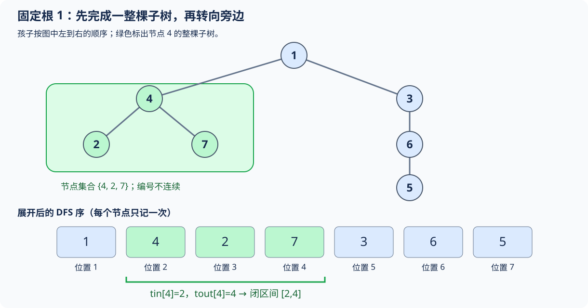
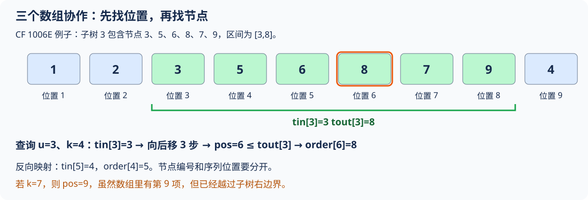
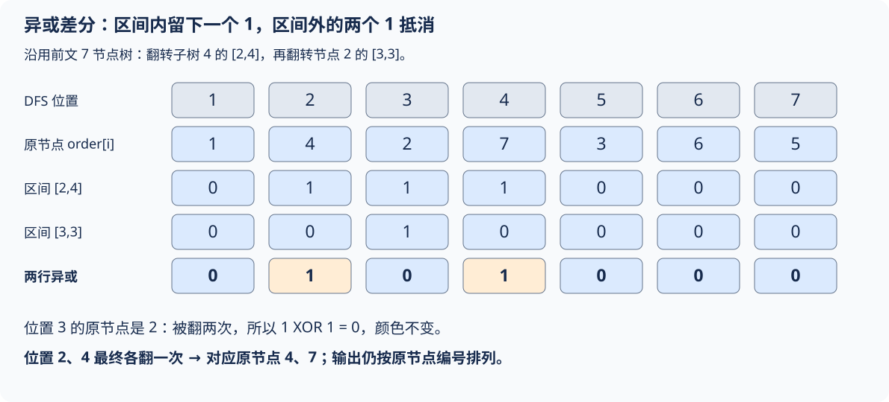

# 6.7 DFS 序：把子树映射成连续区间

前置：[树与父子关系](01-graph-basics.md#7-树限制更强的图)、[显式栈与 next 游标](01-graph-basics.md#6-dfs递归与显式栈)、[前缀和](../02-sequence-techniques/01-prefix-sum.md)。

DFS 序是按深度优先搜索的规则给节点排出的顺序。**本节只在第一次进入节点时记录一次，序列长度恰好为 n。**

> **固定根后，一棵子树中的所有节点，在这个顺序中占据一段连续区间。** 树上的子树操作，就能转成已经学过的数组区间操作。

配套实现：[DFS 序竞赛模板](../../templates/06-graph-and-tree/dfs-order/README.md)。本节建立父亲、深度和子树区间，LCA 与树形 DP 后续再接入。

## 0. 遇到的问题：子树不按节点编号连续

树上每个节点都有权值，要反复询问“某个节点及其全部后代的权值和”。

逐次 DFS 遍历子树能正确求解，但一次可能访问整棵树；q 次查询最坏 `O(nq)`。**完全静态时，也可以一次从孩子向父亲累加，预处理全部子树和；并非必须使用 DFS 序。**

如果还要修改节点权值，预处理的和又需要维护。已有 BIT、线段树能处理数组区间，但节点编号通常没有区间意义：节点 `4` 的后代可能是 `2、7`。

因此先解决表示问题：**重新安排“数组位置”，让每棵子树连续，再选择查询与修改工具。** 原节点编号不变，只多维护一套位置映射。

## 1. 主实现：显式栈记录进入与完成时刻

输入为**非空、连通、无环的无向树**，边的两个方向都已存入邻接表；点编号 `1..n`，根合法，`g[0]` 留空。节点数、邻接列表长度可用 int 表示，内存足够。

```cpp
#include <stack>
#include <vector>

struct DFSOrder {
    std::vector<int> parent, depth;
    std::vector<int> tin, tout, order;

    // 初始化节点信息：节点编号为 1..n，0 号位置不使用。
    explicit DFSOrder(int n)
        : parent(n + 1), depth(n + 1),
          tin(n + 1), tout(n + 1), order(n + 1) {}

    // 子树大小：DFS 序中，u 的整棵子树占据连续区间 [tin[u], tout[u]]。
    int subtree_size(int u) const {
        return tout[u] - tin[u] + 1;
    }

    // 祖先判断：v 的进入时间位于 u 的子树区间内，当且仅当 u 是 v 的祖先（含自身）。
    bool is_ancestor(int u, int v) const {
        return tin[u] <= tin[v] && tin[v] <= tout[u];
    }
};

// 迭代 DFS：计算父节点、深度、DFS 序进入/退出时间。
// 避免递归过深导致栈溢出；要求 g 表示以 root 为根的树。
DFSOrder tree_order(const std::vector<std::vector<int>>& g, int root = 1) {
    int n = static_cast<int>(g.size()) - 1;
    DFSOrder t(n);

    // next[u] 记录 u 下一条待检查的邻接边下标。
    // 这是模拟递归的关键：从子树返回后，继续检查尚未处理的边。
    std::vector<int> next(n + 1);

    std::stack<int> st;
    int timer = 0;

    // 首次进入根节点：根没有父节点，深度为 0。
    t.parent[root] = 0;
    t.depth[root] = 0;
    t.tin[root] = ++timer;
    t.order[timer] = root;
    st.push(root);

    while (!st.empty()) {
        int u = st.top();

        // u 的所有邻接边均已检查，说明它的整棵子树已经遍历完毕。
        if (next[u] == static_cast<int>(g[u].size())) {
            // timer 不再增加：当前值就是 u 的子树最后一个节点的 DFS 序。
            t.tout[u] = timer;
            st.pop();  // 返回父节点，继续检查父节点剩余的邻接边。
            continue;
        }

        // 先推进邻接边下标，再进入子节点。
        // 子节点处理完毕后，next[u] 已指向下一条边，不会重复访问。
        int v = g[u][next[u]++];

        // 树中跳过父边，避免沿原路返回。
        if (v == t.parent[u]) continue;

        // 首次进入 v：记录父节点、深度和 DFS 序。
        t.parent[v] = u;
        t.depth[v] = t.depth[u] + 1;

        // 只有首次进入节点时才增加 timer；退出节点时不增加。
        t.tin[v] = ++timer;
        t.order[timer] = v;
        st.push(v);
    }

    return t;
}
```

输入图只读，函数返回独立的遍历结果。**这里只跳过父亲而不用 vis，依据是输入保证为树。** 一般图有环或重边时不能照搬这个条件；树外的输入不由本函数校验。

## 2. 变量与两套编号

| 变量 | 含义与范围 |
| --- | --- |
| `u、v` | 原节点编号，`1..n` |
| `root` | 本次固定的根；不一定必须为 1 |
| `parent[u]` | u 的父亲；根的父亲为 0，0 不是真实节点 |
| `depth[u]` | 从根到 u 的边数；根深度为 0 |
| `timer` | 已经首次进入过多少个节点，最终为 n |
| `tin[u]` | 首次进入 u 时，它在 DFS 序中的位置，`1..n`，即**子树在 DFS 序中的左端点** |
| `tout[u]` | **u 的子树最后一个节点在 DFS 序中的位置**，即**子树在 DFS 序中的右端点** |
| `order[i]` | **DFS 序第 i 个位置（第 i 个遍历的节点）对应的原节点编号，`order[0]` 不使用** |
| `next[u]` | g[u] 中下一条待检查记录的位置，`0..g[u].size()` |

- **数组长度取决于访问它的下标**：next、parent、depth、tin、tout 都按原节点编号 u 访问；order 才按 DFS 序位置 i 访问。两套下标都在 `1..n`，所以都开 `n+1` 项。**tin[u] 里面存位置，不等于 tin 按位置访问。**
- **`next[u]` 存的是邻接表下标**： 从 `0` 开始；当 `next[u] == g[u].size()` 时，说明节点 `u` 的所有邻接边都已检查完毕。这里比较的是 `g[u]` 的长度，与未使用的 `g[0]` 无关。

### 每个变量留着，后续具体做什么？

**DFS 序的基本过程仍是正常的前序遍历：先记录当前节点，再完整处理每个孩子。** 多维护这些数组，是为了以后不必重新搜索整棵子树。

| 变量 | 从什么找到什么 | 后续用途 |
| --- | --- | --- |
| `tin[u]` | **节点编号 → DFS 序位置** | 找到 u；作为子树左端点，把节点修改转到数组位置 |
| `order[i]` | **DFS 序位置 → 节点编号** | 取出第 i 个访问的节点，把序列答案映回原节点 |
| `tout[u]` | **节点编号 → 子树右端位置** | 确定子树在哪里结束，判断位置是否已超出子树 |
| `parent[u]` | 节点 → 父节点 | 无向树遍历时跳过父边，后续祖先跳跃也要用 |
| `depth[u]` | 节点 → 距根的边数 | 比较深浅，后续计算祖先、路径长度时使用 |
| `next[u]` | 节点 → 下次检查哪个邻接位置 | 只服务于本次显式 DFS，返回后接着遍历；不是题目答案 |
| `timer` | 当前已进入多少个节点 | 给新节点分配位置、完成时确定右端；预处理结束后不必继续维护 |

**tin 和 tout 就是在序列上给整棵子树框出“从第几个数开始，到第几个数结束”。两端都包含。**

进入子树 u 的第一个数就是 u 自身，因此左端为 tin[u]；搜索完全部后代时，最后一个位置记为 tout[u]。

$$
\text{u 的子树在序列上的位置范围}
=[\mathrm{tin}[u],\mathrm{tout}[u]].
$$

从这个左端往后移动，可以定位子树中的某个位置；右端负责检查是否已经越界。**若还要知道那个位置是谁，再用 order 取回节点编号。** [第一题](#91-cf-1006e先定位第几个再取回是谁)会把三者接起来。

**命名保留 tin/tout/order，便于与通用模板和常见资料对照。** 阅读时分别理解为“子树左端、子树右端、位置查节点”；不另建三份同义数组。尤其不要因 tout 的名字带 out，就误以为本篇退出时还要再增加 timer。

### 两个方向，都能还原

两套映射互相还原：

$$
\mathrm{order}[\mathrm{tin}[u]]=u.
$$

从节点找到它的位置，再由这个位置取回原节点。

$$
\mathrm{tin}[\mathrm{order}[i]]=i.
$$

从序列位置取出节点，再查这个节点的位置，也会回到 i。**两者互为映射，但数组含义不同，不能随意互换。**

## 3. 先看树，再看它展开后的顺序

固定根为 1，按图中左到右的孩子顺序搜索：



第一次进入的顺序为：

$$
\mathrm{order}[1..7]=[1,4,2,7,3,6,5].
$$

先进入 4，并完成它的全部孩子 2、7，之后才回到 1，进入另一棵子树 3。

| 节点 u | parent[u] | depth[u] | tin[u] | tout[u] | 子树序列区间 |
| --- | --- | --- | --- | --- | --- |
| 1 | 0 | 0 | 1 | 7 | [1,7] |
| 4 | 1 | 1 | 2 | 4 | [2,4] |
| 2 | 4 | 2 | 3 | 3 | [3,3] |
| 7 | 4 | 2 | 4 | 4 | [4,4] |
| 3 | 1 | 1 | 5 | 7 | [5,7] |
| 6 | 3 | 2 | 6 | 7 | [6,7] |
| 5 | 6 | 3 | 7 | 7 | [7,7] |

**tout[4]=4 是最后一个位置，order[4]=7 才是那个位置上的节点编号。** tout 既不是节点编号，也不是单独递增的退出时间。

> 本质上，`tout[u]` 记录的是 `u` 的子树在 DFS 序中的右端点位置，用于与 `tin[u]` 共同确定子树对应的连续区间。

## 4. 为什么一定连续？

### 从进入 u，到完成 u，中间只能搜索它的后代

图中进入节点 4 时，先记录自己：

$$
\mathrm{tin}[4]=2.
$$

然后在它内部进入 2、7，得到位置 3、4。在这些孩子全部完成之前，DFS 不会返回父亲 1 去处理节点 3。

$$
[2,4]=[\mathrm{tin}[4],\mathrm{tout}[4]].
$$

这段恰好包含 4 自身及其全部后代，没有外部节点插入。

一般地，DFS 在一个孩子的搜索结束后，才处理下一个孩子。每棵孩子子树各占连续一段，这些段紧跟在 u 后面：

$$
[u]\ +\ [\text{第一个孩子的子树}]\ +\ [\text{第二个孩子的子树}]\ +\ \cdots
$$

叶子只占一个位置；从叶子向上看，**当前节点和孩子的连续段拼接，仍是一段连续区间**，由此得到每棵子树的性质。

### 为什么不能换成 BFS 的首次发现顺序？

同一棵树的 BFS 顺序为：

$$
[1,4,3,2,7,6,5].
$$

节点 4 的子树占位置 2、4、5，中间夹着外部节点 3。**BFS 按层交错处理；DFS 先完成一整棵子树，才切到旁边。**

## 5. 为什么 tout 在出栈时记录，却不增加 timer？

timer 统计的是**已首次进入的节点数**，不是所有进入、返回动作的次数。

用节点 4 的处理过程对照代码：

| 动作 | timer | 记录 |
| --- | --- | --- |
| 首次进入 4 | 2 | tin[4]=2 |
| 首次进入 2 | 3 | tin[2]=3 |
| 2 完成并出栈 | 仍为 3 | tout[2]=3 |
| 回到 4，进入 7 | 4 | tin[7]=4 |
| 7 完成并出栈 | 仍为 4 | tout[7]=4 |
| 4 的邻接记录全部检查完 | 仍为 4 | tout[4]=4 |

**到 4 再次成为栈顶且没有下一条邻接记录时，它的孩子都已完成。** 这时 timer 正好停在本子树的最后一个位置。

进入新孩子前，父节点的 `next[u]` 已向后推进；子树完成回到父亲后，从保存的位置继续。详细行为见[已有 next 游标分析](01-graph-basics.md#next保存每个点的邻居枚举进度)。

### 与递归逐行对照

下面是同一结果的递归过程，使用主实现中的 DFSOrder；调用前新建结果与 timer，根深度初始为 0。

```cpp
void dfs(int u, int p, const std::vector<std::vector<int>>& g,
         DFSOrder& t, int& timer) {
    t.parent[u] = p;
    t.tin[u] = ++timer; // 进入这一层，记录一次
    t.order[timer] = u;

    for (int v : g[u]) {
        if (v == p) continue;
        t.depth[v] = t.depth[u] + 1;
        dfs(v, u, g, t, timer); // 必须等这个孩子完整返回
    }

    t.tout[u] = timer; // 本层全部孩子完成，对应显式栈的出栈位置
}
```

**两种写法的状态含义相同。递归调用栈自动保存本层循环位置；显式栈用 next 保存**。

**链状树的递归深度可达 n，大规模输入优先使用主实现。** 递归版用于理解，不以本地小例子通过保证任意深度安全。

## 6. 从区间读出哪些信息？

### 子树大小

一个位置恰好对应一个节点，因此闭区间长度就是子树大小：

$$
\mathrm{size}(u)=\mathrm{tout}[u]-\mathrm{tin}[u]+1.
$$

例如节点 4 的子树有 `4-2+1=3` 个节点。**这包含 u 自身。**

### 判断祖先

v 是 u 的后代或 u 自身，当且仅当 v 的位置落在 u 的子树区间：

$$
\mathrm{tin}[u]\le\mathrm{tin}[v]\le\mathrm{tout}[u].
$$

对应 `is_ancestor(u,v)`。若要求**严格祖先**，再排除 `u==v`；不要默默改变接口对自身的约定。

**两棵子树的区间，要么包含、要么不相交。它们不会出现只交叉一部分的情况；树中的祖先关系也随之变成区间包含关系**。

## 7. 先把节点值放对位置，再使用区间工具

设 a[u] 按**原节点编号**存权值；构造序列 b：

$$
b[\mathrm{tin}[u]]=a[u].
$$

原节点值没有变化，只是改放到它的 DFS 位置。

下面先用已经学过的前缀和演示静态查询。复用主实现的类型，a 长度为 n+1，下标 0 留空；全部求和及相减的中间结果需能用 ll 表示。

```cpp
using ll = long long;

// 利用 DFS 序 + 前缀和，计算每个节点整棵子树的节点权值之和。
// 前提：a 按原节点编号 1-based 存储，t.order 按 DFS 序位置 1-based 存储。
std::vector<ll> subtree_sums(const DFSOrder& t, const std::vector<ll>& a) {
    int n = static_cast<int>(a.size()) - 1;
    std::vector<ll> pre(n + 1), ans(n + 1);

    // 建立 DFS 序上的前缀和：pre[i] 表示 DFS 序前 i 个节点的权值之和。
    for (int i = 1; i <= n; ++i) {
        int u = t.order[i];  // i 是 DFS 序位置，u 才是原节点编号。
        pre[i] = pre[i - 1] + a[u];
    }

    // 子树 u 对应 DFS 序上的连续区间 [tin[u], tout[u]]。
    // 区间和 = 前缀和右端点 - 前缀和左端点之前的位置。
    for (int u = 1; u <= n; ++u) {
        ans[u] = pre[t.tout[u]] - pre[t.tin[u] - 1];
    }

    return ans;  // ans[u] 按原节点编号存储子树权值和。
}
```

例如令 `a[u]=u`，则排列后的权值为 `1、4、2、7、3、6、5`。节点 4 的子树和为：

$$
\mathrm{pre}[4]-\mathrm{pre}[1]=14-1=13=4+2+7.
$$

**数组结构维护的是 DFS 位置；输入操作给出的通常仍是原节点编号。** 两者之间必须经过 tin/order 映射。

| 树上的需求 | 映射后的对象 | 可复用工具 |
| --- | --- | --- |
| 节点 u 的权值 | 位置 tin[u] | 普通数组或单点修改接口 |
| u 的整棵子树 | 闭区间 [tin[u],tout[u]] | 前缀和、BIT 或线段树，按操作类型选择 |
| 仅静态子树和 | 上述区间的和 | 前缀和；也可直接树上汇总 |
| 带单点增量的子树和 | 单点增加、区间求和 | [BIT](../09-data-structures/04-fenwick-tree.md) |
| 子树整体修改 | 一个连续区间的修改 | [差分](../02-sequence-techniques/02-difference.md)或[懒标记线段树](../09-data-structures/07-lazy-segment-tree.md)，取决于查询时机和摘要 |

这里只给通用映射。**不是一看到树就上复杂结构：先看静态还是动态、查什么、什么时候查。** 两道配题如何选择统计与维护方式，见[本节复盘](#9-典题与复盘)。

## 8. 复杂度、顺序与边界

| 操作 | 时间 | 简要说明 |
| --- | --- | --- |
| tree_order | `O(n)` | 无向树有 n-1 条边，每条邻接记录检查一次，每个节点入栈／出栈一次 |
| subtree_size | `O(1)` | 闭区间长度 |
| is_ancestor | `O(1)` | 比较序列位置 |
| 重排权值、构建前缀和 | `O(n)` | 每个位置处理一次 |
| 前缀和查询一棵子树 | `O(1)` | 两个前缀相减 |

邻接表、结果数组、next 与显式栈均为 `O(n)` 空间。单次预处理不包含额外排序；若逐点排序邻居，还需计入排序成本。

- **孩子顺序由邻接列表决定。** 任意固定顺序都保持子树连续；题目要求按编号等规则访问时，必须按规则组织列表，函数不擅自排序。
- 根改变，父子、深度和子树都会改变，必须重新预处理；本节不支持动态换根或增删边。
- n=1 时根区间为 [1,1]。叶子同样满足 tin=tout；根区间为 [1,n]。
- 本节是**只记录首次进入的 n 项序列**；另有记录往返、长度约为 2n 的遍历序列，不能混用其时间戳或区间公式。
- 深度只表示边数，不是进入序号；序列相邻的两个节点也不一定有边。
- 普通路径 u 到 v 通常不是单个子树区间，本节不据此直接解决任意路径查询。

## 9. 典题与复盘

### 9.1 CF 1006E：先定位第几个，再取回是谁

题目：[Military Problem](https://codeforces.com/problemset/problem/1006/E)。从 u 开始，按孩子编号从小到大的 DFS 规则传令，询问第 k 个收到命令的节点；**u 自身算第一个**。

**收录原因：分清“对象是谁”和“它排在第几个”，用双向映射把结构查询变成位置查询。**

#### 原实现

保留实际逻辑与命名，仅调整排版和过程注释，通用主函数不重复。

```cpp
struct DFSOrder {
    vector<int> parent;
    vector<int> tin, tout, order;

    explicit DFSOrder(int n)
        : parent(n + 1), tin(n + 1), tout(n + 1), order(n + 1) {}
};

DFSOrder get_torder(const vector<vector<int>>& g, int root = 1) {
    int n = static_cast<int>(g.size()) - 1;
    DFSOrder t(n);

    vector<int> next(n + 1);
    stack<int> st;
    int timer = 0;

    t.parent[root] = 0;
    t.tin[root] = ++timer;
    t.order[timer] = root;
    st.push(root);

    while (!st.empty()) {
        int u = st.top();

        if (next[u] == static_cast<int>(g[u].size())) {
            t.tout[u] = timer;
            st.pop();
            continue;
        }

        int v = g[u][next[u]++];
        if (v == t.parent[u]) continue;

        t.parent[v] = u;
        t.tin[v] = ++timer;
        t.order[timer] = v;
        st.push(v);
    }

    return t;
}

void solve() {
    int n, m;
    cin >> n >> m;

    vector<vector<int>> g(n + 1);
    for (int v = 2; v <= n; ++v) {
        int u;
        cin >> u;
        g[u].push_back(v); // 仅存父到子；v 递增，因此每个孩子列表已经升序
    }

    auto t = get_torder(g);

    while (m--) {
        int u, k;
        cin >> u >> k;

        int pos = t.tin[u] + k - 1;

        if (pos > t.tout[u]) {
            cout << "-1\n";
        } else {
            cout << t.order[pos] << '\n';
        }
    }
}
```

#### 题意中的整段传令过程，其实已经预处理过

每次从 u 传令，访问的恰好是 u 的整棵子树。全树 DFS 完成时，这个局部过程已连续保存在 order 中。

**不需要每次查询重新 DFS。** 只要找到这段的开头、末尾，以及第 k 个位置即可。

沿用原题例子，DFS 序为：

| DFS 序位置 i | 1 | 2 | 3 | 4 | 5 | 6 | 7 | 8 | 9 |
| --- | --- | --- | --- | --- | --- | --- | --- | --- | --- |
| order[i]：原节点 | 1 | 2 | 3 | 5 | 6 | 8 | 7 | 9 | 4 |

节点 5 出现在第 4 个位置，因而：

$$
\mathrm{tin}[5]=4
\quad\Longrightarrow\quad
\mathrm{order}[4]=5.
$$

前者从“谁”找到“第几个”，后者从“第几个”取回“谁”。



#### 从子树左端往后移动，为什么减一？

节点 3 的子树序列为 `3、5、6、8、7、9`，位于闭区间 [3,8]：

$$
\mathrm{tin}[3]=3,\qquad \mathrm{tout}[3]=8.
$$

第一个数就在左端，不需要移动；第二个数移动一步，第 k 个数移动 k-1 步。

$$
\mathrm{pos}=\mathrm{tin}[u]+k-1.
$$

例如 u=3、k=4，位置为 6，取回的节点是 8：

$$
\mathrm{pos}=3+4-1=6
\quad\Longrightarrow\quad
\mathrm{order}[6]=8.
$$

**pos 只说明位置，并不是答案节点。** 最后还要通过 order 映回去。

#### 右边界检查：数组里有这个位置，不代表还在这棵子树

u=3、k=7 时，得到 pos=9。整个数组确实有第 9 项，但它对应节点 4，已经属于子树外部。

$$
9>\mathrm{tout}[3]=8
\quad\Longrightarrow\quad
\text{第 7 个子树节点不存在}.
$$

因此检查的是 **pos 是否超过 tout[u]**，不能只检查是否超过 n。题目保证 k≥1，所以不需额外判断左侧越界；题目范围下 tin+k-1 不超过 2n-1，int 足够。

#### 实现取舍

- **孩子顺序：** `v=2..n` 递增读入，每次追加 v，单个父亲的孩子列表自然升序，不必再次 sort。
- **父亲与深度：** 原实现保留 parent，没有 depth；只存父到子的边时，parent 的跳过判断不会触发，也可省去，但保留不影响正确性。
- **字段按后续用途裁剪：** 本题需要 tin、tout、order；第二题不需要由位置取节点，因此能省去 order。通用模板保留常用信息，不必每题全部照搬。

预处理 `O(n)`，单次查询 `O(1)`，总时间 `O(n+m)`，空间 `O(n)`。原实现已直接完成位置查询，不为制造另一解而重复贴等价程序。

### 9.2 P10722：子树区间上的异或差分

题目：[二叉树](https://www.luogu.com.cn/problem/P10722)。每次反转一棵子树的 0/1 颜色，**只在全部操作结束后输出最终颜色**。

**收录原因：先判断需要保留操作次数还是最终效果，再用边界记录批量操作，最后映回原对象。**

#### 原实现：只保留本题会用到的位置

保留实际逻辑和已有注释的含义，只做排版与过程说明；邻接表只存父到子，因此没有父边需要跳过。

```cpp
struct DFSOrder {
    vector<int> tin, tout;

    explicit DFSOrder(int n) : tin(n + 1), tout(n + 1) {}
};

// 计算每个节点的 DFS 序进入位置，以及子树右端位置。
DFSOrder get_torder(const vector<vector<int>>& g) {
    int n = static_cast<int>(g.size()) - 1;
    DFSOrder t(n);

    vector<int> next(n + 1);
    stack<int> st;
    int timer = 0;

    t.tin[1] = ++timer;
    st.push(1);

    while (!st.empty()) {
        int u = st.top();

        if (next[u] == static_cast<int>(g[u].size())) {
            t.tout[u] = timer;
            st.pop();
            continue;
        }

        int v = g[u][next[u]++];
        t.tin[v] = ++timer;
        st.push(v);
    }

    return t;
}
```

#### 先看异或真值表，再看 solve 中的翻转

这里的标记始终为 0 或 1：**0 表示不翻转，1 表示翻转一次；已有状态与新增标记通过异或合并。**

| 已有状态 a | 新增标记 b | a XOR b | 效果 |
| --- | --- | --- | --- |
| 0 | 0 | 0 | 都不翻转 |
| 0 | 1 | 1 | 新增一次翻转 |
| 1 | 0 | 1 | 保留已有翻转 |
| 1 | 1 | 0 | 两次翻转抵消 |

因此 `x ^= 1` 会把 0、1 互换；重复两次又回到原值。**只需保留翻转次数的奇偶性，不必保存每条操作的完整历史。**

```cpp
void solve() {
    int n;
    cin >> n;

    vector<vector<int>> g(n + 1);
    for (int v = 2; v <= n; ++v) {
        int u;
        cin >> u;
        g[u].push_back(v);
    }

    auto t = get_torder(g);

    string s;
    cin >> s;

    int m;
    cin >> m;

    // 差分记录每个 DFS 序位置的翻转状态从哪里改变。
    vector<int> diff(n + 2);

    while (m--) {
        int u;
        cin >> u;

        // 子树对应闭区间 [tin[u], tout[u]]。
        // 起点切换一次，右端点之后再切换一次，抵消后续影响。
        diff[t.tin[u]] ^= 1;
        diff[t.tout[u] + 1] ^= 1;
    }

    // 前缀异或还原每个 DFS 序位置实际被翻转的奇偶性。
    for (int i = 1; i <= n; ++i)
        diff[i] ^= diff[i - 1];

    // 按原节点编号输出，通过 tin[u] 找到该节点的序列翻转状态。
    for (int u = 1; u <= n; ++u) {
        if (diff[t.tin[u]])
            s[u - 1] = (s[u - 1] == '0' ? '1' : '0');
    }

    cout << s << '\n';
}
```

#### 为什么两个端点也能维护翻转？

将“只针对当前区间的一次翻转”看作一条影响。对闭区间 [l,r]：

$$
\mathrm{diff}[l]\mathrel{\oplus}=1,\qquad
\mathrm{diff}[r+1]\mathrel{\oplus}=1.
$$

还原位置 i 时，前缀里包含了几个端点标记，决定是否受到这次操作影响：

| i 的位置 | 前缀包含的标记 | 这次操作的影响 |
| --- | --- | --- |
| i<l | 一个也没遇到 | 0 |
| l≤i≤r | 只遇到 l 的一个 1 | 1 |
| i≥r+1 | 遇到两个 1，相互抵消 | 0 |

**和普通差分相同的是“只改边界，最后还原”；不同的是组合运算从加法换成异或。** 多个区间的影响继续异或即可，不用逐项翻转。



沿用前文 7 节点树，先翻子树 4，即 [2,4]；再翻节点 2 的子树，即 [3,3]。位置 3 被翻两次，抵消：

$$
\text{位置 1..7 的最终翻转状态}=[0,1,0,1,0,0,0].
$$

这表示原节点 4、7 各翻一次。**不是原节点 2、4 翻一次：差分下标已经换成 DFS 序位置。**

这里沿用前文图中的孩子顺序。本题不要求特定孩子顺序，换一份合法 DFS 序，映射后仍能得到相同的最终颜色，不必为了图中的顺序额外排序。

#### 输出时为什么只需要 tin，不需要 order？

原颜色 s 按节点编号排列，`s[u-1]` 表示节点 u。循环也按原节点 `u=1..n` 输出，所以只要从 u 去找它的位置：

$$
u\ \longrightarrow\ \mathrm{tin}[u]
\ \longrightarrow\ \mathrm{diff}[\mathrm{tin}[u]].
$$

这一轮已经知道“是谁”，只缺“它在哪个序列位置”。第一题先得到一个位置，需要取回“是谁”，才用 order。**来回映射常用，但每道题不一定同时需要两个方向。**

#### 两种遍历方向：都正确，本题直接枚举节点更合适

若预处理时额外维护 order，也可以枚举 DFS 序位置，再取回原节点：

```cpp
// 前提：使用带 order 的 DFSOrder，并在首次进入节点时记录 order[timer]。
// 上方本题的精简实现未保存 order，不能只替换循环而不补预处理。
for (int i = 1; i <= n; ++i) {
    if (diff[i]) {
        int u = t.order[i];
        s[u - 1] = (s[u - 1] == '0' ? '1' : '0');
    }
}
```

两种写法只是枚举对象不同，**最终修改的都是按原节点编号存储的 s[u-1]**：

| 遍历方向 | 如何找到对应信息 | 本题需要的映射 |
| --- | --- | --- |
| **枚举原节点 u** | 用 tin[u] 找到 DFS 位置，读 diff[tin[u]]，再改 s[u-1] | 只需 tin |
| 枚举 DFS 位置 i | 先读 diff[i]，再用 order[i] 找到节点 u，改 s[u-1] | 额外需要 order |

第一种对照上面的原 solve；第二种即使修改字符串的顺序不同，最后仍输出同一个按原节点编号排列的字符串。每个节点只有一个序列位置，不会因此漏改或重复改。

**本题优先直接枚举原节点：更贴近最终输出，且省掉 order 的存储与预处理写入。** 两种均为 O(n) 时间；省掉的是一份长度 n+1 的数组，并非降低了渐近复杂度，也不据此承诺运行时间必然更快。

#### 查询时机决定要不要维护动态结构

全部操作结束才输出，可以统一还原，时间为 `O(n+m)`，空间 `O(n)`；不需要让每次区间翻转都即时更新全部节点。

若改成操作之间查询点的颜色，可以考虑异或 BIT 等动态前缀结构；若查询子树内黑点数量，就需要能维护翻转后计数的摘要，例如此前的[翻转懒标记](../09-data-structures/07-lazy-segment-tree.md#92-洛谷-p2574xor-的艺术)。**这些是需求改变后的工具选择，不是本题必须升级的写法。**

边界还需记住：diff 开 n+2 项，是为了合法写到 tout+1；根右端为 n，n+1 标记只负责结束影响，不还原到输出。字符串是 0-based，树点与 DFS 序是 1-based，所以使用 `s[u-1]`。

本题对“历史只保留奇偶效果”的复用，补充到[统一变换范式](../../patterns/09-data-structures/composable-transformations.md#翻转历史的奇偶性也能用异或差分维护)，不另造一份重复范式。

两题原实现已本地核验并完成复盘；平台 AC 结果未单独记录。

## 10. 自查与衔接

1. 为什么回到父亲时不再增加 timer？为什么 tout 可以直接等于当前 timer？
2. tin[u]、order[i]、原节点编号分别是什么？哪一个用于数组查询？
3. 改变孩子顺序，会不会破坏子树连续性？会不会改变题目要求的访问次序？
4. 第一题为什么要用 order 取回节点，而第二题按 u 输出时只需要 tin？异或差分为什么在右端之后再改一次？

本节把**树的结构关系转成序列位置关系**。之后在此基础上学习倍增 LCA 与树形 DP；本章完整成本比较与场景推荐仍留到主题收尾。

概念可对照 [USACO Guide 的 Euler Tour Technique](https://usaco.guide/gold/tree-euler?lang=cpp)，它的实现采用 0-based、半开区间；本篇独立实现采用 **1-based、闭区间**，保留已有显式栈风格，不能直接混用端点公式。

[返回本章索引](README.md) · [DFS 序竞赛模板](../../templates/06-graph-and-tree/dfs-order/README.md)
