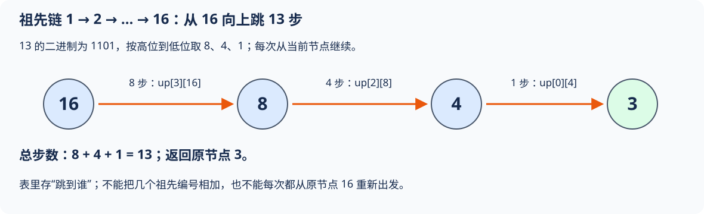
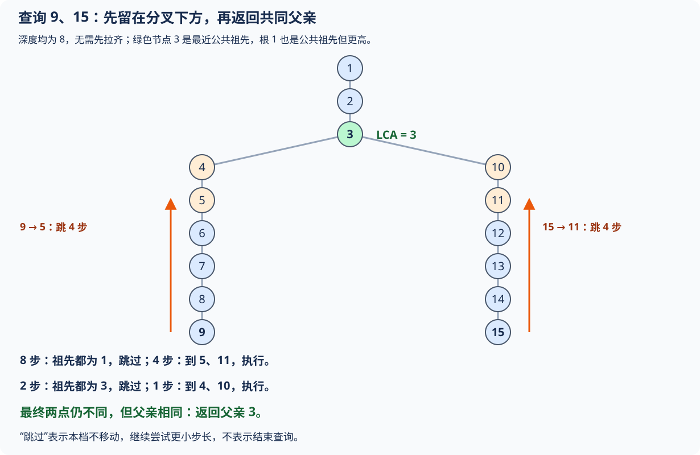

# 6.8 倍增与 LCA：快速向上跳，找到最近公共祖先

前置：[固定根、父亲与深度](07-dfs-order.md#2-变量与两套编号)、[位运算](../01-basic-problem-solving/05-bit-operations.md)、[ST 表的倍增长度](../09-data-structures/05-sparse-table.md)。

先明确三个概念：

- **祖先包含自身。** 从 u 沿父亲一直向根走，路上的节点都是 u 的祖先。
- **公共祖先**同时是 u、v 的祖先；根一定是公共祖先之一。
- **最近公共祖先 LCA**是其中深度最大的那个。它最靠近两个节点，不是编号最大，也不是距离根最近。

若 u 是 v 的祖先，LCA 就是 u；两个节点相同时，LCA 就是它自身。

> **倍增保存“向上走 1、2、4、8……步，到达谁”。LCA 复用这些长跳，替代逐层找父亲。**

配套实现：[倍增 LCA 竞赛模板](../../templates/06-graph-and-tree/lca/README.md)。本节处理固定根、无权树，支持上跳祖先、LCA 与路径边数；不扩展动态换根、树链剖分或路径聚合模板。

## 0. 为什么有 parent，还需要预处理？

已知每个节点的 parent 和 depth，可以先让更深的点逐层向上走；深度相同后，再让两点同时找父亲，第一次相遇就是 LCA。

这个办法正确，但链状树上一次可能走 n 层，q 次询问最坏 `O(nq)`。只有少量询问时仍可直接用，不必强行上倍增。

**询问很多时，希望每次跨过一大段祖先链。** 于是预先记录幂次长度的跳跃，再按二进制拼出需要的步数。

## 1. 主实现：先建跳跃表，再回答询问

沿用 **1-based 非空连通无向树**，g[0] 留空，边两向存储，无自环、重边与环。根和查询点合法，n+1、邻接列表长度可用 int 表示且内存足够。

先复用 [6.7 的 DFSOrder 与 tree_order](07-dfs-order.md#1-主实现显式栈记录进入与完成时刻)，得到父亲与深度；**无需另写一份遍历，更不需要递归处理长链**。

```cpp
#include <algorithm>
#include <utility>
#include <vector>

using ll = long long;

// 前置：已有 6.7 的 tree_order(g, root)，根父亲为 0，根深度为 0。
struct LCA {
    int n;
    int lg;
    std::vector<int> depth;
    std::vector<std::vector<int>> up;

    explicit LCA(const std::vector<std::vector<int>>& g, int root = 1)
        : n(static_cast<int>(g.size()) - 1), lg(1) {
        auto t = tree_order(g, root);
        depth = std::move(t.depth);

        // lg 是行数；合法行号为 0..lg-1，最大跳跃长度为 2^(lg-1)。
        while ((1LL << lg) <= n) ++lg;
        up.assign(lg, std::vector<int>(n + 1));
        up[0] = std::move(t.parent); // 向上 1 步就是直接父亲

        for (int j = 1; j < lg; ++j) {
            for (int u = 1; u <= n; ++u) {
                int mid = up[j - 1][u];
                up[j][u] = up[j - 1][mid]; // 先走一半，再从中点走另一半
            }
        }
    }

    // 向上恰好走 k 条父边；k=0 返回自己，超出根或 k<0 返回 0。
    int jump(int u, int k) const {
        if (k < 0 || k > depth[u]) return 0;

        for (int j = lg - 1; j >= 0; --j) {
            if ((k >> j) & 1) {
                u = up[j][u];
            }
        }

        return u;
    }

    int lca(int u, int v) const {
        if (depth[u] < depth[v]) std::swap(u, v);
        u = jump(u, depth[u] - depth[v]); // 第一步：拉齐深度

        if (u == v) return u; // 原来就在同一条祖先链上，或两点相同

        // 第二步：从大跳到小跳，只跳到两个祖先仍不同的位置。
        for (int j = lg - 1; j >= 0; --j) {
            if (up[j][u] != up[j][v]) {
                u = up[j][u];
                v = up[j][v];
            }
        }

        return up[0][u]; // 此时两点不同，但父亲相同
    }

    ll distance(int u, int v) const {
        int w = lca(u, v);
        return 1LL * depth[u] + depth[v] - 2LL * depth[w];
    }
};
```

构造完成后，查询只读，不修改图或预处理结果。`std::move` 把临时遍历结果中的数组交给 LCA 对象，不改变原图 g；没用到的 tin/tout/order 在临时结果销毁时释放。

模板头文件已自动包含上节依赖；复制单文件参赛时，先放 DFSOrder/tree_order，再放本类。

## 2. 变量各自负责什么？

| 变量／接口 | 含义 | 后续用途 |
| --- | --- | --- |
| `depth[u]` | 根到 u 的边数，根为 0 | 拉齐高度，计算路径边数 |
| `up[j][u]` | u 向上走恰好 2^j 步到达的节点 | 一次跨越较长的祖先链 |
| `lg` | 倍增表行数，为 floor(log₂n)+1 | 约束 j 的循环范围 |
| `j` | 跳跃长度的指数，`0..lg-1` | j=0、1、2 分别表示跳 1、2、4 步 |
| `mid` | 先走半程后到达的节点编号 | 从这个节点继续走相同长度的半程 |
| `jump(u,k)` | 走 k 条父边后到达谁 | 拉齐深度，也可单独求第 k 级祖先 |
| `lca(u,v)` | 返回最近公共祖先的节点编号 | 找到两条向根路径的汇合点 |
| `distance(u,v)` | 唯一简单路径的边数，返回 ll | 无权树上的距离 |

**第一维 j 是“跳几步”的档位，第二维 u 才是节点编号，表里存的也是节点编号。** 不要把 up[j][u] 当作深度或距离。

表有 lg 行、每行 n+1 项，节点列按 `0..n` 分配。0 是**不存在的祖先**，不是真实节点：

$$
\mathrm{up}[j][0]=0.
$$

因此从根再向上、或从不存在的祖先继续向上，仍得到 0；填表时可以直接索引这列。不能把本约定与“根的父亲设成自己”的模板混用。

## 3. 为什么两次半程，能填出一行长跳？

先看一条按 `1→2→…→16` 向下延伸的链，根为 1。

| j | 跳跃长度 | up[j][16] |
| --- | --- | --- |
| 0 | 1 | 15 |
| 1 | 2 | 14 |
| 2 | 4 | 12 |
| 3 | 8 | 8 |
| 4 | 16 | 0，已经越过根 |

求 16 的第 4 级祖先，可以先跳 2 步到 14，再从 14 跳 2 步到 12：

$$
\mathrm{up}[2][16]
=\mathrm{up}[1][\mathrm{up}[1][16]]
=\mathrm{up}[1][14]=12.
$$

两个半程的长度相加，正好是下一档：

$$
2^{j-1}+2^{j-1}=2^j.
$$

因此一般转移为：

$$
\mathrm{up}[j][u]
=\mathrm{up}[j-1][\mathrm{up}[j-1][u]].
$$

**先找到中间节点，再从中间节点继续跳。** j 行只依赖 j-1 行，所以先完整填好短跳，再填长跳，和 ST 表按长度递增满足依赖的思路相通。

两者保存的信息不同：ST 表保存区间摘要；这里保存“执行一段连续父亲跳转后，到达的节点”。不能用节点编号加减代替沿父边跳转，上面的编号差恰好相等只因特意用了顺编号链。

## 4. 任意步数，如何由幂次长跳拼出来？

还是这条链，从 16 向上走 13 步：

$$
13=(1101)_2=8+4+1.
$$

代码从高位到低位检查，只在对应位为 1 时跳跃：



$$
16\ \xrightarrow{8\text{ 步}}\ 8
\ \xrightarrow{4\text{ 步}}\ 4
\ \xrightarrow{1\text{ 步}}\ 3.
$$

共走 13 条边，返回节点 3。**每次都从更新后的 u 继续，不是对原节点分别查几次后把编号相加。**

每个二进制位最多处理一次，最多检查 lg 位；k=0 时不跳，k 超过 depth[u] 时不存在该级祖先，直接返回 0。

## 5. LCA 第一步：先拉齐深度

深度不同的两个点同时跳同样步数，深度差不会消失。因此先只移动较深的一方：

$$
\text{需要上跳的步数}=\mathrm{depth}[u]-\mathrm{depth}[v].
$$

为什么这段可以跳过？公共祖先不可能比较浅的 v 更深；较深节点在这段路上还没有高过 v，所以不会越过 LCA。

拉齐后若两点相同，答案已经找到。**必须先处理这个情况**；否则后面直接返回父亲，会把真实答案又向上多走一步。

## 6. LCA 第二步：只跳到祖先仍不同的位置

拉齐后两点仍不同，说明它们都在 LCA 下方。此时不能直接跳到某个共同祖先就返回，因为它可能比最近的那个更高。

图中查询 9、15：两者深度都是 8，最近公共祖先为 3，深度为 2。



按代码从大到小检查：

| 当前两点 | 尝试跳跃 | 到达的两个祖先 | 是否跳 |
| --- | --- | --- | --- |
| 9、15 | 8 步 | 1、1 | 不跳，已经相遇，可能越过最近汇合点 |
| 9、15 | 4 步 | 5、11 | 跳，两点仍在不同分支 |
| 5、11 | 2 步 | 3、3 | 不跳，保留在汇合点下方 |
| 5、11 | 1 步 | 4、10 | 跳，仍不同 |

最后停在 4、10，它们的父亲都是 3，返回 3。

### 为什么“两个祖先不同”才能跳？

两点始终保持同深度。在 LCA 及它上方，同一深度的祖先必然相同；所以：

$$
\mathrm{up}[j][u]\ne\mathrm{up}[j][v]
\quad\Longrightarrow\quad
\text{跳完后仍在 LCA 下方}.
$$

这种跳跃不会跳过答案，且可以丢掉已经确认不含汇合点的底部路段。

反之，若两个祖先相同，可能刚好到达 LCA，也可能已经跳到它上面；本轮不能区分，因此**先不跳，换更小的步长继续逼近**。

### 为什么从大到小，每档只检查一次？

设当前节点到 LCA 还有 h 条边。只有跳跃长度严格小于 h，两点跳完后才仍不同；最多还能向上走 h-1 步。

从大到小试 2 的幂，相当于逐位拼出这 h-1 步：能跳就减去这段，不能跳就换小一档。每档处理完，尚可安全跳过的步数都小于这一档。

检查完 1 步后，已经没有能让两点仍不同的向上移动；**两点自身不同，但直接父亲相同**，所以最后返回 `up[0][u]`。

0 列也不会让两点一边越根一边继续跳：同深度节点若同时越过根，两个值均为 0，相等，不会进入这次更新。

## 7. 无权树的路径边数

令 w 为 LCA。u 到 v 的唯一路径，可以拆成 u 向上走到 w，再从 w 走到 v：

$$
\mathrm{dist}(u,v)
=(\mathrm{depth}[u]-\mathrm{depth}[w])
+(\mathrm{depth}[v]-\mathrm{depth}[w]).
$$

两段边数相加，整理就是代码中的公式：

$$
\mathrm{dist}(u,v)
=\mathrm{depth}[u]+\mathrm{depth}[v]-2\mathrm{depth}[w].
$$

图中 9、15 各向上 6 条边到 3，因此距离为 12。这里算的是**边数**；若问路径上的节点个数，才是边数加 1。

**树上有权值时，边数不一定是题目费用。** 点权、边权以及是否包含端点，都要重新按题意定义统计量，不直接把 distance 返回值当答案。

## 8. 复杂度与容易混淆的边界

| 操作 | 时间 | 依据 |
| --- | --- | --- |
| 父亲／深度预处理 | `O(n)` | 复用显式 DFS |
| 建立倍增表 | `O(n log n)` | lg 行、每行 n 个节点 |
| jump | 最坏 `O(log n)` | 按二进制位检查；非法步数可提前结束 |
| lca | 最坏 `O(log n)` | 一次拉齐与一次从大到小枚举 |
| distance | 最坏 `O(log n)` | 一次 LCA 加常数次运算 |

倍增表为 `O(n log n)` 空间，遍历临时数组为 `O(n)`。n=1 时只有一行，两个合法节点只能是根自身；可用 `log(n+1)` 统一理解小规模边界。

- `lg` 是行数，不是最后合法行号；循环使用 `j<lg`，倒序从 `lg-1` 开始。
- 根深度为 0，根父亲为 0；jump(root,1)=0，lca(root,u)=root。
- LCA 返回节点编号，不是深度；要比较两个祖先谁更深，应查 depth。
- **固定根后 LCA 才有定义。** 改根可能改变答案，需要按新根重建；这里不提供动态改根接口。
- 同一输入图可以构造独立对象；构造后的对象是快照，之后改变 g 不会更新已有表。
- 先对齐再一起跳，不能只挑其中一个阶段执行；也不能把“祖先相同则跳”写反。
- 这是二进制分解与祖先跳转，**不是二分答案**；没有枚举答案范围与 check(mid)。

## 9. 典题与复盘

**两题待做。** 通用代码与模板已本地核验，不记录配题 AC 或已经掌握。

| 顺序 | 题目 | 条件与练习目的 |
| --- | --- | --- |
| 1 | [P3379 — 最近公共祖先](https://www.luogu.com.cn/problem/P3379) | n、询问数不超过 5×10⁵，根由输入指定，询问两点允许相同；练习无向建图、根约定与倍增查询 |
| 2 | [P8805 — 机房](https://www.luogu.com.cn/problem/P8805) | n、询问数不超过 10⁵，电脑延迟由直接连接数决定，端点也有延迟；练习从树路径工具转回题目实际统计量 |

先完成第一题，再尝试第二题的路径费用建模；这里不提前展开专属公式与实现。

## 10. 自查与衔接

1. up 的两个下标和表值分别表示什么？为什么不能写成 up[j-1][u] 再加上一个步数？
2. 为什么深度相同后，只在两个长跳祖先不同时更新？为什么最后答案是父亲？
3. jump(u,0)、越过根、u=v、根参与查询时分别返回什么？

父亲与深度的作用在本节变得明确：**用深度确定该跳多少，用祖先表确定跳到谁。** 后续再接入树形 DP，学习从孩子结果组织父节点状态；不要求先把所有树上算法学完。

原理参考 [cp-algorithms：Binary Lifting LCA](https://cp-algorithms.com/graph/lca_binary_lifting.html)。本篇独立采用“先拉齐深度，再同步跳”的主写法，复用本仓库非递归遍历；与该页根父亲、时间戳及祖先判定接口不直接混用，未移植其实现。

[返回本章索引](README.md) · [倍增 LCA 竞赛模板](../../templates/06-graph-and-tree/lca/README.md)
