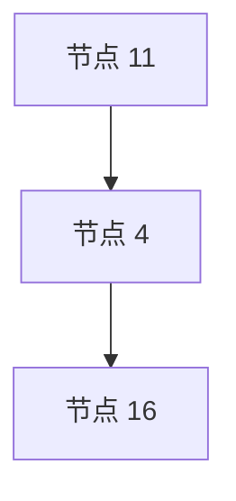
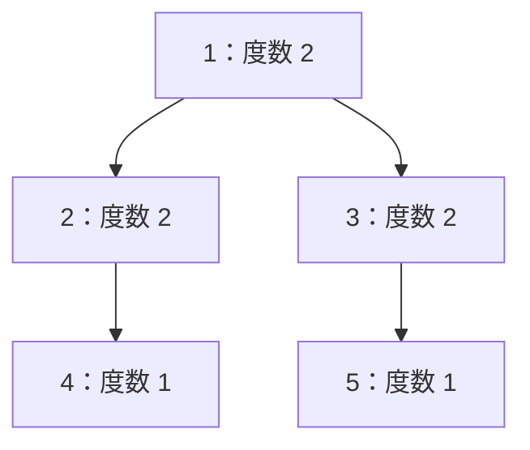
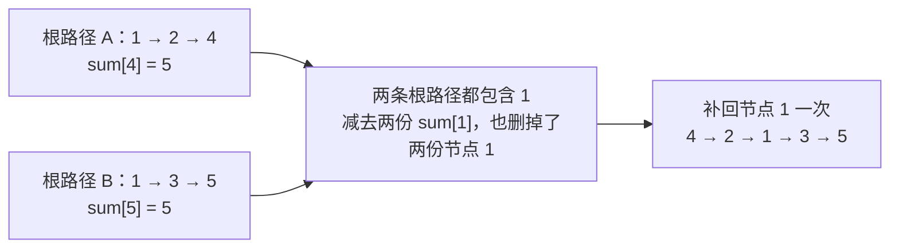

# 6.8 倍增与 LCA：快速向上跳，找到最近公共祖先

前置：[固定根、父亲与深度](07-dfs-order.md#2-变量与两套编号)、[位运算](../01-basic-problem-solving/05-bit-operations.md)、[ST 表的倍增长度](../09-data-structures/05-sparse-table.md)。

先明确三个概念：

- **祖先包含自身。** 从 u 沿父亲一直向根走，路上的节点都是 u 的祖先。
- **公共祖先**同时是 u、v 的祖先；根一定是公共祖先之一。
- **最近公共祖先 LCA**是其中深度最大的那个。它最靠近两个节点，不是编号最大，也不是距离根最近。

若 u 是 v 的祖先，LCA 就是 u；两个节点相同时，LCA 就是它自身。

> **倍增保存“向上走 1、2、4、8……步，到达谁”。LCA 复用这些长跳，替代逐层找父亲。**

配套实现：[倍增 LCA 竞赛模板](../../templates/06-graph-and-tree/lca/README.md)。本节处理固定根的树，支持上跳祖先、LCA 与无权路径边数；配题复盘再补静态点权前缀，不扩展动态换根、树链剖分或通用路径聚合框架。

## 0. 为什么有 parent，还需要预处理？

已知每个节点的 parent 和 depth，可以先让更深的点逐层向上走；深度相同后，再让两点同时找父亲，第一次相遇就是 LCA。

这个办法正确，但链状树上一次可能走 n 层，q 次询问最坏 `O(nq)`。只有少量询问时仍可直接用，不必强行上倍增。

**询问很多时，希望每次跨过一大段祖先链。** 于是**预先记录幂次长度的跳跃，再按二进制拼出需要的步数**。

## 1. 主实现：先建跳跃表，再回答询问

沿用 **1-based 非空连通无向树**，g[0] 留空，边两向存储，无自环、重边与环。根和查询点合法，n+1、邻接列表长度可用 int 表示且内存足够。

先复用 [6.7 的 DFSOrder 与 tree_order](07-dfs-order.md#1-主实现显式栈记录进入与完成时刻)，得到父亲与深度；**无需另写一份遍历，更不需要递归处理长链**。

```cpp
#include <algorithm>
#include <utility>
#include <vector>

using ll = long long;

// 前置：已有 tree_order(g, root)，返回 parent、depth。
// 根节点 parent[root] = 0，depth[root] = 0。
struct LCA {
    int n;
    int lg;  // 倍增表的行数，合法行号为 [0, lg - 1]
    std::vector<int> depth;
    std::vector<std::vector<int>> up;

    // 预处理倍增表：支持 O(log n) 查询 LCA、祖先和距离。
    explicit LCA(const std::vector<std::vector<int>>& g, int root = 1)
        : n(static_cast<int>(g.size()) - 1), lg(1) {
        auto t = tree_order(g, root);
        depth = std::move(t.depth);

        // 确保 2^lg > n，使 0..lg-1 位足以表示任意不超过 n-1 的跳跃距离。
        // 因此，所有合法的向上跳跃距离都能拆成倍增表中若干次跳跃。
        while ((1LL << lg) <= n) ++lg;

        // 根的父亲为 0，节点 0 的祖先也默认为 0，方便处理越过根的情况。
        up.assign(lg, std::vector<int>(n + 1));
        up[0] = std::move(t.parent);  // up[0][u]：u 的直接父亲

        // up[j][u] = u 向上走 2^j 条边到达的祖先。
        // 将一次 2^j 跳跃拆成两次 2^(j-1) 跳跃。
        for (int j = 1; j < lg; ++j) {
            for (int u = 1; u <= n; ++u) {
                int mid = up[j - 1][u];
                up[j][u] = up[j - 1][mid];
            }
        }
    }

    // 查询 u 向上恰好走 k 条父边到达的节点。
    // k = 0 返回 u；k 超出深度或为负数时返回 0。
    int jump(int u, int k) const {
        if (k < 0 || k > depth[u]) return 0;

        // 将 k 拆成二进制：第 j 位为 1，就向上跳 2^j 步。
        // 各次跳跃的距离之和恰好为 k。
        for (int j = lg - 1; j >= 0; --j) {
            if ((k >> j) & 1) {
                u = up[j][u];
            }
        }

        return u;
    }

    // 查询 u、v 的最近公共祖先（LCA）。
    int lca(int u, int v) const {
        // 第一步：拉齐深度。
        // 让两个节点处于同一层，之后可以同步向上比较祖先。
        if (depth[u] < depth[v]) std::swap(u, v);
        u = jump(u, depth[u] - depth[v]);

        // 若较深节点上跳后与另一节点重合，较浅节点就是 LCA。
        if (u == v) return u;

        // 第二步：从大到小尝试同步上跳。
        // 若 2^j 级祖先不同，说明还没有跨过 LCA，可以一起上跳。
        // 若相同，则这次跳跃可能跨过 LCA，因此暂时不跳。
        for (int j = lg - 1; j >= 0; --j) {
            if (up[j][u] != up[j][v]) {
                u = up[j][u];
                v = up[j][v];
            }
        }

        // 此时 u、v 仍不相同，但已经无法再向上同步跳过一条边。
        // 因而两者的直接父亲就是最近公共祖先。
        return up[0][u];
    }

    // 查询树上 u 到 v 的距离（无权树的边数）。
    // 两条路径 u -> LCA、v -> LCA 会重复计算 LCA 到根的公共部分，
    // 因此减去两倍的 LCA 深度。
    ll distance(int u, int v) const {
        int w = lca(u, v);
        return 1LL * depth[u] + depth[v] - 2LL * depth[w];
    }
};
```

构造完成后，查询只读，不修改图或预处理结果。`std::move` 把临时遍历结果中的数组交给 LCA 对象，不改变原图 g；没用到的 tin/tout/order 在临时结果销毁时释放。

模板头文件已自动包含上节依赖；**复制单文件参赛时，先放 DFSOrder/tree_order，再放本类**。

## 2. 变量各自负责什么？

| 变量／接口 | 含义 | 后续用途 |
| --- | --- | --- |
| `depth[u]` | 根到 u 的边数，根为 0 | 拉齐高度，计算路径边数 |
| `up[j][u]` | u 向上走恰好 2^j 步到达的节点 | 一次跨越较长的祖先链 |
| `lg` | 倍增表行数，为 floor(log₂n)+1 | 约束 j 的循环范围 |
| `j` | 跳跃长度的指数，`0..lg-1` | j=0、1、2 分别表示跳 1、2、4 步 |
| `mid` | 先走半程后到达的节点编号 | 从这个节点继续走相同长度的半程 |
| `jump(u,k)` | 走 k 条父边后到达谁 | 拉齐深度，也可单独求第 k 级祖先 |
| `lca(u,v)` | 返回最近公共祖先的节点编号 | 找到两条向根路径的汇合点 |
| `distance(u,v)` | 唯一简单路径的边数，返回 ll | 无权树上的距离 |

**第一维 j 是“跳几步”的档位，第二维 u 才是节点编号，表里存的也是节点编号。** 不要把 $up[j][u]$ 当作深度或距离。

表有 lg 行、每行 n+1 项，节点列按 `0..n` 分配。**0 是不存在的祖先，不是真实节点**：

$$
\mathrm{up}[j][0]=0.
$$

**因此从根再向上、或从不存在的祖先继续向上，仍得到 0**；填表时可以直接索引这列。不能把本约定与“根的父亲设成自己”的模板混用。

## 3. 为什么两次半程，能填出一行长跳？

先看一条按 `1→2→…→16` 向下延伸的链，根为 1。

| j | 跳跃长度 | $up[j][16]$ |
| --- | --- | --- |
| 0 | 1 | 15 |
| 1 | 2 | 14 |
| 2 | 4 | 12 |
| 3 | 8 | 8 |
| 4 | 16 | 0，已经越过根 |

求 16 的第 4 级祖先，可以先跳 2 步到 14，再从 14 跳 2 步到 12：

$$
\mathrm{up}[2][16]
=\mathrm{up}[1][\mathrm{up}[1][16]]
=\mathrm{up}[1][14]=12.
$$

两个半程的长度相加，正好是下一档：

$$
2^{j-1}+2^{j-1}=2^j.
$$

因此一般转移为：

$$
\mathrm{up}[j][u]
=\mathrm{up}[j-1][\mathrm{up}[j-1][u]].
$$

**先找到中间节点，再从中间节点继续跳。j 行只依赖 j-1 行，所以先完整填好短跳，再填长跳，和 ST 表按长度递增满足依赖的思路相通**。

两者保存的信息不同：

- ST 表保存区间摘要；
- 这里保存“执行一段连续父亲跳转后，到达的节点”。

> **向上走一步，是找到当前节点的父亲，不是把节点编号减一。编号只是名字，不代表深度或距离。**

前面的例子特意把节点连成 `1—2—…—16`，所以从 16 向上两步，刚好到 14。这是这条链的特殊编号方式。

换一段父子关系，结果就不同。下图箭头从父亲指向孩子：



从 16 向上两步，应当先到父亲 4，再到 4 的父亲 11：

$$
\mathrm{parent}[\mathrm{parent}[16]]
=\mathrm{parent}[4]=11.
$$

**答案是 11。计算 `16-2=14` 只是在减编号，没有沿树边找父亲，因此不能代替祖先跳转。**

## 4. 任意步数，如何由幂次长跳拼出来？

还是这条链，从 16 向上走 13 步：

$$
13=(1101)_2=8+4+1.
$$

代码从高位到低位检查，只在对应位为 1 时跳跃：


$$
16\ \xrightarrow{8\text{ 步}}\ 8
\ \xrightarrow{4\text{ 步}}\ 4
\ \xrightarrow{1\text{ 步}}\ 3.
$$

共走 13 条边，返回节点 3。**每次都从更新后的 u 继续，不是对原节点分别查几次后把编号相加。**

每个二进制位最多处理一次，最多检查 lg 位；k=0 时不跳，k 超过 depth[u] 时不存在该级祖先，直接返回 0。

## 5. LCA 第一步：先拉齐深度

深度不同的两个点同时跳同样步数，深度差不会消失。因此先只移动较深的一方：

$$
\text{需要上跳的步数}=\mathrm{depth}[u]-\mathrm{depth}[v].
$$

**为什么这段可以跳过？公共祖先不可能比较浅的 v 更深；较深节点在这段路上还没有高过 v，所以不会越过 LCA。**

拉齐后若两点相同，答案已经找到。**必须先处理这个情况**；否则后面直接返回父亲，会把真实答案又向上多走一步。

## 6. LCA 第二步：只跳到祖先仍不同的位置

拉齐后两点仍不同，说明它们都在 LCA 下方。此时不能直接跳到某个共同祖先就返回，因为它可能比最近的那个更高。

图中查询 9、15：两者深度都是 8，最近公共祖先为 3，深度为 2。


> **按代码从大到小检查**：

| 当前两点 | 尝试跳跃 | 到达的两个祖先 | 是否跳 |
| --- | --- | --- | --- |
| 9、15 | 8 步 | 1、1 | 不跳，已经相遇，可能越过最近汇合点 |
| 9、15 | 4 步 | 5、11 | 跳，两点仍在不同分支 |
| 5、11 | 2 步 | 3、3 | 不跳，保留在汇合点下方 |
| 5、11 | 1 步 | 4、10 | 跳，仍不同 |

最后停在 4、10，它们的父亲都是 3，返回 3。

### 为什么“两个祖先不同”才能跳？

两点始终保持同深度。在 LCA 及它上方，同一深度的祖先必然相同；所以：

$$
\mathrm{up}[j][u]\ne\mathrm{up}[j][v]
\quad\Longrightarrow\quad
\text{跳完后仍在 LCA 下方}.
$$

**这种跳跃不会跳过答案，且可以丢掉已经确认不含汇合点的底部路段**。

**反之，若两个祖先相同，可能刚好到达 LCA，也可能已经跳到它上面**；**本轮不能区分，因此先不跳，换更小的步长继续逼近**。

### 为什么从大到小，每档只检查一次？

设当前节点到 LCA 还有 h 条边。只有跳跃长度严格小于 h，两点跳完后才仍不同；最多还能向上走 h-1 步。

**从大到小试 2 的幂，相当于逐位拼出这 h-1 步**：能跳就减去这段，不能跳就换小一档。每档处理完，尚可安全跳过的步数都小于这一档。

检查完 1 步后，已经没有能让两点仍不同的向上移动；**两点自身不同，但直接父亲相同，所以最后返回 `up[0][u]`**。

### 如果尝试的步数太大，越过根了怎么办？

**0 表示“这个祖先不存在”，不是根节点。** 上图中，节点 4 和 10 的深度都为 3；它们各向上走 3 条边就到根 1，再往上便没有真实节点。

若当前尝试上跳 8 步：

| 当前节点 | 到根需要几步 | 尝试跳几步 | 倍增表返回 |
| --- | --- | --- | --- |
| 4 | 3 | 8 | up[3][4]=0 |
| 10 | 3 | 8 | up[3][10]=0 |

两个结果都是 0，代入代码的判断就是：

```cpp
if (0 != 0) { // 条件为假，不执行里面的移动
    // u、v 都不会被更新成 0
}
```

**所以两点仍留在 4、10，只是放弃这次 8 步长跳，继续尝试更小的步长。** 查到 0 不等于真的移动到了 0。

之所以不会出现“一边越根、另一边还没越根”，是因为前面已经把两点深度拉齐：**两点到根需要的步数相同，同时尝试相同长度的跳跃，必然一起越根或一起不越根。** 这也是先拉齐深度的重要作用。

## 7. 无权树的路径边数

令 w 为 LCA。u 到 v 的唯一路径，可以拆成 u 向上走到 w，再从 w 走到 v：

$$
\mathrm{dist}(u,v)
=(\mathrm{depth}[u]-\mathrm{depth}[w])
+(\mathrm{depth}[v]-\mathrm{depth}[w]).
$$

两段边数相加，整理就是代码中的公式：

$$
\mathrm{dist}(u,v)
=\mathrm{depth}[u]+\mathrm{depth}[v]-2\mathrm{depth}[w].
$$

图中 9、15 各向上 6 条边到 3，因此距离为 12。这里算的是**边数**；**若问路径上的节点个数，才是边数加 1**。

**树上有权值时，边数不一定是题目费用。** 点权、边权以及是否包含端点，都要重新按题意定义统计量，不直接把 distance 返回值当答案。

## 8. 复杂度与容易混淆的边界

| 操作 | 时间 | 依据 |
| --- | --- | --- |
| 父亲／深度预处理 | `O(n)` | 复用显式 DFS |
| 建立倍增表 | `O(n log n)` | lg 行、每行 n 个节点 |
| jump | 最坏 `O(log n)` | 按二进制位检查；非法步数可提前结束 |
| lca | 最坏 `O(log n)` | 一次拉齐与一次从大到小枚举 |
| distance | 最坏 `O(log n)` | 一次 LCA 加常数次运算 |

倍增表 up 占 `O(n log n)` 空间。这里另说的 **O(n) 临时存储，指构造 LCA 时调用 tree_order 产生的数据**：

- **遍历中的 next 数组和显式栈 st**：next 保存各节点的邻居检查进度，st 保存当前搜索路径；两者最多各有 O(n) 项，tree_order 返回后就销毁。
- **返回结果 t 中的 parent、depth、tin、tout、order 数组**：每个长度为 n+1。本节只需要 parent 和 depth，因此用 move 将它们的存储分别交给 up[0] 和 LCA 的 depth，不再额外保留一份。
- **本节未使用的 tin、tout、order**：仍由临时结果 t 持有，LCA 构造函数结束、t 销毁时释放。

因此，**不是每次查询都会创建这些数组，而是预处理时临时需要 O(n) 存储。** 构造完成后，主要长期保存的是 up 倍增表与 depth 数组。评估内存上限时，还要计入构造过程中尚未释放的临时数据，以及调用者保存的邻接表 g。

n=1 时只有一行，两个合法节点只能是根自身；可用 `log(n+1)` 统一理解小规模边界。

- `lg` 是行数，不是最后合法行号；循环使用 `j<lg`，倒序从 `lg-1` 开始。
- 根深度为 0，根父亲为 0；jump(root,1)=0，lca(root,u)=root。
- LCA 返回节点编号，不是深度；要比较两个祖先谁更深，应查 depth。
- **固定根后 LCA 才有定义。** 改根可能改变答案，需要按新根重建；这里不提供动态改根接口。
- 同一输入图可以构造独立对象；构造后的对象是快照，之后改变 g 不会更新已有表。
- 先对齐再一起跳，不能只挑其中一个阶段执行；也不能把“祖先相同则跳”写反。
- 这是二进制分解与祖先跳转，**不是二分答案**；没有枚举答案范围与 check(mid)。

## 9. 典题与复盘

两题实际实现已整理并通过本地核验；平台提交结果未单独提供。代码只调整排版与注释，省略相同的主函数框架及未使用的注释代码。

### 9.1 洛谷 P3379：最近公共祖先

[题目链接](https://www.luogu.com.cn/problem/P3379)。n、询问数均不超过 5×10⁵；根由输入指定，两点可以相同。

**练习重点：让树的根、父亲、深度与倍增表采用同一套约定。**

```cpp
struct DFSOrder {
    vector<int> parent, depth;

    explicit DFSOrder(int n) : parent(n + 1), depth(n + 1) {}
};

DFSOrder tree_order(const vector<vector<int>>& g, int root = 1) {
    int n = static_cast<int>(g.size()) - 1;
    DFSOrder t(n);
    vector<int> next(n + 1);
    stack<int> st;

    t.parent[root] = 0;
    t.depth[root] = 0;
    st.push(root);

    while (!st.empty()) {
        int u = st.top();

        if (next[u] == static_cast<int>(g[u].size())) {
            st.pop();
            continue;
        }

        int v = g[u][next[u]++];
        if (v == t.parent[u]) continue; // 无向边双向存储，需要跳过父边

        t.parent[v] = u;
        t.depth[v] = t.depth[u] + 1;
        st.push(v);
    }

    return t;
}

struct LCA {
    int n;
    int lg;
    vector<int> depth;
    vector<vector<int>> up;

    explicit LCA(const vector<vector<int>>& g, int root = 1)
        : n(static_cast<int>(g.size()) - 1), lg(1) {
        auto t = tree_order(g, root);
        depth = move(t.depth);

        while ((1 << lg) <= n) ++lg;
        up.assign(lg, vector<int>(n + 1));
        up[0] = move(t.parent);

        for (int j = 1; j < lg; ++j) {
            for (int u = 1; u <= n; ++u) {
                int mid = up[j - 1][u];
                up[j][u] = up[j - 1][mid];
            }
        }
    }

    int jump(int u, int k) {
        if (k < 0 || k > depth[u]) return 0;

        for (int j = lg - 1; j >= 0; --j) {
            if ((k >> j) & 1) u = up[j][u];
        }

        return u;
    }

    int lca(int u, int v) {
        if (depth[u] < depth[v]) swap(u, v);
        u = jump(u, depth[u] - depth[v]);
        if (u == v) return u;

        for (int j = lg - 1; j >= 0; --j) {
            if (up[j][u] != up[j][v]) {
                u = up[j][u];
                v = up[j][v];
            }
        }

        return up[0][u];
    }
};

void solve() {
    int n, m, s;
    cin >> n >> m >> s;

    vector<vector<int>> g(n + 1);
    for (int i = 1; i < n; ++i) {
        int u, v;
        cin >> u >> v;
        g[u].push_back(v);
        g[v].push_back(u);
    }

    LCA t(g, s); // 使用题目给定的根，不默认根为 1

    while (m--) {
        int u, v;
        cin >> u >> v;
        cout << t.lca(u, v) << '\n';
    }
}
```

这一题只需要父亲和深度，所以 `DFSOrder` 不再分配 tin、tout、order。

**双向存边，需要跳过父边；根必须用输入的 s。** 根深度为 0，根的父亲为 0；同点询问在拉齐后直接返回自己。

本题范围内 `1 << lg` 不会溢出；通用模板用 `1LL << lg`，方便扩大规模时保持移位计算范围。

预处理 **O(n log n)**，每次询问 **O(log n)**，总时间 **O((n+m) log n)**，空间 **O(n log n)**。

### 9.2 洛谷 P8805：机房

[题目链接](https://www.luogu.com.cn/problem/P8805)。n、询问数均不超过 10⁵。每个节点的延迟等于它的**直接连接数，即无向图中的度数**；经过路径两端也要计费，同一个点只计一次。

**收获：按依赖安排计算顺序，再把树路径拆成两条根路径。DFS 序不仅能定位子树，还能保证父状态先于子状态计算。**

#### 原实现：保留访问顺序与父亲

首先，把第一题的 `DFSOrder` 和 `tree_order` 换成以下版本，增加 order；节点和序列位置都为 **1-based**。

```cpp
struct DFSOrder {
    vector<int> order;
    vector<int> parent, depth;

    explicit DFSOrder(int n)
        : order(n + 1), parent(n + 1), depth(n + 1) {}
};

DFSOrder tree_order(const vector<vector<int>>& g, int root = 1) {
    int n = static_cast<int>(g.size()) - 1;
    DFSOrder t(n);
    vector<int> next(n + 1);
    stack<int> st;
    int timer = 0;

    t.order[++timer] = root;
    t.parent[root] = 0;
    t.depth[root] = 0;
    st.push(root);

    while (!st.empty()) {
        int u = st.top();
        if (next[u] == static_cast<int>(g[u].size())) {
            st.pop();
            continue;
        }

        int v = g[u][next[u]++];
        if (v == t.parent[u]) continue;

        t.order[++timer] = v; // 保证父亲先于孩子记录
        t.parent[v] = u;
        t.depth[v] = t.depth[u] + 1;
        st.push(v);
    }

    return t;
}
```

在第一题的 `LCA` 内，**保留原有 n、lg、depth、up 和 jump／lca 方法**；增加成员 t，并把构造函数替换为下列片段：

```cpp
// 在 LCA 中额外保留成员 DFSOrder t；jump、lca 与第一题完全相同。
DFSOrder t;

explicit LCA(const vector<vector<int>>& g, int root = 1)
    : n(static_cast<int>(g.size()) - 1), lg(1), t(n) {
    t = tree_order(g, root);
    depth = move(t.depth); // 后续 LCA 查询使用本类的 depth

    while ((1 << lg) <= n) ++lg;
    up.assign(lg, vector<int>(n + 1));
    up[0] = t.parent; // 这里复制：外面计算 sum 时还需要 t.parent

    for (int j = 1; j < lg; ++j) {
        for (int u = 1; u <= n; ++u) {
            int mid = up[j - 1][u];
            up[j][u] = up[j - 1][mid];
        }
    }
}
```

最后，题目处理如下：

```cpp
void solve() {
    int n, m;
    cin >> n >> m;

    vector<vector<int>> g(n + 1);
    for (int i = 1; i < n; ++i) {
        int u, v;
        cin >> u >> v;
        g[u].push_back(v);
        g[v].push_back(u);
    }

    LCA lca(g);
    auto t = move(lca.t); // 取出 order、parent；lca 自己的 up、depth 不受影响
    vector<int> sum(n + 1); // sum[0]=0，让根也能统一递推

    for (int i = 1; i <= n; ++i) {
        int u = t.order[i];
        sum[u] = sum[t.parent[u]] + (int)g[u].size();
    }

    while (m--) {
        int u, v;
        cin >> u >> v;

        int w = lca.lca(u, v);
        int ans = sum[u] + sum[v] - 2 * sum[w] + (int)g[w].size();
        cout << ans << '\n';
    }
}
```

**这些片段合起来就是原实现；不是三份彼此独立的程序。** LCA 查询逻辑沿用第一题，无需重复展开。

#### 三个变量怎样协作？

| 变量 | 保存什么 | 在递推中的职责 |
| --- | --- | --- |
| `order[i]` | DFS 前序第 i 个访问的节点编号 | 决定先计算谁，让父亲先于孩子 |
| `parent[u]` | u 的直接父亲编号 | 找到当前状态真正依赖的上一状态 |
| `sum[u]` | 从固定根走到 u，路径上所有节点的度数之和，包含两端 | 保存根路径前缀，后面用 LCA 拼接 |
| `sum[0]=0` | 根之前的空路径贡献 | 根也能使用相同递推，不用另写分支 |

> **order 决定计算顺序，parent 决定取谁的结果。sum 的下标是节点编号，不是 DFS 序位置。**

看一棵小树，括号里是节点度数，箭头从父亲指向孩子；按左子树优先访问：



| DFS 序位置 i | 1 | 2 | 3 | 4 | 5 |
| --- | --- | --- | --- | --- | --- |
| `u=order[i]` | 1 | 2 | 4 | 3 | 5 |
| `parent[u]` | 0 | 1 | 2 | 1 | 3 |
| `sum[u]` | 2 | 4 | 5 | 4 | 5 |

处理节点 3 时，前一个访问的是节点 4，但 **3 的父亲是 1**，所以取的是 sum[1]：

$$
\mathrm{sum}[3]=\mathrm{sum}[1]+\mathrm{degree}[3]=2+2=4.
$$

**不能写成把 DFS 序前面的所有节点累加，也不能取前一个访问节点的 sum。** 那会把其他分支混入根到 3 的路径。

一般递推就是：

$$
\mathrm{sum}[u]=\mathrm{sum}[\mathrm{parent}[u]]+\mathrm{degree}[u].
$$

从根到 u 的路径，等于“根到父亲的路径”再加 u 自身。DFS 前序保证父亲先访问，因此右侧状态已经算好。

根的父亲设为 0，并有 sum[0]=0：

$$
\mathrm{sum}[\mathrm{root}]=0+\mathrm{degree}[\mathrm{root}].
$$

**空路径初值让根自然接入同一公式。** 不需要先特判根，再为其他点写一遍递推。

这与树上 DP 共享“**先计算依赖，再计算当前状态**”的思想。本题只做确定的前缀累加，没有候选取优；若改成由孩子汇总子树结果，就应让孩子先算，使用后序或逆前序。

通用识别与方向对照见 [DAG DP：树上的父子依赖](../../patterns/06-graph-and-tree/dag-dp.md#树上的根路径前缀父亲先于孩子)。

#### 为什么减两遍 LCA 前缀，还要补回它自身？

上图查询 4 到 5，最近公共祖先为 1。两条根路径为：



$$
5+5-2\times2+2=8.
$$

正好等于路径上五个节点的度数之和。

一般地，令 w=lca(u,v)。两条根前缀都包含根到 w 的整段：

$$
\mathrm{sum}[u]+\mathrm{sum}[v]-2\mathrm{sum}[w].
$$

这一步连 w 自己也一起去掉了；路径需要经过 w，所以补回一次点权：

$$
\boxed{\mathrm{answer}(u,v)=\mathrm{sum}[u]+\mathrm{sum}[v]-2\mathrm{sum}[w]+\mathrm{degree}[w]}.
$$

**点权前缀包含当前节点，因此要补回 LCA 的点权。** 前面的无权距离统计边数，没有这个补点项。

当 u=v 时，w=u，公式返回 degree[u]，只计算一次；w 是根时也无需特殊分支。

#### 数组的 move 与保留：按后续用途决定

- 第一题拿到 parent 后只用于 up[0]，可以直接 move。
- 第二题还要读取 `t.parent[u]` 计算前缀，所以 `up[0]=t.parent` **保留复制**；不能改成移走后再继续依赖原数组内容。
- `depth=move(t.depth)` 将深度数组交给 LCA 自己；后面不再依赖 t.depth 的内容。
- `auto t=move(lca.t)` 取出遍历结果后，LCA 查询仍使用自身的 up 与 depth，因此仍然有效。**被移动的容器仍可销毁或重新赋值，但不能假定原内容还在，也不能依赖它一定为空。**

竞赛模板不强制把整个 DFS 结果长期塞进 LCA；可单独复用 [根路径前缀辅助函数](../../templates/06-graph-and-tree/lca/README.md#根路径前缀可选辅助)。

#### 范围与复杂度

本题所有点权是非负度数，一棵树的总度数为：

$$
\sum_u\mathrm{degree}[u]=2(n-1).
$$

因此每条根前缀至多 2(n-1)，相加等中间表达式也在 int 范围内。**原实现用 int 足够；通用点权可能更大，辅助模板使用 ll，并要求中间运算也不溢出。**

计算根路径前缀 **O(n)**；连同 LCA 预处理及 m 次询问，总时间 **O((n+m) log n)**，空间 **O(n log n)**。

权值或树边改变后，旧前缀与倍增表不会自动更新；本节处理静态树与静态点权。

## 10. 自查与衔接

1. up 的两个下标和表值分别表示什么？为什么不能写成 up[j-1][u] 再加上一个步数？
2. 为什么深度相同后，只在两个长跳祖先不同时更新？为什么最后答案是父亲？
3. jump(u,0)、越过根、u=v、根参与查询时分别返回什么？
4. order 的前一个节点与 parent[u] 有什么不同？点权路径公式为什么要补回 LCA 自己？

父亲与深度的作用在本节变得明确：**用深度确定该跳多少，用祖先表确定跳到谁。** 后续再接入树形 DP，学习从孩子结果组织父节点状态；不要求先把所有树上算法学完。

原理参考 [cp-algorithms：Binary Lifting LCA](https://cp-algorithms.com/graph/lca_binary_lifting.html)。本篇独立采用“先拉齐深度，再同步跳”的主写法，复用本仓库非递归遍历；与该页根父亲、时间戳及祖先判定接口不直接混用，未移植其实现。

[返回本章索引](README.md) · [倍增 LCA 竞赛模板](../../templates/06-graph-and-tree/lca/README.md)
