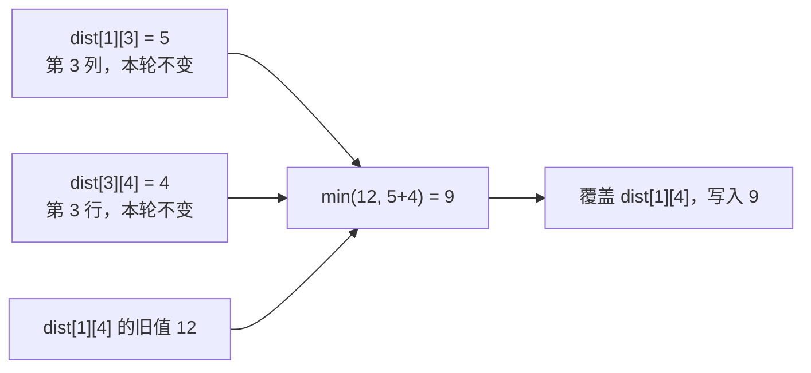

# 6.9 Floyd：全源最短路与中转点 DP

前置：[图的表示与邻接矩阵](01-graph-basics.md)、[Dijkstra](04-dijkstra.md)、[DP 三步走](../../patterns/05-dynamic-programming/dp-modeling-workflow.md)。

**全源最短路，就是求图中任意起点到任意终点的最短距离。** 本节统一使用 **1-based 点编号、整数边权、无负环**，先掌握距离计算，路线还原留到实际需要时补充。

## 0. 问题引入：起点不固定，怎样复用计算？

Dijkstra 一次解决一个起点。若询问的起点很多，可以从多个起点分别运行；非负边权下这是可行方案，并不是遇到全源就必须换算法。

但点数较小、图较稠密时，可以直接保存一张距离矩阵，反复问：

> **原来的 i→j 路线，与借助某个点 k 中转的 i→k→j 路线，哪条更短？**

若只随意做一次这样的尝试，可能用到还没算好的距离。Floyd 的关键是**按允许使用的中转点分阶段计算**，让转移有明确依赖。

## 1. 先给代码：原地更新距离矩阵

```cpp
#include <algorithm>
#include <limits>
#include <vector>

using ll = long long;
constexpr ll FLOYD_INF = std::numeric_limits<ll>::max() / 4;

// 1-based、(n+1)×(n+1) 矩阵；对角线为 0，无边为 FLOYD_INF。
// 前提：无负环；所有有限状态和候选加法结果都在 (-FLOYD_INF,FLOYD_INF) 内。
// 原地更新：结束后 dist[i][j] 是最短距离；不可达仍为 FLOYD_INF。
void floyd(std::vector<std::vector<ll>>& dist) {
    int n = static_cast<int>(dist.size()) - 1;

    for (int k = 1; k <= n; ++k) {
        // 本轮允许新增使用点 k 中转；先前已允许使用 1..k-1。
        for (int i = 1; i <= n; ++i) {
            if (dist[i][k] == FLOYD_INF) continue;

            for (int j = 1; j <= n; ++j) {
                if (dist[k][j] == FLOYD_INF) continue;

                ll candidate = dist[i][k] + dist[k][j];
                dist[i][j] = std::min(dist[i][j], candidate);
            }
        }
    }
}
```

> **用途速记：** 输入已经初始化好的直接距离矩阵，输出保存在同一张矩阵中，回答所有点对的最短距离。每轮允许一个新点参与中转，比较旧路线与两段路线之和；函数不负责读边，也不改变无向／有向的建图约定。

## 2. 变量、初始化与返回方式

| 变量 | 完整含义 | 范围或容量 |
| --- | --- | --- |
| n | 图中的点数 | 由矩阵边长减 1 得到，要求 n≥1 |
| $dist[i][j]$ | 当前阶段允许的中转点下，i 到 j 的最短距离 | (n+1)×(n+1)，第 0 行、列不使用 |
| k | 本轮新增允许使用的中转点编号 | 依次 1..n；不是路径长度，也不是已经走过几个点 |
| i、j | 本轮被更新的起点、终点 | 均枚举 1..n，不要求编号小于 k |
| FLOYD_INF | 不存在可达路线的标记 | 不参与加法，不是合法的有限距离 |
| candidate | 经 k 中转得到的候选距离 | 只有前后两段都可达时才计算 |

**初始化时，矩阵存的是“直接走一条边”的距离；运行后，存的是“允许多次中转”的最短距离。** 自己到自己可以不走任何边，距离为 0。

下面构造一个四点有向图，后面一直用它跟踪代码：

```cpp
int n = 4;
std::vector<std::vector<ll>> dist(n + 1,
    std::vector<ll>(n + 1, FLOYD_INF));

for (int i = 1; i <= n; ++i) dist[i][i] = 0;

// 有向边，只写 u→v；若是无向边，还需同时写 v→u。
dist[1][2] = 3;
dist[2][3] = 2;
dist[3][4] = 4;
dist[1][3] = 10;
dist[1][4] = 12;

floyd(dist);
// dist[1][3] == 5，dist[1][4] == 9；dist[4][1] 仍不可达。
```

若从边表读入，重边应保留最小权值：

```cpp
// 已有合法的 u、v 和权重 w；dist 已按上例初始化。
dist[u][v] = std::min(dist[u][v], w);
// 无向图再执行 dist[v][u] = std::min(dist[v][u], w)。
```

**权重为 0 的边仍然是边。** 不能把所有 0 都解释成无边；矩阵输入中哪个值表示无边，要按原题约定转换。

函数返回 void，因为结果已写回 dist；如果调用后还需要原始边权，先复制一份矩阵。

## 3. 对照图与代码：一轮新增一个中转点


### k=2：先改好 1 到 3 的距离

在这一轮，1→2 与 2→3 都已存在，于是代码尝试：

$$
\mathrm{candidate}=\mathrm{dist}[1][2]+\mathrm{dist}[2][3]=3+2=5.
$$

原来直接走 1→3 要 10，绕经 2 反而更短：

$$
\mathrm{dist}[1][3]=\min(10,5)=5.
$$

### k=3：复用已经改好的 1 到 3

这一轮可以把“已经允许经 2 中转的 1→3”接上 3→4：

$$
\mathrm{candidate}=\mathrm{dist}[1][3]+\mathrm{dist}[3][4]=5+4=9.
$$

与原来的 1→4 比较：

$$
\mathrm{dist}[1][4]=\min(12,9)=9.
$$

> **i→k 和 k→j 不必是直接边，它们可以已经包含前面允许的中转点。** 所以只写“借一个点中转”的更新，也能逐步拼出包含多个中转点的最短路线。

## 4. 为什么这是 DP，为什么 k 在最外层？

### 先把被压缩掉的阶段写出来

为了说明含义，暂时用 $Dₖ[i][j]$ 表示：**从 i 到 j，只允许编号 1..k 的点出现在路线中间时，最短要走多远。** 起点、终点不受这个编号范围限制。

**允许使用，不代表必须使用。** k=3 时，路线可以完全不经过 3，也可以只用其中几个点中转。

当 k=0，没有可用中转点，只有直接边与原地停留，这正是初始化矩阵。

### 本轮只有“用 k”与“不用 k”两类选择

若最短路线不用 k 中转，就保留上一阶段的结果。

若使用 k，在无负环的前提下，可以选一条不重复绕圈的最短路线，并在 k 处分成两段；两段的内部点都只需要 1..k−1。

$$
\boxed{
D_k[i][j]=\min\left(
D_{k-1}[i][j],\;
D_{k-1}[i][k]+D_{k-1}[k][j]
\right).
}
$$

**先算好上一阶段的所有点对，再允许新点中转。** 因此 k 必须是这份实现的最外层；固定 k 后，i、j 两层可以交换。

### 随意把 k 放到最内层，会怎样？

看这条有向链，边权都为 1：

$$
1\longrightarrow3\longrightarrow4\longrightarrow2.
$$

若只按 i、j、k 的顺序扫一遍，处理 i=1、j=2 时，1→4 和 3→2 还没算好，于是仍判不可达。后来 1→4 虽然被更新，却不会回头重新处理这一次 1→2，漏掉正确距离 3。

> **循环顺序不是外观习惯，而是状态依赖的一部分。** 这与[DP 三步走中的阶段顺序](../../patterns/05-dynamic-programming/dp-modeling-workflow.md#按可用中转点分阶段floyd)相同。

## 5. 为什么不保存三维数组？

### 原地覆盖的顾虑：会不会读到本轮刚改过的值？

数学转移写成 Dₖ，是为了区分阶段：**计算第 k 阶段时，需要的是第 k−1 阶段的结果。** 最直接的实现是读旧矩阵、写新矩阵。

但代码把新值直接写回 dist。此时矩阵里一部分格子已经更新，另一部分还没更新，为什么不会混用？先看每次更新实际读取的三个位置：

| 读取的位置 | 在矩阵哪里 | 本轮需要的含义 |
| --- | --- | --- |
| $dist[i][j]$ | 当前准备更新的格子 | 不借 k 中转的旧答案 |
| $dist[i][k]$ | 第 k 列 | i 到 k 的旧答案 |
| $dist[k][j]$ | 第 k 行 | k 到 j 的旧答案 |

**关键不是整张矩阵都不能变，而是后续仍要读取的旧结果不能被破坏。** 固定 k 后，候选路线只读取第 k 行、第 k 列，并不会随意读取其他刚被覆盖的格子。

### 第 k 行、第 k 列，为什么恰好不会变？

没有负环时，从 k 回到 k，最优选择可以是不走任何边，代价为 0；绕一圈也不能比 0 更小。因此：

$$
\mathrm{dist}[k][k]=0.
$$

先看第 k 列中的格子 $dist[i][k]$。若本轮借 k 中转，相当于“先走到 k，再从 k 回到 k”：

$$
\begin{aligned}
\mathrm{dist}[i][k]
&\leftarrow\min\bigl(\mathrm{dist}[i][k],\;
\mathrm{dist}[i][k]+\mathrm{dist}[k][k]\bigr)\\
&=\min\bigl(\mathrm{dist}[i][k],\;\mathrm{dist}[i][k]+0\bigr)\\
&=\mathrm{dist}[i][k].
\end{aligned}
$$

**多接一段代价为 0 的原地停留，距离不变，所以第 k 列不会改变。**

第 k 行也一样，只是把原地停留放在前面：

$$
\mathrm{dist}[k][j]
\leftarrow\min\bigl(\mathrm{dist}[k][j],\;0+\mathrm{dist}[k][j]\bigr)
=\mathrm{dist}[k][j].
$$

若某一段不可达，代码会直接跳过，不对 INF 做加法，该位置也保持不变。

### 回到 k=3 的例子：变的是目标格子，不是它所依赖的行列

这一轮开始时，前面已经算好：dist[1][3]=5、dist[3][4]=4，而 dist[1][4]=12。



写入 9 之后，后面计算其他点对时，**仍然只拿第 3 行、第 3 列拼接候选路线**。例如更新 2→4，要读的是 dist[2][3] 与 dist[3][4]，不会拿刚改好的 dist[1][4] 来替代其中一段。

当前格子的旧值也不会丢失：固定 k 时，每个 (i,j) 只处理一次；轮到它时，尚未被本轮覆盖，先参与 min 比较，再写入新值。

因此，实际读取的三项始终满足上一节的阶段转移。等所有点对更新完，整张矩阵就完成第 k 阶段，可以作为下一轮的旧矩阵。

> **二维原地更新成立，是因为本轮会复用的第 k 行、第 k 列恰好保持不变；不是所有 DP 都能边读边覆盖。** Dₖ 用于讲清阶段含义，代码只需要保存当前矩阵，不必存下全部 n 个阶段。

这次推导也可迁移到新问题：**先识别与定义完整状态，再推导转移、核验朴素实现，最后证明能否压缩。** 通用流程与不同模型的读写对照见 [DP 范式：从识别到压缩的五项检查](../../patterns/05-dynamic-programming/dp-modeling-workflow.md#0-从识别到压缩五项检查)，这里不重复展开。

## 6. 不可达、负权与数值范围

### 两段都存在，才能相加

若 i 到 k 不可达，就不存在 i→k→j 这条候选路线。代码中的两次 INF 判断，先排除这种无效转移。

尤其有负边时，不能计算“INF−5”后把它当作某个很大的有限距离。**哨兵表示路线不存在，不是可以照常运算的真实数值。**

### 负边不等于负环

**Floyd 可以处理负边，但本节距离接口要求没有负环**。若某个负权环能被反复经过，就能让路程不断减小，相关点对没有有限的最短距离。

无向图中的一条负边，沿它来回走就形成负环；本节不将这种输入当作正常的距离查询。负环的判定与受影响点对处理，留到负权最短路专题。

### ll 与 INF 仍需要范围约定

- 所有有限 dist 状态及相加后的候选，都应严格位于 −FLOYD_INF 与 FLOYD_INF 之间，不能与哨兵混淆。
- 一个方便的充分条件：边权绝对值至多 W，且 nW<FLOYD_INF/2，则无负环时的简单最短路状态与两段候选都在上述范围内。检查这个条件时也不要先做可能溢出的乘法。
- FLOYD_INF 取 ll 上限的四分之一，是为算术留余量；它不能替代对输入权重与路径长度的分析。
- 判断不可达时比较是否等于 FLOYD_INF；输出 −1 还是其他标记，按原题要求处理。

## 7. 复杂度与基础选型

| 操作 | 时间 | 空间 |
| --- | --- | --- |
| 初始化矩阵 | O(n²)，另加读边成本 | O(n²) |
| 运行 Floyd | O(n³) | 额外 O(1)，原矩阵 O(n²) |
| 运行后查询一对距离 | O(1) | O(1) |

例如 n=500 时，有约 1.25×10⁸ 次最内层迭代；是否合适仍取决于时限与实现，不能只看代码短就用于大图。

| 需求 | 优先考虑 | 关键前提 |
| --- | --- | --- |
| 无权图，单源最少边数 | BFS | 每条边代价相同 |
| 非负权图，一个或少量起点 | Dijkstra | 结合边数与起点数量估算成本 |
| 点数较小，任意两点距离 | Floyd | 接受 n³ 时间、n² 空间，无负环 |

这只是本节基础对照；图论全章的写法成本与场景推荐，仍在主题收尾时完善。

## 8. 典题与复盘

**两题待做。** 原题条件已核对，只记录练习目的，不提前给出专属汇总公式、处理顺序转换或 solve。

| 顺序 | 题目 | 已核对条件 | 练习目的 |
| --- | --- | --- | --- |
| 1 | [P2910 — Clear And Present Danger S](https://www.luogu.com.cn/problem/P2910) | 岛屿 N≤100，给出危险指数矩阵与必须依次出现的岛屿序列，长度 M≤10⁴ | 区分直接距离和允许中转的距离，练习矩阵输入与查询组织 |
| 2 | [CF 295B — Greg and Graph](https://codeforces.com/problemset/problem/295/B) | N≤500，带权有向完全图，逐个删除点，求每步删除前剩余点对的最短距离总和 | 检验阶段含义、可用点范围与距离汇总的区别 |

收到实际思路与代码后，复盘留在本节，不迁入 Problems。

## 9. 自查与衔接

1. k=3 时，起点 i=4 是否允许？路径必须经过 3 吗？
2. 为什么一次 i→k→j 更新，可以得到含多个中转点的路线？
3. k 为什么放最外层？不保存 Dₖ 的第三维，依据又是什么？
4. 输入矩阵中的 0 是零权边还是无边？这两种情况该如何区分？

本节补全基本的全源距离模型，同时复习“状态含义 → 转移 → 依赖顺序”的 DP 推导。算法条件与阶段证明可对照 [Floyd–Warshall](https://cp-algorithms.com/graph/all-pair-shortest-path-floyd-warshall.html)；本篇实现、图解与例子独立整理。

[本章索引](README.md) · [Floyd 竞赛模板](../../templates/06-graph-and-tree/floyd/README.md)
