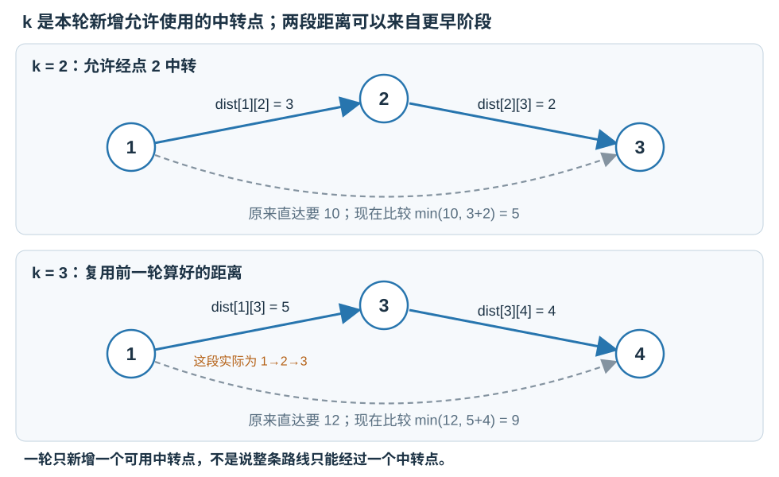
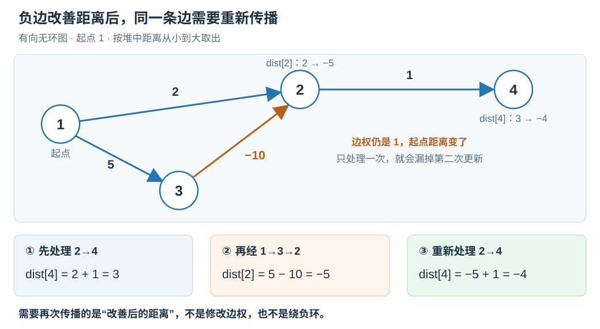
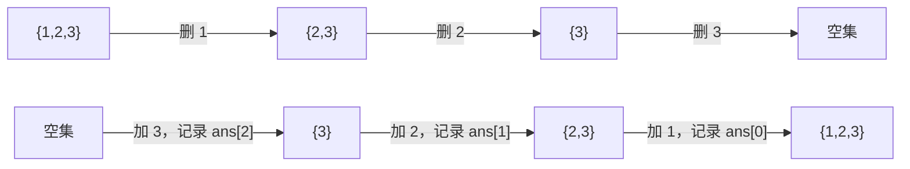

# 6.9 Floyd：全源最短路与中转点 DP

前置：[图的表示与邻接矩阵](01-graph-basics.md)、[Dijkstra](04-dijkstra.md)、[DP 三步走](../../patterns/05-dynamic-programming/dp-modeling-workflow.md)。

**全源最短路，就是求图中任意起点到任意终点的最短距离。** 本节统一使用 **1-based 点编号、整数边权、无负环**，先掌握距离计算，路线还原留到实际需要时补充。

## 0. 问题引入：起点不固定，怎样复用计算？

Dijkstra 一次解决一个起点。若询问的起点很多，可以从多个起点分别运行；非负边权下这是可行方案，并不是遇到全源就必须换算法。

但点数较小、图较稠密时，可以直接保存一张距离矩阵，反复问：

> **原来的 i→j 路线，与借助某个点 k 中转的 i→k→j 路线，哪条更短？**

若只随意做一次这样的尝试，可能用到还没算好的距离。Floyd 的关键是**按允许使用的中转点分阶段计算**，让转移有明确依赖。

## 1. 先给代码：原地更新距离矩阵

```cpp
#include <algorithm>
#include <limits>
#include <vector>

using ll = long long;
constexpr ll FLOYD_INF = std::numeric_limits<ll>::max() / 4;

// 1-based、(n+1)×(n+1) 矩阵；对角线为 0，无边为 FLOYD_INF。
// 前提：无负环；所有有限状态和候选加法结果都在 (-FLOYD_INF,FLOYD_INF) 内。
// 原地更新：结束后 dist[i][j] 是最短距离；不可达仍为 FLOYD_INF。
void floyd(std::vector<std::vector<ll>>& dist) {
    int n = static_cast<int>(dist.size()) - 1;

    for (int k = 1; k <= n; ++k) {
        // 本轮允许新增使用点 k 中转；先前已允许使用 1..k-1。
        for (int i = 1; i <= n; ++i) {
            if (dist[i][k] == FLOYD_INF) continue;

            for (int j = 1; j <= n; ++j) {
                if (dist[k][j] == FLOYD_INF) continue;

                ll candidate = dist[i][k] + dist[k][j];
                dist[i][j] = std::min(dist[i][j], candidate);
            }
        }
    }
}
```

> **用途速记：** 输入已经初始化好的直接距离矩阵，输出保存在同一张矩阵中，回答所有点对的最短距离。每轮允许一个新点参与中转，比较旧路线与两段路线之和；函数不负责读边，也不改变无向／有向的建图约定。

## 2. 变量、初始化与返回方式

| 变量 | 完整含义 | 范围或容量 |
| --- | --- | --- |
| n | 图中的点数 | 由矩阵边长减 1 得到，要求 n≥1 |
| $dist[i][j]$ | 当前阶段允许的中转点下，i 到 j 的最短距离 | (n+1)×(n+1)，第 0 行、列不使用 |
| k | 本轮新增允许使用的中转点编号 | 依次 1..n；不是路径长度，也不是已经走过几个点 |
| i、j | 本轮被更新的起点、终点 | 均枚举 1..n，不要求编号小于 k |
| FLOYD_INF | 不存在可达路线的标记 | 不参与加法，不是合法的有限距离 |
| candidate | 经 k 中转得到的候选距离 | 只有前后两段都可达时才计算 |

**初始化时，矩阵存的是“直接走一条边”的距离；运行后，存的是“允许多次中转”的最短距离。** 自己到自己可以不走任何边，距离为 0。

下面构造一个四点有向图，后面一直用它跟踪代码：

```cpp
int n = 4;
std::vector<std::vector<ll>> dist(n + 1,
    std::vector<ll>(n + 1, FLOYD_INF));

for (int i = 1; i <= n; ++i) dist[i][i] = 0;

// 有向边，只写 u→v；若是无向边，还需同时写 v→u。
dist[1][2] = 3;
dist[2][3] = 2;
dist[3][4] = 4;
dist[1][3] = 10;
dist[1][4] = 12;

floyd(dist);
// dist[1][3] == 5，dist[1][4] == 9；dist[4][1] 仍不可达。
```

若从边表读入，重边应保留最小权值：

```cpp
// 已有合法的 u、v 和权重 w；dist 已按上例初始化。
dist[u][v] = std::min(dist[u][v], w);
// 无向图再执行 dist[v][u] = std::min(dist[v][u], w)。
```

**权重为 0 的边仍然是边。** 不能把所有 0 都解释成无边；矩阵输入中哪个值表示无边，要按原题约定转换。

函数返回 void，因为结果已写回 dist；如果调用后还需要原始边权，先复制一份矩阵。

## 3. 对照图与代码：一轮新增一个中转点



### k=2：先改好 1 到 3 的距离

在这一轮，1→2 与 2→3 都已存在，于是代码尝试：

$$
\mathrm{candidate}=\mathrm{dist}[1][2]+\mathrm{dist}[2][3]=3+2=5.
$$

原来直接走 1→3 要 10，绕经 2 反而更短：

$$
\mathrm{dist}[1][3]=\min(10,5)=5.
$$

### k=3：复用已经改好的 1 到 3

这一轮可以把“已经允许经 2 中转的 1→3”接上 3→4：

$$
\mathrm{candidate}=\mathrm{dist}[1][3]+\mathrm{dist}[3][4]=5+4=9.
$$

与原来的 1→4 比较：

$$
\mathrm{dist}[1][4]=\min(12,9)=9.
$$

> **i→k 和 k→j 不必是直接边，它们可以已经包含前面允许的中转点。** 所以只写“借一个点中转”的更新，也能逐步拼出包含多个中转点的最短路线。

## 4. 为什么这是 DP，为什么 k 在最外层？

### 先把被压缩掉的阶段写出来

为了说明含义，暂时用 $Dₖ[i][j]$ 表示：**从 i 到 j，只允许编号 1..k 的点出现在路线中间时，最短要走多远。** 起点、终点不受这个编号范围限制。

**允许使用，不代表必须使用。** k=3 时，路线可以完全不经过 3，也可以只用其中几个点中转。

当 k=0，没有可用中转点，只有直接边与原地停留，这正是初始化矩阵。

### 本轮只有“用 k”与“不用 k”两类选择

若最短路线不用 k 中转，就保留上一阶段的结果。

若使用 k，在无负环的前提下，可以选一条不重复绕圈的最短路线，并在 k 处分成两段；两段的内部点都只需要 1..k−1。

$$
\boxed{
D_k[i][j]=\min\left(
D_{k-1}[i][j],\;
D_{k-1}[i][k]+D_{k-1}[k][j]
\right).
}
$$

**先算好上一阶段的所有点对，再允许新点中转。** 因此 k 必须是这份实现的最外层；固定 k 后，i、j 两层可以交换。

### 随意把 k 放到最内层，会怎样？

看这条有向链，边权都为 1：

$$
1\longrightarrow3\longrightarrow4\longrightarrow2.
$$

若只按 i、j、k 的顺序扫一遍，处理 i=1、j=2 时，1→4 和 3→2 还没算好，于是仍判不可达。后来 1→4 虽然被更新，却不会回头重新处理这一次 1→2，漏掉正确距离 3。

> **循环顺序不是外观习惯，而是状态依赖的一部分。** 这与[DP 三步走中的阶段顺序](../../patterns/05-dynamic-programming/dp-modeling-workflow.md#按可用中转点分阶段floyd)相同。

## 5. 为什么不保存三维数组？

### 先看朴素状态：第一维记录计算到了哪一轮

把上一节的 Dₖ[i][j] 完整写成数组，就是 `dp[k][i][j]`：第一维是阶段，后两维是起点和终点。朴素转移为：

$$
\mathrm{dp}[k][i][j]=\min\left(
\mathrm{dp}[k-1][i][j],\;
\mathrm{dp}[k-1][i][k]+\mathrm{dp}[k-1][k][j]
\right).
$$

**观察右侧：三个来源的第一个参数都是 k−1，只用到了上一层。** 不需要再读取 k−2、k−3 等更早的阶段，就没必要一直保存所有历史矩阵。

这里的“上一层”是一整张 i、j 距离矩阵，不是二维数组中的上一行。若保存 k=0..n 的全部阶段，空间为 O(n³)；只轮换保存旧、新两张矩阵，就已降为 O(n²)。

接着再问：**能不能连两张矩阵都不分，直接用一张 dist 边读边改？**

### 尝试去掉阶段下标，再检查原地覆盖的风险

压去第一个参数后，想写成：

$$
\mathrm{dist}[i][j]\leftarrow\min\left(
\mathrm{dist}[i][j],\;
\mathrm{dist}[i][k]+\mathrm{dist}[k][j]
\right).
$$

右侧仍出现本轮的 k，但要分清它的含义：

| 三维表达式 | 第一个参数：属于哪一层 | 后两个参数：哪段路线 |
| --- | --- | --- |
| $dp[k−1][i][k]$ | 上一阶段 k−1 | i 到本轮中转点 k |
| $dp[k−1][k][j]$ | 上一阶段 k−1 | 本轮中转点 k 到 j |

**路线的端点是 k，不代表数学转移允许读取第 k 层的新值。** 去掉第一维后，新旧阶段共用同一个位置，这才产生了需要检查的问题。

本轮开始时，dist 全是上一层；每更新一个格子，就把它覆盖成本轮结果。因此计算到一半时：

```text
已经更新的格子：存 dp[k][i][j]
尚未更新的格子：存 dp[k-1][i][j]
全部更新完毕后：整张矩阵才统一成为第 k 层
```

当某次更新读取 $dist[i][k]$、$dist[k][j]$ 时，它们可能已经被本轮处理，也可能还没被处理。**如果本轮处理让它们变小，就不能直接当成上一层的值来用。**

因此，“只依赖上一层”提示可以滚动保存，但**原地覆盖还要单独证明：这两个被反复读取的位置，更新前后是否相同？**

### 代入第 k 行、第 k 列，发现本轮更新不改变它们

没有负环时，从 k 回到 k，不走任何边的代价为 0，绕圈不能更小，所以：

$$
\mathrm{dp}[k-1][k][k]=0.
$$

**先看第 k 行，把起点 i=k 代入朴素转移：**

$$
\begin{aligned}
\mathrm{dp}[k][k][j]
&=\min\left(\mathrm{dp}[k-1][k][j],\;
\mathrm{dp}[k-1][k][k]+\mathrm{dp}[k-1][k][j]\right)\\
&=\min\left(\mathrm{dp}[k-1][k][j],\;0+\mathrm{dp}[k-1][k][j]\right)\\
&=\mathrm{dp}[k-1][k][j].
\end{aligned}
$$

新一层仍等于旧一层：**“从 k 出发，再先在 k 原地停留一次”，不会缩短距离。** 所以第 k 行即使已经被本轮处理，数值也没变。

**再看第 k 列，把终点 j=k 代入：**

$$
\begin{aligned}
\mathrm{dp}[k][i][k]
&=\min\left(\mathrm{dp}[k-1][i][k],\;
\mathrm{dp}[k-1][i][k]+\mathrm{dp}[k-1][k][k]\right)\\
&=\min\left(\mathrm{dp}[k-1][i][k],\;\mathrm{dp}[k-1][i][k]+0\right)\\
&=\mathrm{dp}[k-1][i][k].
\end{aligned}
$$

同样，**“已经走到 k，再在 k 原地停留一次”，也不会缩短距离。** 第 k 列也保持不变。若路线不可达，代码直接跳过，不对 INF 做加法，该位置仍然不变。

### 最后确认：读到“新值”也仍等于所需的旧值

于是，本轮读取第 k 行、第 k 列时，只有两种情况：

- **还没更新：** 读到上一层旧值，正是转移所需。
- **已经更新：** 读到本轮新值，但刚才已经证明它与旧值相等，结果仍然正确。

而当前目标 $dist[i][j]$ 在本轮只处理一次：先读取它的旧值参与比较，再覆盖，之后其他候选也只会读取第 k 行、第 k 列，不会任意使用这个新格子。


因此，固定 k 后，i、j 正常逐格遍历即可，无需为了压缩空间另作倒序或复制；所有点对更新完，dist 就成为下一轮所需的旧矩阵。

> **降维的发现过程：只用上一层 → 尝试删去阶段维度 → 检查覆盖会影响哪些读取 → 证明这些位置新旧相等 → 原地更新成立。** 先发现依赖范围，再验证覆盖安全，不能把两步合成“只依赖上一层，所以一定能原地改”。

通用流程与其他 DP 的读写对照见 [从识别到压缩的五项检查](../../patterns/05-dynamic-programming/dp-modeling-workflow.md#0-从识别到压缩五项检查)，这里不重复展开。

## 6. 不可达、负权与数值范围

### 两段都存在，才能相加

若 i 到 k 不可达，就不存在 i→k→j 这条候选路线。代码中的两次 INF 判断，先排除这种无效转移。

尤其有负边时，不能计算“INF−5”后把它当作某个很大的有限距离。**哨兵表示路线不存在，不是可以照常运算的真实数值。**

### 负边不等于负环

**Floyd 可以处理负边，但本节距离接口要求没有负环**。若某个负权环能被反复经过，就能让路程不断减小，相关点对没有有限的最短距离。

无向图中的一条负边，沿它来回走就形成负环；本节不将这种输入当作正常的距离查询。负环的判定与受影响点对处理，留到负权最短路专题。

### 为什么 Dijkstra 不能直接用于负边，而 Floyd 可以？

**两者都在做“比较旧距离与两段距离之和”。区别在于：凭什么确定目前得到的结果已经足够。**

沿用 [Dijkstra 一节的负边反例](04-dijkstra.md#为什么不能有负权边)，这是一个没有环的有向图：


**Dijkstra：依赖“当前最小的点可以定值”。** 从 1 出发，先看到到 2 的距离为 2、到 3 的距离为 5，因此先取出 2。

**非负边时，后面的路不会让已经走出的长度反而减少；这支撑了“先取出的最小距离就是最终距离”的证明。**但这里从 3 再走一条负边：
$$
5+(-10)=-5<2.
$$

**出发时更远的路线，后面反而变得更近。** 若已把 2 的距离固定为 2，或者第一次取出终点就退出，就会漏掉这条更短路线。被破坏的是距离定值的依据，不是加法或 min 本身。

**Floyd：依赖“本轮允许的中转点已经完整枚举”。** 它**没有因为 2 的当前距离更小，就提前宣布这个点的答案不可再改。**到了 k=3，本轮自然会检查 1→3→2：
$$
\mathrm{dist}[1][2]
\leftarrow\min\bigl(2,\;5+(-10)\bigr)=-5.
$$

转移只要求把“不经 3”与“经 3”的合法路线完整比较，不要求新接上的边权非负。**负边可以让候选更小，正常参加 min 即可；无负环则保证最短距离有限，并支撑前面不重复绕圈与原地更新的证明。**

| 算法 | 正确性依据 | 负边会影响什么 |
| --- | --- | --- |
| Dijkstra | 当前最小的未定值点，可以确定最终距离 | 后面的负边可能继续缩短它，定值结论失效 |
| Floyd | 按中转阶段，完整比较所有合法来源 | 不破坏这种阶段转移，但仍要求没有负环 |

**Floyd 与 Dijkstra 的区别，不是是否限制一条边只能走一次。Floyd 处理没有负环时，绕圈不会让路径更短，因此总能找到一条不重复顶点的最短路径。**若存在可到达且能通向终点的负环，就可以反复绕环，使路径长度无限减小，此时不存在有限的最短距离。

**加永久 `vis` 不能让 Dijkstra 支持负边。**  问题不是边多次访问，而是距离可能在稍后改善，必须重新传播；限制边只处理一次反而会漏解：

沿用上图的权值，再接上边 2→4，权值为 1。**1→3 的权值为 5、3→2 的权值为 −10，才能先取出 2，再由 3 改善它的距离。** 若把 1→3 改成 0，就会先取出 3，不会出现下面的处理顺序。



1. **先经 1→2，再处理 2→4。** 到 2 的距离为 2，因此到 4 暂时得到：

$$
\mathrm{dist}[4]=2+1=3.
$$

2. **后来处理 3，发现到 2 的路线更短。** 经 1→3→2，更新为：

$$
\mathrm{dist}[2]=5+(-10)=-5<2.
$$

3. **到 2 的距离改善后，必须再次处理 2→4。** 若允许重新入堆、继续传播，就能得到：

$$
\mathrm{dist}[4]=-5+1=\boxed{-4}.
$$

如果用 `vis` 规定每条边只处理一次，第三步就会被跳过，错误保留距离 3。**边权没有变，但边的起点距离变短了，因此这条边必须重新传播更新；这张图没有环，错误与无限绕圈无关。**

允许改善后重新入堆的写法，在这个例子中可以算对；但它已经放弃“取出即定值”，不再具有 Dijkstra 在非负权图上的复杂度保证。

> **Dijkstra 需要“后续不会靠负边翻盘”；Floyd 允许后续阶段继续改善距离。** Floyd 允许负边，仍不表示存在负环时也能得到有限的最短距离。

前提与证明可对照 [Dijkstra 的非负边权要求](https://cp-algorithms.com/graph/dijkstra.html)及本篇末尾的 Floyd 参考。

### ll 与 INF 仍需要范围约定

- 所有有限 dist 状态及相加后的候选，都应严格位于 −FLOYD_INF 与 FLOYD_INF 之间，不能与哨兵混淆。
- 一个方便的充分条件：边权绝对值至多 W，且 nW<FLOYD_INF/2，则无负环时的简单最短路状态与两段候选都在上述范围内。检查这个条件时也不要先做可能溢出的乘法。
- FLOYD_INF 取 ll 上限的四分之一，是为算术留余量；它不能替代对输入权重与路径长度的分析。
- 判断不可达时比较是否等于 FLOYD_INF；输出 −1 还是其他标记，按原题要求处理。

## 7. 复杂度与基础选型

| 操作 | 时间 | 空间 |
| --- | --- | --- |
| 初始化矩阵 | O(n²)，另加读边成本 | O(n²) |
| 运行 Floyd | O(n³) | 额外 O(1)，原矩阵 O(n²) |
| 运行后查询一对距离 | O(1) | O(1) |

例如 n=500 时，有约 1.25×10⁸ 次最内层迭代；是否合适仍取决于时限与实现，不能只看代码短就用于大图。

| 需求 | 优先考虑 | 关键前提 |
| --- | --- | --- |
| 无权图，单源最少边数 | BFS | 每条边代价相同 |
| 非负权图，一个或少量起点 | Dijkstra | 结合边数与起点数量估算成本 |
| 点数较小，任意两点距离 | Floyd | 接受 n³ 时间、n² 空间，无负环 |

这只是本节基础对照；图论全章的写法成本与场景推荐，仍在主题收尾时完善。

## 8. 典题与复盘

两份原实现均已本地核验，平台结果未单独提供。以下省略未改动的 main，代码只整理排版与注释，保留原逻辑。

### 8.1 P2910：把必须经过的顺序与实际航线分开

[P2910 — Clear And Present Danger S](https://www.luogu.com.cn/problem/P2910)

**收录原因：区分题目要求的访问顺序与实际行走路线，把整体路径拆成可以独立优化的相邻任务。**

#### 原实现

```cpp
constexpr int INF = 1e5 + 1;

void floyd(vector<vector<int>>& dp) {
    int n = (int)dp.size() - 1;

    for (int k = 1; k <= n; ++k) {
        for (int i = 1; i <= n; ++i) {
            if (dp[i][k] == INF) continue;

            for (int j = 1; j <= n; ++j) {
                if (dp[k][j] == INF) continue;
                dp[i][j] = min(dp[i][j], dp[i][k] + dp[k][j]);
            }
        }
    }
}

void solve() {
    int n, m;
    cin >> n >> m;

    vector<int> p(m + 1);
    p[0] = 1;
    for (int i = 1; i <= m; ++i)
        cin >> p[i];

    vector<vector<int>> dist(n + 1, vector<int>(n + 1, INF));
    for (int i = 1; i <= n; ++i)
        for (int j = 1; j <= n; ++j)
            cin >> dist[i][j];

    floyd(dist);

    int ans = 0;
    for (int i = 0; i < m; ++i) {
        int u = p[i];
        int v = p[i + 1];
        ans += dist[u][v];
    }

    cout << ans << '\n';
}
```

**用途速记：** 输入完整的有向危险指数矩阵与必须依次经过的岛屿，先求全源最短距离，再把相邻任务之间的最小代价相加。矩阵每项都有实际含义，不把 0 当作无边。

#### 为什么可以分段相加？

例如要求依次经过 1、2、1、3。**“依次出现”不要求相邻，可以在两个指定岛屿之间经过其他岛屿。**

$$
\mathrm{ans}=\mathrm{dist}[1][2]+\mathrm{dist}[2][1]+\mathrm{dist}[1][3].
$$

任何合法路线的每一段，都不会比对应最短路更短；反过来，把这些最短路线连接起来，就构成满足指定顺序的路线。因此各段最小值之和可以达到。

#### 这份实现中可以简化的地方

- **题目保证第一个岛屿就是 1。** `p[0] = 1` 多算了一段 1→1；对角线为 0，所以不影响答案。更直接的写法是只存 m 个输入点，从第二个点开始累加相邻距离。
- **输入是完整矩阵。** 所有元素都会覆盖初始化值，且直接边至多 100000，最短距离不会超过直接边；这里不会出现 INF，两个可达判断并非本题必需。通用模板仍须保留无边处理。
- **本题 int 足够。** 最多 9999 段，每段至多 100000，总和至多 999900000；不是看到路径累加就必然溢出，仍要按约束计算。通用距离模板继续用 ll。
- **危险指数有方向。** 不能自行令 dist[i][j] 与 dist[j][i] 相等。

时间为 O(n³+m)，空间为 O(n²+m)。原方案已经合适，不必另加数据结构。

### 8.2 CF 295B：逆序加点，复用 Floyd 的阶段状态

[CF 295B — Greg and Graph](https://codeforces.com/problemset/problem/295/B)

**收录原因：从操作方向寻找可维护性，把难以撤销的变化改成逐步扩展，并分开维护计算所需的信息与当前需要的答案。**

#### 原实现

```cpp
vector<ll> floyd(vector<vector<int>>& dp, const vector<int>& order) {
    int n = (int)dp.size() - 1;
    vector<ll> ans(n);

    for (int u = n - 1; u >= 0; --u) {
        int k = order[u]; // order 保存删除顺序，倒着读就是恢复顺序

        // 只增加一个可用中转点；端点 i、j 仍遍历全部节点
        for (int i = 1; i <= n; ++i) {
            for (int j = 1; j <= n; ++j) {
                dp[i][j] = min(dp[i][j], dp[i][k] + dp[k][j]);
            }
        }

        // 只有 order[u..n-1] 已恢复：只对这些点之间的距离求和
        for (int i = u; i < n; ++i) {
            for (int j = u; j < n; ++j) {
                ans[u] += dp[order[i]][order[j]];
            }
        }
    }

    return ans;
}

void solve() {
    int n;
    cin >> n;

    vector<vector<int>> dist(n + 1, vector<int>(n + 1));
    for (int i = 1; i <= n; ++i)
        for (int j = 1; j <= n; ++j)
            cin >> dist[i][j];

    vector<int> order(n);
    for (int& u : order)
        cin >> u;

    auto ans = floyd(dist, order);
    for (ll u : ans)
        cout << u << ' ';
    cout << '\n';
}
```

**用途速记：** 输入原图矩阵和完整删除顺序，倒序恢复可用中转点，每恢复一步就统计当前点集的距离和，按原删除步骤的位置保存答案。原矩阵会被修改；本题是完整正权图，所以无需无边判断。

#### 先看操作：为什么把删除倒过来？

删除一个点，可能使原来的最短路线失效，距离需要变大；**已经压成一个最小值的 dp，并没有保存所有备用路线。** 每次在剩余图重新运行 Floyd，会达到 O(n⁴)。瓶颈是最短路状态难以撤销，不是删除数组元素本身一定多一层循环。

若删除顺序为 1、2、3：



**原题问删除之前的答案，所以倒序时必须先加回，再统计。** 第 u 轮恢复后，点集恰好为 order[u..n-1]，对应原顺序删除 order[u] 之前。

#### 再看状态：中转点未必按编号加入

普通 Floyd 按 1、2、3 加入，只是选了一种固定顺序。核心状态其实是：**允许哪些点充当中转点时，i 到 j 的最短距离。**

设已经允许的中转点集合为 S，这轮加入 k：

$$
D_{S\cup\{k\}}[i][j]
=\min\bigl(D_S[i][j],\ D_S[i][k]+D_S[k][j]\bigr).
$$

>仍然只分“不经 k”与“经 k”两种情况。**集合扩大即可，编号是否递增并不影响证明；每个点作为新中转点加入一次。**

无负环时，这一轮第 k 行、第 k 列不变，原地更新仍成立。与[第五节的降维证明](#5-为什么不保存三维数组)完全对应，只是阶段由实际加入顺序决定。

#### 最关键的分工：全部端点更新，当前点集求和

| 对象 | 含义与范围 |
| --- | --- |
| u | 当前阶段的数组位置，0-based，倒序枚举 |
| k=order[u] | 本轮恢复的节点编号，1-based |
| dp[i][j] | 端点可为任意节点，但中转点只允许使用已恢复点 |
| order[u..n-1] | 当前实际存在的节点，用于答案统计 |
| ans[u] | 原删除步骤 u 之前的距离和；倒序计算、正序输出 |

**尚未恢复的点可以作为端点提前保存信息，但不能提前作为中转点。** 这些准备好的距离，会在它们恢复时直接使用。

例如删除顺序为 1、2、3，图中 1→3、3→2 权值都为 1，1→2 直接边为 10，其余非对角边为 10：


刚恢复 3 时，仍要提前更新：

$$
\mathrm{dp}[1][2]=\min(10,1+1)=2.
$$

此时不把这个距离计入答案；等 1、2 也恢复，它才参与求和。**若松弛时只遍历已经恢复的端点，就会错过这次以 3 中转的更新；等全部恢复，也不会重新枚举 3。**

#### 数值、复杂度与思想归属

- **求和对象是有序点对。** i→j 与 j→i 分别计算，不除以 2；对角线为 0，可以一起累加。
- **单个距离可以用 int，总和必须用 ll。** 完整图的每条直接边至多 10⁵，任意最短距离至多 10⁵；但 n=500 时，距离和可以达到 500×499×10⁵=24950000000。
- **全部恢复阶段总时间为 O(n³)，空间为 O(n²)。** 每步松弛全部点对，并统计当前点对；求和虽也有两重循环，总体没有再乘一个 n。
- **这是逆序离线，不是离散化。** order 记录处理顺序，没有压缩值域。离散化可以与离线结合，但它们解决的问题不同。

可迁移的识别条件、逆序后状态的对应关系，以及什么时候不能直接倒序，独立收录在[逆序离线：把难维护的删除变成恢复](../../patterns/06-graph-and-tree/reverse-offline.md)。具体实现留在本节，通用 Floyd 模板继续复用，不另造本题专属板子。

## 9. 自查与衔接

1. k=3 时，起点 i=4 是否允许？路径必须经过 3 吗？
2. 为什么一次 i→k→j 更新，可以得到含多个中转点的路线？
3. k 为什么放最外层？不保存 Dₖ 的第三维，依据又是什么？
4. 输入矩阵中的 0 是零权边还是无边？这两种情况该如何区分？

本节补全基本的全源距离模型，同时复习“状态含义 → 转移 → 依赖顺序”的 DP 推导。算法条件与阶段证明可对照 [Floyd–Warshall](https://cp-algorithms.com/graph/all-pair-shortest-path-floyd-warshall.html)；本篇实现、图解与例子独立整理。

[本章索引](README.md) · [Floyd 竞赛模板](../../templates/06-graph-and-tree/floyd/README.md)
