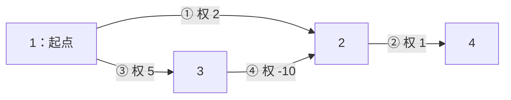
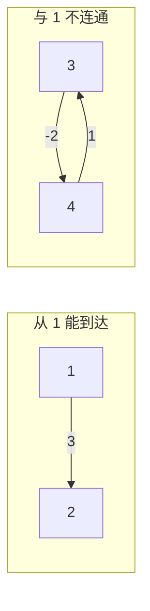

# 6.10 负权最短路与负环：Bellman–Ford、SPFA

前置：[有向图与边的存储](01-graph-basics.md)、[Dijkstra 的非负权条件](04-dijkstra.md)、[Floyd 对负边的处理](09-floyd.md#为什么-dijkstra-不能直接用于负边而-floyd-可以)、[DP 的阶段与依赖](../../patterns/05-dynamic-programming/dp-modeling-workflow.md)。

> **负边允许后来的路线变得更短，所以改善后的距离必须继续传播。** Bellman–Ford 反复扫描边；SPFA 用队列安排需要传播的点。二者都不能把“曾经访问过”当成永不更新的理由。

## 0. 为什么需要另一种最短路算法

边权非负时，Dijkstra 可以把当前最小距离确定下来。若含负边，后面再走一段反而可能更短，原先的定值依据失效；具体反例见[Floyd 中的负边对照](09-floyd.md#为什么-dijkstra-不能直接用于负边而-floyd-可以)。

Floyd 可以处理无负环的负权图，但要预处理全部点对，时间 O(n³)、空间 O(n²)。若只求一个起点，就希望直接沿边传播距离。

**于是先放弃“一个点只处理一次”，改成“距离只要变小，就允许继续更新”。** 但这也带来新问题：有的环能让距离一直减小，必须识别并结束。

本节最短路允许重复经过点和边。负边是单条边权小于 0；**负环是一圈边的总权重小于 0**，两者不同。


绕 `2→3→2` 一圈，代价变化为：

$$
-4+1=-3.
$$

多绕一次就再少 3，因此从 1 到 2、3，以及还能继续到达的 4，都没有有限的最小距离。**不是“最短路碰巧是负数”，而是能无限减小。有负边但无负环时，最短距离仍可正常求出。**

## 1. 先给代码：Bellman–Ford

沿用 `using ll = long long;`，点编号为 **1-based**。输入是已经建好的有向边表，每条边保存一次；无向边由调用者明确加入两个方向。

教学与模板统一限制：1≤n≤2000，实际有向边数 m≤20000，边权绝对值≤10⁹。允许重边、自环和不连通；下面的计算范围覆盖检测负环期间的中间值。`s=0` 是接口约定的全图模式，不把编号 0 当作真实点。

```cpp
const ll BF_INF = LLONG_MAX / 4;

struct Edge {
    int u, v;
    ll w;
};

struct ShortestResult {
    vector<ll> dist;
    bool negative_cycle;
};

ShortestResult bellman_ford(int n, const vector<Edge>& edges, int s = 1) {
    // 普通单源模式：只有起点 s 的距离为 0，其余点暂时不可达
    // 全图检测模式（s=0）：所有真实点初始距离均为 0，相当于添加虚拟源点
    // 这样即使负环与原图其他部分不连通，也能检测到
    vector<ll> dist(n + 1, s == 0 ? 0 : BF_INF);
    if (s != 0) dist[s] = 0;

    // 最多进行 n 轮松弛；若第 n 轮仍有更新，说明存在可达负环
    for (int round = 1; round <= n; ++round) {
        bool changed = false;

        // 依次尝试用每条边 u -> v 更新 v 的最短距离
        for (const auto& e : edges) {
            // 普通单源模式下，不可达的 u 无法向外传播距离
            if (dist[e.u] == BF_INF) continue;

            // 尝试先到达 u，再沿边 (u, v) 到达 v
            ll nd = dist[e.u] + e.w;

            // 新路线没有更短，不更新
            if (nd >= dist[e.v]) continue;

            dist[e.v] = nd;
            changed = true;

            // 前 n-1 轮足以确定无负环时的最短距离
            // 第 n 轮仍能变短，说明存在可达的负权环
            if (round == n) return {dist, true};
        }

        // 一整轮都没有更新，说明距离已经稳定，无需继续
        if (!changed) return {dist, false};
    }

    return {dist, false};
}
```

**用途速记：** 给定有向边表和起点，反复尝试用 `dist[u]+w` 改善 `dist[v]`，返回距离及是否有起点可达的负环。`s=0` 检查全图。只有 negative_cycle=false 时，才把 dist 当作最终结果；普通单源中不可达点保持 BF_INF。

### 每个变量在维护什么

| 变量／容器 | 含义 | 范围与容量 |
| --- | --- | --- |
| edges | 全部实际有向边，扫描顺序固定但可任意 | m 项；不是输入记录条数的必然同义词 |
| dist[v] | 当前已经找到的到 v 的最小走法代价 | n+1 项，0 号不查询 |
| round | 第几次完整扫描边表 | 1..n；不等于当前走法恰好用了几条边 |
| changed | 本次完整扫描是否改善过任何距离 | 每轮重置；用于提前结束 |
| negative_cycle | 当前初始化能到达的范围中是否存在负环 | 一个总判断，不是逐点负无穷标记 |

dist 是**已发现走法的最小值**，传播尚未结束时不一定是真正最短距离。BF_INF 表示没有找到走法；不能直接计算 `BF_INF+w` 并让负边把“无穷”减成可达。

## 2. 跟着一张图，看一轮为什么还不够

下面的有向图没有环，却能让某点的距离在稍后改善。按表列顺序扫描四条边。



| 时刻 | dist[1] | dist[2] | dist[3] | dist[4] |
| --- | --- | --- | --- | --- |
| 初始化 | 0 | ∞ | ∞ | ∞ |
| 第 1 轮结束 | 0 | −5 | 5 | 3 |
| 第 2 轮结束 | 0 | −5 | 5 | −4 |
| 第 3 轮结束 | 0 | −5 | 5 | −4；无改善，结束 |

第 1 轮先扫描 `2→4`，此时只能得到 2+1=3。之后才由 `3→2` 把到 2 的距离改为 −5；`2→4` 已扫过，需要下一轮再传播：

$$
\mathrm{dist}[4]=-5+1=-4.
$$

**边没变，边起点的距离变了，所以同一条边需要再次处理。** 不应给边或点加永久 vis 禁止后续传播。

## 3. 为什么最多看 n 轮：按边数理解阶段

先用严格分层的状态帮助理解，**当前代码随后采用原地更新**。

令 Dₜ(v) 表示从 s 出发、最多用 t 条边到 v 的最小代价。起点的 0 条边走法为 0，其他点不可达。

到 v 的走法，要么之前已经有，要么最后从某条 `u→v` 接入：

$$
D_t(v)=\min\left(D_{t-1}(v),\ \min_{u\to v}\{D_{t-1}(u)+w(u,v)\}\right).
$$

第一项保留少于 t 条边的选择；第二项是在上一阶段的走法后追加一条边。

### 为什么不必真的保存上一轮数组

原地扫描会读到本轮刚改善的 dist。例如按 `1→2、2→3` 的顺序，一轮就能传播两条边；倒过来则需要两轮。

> **所以第 t 轮后的 dist 不必恰好等于 Dₜ。** 但所有有限值都对应真实走法，而且每完整扫描一轮，至少保证把不超过 t 条边的最优走法覆盖到；同轮继续传播只会更早得到改进。

**如果题目限制“最多经过 k 条边”，就必须按严格阶段读取旧数组，不能直接套这份原地实现。**阶段与原地更新的区别也可对照[数位 DP 的同义递推](../05-dynamic-programming/09-digit-dp.md#dfs-与三维递推逐项对应)。

### 没有可达负环，n−1 轮足够

一条走法如果重复节点，中间就有环。没有可达负环时，可以删掉总权重非负的环，总代价不会更大，因此最短走法总能选成不重复节点的简单路径。

$$
\text{简单路径最多经过 }n\text{ 个点}
\quad\Longrightarrow\quad
\text{最多 }n-1\text{ 条边}.
$$

因此 **n−1 轮后已经得到全部可达点的最短距离；第 n 轮只作检查**。

### 第 n 轮还改善，说明什么

**若没有可达负环，上一段证明保证此时不可能再改善。** 反过来，只要第 n 轮还有改善，就否定了“没有可达负环”的假设。

这不是“普通有向环就报错”：零环、正环都不会让距离无限减小。

如果遍历所有边后，**没有任何点的距离变小**，说明这一轮结束时，所有距离都保持不变。下一轮开始时，距离数组与本轮开始时完全相同，因此每条边仍然无法更新距离，继续循环也不会产生新结果，可以直接结束。

## 4. 检测范围：从一个点出发，还是检查整张图



右边有负环，但从 1 到不了它。**单源最短路只关心从该起点能够到达的部分，不能据“全图某处有负环”就宣布所有单源距离都不存在。**

| 初始化 | 检测到什么 | 无负环时 dist 的含义 |
| --- | --- | --- |
| dist[s]=0，其他为 INF | 从 s 可达的负环 | 从 s 出发的最短距离 |
| 所有真实点 dist=0 | 全图任何位置的负环 | 想象一个虚拟源，用 0 权边接向所有点后的距离 |

> 代码用 `s=0` 表示第二种模式。**不是把每条原边权重改成 0**，只是让每个点都具备初始传播资格；SPFA 中还须把所有点入队，见下一节。

全图模式也仍只需用原图 n 个点作阈值：进入原图后的简单路径最多 n−1 条原边，初始化已经省略虚拟源的那一步。

进一步，指定终点 t 的距离能无限减小，需要同时满足“s 能到负环、负环还能到 t”。**本节返回总标志，不区分受影响的具体点；一旦返回 true，函数即中止，dist 不能作为完整最终答案。**

## 5. SPFA：只让距离改善的点继续传播

Bellman–Ford 每轮都扫描全部边，即使某些点的距离没有变化，也会重复检查它们的出边。

**只有当 `dist[u]` 变小后，经过 `u` 到达邻点 `v` 的候选距离 `dist[u] + w` 才可能变小，进而让 `dist[v]` 得到改善。** 而 `dist[v]` 变小后，又可能继续改善 `v` 的邻点。

**SPFA 因此用队列记录距离发生改善、需要重新检查出边的点，避免反复扫描暂时不会产生新改善的边。**

以下复用开篇的 BF_INF 与 ShortestResult；邻接表有效下标仍为 1..n。

```cpp
struct AdjEdge {
    int v;
    ll w;
};

ShortestResult spfa(const vector<vector<AdjEdge>>& g, int s = 1) {
    int n = (int)g.size() - 1;

    // 普通单源：只有起点距离为 0，其余点初始为 INF
    // 全图检测（s=0）：所有点距离初始化为 0，相当于添加虚拟源点
    // 这样即使负环与其他点不连通，也能检测到
    vector<ll> dist(n + 1, s == 0 ? 0 : BF_INF);

    // hops[v]：当前这条距离记录对应的路径所经过的边数
    vector<int> hops(n + 1, 0);

    // inq[v]：点 v 是否已经在队列中，避免重复入队
    // 注意：不代表 v 已经处理完，之后距离变小仍可再次入队
    vector<bool> inq(n + 1, false);
    queue<int> q;

    if (s == 0) {
        // 全图检测：所有点都入队，保证每个连通部分都能被检查
        for (int u = 1; u <= n; ++u) {
            q.push(u);
            inq[u] = true;
        }
    } else {
        // 普通单源：从起点开始传播距离
        dist[s] = 0;
        q.push(s);
        inq[s] = true;
    }

    while (!q.empty()) {
        int u = q.front();
        q.pop();

        // u 已经离开队列；如果之后距离再次变小，允许重新入队
        inq[u] = false;

        // 尝试通过 u 的每条出边，改善目标点的距离
        for (const auto& e : g[u]) {
            ll nd = dist[u] + e.w;

            // 新路线没有更短，不更新
            if (nd >= dist[e.v]) continue;

            dist[e.v] = nd;

            // 新路线经过的边数 = 到 u 的边数 + 当前这条边
            hops[e.v] = hops[u] + 1;

            // n 个点的简单路径最多有 n-1 条边
            // 若改善后的路径达到 n 条边，说明路径中存在负权环
            if (hops[e.v] >= n)
                return {dist, true};

            // 只有不在队列中的点才需要入队
            // 若已经在队列中，它出队时会使用最新的 dist 值
            if (!inq[e.v]) {
                q.push(e.v);
                inq[e.v] = true;
            }
        }
    }

    // 队列清空，说明已经没有可以继续传播的距离改善
    return {dist, false};
}
```

**用途速记：** 输入邻接表与起点，将发生距离改善的点安排入队，继续检查其出边，返回距离及负环标志。不是 BFS 首次到达就确定距离；一个点可以多次入队，SPFA 也不保证比 Bellman–Ford 快一个数量级。

### 与刚才的同一张图对照队列行为

邻接遍历先处理 `1→2`，再处理 `1→3`；队列左端为下一次出队的点。

| 刚处理的点 | 发生的改善 | 队列 |
| --- | --- | --- |
| 初始化 | dist[1]=0 | 1 |
| 1 | dist[2]=2，dist[3]=5 | 2，3 |
| 2 | dist[4]=3 | 3，4 |
| 3 | dist[2]=−5 | 4，2 |
| 4 | 无出边 | 2 |
| 2，再次处理 | dist[4]=−4 | 4 |
| 4，再次处理 | 无出边，结束 | 空 |

**inq[u] 只表示“当前队列里已经有一份 u 的待办”。** 若 u 还没出队就又改善了，更新 dist 即可，不再放第二份；等它出队，会使用最新距离传播。出队后取消标记，未来仍可再次入队。

### hops 不是累计改善次数

每次沿 u→v 改善时，传播所对应走法的边数为：

$$
\mathrm{hops}[v]=\mathrm{hops}[u]+1.
$$

> 这里跟踪的是**这次成功更新对应的走法有几条边**。不是 `++hops[v]`，也不是统计 v 被访问或入队了多少次。多个不同前驱各改善一次，并不说明绕了环：
>
> 当一次成功更新对应的路径包含至少 n 条边时，路径经过的顶点必然有重复，说明其中包含一个环。若这个环的总权重非负，去掉它就能得到一条不更差的路径，因此它不能带来严格的距离改善。由此可以判断存在可达负权环。

**注意两者的区别：** Bellman–Ford 检查的是第 n 轮遍历整张边表时是否仍有更新；SPFA 检查的是某次更新对应的路径边数是否达到 n。两者的计数含义不同，不能混用。

## 6. 复杂度、范围与怎么选

令 m 为**实际存储的有向边数**。一条输入记录可能需要建两条边，估算时间和空间时也要算两条。

| 操作／算法 | 时间 | 辅助空间（不计输入图） | 依据 |
| --- | --- | --- | --- |
| 创建距离与状态数组 | O(n) | O(n) | n+1 个下标 |
| Bellman–Ford 扫描一轮 | O(m) | O(1) 额外工作 | 每条有向边尝试一次 |
| Bellman–Ford 完整调用 | O(nm+n) | O(n) | 至多 n 轮，另有初始化；通常简写 O(nm) |
| SPFA 完整调用 | 最坏 O(nm+n) | O(n) | 点会重复处理；inq 保证队列中每点至多一份 |
| 输入边表／邻接表 | 建图 O(n+m) | 输入本身 O(n+m) | Bellman–Ford 的纯边表可只占 O(m) |

**不要把 SPFA 当作“带负边的线性 BFS”。** 它可能减少实际无效扫描，但存在退化输入，不能承诺 O(m)。若 n=2000、实际 m=6000，Bellman–Ford 按上界约有 1200 万次边检查；不是把输入记录数直接乘 n 就一定准确。

| 图与需求 | 优先考虑 |
| --- | --- |
| 无权、求最少边数 | BFS |
| 单源、边权非负 | 堆优化 Dijkstra |
| 单源、允许负边，规模可承受 n×m | Bellman–Ford；理解队列传播后再考虑 SPFA |
| 点少、需要任意两点距离，且无负环 | Floyd |
| DAG，即使有负边 | 拓扑顺序 DP，图无环时不必反复传播 |

这里比较的是最短路小模型；完整图论选型仍留到章末。

### ll 也要保护检测期间的中间值

本实现的 INF 为 LLONG_MAX/4。没有负环时，有限最短路可按简单路径估算；**检测到负环前，临时走法却可能已经绕了许多圈，不能只按 n−1 条边估算。**

Bellman–Ford 至多进行 n×m 次边检查，每个成功更新都能解释为在已有走法后追加一条边。令 W 为边权绝对值上限，一个保守的量级界为：

$$
n\times m\times W
\le 2000\times20000\times10^9
=4\times10^{16}.
$$

这低于本节 INF 且在 ll 范围内；SPFA 按 hops 达到 n 就停止，传播走法的数值也在该契约内。若扩大规模或边权，要重新分析，**不能靠把负值钳到某个下限，再默认负环判断不受影响。**

其他边界：

- **负权自环：** 就是负环；n=1 也必须能检测。零权自环不构成严格改善。
- **负权无向边：** 若把它存成双向边，就能来回走，形成负环；不能说“无向图只有一条负边，所以没有环”。这里讨论的走法允许重复边。
- **重边：** 可以全部保留，仍按每条边尝试；不默认输入无重边。
- **稳定后的 0：** 合法距离可能为 0，不能用 0 表示未到达；不可达只认 INF。
- **负环标志为 true：** dist 是中间结果，不是每个点都应输出负无穷，也不是最终距离表。
- **多测：** 两函数都创建局部状态，图由调用者每组重建，无需手动清旧缓存。

## 7. 典题与复盘

两题共用下面的个人判环函数，返回 true 表示发现负环；不需要距离结果时，直接返回 bool 更贴合题目。**本轮只静态检查和整理，不重复评测或对拍。** 第一题当前贴稿的检测范围与题意有差别，保留原调用并单列修正；第二题保留原逻辑。

### 两题共用的个人实现

以下代码与开篇教学代码**分开使用**。这里的 Edge 是邻接边，只含 v、w；开篇 Bellman–Ford 的同名结构体则是完整边表项，含 u、v、w，不能直接合并定义。

```cpp
const ll INF = LLONG_MAX / 4;

struct Edge {
    int v;
    ll w;
};

bool spfa(const vector<vector<Edge>>& g, int s = 1) {
    int n = (int)g.size() - 1;
    vector<ll> dist(n + 1, s == 0 ? 0 : INF);
    vector<int> hops(n + 1, 0);
    vector<bool> inq(n + 1, false);
    queue<int> q;

    if (s == 0) {
        for (int u = 1; u <= n; ++u) {
            q.push(u);
            inq[u] = true;
        }
    } else {
        dist[s] = 0;
        q.push(s);
        inq[s] = true;
    }

    while (!q.empty()) {
        int u = q.front();
        q.pop();
        inq[u] = false;

        for (const auto& e : g[u]) {
            ll nd = dist[u] + e.w;
            if (nd >= dist[e.v]) continue;

            dist[e.v] = nd;
            hops[e.v] = hops[u] + 1;
            if (hops[e.v] >= n) return true;

            if (!inq[e.v]) {
                q.push(e.v);
                inq[e.v] = true;
            }
        }
    }
    return false;
}
```

**用途速记：** 从 s 能到达的点中找负环；s=0 时把全部点纳入检测，等价于从虚拟源出发。算法主体可以共用，具体题目仍须确定边的方向、权重正负和起点范围。

### 7.1 P3385：全图有负环，不一定是从 1 可达的负环

[原题](https://www.luogu.com.cn/problem/P3385)明确要求判断**从顶点 1 出发能到达的负环**。n≤2000，输入记录 m≤3000；边权非负的记录双向建边，负权记录只建给定方向。

当前贴出的 solve 如下，只整理缩进，没有悄悄改掉 `spfa(g,0)`：

```cpp
void solve() {
    int n, m;
    cin >> n >> m;
    vector<vector<Edge>> g(n + 1);

    while (m--) {
        int u, v;
        ll w;
        cin >> u >> v >> w;
        g[u].push_back({v, w});
        if (w >= 0)
            g[v].push_back({u, w});
    }

    if (spfa(g, 0))
        cout << "YES\n";
    else
        cout << "NO\n";
}
```

**建边规则正确，但全图检测扩大了题目的判定范围。** 比如下面这组数据，点 1 孤立，只有 2、3 之间存在负环：

```text
1
3 2
2 3 -1
3 2 -1
```

按题意应输出 NO，因为从 1 到不了这个环；全图模式则会发现它并判断 YES。这是依据可达性直接推导的反例，本轮未运行代码。

**按当前原题，应将调用改为 `spfa(g,1)`，或省略参数使用默认的 1。** 其余建图和 SPFA 主体无需改变：

```cpp
if (spfa(g, 1))
    cout << "YES\n";
else
    cout << "NO\n";
```

记录时区分当前粘贴稿与实际平台提交版本；**不能因为共用了已通过的模板，就把两种初始化当成等价。** 当前贴稿保留“范围待修正”的状态，不将其默记为符合题意的版本。

### 7.2 P2850：回到更早的时刻，就是全图判负环

[原题](https://www.luogu.com.cn/problem/P2850)允许从某块田地出发，不要求从 1 开始。n≤500，双向道路≤2500，单向虫洞≤200，耗时量≤10⁴。

```cpp
void solve() {
    int n, m, w;
    cin >> n >> m >> w;
    vector<vector<Edge>> g(n + 1);

    while (m--) {
        int u, v;
        ll dist;
        cin >> u >> v >> dist;
        g[u].push_back({v, dist});
        g[v].push_back({u, dist});
    }

    while (w--) {
        int u, v;
        ll dist;
        cin >> u >> v >> dist;
        g[u].push_back({v, -dist});
    }

    if (spfa(g, 0))
        cout << "YES\n";
    else
        cout << "NO\n";
}
```

**建模的关键是把“时间变化”变成边权。** 普通道路消耗时间，建正权双向边；虫洞使时间倒退，输入的正数耗时量要取负，且只建单向边。

沿一条闭合路线回到原地后，净时间变化为：

$$
\Delta t
=\sum\text{道路耗时}-\sum\text{虫洞回溯量}.
$$

$$
\text{回到出发时刻之前}
\quad\Longleftrightarrow\quad
\Delta t\lt0
\quad\Longleftrightarrow\quad
\text{存在负权闭合走法}.
$$

负权闭合走法可以拆成若干环；总和为负，其中至少有一个负环。反过来，从任意负环上的节点出发绕一圈，就能回到更早的时刻。

**所以问题只剩下“全图任意位置是否有负环”，不必指定一个真实起点，也不必求出最终最短距离。** `spfa(g,0)` 把每个点的初始距离设为 0，并把全部点入队，使每个连通部分都有机会传播；这正好符合题意。

注意两步要配套：**不能只把距离都设成 0，却仍只将点 1 入队。** 其余不连通部分若没有传播机会，仍可能漏掉负环。

### 两题横向对照

| 对照项 | P3385 | P2850 |
| --- | --- | --- |
| 题目问的范围 | 从点 1 能到达的部分 | 任意起点，覆盖全图 |
| 对应调用 | `spfa(g,1)`；当前贴稿为 0，需区分修正 | `spfa(g,0)` |
| 双向边 | 原题中非负权的记录 | 普通道路 |
| 单向边 | 原题中负权的记录 | 虫洞，输入耗时量取负 |
| 真正复用的部分 | 距离改善、hops 传播与队列管理 | 同一套函数 |

两题的输入都含多组数据，公共 main 中读取 T 后逐组调用 solve；本节省略未改动的框架。P3385 实际有向边数最多为输入记录的两倍；P2850 为 2m+w，复杂度估算也应按实际存边数。

**收获：先把叙述翻译成图，再单独确认“从哪里开始”这个量词。** “从 1 出发能遇到”和“存在某处可以出发”会改变初始化；共享算法不等于共享调用参数。本节原有[范围图](#4-检测范围从一个点出发还是检查整张图)可直接用来检查这项区别。

## 8. 自查与后续衔接

1. 为什么含负边但无环的图，某条边仍可能需要检查第二次？
2. 原地扫描第 t 轮的 dist，为什么不能直接解释为“恰好或至多用了 t 条边”的严格状态？
3. 全图某处有负环，是否说明从 1 到 2 没有有限最短路？还需什么可达条件？
4. inq 与 BFS 的永久访问标记有什么区别？hops 又为何不能写成每次改善就自增？

本节的阶段递推与通用 DP 的联系补入[按允许边数组织状态](../../patterns/05-dynamic-programming/dp-modeling-workflow.md#按允许边数分阶段bellmanford)。后续在完成本节练习后，再用这套负环判断衔接差分约束；暂不把下一专题记为已整理。

算法条件与参考说明：[Bellman–Ford 与 SPFA](https://cp-algorithms.com/graph/bellman_ford.html)、[OI Wiki 最短路](https://oi-wiki.org/graph/shortest-path/)。通用教学代码与图表按当前契约自行整理；两题个人实现及当前贴稿的范围修正记录在第 7 节，不混写为通用模板的验证结果。

[本章索引](README.md) · [竞赛模板](../../templates/06-graph-and-tree/negative-shortest-path/README.md)
