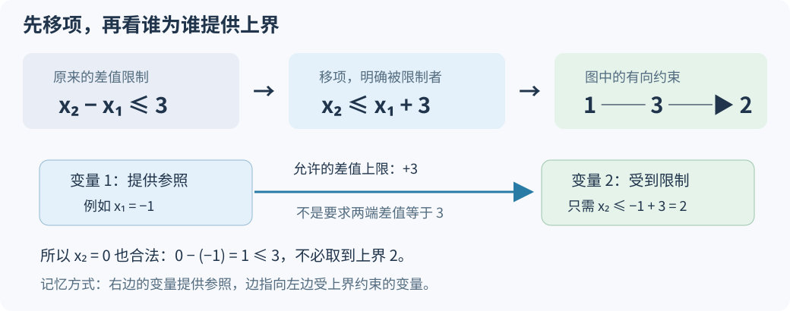
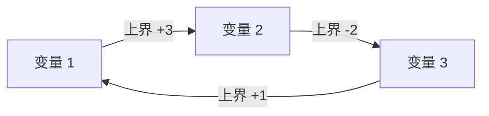
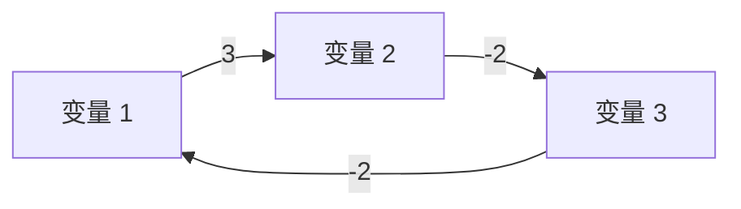
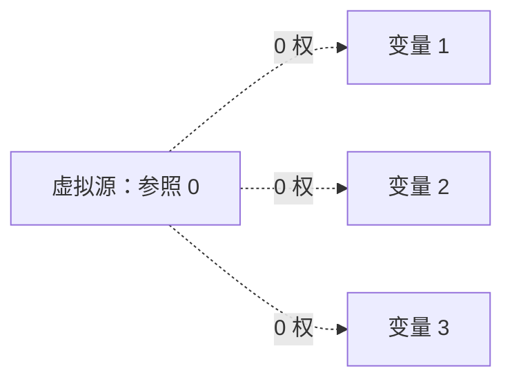

# 6.11 差分约束：把不等式转成边

前置：[负权最短路与负环](10-negative-shortest-path.md)、[全图判环的初始化](10-negative-shortest-path.md#4-检测范围从一个点出发还是检查整张图)。

> **差分约束处理“两变量之差不超过某个常数”的一组条件。** 把条件编码为有向边，就可以借助全图负环判断是否有解；无负环时，还能得到一组满足条件的变量值。

## 0. 从变量关系中，看到松弛公式

给定若干未知数，已知它们之间的差值限制，例如：

$$
x_2-x_1\le3,\qquad x_3-x_2\le-2.
$$

**不要求找出唯一值，只问能否同时满足，或者输出任意一组解。**直接枚举各变量的值很困难：取值范围可能很大，甚至没有给出绝对上限；变量关系还可能绕成环。

上一节检查一条边 `u→v` 时，要求最终距离满足：

$$
\mathrm{dist}[v]\le\mathrm{dist}[u]+w.
$$

**这里的形式恰好相同：一个变量，为另一个变量提供上界。** 因此不必重新枚举赋值，而是把每条限制翻译成边，让距离更新协调这些上界。

## 1. 先给代码：求一组可行解

沿用 `using ll = long long;`。下面复用[上一节模板](../../templates/06-graph-and-tree/negative-shortest-path/README.md)，示例中的头文件来自该模板组；不用再抄一份 SPFA。变量编号是 **1-based**。

```cpp
#include "negative_shortest_path.hpp"

using ll = long long;

struct Inequality {
    int i, j;
    ll c; // 表示 x[i]-x[j] <= c，不是直接保存一条边
};

negative_shortest::Result difference_constraints(
    int n, const std::vector<Inequality>& constraints) {
    std::vector<std::vector<negative_shortest::AdjEdge>> g(n + 1);

    for (const auto& t : constraints)
        g[t.j].push_back({t.i, t.c}); // j -> i，权重 c

    // 每个变量所属的约束分量都要检查。
    return negative_shortest::spfa(g, 0);
}
```

**用途速记：** 输入统一为 `x[i]-x[j] <= c` 的约束，建出 `j→i` 后检查全图。返回的 negative_cycle 为 true 表示无解；否则 dist[1..n] 就是一组可行赋值。dist 此时表示变量解，不是某段实际路程。

| 变量／容器 | 含义与功能 | 范围／容量 |
| --- | --- | --- |
| n | 未知数的数量，也就是图的真实点数 | 变量下标 1..n |
| constraints | 已经整理为同一形式的全部约束 | 容器位置从 0 开始；i、j 仍是变量编号 |
| i、j | 本条约束涉及哪两个变量 | x[j] 给 x[i] 提供上界 |
| c | 差值的上限 | 可以为负数、0 或正数 |
| g | 约束图的邻接表 | n+1 个列表，真实有向边数记为 M |
| dist[i] | 无负环时，为 x[i] 找到的一种取值 | n+1 项；不输出 0 号 |

执行流程是：**统一不等式 → 建边 → 全图检查 → 无解则报告，否则读取变量解。** 本节只求可行性和任意解；若另问总和最大／最小，还需要额外分析。

## 2. 为什么是 j 到 i：看谁为谁提供上界

先看 `x₂−x₁≤3`。移项后：

$$
x_2\le x_1+3.
$$

**x₁ 的值加 3，限制了 x₂ 最多能取多少。** 若先知道 x₁，就能沿这条关系检查 x₂，因此边从 1 指向 2，权重为 3。



一般地：

$$
x_i-x_j\le c
\quad\Longleftrightarrow\quad
x_i\le x_j+c.
$$

与距离松弛的条件比较，被限制的是 i，提供参照的是 j，于是：

$$
j\xrightarrow{\ c\ }i.
$$

**边权是允许的差值上限，不是强迫两端恰好相差 c。** 比如 x₁=−1 时，x₂ 只需不超过 2；取 0 也合法，不必取 2。

代码中的 `g[t.j].push_back({t.i,t.c})` 正是在保存这件事。不要按输入出现顺序机械写成 i→j。

### 其他常见形式，先统一再建边

| 原条件 | 转成统一形式 | 对应边 |
| --- | --- | --- |
| $x_i-x_j\le c$ | 已经统一 | j→i，权 c |
| $x_i-x_j\ge c$ | $x_j-x_i\le-c$ | i→j，权 −c |
| $x_i-x_j=c$ | 同时要求两侧不等式 | j→i，权 c；i→j，权 −c |
| 整数满足 $x_i-x_j\lt c$，且 c 为整数 | $x_i-x_j\le c-1$ | j→i，权 c−1 |

**等式需要两条边，因为一个方向只给上界。** 严格小于改成减 1，只适用于整数差值与整数上限；实数不能这样处理。

本模型要求每个条件都能化成上述“两变量之差”的形式。`x[i]+x[j] <= c`、一般乘积关系等，不能直接套这个建边规则。

## 3. 跟着一组约束，看看 dist 怎样变成变量解

在开头两条限制外，再加：

$$
x_1-x_3\le1.
$$

三条边组成一个环，但它的总权重为 3−2+1=2，不是负环：



全图模式先令所有 dist=0，所有点入队。按 1、2、3 的顺序开始处理：

| 刚处理的点 | 这次检查 | 更新后的 dist[1]、dist[2]、dist[3] |
| --- | --- | --- |
| 初始化 | 每个点都有传播资格 | 0，0，0 |
| 1 | dist[2] 已不超过 dist[1]+3 | 0，0，0 |
| 2 | dist[3] 必须不超过 dist[2]−2 | 0，0，−2 |
| 3 | dist[1] 必须不超过 dist[3]+1 | −1，0，−2 |
| 再次处理 1 | dist[2]=0 已不超过 −1+3 | −1，0，−2；稳定 |

稳定后，把它们读作变量值：

$$
(x_1,x_2,x_3)=(-1,0,-2).
$$

逐条代回原约束：

| 原限制 | 代入后的差值 | 是否满足 |
| --- | --- | --- |
| x₂−x₁≤3 | 0−(−1)=1 | 满足 |
| x₃−x₂≤−2 | −2−0=−2 | 满足 |
| x₁−x₃≤1 | −1−(−2)=1 | 满足 |

**算法不要求让每条边都取等号，只要所有约束同时成立。** 正权环、零权环都不必然冲突。

## 4. 为什么负环代表矛盾：沿约束代入一圈

现在只把第三条改成 `x₁−x₃≤−2`，其余不变：



前两条合起来，x₃ 的上界为：

$$
x_3\le x_2-2\le x_1+3-2=x_1+1.
$$

再接上第三条，就要求：

$$
x_1\le x_3-2\le x_1+1-2=x_1-1.
$$

两边同时减去 x₁：

$$
0\le-1.
$$

这不可能成立。图上的同一圈权重之和为 3−2−2=−1，正好是负环。

**沿一个环将约束相加，所有变量差会相互抵消，最后只剩“0 不超过这一圈的总权重”。 总权重为负，就与任何赋值都冲突；不是只与当前 dist 冲突。**

## 5. 为什么检查全图，而不是只从变量 1 开始

一组约束可能分成互不相关的几部分。即使变量 1 所在部分有解，另一部分若矛盾，**整组条件仍然无解**。

所以调用的是全图模式 `spfa(g,0)`，不是从真实变量 1 出发。



无需真的创建这些边：上一节的 s=0 已经把各点初始距离设为 0，并将全部点入队。**虚拟源是检查所有约束分量的工具，不代表原题规定各变量最终都等于 0。**

有人会担心：这样求出的数常是负的，会不会把本来存在的正解排除了？

**只有差值限制时，全部变量统一加上 K，不会改变任何一条限制：**
$$
(x_i+K)-(x_j+K)=x_i-x_j.
$$

因此，对任何一组有限解，都能通过平移让各值不超过 0，或在需要时统一移到非负范围。前面的解整体加 3，就得到同样合法的 `(2,3,1)`。

**可行性由相对差值决定，不由某个解里有没有负数决定。** 若题目还给出固定的绝对值、各不相同的上下界等，需把额外条件也纳入模型，不能随意平移后声称仍满足它们。

## 6. 为什么没有负环，就一定能返回解

负环会导致矛盾，说明“有解则没有负环”；还要确认另一个方向。

虚拟源保证每个点可达。没有负环时，最短距离有限，算法结束后每条边 j→i 都满足：

$$
\mathrm{dist}[i]\le\mathrm{dist}[j]+c.
$$

否则还能沿这条边改善距离，就不应当已经稳定。将 dist 作为变量值，移项即得：

$$
\mathrm{dist}[i]-\mathrm{dist}[j]\le c.
$$

这正是原来要求的每一条约束。因此，**全图无负环时，返回的距离就是一组可行解**，不需要再单独搜索赋值。

$$
\boxed{\text{纯差分约束有解}\quad\Longleftrightarrow\quad\text{约束图没有负环}}
$$

若约束常数都是整数，距离更新只做整数加法，得到的解也全是整数。

## 7. 求可行解，不等于求最小总和

这里使用“最短路”只是为了协调所有上界，并不自动证明题目中某个数量之和最小。

只有相对差值限制时，一组解可以整体向下平移，所有变量之和还会继续减小，甚至根本没有有限的最小总和。**题目若问最少人数、最小总和或某个变量的最值，要重新审查下界、参照点与优化方向。**

本节先完成存在性与任意可行解；不把最长路式下界模型、前缀计数模型等变形混成同一个不用证明的模板。

## 8. 复杂度、存边数与数值范围

令 M 为**统一形式后实际存储的有向边数**，W 为这些边的权重绝对值上限。

| 部分 | 时间 | 空间 | 原因 |
| --- | --- | --- | --- |
| 统一并建立约束图 | O(n+M) | O(n+M) | 每个不等式建一条边，等式建两条 |
| 全图 SPFA | 最坏 O(nM+n) | O(n) 辅助空间 | 复用上一节，不承诺线性复杂度 |
| 输出一组解 | O(n) | 不另建解表时 O(1) 额外空间 | 直接读返回的 dist[1..n] |
| 整体 | 最坏 O(nM+n) | O(n+M) | 包含图、状态、队列与结果 |

**原来有 m 条信息，不代表实际只有 m 条边。** 一条等式包含两个方向；估算运行规模时要用转换后的 M。

本节模板复用的判环实现采用更一般的数值契约：n、M 与容器下标可由 int 表示、内存足够，并保证检测过程的保守上界：

$$
nMW\le10^{18}.
$$

这不是最短路复杂度，而是保护中间加法的数值条件。比如 n=5000、M=10000、W=10000，乘积为 5×10¹¹，仍安全落在 ll 与模板 INF 范围内。**核对乘积时先作数学估算或用除法比较，不要在 ll 中先溢出再判断。**

上一节教学正文用 n≤2000 的具体范围演示证明；复用模板的说明已明确这一更一般的充分条件，算法主体未改动。

常见边界：

- **没有约束：** 全 0 就是一组可行解，空图不应误判无解。
- **自身限制：** `x[i]-x[i] <= c` 等于要求 0≤c；c 为负时对应负权自环。
- **重复限制：** 可以全部保留；同方向更小的 c 限制更强，但不必为此另写去重。
- **等式：** 漏一个方向会把“相等”放宽成“至多”，改变问题。
- **负环标志：** true 表示无解，不是“存在解”；此时不能继续输出中间 dist。
- **全局平移：** 只有确认新增的绝对条件也被满足时才能平移；本接口不自动处理额外锚点与任意边界。

## 9. 典题与复盘

两题实际实现已静态核对题意、建边与返回值，以下只整理排版和注释，**不重复运行或对拍个人代码**。两题共用同一套全图 SPFA；第一题保留距离作为解，第二题只需要负环标志。

### 共用主体：把“是否矛盾”和“变量赋值”一起返回

沿用开篇的 `ll` 别名，`INF = LLONG_MAX / 4`。变量与图节点均为 **1-based**；参数 `s=0` 表示检查全图，不是真实变量。

```cpp
struct Edge {
    int v;
    ll w;
};

struct SRes {
    vector<ll> dist;
    bool neg; // true 表示有负环：约束无解
};

SRes spfa(const vector<vector<Edge>>& g, int s = 1) {
    int n = (int)g.size() - 1;
    vector<ll> dist(n + 1, s == 0 ? 0 : INF);
    vector<int> hops(n + 1, 0);
    vector<bool> inq(n + 1, false);
    queue<int> q;

    if (s == 0) {
        for (int u = 1; u <= n; ++u) {
            q.push(u);
            inq[u] = true;
        }
    } else {
        dist[s] = 0;
        q.push(s);
        inq[s] = true;
    }

    while (!q.empty()) {
        int u = q.front();
        q.pop();
        inq[u] = false; // 已出队，之后距离改善仍可再次入队

        for (const auto& e : g[u]) {
            ll nd = dist[u] + e.w;
            if (nd >= dist[e.v]) continue;

            dist[e.v] = nd;
            hops[e.v] = hops[u] + 1;
            if (hops[e.v] >= n)
                return {dist, true};

            if (!inq[e.v]) {
                q.push(e.v);
                inq[e.v] = true;
            }
        }
    }
    return {dist, false};
}
```

**用途速记：** 先把全部关系翻译成边，再调用 `spfa(g,0)`。有负环就报告矛盾；没有负环，`res.dist[i]` 可以直接作为变量值。**两题的区别在于怎样建图、怎样使用结果，松弛主体不用改变。**

个人第二份代码只返回 `bool`：检测到负环返回 `true`，正常结束返回 `false`。这也足够，因为第二题不输出赋值；下方为避免重抄主体，统一读取同义的 `res.neg`，只调整返回结果的使用方式，未改变算法。

### 9.1 P5960：距离本身就是解

题目：[P5960 〖模板〗差分约束](https://www.luogu.com.cn/problem/P5960)。给出差值上界，输出任意一组整数解，无解输出 `NO`。

原实现的 `solve()`：

```cpp
void solve() {
    int n, m;
    cin >> n >> m;
    vector<vector<Edge>> g(n + 1);

    while (m--) {
        int u, v;
        ll w;
        cin >> u >> v >> w;
        g[v].push_back({u, w}); // x[u]-x[v] <= w
    }

    auto res = spfa(g, 0);
    if (res.neg) {
        cout << "NO\n";
    } else {
        for (int i = 1; i <= n; ++i)
            cout << res.dist[i] << ' ';
        cout << '\n';
    }
}
```

**输入不是边的起终点，而是不等式中两个变量的顺序。** 先移项，再确定方向：

$$
x_u-x_v\le w
\quad\Longleftrightarrow\quad
x_u\le x_v+w.
$$

v 给 u 提供上界，因此保存 `v→u`、权重 w。

无负环并结束松弛时，每条边都已经满足：

$$
\mathrm{dist}[u]\le\mathrm{dist}[v]+w.
$$

于是直接令：

$$
\boxed{x_i=\mathrm{dist}[i]}.
$$

**不是先判断有解、再去枚举解；传播上界的过程，已经构造出了一个解。** 有负环时则不能输出尚未稳定的距离。

题目要求输出值在 int 范围。边权绝对值不超过 10⁴，n≤5000；无负环时，可用不重复真实节点的最短路径取到距离，真实边最多 n−1 条，故全图零源模型下的解在约 −5×10⁷ 到 0 之间。**内部仍用 ll，最终赋值也满足题目的 int 范围要求。**

### 9.2 P1993：把自然语言拆成三种关系

题目：[P1993 小 K 的农场](https://www.luogu.com.cn/problem/P1993)。只问是否存在符合全部记忆的信息，因此不必输出作物数量。

下面复用共用的 `SRes` 主体；与个人只返回 `bool` 的版本相比，仅把结果读取改成 `res.neg`：

```cpp
void solve() {
    int n, m;
    cin >> n >> m;
    vector<vector<Edge>> g(n + 1);

    while (m--) {
        int op, u, v;
        cin >> op >> u >> v;
        if (op == 1) {
            ll w;
            cin >> w;
            g[u].push_back({v, -w}); // u 至少比 v 多 w
        } else if (op == 2) {
            ll w;
            cin >> w;
            g[v].push_back({u, w});  // u 至多比 v 多 w
        } else {
            g[u].push_back({v, 0});  // 两侧都不超过对方
            g[v].push_back({u, 0});
        }
    }

    auto res = spfa(g, 0);
    cout << (res.neg ? "No\n" : "Yes\n");
}
```

令 xᵤ、xᵥ 分别为两块农场的作物数量。**先写条件，再化成“某个变量的上界”，不要背操作编号与边方向。**

**① 至少多 w：下界换成反向上界。**

$$
x_u-x_v\ge w.
$$

两边取负，比较方向反过来：

$$
x_v-x_u\le-w
\quad\Longleftrightarrow\quad
x_v\le x_u-w.
$$

因此是 u→v，权重 −w。“至少”没有消失，而是变成了对另一个变量的“至多”。

**② 至多多 w：已经是标准形式。**

$$
x_u-x_v\le w
\quad\Longleftrightarrow\quad
x_u\le x_v+w.
$$

因此是 v→u，权重 w。

**③ 一样多：两个方向都限制。**

$$
x_u=x_v
\quad\Longleftrightarrow\quad
\begin{cases}
x_u\le x_v,\\
x_v\le x_u.
\end{cases}
$$

因此建 u→v 和 v→u，权重均为 0。只建一边会允许其中一个变量更小，不能保证相等。

| 信息 | 原不等式 | 存边 |
| --- | --- | --- |
| op=1：u 至少比 v 多 w | $x_u-x_v\ge w$ | u→v，−w |
| op=2：u 至多比 v 多 w | $x_u-x_v\le w$ | v→u，w |
| op=3：一样多 | $x_u=x_v$ | 双向，均为 0 |

**全图判负环，就是检查全部记忆能否同时成立。** 例如“u 至少比 v 多 2”和“一样多”并存，产生一个总权重为 −2 的环，矛盾立即暴露。若无矛盾，纯差值关系允许统一平移；即使求出的距离为负，也能整体加上足够大的整数，得到非负作物数量。

### 两题共同的发现过程


**原题要求的未必是路程，但只要约束形式与松弛公式一致，就可以借用图算法来协调变量。** 第一题读取构造结果，第二题只读取是否矛盾；这比机械记忆两份 SPFA 更值得保留。

两题建图均为 O(n+M)，SPFA 最坏 O(nM+n)，空间 O(n+M)。P1993 的等式增加两条边，因此 m 条信息转成的实际边数 M 最多为 2m；模板已支持三类接口，继续复用[差分约束封装](../../templates/06-graph-and-tree/difference-constraints/README.md)，不另造题目模板。


## 10. 自查

1. `x[2]-x[1] <= 3` 为什么是 1→2？为什么不是强迫两个数恰好相差 3？
2. 等式只建一条边，会多允许哪些本不合法的赋值？
3. 一个环权重为 0，为什么不代表无解？负环又如何直接推出变量矛盾？
4. dist 全部初始化为 0，为什么不表示变量最终必须全为 0？
5. 为什么不能只从变量 1 检查？返回值为 true 时为什么不能读中间距离作为解？
6. 求出一组可行解后，为什么还不能直接宣布变量总和最小？

模型定义与条件可对照 [OI Wiki：差分约束](https://oi-wiki.org/graph/diff-constraints/)。本篇例子、过程图与代码按仓库约定自行整理，两题实际实现与建模推导见第 9 节。

[本章索引](README.md) · [差分约束模板](../../templates/06-graph-and-tree/difference-constraints/README.md)
