# 6.12 强连通分量与缩点：把互相可达的点归成一组

前置：[显式 DFS 与 next](01-graph-basics.md)、[拓扑排序](05-topological-sort.md)。SCC 是 Strongly Connected Component，即强连通分量。

## 0. 先遇到问题：有方向，不能只分普通连通块

无向图中，只要有路相连，就可以归入同一连通块。有向图则不同：**1 能走到 2，不代表 2 能走回 1。**

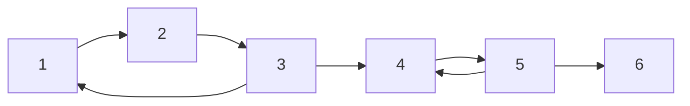

1、2、3 可以互相到达；4、5 也可以。但从第一组走到第二组后，再也回不去。

**强连通分量：一组尽可能多的点，其中任意两点都能沿有向路径互相到达。** 单个点自己也构成强连通分量，即使没有自环。

普通 DFS 的 visited 只能记录发现过谁，不能区分“走得到”和“走得回来”。并查集若见边就合并，也会丢掉方向。逐点搜索所有可达关系可行，但要 O(n(n+m))；这里希望只遍历一次图完成分组。

另一个动机是：**原图有环，不能直接拓扑排序；但环内互相可达的部分，也许可以先看作一个整体。**

## 1. 先给代码：在熟悉的显式 DFS 上维护分组信息

图节点 **1-based**，邻接列表内部仍为 **0-based**。下面的 next 与之前相同，保存每个点下一条待检查边的位置。显式栈实现较长，但能直接看见“进入节点”和“从孩子返回”两个时机，也避免长链递归过深。

```cpp
struct SCCResult {
    int count;                  // 强连通分量总数
    vector<int> id, size;       // id[u]：点 u 所属的分量编号
                                // size[c]：第 c 个分量的点数；size[0] 不用
};

// 有向图，顶点编号 1..n
// 使用显式栈模拟 Tarjan DFS，避免递归过深导致系统栈溢出
inline SCCResult tarjan_scc(const vector<vector<int>>& g) {
    int n = (int)g.size() - 1;
    int timer = 0; // DFS 时间戳，每访问一个新点就加 1

    vector<int> dfn(n + 1, 0);    // dfn[u]：首次访问 u 的时间；0 表示未访问
    vector<int> low(n + 1, 0);    // low[u]：u 能通过 DFS 树边及返祖边到达的最早时间戳
    vector<int> parent(n + 1, 0); // DFS 树中 u 的父节点；0 表示没有父节点
    vector<int> next(n + 1, 0);   // next[u]：下一条尚未处理的出边下标，模拟递归中的循环进度

    vector<int> id(n + 1, 0);     // id[u]：u 所属的 SCC 编号；0 表示尚未分配
    vector<int> size(1, 0);       // 分量编号从 1 开始，因此先占用 size[0]

    // in[u] 表示 u 是否仍在 Tarjan 栈中，即尚未归入任何已确定的 SCC
    vector<bool> in(n + 1, false);

    stack<int> dfs;     // 模拟递归调用栈：保存当前 DFS 路径上的待处理节点
    stack<int> pending; // Tarjan 栈：保存尚未确定所属 SCC 的节点

    // 首次进入 u：分配时间戳，并将 u 放入两个栈
    auto enter = [&](int u) {
        dfn[u] = low[u] = ++timer;
        in[u] = true;
        dfs.push(u);
        pending.push(u);
    };

    // 图可能不连通，需要从每个尚未访问的点开始 DFS
    for (int s = 1; s <= n; ++s) {
        if (dfn[s]) continue;

        enter(s);

        while (!dfs.empty()) {
            int u = dfs.top();

            // u 还有未处理的出边，继续模拟递归中的 for 循环
            if (next[u] < (int)g[u].size()) {
                int v = g[u][next[u]++]; // 取出一条边，并推进 u 的扫描位置

                if (!dfn[v]) {
                    // v 尚未访问：沿树边深入，之后还要回到 u
                    parent[v] = u;
                    enter(v);
                } else if (in[v]) {
                    // v 已访问且仍在 Tarjan 栈中，说明它尚未归入已确定的 SCC
                    // 通过 u -> v 可以联系到 dfn[v] 对应的访问位置
                    low[u] = min(low[u], dfn[v]);
                }
                // 不论 v 是新点还是旧点，都先结束本次边处理
                // 若刚进入了 v，下轮会先处理 v，模拟递归深入
                continue;
            }

            // u 的所有出边都处理完，相当于递归函数即将 return
            dfs.pop();

            // 模拟递归返回：子节点 u 的 low 值可能影响父节点
            // 取 min 是因为父节点可能已经通过其他路径找到更早的访问位置
            if (parent[u])
                low[parent[u]] = min(low[parent[u]], low[u]);

            // low[u] == dfn[u]：u 是一个 SCC 的根
            // 从 Tarjan 栈顶部一直弹到 u，这些节点构成一个完整的 SCC
            if (low[u] == dfn[u]) {
                int c = (int)size.size(); // 新分量编号，从 1 开始
                size.push_back(0);

                while (true) {
                    int v = pending.top();
                    pending.pop();

                    in[v] = false; // v 已归入确定的 SCC
                    id[v] = c;
                    ++size[c];

                    if (v == u) break; // 弹到根节点 u，本分量处理完毕
                }
            }
        }
    }

    // size[0] 是占位项，因此分量数为 size.size() - 1
    return {(int)size.size() - 1, id, size};
}
```

**用途速记：** 输入有向邻接表，返回每个点属于哪一组、每组有几个点、总共有几组。**算法通过 DFS 顺序和回连信息，推迟决定分组，直到能够确认一整组再一起弹出。无需先枚举所有点对的可达性。**

### 变量、容器和各自职责

| 变量 | 含义／功能 | 范围与容量依据 |
| --- | --- | --- |
| dfn[u] | 首次发现 u 的时间编号；0 表示未访问 | 1..n；数组 n+1 |
| low[u] | 按下文更新规则记录的最早回连编号 | 首次为 dfn[u]，后续只减小 |
| parent[u] | DFS 树上从哪个点第一次进入 u | 0 表示本次搜索根；不是输入给定的树 |
| next[u] | u 的哪条出边下一次还要检查 | 0..g[u].size()，不是节点编号 |
| dfs | 当前尚未返回的 DFS 调用链 | 最多 n 点，栈顶是本轮 u |
| pending | 已发现、尚未确定所属分量的点 | 最多 n 点，按发现次序入栈 |
| in[u] | u 是否仍在 pending 中 | 不是“曾访问”，也不是“在 dfs 中” |
| id[u] | 原点编号 → 分量编号 | 1..count，数组 n+1 |
| size[c] | 分量 c 包含多少点 | 下标 0 占位，真实分量 1..count |

**dfn 是不会改变的发现顺序；low 是仍在更新的回连信息；id 是最后确定的分组结果。** 三者不要混成一个 visited。

整体流程：首次进入 → 检查出边／深入孩子 → 孩子返回后合并 low → 符合分组条件时弹出一整组 → 继续尚未访问的起点。

### 按代码执行：同一张图的逐步快照

先看完下面这组图，再读后文的各条规则。**每张图都展示执行后的状态，蓝色单元格表示相对上一张图发生变化。** 同时对照原图、两个栈和数组，避免只盯着某一项数值。

固定出边顺序，才能得到一致的执行过程：

```text
g[1] = [2]      g[2] = [3]      g[3] = [1, 4]
g[4] = [5]      g[5] = [4, 6]   g[6] = []
```

所有数组最初为 0，两个栈为空，timer=0，size 只有占位的 size[0]=0。图中的 in 用 0／1 表示 false／true。**表头 u 是数组下标；标题中的当前节点，是代码本轮处理的 u。**

第一、三张图连续展示多次进入后的结果，其余图各对应一次检查边或节点返回。取边时就执行 next[u]++，不是等孩子处理完才递增。

**01．进入 1 → 2 → 3**

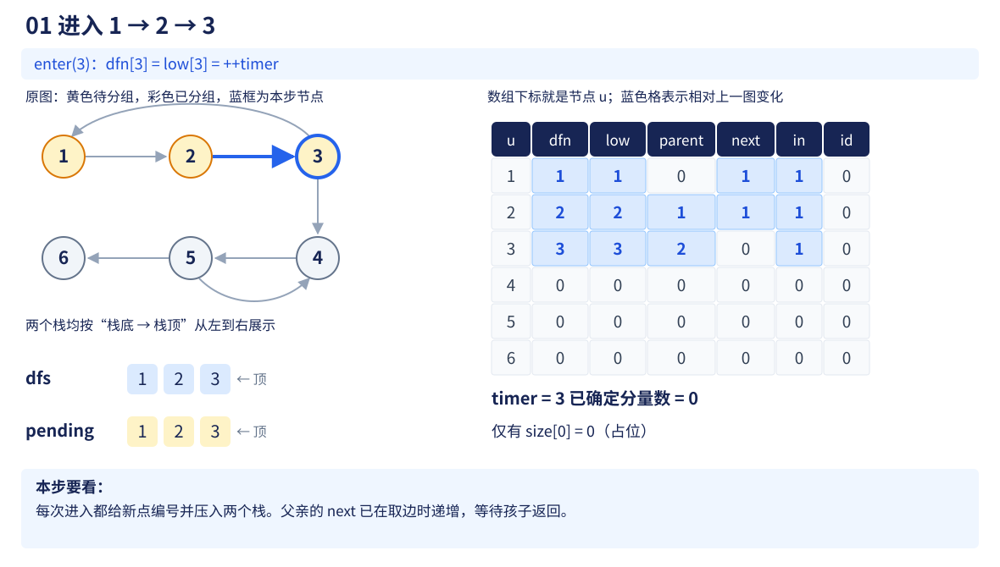

**02．检查 3 → 1：先只改 low[3]**

![Tarjan 第 2 步：检查 3 → 1：先只改 low[3]，图、两栈与数组快照](assets/scc-trace-02.svg)

**03．继续深入：从 3 进入 4、5**

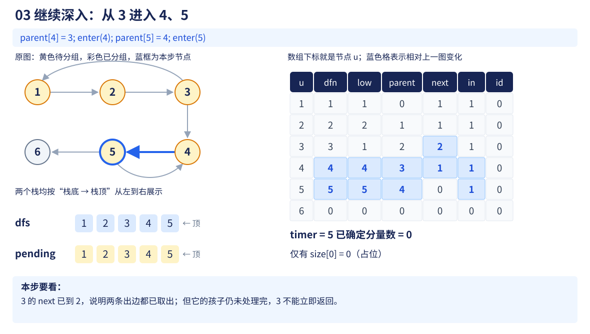

**04．检查 5 → 4：5 继续等待 4**

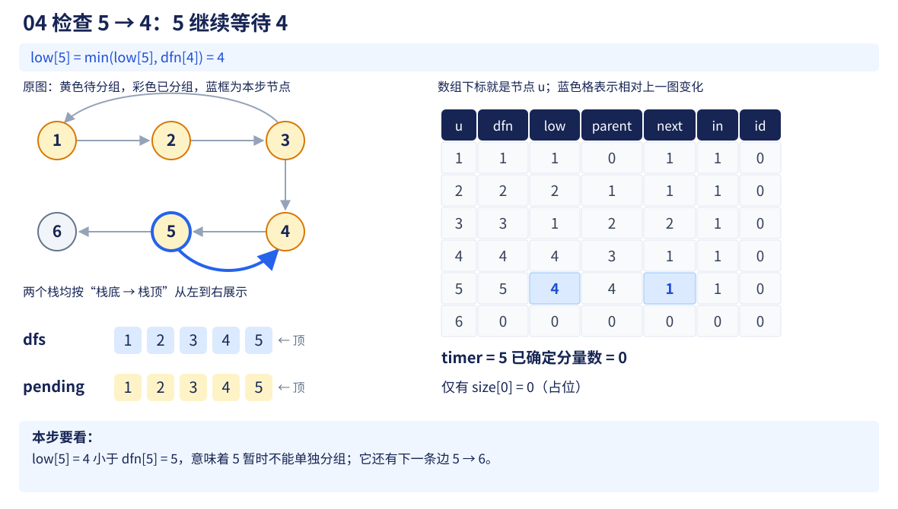

**05．进入 6：所有点都已发现**

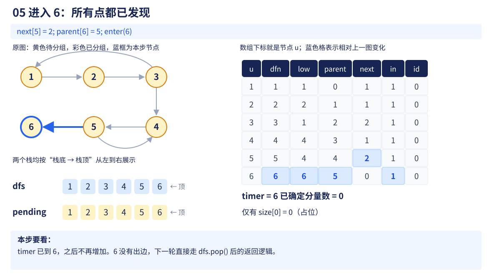

**06．6 返回：确定第 1 组 {6}**

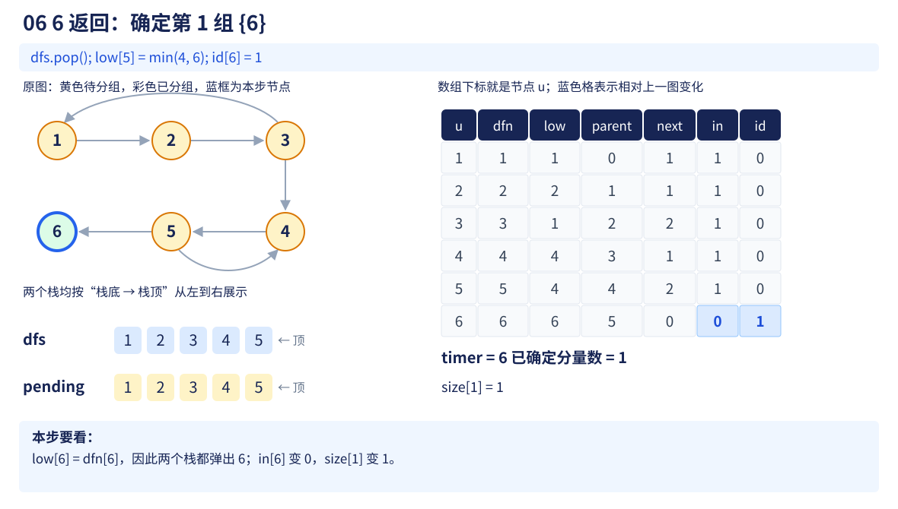

**07．5 返回：只退调用栈，尚不分组**

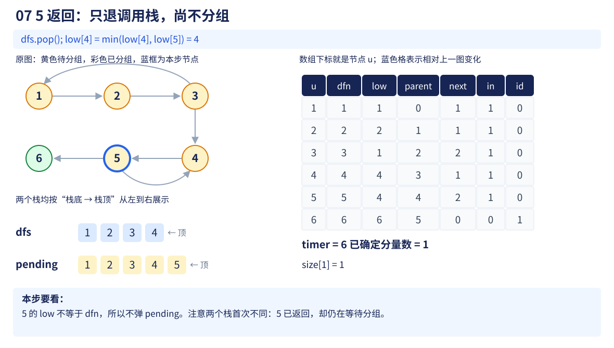

**08．4 返回：一起取出 5、4**

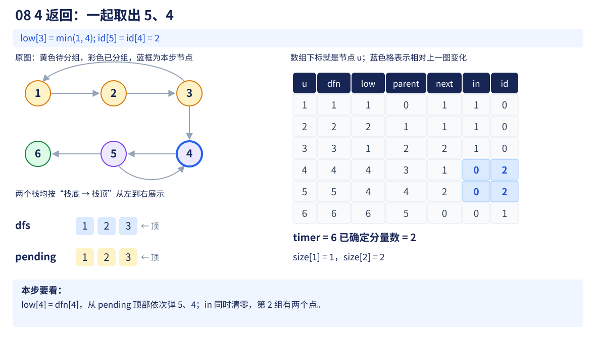

**09．3 返回：把 low[3] 传给 2**

![Tarjan 第 9 步：3 返回：把 low[3] 传给 2，图、两栈与数组快照](assets/scc-trace-09.svg)

**10．2 返回：把回连信息继续传给 1**

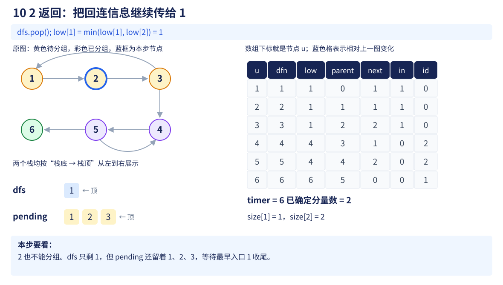

**11．1 返回：确定最后一组，搜索结束**

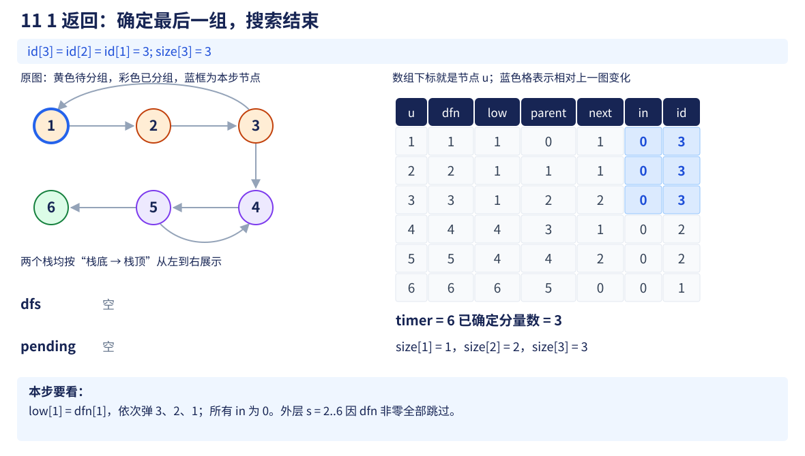

> 把这组图连起来看，有三条独立的变化线：

- **发现顺序：enter 才增加 timer，写入 dfn 与 low，并压入两个栈。**
- **搜索进度：取边推进 next；孩子返回才把 low 传给 parent。**图 02 的 low[3]=1，要到图 09 才传给 2。
- **分组结果：只有满足 low[u]==dfn[u] 时，才弹 pending、清 in、写 id 并统计 size。**图 07、09、10 只退出 dfs，不完成分组。

**尤其比较图 06 与图 07：6 返回时完成了分组，5 返回时却没有。** 因此**两个栈的弹出时机不能合并成一个操作。**

## 2. 两个栈：返回了，不一定已经分好组

先看一个比开头更小的图，邻接顺序让 1 先访问 2，再访问 3：

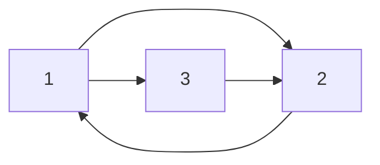

2 通过边 2→1 发现自己能回到更早的点，所以不能单独分组。**2 的出边查完后，可以退出 DFS 调用，但仍留在 pending 中等待 1。**

当随后进入 3 时，两个栈如下，右侧是栈顶：

| 此刻 | 栈内节点 | 意义 |
| --- | --- | --- |
| dfs | 1，3 | 当前调用链，2 已经返回 |
| pending | 1，2，3 | 三个点的最终分组均尚未确定 |

此时 3→2 仍要使用：3→2→1，而 1→3，所以三个点互相可达。

**因此 `in[v]` 不能换成“v 还在 DFS 调用链中”。** 2 虽已返回，却还在等待分组；漏掉这条边就会错误地拆开 3。

## 3. low 怎样更新：围绕检查一条边展开

low 记录的是 Tarjan 的回连信息，**不要把它理解成任意路径能到达的最小编号**。标准含义是：从当前点出发，沿 DFS 树向下走零条或多条边，再利用至多一条通往 pending 内节点的非树边，能联系到的最早发现编号；同时保留当前点自身的编号。

先用下面三种情况理解代码，比直接背整句定义更直观。

### ① v 还未访问：深入后，等孩子返回

```cpp
parent[v] = u;
enter(v);
```

u 暂停，先把 v 的后续边全部检查完。v 返回时再执行：

$$
\mathrm{low}[u]=\min(\mathrm{low}[u],\mathrm{low}[v]).
$$

**u 可以先走树边 u→v，再利用 v 已经找出的回连路线。** 所以传回来的是孩子的 low。代码把这一步放在 v 的 `dfs.pop()` 之后，模拟递归调用返回。

若 v 已经能独立成组，low[v]=dfn[v] 又晚于 u 的发现时间，这次取 min 不会降低 low[u]；因此可统一执行，不必额外分支。

### ② v 已访问，但还在 pending：使用这条边

```cpp
else if (in[v])
    low[u] = min(low[u], dfn[v]);
```

例如 3→1，发现编号分别为 3 和 1：

$$
\mathrm{low}[3]=\min(3,1)=1.
$$

3 与更早、尚未封闭的搜索部分取得了联系，需要继续等待。

这里更新的是 **dfn[v]，不是 low[v]**：当前非树边直接到达的是 v；孩子返回才沿用其已汇总的 low。按这个定义分别处理两类边，不把两条规则混写。

### ③ v 已经分好组：忽略它对 low 的影响

例如先搜索 1，使它单独成组；之后从 2 出发，只有边 2→1。

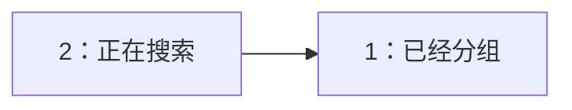

2 能到 1，但 1 不能回到 2。若只看 `dfn[1]` 较小就降低 low[2]，2 会一直等待一个早已弹出的点，无法正确收尾。

> **已经封闭的分量不能因一条单向入边重新合并。** 所以只有 `in[v]` 为 true 的已访问点，才参与第二种更新。

## 4. 为什么 low[u] 等于 dfn[u]，就弹出一整组

回到开头的六点图，按图中顺序先深入到 6。所有点首次进入时，dfn 与 low 都等于自己的发现编号。

| 关键行为 | low 的变化 | 分组行为 |
| --- | --- | --- |
| 检查 3→1 | low[3] 从 3 变 1 | 等待更早的 1 |
| 检查 5→4 | low[5] 从 5 变 4 | 等待更早的 4 |
| 6 出边查完 | low[6]=dfn[6]=6 | 弹出 6，形成一组 |
| 5 返回 4 | low[4]=min(4,4)=4 | 5 返回调用，但还在 pending |
| 4 出边查完 | low[4]=dfn[4]=4 | 弹出 5、4，形成一组 |
| 3 返回 2，再返回 1 | low[2]=1，low[1]=1 | 3、2 都要等待 1 |
| 1 出边查完 | low[1]=dfn[1]=1 | 弹出 3、2、1，形成一组 |

例如 4 收尾时，6 已被取走，pending 栈底到栈顶为：

```text
1  2  3  |  4  5
            ↑  ↑
          到这里停止，先弹出 5
```

**从栈顶一直弹到 u，包含 u。** 不是只弹 u，也不是只弹 DFS 的直接孩子。

判定条件：

$$
\mathrm{low}[u]=\mathrm{dfn}[u].
$$

**表示处理完全部后继后，u 没有找到能让这一块继续向更早未分组点合并的回连。比 u 更晚入栈、且仍没被独立取走的点，要与 u 一起封闭。**

为什么这些点不是随意凑在一起？**u 沿 DFS 树可以到达它们；它们若不能回连到 u 所在的待定部分，就会在更深处先满足条件、被独立取走。 留下的回连关系将它们接回 u。因此此刻整块内部可以互相到达，又不再需要等待更早的点。**

若 low[u] 更小，则还有更早的待定节点：

$$
\mathrm{low}[u]\lt\mathrm{dfn}[u].
$$

**此时只能返回 DFS，不能把 u 所在的部分提前分组。分组要留给更早的入口完成。**

## 5. 缩点：原点编号映射为分量编号

```cpp
// 将原图缩点，构造 SCC 的缩点图（DAG）
inline vector<vector<int>> condensation(
    const vector<vector<int>>& g, const SCCResult& scc) {

    // 每个强连通分量作为一个新节点，编号为 1..scc.count
    vector<vector<int>> dag(scc.count + 1);

    // 遍历原图的所有有向边 u -> v
    for (int u = 1; u < (int)g.size(); ++u) {
        for (int v : g[u]) {

            // 若 u、v 属于不同的 SCC，
            // 则在对应的分量之间保留有向边
            if (scc.id[u] != scc.id[v]) {
                dag[scc.id[u]].push_back(scc.id[v]);
            }
            // 若属于同一 SCC，边缩点后变成分量内部的边，直接忽略
        }
    }

    return dag;
}
```

**用途速记：** 先用 id 把每条原边的两端转换为分量编号。两端同组就跳过，跨组就存一条新边。此版本保留重边，不额外排序。

开头的图缩为：

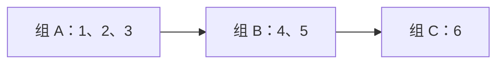

本代码实际按弹出顺序编号：C 为 1，B 为 2，A 为 3；图中的 A/B/C 只是便于阅读的组名。

| 原图信息 | 映射后 | 用途 |
| --- | --- | --- |
| 节点 u | id[u] | 找到它所在的新点 |
| 边 u→v | id[u]→id[v] | **保存组与组之间的方向** |
| 同组的一条边 | 两端 id 相等，忽略 | 内部可达已由分组表达 |
| 一组节点的数量 | size[c] | 查看该组规模 |

**缩点后一定是 DAG。** 假设不同组还能绕成有向环：

$$
A\to B\to C\to A.
$$

每组内部已经互相可达，再接上环，三组中的点也都可以互相到达，就应当属于同一组，与“不同强连通分量”矛盾。

因此可以衔接[拓扑排序](05-topological-sort.md#6-c11-实现kahn-算法)与 [DAG DP](../../patterns/06-graph-and-tree/dag-dp.md#1-先识别两层不同的问题)。**但组内状态如何聚合，必须根据目标另证。** SCC 保留可达关系，不保证原图简单路径能访问组内全部点，因为原图中的简单路径不能重复经过顶点，而一个 SCC 内部不一定存在能够访问所有顶点且符合进出要求的简单路径。也因此**最长简单路径不能直接把 size 相加**。

## 6. 别混淆：同一组、存在环、负环

| 要判断的事 | 关注什么 | 本节能否直接完成 |
| --- | --- | --- |
| 两点是否互相可达 | id 是否相同 | 可以 |
| 两点是否只要任一方向可达 | 还要检查组间路径 | **id 不同也可能单向可达** |
| 图是否有有向环 | 多点 SCC，或单点自环 | **可以结合自环检查** |
| 图是否有负环 | 环上的边权总和 | 不可以，只分组不看权重 |
| 无向图的普通连通块 | 不要求区分方向 | **用普通 DFS／DSU 更直接** |

**单点 SCC 不等于没有环：它可能有自环。** 也不能把“有环”当成“负环”；上一节差分约束允许零权环与正权环。

## 7. 复杂度：为什么不是每条边都反复搜

| 操作 | 时间 | 原因 |
| --- | --- | --- |
| 建图 | O(n+m) | 初始化列表、逐条存边 |
| Tarjan 全图分组 | O(n+m) | 每点进入／返回一次，next 让每条出边只检查一次 |
| pending 分组弹栈 | 合计 O(n) | 一个点只进一次、出一次 |
| 缩点并保留重边 | O(n+m) | 再扫每条边一次 |
| 总空间 | O(n+m) | 图占边空间，数组与两个栈为 O(n) |

外层从 1 到 n 检查起点，**已经发现的点会跳过，并不意味着从每个点重新搜索全图**。

例如 n=10⁵、m=5×10⁵，算法处理的是几十万条边与十万个点的量级；不会生成 n² 个点对。实际运行还取决于实现与机器，但**复杂度为线性**。

循环、栈深和答案组数都由点边数量决定，不由节点权值大小决定。显式栈能处理长链而不使用同等深度的系统递归栈，仍需提供 O(n) 的容器空间。

## 8. 易错点与边界

- **有向边不补反向边。** 补边会直接改变互相可达关系。
- **必须从所有未访问点启动。** 图可能不连通，不能只做起点 1。
- **next 是出边位置。** 每次取边后递增，孩子回来才知道从哪里接着检查。
- **low 的合并时机：** 孩子返回后读 low[v]；遇到已访问且待分组的 v 时读 dfn[v]。
- **两种退出不同：** dfs 弹出表示搜索返回；pending 弹出才表示分量确定，随后把 in 改为 false。
- **缩点重边看目标。** Kahn 按实际边数配套增减入度可以保留重边；不同后继计数或路径数不能未经分析照算重边。
- **重新调用会重新初始化。** 多测不沿用上一张图的 dfn、id、timer 或栈。

## 9. 典题与复盘

两题实际代码已按原题静态复盘，**不重复运行或对拍个人代码**。两份分组函数与开篇主体相同，第一题命名为 scc，第二题命名为 tarjan；下面保留各自调用名，不重复抄写主体。公共框架沿用 `using namespace std;` 等约定。

### 9.1 P2863：在分组结果中筛选，而不是再搜索

题目：[P2863 The Cow Prom S](https://www.luogu.com.cn/problem/P2863)。要求统计**点数大于 1 的强连通分量个数**，不是统计这些分量包含的总点数。

原实现只整理排版与注释：

```cpp
void solve() {
    int n, m;
    cin >> n >> m;

    vector<vector<int>> g(n + 1);
    while (m--) {
        int u, v;
        cin >> u >> v;
        g[u].push_back(v);
    }

    auto res = scc(g);
    for (int x : res.size)
        if (x == 1)
            --res.count; // 从全部分量中扣除单点分量

    cout << res.count << '\n';
}
```

size[0]=0 是占位项，不满足 x==1，不会误减。真实分量至少有一个点，因此扣除所有单点分量，恰好留下目标分量数量。

$$
\text{答案}=\text{全部 SCC 数量}-\text{单点 SCC 数量}.
$$

**即使一个单点带自环，它的点数仍然是 1，也应排除。** 这里按题目点数条件筛选，不是泛泛地判断有没有环。

原写法可用。如果后续还需要原始分量总数，可另外统计，保持 res.count 的原含义：

```cpp
int ans = 0;
for (int c = 1; c <= res.count; ++c)
    ans += (res.size[c] > 1);
```

分组 O(n+m)，结果扫描 O(n)，总时间 O(n+m)，空间 O(n+m)。

### 9.2 P2002：最少选几个起点，才能让消息覆盖全图

题目：[P2002 消息扩散](https://www.luogu.com.cn/problem/P2002)。消息沿有向边传播，选择尽可能少的发布城市，使所有城市都能收到消息。

**这里要求的是从若干起点出发，可达范围的并集覆盖全图。** 允许消息沿多条边分支扩散；不是要求一条不重复节点的路径走遍全图。

原实现只整理排版与注释：

```cpp
void solve() {
    int n, m;
    cin >> n >> m;

    vector<vector<int>> g(n + 1);
    while (m--) {
        int u, v;
        cin >> u >> v;
        g[u].push_back(v);
    }

    auto res = tarjan(g);
    vector<int> indeg(res.count + 1, 0);

    for (int u = 1; u <= n; ++u)
        for (int v : g[u])
            if (res.id[u] != res.id[v]) // 只统计跨分量的入边
                ++indeg[res.id[v]];

    int ans = 0;
    for (int c = 1; c <= res.count; ++c)
        if (!indeg[c])
            ++ans;

    cout << ans << '\n';
}
```

**用途速记：** 先把互相可达的城市归为一组，再统计每组是否能从别组收到消息。没有外部入边的组，必须自己安排发布点；其他组可以由上游传播到达。

#### 为什么不能直接数原图中入度为 0 的节点

先用反例检查这个自然想法：


**原图每个点的入度都非零，但不能因此不安排任何发布点。** 1、2 的入边只是互相指向：它们可以互相转发，不能凭空产生第一条消息。

从 1 或 2 中选一个发布，就能让三个点全部收到消息。因此答案是 1，直接数原图零入度点却会得到 0。

> 症结是：**“有人能传给我”，不等于“这一圈一定有人先得到消息”。原节点入度把圈内的转发边也算进去了。**

把 1、2 缩成一个点后：


**圈内边被去掉，才看清 A 根本没有外部消息入口。**

> **不是只选“原图入度为 0 的点”，而是每个“没有外部入边的强连通分量”选一个代表点。** 即使该组内每个点都有入边，整组也可能仍需主动启动。

#### 为什么用 SCC，而不是任意合并或普通连通块

需要把一组点看作一个传播单位，必须保证：**消息只要到达组中任意一个点，就能到达组内全部点。强连通分量恰好提供这个保证。**

**所以在源分量内选哪一个原节点都可以**：它能通知组内全部城市，也就能通知每条跨组出边的起点，再继续向下传播。

**普通无向连通块没有这个保证**：只有 1→2 时，若忽略方向把它们看作一组，选 2 发布就无法通知 1。**直接合并有边的点，会丢掉这个关键方向差异。**

同时，**缩点得到的是 DAG，不保证整张新图连通。**因此各个彼此无关的部分都要考虑：不能只从其中一个源开始，这里的“源”就是缩点图中入度为 0 的分量。

#### 为什么数源分量就是最少：先证明必须，再证明足够

**① 必须：每个源分量至少选一个点。**

源分量没有跨组入边。若组内没有发布点，外部消息也没有任何边能第一次进入该组，所以其中所有点都无法收到消息。

设源分量共有 S 个，就得到下界：

$$
\text{所需发布点数量}\ge S.
$$

**② 足够：从每个源分量各选一个点，就能覆盖所有分量。**

任选一个非源分量，沿入边往回找前驱。缩点图没有环、点数有限，因此不可能无限绕圈，最终必然停在某个没有前驱的源分量。

把刚才的路线反过来，就是从源到该分量的一条传播路径。因此每个分量都能由某个源到达。

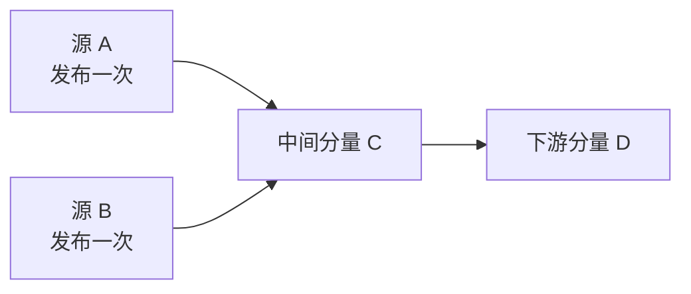

A、B 都必须启动；C、D 已经能收到上游消息，无需再增加发布点。多个源的传播范围可以重叠，不影响全图覆盖。

于是构造达到下界：

$$
\text{所需发布点数量}\le S.
$$

两边合起来：

$$
\boxed{\text{最少起点数量}=\text{缩点 DAG 中入度为 0 的分量数量}}.
$$

**这一步利用了 DAG 的性质**：**原图沿前驱回溯可能永远绕在环中**，所以不能把这套证明直接搬到原节点上；**缩点正是先消除这个障碍**。

#### 对照代码：没有建立新邻接表，也是在缩点上统计

```cpp
if (res.id[u] != res.id[v])
    ++indeg[res.id[v]];
```

| 代码信息 | 代表什么 | 为什么这样处理 |
| --- | --- | --- |
| res.id[u]、res.id[v] | 边两端所在的分量 | 原点编号转换为新点编号 |
| 两端 id 相同 | 分量内部的传播 | 不算外部入口，否则源分量会被自身环误判为非源 |
| 两端 id 不同 | 一条跨组有向边 | 给目标分量的 indeg 加 1 |
| indeg[c]==0 | 该组没有任何外部入口 | 必须在该组内选发布点 |

> **这里只要知道跨组入边是否存在，不必真的保存完整缩点图。** 扫描原边，经由 id 映射后直接统计，就得到了所需信息。这是按答案需要保留信息，不是换了一套缩点规则。

- **重边：** 可能让某个正入度重复增加，但不会把非零变成零。本题只判断零／非零，因此无需去重。
- **自环／组内边：** 必须排除；否则它们会**把本应没有外部入口的组算成有入度**。
- **原图已经是 DAG：** 每个节点单独成组，此时结论自然退化为数原图零入度点。
- **全图是一个 SCC：** 缩点后一个点、没有跨组入边，因此只需一个发布点。
- **多个互不相关的 SCC：** 每组都没有外部入口，每组都要选一个点。

Tarjan、扫描原边与扫描分量分别为 O(n+m)、O(m)、O(n)，总时间仍为 O(n+m)，图与状态空间为 O(n+m)。**没有必要再从每个候选起点执行一次 DFS**。

#### 以后识别这类题的入口

看到“**有向传播／从若干起点覆盖所有点／起点数量最少**”，先审查**环是否会让原节点入度失去判断力**。

**互相可达的一组点，只需要被启动一次；真正必须主动启动的，是没有外部入口的组。**

- **先把循环依赖收为整体，再在 DAG 上分析谁必须启动。**

1. 这一结论用于**可达性覆盖**。

2. 若另有发布费用、候选点限制，组内代表怎样选还需另算；
3. **若要求单条简单路径覆盖全图，也不属于本题模**：本题只要求消息能从发布点传播到所有节点，并不要求沿着一条路线，把所有节点依次走一遍。


## 10. 自查

1. 只有 1→2，为什么不能把它们划进同一个 SCC？
2. 节点退出 DFS 调用后，为什么仍可能留在 pending？第 2 节的 2 就是例子。
3. 为什么已经分好组的邻点，不能再用于降低 low？
4. 孩子返回与遇到待分组邻点时，分别读 low 还是 dfn？
5. 缩点为什么无环？为什么无环仍不意味着所有 DP 都能直接套用？
6. 为什么原图每个点都有入边，仍然可能需要主动选起点？缩点后为什么每个零入度分量都必须且只需启动一次？

概念与标准更新规则可对照 [OI Wiki：强连通分量](https://oi-wiki.org/graph/scc/)。本篇例图、过程表与显式栈实现按仓库已有 next 写法自行整理。

[本章索引](README.md) · [强连通分量模板](../../templates/06-graph-and-tree/scc/README.md)
