# 6.13 割点与桥：删掉哪里，会让无向图断开

前置：[图的表示与 DFS](01-graph-basics.md)、[上一节的 DFS 返回与 low](12-strongly-connected-components.md)。本节处理**无向图**，不沿用有向图强连通分量的判定条件。

## 0. 从删点、删边开始：能否不逐个试

一张交通网中，有些路可以绕行，有些路一断就会分成两部分；有些站点一旦停用，原本相通的区域也会断开。

- **割点：** 删除这个点及其所有关联边后，图的连通块数量增加。
- **桥，也叫割边：** 只删除这一条无向边后，图的连通块数量增加。

原图可以已经不连通。比较的是**删除前后的连通块数量**，不是要求删完后“图不连通”就算成功。删掉一个孤立点反而少一个连通块，它不是割点。

最直接的办法是每次删一个点或一条边，再做 DFS 数连通块：正确，但最坏分别要 O(n(n+m))、O(m(n+m))。

**真正要问的是：一棵 DFS 子树，除了来时的连接，还能不能绕回上面？** 用 low 保存这种回连信息，孩子返回时就能判断，无需真的逐项删除。

## 1. 先给代码：同一次 DFS 找出割点与桥

> 点编号 **1..n**；无向边编号 **0..m−1**。每条无向边只加入一次，内部存两个方向，但共用一个边编号。

```cpp
struct UndirectedGraph {
    struct Arc {
        int v, id; // 邻接点编号、原无向边编号
    };

    vector<vector<Arc>> g;
    vector<pair<int, int>> edges; // 按 id 保存原始无向边的两个端点

    explicit UndirectedGraph(int n) : g(n + 1) {}

    int add_edge(int u, int v) {
        int id = (int)edges.size();
        edges.push_back({u, v});

        // 一条无向边在邻接表中存两次，但共用同一个 id
        g[u].push_back({v, id});
        g[v].push_back({u, id});

        return id;
    }
};

struct CutResult {
    vector<bool> cut, bridge;
    // cut[u]：点 u 是否为割点
    // bridge[id]：原图中编号为 id 的无向边是否为桥
};

inline CutResult find_cuts(const UndirectedGraph& graph) {
    const auto& g = graph.g;
    int n = (int)g.size() - 1;
    int timer = 0;

    vector<int> dfn(n + 1, 0);    // 首次访问时间；0 表示未访问
    vector<int> low(n + 1, 0);    // 能通过 DFS 树边和返祖边关联到的最早访问时间
    vector<int> parent(n + 1, 0); // DFS 树中的父节点
    vector<int> pe(n + 1, -1);    // u 与父节点之间的那条树边的 id
    vector<int> next(n + 1, 0);   // u 下一条尚未处理的邻接边下标
    vector<int> child(n + 1, 0);  // u 在 DFS 树中的孩子数量

    vector<bool> cut(n + 1, false);
    vector<bool> bridge(graph.edges.size(), false);

    // 模拟递归 DFS 的调用栈
    stack<int> st;

    auto enter = [&](int u) {
        dfn[u] = low[u] = ++timer; // 首次访问时初始化时间戳
        st.push(u);
    };

    // 图可能不连通，每个未访问的点都要作为一棵 DFS 树的根
    for (int s = 1; s <= n; ++s) {
        if (dfn[s]) continue;

        enter(s);

        while (!st.empty()) {
            int u = st.top();

            // 还有未处理的出边：模拟递归中的 for 循环
            if (next[u] < (int)g[u].size()) {
                auto e = g[u][next[u]++];
                int v = e.v;

                // 只跳过 u 的父边，而不是所有通向父节点的边
                // 若存在重边，另一条连接父节点的边仍可能是返祖边
                // 所以同一条无向边的两条邻接记录必须共享同一个 id，才能准确识别父边
                if (e.id == pe[u]) continue;

                if (!dfn[v]) {
                    // v 是新节点：沿 DFS 树边深入，之后再返回 u
                    parent[v] = u;
                    pe[v] = e.id;
                    ++child[u]; // 只统计 DFS 树孩子，不是图上的总邻接数
                    enter(v);
                } else {
                    // 遇到已访问的节点：尝试通过这条边关联到更早的访问时间
                    low[u] = min(low[u], dfn[v]);
                }

                // 本轮只处理一条边；下一轮继续处理 u 或刚进入的 v
                continue;
            }

            // u 的所有邻接边均已处理，模拟递归函数返回
            st.pop();

            int p = parent[u];

            if (!p) {
                // u 是 DFS 树根，没有父节点，需要单独判断
                // 删除根后，各个 DFS 树孩子对应的子树彼此断开
                // 至少有两个孩子，删除根才会使连通块数量增加
                cut[u] = child[u] > 1;
            } else {
                // u 的子树处理完毕，将子树的 low 值回传给父节点
                low[p] = min(low[p], low[u]);

                // low[u] > dfn[p]：u 的子树无法绕过树边 (p,u)
                // 到达 p 或 p 的祖先，因此这条树边是桥
                if (low[u] > dfn[p])
                    bridge[pe[u]] = true;

                // 非根节点 p：
                // 若某个孩子 u 无法通过返祖边到达 p 的祖先，
                // 删除 p 就会使 u 的子树与上方断开，因此 p 是割点
                if (parent[p] && low[u] >= dfn[p])
                    cut[p] = true;
            }
        }
    }

    return {cut, bridge};
}
```

**用途速记：** 用 add_edge 输入无向边，find_cuts 返回割点标志与桥标志。DFS 先记录进入顺序和回连信息，再在孩子返回时判断哪里不能绕开；bridge[id] 通过 edges[id] 找回原边的两端。

### 变量与图的两套编号

| 名称 | 含义／作用 | 容量与范围 |
| --- | --- | --- |
| g[u] | u 的邻接记录，每项包含 v 与原边 id | n+1 个列表，总记录数 2m |
| edges[id] | 一条原无向边的两个端点 | m 项，下标从 0 开始 |
| dfn[u] | 首次发现 u 的顺序，0 表示未访问 | 数组 n+1，时间戳 1..n |
| low[u] | u 的子树能借助非来边回连到的最早发现编号 | 初始为 dfn[u]，后续取 min |
| parent[u] | DFS 树中的父节点 | 0 表示本次搜索的根 |
| pe[u] | **从父亲进入 u 的那条无向边编号** | 根为 −1，其他为 0..m−1 |
| next[u] | 下一条待检查邻接记录的位置 | 0..g[u].size() |
| child[u] | u 的 DFS 树孩子数量 | 只在发现新点时递增，不是度数 |
| st | 尚未返回的 DFS 调用链 | 最多 n 点，右端是栈顶 |
| cut[u] | 点 u 是否为割点 | n+1 个布尔值 |
| bridge[id] | 原边 id 是否为桥 | m 个布尔值 |

**u 是点编号，id 是边编号，next[u] 是列表位置，三者互不替代。** 图中第 0 条边有效，所以 pe 的“没有来边”用 −1，不能默认成 0。

执行顺序仍是：**进入 → 取边并推进 next → 深入孩子 → 返回并合并 low → 判断点和边。**

## 2. 先看一次完整运行：哪里会判成割点或桥

用两个三角形共用节点 3，再在 5 上接一个叶子 6：

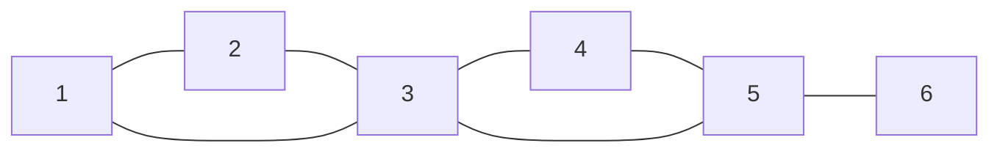

**3、5 是割点，5—6 是桥。** 注意 3—4 不是桥：删掉这条边后，还能沿 3—5—4 绕行；但删掉点 3，就连同它的全部边一起消失，左右两个三角形剩余部分会分开。

为固定 DFS 顺序，按下列顺序调用 add_edge：

```text
边 id：  0      1      2      3      4      5      6
端点：  1—2    2—3    3—1    3—4    4—5    5—3    5—6
```

数组最初为 0，pe 全为 −1。下面六张图从同一次实际执行中取关键快照；**蓝色格表示相对上一张图发生变化，边旁的 ei 等表示原无向边编号**。图中 cut 用 0／1 表示 false／true。

**01．先深入到 5：根 1 只有一个树孩子**

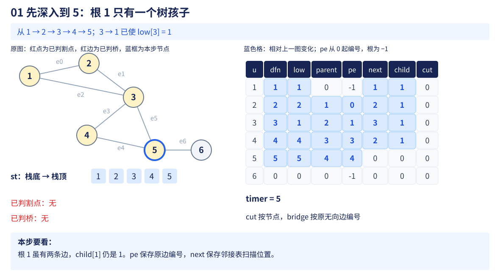

**02．5 通过另一条边回到 3**


**03．6 返回：e6 是桥，5 是割点**

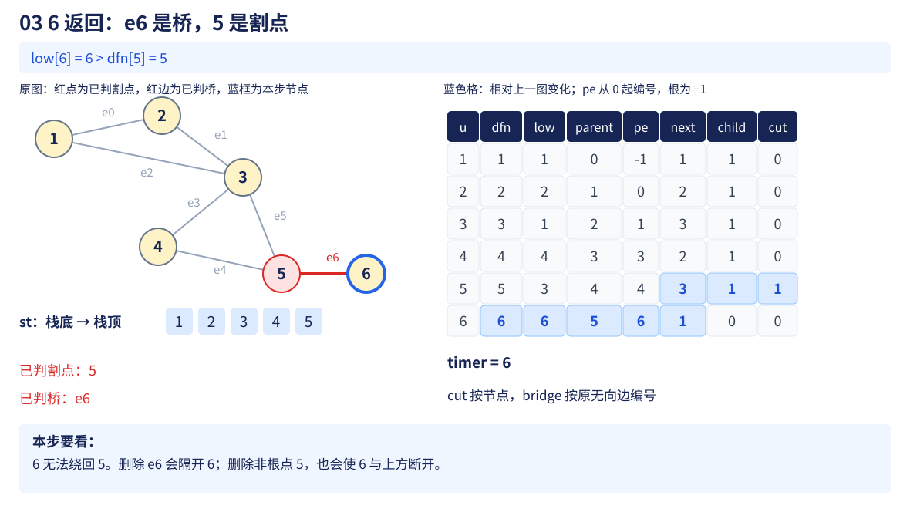

**04．5 返回：把回连结果传给 4**

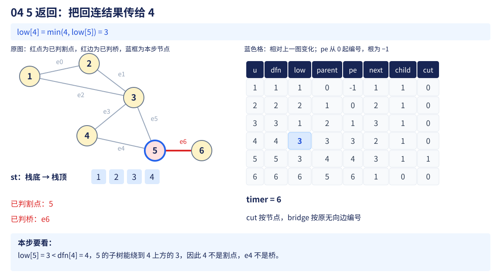

**05．等号出现：3 是割点，e3 却不是桥**

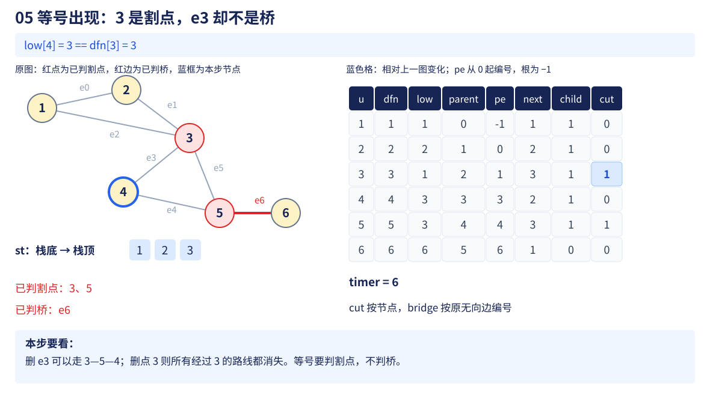

**06．根返回：只按树孩子数判断**

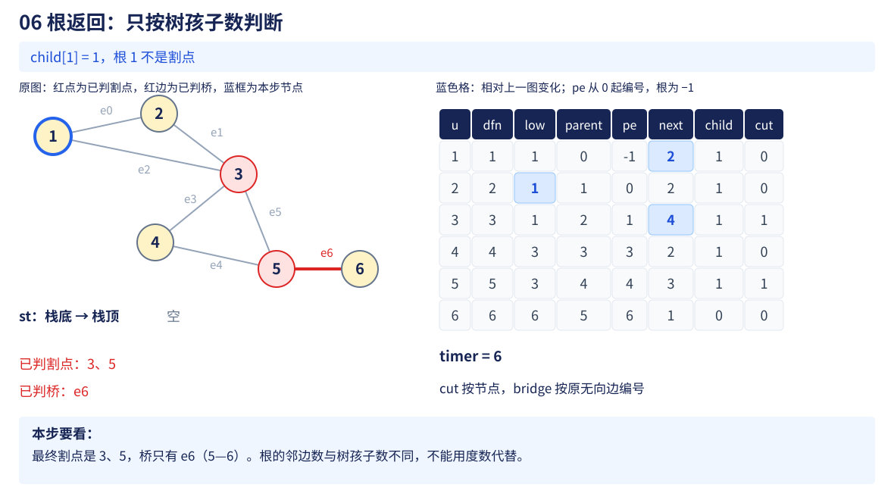


六张图刻意突出两个不同的返回：**6 返回后判桥；4 返回后判割点，却不判 3—4 为桥。** 后文分别说明这两个比较为何不同。

## 3. low 怎样更新：先排除“假绕行”

考虑树边 u—v，DFS 刚从 u 进入 v。因为双向存边，v 的邻接表里也有一项指回 u。

如果直接把这项当成绕行，任何孩子都能“回到父亲”，所有树边就都不可能是桥了。**同一条边走回去，不是删掉它后仍能走的替代路线。**

所以先跳过来时的原边：

```cpp
if (e.id == pe[u]) continue;
```

### 为什么不能写成“邻点等于 parent 就跳过”

两点之间有两条不同的边 e0、e1：

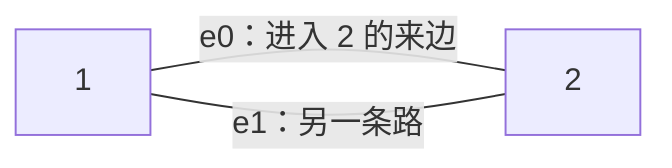

从 e0 进入 2，应该只跳过 e0 的反向记录；e1 仍然有效，因为删除 e0 后还能通过 e1 回去。此时 low[2] 的当前值为 2，dfn[1] 为 1，按代码的更新式取 min：

$$
\mathrm{low}[2]=\min(\mathrm{low}[2],\mathrm{dfn}[1])=\min(2,1)=1.
$$

如果把所有指向父节点的边一起跳过，就会漏掉 e1，错把 e0 当桥。**按原边编号区分，是为了判断删掉“这一条”边后的绕行。**

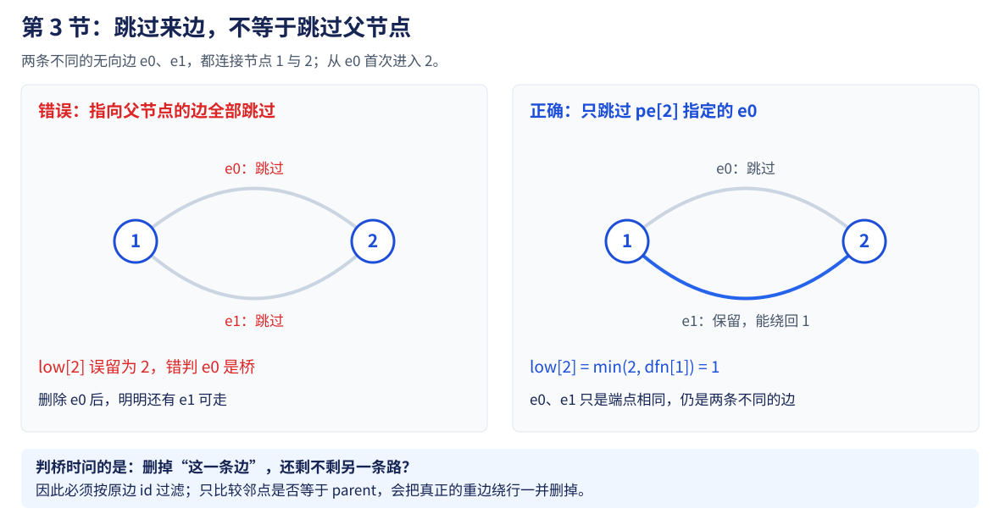

### 两种 low 更新时机

**① 发现未访问的孩子 v：** 先深入，等 v 返回再合并它的 low：

$$
\mathrm{low}[u]=\min(\mathrm{low}[u],\mathrm{low}[v]).
$$

u 的子树能沿树边走到 v，再利用 v 子树找到的回连。

**② 遇到已访问的 v，且不是来边：** 用这一条边直接联系 v 的发现编号：

$$
\mathrm{low}[u]=\min(\mathrm{low}[u],\mathrm{dfn}[v]).
$$

无向 DFS 的非树边连接祖先与后代；在后代这一端检查时，它能降低回连编号。在祖先这一端稍后遇到已访问后代时，dfn[v] 比自身晚，取 min 不会错误降低 low。

**本节不需要 SCC 的 pending 与 in。** 无向图这里在判断子树能否绕回祖先，不是在维护“哪些点还没归入某个有向强连通分量”。

## 4. 桥：孩子子树回不到父亲，就只有这一条连接

设 u 是 v 的 DFS 父节点，树边为 u—v。孩子 v 返回后，判断：

$$
\boxed{\mathrm{low}[v]\gt\mathrm{dfn}[u]}.
$$

**v 的子树借助其他边，连 u 本身都回不到，更不用说 u 的祖先。** 而无向 DFS 的不同子树之间不会额外存在未被搜索吸收的交叉连接，因此删掉 u—v，v 的整棵子树就与上方分开，这条边是桥。

反过来，若能通过另一条边回到 u 或更早的祖先，就存在绕行；删掉树边后仍可接回去，故不是桥。

例子中 6 没有其他边：

$$
\mathrm{low}[6]=6\gt\mathrm{dfn}[5]=5.
$$

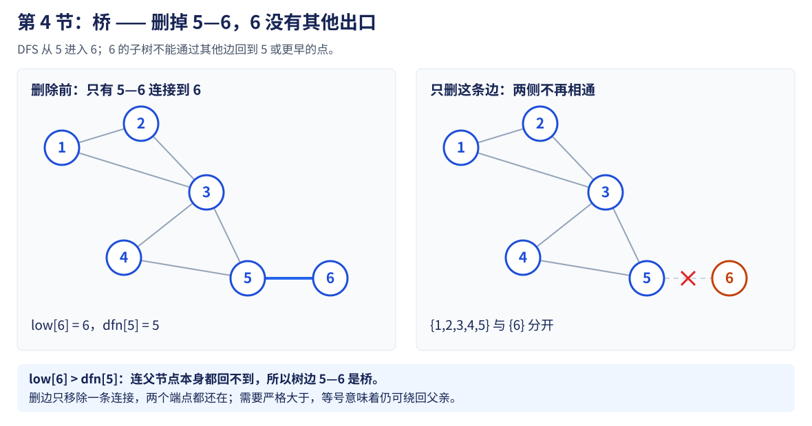

因此 e6，也就是 5—6，是桥。桥一定是 DFS 树边：一条非树边自身已经与树路径组成绕行，不能成为唯一连接。

**判桥写入的是 bridge[pe[v]]，不是 bridge[v]。** 前者按边编号，后者却把点编号混了进去。

## 5. 非根割点：只能回到 u 本身，也救不了删点

仍看父节点 u 与树孩子 v，但现在删除的是**整个 u 及其所有关联边**。

若 v 的子树只能回到 u，不能回到 u 上方，那么 u 一消失，v 子树就与父亲方向剩下的点分开。因此非根 u 的判定为：

$$
\boxed{\text{存在树孩子 }v,\quad\mathrm{low}[v]\ge\mathrm{dfn}[u]}.
$$

只需找到一个被隔开的孩子子树，就足以把 u 标为割点。其他孩子返回时不能把已经为 true 的 cut[u] 覆盖为 false。

### 关键差别：等号为什么属于割点，却不属于桥

例子中 4 的子树沿 4—5—3 回到 3：

$$
\mathrm{low}[4]=3=\mathrm{dfn}[3].
$$

**删边 3—4：** 3 还在，可以经 3—5—4 绕过去，所以该边不是桥。

**删点 3：** 绕行也经过 3，一起失效；4、5、6 无法再连接到 1、2，所以 3 是割点。

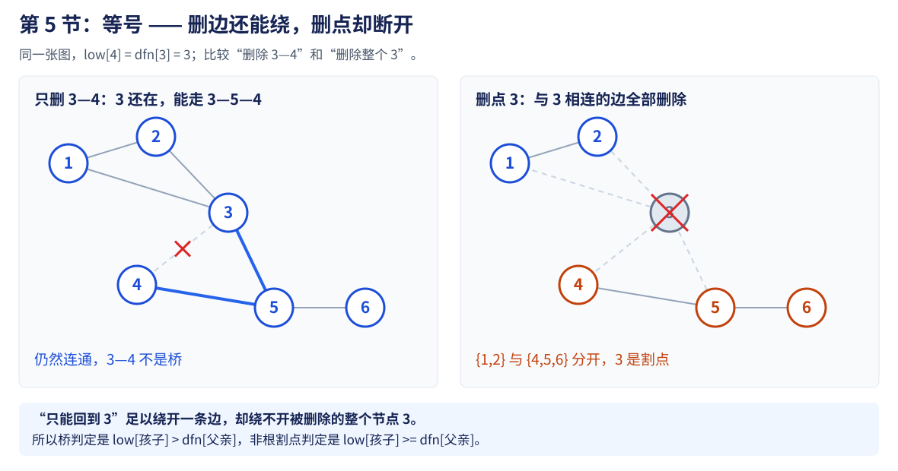

| low[v] 与 dfn[u] 的关系 | 删边 u—v | 删非根点 u |
| --- | --- | --- |
| 更小 | 可以绕到 u 上方，不是桥 | 这个孩子子树不会因此与上方隔开 |
| 相等 | 可以绕到 u，不是桥 | 只能接回被删的 u，足以判 u 为割点 |
| 更大 | 回不到 u，是桥 | 同样足以判 u 为割点 |

**桥问能不能避开一条边；割点问能不能避开整个点。** 这就是一个严格大于、一个大于等于的原因。

## 6. DFS 根为什么不能套上一节的非根规则

根没有父亲方向的其他点。即使某个孩子子树只能通过根向上走，根被删除后也未必会增加连通块。

三角形 1—2—3—1 中，以 1 为根，DFS 可以走成 1→2→3：


root=1 只有一个 DFS 树孩子，删掉 1 后，2 与 3 仍相连。若机械使用非根的 ≥ 条件，就会误判根。

对于每棵 DFS 树的根 r：

$$
\boxed{r\text{ 为割点}\quad\Longleftrightarrow\quad\mathrm{child}[r]\ge2}.
$$

两个不同的 DFS 树孩子之间若还有绕行，搜索第一个孩子时就会沿路发现另一个，不会再出现第二个独立树孩子。故删掉根后，各孩子子树互相分开。

- **0 个树孩子：** 根是孤立点或只有自环，不是割点。
- **1 个树孩子：** 删根后，剩下的该子树仍连通，不是割点。
- **至少 2 个树孩子：** 删除根，将原来的一个连通块拆成多个，是割点。

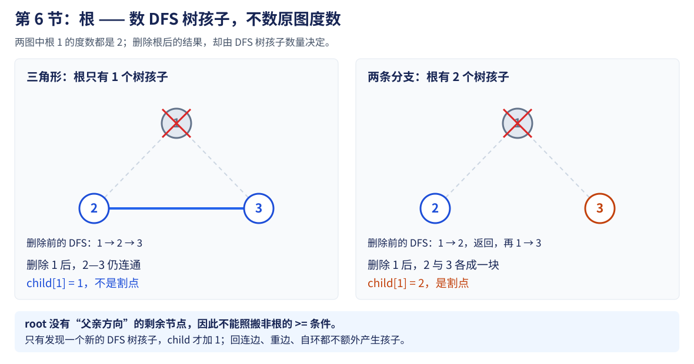

**child 不是度数。** 回连边、重边和自环不产生新的树孩子；只在 `!dfn[v]` 的首次深入分支中递增。

代码中 `parent[p]` 的检查，正是防止在孩子返回时提前把 DFS 根按非根规则标记。根退出时再单独赋值。

## 7. 与上一节 SCC 对照：别因为同名 low 就照搬

| 对照项 | 有向 SCC | 本节无向割点／桥 |
| --- | --- | --- |
| 目标 | 找出互相可达的最大组 | 找删掉后增加连通块的点／边 |
| 邻接表 | 按输入方向保存 | 每条无向边保存两个方向，共用原边 id |
| 来边 | 没有统一“反向边必须跳过”的规则 | 跳过进入当前点的同一条原边 |
| 额外栈 | pending 保留待分组节点 | 不需要待分组栈 |
| 已访问邻点 | 还要检查是否在 pending | 排除来边后使用 dfn 更新 |
| 返回时判断 | low[u]==dfn[u] 时弹一组 | 比较孩子 low 与父亲 dfn，根另判 |

**共同点是发现顺序与返回传播，具体不变量和问题目标不同。** 本节不输出双连通分量，也不把割点当作某个 SCC 的根。

### 7.1 为什么 Tarjan SCC 要检查 in，而这里不需要

> **上一节 Tarjan 的 in 表示“已经发现、还在等待分组”，不是“还在 DFS 调用栈里”。** 无向割点／桥没有这项待分组任务；是否需要 in，要从遇到旧节点时能否安全更新 low 来理解。

#### 有向图：旧节点可能早已属于另一个分量

只有一条边 2→1，按外层编号先搜索 1，再搜索 2：

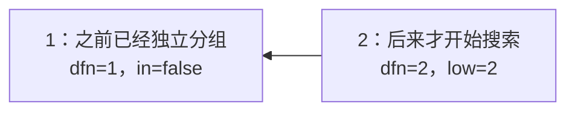

> 1 没有出边，先完成自己的 SCC。之后 2 走向 1，**只能说明 2 能到 1，不能说明 1 能返回 2**。

如果仅凭“访问过”就更新：

$$
\mathrm{low}[2]=\min(2,\mathrm{dfn}[1])=1.
$$

这会让 2 错误地等待已分好组、早已离开 pending 的 1；最终 low[2] 不等于 dfn[2]，2 也无法正常封闭成组。

> 因此上一节需要 `in[v]`：**已经分好组的旧节点不能参与这个回连更新；仍在等待分组的节点才参与。**

同时，节点从 DFS 返回后可能仍留在 pending，因此也不能用“当前调用链”代替 in。上一节的[两个栈反例](12-strongly-connected-components.md#2-两个栈返回了不一定已经分好组)展示了这种情况。

#### 无向图：一条边连接的点，不会分属已经独立搜完的两棵树

把上面的边改成 1—2。由于可以双向走，第一次从 1 搜索时，就会沿边发现 2，**不可能先单独搜完 1，再从新起点 2 发现这条边**。

同理，若两棵不同的 DFS 孩子子树之间有边，搜索先进入的子树时，就会沿该边发现另一边的节点；它们不会继续保持为两个独立分支。

因此无向 DFS 排除来边后，遇到的旧邻点可以这样处理：

| 旧邻点 v 的位置 | 这条记录提供什么 | 对 low[u] 的影响 |
| --- | --- | --- |
| 更早的祖先 | 一条不使用来边的回连 | 可能用 dfn[v] 降低 low[u] |
| 已经搜索完的后代 | 同一非树边在祖先这一端被再次看到 | dfn[v] 更晚，取 min 不会降低 low[u] |
| u 自身，即自环 | 回到自身 | 也不会降低 low[u] |

例如三角形先走 DFS 树边 1→2→3，再检查非树边 3—1：

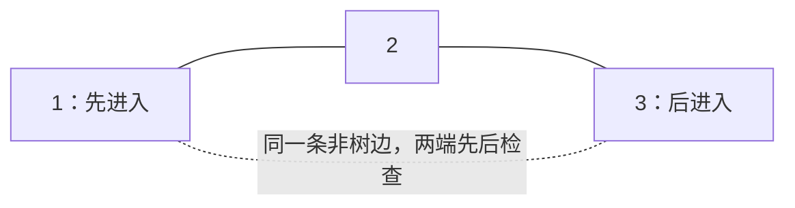

在 3 这一端检查时，1 是祖先：

$$
\mathrm{low}[3]=\min(3,\mathrm{dfn}[1])=1.
$$

等 3、2 返回后，1 才在自己的邻接表中检查到 3。此时 3 虽然已经退出调用栈，但它是后代：

$$
\mathrm{low}[1]=\min(1,\mathrm{dfn}[3])=\min(1,3)=1.
$$

> **这项更新没有副作用，所以不必额外加 in 把它过滤掉。** 真正必须排除的是同一条来边；另一条连接父亲的重边则仍可构成回连，不能误删。

**更准确的总结：** 

1. Tarjan SCC 要区分“仍待分组／已分好组”的旧节点；
2. 本节无向 low-link 利用 DFS 的祖先／后代结构，排除来边后便能安全更新，不需要维护待分组标记。

这里说的是上一节采用的 Tarjan 写法，并非所有 SCC 算法都必须有一个名为 in 的数组。**即使在 Tarjan 中，也可以用“dfn 非零且 id 尚未分配”表达同样的成员资格；不可省略的是判断语义，而不是变量名称。**


## 8. 复杂度与边界

| 操作 | 时间 | 原因 |
| --- | --- | --- |
| 建无向图 | O(n+m) | 每条输入边保留一个端点对与两条邻接记录 |
| 全图 DFS | O(n+m) | 每点只进入、返回一次，每条邻接记录只检查一次 |
| 判断割点与桥 | 合计 O(n) | 随树孩子返回做常数次比较 |
| 扫描输出结果 | O(n+m) | cut 按点、bridge 按原边查看；额外排序另算 |
| 总空间 | O(n+m) | 图、结果数组与 O(n) DFS 状态 |

例：n=2×10⁴、m=10⁵ 时，邻接记录有 2×10⁵ 条，核心搜索只扫描这些记录；若逐条删边重新搜，粗略上界会到 10¹⁰ 次以上的点边处理量级。

边界检查：

- **不连通图：** 外层每个未访问点启动一棵 DFS 树，每棵根都单独判断。
- **两个点一条边：** 边是桥，两个端点都不是割点；删去一个端点后只剩单点，块数没增加。
- **重边：** 删掉其中一条仍可能有另一条，不能跳过全部父节点邻接项。
- **自环：** 不改变其他点的连通性，不是桥，也不增加树孩子数。
- **多测：** 图与状态每轮重建；本模板不是在线增删维护。
- **深链：** 显式栈不依赖系统递归栈，仍需要 O(n) 容器空间。

## 9. 典题与复盘

两题实际实现已按原题静态复盘，**不重复运行或对拍个人代码**，也不另补平台评测结论。两题共用同一套 find_cuts，下面只保留各自 solve，整理排版并补充注释，不改变算法与输出逻辑。

原实现中的 UDG、CutRes 分别对应开篇的 UndirectedGraph、CutResult，成员与返回值含义一致。若直接拼接开篇代码，增加下面的名称别名即可；find_cuts 不需要再写一份：

```cpp
using UDG = UndirectedGraph;
using CutRes = CutResult;
```

原实现 add_edge 先向 g[v] 存记录，再向 g[u] 存记录；开篇顺序相反。**这里写入的是两个不同节点的邻接表，共用的边编号不变；自环时两项也相同，不影响判定。**

### 9.1 P3388：按点编号提取割点

题目：[P3388 〖模板〗割点](https://www.luogu.com.cn/problem/P3388)。给出无向图，输出割点数量，再按节点编号递增输出割点；**图不一定连通**。

```cpp
void solve() {
    int n, m;
    cin >> n >> m;

    UDG g(n);
    while (m--) {
        int u, v;
        cin >> u >> v;
        g.add_edge(u, v); // 每条无向边只调用一次，内部已经双向存储
    }

    auto res = find_cuts(g);
    vector<int> ans;

    for (int u = 1; u <= n; ++u) {
        if (res.cut[u])
            ans.push_back(u);
    }
    cout << ans.size() << '\n';

    for (int x : ans)
        cout << x << ' ';
    cout << '\n';
}
```

**用途速记：** find_cuts 已经完成全图搜索与割点判定；solve 只需扫描 cut，收集需要输出的节点。**结果按什么编号存储，就按什么编号提取。**

这里不需要额外 sort：从 1 到 n 扫描，加入 ans 的节点天然递增。一个点可能因多个孩子满足条件而被判为割点，但 cut[u] 只有一个布尔位置，最终扫描也只会输出一次。

全图覆盖由 find_cuts 外层的 `for (int s = 1; s <= n; ++s)` 保证；solve 不需要再按连通块分别调用。根条件仍按**每一棵 DFS 树**独立判断，不能只照顾编号为 1 的点。

**复杂度：** 建图、判定和结果扫描合计 O(n+m)，空间 O(n+m)。

### 9.2 P1656：把桥的边编号还原为铁路端点

题目：[P1656 炸铁路](https://www.luogu.com.cn/problem/P1656)。原铁路网连通，找出毁坏后会使某些城市无法互相到达的铁路。

**删除一条铁路，相当于删除一条无向边；删后连通性被破坏，目标正是桥。** 无需真的逐条删边再搜索。

```cpp
void solve() {
    int n, m;
    cin >> n >> m;

    UDG g(n);
    for (int i = 0; i < m; ++i) {
        int u, v;
        cin >> u >> v;
        g.add_edge(u, v);
    }

    auto res = find_cuts(g);
    vector<pii> ans;

    for (int i = 0; i < m; ++i)
        if (res.bridge[i]) { // i 是原无向边编号，不是节点编号
            int u = g.edges[i].first;
            int v = g.edges[i].second;

            if (u > v) swap(u, v); // 同一条无向边，统一小编号在前
            ans.push_back({u, v});
        }

    sort(ans.begin(), ans.end()); // pair 先比较 first，相同再比较 second

    for (auto x : ans)
        cout << x.first << ' ' << x.second << '\n';
}
```

**用途速记：** bridge[i] 判断第 i 条输入边是否为桥，edges[i] 找回这条边的两个端点；统一端点顺序，再按端点对排序输出。

#### 为什么既要 swap，又要 sort

假设按输入顺序筛出的桥端点对是：

```text
(5,2)、(4,1)、(3,1)
```

**swap 处理一条边内部的顺序：** 无向边 5—2 与 2—5 相同，统一表示为小编号在前：

```text
(2,5)、(1,4)、(1,3)
```

**sort 处理多条边之间的顺序：** pair 的默认比较先看第一个端点，相同再看第二个：

```text
(1,3)、(1,4)、(2,5)
```

两步处理的是不同层次。**只排序不统一方向，会让输入时的端点先后影响输出；只统一方向不排序，仍然只是输入顺序。** DFS 发现桥的顺序也不等于题目需要的端点顺序。

#### 点编号、边编号与结果下标分开

| 信息 | 下标是什么 | 用来做什么 |
| --- | --- | --- |
| cut[u] | 节点编号 1..n | 判断是否输出节点 u |
| bridge[i] | 原无向边编号 0..m−1 | 判断是否输出第 i 条边 |
| edges[i] | 同一个原边编号 | 还原需要输出的端点对 |

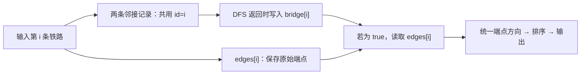

第二题按边编号从 0 扫到 m−1，**每条原边只提取一次**；邻接表里虽然双向存了两条记录，也不会因此输出两遍。

**复杂度：** 设桥的数量为 b，建图与判定 O(n+m)，提取结果 O(m)，排序 O(b log b)，总空间 O(n+m)。b 不超过 n−1，因为桥一定是 DFS 树边。没有桥时，ans 为空，不输出任何端点行。

### 9.3 两题共同留下什么

| 题目线索 | 算法要判断的对象 | 输出阶段负责什么 |
| --- | --- | --- |
| 删掉站点及其关联边后，连通块增加 | 割点 | 按节点编号筛选 |
| 删掉一条铁路后，连通块增加 | 桥 | 按边编号筛选，再还原端点 |

**先明确删除的对象，再选择 cut 或 bridge；搜索负责判定，结果扫描负责映射和输出格式。** 本节已有完整的判定推导与编号对照，不另建重复的范式。

通用模板允许重边；P1656 没有重边是该题的输入限制，不是可以把“只跳过来边”改成“跳过全部父邻点”的理由。

## 10. 自查

1. 两个点只有一条边，为什么它是桥，但端点都不是割点？
2. low[v]==dfn[u] 时，为什么树边不是桥，而非根 u 却是割点？
3. 根的度数大于 1，为什么仍可能不是割点？
4. 为什么 pe 初值是 −1，为什么不能只跳过邻点 parent[u]？
5. 与 SCC 相比，这里为何不需要 pending 与 in？

概念与标准判定规则参考 [OI Wiki：割点和桥](https://oi-wiki.org/graph/cut/)。本篇显式栈实现、例图和执行快照按仓库已有 DFS 写法自行整理。

下一节：[6.14 欧拉路径与回路](14-euler-trail.md)，继续使用原边编号，但目标从判断删边后的连通性，转为安排每条边恰好使用一次的走法。

[本章索引](README.md) · [割点与桥模板](../../templates/06-graph-and-tree/cuts/README.md)
