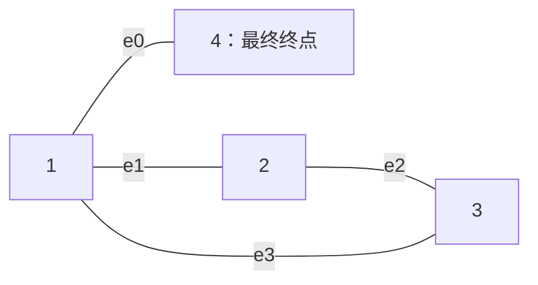
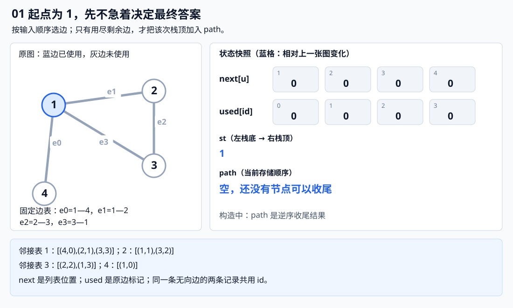
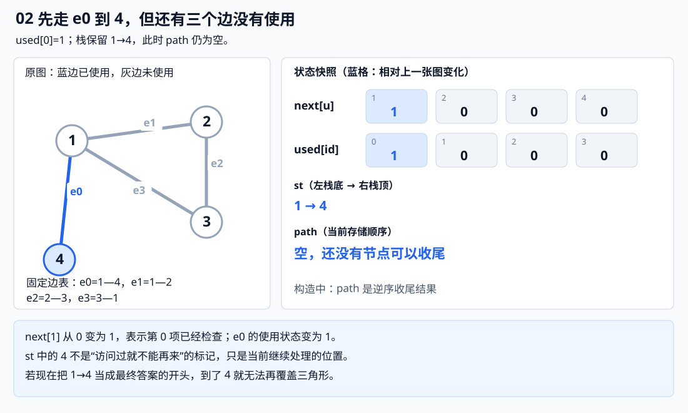
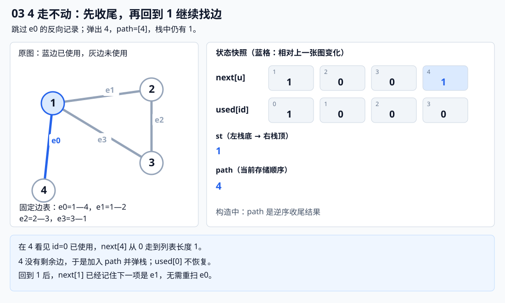
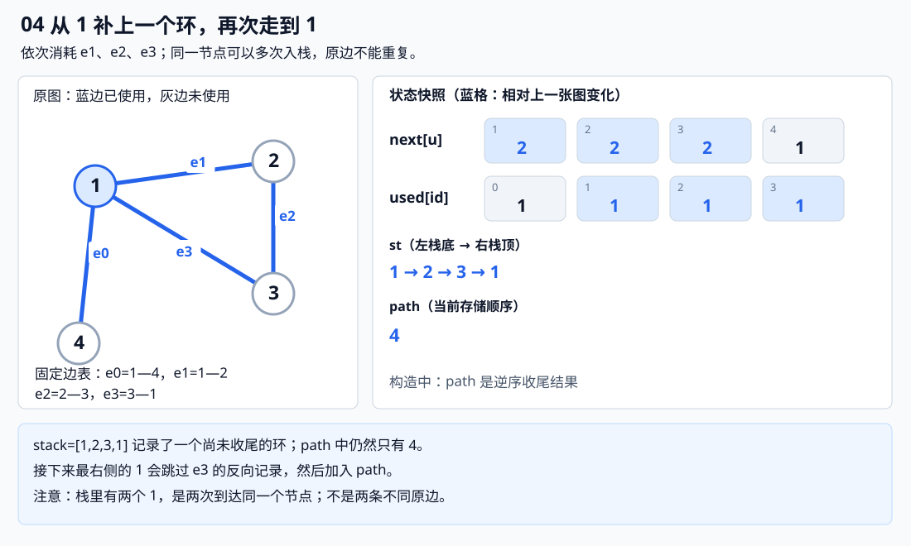
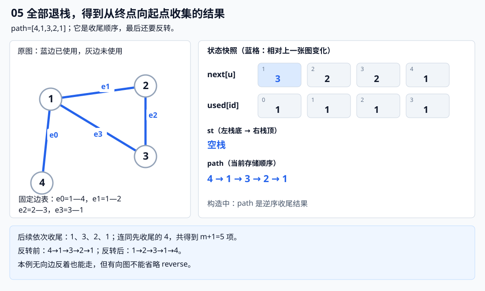
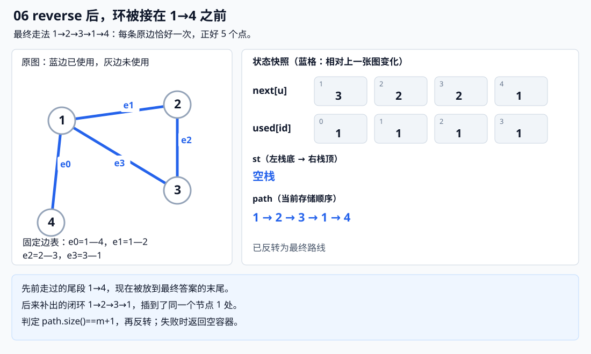
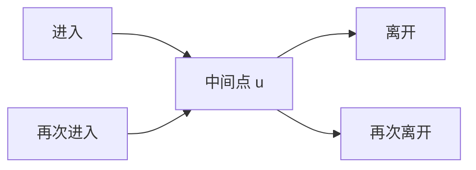
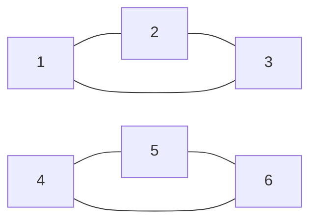
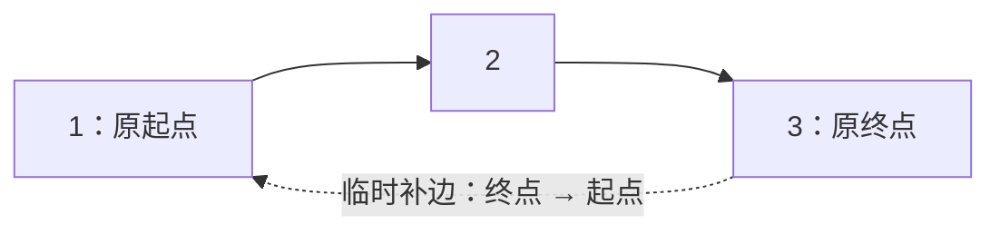

# 6.14 欧拉路径与回路：每条边恰好走一次

前置：[图的表示与 DFS](01-graph-basics.md)、[原无向边编号](13-articulation-points-bridges.md#3-low-怎样更新先排除假绕行)。本节覆盖无向／有向图的存在条件与 Hierholzer 构造，不展开中国邮递员、混合图或计数问题。

## 0. 从修路问题引入：访问过节点，还能再经过吗

把路口看成点，道路看成边。现在要求走一条连续路线，**每条道路恰好走一次**，路口可以重复经过。

- **欧拉路径：** 恰好使用全部边各一次的连续走法，起点与终点可以不同。
- **欧拉回路：** 起点与终点相同的欧拉路径，是前者的特殊情况。

这里的“路径”允许重复顶点，不是前文所说的简单路径。也不要与 [DFS 序](07-dfs-order.md)混淆：DFS 序记录节点进入位置，这里要安排的是**全部原边的使用顺序**。

普通 DFS 的节点 vis 不能直接照搬：回到一个路口时，可能还有别的道路没修，不能因为“这个点来过”就跳过。

若枚举每次走哪条未使用边、失败就撤销，最坏会产生阶乘级分支。若只随便走、走不动就直接结束，又可能提前进入终点，把其他边留在身后。

**新的办法：边只消耗一次；走不动时先记下收尾位置，回到栈里尚有余边的点继续补路，最后逆序整理。** 这就是 Hierholzer 算法。

## 1. 先给代码：按边消耗，退栈时收尾

> **点编号 1..n，原边编号 0..m−1；n≥1。** edges 中每条原边只写一次，无向图由函数补反向记录。默认求任意合法结果；ordered=true 时求字典序最小的点序列。

```cpp
// 顶点编号 1..n，每条输入边只记录一次
// directed=true：有向图；false：无向图
// ordered=true：尝试求字典序最小的欧拉路径
// 无解返回 {}；无边时返回 {1}（要求 n >= 1）
vector<int> euler_trail(
    int n, const vector<pair<int, int>>& edges,
    bool directed = false, bool ordered = false) {

    int m = (int)edges.size();

    using Arc = pair<int, int>; // {邻点, 原边 id}
    vector<vector<Arc>> g(n + 1);
    vector<int> in(n + 1), out(n + 1); // 入度、出度；无向图中 out 表示度数

    // 建图，同时统计每个点的入度和出度
    for (int id = 0; id < m; ++id) {
        int u = edges[id].first;
        int v = edges[id].second;

        g[u].push_back({v, id});
        ++out[u];
        ++in[v];

        if (!directed) {
            // 无向边需要在两个方向各存一条邻接记录
            // 但两条记录共用同一个 id，表示同一条原边
            g[v].push_back({u, id});
            ++out[v];
            ++in[u]; // 无向图中入度、出度相等，都等于度数
        }
    }

    int s = 0; // 欧拉路径的起点，0 表示尚未确定

    if (directed) {
        // 有向图存在欧拉路径的必要度数条件：
        // 起点出度比入度多 1，终点入度比出度多 1；
        // 其他点入度等于出度。
        // 若所有点入度等于出度，则是欧拉回路。
        int plus = 0, minus = 0;

        for (int u = 1; u <= n; ++u) {
            int d = out[u] - in[u];

            if (d == 1) {
                ++plus;
                s = u; // 唯一的出度多 1 的点是起点
            } else if (d == -1) {
                ++minus; // 唯一的入度多 1 的点是终点
            } else if (d != 0) {
                return {}; // 度数不满足欧拉路径条件
            }
        }

        // 若所有点的入度都等于出度，路径最终会回到出发点，形成欧拉回路。
        // 否则，必须恰好有一个点出度比入度多 1（起点），
        // 另一个点入度比出度多 1（终点）。
        if (plus != minus || plus > 1) return {};

    } else {
        // 无向图存在欧拉路径的必要度数条件：
        // 奇数度顶点只能有 0 个或 2 个。
        vector<int> odd;

        for (int u = 1; u <= n; ++u)
            if (out[u] & 1)
                odd.push_back(u);

        if (!odd.empty() && odd.size() != 2)
            return {};

        // 有两个奇数度点时，欧拉路径必须从其中一个开始
        // odd 按顶点编号收集，因此 ordered=true 时先选较小者
        if (!odd.empty())
            s = odd[0];
    }

    // 若尚未确定起点，说明是欧拉回路：
    // 从任意有边相连的顶点开始即可。
    // 按编号从小到大寻找，方便 ordered=true 时确定起点。
    if (!s) {
        for (int u = 1; u <= n; ++u) {
            if (out[u]) {
                s = u;
                break;
            }
        }

        // 没有任何边时，返回单个顶点
        if (!s) s = 1;
    }

    // 按邻点编号排序，优先尝试较小的下一站
    // id 用于区分重边；相同邻点之间按边编号排列
    if (ordered) {
        for (auto& adj : g)
            sort(adj.begin(), adj.end());
    }

    vector<int> next(n + 1, 0); // 每个点下一条尚未检查的邻接记录
    vector<int> path;           // 最终逆序得到的欧拉路径
    vector<bool> used(m, false); // 按原边 id 标记，防止一条边重复使用
    stack<int> st;

    st.push(s);

    // Hierholzer：沿未使用的边不断前进，走不动时再收尾
    while (!st.empty()) {
        int u = st.top();
        int& i = next[u];

        // 跳过已经使用过的边。
        // 无向图的同一条边在两个方向共享 id，因此只会使用一次。
        while (i < (int)g[u].size() && used[g[u][i].second])
            ++i;

        if (i == (int)g[u].size()) {
            // u 已经没有未使用的出边：
            // 此时才将 u 加入答案并弹栈，而不是首次到达时就记录。
            // 这样能正确处理途中遇到死路、需要回溯的情况。
            path.push_back(u);
            st.pop();
        } else {
            // 选择一条尚未使用的边，沿边前往邻点
            auto e = g[u][i++];
            used[e.second] = true; // 标记原边已使用
            st.push(e.first);
        }
    }

    // 一条包含 m 条边的欧拉路径必须包含 m+1 个顶点记录。
    // 若数量不足，说明有边没有从当前起点遍历到，图不满足要求。
    if ((int)path.size() != m + 1)
        return {};

    // 前面是逆序收尾：最后走不动的点最先加入 path
    reverse(path.begin(), path.end());

    return path;
}
```

**用途速记：** 给出点数、原边端点表和方向类型，返回依次经过的节点；失败返回空向量。先检查度数与起点，再用边编号防重复、用栈拼接路线；退栈收集的是反向答案，最后 reverse。

m 条边对应 m+1 个节点位置，**不是 m+1 个不同节点**。没有边时，本实现约定返回 `{1}`；空向量只表示失败。

### 变量各管什么

| 变量 | 完整含义 | 范围／容量 |
| --- | --- | --- |
| edges[id] | 编号为 id 的原边端点 | m 项，每条输入边只存一次 |
| g[u] | 从 u 可走的邻接记录，记录为 `{邻点, 原边编号}` | n+1 个列表；有向共 m 项，无向共 2m 项 |
| in[u]、out[u] | 有向时为入度、出度；无向时两者都等于度数 | n+1 项，0 号不用 |
| s | 选定的合法起点 | 有边时选满足端点条件且有边的点 |
| next[u] | u 的下一条待检查邻接记录的位置 | 0..g[u].size() |
| used[id] | 这条原边是否已经消耗 | m 个永久标记，之后不恢复 |
| st | 尚未完成收尾的节点栈，一次走边压入一个节点 | 节点可以重复，最多 m+1 项 |
| path | 退栈时依次收集的节点，最后反转为答案 | 最多 m+1 项 |

**与上一节不同：这里的栈深由边数决定，不能只按不同节点的数量估计。** 一个点有许多自环时，同一编号会反复入栈。

## 2. 跟着代码看：先走到尽头，为什么仍能补环

先看无向图，按下面的顺序输入边，使用默认 ordered=false：

```text
id：     0      1      2      3
原边：  1—4    1—2    2—3    3—1
```



节点 1、4 是两个奇度点，代码选择 1 出发。因为 e0 最先输入，第一次走边就会到 4。

**如果此时直接把 1→4 当成最终路线的前缀，就走不下去了。代码把“探索顺序”与“最终答案顺序”分开处理。**

以下六张图取自同一份实现的实际运行；**st 从左到右为栈底到栈顶，蓝格标出相对上一张图变化的值**。

**① 刚压入起点 1：**



**② 先走 e0，来到 4；还没有写入答案：**



**③ 4 已无剩余边，先把 4 收入 path，再弹出：**



**④ 栈顶回到 1，接着补出 1→2→3→1：**



**⑤ 依次收尾，得到逆序节点表：**



**⑥ 反转后，补出的环被放在尾段之前：**



最终答案是：

$$
1\to2\to3\to1\to4.
$$

节点 1 出现两次，但四条原边各使用一次。**重复节点合法，重复原边不合法。**

## 3. 无向图的条件：中途必须有进有出

先只讨论至少有一条边的图，暂时忽略孤立点。

### 中间节点：一次进入，要配一次离开

例如路线中出现一段：

$$
\cdots\to u\to\cdots
$$

每次进入和离开会使用两条关联边，所以普通中间点的度数应能成对分配：

$$
\mathrm{deg}[u]=2\times\text{成对经过的次数}.
$$

即使重复经过这个点，也是多消耗若干对边，仍是偶数。



图中的箭头仅表示这一次的行走方向，原图仍是无向图。

### 起终点不同：各有一条没有配对的边

起点多一次离开，终点多一次进入：

$$
\mathrm{deg}[s]=2a+1,\qquad \mathrm{deg}[t]=2b+1.
$$

因此开放路线恰好有两个奇度点，且它们必须是两个端点。若首尾相同，起点处最后进入与最初离开也配成一对，所有点都是偶度。

**还必须能在同一次连续行走中覆盖全部边。** 只看度数不够：两个互不相连的三角形，每个点都是偶度，却不可能一笔走完两边。

| 无向目标 | 度数条件 | 连通条件 | 起点 |
| --- | --- | --- | --- |
| 首尾相同的欧拉回路 | 所有点都是偶度 | 所有有边的点在同一个连通块 | 任意有边的点 |
| 首尾不同的欧拉路径 | 恰好两个奇度点 | 同上 | 两个奇度点任选一个 |

**不必经过孤立点。** “所有边走完”并不等于“所有点都要访问”；真正检查的是有边的部分。

无向自环在度数中贡献 2：沿它离开再回到自身，各占一个关联端。因此代码对自环也保存两条共享 id 的记录，并将度数加两次。

## 4. 为什么收尾再反转，相当于拼接路线

回看小例子。先走出的尾段是：

$$
1\to4.
$$

1 还有剩余边，形成一个从 1 出发、又回到 1 的环：

$$
1\to2\to3\to1.
$$

两段在 1 相接，可以把环插到离开 1 去 4 之前：

$$
\underbrace{1\to2\to3\to1}_{\text{补出的环}}\to4.
$$

> **插入环不会改变原来尾段的起终点；两部分的边又互不重复，所以可以拼起来。**

代码没有真的在 vector 中间插入一整段。它先把较早走到尽头的 4 放进 path，再收集后补的环，反转后就得到环在前、尾段在后的顺序。

### 一般情况下，为什么不会拼不回去

先看所有度数为偶数、边所在部分连通的无向图：从有边的起点一路消耗未用边，**不可能第一次停在另一个点**。

到一个非起点时，刚用掉进入边；此前对这个点的进出成对，原度数又为偶数，因此仍有一条可以离开的边。直到回到起点，才可能走不动，得到一条闭合走法。

若还有未用边，因为原图有边的部分连通，已经走出的路线中必有一个点还连着未用边。从这个点继续得到一个闭合走法，再接回原位置。**每次至少消耗一条新边，最终就能拼完。**

若是两个奇度端点，可以在思考时给两端补一条临时边，让全部度数变偶；得到回路后删掉那条临时边，就变成原图的开放路线。**本代码直接从奇度端点出发，不需要真的补边。**

栈版 Hierholzer 用“继续走边／无边时收尾”实现同样的拼接过程。**退栈不是撤销已经使用的边，也不是搜索失败后换一种方案。**

## 5. next 与 used：一个防止重扫，一个防止重走

对照核心语句：

```cpp
int& i = next[u];
while (i < (int)g[u].size() && used[g[u][i].second]) ++i;
```

> **i 是 next[u] 的引用，改变 i 就会同步改变 next[u]。** 下次又回到节点 u 时，继续检查上次没处理的位置，而不是从邻接表开头重新搜索。

- 普通 DFS 通常在 `for` 循环里用 `if (vis[v]) continue;` 跳过已访问点，循环自己就会前进到下一项。

- 这里无向边可能早已从另一端用掉，但它的邻接记录仍留在表中，所以用 `while` 连续跳过已用记录，找到可走边或确认已无边可走后，再决定压栈还是收尾。

接下来若选到一条未用边：

```cpp
auto e = g[u][i++];
used[e.second] = true;
st.push(e.first);
```

先推进邻接位置，再永久消耗这条原边，最后到另一端继续。与[回溯枚举所有路线](../03-search/01-dfs-backtracking.md)不同，**这里只构造一条覆盖全部边的走法，不撤销 used 来枚举别的方案**。

| 信息 | 不能混成什么 | 为什么 |
| --- | --- | --- |
| used[id]：**原边**是否已用 | 节点是否访问过 | 同一个节点可以反复经过 |
| next[u]：邻接表扫描位置 | 已经过多少条不同原边 | 无向边的反向记录可能只是被跳过 |
| st 中出现的 u | 只有一个 u 的全局记录 | 一条路线可以多次到达 u |

**无向图两条记录共享 id，消耗一个方向后，另一方向也自动被识别为已用。** 重边拥有不同 id，可以各走一次；自环虽然有两条记录，也只能消耗原边一次。

这里不再跳过 parent 边：父子关系不是欧拉构造的限制，**是否已用原边才是判断依据**。

## 6. 为什么还要检查 path.size()==m+1

度数条件只检查了各点的局部收支，没有检查不同有边区域能否连接。



这张图有 6 条边，但从 1 出发只能覆盖左侧 3 条边，收集到 4 个节点位置：

$$
\mathrm{path.size()}=3+1=4\ne6+1.
$$

每使用一条新原边，恰好压入一个节点；初始还压入一个起点。最后栈全部弹完，因此：

$$
\mathrm{path.size()}=\text{实际使用的原边数量}+1.
$$

> used 保证每条边最多使用一次，所以在**度数和起点已经合法**的前提下，长度等于 m+1，便说明没有漏边。不等就返回失败，不必额外建一份连通性搜索。

**长度检查不能代替前面的度数判定。** 若起点选择错误，或者度数本就不合法，弹栈节点数量即使足够，反转后的相邻节点也未必能接成正确路线。

例如链 1—2—3 必须从端点出发；若错误地从中间点 2 开始，仍可能收集 3 个节点位置，但反转得到 2→3→1，其中根本没有 3—1 这条边。**长度足够，不能挽救错误起点。**

## 7. 有向图：进出要平衡，不能只数奇偶

同样是一条完整路线，在中间节点，每次进入必须配一次沿方向离开：

$$
\mathrm{out}[u]=\mathrm{in}[u].
$$

起终点不同，则起点多离开一次，终点多进入一次：

$$
\mathrm{out}[s]-\mathrm{in}[s]=1.
$$

$$
\mathrm{out}[t]-\mathrm{in}[t]=-1.
$$

例如 1→2→3：只有起点 1 的差为 1，终点 3 的差为 −1，节点 2 的差为 0。

| 有向目标 | 度数条件 | 对有边部分的连通要求 | 起点 |
| --- | --- | --- | --- |
| 欧拉回路 | 每点入度等于出度 | 忽略方向后连通 | 任意有出边的点 |
| 首尾不同的欧拉路径 | 一个差为 1、一个差为 −1，其余差为 0 | 忽略方向后连通 | 差为 1 的唯一点 |

是否存在欧拉路线，必须同时满足**度数条件和连通条件**；忽略边的方向后图是连通的，并不代表一定存在欧拉路线。

### 为什么开放路径不要求原图强连通

先分清两个词：**弱连通只看“去掉箭头后能否连起来”；强连通还要求“任意两点都能沿箭头互相到达”。** 这里只讨论有边的部分，孤立点不参与判断。

**① 开放路径只需从起点走到终点，不要求还能返回。**


1→2→3 已经把每条边用了一次。虽然 3 回不到 1，仍然满足欧拉路径的要求，**所以不能把强连通当成开放路径的必要条件**。

**② 若每个点的入度都等于出度，弱连通为什么就够了？**

任选一个有边的点作为起点，把**从它出发能沿箭头到达的全部点**装进一个框。

假设框外还剩下有边的点。先看框向外的边：**一条也不能有**。因为只要有一条，就能顺着它到达框外点，这个点也应该被装进框，与“框外”矛盾。

再看框外进入框内的边。把框内所有点的入度、出度分别相加：

$$
\text{框内所有点的出度总和}=\text{框内所有点的入度总和}.
$$

这是因为每个点都满足入度等于出度。框内的一条边，在左边算一次出度，在右边算一次入度，可以成对消去，剩下：

$$
\text{出框的边数}=\text{入框的边数}.
$$

刚才已经知道出框边为 0，所以入框边也只能为 0：

$$
\text{出框边数}=0\quad\Longrightarrow\quad\text{入框边数}=0.
$$

**框内与框外没有任何边相连，去掉箭头也不连通，和弱连通的前提矛盾。** 因此框外不可能还有有边的点：从任选的起点都能到达全部有边点，这就得到强连通。

> **关键不是“弱连通总能推出强连通”，而是“弱连通＋每点入出度相等”能推出强连通。** 开放路径的两端不平衡，所以不套这句话。

**③ 开放路径怎样借用回路的结论？**

仍看 1→2→3，在思考时临时补一条 **3→1**：



原起点本来多一条出边，现在补进来一条入边；原终点本来多一条入边，现在补出去一条出边。**两端也平衡了，就变成可以求欧拉回路的情形。**

沿回路走完后，把临时边拿掉，并从它后面的节点开始读，便得到原图的开放路径。上图就是从回路 1→2→3→1 中去掉 3→1，留下 1→2→3。

**补边只是证明时的辅助想法，开篇代码没有真的补边**： 它直接从规定的起点构造，再检查是否覆盖了 m 条原边；因此不需要额外运行 SCC 来判断强连通。

最后回到实现：`directed=true` 时，只保存输入方向；其余“用边 → 压栈 → 无边时收尾”的流程相同。**path 记录的是收尾顺序，必须 reverse 才是实际行走顺序。** 例如有向链会先后收尾 3、2、1，反转后才得到能沿箭头走的 1→2→3。

## 8. 字典序要求：有序探索，仍然退栈收尾

**默认 ordered=false 只保证得到一条合法路线，不保证最小字典序。** 相同图按不同顺序输入边，可能得到不同的合法结果。

若比较的是经过的**节点编号序列**，可以将每个邻接列表按邻点递增排序，再使用同一套退栈构造。代码中 ordered=true 开启这个步骤：

```cpp
for (auto& adj : g)
    sort(adj.begin(), adj.end()); // pair 先按邻点，再按原边 id
```

**起点也要选得最小**：两个无向奇度点取较小者；有向开放路线只有一个合法起点；回路选择编号最小的有边点。

开篇代码已经按这一规则选起点。

**排序邻接表，是为了优先尝试编号较小的邻点；但不能把每次到达的点直接加入最终答案。** Hierholzer 要等当前点没有未使用的边时，才将它加入 `path`，最后再反转。这样，提前走到尽头的分支会被放到合适的位置，其他路线也能正确拼接，从而得到字典序最小的完整点序列。

因此，不能再对最终的 `path` 排序：排序会打乱点的先后顺序，使相邻点之间可能不再有对应的边。

> **记住： 排序邻接表决定优先尝试的顺序，收尾后反转才能还原路线。两者作用不同。**

本模板比较的是顶点序列的字典序，而不是边编号的字典序。同一对端点之间的重边即使 `id` 顺序不同，也不会改变顶点序列。

## 9. 复杂度与边界

| 操作 | 时间 | 原因 |
| --- | --- | --- |
| 建图、统计度数、选起点 | O(n+m) | 扫一次原边表和点编号 |
| next 扫邻接记录 | 合计 O(m) | 每个列表位置只前进，不回退；无向共 2m 项 |
| 压栈、退栈、写入和反转 path | 合计 O(m+1) | 每条原边触发一次压栈，节点位置各退栈一次 |
| 默认总时间 | O(n+m) | 不排序邻接表 |
| ordered=true | O(n+m log(m+1)) 上界 | 额外排序各点邻接表，构造仍线性 |
| 总空间 | O(n+m) | 邻接表、数组、边标记与路线栈 |

例如 n=10⁵、m=2×10⁵，无向图保存 4×10⁵ 条邻接记录；虽然会反复回到某些点，**扫描总量仍是这些记录的数量，不是每次回到节点都扫描一遍全部邻边**。排序版本要另外计入排序成本。

- **起点：** 有边时不能默认从 1 开始；1 可能是孤立点，也可能不符合端点条件。
- **无边：** n≥1 时返回 `{1}`，这是本实现对零边走法的约定；按题目要求决定是否输出。
- **重边／自环：** 按原边 id 区分并标记，允许存在；无向自环度数计 2。
- **图不连通：** 孤立点不妨碍有边部分；互不相连的有边部分会因覆盖数量不足失败。
- **多测／重复调用：** 所有工作状态局部创建，不修改输入 edges，可以重复调用。
- **容量：** n+1、m+1、每个邻接列表长度和度数均需能用 int 表示，内存足够；n 必须至少为 1，输入端点必须在 1..n。
- **返回值：** 只返回节点序列；若题目要输出具体边编号，需要随压栈保存进入边并在退栈时同步收集，不能用端点对唯一识别重边。

## 10. 典题与复盘

两题实际实现已按原题静态复盘，**不重复运行或对拍个人代码，不另补平台评测结论**。共享的 euler 与开篇 euler_trail 的算法相同，下面保留个人调用名与两段 solve，只整理排版并补充注释，不重复粘贴主体。

若直接使用开篇或竞赛模板，把下文调用名 euler 改成 euler_trail 即可。个人函数的 edges 参数为普通引用，但函数没有修改输入边表；模板用 const 引用表达这一点，算法与返回值不变。

### 10.1 P7771：有向图，构造最小字典序路线

题目：[P7771 〖模板〗欧拉路径](https://www.luogu.com.cn/problem/P7771)。求有向图的字典序最小欧拉路径；无解输出 `No`，有解输出依次经过的 m+1 个节点。

```cpp
void solve() {
    int n, m;
    cin >> n >> m;

    vector<pii> edges;
    while (m--) {
        int u, v;
        cin >> u >> v;
        edges.push_back({u, v}); // 只记录输入的有向边
    }

    auto path = euler(n, edges, true, true);
    // 第一个 true：有向图；第二个 true：按节点序列求最小字典序

    if (path.empty())
        cout << "No";
    else
        for (int v : path)
            cout << v << ' ';
    cout << '\n';
}
```

**用途速记：** solve 只负责读边、指定“有向＋有序”、按返回值输出。度数检查、起点选择、用边与路线拼接都交给共享函数，不再另写一套搜索。

虽然输入保证忽略方向后连通，**仍然可能不满足有向入出度条件**，所以必须保留空结果分支；“连在一起”不能替代“能按方向恰好走完”。

### 10.2 P2731：“500 进制最小”就是节点序列的字典序

题目：[P2731 骑马修栅栏](https://www.luogu.com.cn/problem/P2731)。每段栅栏是一条无向边，允许重边；要求每条边恰好经过一次，输入保证有解。

```cpp
void solve() {
    int m;
    cin >> m;

    vector<pii> edges;
    while (m--) {
        int u, v;
        cin >> u >> v;
        edges.push_back({u, v}); // 每段栅栏只加入一次，函数内部补反向记录
    }

    auto path = euler(500, edges, false, true);
    // 500 是节点编号上界；false：无向图；true：最小字典序

    for (int v : path)
        cout << v << '\n'; // 本题每个节点单独占一行
}
```

**用途速记：** 与上一题复用同一函数，只切换为无向模式、使用题目给出的编号上界，并按每行一个节点输出。允许重复经过路口，但每段原栅栏仍只能消耗一次。

#### 不必计算任何“500 进制整数”

题目紧接着解释了比较方式：**先比较第一个节点编号，若相同再比较第二个，依此类推。** 这就是字典序，不需要进制转换，也不需要高精度。

例如比较两个等长节点序列：

```text
A：1，3，20
B：1，4， 2
   相同 ↑ 第一个不同位置：3 < 4
```

因此 A 更小。第三项即使 20 大于 2，也不能改变第二项已经决定的顺序。**比较节点编号本身，不是把编号写成十进制字符后拼接，再按字符比较。**

所有候选路线都使用同样的 m 条边，因此都有 m+1 个节点位置；这里比较的正是这些等长的节点序列。

#### 为什么可以把 n 直接写成 500

500 是**允许出现的最大节点编号**，不代表每个编号都必须在输入中出现。

例如只有边 20—30，1..19 都是孤立点。共享函数先检查奇度端点；没有奇度端点时，也会找最小的有边点作为起点，**不会机械地从节点 1 开始，更不会要求经过所有 500 个点**。

本题保证有解，因此原 solve 直接输出返回路线。通用函数仍保留失败检查，以便在不保证有解的其他题中复用。

### 10.3 同一模板，差别留在输入与输出

| 对照项 | P7771 | P2731 |
| --- | --- | --- |
| 图的方向 | 有向，directed=true | 无向，directed=false |
| 最小字典序 | ordered=true | ordered=true，“500 进制”只是题面表述 |
| 点编号范围 | 输入给出的 1..n | 固定上界 1..500，部分编号可能不出现 |
| 重边 | 通用函数按原边 id 区分 | 题目明确允许，不能合并成一条边 |
| 无解处理 | 输出 No | 题目保证有解，原实现直接输出 |
| 输出格式 | 一行输出全部节点 | 每行输出一个节点 |

两题都先确定合法起点，再排序各点邻接候选，**仍然使用“退栈记录＋最终反转”**；不能因为要求字典序，就把探索时的节点直接顺序输出，也不能给最终 path 排序。

**复杂度：** 两题均启用排序，总时间上界 O(n+m log(m+1))，空间 O(n+m)。第二题使用 n=500，只是保留固定编号范围的数组，不会枚举所有节点排列。

本轮识别经验是：**先把题面的比较描述翻译成“比较什么对象、先比哪一项”，再选择对应算法选项。** 已在本节和有序构造部分说明，不为同一结论另建重复范式；通用模板主体可以继续复用。

## 11. 自查

1. 为什么两个三角形不相连，即使全是偶度点，也不存在覆盖全部边的欧拉路线？
2. 在 1—4 加三角形的例子里，为什么最先走过的 1—4 最后却放在答案末尾？
3. used 应该标记点还是原边？为什么同一个节点能多次在栈中出现？
4. next 防止重扫与 used 防止重走各解决什么问题？无向边的反向记录怎样跳过？
5. 为什么度数判定、合法起点与最终 m+1 长度检查缺一不可？

定义与拼接思想参考 [OI Wiki：欧拉图](https://oi-wiki.org/graph/euler/) 和 [CP-Algorithms：Eulerian Path](https://cp-algorithms.com/graph/euler_path.html)。本篇按既有显式栈与原边编号约定自行实现，过程图由该实现的运行状态整理。

[本章索引](README.md) · [欧拉路径竞赛模板](../../templates/06-graph-and-tree/euler-trail/README.md)
