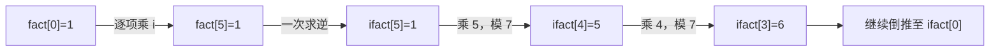

# 7.6 模逆元与组合数取模

前置：[同余与模运算](02-congruence-modulo.md)、[快速幂](03-binary-exponentiation.md)、[基础计数与组合数](05-basic-counting.md)。

**逆元把模意义下的除法，转成乘法。** 但分母必须可逆；本节主写法限定素数模数，再用于阶乘公式计算组合数。

## 0. 问题引入：为什么不能取模后直接除？

先算再取模，结果是：

$$
(6/2)\bmod5=3.
$$

若先取模再按整数除法，变成 1/2，C++ 会得到 0。**取模保留的余数不足以支持普通整数除法。**

但模 5 时，2 乘 3 的余数为 1：

$$
2\times3\equiv1\pmod5.
$$

因此可以把“除以 2”改成“乘以 3”：

$$
(6\bmod5)\times3\bmod5=3.
$$

**分母与它的逆元相乘，在模 $m$ 意义下余数为 $1$**。这里 $3(=8\mod5)$ 是 $2$ 在模 $5$ 下的逆元。

后面遇到组合数中的阶乘分母，也要用同一思路处理。

## 1. 先给代码：素数模数下求单个逆元

复用 [mod_pow 快速幂模板](../../templates/07-math/binary-exponentiation/README.md)，不再重复平方取幂的循环。模数 p 必须是素数，且满足 2≤p<2³¹；函数不负责检测素数。

```cpp
using ll = long long;

// 前提：p 是素数，2<=p<2^31；已有 mod_pow(a,b,p)。
// 返回 a 在模 p 下的逆元；a 是 p 的倍数时不存在，返回 -1。
ll inv_prime(ll a, ll p) {
    a %= p;
    if (a < 0) a += p;
    if (a == 0) return -1;

    return mod_pow(a, p - 2, p);
}
```

例如 inv_prime(2,5)=3；inv_prime(5,5) 返回 -1，表示不存在。**-1 是失败标记，不能继续当作正常乘数使用。**

## 2. 为什么 a 的 p−2 次幂就是逆元？

### 先明确定义与存在条件

逆元可以理解为：**在取模运算中，找一个整数，乘上去以后余数恰好为 1。** 本节讨论的模数 $m\ge2$。

例如，在模 5 下：

$$
2\times3=6\equiv1\pmod5.
$$

所以，**3 是 2 在模 5 下的逆元**。这里写作 $2^{-1}$，指的是这个整数 3，而不是普通除法得到的 $1/2$。

一般地，$a$ 在模 $m$ 下的逆元，就是满足以下关系的整数 $x$：

$$
ax\equiv1\pmod m.
$$

#### 为什么要求互质？

先看不存在逆元的例子：求 2 在模 6 下的逆元。如果某个整数 $x$ 满足：

$$
2x\equiv1\pmod6,
$$

就意味着存在整数 $t$，使得：

$$
2x=6t+1.
$$

但**左边一定是偶数，右边一定是奇数**，不可能相等。

一般地，如果 $a$ 和 $m$ 有公因子 $d>1$，把同余关系改写为：

$$
ax-mt=1.
$$

左边两项都是 $d$ 的倍数，相减后仍是 $d$ 的倍数；右边的 1 却不是，因此逆元不存在。

#### 互质时为什么一定存在？

例如 $a=2、m=5$，依次尝试所有余数作为 $x$：

| $x$ | 0 | 1 | 2 | 3 | 4 |
| --- | --- | --- | --- | --- | --- |
| $2x\bmod5$ | 0 | 2 | 4 | **1** | 3 |

**结果恰好把 0 到 4 各出现一次，只是顺序改变了。** 因而一定能找到结果为 1 的位置。

互质保证这些乘积的余数不会重复；一共有 $m$ 种输入、$m$ 种可能的余数，因此每种余数都会出现。一般情况也就能找到余数为 1 的乘积。

$$
\boxed{a\text{ 在模 }m\text{ 下有逆元}\iff\gcd(a,m)=1}
$$

**因为 模 $p$ 只有 $p$ 种余数，而乘以一个不被 $p$ 整除的数 $a$，不会让不同余数变成相同余数**。

若 $ax\equiv ay\pmod p$，则 $p\mid a(x-y)$。由于 $p$ 是质数且 $p\nmid a$，必有 $p\mid(x-y)$，所以 $x\equiv y\pmod p$。

因此，$0a,1a,\ldots,(p-1)a$ 模 $p$ 的结果**两两不同**。既然恰好有 $p$ 个结果，它们就必然把 $0,\ldots,p-1$ 全部覆盖，不重不漏。

超出这个范围后，余数每隔 $p$ 项就会重复，因此形成周期。

#### 素数模数为什么方便？

当模数 \(p\) 为素数时，余数 \(1,\ldots,p-1\) 都与 \(p\) 互质，因此都有逆元；只有余数为 \(0\) 时，逆元不存在。

**代码先把负余数调整到 $0$ 到 $p-1$，再判断是否为 0，就是为了正确处理这个条件**。

### 从“非零余数的排列”看费马小定理

例如 p=7、a=3，把 1..6 各乘 3 后取模：

| 原余数 | 1 | 2 | 3 | 4 | 5 | 6 |
| --- | --- | --- | --- | --- | --- | --- |
| 乘 3 后模 7 | 3 | 6 | 2 | 5 | 1 | 4 |

**没有重复，也没有漏掉任何非零余数，只是换了顺序。** 一般地，把 p−1 个非零余数全部相乘，有：

$$
a^{p-1}(p-1)!\equiv(p-1)!\pmod p.
$$

由于 $p\nmid(p-1)!$，可消去这个因子，得到费马小定理：

$$
a^{p-1}\equiv1\pmod p.
$$

把左边拆成 a 与剩下的幂：

$$
a\cdot a^{p-2}\equiv1\pmod p.
$$

对照逆元定义，便得到代码里的公式：

$$
\boxed{a^{-1}\equiv a^{p-2}\pmod p.}
$$

**这是素数模数的算法，不是所有有逆元的情况都能用。** 例如 2 在模 9 下的逆元是 5，但 2⁷ mod 9=2，不能把 9 直接套进上面的 p。

## 3. 组合数实现：阶乘与阶乘逆元

精确公式为：

$$
\binom nk=\frac{n!}{k!(n-k)!}.
$$

结果很大、只需模 p 时，可以保存阶乘余数，把分母除法改成乘逆元。**这一版要求预处理上限 N<p，且 p 是素数。**

```cpp
#include <vector>

// 前提：mod 为素数，0 <= N < mod，且已有 inv_prime(a, mod)。
// 预处理阶乘及其逆元，使组合数 C(n, k) 可在 O(1) 时间查询。
struct ModComb {
    int N;              // 预处理上限（最大 n）
    ll mod;             // 模数
    std::vector<ll> fact, ifact;
    // fact[i]：i! mod mod
    // ifact[i]：(i!) 的模逆元，即 (i!)^(-1) mod mod

    explicit ModComb(int limit, ll p)
        : N(limit), mod(p), fact(N + 1, 1), ifact(N + 1, 1) {

        // 正向递推阶乘：fact[i] = i! mod mod。
        for (int i = 1; i <= N; ++i) {
            fact[i] = fact[i - 1] * i % mod;
        }

        // 只求最大阶乘的逆元，再反向递推所有较小阶乘的逆元。
        ifact[N] = inv_prime(fact[N], mod);

        // ifact[i - 1] = ifact[i] * i mod mod。
        for (int i = N; i >= 1; --i) {
            ifact[i - 1] = ifact[i] * i % mod;
        }
    }

    // 返回组合数 C(n, k) mod mod。
    // 前提：0 <= n <= N；k 越界时组合数为 0。
    ll C(int n, int k) const {
        if (k < 0 || k > n) return 0;

        // C(n,k) = n! / (k! * (n-k)!)，用模逆元代替除法。
        return fact[n] * ifact[k] % mod * ifact[n - k] % mod;
    }
};
```

使用时，先按最大查询 n 建表，再复用：

```cpp
ModComb comb(5, 7);
ll a = comb.C(5, 2); // 10 mod 7 = 3
ll b = comb.C(0, 0); // 1，空集合的选法
ll c = comb.C(3, 4); // 0，选取数量不合法
```

## 4. 变量与执行流程

| 变量 | 含义 | 容量与范围 |
| --- | --- | --- |
| N | 能回答的最大 n | 0≤N<p；按查询上限设置，不按 p 开数组 |
| mod | 本组固定素数模数 | 2≤mod<2³¹；不同模数必须分别建表 |
| fact[i] | i! 的规范余数 | N+1 项，下标 0..N，fact[0]=1 |
| ifact[i] | i! 在模 mod 下的逆元 | N+1 项；不是“i 的逆元” |
| C(n,k) | 从 n 个对象中不计顺序选 k 个的方案数，模 mod | 0≤n≤N；非法 k 返回 0 |

构造时分三步：

1. **正着算 fact：** 从 0!=1 开始，每次乘当前 i 并取模。
2. **只求一次逆元：** 计算 ifact[N]。
3. **倒着算 ifact：** 根据最大的已知结果，逐项推出前一个结果。

例如 N=5、p=7：



| i | 0 | 1 | 2 | 3 | 4 | 5 |
| --- | --- | --- | --- | --- | --- | --- |
| fact[i] | 1 | 1 | 2 | 6 | 3 | 1 |
| ifact[i] | 1 | 1 | 4 | 6 | 5 | 1 |

**表按阶乘下标 i 存储，模数只负责控制数值范围。** N=10⁶、p=10⁹+7 时，只需各建 10⁶+1 项，而不是十亿项。

## 5. 为什么能倒推，又怎样回答查询？

### 倒推的是阶乘的逆元，不是再求一次逆

先看普通阶乘关系：

$$
i!=i\cdot(i-1)!.
$$

两边同时除以 $i!(i-1)!$，可得：

$$
\frac{1}{(i-1)!}=\frac{i}{i!}.
$$

在阶乘均可逆的模数范围内，这对应：

$$
\boxed{\mathrm{ifact}[i-1]\equiv i\cdot\mathrm{ifact}[i]\pmod p.}
$$

所以先求最大下标，**每轮只用乘法得到前一个位置**，不需要每个位置再跑一次快速幂。

### 把两个分母分别换成逆元

$$
\boxed{\binom nk\equiv\mathrm{fact}[n]\cdot\mathrm{ifact}[k]\cdot\mathrm{ifact}[n-k]\pmod p.}
$$

例如模 7 计算 C(5,2)，直接读取上表：

$$
1\times4\times6\bmod7=3.
$$

代码两次乘法之间取模，避免先把三个因子完整乘起来。**不能把 ifact[k] 换成 fact[k]，也不能用普通整数除法代替它。**

## 6. 先检查前提，再选写法

### 为什么必须 N<p？

一旦 N≥p，N! 就含有因子 p：

$$
N!\equiv0\pmod p.
$$

**0 没有逆元，倒推起点已经失效。**

**即`N >= p` 时，`N! mod p = 0`，其逆元不存在，因此无法从 `ifact[N]` 开始倒推。**

| 需求 | 可以使用的写法 | 关键条件 |
| --- | --- | --- |
| 精确组合数，结果与中间乘积较小 | [单次乘除递推](../../templates/07-math/combinations/README.md#接口与约定) | 每轮中间乘积也不能溢出 |
| n 较小的组合数取模 | [杨辉三角递推](05-basic-counting.md#5-小范围组合数表按选或不选递推)，加法后取模 | 不需要逆元，合数模数也能算 |
| 较大上限、多次查询组合数取模 | 本节阶乘＋阶乘逆元 | 素数 p，且所有查询 n≤N<p |

**逆元是可用工具，不代表所有组合数题都必须用它。**

### 复杂度与实现边界

| 操作 | 时间 | 额外空间 |
| --- | --- | --- |
| 单个 inv_prime | O(log p) | O(1)，复用迭代快速幂 |
| 建立 ModComb | O(N+log p) | O(N) |
| 单次 C(n,k) | O(1) | O(1) |

- p=2 时合法非零余数的逆元仍为 1；p=1 不在接口契约内。
- N=0 时两张表只有第 0 项，C(0,0)=1。
- a 可为负数，先规范余数；a 是 p 的倍数时返回 -1。
- C 的 n 必须已经预处理，不能把 n>N 的查询也当作“答案为 0”。
- p<2³¹，规范余数相乘小于 2⁶²，使用 ll；连续三个因子之间仍要取模。
- 每次构造对象独立初始化；不直接修改 mod 或表内容。模数、上限改变时重新构造。

一般合数模数下的逆元可通过扩展欧几里得等方法处理，后续再补；本节不把费马公式扩展到合数模数。n≥p 或上限无法建表的组合数，也需要另选算法。

## 7. 二项式展开：组合数在计数什么？

把 (A+B) 连乘 t 次，想得到 AʲBᵗ⁻ʲ，先从 t 个括号中选择 j 个提供 A，其余提供 B：

$$
(A+B)^t=\sum_{j=0}^{t}\binom tj A^jB^{t-j}.
$$

**选出提供 A 的位置后，其余提供 B 的位置已唯一确定，不能再独立计数一次。**

**组合数决定选择哪几个位置，幂决定这些位置各自贡献相乘后的结果。** 这是二项式定理的基本计数解释；实际题目中先确认对象、位置和取值，再决定怎样组合这些工具。

## 8. 典题与复盘

两题原实现已本地核验并完成复盘；**平台 AC 结果未单独提供**。只整理排版和注释，不把本地验证写成平台通过。

### 8.1 两题共用的原实现

沿用原稿的 CMod、独立 C 函数与快速幂；通用竞赛模板仍复用前文的 ModComb，不再保存一份等价实现。

```cpp
using ll = long long;

ll pow_mod(ll a, ll k, ll mod) {
    ll ans = 1;

    while (k > 0) {
        if (k & 1) ans = ans * a % mod;
        a = a * a % mod;
        k >>= 1;
    }

    return ans;
}

ll inv_prime(ll a, ll p) {
    a %= p;
    if (a == 0) return -1;
    if (a < 0) a += p;

    return pow_mod(a, p - 2, p);
}

struct CMod {
    ll N, mod;
    vector<ll> fact, ifact;

    explicit CMod(ll limit, ll p)
        : N(limit), mod(p), fact(N + 1, 1), ifact(N + 1, 1) {
        for (ll i = 1; i <= N; ++i)
            fact[i] = fact[i - 1] * i % mod;

        ifact[N] = inv_prime(fact[N], mod);

        for (ll i = N; i >= 1; --i)
            ifact[i - 1] = ifact[i] * i % mod;
    }
};

ll C(const CMod& c, ll n, ll k) {
    if (k < 0 || k > n) return 0;
    return c.fact[n] * c.ifact[k] % c.mod * c.ifact[n - k] % c.mod;
}
```

本组代码的前提仍是 **模数为素数、预处理上限 N 小于模数**。这里 N 用 ll 合法，但它表示数组规模，使用 int 也足够；阶乘余数的乘积仍用 ll。

### 8.2 [P1313 — 计算系数](https://www.luogu.com.cn/problem/P1313)

#### 原实现

```cpp
void solve() {
    ll a, b, n, p, q;
    cin >> a >> b >> n >> p >> q;

    CMod cm(n, 10007LL);
    ll x = pow_mod(a, p, cm.mod);
    ll y = pow_mod(b, q, cm.mod);
    ll c = C(cm, n, p);

    cout << c * x % cm.mod * y % cm.mod << '\n';
}
```

**变量对应：** 题面输入为 a、b、k、n、m；原代码依次命名为 a、b、n、p、q。因此代码的 n 是总次数，p、q 是两种变量的指数；这里的 p 不是素数模数。

#### 先选位置，再乘各位置的贡献

把 n 个括号相乘，要得到指定项，就让其中 p 个括号提供 ax，其余 q 个提供 by。

$$
(ax+by)^n,\qquad p+q=n.
$$

先确定哪些括号提供 ax，共有：

$$
\binom np.
$$

每一种位置选择的系数相同，都是 a 连乘 p 次、b 连乘 q 次：

$$
\boxed{\text{所求系数}=\binom np a^p b^q\pmod{10007}.}
$$

**组合数数位置，快速幂算系数，两者职责不同。** 选出 p 个位置后，其余 q 个已确定，不需要再乘一次“选择 q 个位置”的组合数。

题目保证总次数不超过 1000，因而 n<10007，阶乘均可逆。系数 a、b 可以为 0 或模数的倍数，这不影响建表；它们用于乘方，求逆的是阶乘。

**边界：** n=0 时，C(0,0)=1，两次零次幂也按展开式约定取 1，常数项为 1。原稿 pow_mod 在本题非负底数、底数不超过 10⁶ 的范围内乘法安全；不能据此扩大到任意 ll 底数。

时间 O(n+log 10007+log(p+1)+log(q+1))，空间 O(n)。本题规模也可用杨辉三角求组合数；逆元写法的价值是与下一题复用同一套工具。

### 8.3 [CF 300C — Beautiful Numbers](https://codeforces.com/problemset/problem/300/C)

#### 原实现

继续复用上面的 CMod 与 C，不重复展示框架。

```cpp
void solve() {
    ll a, b, n;
    cin >> a >> b >> n;

    const ll mod = 1000000007LL;
    CMod cm(n, mod);
    ll ans = 0;

    function<bool(ll)> check = [&](ll num) {
        while (num) {
            ll d = num % 10;
            if (d != a && d != b) return false;
            num /= 10;
        }
        return true;
    };

    for (ll k = 0; k <= n; ++k) {
        ll num = a * k + b * (n - k);

        if (check(num))
            ans = (ans + C(cm, n, k)) % mod;
    }

    cout << ans << '\n';
}
```

#### 如何想到：从枚举整个数字，改成枚举某种数字的数量

每一位只能放 a 或 b，直接枚举 n 位有 2ⁿ 种，n 达到 10⁶ 时不可行。

但**各位数字之和只取决于两种数字各有几个，不取决于排列顺序**。于是枚举 a 出现的次数 k：

$$
\text{a 有 }k\text{ 个},\qquad\text{b 有 }n-k\text{ 个}.
$$

固定数量后，这一类数字的数位和相同：

$$
\mathrm{num}=ak+b(n-k).
$$

先用 check 检查 num 的每一位是否仍只有 a、b。若合法，再选择原数字中哪些位置放 a：

$$
\boxed{\mathrm{ans}=\sum_{\substack{0\le k\le n\\\mathrm{check}(ak+b(n-k))}}\binom nk\pmod{10^9+7}.}
$$

**按数量分类 → 判断整类是否合法 → 用组合数统计类内排列。** 每个原数字的 k 唯一，因此不同 k 对应互斥的类别，可以累加。

#### 重点踩坑：选 a 的位置与选 b 的位置，是同一套选择

原错误是在同一次 k 的计算中，把两种写法都加入答案：

```cpp
// c1 = C(cm, n, k)，c2 = C(cm, n, n-k)。
// 错误：同一类数字被计算了两遍。
ans = ((ans + c1) % cm.mod + c2) % cm.mod;
```

例如 a=2、b=3、n=10，固定 k=8，则有八个 2、两个 3，数位和为 22，符合条件。

选八个位置放 2：

$$
\binom{10}{8}=45.
$$

等价地，选两个位置放 3：

$$
\binom{10}{2}=45.
$$

**这两个 45 数的是同一批数字，不是两批各 45 个。** 一边的位置选完，另一边就是补集，已经没有第二次自由选择。

$$
\boxed{\text{固定 }k\text{ 时只加 }\binom nk\text{ 一次，不是 }\binom nk+\binom n{n-k}.}
$$

注意，这不表示外层 k 和 n−k 必须合并。例如本题 k=7 时数位和为 23，对应另一批数字，仍需单独检查并累加。**组合数相等，不代表交换两种数字的数量后仍是同一类对象。**

#### 判断、范围与实现选择

- **容量按 n：** 两张表各 n+1 项；模数为 10⁹+7，不需要按模数开数组。
- **零次与全选：** k 要覆盖 0..n，两端分别代表只含一种数字。
- **check 的输入一定为正：** 原题 1≤a<b≤9、n≥1，num 不会是 0，因此 while(num) 合适。若迁移到允许 0 的题目，需另判断 0 这个数位是否合法。
- **不必每次重新求组合数：** 先建一次阶乘及逆元表，循环中每次 C 查询为 O(1)。这与“同一类方案被加了两遍”是两个不同的问题。
- **lambda 写法：** check 不递归，可以写成 `auto check = [&](ll num)`；原稿 function 写法也正确，不为简化而改写原实现。

设一次数位检查最多读取 d 位，时间为 O(n+log mod+nd)，空间 O(n)；num≤9n，原题最多检查 7 位。

**可迁移经验：先说清每个组合数到底选了什么。若选定一部分后，另一部分已被唯一确定，就不要把两种描述误当成两套方案。** 对应[基础计数中的对象与分类](05-basic-counting.md#1-先明确怎样才算不同方案)，本次先补充原节，不另建重复范式。

两份原实现已通过本地小范围独立枚举与题目边界核验；平台结果仍按实际提交记录，不以本地通过替代。

## 9. 自查与衔接

1. 为什么逆元不是普通的 1/a？模数是素数，还需要排除哪种 a？
2. ifact[i] 与 i 的逆元有什么区别？为什么可以从 ifact[N] 向前推？
3. n≥p 时，是组合数不存在，还是这份实现不再适用？

本节把同余、快速幂与基础计数连起来。范围与写法依据参考 [Modular Inverse](https://cp-algorithms.com/algebra/module-inverse.html)及 [Binomial Coefficients](https://cp-algorithms.com/combinatorics/binomial-coefficients.html)，代码在本仓库既有快速幂上独立整理。

后续用 [7.7 容斥原理](07-inclusion-exclusion.md)处理类别重叠：本节强调一套位置选择不能重复计数，容斥进一步处理同一对象同时属于多类的情况。

[本章索引](README.md) · [逆元模板](../../templates/07-math/modular-arithmetic/README.md) · [组合数模板](../../templates/07-math/combinations/README.md)
