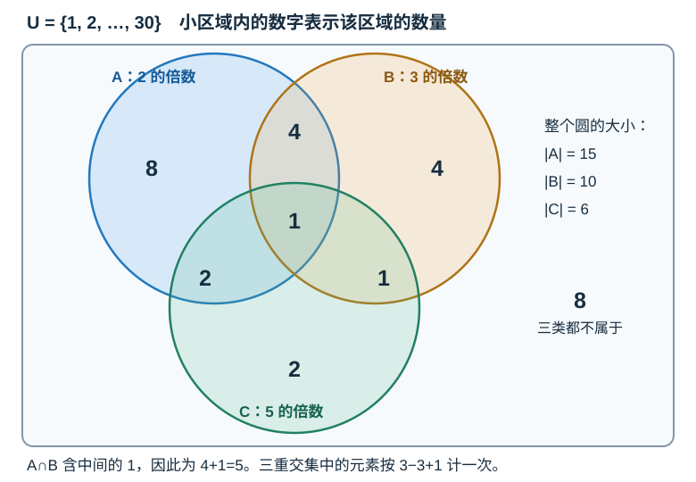
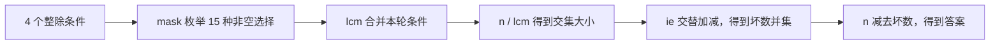

# 7.7 容斥原理：重叠计数与补集

前置：[基础计数](05-basic-counting.md)、[位掩码](../01-basic-problem-solving/05-bit-operations.md#4-位掩码用整数表示小集合)。证明会用到 [7.6 的二项式展开](06-modular-inverse-combinations.md#7-二项式展开组合数在计数什么)。

**容斥用来修正重复计数：先把各类数量加起来，再根据交集逐层加减。** 本节只讨论有限集合的数量，不展开“恰好满足若干条件”等进阶形式。

## 0. 从问题引入：为什么直接相加不对？

设全集 U 是 1..30，A 表示其中 2 的倍数，B 表示其中 3 的倍数。

常用记号：$|A|$ 表示 A 的元素个数，$A\cup B$ 表示至少属于一类，$A\cap B$ 表示两类都属于。

想求“2 或 3 的倍数”有几个。直接扫描可以解决，但范围很大时不适合逐个检查；分别统计两类，则得到：

$$
|A|+|B|=15+10=25.
$$

**6、12、18、24、30 都被计算了两次。** 它们同时属于 A 和 B，正是交集中的 5 个元素。

$$
|A\cup B|=|A|+|B|-|A\cap B|=15+10-5=20.
$$

若再加入“5 的倍数”这一类，只有两两扣重还不够。需要一种规则，保证无论元素属于几类，最终都只计算一次。

## 1. 先给代码：已知交集大小，计算并集大小

下面先把职责分开：**题目决定每个交集怎样计算，函数只负责按正确符号累加。** 使用 C++11 与 GCC/Clang 的内建位计数。

```cpp
#include <vector>

using ll = long long;

// inter[mask]：mask 对应的集合的交集大小。
// 返回所有集合的并集大小，使用容斥原理。
// 前提：集合数量 k <= 20，inter.size() == 2^k，
//       所有中间累加结果均在 ll 范围内。
ll inclusion_exclusion(const std::vector<ll>& inter) {
    int limit = static_cast<int>(inter.size());
    ll ans = 0;

    // 枚举非空集合子集；mask 的每个置位代表选中了一个集合。
    for (int mask = 1; mask < limit; ++mask) {
        int count = __builtin_popcount(static_cast<unsigned>(mask));
        // count：当前选中的集合数量。

        // 容斥原理：交集项的符号由选中集合的数量决定。
        // 奇数个集合：加；偶数个集合：减。
        if (count & 1)
            ans += inter[mask];
        else
            ans -= inter[mask];
    }

    return ans;
}
```

> **用途速记：** 已知每一种非空集合组合的交集大小 inter[mask]，就能求“至少属于一个集合”的元素总数。依据是奇数个集合的交集加、偶数个集合的交集减，最终让每个被覆盖元素恰好算一次。
>
> **函数只负责交替加减，不负责求交集。** 倍数题可以先用 lcm 合并整除条件，再用 n/lcm 计算各交集数量；其他题要按自己的条件计算，容斥本身并不要求使用 lcm。集合只有两三类，或结构能直接化简时，直接列式通常更清楚。

`__builtin_popcount` 的含义见[位运算中的计数](../01-basic-problem-solving/05-bit-operations.md#gcc-内建函数__builtin_popcount)：计算二进制中 1 的数量，这里就是选中了几个集合。

## 2. 变量与运行过程：枚举的是集合组合

| 变量 | 含义 | 容量与范围 |
| --- | --- | --- |
| k（概念符号，非代码变量） | 条件／集合的数量 | 约定 0..20；inter 长度为 2ᵏ，代码不另存 k |
| limit | inter 的长度，即 2ᵏ | 枚举 mask 的上界，代码由 inter.size() 得到 |
| mask | 本轮选中了哪些集合 | 1..2ᵏ−1，不枚举空选择 |
| inter[mask] | 同时属于这些集合的元素数 | 共 2ᵏ 项，第 0 项不使用；不是按全集最大值开数组 |
| count | mask 中 1 的数量 | 决定加减号，与交集里有几个元素无关 |
| ans | 已枚举交集项的带符号累加值 | 使用 ll；循环结束才是完整并集大小 |

**k 是集合／条件的数量，不是全集里有多少元素。** 每个集合都只有“选入本轮交集、不选”两种选择，所以 k 个集合共有：

$$
\underbrace{2\times2\times\cdots\times2}_{k\text{ 个}}=2^k.
$$

其中有一种什么也不选，去掉空选择后，需要计算的交集项为：

$$
\boxed{2^k-1.}
$$

因此数组长度写成 `1 << k`，保留下标 0 不使用；枚举从 1 到 `(1 << k)-1`。`1 << k` 就是整数 2ᵏ，不是把某个元素值放大。

代码中的 limit 直接取数组长度。例如有 A、B、C 三个集合，概念上 k=3，inter 有 8 项，代码中的 limit=8，不需要额外计算 k。

**两三类集合可以直接写容斥式，不必套模板。** 例如棋盘题可先把行覆盖、列覆盖归并为两个集合；输入的车数 K 不是这里的集合数 k，见[典题复盘](#81-p3913--车的攻击)。

以 A、B、C 三个集合为例，bit 0、1、2 分别表示选中 A、B、C：

| mask（二进制） | 本轮交集 | 选了几个集合 | 处理 |
| --- | --- | --- | --- |
| 001 | A | 1 | 加 |
| 010 | B | 1 | 加 |
| 011 | A∩B | 2 | 减 |
| 100 | C | 1 | 加 |
| 101 | A∩C | 2 | 减 |
| 110 | B∩C | 2 | 减 |
| 111 | A∩B∩C | 3 | 加 |

每轮依次做三件事：**读取本轮交集数量 → 数选中的集合个数 → 奇数加、偶数减。**

## 3. 看图理解：为什么三重交集要加回来？

继续使用 U=1..30，增加 C：5 的倍数。图中数字表示**所在小区域的元素数**，不是整个圆的大小。



先看只属于 A 的元素，例如 2：只在单集合统计中出现，计算一次。

$$
1.
$$

再看同时属于 A、B，但不属于 C 的元素，例如 6：先加两次，再从 A∩B 中减一次。

$$
2-1=1.
$$

最后看同时属于三类的 30：先加三次，却又在三个两两交集中各减一次。此时被完全减掉了，必须加回一次。

$$
3-3+1=1.
$$

因此：

$$
\begin{aligned}
|A\cup B\cup C|={}&|A|+|B|+|C|\\
&-|A\cap B|-|A\cap C|-|B\cap C|\\
&+|A\cap B\cap C|.
\end{aligned}
$$

**两两交集包含三重交集，不是图中“两圆独占的那一小块”。** 例如 A∩B 的 5 个数中包含 30。

代入各个完整交集的数量：

$$
15+10+6-5-3-2+1=22.
$$

这正对应数组下标顺序：

```cpp
// 下标 0..7，分别对应空选择、A、B、AB、C、AC、BC、ABC。
std::vector<ll> inter = {0, 15, 10, 5, 6, 3, 2, 1};
ll answer = inclusion_exclusion(inter); // 22
```

## 4. 一般证明：每个被覆盖元素最后恰好计算一次

固定一个元素，假设它恰好属于 t 个集合。

关键是：**每计算一个交集的大小，其中的这个元素就会被计算一次。** 所以要数的是“有多少个交集包含它”，不是只看元素本身有几个。

先看 t=3 的例子：元素 x 属于 A、B、C，但不属于 D。

| 统计哪一层 | 包含 x 的项 | x 被计算几次 |
| --- | --- | --- |
| 单集合项 | A、B、C | 加 3 次 |
| 两集合交集 | A∩B、A∩C、B∩C | 减 3 次 |
| 三集合交集 | A∩B∩C | 加 1 次 |

为什么两集合项有 3 个？因为从 A、B、C 中**任选两个集合**，它们都包含 x，所以交集也包含 x。这样的选法有：

$$
\binom32=3.
$$

这里只选哪些集合，不区分顺序；A∩B 与 B∩A 是同一项，不能再算一次。

反过来，A∩D 不包含 x，因为**交集要求每个集合都包含它，但 D 不包含它**。所以任何选中 D 的交集，都不会计算 x。

推广到一般情况：x 恰好属于 t 个集合，要让某个 **j 个集合的交集**包含它，就必须从这 t 个集合中选出 j 个。每种选法对应一个包含 x 的交集项，因此共有：

$$
\binom tj.
$$

**包含它的交集项数量由组合数决定，加减号由所选集合个数的奇偶决定。** 单集合项加 C(t,1)=t 次，两集合项减 C(t,2) 次，三集合项加 C(t,3) 次，依此类推。

用 T 表示 x 在整个容斥式中被计算的净次数：

$$
T=\binom t1-\binom t2+\binom t3-\cdots+(-1)^{t+1}\binom tt.
$$

利用二项式展开：

$$
(1-1)^t=1-\binom t1+\binom t2-\cdots+(-1)^t\binom tt.
$$

当 t≥1 时，左边为 0，右边正是 1−T，因此：

$$
\boxed{T=1.}
$$

不属于任何集合的元素，则不在任何非空交集中，始终贡献 0。**因此并集内每个元素算一次，并集外每个元素不计算。**

## 5. 补集：没有命中任何条件

若 A、B、C 表示三种“不允许的情况”，其并集就表示至少违反一种要求。

$$
\text{全部合法数量}=|U|-|A\cup B\cup C|.
$$

上例中，不属于任何一类的数量为：

$$
30-22=8.
$$

**没有命中任何条件，不等于只减去各类数量之和。** 坏情况也可能重叠，仍应先用容斥求并集。

注意区分三种问题：

| 条件 | 集合含义 | 处理方式 |
| --- | --- | --- |
| 至少满足一种 | 并集 | 容斥 |
| 一种也不满足 | 并集的补集 | 全集减并集 |
| 所有条件都满足 | 全部集合的交集 | 直接计算这个交集 |

**恰好满足一种**与**至少一种**不同，不能直接套本节的并集公式。

## 6. 交集怎样计算？先翻译“同时满足”

前面的函数直接读取 inter[mask]，但这些数从哪里来？**必须先根据题意算好每个交集的大小，再交给容斥函数加减。**

下面用一个完整例子，把“条件 → 交集 → 数量 → 数组项”连起来。

### 先定义集合，再找共同元素

考虑 1..30 中，能被 4 **或** 6 整除的数。先分别定义：

$$
A=\{4,8,12,16,20,24,28\}.
$$

A 是 4 的倍数，共 7 个。

$$
B=\{6,12,18,24,30\}.
$$

B 是 6 的倍数，共 5 个。

原问题中的“或”表示求并集；为了扣除重复，需要另外求交集，也就是**哪些数同时出现在 A、B 中**：

$$
A\cap B=\{12,24\}.
$$

因此，这个交集的大小是 2，而不是 12，也不是两类数量相乘得到的 7×5。

### 为什么能用 lcm 直接计数？

同时被 4 和 6 整除，说明这个数是它们的公倍数。最小公倍数为：

$$
\mathrm{lcm}(4,6)=12.
$$

所以共同元素就是 12 的正倍数：12、24、36……，但这里只保留不超过 30 的部分。

$$
|A\cap B|=\left\lfloor\frac{30}{12}\right\rfloor=2.
$$

**lcm 给出共同倍数之间的间隔，除法才给出交集中的元素数量。** 不能用 4×6=24 代替 lcm，否则会漏掉同样满足条件的 12；只有互质时，lcm 才等于乘积，见 [gcd/lcm](01-gcd-lcm.md)。

一般地，1..n 中 d 的正倍数依次是 d、2d、3d……；最多取到第几个，决定了它们的数量：

$$
jd\le n\quad\Longleftrightarrow\quad j\le\left\lfloor\frac nd\right\rfloor.
$$

因此，同时被 d₁、d₂ 整除的数有：

$$
\left\lfloor\frac{n}{\mathrm{lcm}(d_1,d_2)}\right\rfloor.
$$

### 回到代码：填的是交集大小，不是 lcm

bit 0 对应 A，bit 1 对应 B，本例的数组应为：

| mask | 选中的集合 | inter[mask] 应保存什么 | 本例数值 |
| --- | --- | --- | --- |
| 01 | A | 4 的倍数有几个 | 7 |
| 10 | B | 6 的倍数有几个 | 5 |
| 11 | A、B | 同时被 4、6 整除的数有几个 | 2 |

```cpp
// 第 0 项不使用；其余依次是 |A|、|B|、|A∩B|。
std::vector<ll> inter = {0, 7, 5, 2};
ll answer = inclusion_exclusion(inter); // 7 + 5 - 2 = 10
```

> **计算交集大小负责填表，容斥负责扣除重叠。** 函数不会看到 4、6 后自动求 lcm；其他题的交集也未必与倍数有关，必须重新翻译“同时满足这些条件”意味着什么。

例如字符串的某个位置同时被要求填 0 和填 1，没有任何字符串满足，交集数量就是 0；并不能套倍数公式。

实现倍数交集时，构造 lcm 仍需防溢出；如果已经确定 lcm>n，那么区间内一个正倍数也没有，对应 inter 项直接记 0。如何安全合并 lcm，沿用 [7.1 的数值范围检查](01-gcd-lcm.md)，不为求一个零贡献真的乘出超大数。

## 7. 复杂度与使用边界

| 操作 | 时间 | 额外空间 |
| --- | --- | --- |
| 两集合／三集合公式，交集已知 | O(1) | O(1) |
| 本节函数，全部交集已存好 | O(2ᵏ)，固定 32 位位计数 | O(1)，不复制输入 |
| 保存全部交集 | 取决于交集生成方式 | O(2ᵏ) |

若每个 mask 的交集还需遍历 k 个条件，**完整计算通常为 O(k2ᵏ)**，不能把预计算成本漏掉。大 k 时，即使全集很小或单次交集很快，也不能盲目枚举全部条件子集。

- **不枚举空选择：** 并集从 mask=1 开始；inter[0] 不承担全集数量的职责。
- **重复条件：** 真实交集仍能保证公式正确，但会浪费枚举；可安全合并的重复条件先合并。
- **整数范围：** 最终数量能用 ll 表示，不代表中间累加一定安全；按所有带符号项的累计范围检查，不能用无符号数承接减法。
- **只求模数下结果：** 可对每项加减后规范余数；容斥本身只用加减，模数不必为素数。若交集内部另用逆元，才需检查对应条件。
- **无需万能模板：** 两三类时直接列式更清楚；集合数稍多、各交集可高效计算时，再使用位掩码。

## 8. 典题与复盘

两份原实现已本地核验并完成复盘，**平台 AC 结果未单独提供**。下面只整理排版和注释，不改原程序逻辑；没有变化的 main 框架不重复展示。

### 8.1 [P3913 — 车的攻击](https://www.luogu.com.cn/problem/P3913)

#### 原实现：统计不同的行、列，再直接列式

```cpp
void solve() {
    ll n, k;
    cin >> n >> k;

    unordered_map<int, bool> x, y;
    ll xx = 0, yy = 0;

    while (k--) {
        int r, c;
        cin >> r >> c;

        // 同一行、同一列出现多辆车，只计一次。
        if (!x[r]) {
            ++xx;
            x[r] = true;
        }
        if (!y[c]) {
            ++yy;
            y[c] = true;
        }
    }

    cout << n * (xx + yy) - xx * yy << '\n';
}
```

**用途速记：** 输入车的位置，只需知道有车的不同行数 R 与不同列数 C；将行覆盖、列覆盖分别计数，再减去重复交点，得到至少被攻击一次的格子数。

#### 为什么不需要通用模板？

逐格标记需要面对 N×N 个格子，N 可达 10⁹；但同一行中增加一辆车，并不会增加新的行覆盖，因此只保留**不同的行、不同的列**。

设 A 为所有有车的行覆盖的格子，B 为所有有车的列覆盖的格子。把许多局部覆盖先归并为这两类：

$$
|A|=RN,\qquad |B|=CN.
$$

每一条被覆盖的行，与每一条被覆盖的列，都有一个不同的交点；选择一行、一列，就唯一确定一个交点：

$$
|A\cap B|=RC.
$$

这些交点在行、列统计中各出现一次，因此：

$$
\boxed{\mathrm{ans}=RN+CN-RC=N(R+C)-RC.}
$$

例如 N=4，车位于 (1,1)、(1,3)、(3,1)，不同的行和列都只有 2 条：

$$
4\times(2+2)-2\times2=12.
$$

**这里的 RC 是交集大小，不是盲目把两个集合的元素个数 RN、CN 相乘。** 能相乘的依据是：一行与一列的每一种组合，恰好对应一个交点。

也可以把每一条不同的行、列分别看成集合：不同行不相交，不同列不相交，一个格子至多属于一行、一列。因此任取三个不同的这类集合，交集必为空，公式也就只需单项和两两交集。

> **结构已经能直接化简时，就直接列式。** 容斥不等于必须使用 mask；这里甚至可以先把覆盖归成 A、B 两个集合。

#### 容器、数量与边界

- **代码的 k 是车数 K，xx、yy 才是不同行数 R、不同列数 C。** 它与通用模板中表示“集合数”的 k 不是同一个量，不能按车数枚举 2ᴷ 种组合。
- unordered_map 的键是行号、列号；数值范围虽到 10⁹，空间只随实际出现的键增长，不按最大编号开数组。
- `x[r]` 对新键会插入默认值 false，第一次遇到后置 true；后面不再重复计数。这里不需要关联额外数据，换成 `unordered_set<int>` 表达“是否出现”也合适，复杂度量级相同，不必重写算法。
- N² 最大可达 10¹⁸，R、C、乘积与答案使用 ll；坐标不超过 10⁹，int 可以保存。

哈希操作平均 O(1)，总时间平均 O(K)，空间 O(R+C)。这不是哈希最坏情况的时间保证；若需要确定的排序复杂度，也可收集坐标后排序去重。

### 8.2 [CF 630K — Indivisibility](https://codeforces.com/problemset/problem/630/K)

#### 原实现：生成交集表，再容斥，最后取补集

```cpp
ll lcm(ll a, ll b) {
    return a * b / __gcd(a, b);
}

ll ie(const vector<ll>& inter) {
    int limit = (int)inter.size();
    ll ans = 0;

    for (int mask = 1; mask < limit; ++mask) {
        ll cnt = __builtin_popcount((unsigned)mask);

        if (cnt & 1) ans += inter[mask];
        else ans -= inter[mask];
    }

    return ans;
}

void solve() {
    ll n;
    cin >> n;

    const int p[] = {2, 3, 5, 7};
    const int k = 4;
    vector<ll> inter(1 << k);

    for (int mask = 1; mask < (1 << k); ++mask) {
        ll lc = 1;

        // 把本轮选中的整除条件合并成一个 lcm。
        for (int i = 0; i < k; ++i) {
            if (mask & (1 << i))
                lc = lcm(lc, p[i]);
        }

        inter[mask] = n / lc; // 同时满足这些条件的数有几个。
    }

    ll able = ie(inter);      // 至少命中一种整除条件的数量。
    cout << n - able << '\n'; // 题目要求一种也不命中，取补集。
}
```

**用途速记：** p 中每个数代表一种“不允许的整除条件”；mask 选条件，lcm 合并条件，n/lcm 填入交集数量。ie 求至少命中一种条件的数量，再用 n 减去它，得到全部合法数量。

#### 先减少条件：为什么只保留 2、3、5、7？

题目要求不被 2..10 中任意一个数整除。但能被 4 整除，一定能被 2 整除；能被 9 整除，一定能被 3 整除。其他合数条件也已被它的素因子覆盖。

$$
\text{被 }2..10\text{ 中至少一个数整除}
\quad\Longleftrightarrow\quad
\text{被 }2,3,5,7\text{ 中至少一个数整除}.
$$

原因分两边看：若能被某个合数整除，也能被它在范围内的素因子整除；反过来，这四个素数本来就属于 2..10。因此删除合数条件，不会改变坏数的集合。

**这里 k=4 是剩余条件的数量，不是 n 的大小。** n 即使达到 10¹⁸，也只需枚举 15 个非空条件组合。

#### 每一层代码分别在做什么？

例如 mask=0101，选中了 p[0]=2、p[2]=5：

$$
\mathrm{lc}=\mathrm{lcm}(2,5)=10.
$$

这一项要求同时被 2、5 整除，所以填入：

$$
\mathrm{inter}[5]=\left\lfloor\frac n{10}\right\rfloor.
$$

mask 中有两个 1，ie 会减去这一项，扣除它在单集合统计中的重复。若选三个条件，则加回它们的共同部分，仍由同一个函数处理。



**交集生成与容斥累加是两个步骤，最后取补集是第三个步骤。** 这也说明通用函数的输入必须是“每个交集中有多少数”，而不是素数表或 lcm 表。

#### 数值范围与可迁移边界

- 原稿 lcm 写成 `a * b / __gcd(a,b)`；本题只合并 2、3、5、7，每个中间乘积至多 210，所以安全。**不能由此把“先乘后除”搬到任意 ll 输入**；通用场景优先复用 [7.1 的先除后乘及范围约定](01-gcd-lcm.md)。
- 四个条件共有 15 个非空交集，每项最多 n/2。n≤10¹⁸ 时，即使把 15 项绝对值相加，也不超过 7.5×10¹⁸，因此原稿的 ll 带符号累加安全。
- 本题的四个数互质，所选数的乘积恰好等于 lcm；保留 lcm 写法更直接表达“同时整除”，但遇到不互质的条件时不能改成直接乘积。
- ie 的 cnt 只表示所选集合个数，int 足够；原稿用 ll 也正确。GCC 的 `__gcd`、`__builtin_popcount` 依赖本篇约定的编译器环境。

本题固定 k=4，枚举次数和交集表大小均为常数，相对 n 的时间、空间都是 O(1)。若把 k 看作变量，每个 mask 扫 k 个条件，需 O(k2ᵏ) 次条件检查，另计 gcd 的计算成本，存表 O(2ᵏ)。

两题本地核验通过；第一题保留按结构直接列式，第二题完整复用“交集表 → 容斥 → 补集”。通用模板已能覆盖第二题的 ie，无需新增一份同义实现。

## 9. 自查与衔接

1. 为什么三重交集中的元素经历 3−3+1，而不是 3−1？
2. mask 有三个 1，是交集内有三个元素，还是选了三个条件？
3. 原题要求“没有一种”“至少一种”“恰好一种”时，能否使用同一个式子？

本节接续 [7.5 的互斥分类](05-basic-counting.md#2-加法与乘法分类相加分步相乘)与 [7.6 的位置计数](06-modular-inverse-combinations.md#83-cf-300c--beautiful-numbers)：**类别互斥才能直接相加，有重叠就必须处理同一对象被计算了几次。** 标准原理可对照 [Inclusion–Exclusion Principle](https://cp-algorithms.com/combinatorics/inclusion-exclusion.html)；本篇图示、实例与累加函数独立整理。

[本章索引](README.md) · [容斥竞赛模板](../../templates/07-math/inclusion-exclusion/README.md)
