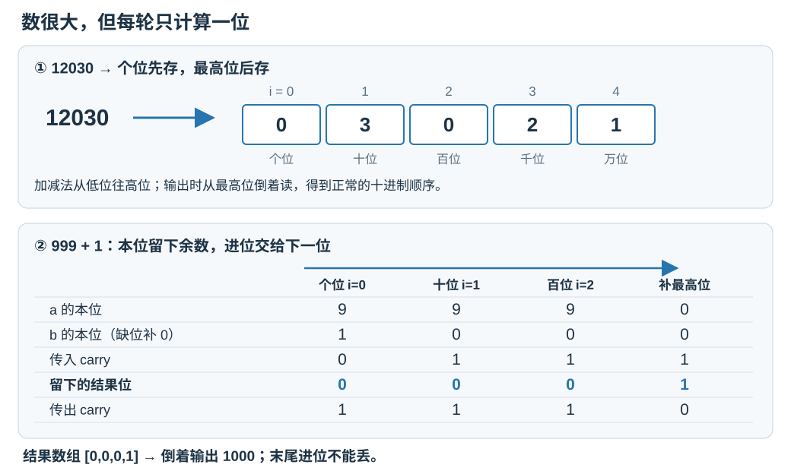
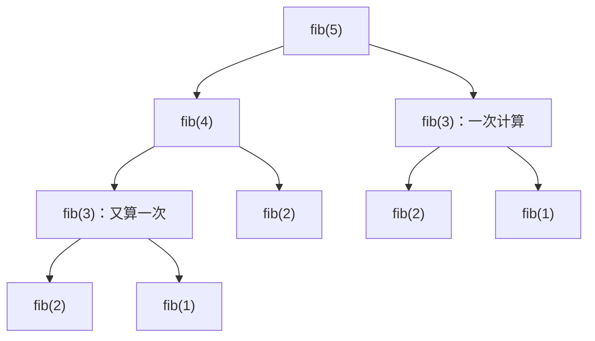

# 7.8 高精度整数：用数位数组实现竖式运算

前置：[vector](../01-basic-problem-solving/04-stl/containers/01-vector.md)、[string](../01-basic-problem-solving/04-stl/containers/03-string.md)、[整除与余数](02-congruence-modulo.md)。

**高精度整数解决的是“需要完整、精确的整数，但内置类型装不下”。** 本节只处理非负整数，采用十进制数位数组，覆盖比较、加减乘和除以正 int；负数与高精度除以高精度留到后续。

## 0. 从问题引入：数放不下，换一种存法

例如要精确计算：

$$
99999999999999999999+1.
$$

这个数已经超出常见 64 位 ll 的范围。**不能先读进 ll，再转换成字符串：读入时就已经装不下。**

- 换成 double 会丢失整数精度，不能保证每一位正确。
- 取模只保留余数，不能还原完整答案。
- 若要求完整精确值，可以像手算竖式一样，**每次只算一位，把进位或借位交给下一位**。

于是：先用 string 读取，再拆成 vector 中的数位。**大的是位数，不是数组下标表示的数值；一个 500 位整数只需保存约 500 个数位。**

## 1. 数怎样存：个位在前，最高位在后

下面代码沿用通用框架中的标准头文件与 `using namespace std;`。Big 是数位容器，不是新的内置数值类型。

```cpp
using Big = vector<int>;

// 去掉最高位多余的 0，但整数 0 仍保留一个数位。
void trim(Big& a) {
    while (a.size() > 1 && a.back() == 0)
        a.pop_back();
}

// 将十进制字符串转为大整数。
// 字符串按高位到低位存储，Big 按低位到高位存储，因此需要逆序读取。
// 例如 "123" -> {3, 2, 1}。
Big read_big(const string& s) {
    Big a;
    for (int i = static_cast<int>(s.size()) - 1; i >= 0; --i)
        a.push_back(s[i] - '0');

    trim(a);
    return a;
}

// 将大整数转回十进制字符串。
// Big 的存储顺序与正常数字顺序相反，因此逆序遍历。
// 例如 {3, 2, 1} -> "123"。
string str_big(const Big& a) {
    string s;
    for (int i = static_cast<int>(a.size()) - 1; i >= 0; --i)
        s.push_back(static_cast<char>('0' + a[i]));

    return s;
}

// 返回 -1 / 0 / 1，分别表示 a < b、a == b、a > b。
// 不能直接用 string 比较数值大小：字符串按字典序比较，
// 先比较最高位字符，而整数应先比较位数；位数相同时再比较各位。
// 例如，字典序认为 "99" > "100"，但数值上 99 < 100。
// Big 已按高位去除多余的 0，因此位数可直接用 size() 比较。
int cmp(const Big& a, const Big& b) {
    // 位数不同，位数更多的非负整数更大。
    if (a.size() != b.size())
        return a.size() < b.size() ? -1 : 1;

    // 位数相同，从最高位向最低位比较。
    for (int i = static_cast<int>(a.size()) - 1; i >= 0; --i) {
        if (a[i] != b[i])
            return a[i] < b[i] ? -1 : 1;
    }

    return 0;
}
```

> **用途速记：** 用字符串输入完整整数，转换成“低位在前”的数位数组；输出时倒着读。比较先看有效位数，再从最高位找第一个不同位；输入和运算结果都要保持同一种规范表示。

### 变量与表示约定

| 对象 | 含义与范围 |
| --- | --- |
| Big a | 保存整数的十进制数位；容量由位数决定，不按整数值开数组 |
| a[i] | 10ⁱ 位的数字，范围 0..9；i 为 0-based |
| a[0] | 个位，方便低位向高位的进位／借位 |
| a.back() | 最高位；多位数不能为 0 |
| `{0}` | 整数 0 的唯一约定，不用空 vector 表示 0 |
| trim | 删除容器末尾的无效高位零，不删中间的零 |

例如 12030 的表示是：

$$
12030=0\times10^0+3\times10^1+0\times10^2+2\times10^3+1\times10^4.
$$

所以数组为 `[0,3,0,2,1]`。**低位在前是为了方便计算，不是让整数的数学意义倒过来。**



### 为什么要统一去掉前导零？

`00012` 与 `12` 表示同一个数，都应转成 `[2,1]`。否则只按容器长度比较，就会把 00012 错认成更大的整数。

**不能直接用 vector 的 `<` 比较数值。** vector 从 a[0] 开始按字典序比较，但这里 a[0] 是个位；例如 19 存为 `[9,1]`、20 存为 `[0,2]`，容器字典序与整数大小相反。

## 2. 加法：本位留余数，进位交给下一位

```cpp
// 两个非负大整数相加，结果仍为非负大整数。
// 按低位到高位逐位相加，处理进位。
Big add(const Big& a, const Big& b) {
    int n = max(a.size(), b.size());
    Big c(n);
    int carry = 0;

    for (int i = 0; i < n; ++i) {
        int cur = carry;
        if (i < static_cast<int>(a.size())) cur += a[i];
        if (i < static_cast<int>(b.size())) cur += b[i];

        c[i] = cur % 10;  // 当前位保留个位
        carry = cur / 10; // 向高位进位
    }

    if (carry) c.push_back(carry);

    return c;
}
```

**用途速记：** 传入两个规范 Big，返回它们的完整精确和，不修改输入。缺少的高位当作 0，最后的进位要单独保留。

先看 999+1：个位算 9+1=10，留下 0、向十位进 1；十位和百位也一样，最后再补上最高位 1，得到 `[0,0,0,1]`。

每位使用的数学关系是：

$$
\mathrm{cur}=a[i]+b[i]+\mathrm{carry}.
$$

先把两个数的本位与低一位传来的进位相加，缺位补 0。

$$
\mathrm{cur}=10\left\lfloor\frac{\mathrm{cur}}{10}\right\rfloor+(\mathrm{cur}\bmod10).
$$

余数就是本位，商就是下一位的进位。**每轮只负责写本位，下一轮自然接着处理进位。**

### 为什么最多只进 1？

先不算低位传来的进位，两个数字相加最多为：

$$
9+9=18=8+1\times10.
$$

本位留下 8，向高一位进 1。**即使低位还传来一个 1，仍然只进 1：**

$$
9+9+1=19=9+1\times10.
$$

个位开始时 carry=0；每轮传出的进位仍只可能是 0 或 1，所以这个范围可以逐位保持下去：

$$
0\le\mathrm{cur}\le19
\quad\Longrightarrow\quad
\left\lfloor\frac{\mathrm{cur}}{10}\right\rfloor\in\{0,1\}.
$$

因此不管原整数有多少位，**两数加法的每一位最多进 1**，局部计算也不会溢出。这个结论只针对这里的加法，不能直接套到乘法的 carry。

## 3. 减法：先约定结果非负，再处理借位

```cpp
// 前提：a >= b，且 a、b 均为非负整数；不处理负数结果。
// 按低位到高位逐位相减，借位规则与手算减法相同。
Big sub(const Big& a, const Big& b) {
    Big c(a.size());
    int borrow = 0;

    for (int i = 0; i < static_cast<int>(a.size()); ++i) {
        int cur = a[i] - borrow; // 减去上一位的借位
        if (i < static_cast<int>(b.size()))
            cur -= b[i];         // 减去 b 当前位（若存在）

        borrow = (cur < 0);      // 不够减则向高位借 1
        if (borrow) cur += 10;   // 当前位加 10，完成本位相减
        c[i] = cur;
    }

    trim(c); // 去掉结果高位多余的 0
    return c;
}
```

**用途速记：** 已确认 a≥b 时，返回 a−b。borrow 表示本位是否向更高位借了 1；它使下一轮多减 1。

### 为什么借一次就够？

除了减去 b[i]，还要扣掉上一位已经借走的 borrow。最不够减的情况是：

$$
\mathrm{cur}=0-9-1=-10.
$$

**向高一位借 1，相当于给本位补 10**；即使本位已经被低位借走 1，最坏也刚好够补：

$$
-10+10=0.
$$

一般地，若本位不够减，则：

$$
-10\le\mathrm{cur}<0
\quad\Longrightarrow\quad
0\le\mathrm{cur}+10\le9.
$$

所以只需借一次，本位就能变成合法数字；下一轮在更高位扣掉这一个 1。borrow 初始为 0，之后也始终只需记录 **0／1：本位是否向高位借了 1**。

以 1000−1 为例，个位不够减，向十位借 1：

$$
0-1=-1=9-10.
$$

本位留下 9，而“借走一个十”要由下一位扣除。之后两个 0 都还需继续借，最高位的 1 最终减成 0。

计算结果暂为 `[9,9,9,0]`，trim 后得到 `[9,9,9]`，即 999。

**a==b 时必须保留 `{0}`；a<b 不能直接调用。** 若题目允许负结果，应先比较、分离符号，再对绝对值作减法，本节不混入这层逻辑。

## 4. 乘法：一位乘整行，按位权错位累加

```cpp
// 两个非负大整数相乘，按低位到高位逐位计算。
Big mul(const Big& a, const Big& b) {
    int n = static_cast<int>(a.size());
    int m = static_cast<int>(b.size());
    Big c(n + m); // 乘积最多有 n + m 位，初始各位为 0。

    for (int i = 0; i < n; ++i) {
        int carry = 0; // 当前行的进位。

        for (int j = 0; j < m; ++j) {
            // 累加已有结果、当前位乘积和上一位的进位。
            int cur = c[i + j] + a[i] * b[j] + carry;
            c[i + j] = cur % 10; // 当前位保留个位。
            carry = cur / 10;    // 高位部分留待下一位处理。
        }

        // 保存当前行的最后进位；该位置此前尚未被写入。
        c[i + m] = carry;
    }

    trim(c); // 去掉乘积高位多余的 0。
    return c;
}
```

**用途速记：** 返回两个 Big 的精确乘积。每个 a[i] 与全部 b[j] 相乘，乘积并入 c[i+j]；每处理一个位置就规范成 0..9，避免把所有贡献无限堆在一个 int 中。

### 为什么是 i+j？

先看 23×14：个位的 3 乘 14，贡献 42；十位的 2 表示 20，乘 14，贡献 280。

$$
23\times14=3\times14+20\times14=42+280=322.
$$

**数组中的 a[i]、b[j] 分别带着位权 10ⁱ、10ʲ：**
$$
(a[i]\times10^i)(b[j]\times10^j)=a[i]b[j]\times10^{i+j}.
$$

**因此该乘积从 c[i+j] 开始贡献，不是 c[i]，也不是 c[j]**。

| 已处理的行 | 本行贡献 | 累加后的整数 |
| --- | --- | --- |
| i=0：a[0]=3 | 3×14=42 | 42 |
| i=1：a[1]=2 | 2×14×10=280 | 322 |

**c[i+j] 可能已有前面各行的贡献，所以要把旧值也加进 cur**。循环中 c 的各位最多为 9，carry 最多为 9，故：
$$
\mathrm{cur}\le9+9\times9+9=99.
$$

本位仍取 `%10`，高一位仍接 `/10`。原整数可以很长，单次运算却始终很小。

### 为什么开 n+m 位？

n 位与 m 位非负数分别小于 10ⁿ、10ᵐ：

$$
A B<10^n\times10^m=10^{n+m}.
$$

所以乘积最多 n+m 位。原式保留整数 0 为一位，0 乘任何数后也用 trim 还原为 `{0}`。

## 5. 除以小整数：方向反过来，从高位向低位

```cpp
// 将非负大整数 a 除以正整数 b，返回 {整数商, 余数}。
// 从最高位向最低位计算，利用“当前余数 × 10 + 当前位”得到下一步的被除数。
pair<Big, int> div_small(const Big& a, int b) {
    Big q(a.size()); // 商与被除数最多有相同的位数
    ll rem = 0;      // 已处理部分的余数

    for (int i = static_cast<int>(a.size()) - 1; i >= 0; --i) {
        ll cur = rem * 10 + a[i]; // 拼接当前位，形成本轮被除数
        q[i] = static_cast<int>(cur / b); // 当前位的商
        rem = cur % b;                    // 留下余数，供下一位使用
    }

    trim(q); // 去掉商最高位多余的 0
    return {q, static_cast<int>(rem)};
}
```

**用途速记：** 被除数用 Big，除数仍用正 int，得到整数商和余数。这里不是模逆元，也不是两个任意长度整数相除；除数不能为 0。

### 为什么这次从高位开始？

手算 1234÷12 时，先读 1，再读 2，然后读 3、4：

| 新读入的数字 | cur=旧余数×10+新数字 | 本次商位 | 新余数 |
| --- | --- | --- | --- |
| 1 | 1 | 0 | 1 |
| 2 | 12 | 1 | 0 |
| 3 | 3 | 0 | 3 |
| 4 | 34 | 2 | 10 |

得到商的数字 0、1、0、2，去掉前导 0 后为 102，余数为 10：

$$
1234=12\times102+10.
$$

**余数是已经读过的高位部分尚未除完的量。** 再读一个数字 d，相当于把原来的量乘 10、再加 d；已经除尽的部分无需重新计算。

这里各字母都描述**读入下一个数字之前**的状态：

| 字母 | 含义 | 与代码的对应 |
| --- | --- | --- |
| P | 已经从高位读过的那一段数字组成的整数，即已读前缀 | 推导用的完整数值，不必实际存储 |
| b | 固定的正整数除数 | 函数参数 b |
| Q | P 除以 b 得到的整数商 | 已经算出的高位商，不必另外用 ll 保存 |
| r | P 除以 b 后的余数，满足 0≤r<b | 读取本位之前的 rem |
| d | 接下来读入的一个十进制数字，范围 0..9 | 当前 a[i] |

例如处理 1234÷12，已经读过 123、准备读最后的 4 时，P=123、b=12、Q=10、r=3、d=4。

已读部分满足 P=bQ+r，再接上数字 d：

$$
10P+d=b(10Q)+(10r+d).
$$

**前面的整商只需左移一位，新商位和新余数完全由 10r+d 决定。因此代码只需要保存 rem，不需要把已读前缀存进 ll。**

### 为什么 rem 与 cur 用 ll？

始终有 0≤rem<b，所以：

$$
0\le\mathrm{cur}=10\mathrm{rem}+a[i]<10b.
$$

在常见 32 位 int、64 位 ll 环境中，即使 b 接近 INT_MAX，cur 也可由 ll 保存，商位仍不超过 9。**高精度容器不会自动保护局部计算，每个中间变量仍须分析范围。**

## 6. 复杂度与使用边界

设两个操作数分别有 n、m 个有效十进制数位，不按整数的数值大小计复杂度。

| 操作 | 时间 | 额外空间（含返回结果） | 原因 |
| --- | --- | --- | --- |
| 读入、转换为字符串 | O(n) | O(n) | 每个数位访问一次 |
| cmp | 最坏 O(max(n,m)) | O(1) | 位数不同直接返回，否则从高位比较 |
| add | O(max(n,m)) | O(max(n,m)) | 低位到高位扫描一次 |
| sub，要求 A≥B | O(n) | O(n) | 每位减去数字和借位 |
| mul | O(nm) | O(n+m) | 枚举两个数的数位组合 |
| div_small | O(n) | O(n) | 从高位向低位扫描一次 |

所有输入 Big 必须非空、各位为 0..9、没有无效高位零；由 read_big 与这些运算生成的结果满足约定。**输入位数及结果分配长度须能用 int 表示且内存足够**；当前模板统一限制**各输入长度不超过 INT_MAX/2，以覆盖乘积的 n+m 和加法多一位**。

这些函数返回新容器，不修改输入；**只有 trim 会修改传入容器**。多组测试重新创建局部 Big，没有需要手动清空的全局数组。

### 何时仍用 ll，何时改用高精度？

| 需求 | 处理方式 |
| --- | --- |
| 所有中间值都在 ll 范围内 | 继续使用 ll，代码和常数更小 |
| 只要求答案模 p | 按题意取模，并检查局部乘法范围 |
| 要求完整精确值，位数超出内置类型 | 高精度保存数位，运算逐位完成 |
| **只需比较很长的非负整数** | **规范前导零后，可直接按字符串长度和字典序比较** |

这是本节的边界对照；整章写法成本与场景推荐仍留到章末。

更大的进制（如 10⁹）能在一个元素中保存多位，减少循环次数，但要重新分析乘法、进位与补零输出。**本节先统一十进制，不把大进制常数直接替换进去。**

## 7. 典题与复盘

两份当前实现保留原逻辑，只整理排版与注释，省略未改动的 main。P1255 的首次递归版本按实际反馈记录 TLE、无条件初始化记录 RE；当前版本的本地核验与平台结果分别记录，不据代码推断 AC。

### 7.1 P1601：数位相加与结果规范化

[P1601 高精度加法](https://www.luogu.com.cn/problem/P1601)：两个非负整数不超过 10⁵⁰⁰，上界本身有 501 位。

**收录原因：把超出类型范围的整数拆成局部数位运算，区分“数值算对”与“表示、输出也符合约定”。**

#### 原实现

```cpp
using Big = vector<int>;

Big s2b(const string& s) {
    Big a;
    for (int i = (int)s.size() - 1; i >= 0; --i)
        a.push_back(s[i] - '0');
    return a;
}

Big add(const Big& a, const Big& b) {
    int n = max(a.size(), b.size());
    Big c(n);
    int carry = 0;

    for (int i = 0; i < n; ++i) {
        int cur = carry;
        if (i < (int)a.size()) cur += a[i];
        if (i < (int)b.size()) cur += b[i];

        c[i] = cur % 10;
        carry = cur / 10;
    }

    if (carry)
        c.push_back(carry);

    return c;
}

void solve() {
    string a, b;
    cin >> a >> b;

    auto ans = add(s2b(a), s2b(b));
    for (int i = (int)ans.size() - 1; i >= 0; --i)
        cout << ans[i];
    cout << '\n';
}
```

**用途速记：** 字符串读取完整数字，倒序转成 Big；按下标累加各位，最后倒序输出。Big c(n) 已经创建 n 个结果位，所以使用 c[i]；不能再同时用 push_back 写这 n 位。

#### 核验与边界

规范十进制输入下，加法与输出已本地核验；平台结果未单独提供。

**s2b 没有去除前导零。** 若输入 `0001` 与 `0002`，原实现会输出 `0003`。需要规范输出时，最小补强是在输出前复用本节 trim：

```cpp
trim(ans); // 放在求得 ans 后、倒序输出前；全零仍保留一位 0
```

这是一项独立补强，不暗改原稿。通用模板的 read_big 已规范输入，add 也维持规范表示，可直接复用。

设最大输入位数为 L，时间与额外空间都是 O(L)。完整整数不需要装入 ll；数位下标、cur、carry 仍可用 int。

### 7.2 P1255：小下标、大答案，递推中复用高精度加法

[P1255 数楼梯](https://www.luogu.com.cn/problem/P1255)：每次上一阶或两阶，1≤n≤5000，输出完整方案数。

**收录原因：把状态规模与状态值大小分开分析，并用子问题复用消除递归中的重复计算。**

#### 首次递归版：保留 TLE 过程

共享上题的 Big、s2b、add。以下是原注释版本中的辅助函数和递归核心，恢复成代码展示；**不是推荐实现**。这里的 sub 只用于递归中减 1、减 2，不作为任意小整数减法的通用接口。

```cpp
void trim(Big& a) {
    while (a.size() > 1 && a.back() == 0)
        a.pop_back();
}

Big sub(const Big& a, int b) {
    Big c(a.size());
    int borrow = 0;

    for (int i = 0; i < (int)a.size(); ++i) {
        int cur = a[i] - borrow;
        if (i == 0) cur -= b;

        borrow = (cur < 0);
        if (borrow) cur += 10;
        c[i] = cur;
    }

    trim(c);
    return c;
}

Big fib(Big a) {
    if (a.size() == 1 && a[0] == 1) return Big(1, 1);
    if (a.size() == 1 && a[0] == 2) return Big(1, 2);

    return add(fib(sub(a, 1)), fib(sub(a, 2)));
}
```

**TLE 的主因是无记忆化的重复求解。** 求 fib(5) 时，fib(3) 会在不同分支重新展开：



更大的 n 会不断复制这些分支，调用数量指数增长；每次还要复制 Big 参数、分配容器并作高精度减法。

**需要避免的是无记忆化递归，不是所有递归。** [记忆化搜索](../03-search/03-memoized-search.md)也能复用结果；本题依赖顺序直接，改成自底向上递推更简洁，也没有深层递归调用。

此外，n≤5000，状态编号本来就能用 int。**需要高精度的是方案数，不是楼梯阶数；不必把状态编号也转成 Big。**

#### 改后的原实现

复用 7.1 的 Big 和 add；原稿中不再使用的 s2b、注释函数不重复粘贴。

```cpp
void solve() {
    int n;
    cin >> n;

    vector<Big> fib(n + 1);
    if (n >= 1) fib[1] = Big(1, 1);
    if (n >= 2) fib[2] = Big(1, 2);

    for (int i = 3; i <= n; ++i)
        fib[i] = add(fib[i - 1], fib[i - 2]);

    for (int i = (int)fib[n].size() - 1; i >= 0; --i)
        cout << fib[n][i];
    cout << '\n';
}
```

**用途速记：** fib[i] 保存“走到第 i 阶的方案数”，每个状态只算一次；加法仍是同一个高精度工具，改变的是组织计算的顺序。

从最后一步分类：走一阶的方案来自 i−1，走两阶的方案来自 i−2，两类互不重叠且覆盖全部情况：

$$
\mathrm{fib}[1]=1,\qquad \mathrm{fib}[2]=2.
$$

一阶只有一种走法；两阶有“1+1”和“2”两种走法。

$$
\mathrm{fib}[i]=\mathrm{fib}[i-1]+\mathrm{fib}[i-2],\qquad i\ge3.
$$

按 i 递增，两个来源已算完，直接调用 add 即可。fib[0] 没有参与运算，因此其空容器不被当作高精度整数 0 使用。

#### RE 坑点：初始状态也要先检查数组范围

原来无条件初始化 fib[1]、fib[2]，提交后出现 RE。**数学上需要两个基础值，不代表本次分配的数组一定包含两个位置。**

| 输入与分配 | 有效下标 | 无条件写 fib[2] |
| --- | --- | --- |
| n=1，fib 大小为 2 | 0、1 | 越界，属于未定义行为，可能 RE |
| n≥2，fib 大小至少为 3 | 0..n | 在范围内 |

因此要么按原实现用 n≥2 保护第二个初值，要么先特判 n=1。题目保证 n≥1，所以第一条 n≥1 判断可以省，但保留也没有问题。

> **初始化不是循环外的“例外”：每次访问数组，都必须先保证对应位置存在。**

#### 可选滚动版：只保留两个来源

复用原 add；下面是整理实现，不代替上面的个人原稿。

```cpp
void solve() {
    int n;
    cin >> n;

    if (n == 1) {
        cout << "1\n";
        return;
    }

    Big prev{1}, cur{2};
    for (int i = 3; i <= n; ++i) {
        Big next = add(prev, cur); // 先读取两个旧值
        prev.swap(cur);           // 原 cur 成为下一轮的前一个值
        cur.swap(next);           // 新结果成为当前值
    }

    for (int i = (int)cur.size() - 1; i >= 0; --i)
        cout << cur[i];
    cout << '\n';
}
```

**先算 next，再改变 prev、cur**，避免覆盖本轮尚需读取的来源。两个 swap 只交换容器内容，不逐位复制整段数字；可对照 [DP 空间压缩的读写检查](../../patterns/05-dynamic-programming/dp-modeling-workflow.md#空间压缩先标清每次读取属于哪一层)。

设最终答案有 L 位，原递推版时间为 O(nL)、保存全部状态的空间至多 O(nL)；滚动版时间仍为 O(nL)，空间为 O(L)。**有 O(n) 次加法，不等于总时间就是 O(n)：高精度加法还需逐位处理。**

当前递推版与滚动版均已本地核验，平台结果未单独提供。原版便于观察所有状态，滚动版减少保存内容；不必为套模板再建斐波那契专属工具。

## 8. 自查与衔接

1. 为什么 12030 存成 `[0,3,0,2,1]`，却不能直接用 vector 的 `<` 比较？
2. 为什么加减法从 a[0] 开始，而除法从 a.back() 开始？
3. 1000−1 为什么要 trim，0−0 又为什么不能删成空容器？
4. 乘法为什么写入 i+j，除法为什么只保存 rem 就够了？

表示与竖式算法可对照 [Arbitrary-Precision Arithmetic](https://cp-algorithms.com/algebra/big-integer.html)；本节采用十进制、唯一零表示与独立实现，不直接移植该页的大进制代码。

[本章索引](README.md) · [高精度模板](../../templates/07-math/big-integer/README.md)
