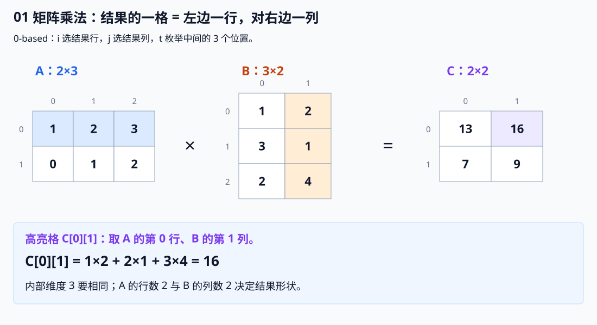
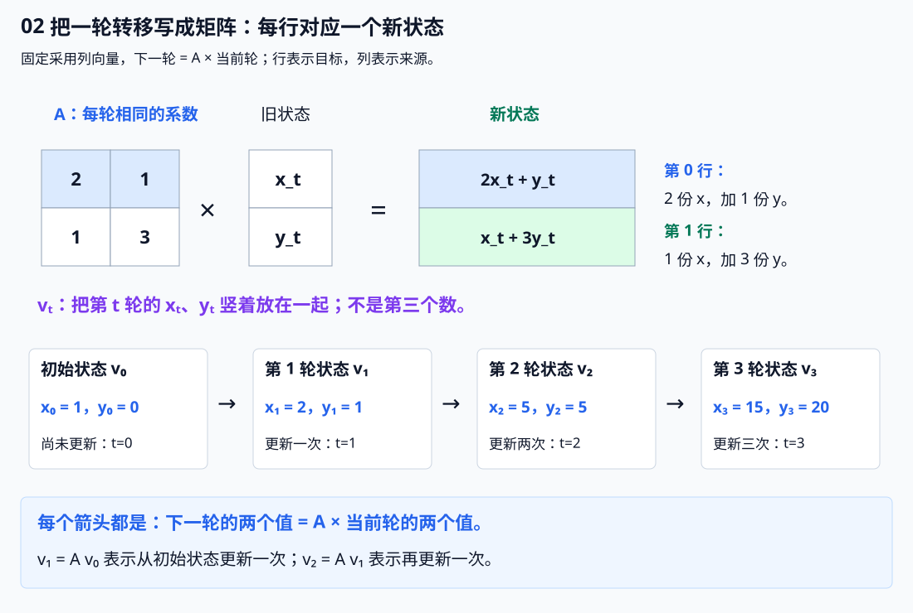
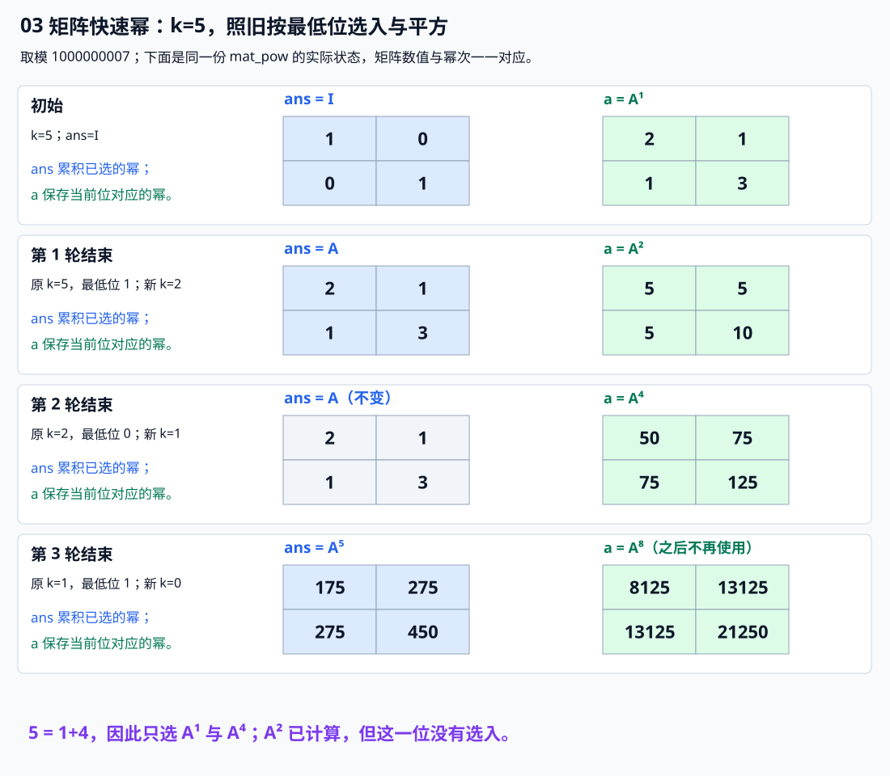

# 7.9 矩阵与矩阵快速幂：把重复转移打包

前置：[快速幂](03-binary-exponentiation.md)、[DP 状态与转移](../05-dynamic-programming/01-dp-basics.md)。矩阵可以先理解成一张有行、有列的数表；本节用它保存**一轮转移的全部系数**。

## 1. 问题从哪里来？同一轮转移，能不能少做几次

假设只有两个状态，每轮都按相同规则更新：

$$
x_{t+1}=2x_t+y_t.
$$

新一轮的第一个值，由上一轮的两个值共同算出。

$$
y_{t+1}=x_t+3y_t.
$$

新一轮的第二个值，也只依赖上一轮。这里的 $t$ 是已经完成的轮数。

普通循环可以正确求解。但若要执行 $10^{18}$ 轮，**瓶颈是轮数太多，不是某一轮不会算**。

标量快速幂把连续乘同一个数合并成平方链。现在希望把“执行一轮”也保存成一种**可以相乘、可以平方的对象**：这就是本节的矩阵。

## 2. 通用代码：矩阵乘法与快速幂

下标统一为 **0-based**。`Mat` 就是二维 `vector`，不额外封装类。

```cpp
using Mat = vector<vector<ll>>;

// A 为 n×r，B 为 r×m，结果 C 为 n×m。
// 输入矩阵非空、行长一致，元素已规范到 [0,mod)。
// 1 <= mod < 2^31，保证乘法及累加过程不会发生 ll 溢出。
Mat mat_mul(const Mat& a, const Mat& b, ll mod) {
    int n = (int)a.size();
    int r = (int)b.size();      // A 的列数 = B 的行数
    int m = (int)b[0].size();

    Mat c(n, vector<ll>(m, 0));

    // C[i][j] = A 的第 i 行与 B 的第 j 列对应元素相乘后求和
    for (int i = 0; i < n; ++i) {
        for (int t = 0; t < r; ++t) {

            // A[i][t] 为 0 时，这一项对结果没有贡献
            if (a[i][t] == 0) continue;

            for (int j = 0; j < m; ++j) {
                // 将 A[i][t] * B[t][j] 加入 C[i][j]
                // 每次取模，避免累加值过大
                c[i][j] = (c[i][j] + a[i][t] * b[t][j]) % mod;
            }
        }
    }

    return c;
}

// A 为非空方阵，k >= 0；输入元素可以是任意 ll。
// 返回 A^k mod mod。
Mat mat_pow(Mat a, ll k, ll mod) {
    int n = (int)a.size();

    // 先将底数矩阵的所有元素规范到 [0,mod)
    // C++ 对负数取模可能得到负数，因此需要额外加 mod
    for (auto& row : a) {
        for (ll& x : row) {
            x %= mod;
            if (x < 0) x += mod;
        }
    }

    // 单位矩阵 E：主对角线为 1，其余位置为 0
    // A^0 = E，因此用它作为累乘初始值
    Mat ans(n, vector<ll>(n, 0));
    for (int i = 0; i < n; ++i)
        ans[i][i] = 1 % mod;

    // 二进制快速幂：逐位处理指数 k
    while (k > 0) {

        // 当前二进制位为 1，说明这一份 a 应计入最终结果
        if (k & 1)
            ans = mat_mul(ans, a, mod);

        // 下一轮处理更高位时，底数变为当前底数的平方
        a = mat_mul(a, a, mod);

        // 右移一位，继续处理 k 的下一位
        k >>= 1;
    }

    return ans;
}
```

**用途速记：** `mat_mul` 接收两个维度相容的矩阵，返回模意义下的乘积；`mat_pow` 接收方阵、非负指数与模数，返回矩阵的幂。它把重复执行同一种线性转移合并为平方链；**具体状态、转移系数和初始值仍由题意决定**。

竞赛头文件见[矩阵模板](../../templates/07-math/matrix/README.md)。两者接口与数值约定相同，模板省去教学留白。

## 3. 先看乘法：取左边一行，对右边一列

### 一格是怎样算出来的



结果第 0 行、第 1 列，要用 **A 的第 0 行**与 **B 的第 1 列**：

$$
C_{0,1}=1\times2+2\times1+3\times4=16.
$$

按相同位置配对相乘，再相加。**不是两个矩阵对应格子直接相乘。**

一般地：

$$
C_{i,j}=\sum_{t=0}^{r-1}A_{i,t}B_{t,j}.
$$

中间的 $t$ 枚举“左边这一行、右边这一列”共有的 $r$ 个位置。

### 为什么有维度要求

| 代码中的量 | 含义 | 范围／形状 |
| --- | --- | --- |
| `a` | 左矩阵 | $n\times r$ |
| `b` | 右矩阵 | $r\times m$ |
| `c` | 结果矩阵，初始全 0 | $n\times m$ |
| `i` | **结果的行，也是 A 的行** | `0..n-1` |
| `j` | **结果的列，也是 B 的列** | `0..m-1` |
| `t` | 本次相乘的中间位置 | `0..r-1` |

**左矩阵的列数必须等于右矩阵的行数**，行、列才能逐项配对。

$$
(n\times r)(r\times m)\longrightarrow n\times m.
$$

图中是 $2\times3$ 乘 $3\times2$，所以结果为 $2\times2$。矩阵乘法本身不要求方阵；**同一个矩阵反复自乘才要求方阵**。

代码把循环写成 `i → t → j`：固定 `a[i][t]`，向结果这一行的各列累加贡献。与公式中的求和相同，只是换了枚举顺序。

```cpp
if (a[i][t] == 0) continue;
```

这个系数为 0 时，对所有列的贡献都是 0，可以整批跳过。新建 `c` 则是为了**完整读完旧 A、B 后再得到结果**，不能边改 A 边拿它的旧值继续计算。

## 4. 从一轮转移到一个矩阵

### 先说明图里的 v：把同一轮的 x、y 打包

一直要维护的量仍然只有 x、y。把**第 t 轮的两个值竖着放在一起**，用一个名字 $v_t$ 表示：

$$
v_t=\begin{pmatrix}x_t\\y_t\end{pmatrix}.
$$

**v 不是额外算出的第三个数，而是一整列两个数的简称。下标 t 表示已经执行的轮数，不表示矩阵的行号。** 这种只有一列的矩阵称为列向量。

本例初始时 x=1、y=0，还没执行任何一轮：

$$
v_0=\begin{pmatrix}x_0\\y_0\end{pmatrix}
=\begin{pmatrix}1\\0\end{pmatrix}.
$$

按开篇的两条规则更新一次，得到 x=2、y=1：

$$
v_1=\begin{pmatrix}x_1\\y_1\end{pmatrix}
=\begin{pmatrix}2\times1+0\\1+3\times0\end{pmatrix}
=\begin{pmatrix}2\\1\end{pmatrix}.
$$

因此，**$v_0$ 是初始的两个值，$v_1$ 是更新一轮后的两个值；两者保存的是不同轮次的同一组状态。**



### 再把一轮更新写成乘法

一轮规则可以合写为：

$$
\begin{pmatrix}x_{t+1}\\y_{t+1}\end{pmatrix}
=
\begin{pmatrix}2&1\\1&3\end{pmatrix}
\begin{pmatrix}x_t\\y_t\end{pmatrix}.
$$

按刚才的“行对列”展开，正好回到开篇两条式子。

用 A 表示图中的系数矩阵。从初始状态更新一轮，就简写为：

$$
v_1=Av_0.
$$

一轮：对初始状态应用一次 A。

$$
v_2=A(Av_0)=A^2v_0.
$$

两轮：同样的转移再次作用于上一轮结果。

$$
\boxed{v_K=A^Kv_0}.
$$

因此先求 $A^K$，再乘初始列向量，就能得到第 K 轮。**矩阵的行对应目标状态，列对应来源状态；格子保存来源对目标的贡献系数。**

本例从 $(1,0)$ 开始，前几轮为：

$$
(1,0)\longrightarrow(2,1)\longrightarrow(5,5)\longrightarrow(15,20).
$$

这里第 0 轮是初始状态，所以执行 K 轮用 $A^K$。若题目直接给了第 1 项或前几项，**必须先明确初始状态处于哪一轮，再算还差几步**。

## 5. 为什么可以快速幂？结合律、单位矩阵与顺序

### 零次操作应当保持原样

```cpp
Mat ans(n, vector<ll>(n));
for (int i = 0; i < n; ++i) ans[i][i] = 1 % mod;
```

对角线为 1、其余为 0，得到**单位矩阵 I**：

$$
I=\begin{pmatrix}1&0\\0&1\end{pmatrix},\qquad Iv=v.
$$

乘 I 不改变状态，正好表示“什么也不做”。

$$
A^0=I,\qquad IA=AI=A.
$$

所以 `ans` 从 I 开始，不能初始化为全 0 或全 1。`mod=1` 时所有余数均为 0，代码中的 `1 % mod` 也自然得到 0。

### 能改括号，不代表能换位置

矩阵乘法满足结合律：

$$
(AB)C=A(BC).
$$

因此连续转移可以分组，两个相同的幂相乘就能得到更高的幂。

但通常不满足交换律。例如：

$$
U=\begin{pmatrix}1&1\\0&1\end{pmatrix},\qquad
V=\begin{pmatrix}2&0\\0&3\end{pmatrix}.
$$

两种顺序分别得到：

$$
UV=\begin{pmatrix}2&3\\0&3\end{pmatrix},\qquad
VU=\begin{pmatrix}2&2\\0&3\end{pmatrix}.
$$

结果不同。采用列向量时，`ABv` 表示**先 B、后 A**：


**快速幂利用的是结合律；它没有允许任意交换不同转移的先后顺序。**

### 沿代码看指数 5



$$
5=(101)_2=1+4.
$$

第 0 位与第 2 位为 1，所以需要 $A^1$ 与 $A^4$；$A^2$ 只用来继续平方，不并入答案。

```cpp
if (k & 1) ans = mat_mul(ans, a, mod);
a = mat_mul(a, a, mod);
k >>= 1;
```

`a` 依次保存 $A,A^2,A^4,\ldots$，`k` 的最低位决定是否乘入。**与标量快速幂相比，只是把乘法换成矩阵乘法、初值 1 换成 I。**

设原指数为 K，每轮开始保持：

$$
\mathrm{ans}\cdot a^k=A^K.
$$

若 k 为奇数，把一个 a 移入 `ans`；剩下的指数为偶数，再把两个 a 合成 $a^2$。若 k 为偶数，直接平方并折半。两种情况都保留同一乘积。

循环结束时 k 为 0，因此 `ans` 就是所求。代码最后一轮还会平方一次，但此后不再使用该值，不影响结果。

## 6. 如何识别？先有状态转移，再决定是否用矩阵

| 观察到的条件 | 应当检查什么 |
| --- | --- |
| 轮数／下标很大 | 逐轮递推是否超时？ |
| 状态数量很少 | 能否把需要继承的信息放进一个短向量？ |
| 每轮规则完全相同 | 能否用同一个矩阵重复作用？ |
| 新状态是旧状态的固定系数加权和 | 能否直接写成普通矩阵乘法？ |

**顺序是：定义状态 → 写一轮转移 → 填入系数 → 用幂合并多轮。** 不要看到“大下标”就跳过状态建模。最近若干项如何保留、历史如何搬运，见[从递推式构造矩阵](../../patterns/07-math/recurrence-to-matrix.md)；具体配题实现留在第 9 节。

本节普通乘法使用“相乘后求和”。带 `max`、`min` 的 DP 转移不能直接照搬这个模板；每轮系数不同，也不能直接求某一个固定 A 的幂。

更一般的关联见[统一变换，按顺序复合](../../patterns/09-data-structures/composable-transformations.md#同一种线性变换重复很多次矩阵快速幂)：先找到可组合的变换，再决定如何高效组织重复操作。

## 7. 复杂度：节省轮数，但要付出矩阵相乘的成本

用 d 表示方阵边长、K 表示执行轮数。

| 操作 | 时间 | 额外空间 | 原因 |
| --- | --- | --- | --- |
| $n\times r$ 乘 $r\times m$ | $O(nrm)$ | $O(nm)$ | 每格累计 r 项，创建结果矩阵 |
| d 维状态逐轮递推 K 次 | $O(d^2K)$ | $O(d)$ | 每轮按系数汇总旧状态 |
| 方阵快速幂，$K\ge1$ | $O(d^3\log(K+1))$ | $O(d^2)$ | 每个二进制位至多做两次矩阵乘法 |
| 求完幂后乘初始列向量 | $O(d^2)$ | $O(d)$ | 每个新状态汇总 d 项 |

K 为 0 时只需规范输入并创建 I，时间为 $O(d^2)$。按值传入、底数、答案和临时结果总共只是常数份矩阵，空间仍为 $O(d^2)$。

代入几个规模，按“每位最多两次乘法”粗估内层乘加次数：

| d | K | 位数约为 | 内层乘加次数上界约为 |
| --- | --- | --- | --- |
| 2 | $10^{18}$ | 60 | $2\times60\times2^3\approx10^3$ |
| 50 | $10^{12}$ | 40 | $2\times40\times50^3=10^7$ |
| 100 | $10^{12}$ | 40 | $2\times40\times100^3=8\times10^7$ |

**适合状态少、轮数多。** 轮数被压到对数级，但状态数带来立方成本；实际耗时还受取模、数据稠密程度与时限影响，不能只看指数很大就断定可行。

## 8. 数值与调用边界

- **模数满足 $1\le p\lt2^{31}$。** 模数不必为素数；这里只用加、乘，不涉及求逆元。
- `mat_pow` 会先规范负数，且按值接收，不改变调用处的原矩阵。**单独调用 `mat_mul` 时，两份输入必须已经是规范余数。**
- 每次乘加后立即取模，不要先累计整行再取模。规范余数下，一步计算至多为：

$$
(p-1)^2+(p-1)=p(p-1)\lt2^{62}.
$$

这说明当前范围内 `ll` 足够；换成更大的模数，需要重新处理模乘溢出。

- 指数用 `ll` 保存，要求非负；**不能把指数对模数取模**。本模板不处理负幂。
- 输入矩阵非空、各行长度一致，乘法的内维相等；快速幂必须是方阵。模板不另做维度报错。
- 零指数返回 I，与 A 是否可逆无关；初始向量另存，答案取哪个分量由状态定义决定。
- 每次调用都新建局部矩阵，无多测残留。二维数组容量由**状态数**决定，不由轮数 K 决定。

## 9. 典题与复盘

两题共用开篇的 `Mat`、`mat_mul`、`mat_pow`。原实现的矩阵乘法、负余数规范化、单位矩阵和平方循环与正文一致，**这里只展示各自的 `solve()`，保留原逻辑，仅整理排版与注释**。

### 9.1 [P3390【模板】矩阵快速幂](https://www.luogu.com.cn/problem/P3390)

给定方阵 A 与非负指数 k，输出 $A^k$，各元素对 $10^9+7$ 取模。原题范围：

$$
1\le n\le100,\qquad0\le k\le10^{12},\qquad |A_{i,j}|\le1000.
$$

#### 原实现

```cpp
void solve() {
    int n;
    ll k;
    cin >> n >> k;

    Mat a(n, vector<ll>(n));
    for (auto& row : a)
        for (ll& x : row)
            cin >> x;

    auto ans = mat_pow(a, k, ll(1e9 + 7));
    for (auto& row : ans) {
        for (ll& x : row)
            cout << x << ' ';
        cout << '\n';
    }
}
```

**本题已经直接给出矩阵，不需要额外构造状态向量。** 按行读入，调用快速幂，再按行输出结果即可。

静态检查的关键边界：

- `k` 用 `ll`，避免把大指数读进 `int`。
- `k=0` 时平方循环不执行，返回初始化好的单位矩阵。
- 元素可能为负，先在 `mat_pow` 中规范余数；后续各次乘法的输入都是规范余数。
- 模数在模板约定范围内，使用 `ll` 并逐项取模，乘加不会溢出。

时间为 $O(n^3\log(k+1))$，k=0 时为 $O(n^2)$；空间为 $O(n^2)$。原方案已经简洁，**复用同一实现，不另造等价改进版**。

**核验范围：** 已对照原题和代码静态复盘；本轮不编译、运行或对拍个人代码，平台结果未单独记录。

### 9.2 [P1962 斐波那契数列](https://www.luogu.com.cn/problem/P1962)

给定 $F_1=F_2=1$，后续每项为前两项之和，求第 n 项对 $10^9+7$ 取模。原题的 n 为正整数：

$$
1\le n\lt2^{63}.
$$

#### 原实现

```cpp
void solve() {
    ll n;
    cin >> n;

    Mat A = {
        {1, 1},
        {1, 0}
    };

    auto ans = mat_pow(A, n - 1, ll(1e9 + 7));

    cout << ans[0][0];
}
```

#### 矩阵怎样构造：最近两项算新项，再把历史往后移

**先找依赖，再定义状态：** 要算下一项，必须保留最近两项。新第一格是它们的和，新第二格则直接复制旧第一格，因此：

$$
\begin{pmatrix}F_{t+1}\\F_t\end{pmatrix}
=\begin{pmatrix}1&1\\1&0\end{pmatrix}
\begin{pmatrix}F_t\\F_{t-1}\end{pmatrix}.
$$

第一行 `(1,1)` 负责计算新项，第二行 `(1,0)` 负责留下下一轮所需的历史。**矩阵每一行，都是一个新分量由旧分量算出的系数表。**

完整构造过程与两项／三项递推、固定常数的迁移，集中整理为[从递推式构造矩阵](../../patterns/07-math/recurrence-to-matrix.md)；本处重点核对原实现的指数与取值。

#### 为什么是 n−1 次？为什么能直接读 `[0][0]`？

原题只要求正整数下标。为统一构造初始的两格状态，**补设辅助项 $F_0=0$**，使 $F_2=F_1+F_0=1$，与题目原有数列一致。

$$
\begin{pmatrix}F_n\\F_{n-1}\end{pmatrix}
=A^{n-1}\begin{pmatrix}1\\0\end{pmatrix}.
$$

从第 1 项对应的状态走到第 n 项，共更新 `n-1` 次。记代码算出的幂矩阵为 `ans`，乘初始向量时：

$$
F_n=\mathrm{ans}_{0,0}\times1+\mathrm{ans}_{0,1}\times0
=\mathrm{ans}_{0,0}.
$$

所以原实现省去了显式乘向量，直接读 `[0][0]`。**换了初值或状态顺序，就不能照搬这个取值位置。**

`n=1` 时，指数为 0，返回 I，`I[0][0]=1`，自然得到首项；无需另开分支。n 最大为 `LLONG_MAX`，原实现用 `ll` 保存，`n-1` 非负且可表示。

#### 显式写法：从题面给出的两项出发

如果初始向量不恰好是 `(1,0)`，就**把初始状态写成列向量，显式做一次矩阵乘法**。本题可以直接使用题面给出的 $(F_2,F_1)=(1,1)$，不补辅助项：

```cpp
void solve() {
    ll n;
    cin >> n;

    if (n == 1) {
        cout << 1 << '\n';
        return;
    }

    const ll mod = 1000000007;
    Mat A = {{1, 1}, {1, 0}};
    Mat initial = {{1}, {1}}; // 第 2 项对应状态：(F2, F1)。

    Mat power = mat_pow(A, n - 2, mod);
    Mat state = mat_mul(power, initial, mod);

    cout << state[0][0] << '\n'; // 已经乘过初值，第一格才是 Fn。
}
```

这里的 `initial` 是 **2 行 1 列**，不是 `{{1,1}}` 这样的 1 行 2 列。

$$
\begin{pmatrix}F_n\\F_{n-1}\end{pmatrix}
=A^{n-2}\begin{pmatrix}1\\1\end{pmatrix}.
$$

起点已经是第 2 项，所以只需再走 `n-2` 次；`n=2` 时乘 I，直接保留初始状态。`n=1` 在起点之前，因此提前单独返回，不能把负指数交给模板。

| 写法 | 初始状态 | 更新次数 | 最终读哪里 |
| --- | --- | --- | --- |
| 原实现 | 补设的 $(F_1,F_0)=(1,0)$ | `n-1` | 幂矩阵 `ans[0][0]`，利用特殊初值省略相乘 |
| 显式版 | 题面给出的 $(F_2,F_1)=(1,1)$ | `n-2`，先处理 `n=1` | 相乘后的 `state[0][0]` |

**初始向量、指数和答案位置要一起核对。** 显式版更直接地体现完整状态转移；原实现利用特殊初值更短，两者时间、空间量级相同。

#### 如何想到与取舍

**下标很大 → 逐项递推过慢 → 每步只用最近两项 → 把它们一起保留 → 写出新项计算与历史复制 → 按行提取系数 → 快速幂合并重复转移。**

普通迭代为 $O(n)$ 时间、$O(1)$ 空间；2×2 矩阵快速幂为 $O(\log(n+1))$ 时间、$O(1)$ 空间。原实现已适合本题，推荐保留同一代码，把构造依据、初始状态和答案位置解释完整。

**核验范围：** 已对照原题与状态转移静态复盘；本轮不编译、运行或对拍个人代码，平台结果未单独记录。

## 10. 衔接与参考

本节把“反复执行同一轮线性转移”接到已有快速幂与 DP 建模上。后续再补方程组与高斯消元；它处理的是求未知数，与这里计算重复转移不同，不在本节混讲。

参考：[CP-Algorithms：Binary Exponentiation](https://cp-algorithms.com/algebra/binary-exp.html)中的结合律与重复变换应用；题目条件以两道洛谷原题为准。正文示例、图示与实现按本节约定整理。

[返回数学索引](README.md)
