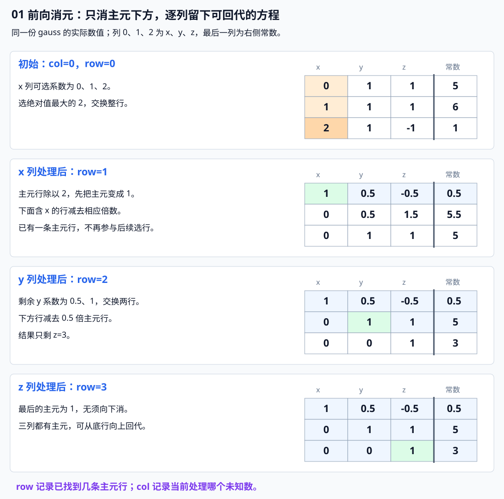
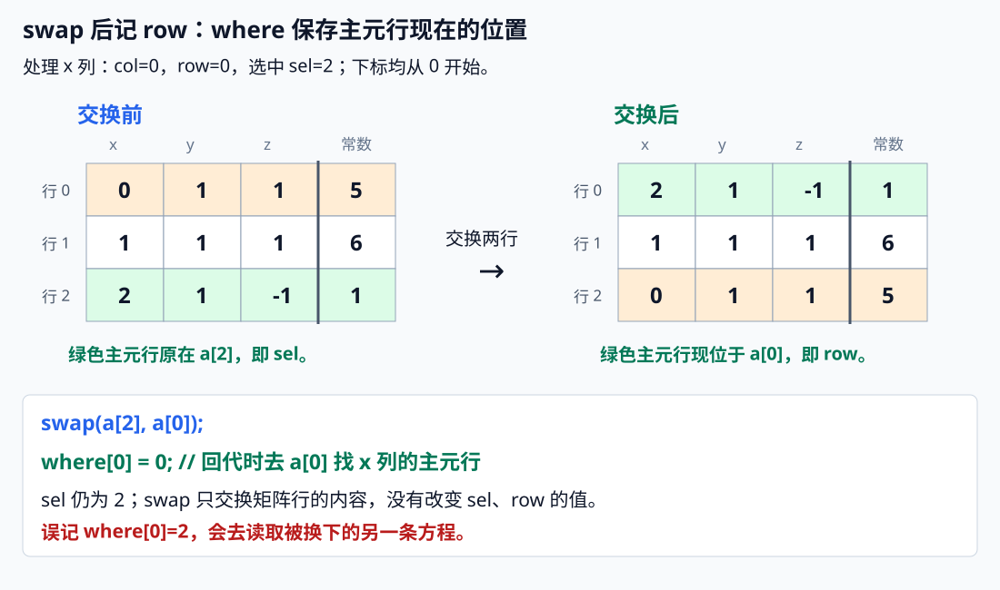
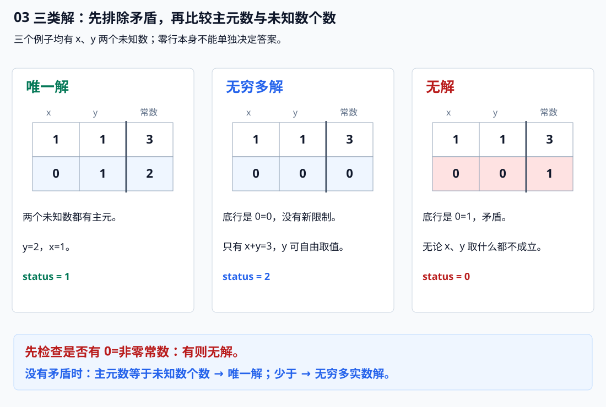
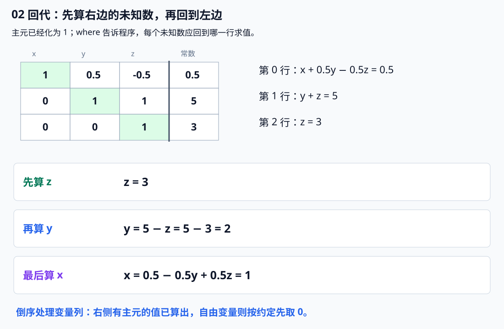

# 7.10 高斯消元：逐列消元，再从最后一行回代

前置：[矩阵的行与列](09-matrix-exponentiation.md#3-先看乘法取左边一行对右边一列)。**上一节知道初始状态、计算转移结果；本节知道方程系数和右侧常数、反过来求未知数。** 两者都会用二维数组，但任务不同。

## 1. 从熟悉的加减消元开始

例如：

$$
\begin{cases}
x+y=3,\\
2x+y=4.
\end{cases}
$$

第二个方程减去第一个方程的两倍：

$$
(2x+y)-2(x+y)=4-2\times3.
$$

x 被消掉，得到 $-y=-2$；再回到第一个方程求 x。这就是已经熟悉的**消去一个未知数，再用结果求另一个未知数**。

当方程、未知数各有上百个时，手工挑方程和整理式子容易混乱。高斯消元把同样的过程变成固定循环：

**按列找一个可用系数 → 用这一行消掉下面各行的同列系数 → 最后从下往上求值。**

本节处理实数域的线性方程组：未知数只以“一次项相加”的形式出现，不含 $x^2$、$xy$ 等项。不先求逆矩阵，也不做矩阵快速幂。

## 2. 通用代码：前向消元与回代

输入增广矩阵：**一行对应一个方程，前 m 列是未知数的系数，最后一列是等号右侧的常数。** n 是方程数，m 是未知数个数；两者不必相等。

下标从 0 开始，`a` 为 `n × (m+1)`，元素用 `double`。代码先给出，下面用同一套数字逐步跟踪。

```cpp
struct GaussRes {
    int status; // 0：无解；1：唯一解；2：无穷多解（按 eps 判断）
    int rank;   // 系数矩阵的秩，即成功找到的主元数量
    vector<double> x; // 有解时返回一组解；自由变量取 0；无解时为空
};

// ---- 1. 高斯消元：逐列寻找主元，向下消元，得到阶梯形矩阵 ----
// 实数方程组的增广矩阵：n 行、m+1 列。
// 前 m 列是未知数系数，最后一列是等号右侧的常数。
// 0-based；n,m>=1，各行等长，元素有限，eps>0。
// 按值传入，不会修改调用者原矩阵。
GaussRes gauss(vector<vector<double>> a, double eps = 1e-9) {
    int n = (int)a.size();
    int m = (int)a[0].size() - 1;

    int row = 0; // 当前处理到的行，也是下一个主元应该放置的行

    // where[col]：记录第 col 个未知数对应的主元所在行。
    // -1 表示这一列没有主元，该未知数是自由变量。
    // 由于某些列可能跳过，主元列编号与主元行编号不一定相同，不能直接用 col 作为行号。
    // 因此需要记录二者的对应关系，供后续回代时查找主元行，并识别自由变量。
    vector<int> where(m, -1);

    // 从左到右枚举未知数列，尝试为每一列寻找主元。
    for (int col = 0; col < m && row < n; ++col) {

        // 在当前列尚未处理的行中，寻找绝对值最大的元素作为主元。
        // 选择较大的主元可以减小浮点数运算中的数值误差。
        // 减小误差：使消元时使用的系数绝对值不会超过 1，这有助于控制中间计算的数值规模，降低误差放大的风险。
        int sel = row;

        for (int i = row + 1; i < n; ++i)
            if (fabs(a[i][col]) > fabs(a[sel][col]))
                sel = i;

        // 当前列剩余位置的元素都接近 0，
        // 说明这一列无法提供新的主元，跳过该列。
        if (fabs(a[sel][col]) <= eps)
            continue;

        // 将选中的主元所在行交换到当前处理行。
        swap(a[sel], a[row]);

        // 记录当前未知数的主元所在行。
        where[col] = row;

        // 将主元所在行除以主元，使主元变为 1（归一化）。
        // 从当前列开始处理，前面的列已经完成消元。
        double pivot = a[row][col];

        for (int j = col; j <= m; ++j)
            a[row][j] /= pivot;

        // 使用当前主元行，消去下面所有行的当前列，逐步形成阶梯形矩阵。
        // 当前 row 行是本列的主元行，其上方的行已经完成处理，
        // 因此只需要消去 row 下方尚未处理的行。
        for (int i = row + 1; i < n; ++i) {

            // 当前行在主元列上的系数，也是消元时需要使用的倍数。
            double factor = a[i][col];

            // 理论上消元后该位置为 0，直接赋值避免浮点残差。
            a[i][col] = 0;

            // 当前行减去 factor 倍的主元行，
            // 消去当前列的系数，同时更新后续系数和常数项。
            for (int j = col + 1; j <= m; ++j)
                a[i][j] -= factor * a[row][j];
        }

        // 成功找到一个主元，下一次从下一行继续处理。
        ++row;
    }

    // ---- 2. 判断是否无解：检查是否出现 0 = 非零数 ----
    // 此时 row 就是系数矩阵的秩。
    // 主元行下面没有主元，检查这些行是否出现矛盾。
    for (int i = row; i < n; ++i) {

        // 系数部分全部接近 0，但常数项不为 0：
        // 代表出现 0 = 非零数，方程组无解。
        if (fabs(a[i][m]) > eps)
            return {0, row, {}};
    }

    // 构造一组解，先将所有未知数设为 0。
    // 没有主元的列对应自由变量，直接保留为 0。
    vector<double> x(m, 0);
    
    // ---- 3. 回代求解：自由变量取 0，从下往上求其他未知数 ----
    // 从最后一列向前回代，依次求出有主元的未知数。
    for (int col = m - 1; col >= 0; --col) {

        int r = where[col];

        // 当前列没有主元，是自由变量，保持为 0。
        if (r == -1)
            continue;

        // 当前主元已经归一化为 1，且其左侧系数均已消为 0。
        // 因此第 r 行对应的方程可以写成：
        // x[col] + a[r][col+1]*x[col+1] + ... + a[r][m-1]*x[m-1] = a[r][m]
        //
        // 将主元右侧的未知数项移到等号右边：
        // x[col] = a[r][m] - Σ(a[r][j] * x[j])
        //
        // 所以先用增广矩阵的常数项初始化当前未知数。
        x[col] = a[r][m];

        // 减去其他已知未知数的贡献。
        // 当前主元行中，主元右侧的未知数已经通过逆序回代求出。
        for (int j = col + 1; j < m; ++j)
            x[col] -= a[r][j] * x[j];
    }

    // 秩等于未知数数量：每个未知数都有主元，解唯一。
    // 秩小于未知数数量：存在自由变量，解有无穷多组。
    return {row == m ? 1 : 2, row, x};
}
```

**用途速记：** 给出所有方程的系数与右侧常数，`gauss` 在不改变解集的前提下逐列消元，返回无解／唯一解／无穷多解。有解时 `x` 返回一组解；无穷多解时把自由变量暂取 0，**不是列出全部解**。

竞赛头文件见[高斯消元模板](../../templates/07-math/gaussian-elimination/README.md)。状态码含义由本模板约定，与题目要求输出的数字或字符串无关。

## 3. 二维数组里，每个位置到底表示什么

本节反复使用这个方程组：

$$
\begin{cases}
y+z=5,\\
x+y+z=6,\\
2x+y-z=1.
\end{cases}
$$

按 x、y、z 的固定顺序记录系数，没有出现的项写 0：

$$
\left[\begin{array}{ccc|c}
0&1&1&5\\
1&1&1&6\\
2&1&-1&1
\end{array}\right].
$$

竖线左侧是三个未知数的系数，右侧是常数；它们放在**同一个二维数组**里。这样的表叫增广矩阵。

| 变量／位置 | 含义 | 下标与容量 |
| --- | --- | --- |
| `a[i][j]`，`j < m` | 第 i 个方程中，第 j 个未知数的系数 | 前 m 列 |
| `a[i][m]` | 第 i 个方程的右侧常数 | 最后一列 |
| `row` | 下一条主元行应放的位置，也是已经找到的主元数 | `0..n` |
| `col` | 当前尝试消元的未知数列 | `0..m-1` |
| `sel` | 当前列选出的行 | 仅在 `row..n-1` 中选择 |
| `where[col]` | 这一列的主元在哪一行，`-1` 表示没找到 | 长度 m |
| `pivot` | 选中行当前列的非零系数 | 用来把该系数化为 1 |
| `factor` | 下面某一行当前列的系数 | 决定要减去多少倍主元行 |
| 返回的 `rank` | 系数部分找到的主元数 | 即最终的 `row`，按 eps 判定 |

**主元**就是当前选中的、用来消除下面同列系数的非零系数。每找到一个主元，就固定一条主元行；这里把主元化为 1，方便后续回代。

### 为什么改写方程不会改掉答案

只使用三种可还原的变换：

| 行操作 | 为什么保留原来的解 |
| --- | --- |
| 交换两个方程 | 只是改变排列，交换回来即可 |
| 某行除以非零数 | 等号两侧同除一个数，乘回来即可 |
| 某行减去另一行的若干倍 | 保留作为依据的另一行，再加回来即可 |

例如用第 r 行消去第 i 行的当前系数：

$$
R_i\leftarrow R_i-cR_r.
$$

这里 $R_i$、$R_r$ 表示整行，c 是所减的倍数；**右侧常数也必须一起做相同运算**，因此循环必须包含 `j == m`。

把一行乘 0 会丢失信息，不在这些操作内。本模板只交换行，不交换未知数所在的列，因此答案仍按原未知数顺序返回。

## 4. 对照程序：选行、化 1、消掉下方同列



### 第一次处理 x：第一行是 0，就从下面换上来

```cpp
int sel = row;
for (int i = row + 1; i < n; ++i)
    if (fabs(a[i][col]) > fabs(a[sel][col])) sel = i;
```

当前列是 x，可选系数为 0、1、2；选绝对值最大的 2，把它所在的整行换到第 0 行。

**不是只看对角线，也不是固定使用原来的第 i 个方程。** 即使当前系数非零，仍选择绝对值较大的候选，减少除以过小数带来的误差放大；这称为部分选主元。

选中行除以 2：

$$
[2,1,-1\mid1]\longrightarrow[1,0.5,-0.5\mid0.5].
$$

把 x 的系数化为 1。再用它消掉下面一行系数为 1 的 x：

$$
[1,1,1\mid6]-[1,0.5,-0.5\mid0.5]
=[0,0.5,1.5\mid5.5].
$$

这一列下方已全为 0，固定这一行，`row` 加 1。

### 第二次处理 y：只在剩下的行里挑选

剩下两个 y 系数为 0.5、1，交换这两行，让系数 1 作为主元。

$$
[0,0.5,1.5\mid5.5]-0.5[0,1,1\mid5]
=[0,0,1\mid3].
$$

y 也被消掉，只剩 z。最后一列变量的主元已经为 1，无须再改动下方行。

最终得到：

$$
\begin{cases}
x+0.5y-0.5z=0.5,\\
y+z=5,\\
z=3.
\end{cases}
$$

这不是把原来的未知数改成别的值，而是**把同一个解集写成更容易依次求解的形状**。

### swap 之后，where 记录主元现在的位置

```cpp
swap(a[sel], a[row]);
where[col] = row;
```



在同一个例子中，当前处理 x 列：`col=0、row=0`，选中的行原本位于 `sel=2`。

**交换前：** 主元系数 2 在 `a[2]`，所以用 `sel=2` 找到这行。

**交换后：** 整条主元行已搬到 `a[0]`，因此应记录 `where[0]=0`。`a[2]` 现在放的是被换下去的另一条方程。

`swap(a[sel], a[row])` 交换的是数组中的两行内容，**不会把整数变量 `sel` 和 `row` 的值也交换**。它们仍为 2 和 0；只是主元行的位置已经变了。

回代时读取 `a[where[col]]`，需要的是主元行**现在在哪一行**，不是它最初在哪一行。若误写为 `where[col]=sel`，真正换行后就会回到错误的方程。

### 两个需要先保存的旧值

```cpp
double pivot = a[row][col];
for (int j = col; j <= m; ++j) a[row][j] /= pivot;
```

**`pivot` 必须先保存。若直接反复除以 `a[row][col]`，第一格化为 1 后，后面读到的除数就变了。**

```cpp
double factor = a[i][col];
a[i][col] = 0;
```

同样，先记下本行要减的倍数，再把当前系数直接置 0。后续从 `col+1` 更新到常数列，不能把倍数也一并清掉。

**已经处理过的主元列，在剩余行中都是 0。** 因此本轮只需更新当前列及其右边，不会破坏前面完成的消元。

## 5. row 和 col 为什么不能永远一起加

看一个 x 系数整列为 0 的例子：

$$
\left[\begin{array}{cc|c}0&1&2\\0&2&4\end{array}\right].
$$

当前没有方程能用 x 作主元，**只跳过 x 列，主元行位置仍为第 0 行**。继续处理 y，便能得到 $y=2$；x 没被约束，可以自由取值。

| 时刻 | 当前列 `col` | 已找到的主元行数 `row` | `where` |
| --- | --- | --- | --- |
| 开始 | 0：x | 0 | `{-1,-1}` |
| x 列找不到主元，准备处理 y | 1：y | 0 | `{-1,-1}` |
| y 列处理完成 | 已无下一列 | 1 | `{-1,0}` |

对应代码：

```cpp
if (fabs(a[sel][col]) <= eps) continue;
```

外层循环继续推进 `col`，但不执行结尾的 `++row`。**一列是一个未知数，一行是一个方程，它们不是同一种进度。**

如果第二个方程改为 $2y=5$，消元后会出现 $0=1$，此时无解。因此**跳过一列，只说明没找到这列的主元，不能立刻断定无穷多解；必须继续检查是否矛盾**。

## 6. 三类解：先看矛盾，再数独立约束



### 无解：同一批数不可能满足全部方程

若剩余某行系数全为 0，常数却非 0，例如：

$$
0x+0y=1,
$$

就没有任何 x、y 能满足它，返回 `status=0`。

前向消元结束后，主元行以下的系数都已被消掉，或在 eps 下视作 0；所以代码检查这些行的常数：

```cpp
for (int i = row; i < n; ++i)
    if (fabs(a[i][m]) > eps) return {0, row, {}};
```

### 唯一解：没有矛盾，每个未知数都有主元

找到的主元数等于未知数个数：

$$
\mathrm{rank}=m.
$$

最后一个未知数能算出，往回每个未知数也都能算出，最终只有一组解，返回 `status=1`。

### 无穷多解：没有矛盾，但还有可自由选择的量

主元数少于未知数个数：

$$
\mathrm{rank}\lt m.
$$

没有主元的变量可以自由选择，其余变量随之确定；在实数范围内因此有无穷多解，返回 `status=2`。

例如只剩 $x+y=3$，y 可取任意实数，x 随之为 $3-y$。模板把 y 暂取 0，得到一组解 `(3,0)`。

**`0=0` 只是冗余方程，本身不代表无穷多解。** 例如已经由前两行分别确定 x、y，再多一行 `0=0`，仍然是唯一解。必须把主元数与未知数个数一起看，而非只数零行或看方程是否有 n 个。

## 7. 回代：从最后一个有主元的未知数开始



本例先知道：

$$
z=3.
$$

代入上一行：

$$
y=5-z=2.
$$

再代回最上面一行：

$$
x=0.5-0.5y+0.5z=1.
$$

因为每个主元已化为 1，一般的回代式是：

$$
x_{\mathrm{col}}
=a_{r,m}-\sum_{j=\mathrm{col}+1}^{m-1}a_{r,j}x_j.
$$

其中 r 就是 `where[col]`：**先找到负责这个未知数的方程，再从常数中减去右边那些已算出变量的贡献**。

代码倒序枚举变量列。右侧有主元的变量已算完，没有主元的自由变量已按约定取 0，因此都可以直接使用。

```cpp
int r = where[col];
if (r == -1) continue;
```

没有主元的列保持初始值 0。有解时返回的 `x` 是完整的一组赋值，不是消元后的矩阵某一行。

本写法先只消下方、再回代，通常称为高斯消元；如果每次连主元上方也消成 0，就属于 Gauss–Jordan 的常用写法。**本节只维护前一种主实现，不混用两种中间状态。**

## 8. eps、精度与调用边界

`eps` 是本实现用来判断“是否足够接近 0”的阈值：

$$
|v|\le\mathrm{eps}\quad\Longrightarrow\quad\text{本次计算把它视为 0}.
$$

浮点运算会有舍入误差，不能要求消元后每个理论零都严格等于 `0.0`。但 eps 也不能随意放大，否则真实存在的小系数会被忽略。

- 默认 `eps=1e-9`，要求输入量级合理、精度与题目误差要求匹配。**阈值判断给出的是数值上的分类，不是对任意数据的精确证明**；系数极端悬殊或方程接近相关时，需要重新评估精度与判零方式。
- 主元用绝对值比较，负系数同样可用；选主元时不能只找数值最大的正数。
- 输入至少一个方程、一个未知数，所有行等长，元素有限，`eps>0`；模板不额外检查非法形状、NaN 或无穷大。
- **`double` 用于实数求解，本模板不取模，也不保证整数解。** 有整数输入仍可能得到小数解；模意义方程组另有运算规则。
- `status=0` 时 `x` 为空，不读取答案；`status=2` 时只返回自由变量为 0 的一组解，不返回所有参数化解。
- `a` 按值接收，调用处的原矩阵保留；所有工作数组局部新建，多测不残留。输出保留几位小数、是否处理 `-0.00`，按题目要求决定。

## 9. 复杂度与规模

| 操作 | 时间 | 原因 |
| --- | --- | --- |
| 选择主元 | 总共 $O(nm)$ | 每列至多扫描剩余 n 行 |
| 归一化与消下方 | $O(nm\min(n,m))$ | 至多产生 min(n,m) 条主元行，每次更新剩余行列 |
| 检查矛盾、回代 | $O(n+m\min(n,m))$ | 检查剩余常数，每个主元行回代一次 |

总体为 $O(nm\min(n,m))$，方程数与未知数均为 n 时是 **$O(n^3)$**。按值接收所复制的增广矩阵占额外 $O(nm)$ 空间，`where` 和答案另占 $O(m)$。

代入方程数与未知数都为 n 的规模，下面只是立方量级的直观比较，不是精确操作次数或运行时保证：

| n | $n^3$ | 增广矩阵自身约占内存 |
| --- | --- | --- |
| 100 | $10^6$ | 0.08 MB |
| 500 | $1.25\times10^8$ | 2 MB |
| 1000 | $10^9$ | 8 MB |

内存可能还够，时间却已经很高。**高斯消元适合中小规模稠密方程组，不能仅因二维数组放得下就认为可行。**

## 10. 典题与复盘

两题共用同一个 `GaussRes` 与 `gauss`，**只需根据题目要求分别写 `solve()`**。原共享主体与开篇是同一套前向消元、回代算法；原稿判零用 `< eps`，教学版／模板用 `<= eps`，仅恰好等于阈值时约定不同，不暗改原稿。

以下保留两份 `solve()` 的原逻辑，只整理排版；公共函数不重复粘贴。

### 10.1 [P3389【模板】高斯消元法](https://www.luogu.com.cn/problem/P3389)

给定 n 个未知数、n 个方程，唯一解时按顺序输出各分量、保留两位小数；无解和无穷多解统一输出 `No Solution`。

$$
1\le n\le100,\qquad |a_{i,j}|,|b_i|\le10^4.
$$

#### 原实现

```cpp
void solve() {
    int n;
    cin >> n;

    vector<vector<double>> a(n, vector<double>(n + 1));
    for (auto& row : a)
        for (double& x : row)
            cin >> x;

    auto r = gauss(a);
    if (r.status != 1) {
        cout << "No Solution\n";
    } else {
        cout << fixed << setprecision(2);
        for (double x : r.x)
            cout << x << '\n';
    }
}
```

**本题只接受唯一解**，所以 `r.status != 1` 把无解和无穷多解合并处理。读取 n 行、每行 n+1 个数，最后一列始终是常数，不能只分配 n×n。

`fixed << setprecision(2)` 按题意输出小数。原题明确允许四舍五入结果为 0 时输出 `-0.00`，这里无须为负零另改求解逻辑。

**核验范围：** 已对照原题与接口静态复盘；本轮未编译、运行或对拍个人代码，平台结果未单独记录。原实现已简洁，复用同一主体，不另列等价改进版。

### 10.2 [P2455 [SDOI2006] 线性方程组](https://www.luogu.com.cn/problem/P2455)

同样给出方程组，但需要分别报告三种解的情况；唯一解时，原实现按题目样例的 `x1=...` 形式输出。

$$
1\le n\le50,\qquad |a_{i,j}|\le100,\qquad |b_i|\le300.
$$

#### 原实现

```cpp
void solve() {
    int n;
    cin >> n;

    vector<vector<double>> a(n, vector<double>(n + 1));

    for (auto& row : a)
        for (double& x : row)
            cin >> x;

    auto r = gauss(a);

    if (r.status == 0) {
        cout << -1 << '\n';
    }
    else if (r.status == 2) {
        cout << 0 << '\n';
    }
    else {
        cout << fixed << setprecision(2);

        for (int i = 0; i < n; ++i)
            cout << "x" << i + 1 << "=" << r.x[i] << '\n';
    }
}
```

**算法不变，变化的是返回结果怎样翻译成题目要求。** `r.x[i]` 对应第 i 列未知数，数组下标从 0 开始，而输出编号从 1 开始，所以写 `i+1`。

| `gauss` 返回状态 | 含义 | P3389 输出 | P2455 原实现输出 |
| --- | --- | --- | --- |
| `0` | 无解 | `No Solution` | `-1` |
| `1` | 唯一解 | 每行一个分量 | `x1=...`、`x2=...`，逐行输出 |
| `2` | 无穷多解 | `No Solution` | `0` |

**`status=2` 是“无穷多解”这个类别的编号，不表示只有两组解。** 第二题不能照搬第一题的 `status != 1` 输出分支，也不能直接输出状态码。

**核验范围：** 已对照原题的分类要求、样例格式与代码静态复盘；本轮未编译、运行或对拍个人代码，平台结果未单独记录。

### 10.3 两题共同的实现坑：where 记录的是当前位置

```cpp
swap(a[sel], a[row]);
where[col] = row; // 主元行现在位于 row，不是交换前的 sel。
```

正文[交换后行号的示意图](#swap-之后where-记录主元现在的位置)已展示 `row=0、sel=2` 的过程。**`sel` 用来找到哪一行，`where` 则告诉回代以后去哪里找它；交换后，记录目的位置 `row`。**

未发生交换时 `sel==row`，误写成 `sel` 看起来也能用；一旦真正换行，回代就可能读取错误方程。保存的应是**当前容器里的位置**，不能继续使用元素搬动前的位置。

### 10.4 复盘与迁移

**题目给出多条线性等式 → 系数和常数按行存入增广矩阵 → 通用消元判断类别并求一组解 → `solve()` 按题意映射输出。**

方程数与未知数均为 n，两题都是 $O(n^3)$ 时间、$O(n^2)$ 额外空间。共享主体已经足够复用；这次重点是**换行后的位置映射，以及通用返回值与题目输出的分离**，无需为第二题复制另一套消元算法。

## 11. 衔接与参考

与[递推矩阵构造](../../patterns/07-math/recurrence-to-matrix.md)的联系仅在于按行记录系数：前者已知旧状态、算新状态；这里把多个约束一起改写，反过来求未知状态。**识别时先问“已知什么、要求什么”，再选运算。**

本节先覆盖实数线性方程组，求逆矩阵、行列式或模意义消元留到相应专题。

参考：[CP-Algorithms：Gauss method](https://cp-algorithms.com/linear_algebra/linear-system-gauss.html)的选主元与退化情况讨论；该页主体展示 Gauss–Jordan，本节采用**前向消元＋回代**。图示、变量契约及实现按本节约定整理，配题条件以洛谷原题为准。

[返回数学索引](README.md)
