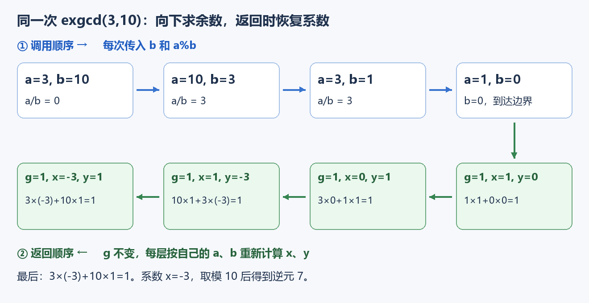
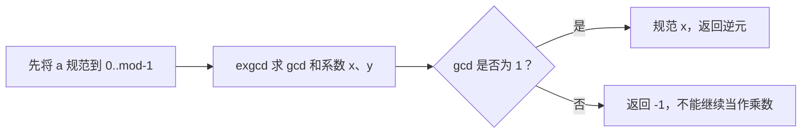

# 7.11 扩展欧几里得与一般模逆元

前置：[gcd 与辗转相除](01-gcd-lcm.md)、[同余](02-congruence-modulo.md)、[7.6 模逆元](06-modular-inverse-combinations.md)。

**扩展欧几里得：求出 gcd 的同时，找到它怎样由两个输入整数相乘再相加得到。** 本节先处理非负整数，再用它求一般模数下的逆元。

## 1. 问题引入：模数不是素数怎么办？

求 3 在模 10 下的逆元，可以逐个试乘数：

$$
3\times7=21\equiv1\pmod{10}.
$$

因此逆元是 7。但模数很大时，逐个试需要最多 $O(m)$ 次；[7.6 的费马小定理写法](06-modular-inverse-combinations.md)又要求模数是素数，不能直接套到 10 上。

换个表达：**乘积除以模数余 1，就是乘积与某个模数倍数相差 1。**

$$
ax\equiv1\pmod m
\quad\Longleftrightarrow\quad
ax+my=1\quad(x,y\text{ 为整数}).
$$

例如 $3\times(-3)+10\times1=1$。只要能求出这样的系数，就能取模得到逆元。

## 2. 先给代码：求系数，再取出逆元

```cpp
using ll = long long;

// a、b 非负且不超过 2e9。
// 返回 g = gcd(a,b)，并写入一组满足 a*x + b*y = g 的整数系数。
ll exgcd(ll a, ll b, ll& x, ll& y) {
    if (b == 0) {
        x = 1;
        y = 0;
        return a;
    }

    ll x1, y1;
    ll g = exgcd(b, a % b, x1, y1);

    x = y1;
    y = x1 - (a / b) * y1;
    return g;
}

// a 可为任意 ll；2 <= mod <= 2e9，不要求 mod 是素数。
// 返回 [0,mod) 中的逆元；不存在时返回 -1。
ll inv_general(ll a, ll mod) {
    a %= mod;
    if (a < 0) a += mod;

    ll x, y;
    if (exgcd(a, mod, x, y) != 1) return -1;

    x %= mod;
    if (x < 0) x += mod;
    return x;
}
```

**用途速记：** `exgcd(a,b,x,y)` 输入两个非负整数，返回 gcd，并把系数写进 `x、y`。`inv_general(a,mod)` 利用这些系数求逆元，模数可以是合数；返回 `-1` 表示不存在。

| 变量 | 表示什么 | 用在哪里 |
| --- | --- | --- |
| `a、b` | 当前这一层要求解的两个数 | 本层目标是 `a*x+b*y=g` |
| `g` | 两个数的 gcd | 每次递归返回时不变 |
| `x、y` | **本层**两个数对应的系数 | 引用参数，把结果交给调用者 |
| `x1、y1` | **下一层**返回的系数 | 对应的是 `b、a%b`，不能直接当成本层的系数 |
| `a/b` | 整数商 | 把余数换回 `a、b` 时使用 |
| `mod` | 求逆元时的模数 | 必须至少为 2；只有与 `a` 互质才存在逆元 |

代码中的 `x1、y1` 是局部变量，递归完成后才读取；引用参数不是让各层共享同一对系数。这里也不要求 `a>=b`：较小时第一轮商为 0，会自然交换到下一层。

## 3. 同一个例子：向下求余数，返回时算系数

调用 `exgcd(3,10,x,y)`。**上排从左向右是调用顺序，下排从右向左是返回顺序。**



先看最深层 `exgcd(1,0,...)`：

$$
1\times1+0\times0=1.
$$

所以直接返回 `g=1、x=1、y=0`。这解释了代码的边界，不需要继续递归。

接着逐层恢复各自的系数：

| 当前层 `(a,b)` | 下一层给回 `(x1,y1)` | 本层算出的 `(x,y)` | 对照本层目标 |
| --- | --- | --- | --- |
| `(3,1)` | `(1,0)` | `(0,1)` | $3\times0+1\times1=1$ |
| `(10,3)` | `(0,1)` | `(1,-3)` | $10\times1+3\times(-3)=1$ |
| `(3,10)` | `(1,-3)` | `(-3,1)` | $3\times(-3)+10\times1=1$ |

> **每层只负责把下一层的结果，换算成本层两个数的系数。** `g` 一路原样返回，`x、y` 则随着当前的 `a、b` 改变。

## 4. 两句系数更新是怎样推出来的？

对应代码：

```cpp
x = y1;
y = x1 - (a / b) * y1;
```

令

$$
q=\left\lfloor\frac{a}{b}\right\rfloor,\qquad r=a\bmod b,
$$

则

$$
a=qb+r,\qquad r=a-qb.
$$

递归调用是：

```cpp
g = exgcd(b, a % b, x1, y1);
```

也就是把参数从 \((a,b)\) 换成了 \((b,r)\)。按照 `exgcd(A, B, X, Y)` 的函数约定，它返回的 \(X,Y\) 满足

$$
A\cdot X+B\cdot Y=\gcd(A,B).
$$

把 \(A=b,\ B=r,\ X=x_1,\ Y=y_1\) 代进去，得到下一层满足的等式：

$$
b x_1+r y_1=\gcd(b,r).
$$

又因为

$$
\gcd(b,r)=\gcd(b,a\bmod b)=\gcd(a,b)=g,
$$

所以下一层求出的是：

$$
b x_1+r y_1=g.
$$

注意：这里的 \(x_1,y_1\) 不是当前层 \(a,b\) 的系数，而是下一层参数 \(b,r\) 的系数。

接下来把

$$
r=a-qb
$$

代回下一层的等式：

$$
b x_1+(a-qb)y_1=g.
$$

展开并合并同类项：

$$
b x_1+a y_1-qb y_1=g,
$$

$$
a y_1+b(x_1-qy_1)=g.
$$

而当前层需要的形式是：

$$
a x+b y=g.
$$

对比系数可得：

$$
\boxed{x=y_1,\qquad y=x_1-qy_1.}
$$

因为 \(q=a/b\)，所以代码写成：

```cpp
x = y1;
y = x1 - (a / b) * y1;
```

## 5. 为什么可以从系数得到逆元？

### 互质时：取第一个系数

`exgcd(a,mod,x,y)` 给出的等式为：

$$
ax+my=\gcd(a,m).
$$

当 gcd 为 1，对等式两边取模，$my$ 的余数为 0：

$$
ax\equiv1\pmod m.
$$

因此 `x` 就是一份逆元，但它可能为负，需要规范到 `[0,mod)`。

例子中的 `x=-3`，在模 10 下与 7 相同：

$$
-3\equiv7\pmod{10},\qquad3\times7\equiv1\pmod{10}.
$$

`x %= mod` 后若为负，再加一次 `mod` 即可。**先取余，再按需加一次；不能只对原始负系数随意加一次。**

### 不互质时：系数存在，逆元不存在

例如 `exgcd(6,10,...)` 可以得到：

$$
6\times2+10\times(-1)=2.
$$

它确实表示出了 gcd，但右边是 2，不是 1。任意 $6x+10y$ 都是偶数，不能等于 1，所以 6 在模 10 下没有逆元。



这同时说明了逆元存在条件的两个方向：**不互质时不可能凑出 1；互质时，算法就能实际给出凑出 1 的系数。**

## 6. 怎样选写法，有哪些边界？

| 要求 | 选用方式 | 检查条件 |
| --- | --- | --- |
| 只求 gcd | [普通欧几里得](01-gcd-lcm.md) | 不需要额外求系数 |
| 单个逆元，模数已知为素数 | 7.6 的 `inv_prime` | 排除 `a%mod==0` |
| 单个逆元，模数不保证为素数 | 本节 `inv_general` | 检查 gcd 是否为 1 |
| 把一般 gcd 表示成两数的线性组合 | 本节 `exgcd` | 输出的是一组系数，不保证非负或最小 |
| 组合数取合数模数 | **不能只替换逆元函数** | 阶乘分母可能与模数不互质，原公式仍可能失效 |

两种逆元方法都是对数时间；这里的主要收益是**取消素数要求**，不是把算法降到更低的复杂度。

- **负数输入：** `inv_general` 先规范，因此可以传负 `a`；裸 `exgcd` 按本节契约只收非负数。
- **零：** `exgcd(a,0)` 直接返回 `a、1、0`；约定 `exgcd(0,0)` 返回 `0、1、0`。但 `inv_general(0,mod)` 返回 `-1`。
- **引用参数：** 调用时为 `x、y` 提供两个不同的变量；不能把同一个变量同时当作两个输出。
- **数值范围：** 系数可能为负，用 `ll`。本实现限定裸输入不超过 $2\times10^9$，并不因参数类型是 `ll` 就承诺完整 64 位范围；扩大范围时需重新检查系数乘法的中间值。
- **边界与清理：** `mod>=2` 由调用者保证，不在函数里检测；函数没有全局状态，多组调用无需清理。

### 操作复杂度

令 $V=\max(a,b,2)$；以下按固定宽度整数的除法、乘法视为常数时间。

| 操作 | 时间 | 额外空间 | 原因 |
| --- | --- | --- | --- |
| `exgcd(a,b,x,y)` | $O(\log V)$ | $O(\log V)$ | 与辗转相除一样递归，每层再做常数次系数更新 |
| `inv_general(a,mod)` | $O(\log m)$ | $O(\log m)$ | 先规范到模数范围，只调用一次扩展欧几里得 |

例如模数接近 $10^9$ 时，枚举可能检查近十亿个乘数；辗转相除通常只需几十层。**不是每次都立刻减半，但至多两次取余就能让较小数至少减半**，因此是对数层数。

## 7. 典题与复盘

### P1082 同余方程：直接调用模板

[洛谷 P1082 — 同余方程](https://www.luogu.com.cn/problem/P1082)

题目要求 $ax\equiv1\pmod b$ 的最小正整数解，$2\le a,b\le2\times10^9$，保证有解。

#### 原实现

本题将开篇的 `inv_general` 简称为 `inv`，函数体不变；若保留开篇命名，将下面的调用写成 `inv_general(a, mod)` 即可。这里只整理排版。

```cpp
void solve() {
    ll a, mod;
    cin >> a >> mod;
    cout << inv(a, mod) << '\n';
}
```

**题目已经是单个逆元模型，直接读取参数、调用模板、输出返回值即可。** `mod` 对应题面的 $b$，无需再构造其他状态或修改扩展欧几里得。

题目保证有解，因此 gcd 为 1，模板不会返回 `-1`。模板将逆元规范到 `[0,mod)`，而 0 不可能满足余数为 1，所以结果实际位于 $1\ldots m-1$，正好是最小正整数解。

时间 $O(\log m)$，额外递归栈空间 $O(\log m)$，其中 $m=\texttt{mod}$。原实现已经简洁，无需另外给出改进版。

**复盘状态：** 已静态核对模型、函数命名和输出范围；本轮未编译或运行个人代码，平台结果未单独提供。

## 8. 自查与衔接

1. 下一层的 `x1、y1` 为什么不能直接作为本层的答案？
2. `exgcd` 能返回系数，为什么仍可能没有逆元？
3. 把 `inv_prime` 换成 `inv_general`，为什么不能自动解决合数模数下的阶乘组合数？

本节补齐 [7.6](06-modular-inverse-combinations.md)的单个逆元计算条件，不展开一般同余方程组、CRT 或合数模数组合数。

参考：[NPTEL：Extended Euclid](https://archive.nptel.ac.in/content/storage2/courses/106103015/module2/lec2/2.html)的递归系数关系。实现按本仓库的非负输入与数值范围独立整理，配题条件以洛谷原题为准。

[数学索引](README.md) · [逆元与扩展欧几里得模板](../../templates/07-math/modular-arithmetic/README.md)
