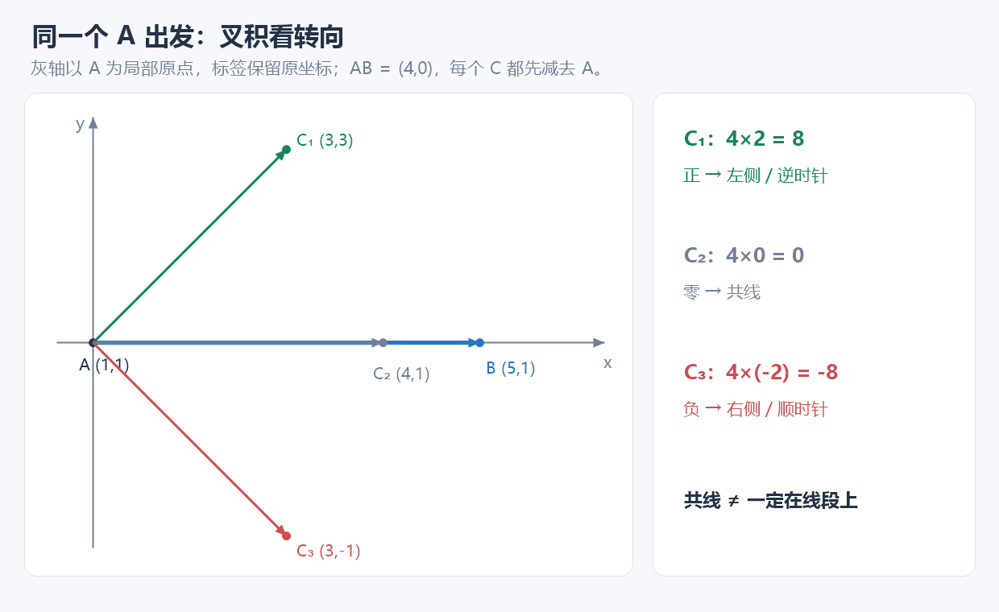
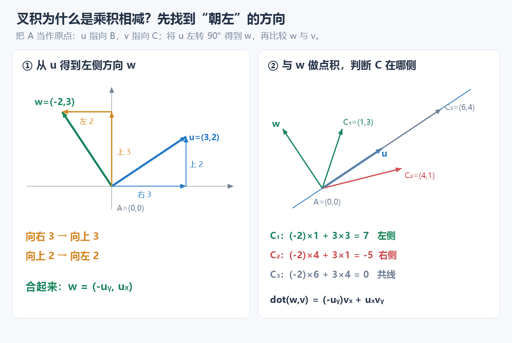
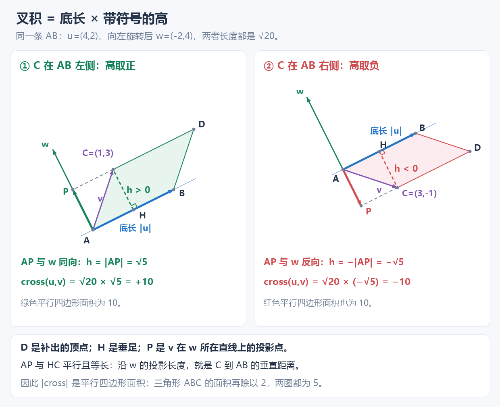
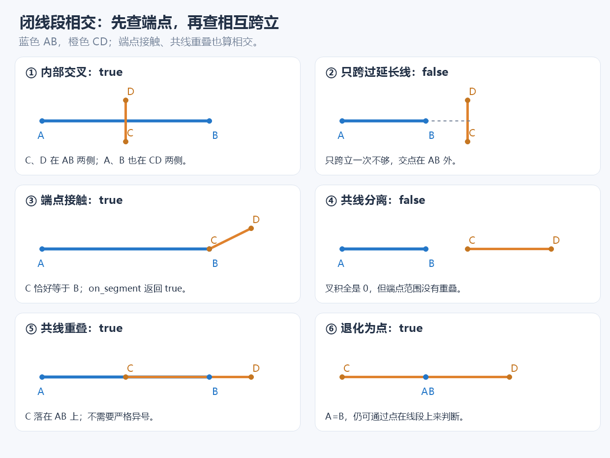
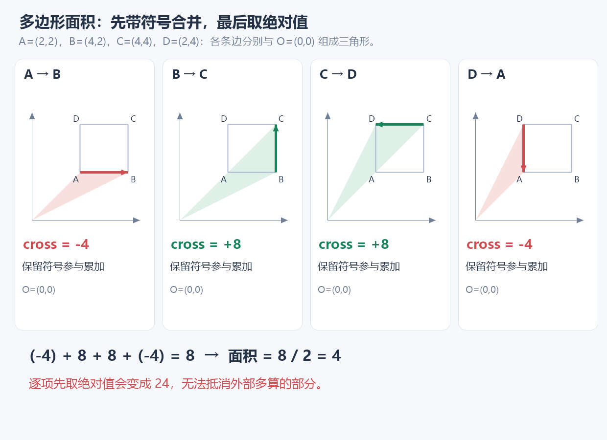
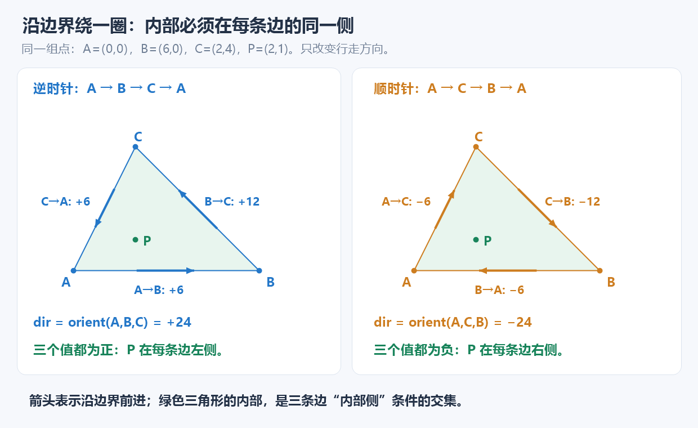
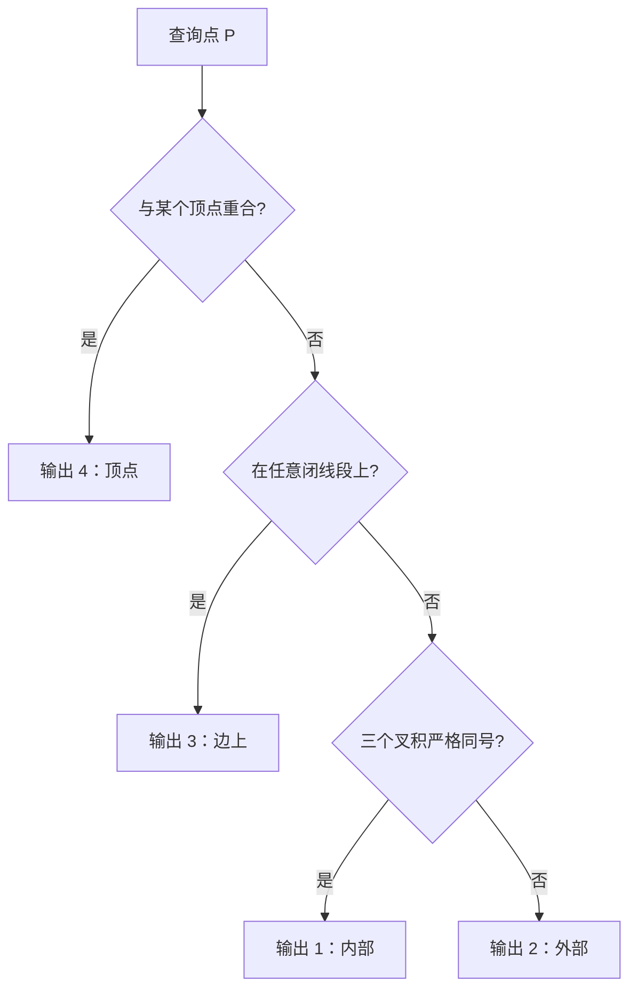

# 7.12 基础几何：把位置关系写成整数判定

前置：坐标、勾股定理，以及 [ll 与乘法溢出](../01-basic-problem-solving/01-complexity-analysis.md)。本节使用普通数学坐标系：**x 向右，y 向上**。

## 1. 问题引入：竖直线没有斜率，边界又怎么算？

已知 A=(2,1)、B=(2,5)，判断一个点与 AB 的关系。直接写斜率，会遇到分母为 0；改成浮点直线方程，还要处理等于 0 的误差。

而“在线上”还不够：P=(2,8) 与 A、B 共线，却不在线段 AB 上。

因此需要分别表达两件事：**方向是否一致，位置是否落在端点之间**。先用坐标差表示方向，再用乘加完成判定；整数输入不必先算角度或交点。

本节整理距离、点积／叉积、共线、闭线段相交与简单多边形面积；两题复盘再将方向判定组合成点与凸图形的位置判断。

## 2. 先给代码：一组可组合的基础操作

以下代码沿用 C++ 基础框架中的标准库；直接使用可包含[竞赛头文件](../../templates/07-math/geometry/geometry_int.hpp)。所有输入点的坐标绝对值不超过 $10^6$，多边形顶点不超过 $2\times10^5$；范围依据见第 8 节。

```cpp
namespace geom {
using ll = long long;

struct Point {
    ll x, y;

    // 向量减法：a - b。
    Point operator-(Point b) const {
        return {x - b.x, y - b.y};
    }
};

// 点积：判断方向关系、投影及垂直关系等。
ll dot(Point a, Point b) {
    return a.x * b.x + a.y * b.y;
}

// 叉积：判断两个向量的旋转方向及平行关系。
ll cross(Point a, Point b) {
    return a.x * b.y - a.y * b.x;
}

// 符号函数：返回 -1、0、1。
int sgn(ll x) {
    return (x > 0) - (x < 0);
}

// 三点方向关系：判断 c 相对于有向直线 a -> b 的位置。
// >0：左侧；<0：右侧；=0：三点共线。
ll orient(Point a, Point b, Point c) {
    return cross(b - a, c - a);
}

// 两点距离的平方，比较远近时不必开方。
ll dist2(Point a, Point b) {
    Point d = b - a;
    return dot(d, d);
}

// 两点欧几里得距离。
double distance(Point a, Point b) {
    return hypot((double)(a.x - b.x), (double)(a.y - b.y));
}

// 判断点 p 是否在线段 ab 上（包含端点）。
// 先判断共线，再判断 p 是否落在两个坐标的取值范围内。
bool on_segment(Point p, Point a, Point b) {
    return orient(a, b, p) == 0
        && min(a.x, b.x) <= p.x && p.x <= max(a.x, b.x)
        && min(a.y, b.y) <= p.y && p.y <= max(a.y, b.y);
}

// 判断两条闭线段 ab、cd 是否相交。
// 包含端点接触、共线重叠及退化为点的情况。
bool segments_intersect(Point a, Point b, Point c, Point d) {
    // 分别判断对方端点相对于本线段所在直线的方向。
    ll c1 = orient(a, b, c), c2 = orient(a, b, d);
    ll c3 = orient(c, d, a), c4 = orient(c, d, b);

    // 先处理边界情况：共线接触、重叠及点在线段上。
    if (c1 == 0 && on_segment(c, a, b)) return true;
    if (c2 == 0 && on_segment(d, a, b)) return true;
    if (c3 == 0 && on_segment(a, c, d)) return true;
    if (c4 == 0 && on_segment(b, c, d)) return true;

    // 严格跨立：两条线段的端点分别位于对方直线两侧。
    return sgn(c1) * sgn(c2) < 0 && sgn(c3) * sgn(c4) < 0;
}

// 非退化凸多边形，顶点沿边界有序、不重复；border 控制是否包含边界。
bool point_in_convex(const vector<Point>& poly, Point p, bool border = true) {
    int n = (int)poly.size(), side = 0;
    if (n < 3) return false;

    for (int i = 0; i < n; ++i) {
        // 判断 p 相对于当前有向边的位置：左侧 1，右侧 -1，共线 0。
        int s = sgn(orient(poly[i], poly[(i + 1) % n], p));

        // 共线：允许边界则跳过，禁止边界则直接排除。
        if (!s) {
            if (!border) return false;
            continue;
        }

        // side 记录此前遇到的第一个非零符号。
        // 凸多边形内部点必须位于所有边的同一侧。
        // 当前符号与之前不一致，说明 p 在多边形外部。
        if (side && s != side) return false;

        // 初始化或更新当前记录的方向符号。
        side = s;
    }

    // 非退化凸多边形下，未提前返回则必然存在非零叉积。
    // 此处保留 side != 0，作为退化输入的防御性检查。
    return side != 0;
}

// 简单多边形：顶点按边界顺序给出。
// 返回非负的两倍面积，使用鞋带公式。
ll polygon_area2(const vector<Point>& p) {
    int n = (int)p.size();
    if (n < 3) return 0;

    ll sum = 0;

    // 首尾相连，累加相邻顶点的叉积。
    for (int i = 0; i < n; ++i)
        sum += cross(p[i], p[(i + 1) % n]);

    // 叉积和的绝对值等于多边形面积的两倍。
    return sum >= 0 ? sum : -sum;
}
} // namespace geom
```

**用途速记：** 输入点的整数坐标，可以得到距离平方、左右方向、点在线段上／两线段相交的判断，凸多边形内点判断，以及多边形的两倍面积。判定依靠坐标差的点积、叉积和范围比较；只有真正需要距离时才开方。

| 名称 | 表示什么 | 后续用在哪里 |
| --- | --- | --- |
| `Point {x,y}` | 一个点；相减后也可表示向量 | 统一存位置与位移 |
| `b-a` | 从 a 走到 b 的位移 | 把参考点移到原点 |
| `dot(a,b)` | 两个向量的点积 | 长度平方、垂直与夹角类型 |
| `cross(a,b)` | 两个向量的二维叉积值 | 方向、有向面积 |
| `orient(a,b,c)` | 从 a→b 看 c 在哪侧 | 点的位置与相交判断 |
| `point_in_convex(poly,p,border)` | 按所有有向边的同侧条件判断内点，默认含边界 | 只适用于非退化凸多边形，顶点已沿边界排列 |
| `c1..c4` | 两端点分别相对另一条直线的位置 | 两个方向都要检查 |
| `p[i]` | 按边界排列的第 i 个顶点，0-based | 相邻顶点组成一条边 |

使用时可写 `geom::Point`、`geom::orient(...)`；或在局部采用 `using namespace geom;`。操作不修改输入，没有需要跨测试清理的缓存。

## 3. 点变向量：先选起点，再看位移

```cpp
Point u = b - a;
Point v = c - a;
ll side = cross(u, v);
```

例如 A=(1,1)、B=(5,1)、C=(3,3)：

$$
B-A=(4,0),\qquad C-A=(2,2).
$$

不是把 B、C 的绝对坐标直接比较，而是**从同一个 A 出发，看两条方向**。整体平移不改变这两个差，也不改变判断结果。

距离由勾股定理得到：

$$
AB^2=(B_x-A_x)^2+(B_y-A_y)^2=\mathrm{dot}(B-A,B-A).
$$

比较远近只需 `dist2`；输出实际长度再用 `distance`。例如 (0,0) 到 (3,4)，平方为 25，长度为 5。

## 4. 点积看夹角，叉积看转向

### 点积：只判断夹角，不必算出角度

$$
\mathrm{dot}(u,v)=u_xv_x+u_yv_y=|u||v|\cos\theta.
$$

对于**两个非零向量**，点积为正表示夹角小于 90°，为 0 表示垂直，为负表示夹角大于 90°。零向量与任何向量点积为 0，但它没有可定义的夹角，不能据此认定形成直角。

例如 (3,0) 与 (0,4) 的点积为 0；与 (2,1) 的点积为 6；与 (-2,1) 的点积为 -6。

### 叉积：从第一条方向转向第二条方向



**① 水平向右时，先看高度差。**

图中 A=(1,1)、B=(5,1)。把 A 当作共同起点：

$$
u=B-A=(4,0),\qquad v=C-A=(C_x-1,C_y-1).
$$

这里 u 是前进方向，v 是从 A 走到 C 的位移。由于 AB 水平向右，C 的左右位置只取决于高度差：

$$
C_y-1\gt0\Rightarrow\text{左侧},\qquad
C_y-1\lt0\Rightarrow\text{右侧}.
$$

高度差为 0 就共线。再乘上 AB 的正长度 4，符号仍不改变，于是 $4(C_y-1)$ 也能判断左右。**现在要解决的是：AB 倾斜后，“朝左”的方向怎样找？**

**② 把前进方向向左转 90°，得到“朝左”的方向。**

先看具体例子，原方向是向右 3、向上 2：

$$
u=(3,2).
$$

整体向左转 90°，其中“向右 3”变成“向上 3”，“向上 2”变成“向左 2”。合起来得到：

$$
w=(-2,3).
$$

w 与 u 垂直，长度相同，而且始终指向 u 的左侧。



同样地，任意前进方向的两个分量各自转 90°：

$$
(u_x,0)\longrightarrow(0,u_x),\qquad
(0,u_y)\longrightarrow(-u_y,0).
$$

把转完的两个分量相加，就得到通用的“朝左”向量：

$$
\boxed{w=(-u_y,u_x)}.
$$

**③ 用点积，判断 C 是否偏向这个左侧方向。**

上一段已经说明：两个非零向量的夹角小于 90°时点积为正，大于 90°时为负。现在拿“朝左”的 w 与“走到 C”的 v 比较：

| C 相对 AB 的位置 | v 与 w 的关系 | 点积 |
| --- | --- | --- |
| 左侧 | 向左的分量为正，夹角小于 90° | 正 |
| 右侧 | 向左的分量为负，夹角大于 90° | 负 |
| 在 AB 直线上 | v 垂直于 w，或 C 就是 A | 0 |

把 $w=(-u_y,u_x)$ 代入**已经学过的点积公式**：

$$
\mathrm{dot}(w,v)=(-u_y)v_x+u_xv_y.
$$

调换两项的书写顺序：

$$
\mathrm{dot}(w,v)=u_xv_y-u_yv_x.
$$

这就是代码里叉积的“乘积相减”：**先构造左侧方向，再做点积，展开后恰好得到这个式子。**

$$
\boxed{\mathrm{cross}(u,v)=\mathrm{dot}(w,v)=u_xv_y-u_yv_x}.
$$

图右仍用 u=(3,2)、w=(-2,3)。C 在 (1,3) 时得到 7，在 (4,1) 时得到 -5，在 (6,4) 时得到 0，分别对应左侧、右侧和共线。

**④ 换回 A、B、C，就得到 orient 的代码。**

$$
u=(B_x-A_x,B_y-A_y),\qquad
v=(C_x-A_x,C_y-A_y).
$$

把这两个坐标差放入刚推出来的叉积式：

$$
\mathrm{orient}(A,B,C)
=(B_x-A_x)(C_y-A_y)-(B_y-A_y)(C_x-A_x).
$$

回到开头水平向右的例子，u=(4,0)，左侧方向就是 w=(0,4)：

$$
\mathrm{dot}(w,v)=0(C_x-1)+4(C_y-1)=4(C_y-1).
$$

因此水平、倾斜、竖直都在使用同一个判准：**沿左侧方向的分量为正，点就在左侧。** 不需要求斜率，也没有除以 0 的问题。

**⑤ 为什么它又等于“带方向的面积”？**



图中 H 是 C 到 AB 的垂足，P 是 v 在 w 所在直线上的投影点。**AP 与 HC 平行且等长，所以沿 w 的投影长度，就是 C 到 AB 的垂直距离。** AP 与 w 同向时记正，反向时记负。

设 h 是 C 到 AB 所在直线的**带符号垂直距离**：左侧为正，右侧为负。w 垂直于 AB，v 沿 w 的带符号投影长度正好是 h。

点积等于“一个向量的长度 × 另一个向量沿它的带符号投影”：

$$
\mathrm{dot}(w,v)=|w|h.
$$

w 是把 u 旋转得到的，长度没变，所以：

$$
\mathrm{cross}(u,v)=|u|h.
$$

这正是“底长 × 带符号的高”。取绝对值就是 u、v 围成的平行四边形面积，保留符号则同时记录左右；三角形面积再除以 2。

**边界约定：** 以上以 A≠B 为前提，才能确定前进方向。A=B 时 u、w 都为零，函数仍返回 0，但不存在一条确定的 AB 直线；交换 A、B 会翻转符号。屏幕坐标若 y 向下，视觉左右也会反过来，本节始终约定 y 向上。

## 5. 在线段上：共线之外，还要在范围内

```cpp
orient(a, b, p) == 0
&& min(a.x, b.x) <= p.x && p.x <= max(a.x, b.x)
&& min(a.y, b.y) <= p.y && p.y <= max(a.y, b.y)
```

A=(1,1)、B=(5,1) 时，P=(3,1) 在线段上，Q=(7,1) 只在延长线上。两者的叉积均为 0，**端点范围才把 Q 排除**。

$$
\text{在闭线段 AB 上}
\iff\text{共线，且 x、y 都落在各自端点范围内}.
$$

同时检查两坐标，竖直、水平和倾斜都能统一处理。A=B 时，两项范围都退化为单个坐标，只有 P=A 才返回 true。

## 6. 两线段相交：先边界，再相互跨立



**这里问的是闭线段是否有公共点**，端点接触和共线重叠都算相交。

先看图中的三种边界：端点碰到另一条线段、共线部分重叠、一条线段退化为点。只要存在一个端点落在另一条线段上，就已相交，因此代码先用四次 `on_segment` 返回。

剩下的情况没有边界接触，只可能在内部交叉：

$$
\mathrm{sgn}(c1)\mathrm{sgn}(c2)\lt0.
$$

C、D 在 AB 直线的两侧，意味着 CD 跨过 AB 所在的直线。

$$
\mathrm{sgn}(c3)\mathrm{sgn}(c4)\lt0.
$$

A、B 也必须在 CD 直线的两侧，才保证交点同时落在两条**有限线段**内。图右上只满足第一项，交点在 AB 的延长线上，所以不能只检查一次跨立。

**为什么这就足够？** 无边界接触时，端点在一条直线两侧，沿线段移动必会穿过该直线；两条不平行直线只有一个交点。相互跨立保证这个交点在双方线段内部。若共线，则没有严格异号，是否重叠已由前面的端点检查处理。

不要直接乘 `c1*c2` 判断异号：叉积本身可能很大，两个结果再相乘会溢出。先压成 -1、0、1，只乘符号。

## 7. 面积：叉积还记录了“带方向的面积”

三角形 ABC：

$$
2S_{ABC}=|\mathrm{orient}(A,B,C)|.
$$

例如 A=(1,1)、B=(5,1)、C=(3,3)，叉积为 8，三角形面积为 4。返回两倍面积，可以保留整数坐标下的半整数结果，例如 1/2 不会被整除截成 0。

多边形把每条边与原点组成一个有向三角形，再合并：



图中正方形顶点依次为 (2,2)、(4,2)、(4,4)、(2,4)。对应四条边的叉积：

$$
-4+8+8-4=8,\qquad S=8/2=4.
$$

不能逐项取绝对值，否则得到 24，多算了图形外的部分。**先保留方向求和，最后对总和取绝对值**：

$$
2S=\left|\sum_{i=0}^{n-1}\mathrm{cross}(p_i,p_{(i+1)\bmod n})\right|.
$$

沿相邻边拼接时，外部多算部分方向相反而抵消；顺时针与逆时针只影响整体符号。这适用于按边界给出的**简单多边形**，包括凹多边形。顶点若乱序，或边界自交，不能把函数结果当成通常的图形面积。

数组下标为 0..n-1，`(i+1)%n` 自动连回第一个点，不必额外复制末点；少于 3 点返回 0。需要面积时用 `polygon_area2(p)/2.0`；若很大且要求精确输出 .0/.5，可根据整数结果的奇偶性输出。

## 8. 数值边界：整数精确，也要防溢出

本模板统一约定**点坐标绝对值不超过 $10^6$，顶点数不超过 $2\times10^5$**。设坐标界为 M，数值量级为：

$$
|\Delta x|,|\Delta y|\le2M,
\qquad |\mathrm{dot}|,|\mathrm{cross}|,AB^2\le8M^2.
$$

坐标差参与两次乘法与加减，不能只按输入坐标的大小选类型。这里单次运算不超过 $8\times10^{12}$，应使用 ll；字段本身就是 ll，乘法也按 ll 执行。

多边形每项使用原始坐标，其绝对值不超过 $2M^2$。即使按“不考虑抵消”的保守界：

$$
\left|\text{任意部分和}\right|\le2nM^2\le4\times10^{17}\lt9.22\times10^{18}.
$$

所以当前契约中总和也安全。坐标或点数扩大后，需要重新检查**中间乘积和部分和**；不能只把最终结果变量改成 ll。

| 场景 | 推荐处理 |
| --- | --- |
| 整数坐标，判断共线、方向、相交 | 在范围内直接整数比较，无需 eps |
| 只比较距离大小 | 比距离平方，避免开方 |
| 输出实际距离 | double 与 `hypot`，按题意控制小数位 |
| 输入本身是实数 | 另设浮点类型与误差约定，不能直接套本整数板子 |

浮点误差阈值要结合量级与题目精度，不能把“加一个固定 eps”当成所有几何问题的通解。

## 9. 操作复杂度与使用顺序

| 操作 | 时间 | 额外空间 | 原因 |
| --- | --- | --- | --- |
| 点积、叉积、方向、距离 | O(1) | O(1) | 固定次数算术运算 |
| 点在线段上、两线段相交 | O(1) | O(1) | 固定几个叉积与范围判断 |
| n 边形面积 | O(n) | O(1) | 每条边累加一次；输入另占 O(n) |
| 点与 n 边凸多边形的位置 | O(n) | O(1) | 每条边判断一次；Q 次查询合计 O(Qn) |
| 检查 n 条线段的所有两两关系 | O(n²) | O(1) | 单次判断快，不代表可免除枚举 |

例如 1000 条线段有 $1000\times999/2=499500$ 对；100000 条约有 $5\times10^9$ 对。基础相交函数只优化每次判定，不负责更大规模的几何搜索。

选操作时先问：**要长度、方向、边界还是面积？** 再问是否包含端点、点是否退化、输入是否有序、整数范围是否安全。本节不展开求交点坐标、任意多边形内点、凸包或扫描线。

## 10. 典题与复盘

两题共用开头的 `Point`、`orient`、`on_segment`；以下保留个人实现的逻辑、类型和原有注释，仅统一排版。**本轮只作静态复盘，不编译／运行／对拍个人代码；平台结果未单独记录。**

| 题目 | 本题的分类目标 | 复杂度 |
| --- | --- | --- |
| [P1355 神秘大三角](https://www.luogu.com.cn/problem/P1355) | 内部、外部、边上、顶点，四类互斥 | O(1) 时间、O(1) 额外空间 |
| [CF1030B Vasya and Cornfield](https://codeforces.com/problemset/problem/1030/B) | 矩形内部或边界输出 YES，否则 NO | 每次 O(1)，m 次合计 O(m)；额外空间 O(1) |

### P1355：先拆边界，再判断所有边的同侧

```cpp
void solve() {
    Point a, b, c, p;
    char ch;

    auto read = [&](Point& p) {
        cin >> ch >> p.x >> ch >> p.y >> ch;
    };

    read(a);
    read(b);
    read(c);
    read(p);

    // 1. 判断是否与三角形顶点重合。
    if ((p.x == a.x && p.y == a.y) ||
        (p.x == b.x && p.y == b.y) ||
        (p.x == c.x && p.y == c.y)) {
        cout << 4 << '\n';
        return;
    }

    // 2. 判断是否在线段边界上。
    if (on_segment(p, a, b) ||
        on_segment(p, b, c) ||
        on_segment(p, c, a)) {
        cout << 3 << '\n';
        return;
    }

    // 3. 判断是否位于三条有向边的同一侧。
    ll s1 = orient(a, b, p);
    ll s2 = orient(b, c, p);
    ll s3 = orient(c, a, p);

    bool inside = (s1 > 0 && s2 > 0 && s3 > 0) ||
                  (s1 < 0 && s2 < 0 && s3 < 0);

    cout << (inside ? 1 : 2) << '\n';
}
```

**用途速记：** 输入三个三角形顶点和查询点，先用坐标相等与闭线段判断处理特殊位置，再看查询点是否落在所有边的内部一侧。对应输出 4、3、1、2。

**① 为什么三个符号要一起看？**

只在 AB 左侧，仍可能跑到 BC 的外侧。必须沿 A→B→C→A 绕一圈，检查三条边。



图左按 A→B→C 排列，令：

$$
dir=\mathrm{orient}(A,B,C)=24\gt0.
$$

这是逆时针排列，内部在每条边左侧。图右反过来沿 A→C→B 排列，dir 为负，内部就都在右侧。

对查询点 P，沿边界依次计算：

$$
\begin{aligned}
s_1&=\mathrm{orient}(A,B,P),\\
s_2&=\mathrm{orient}(B,C,P),\\
s_3&=\mathrm{orient}(C,A,P).
\end{aligned}
$$

严格内部要求每个符号都与顶点方向一致：

$$
\text{严格内部}\iff
\begin{cases}
s_1,s_2,s_3\gt0,&dir\gt0,\\
s_1,s_2,s_3\lt0,&dir\lt0.
\end{cases}
$$

**原代码同时接受“全正”或“全负”，因此不必额外计算 dir。** 三角形的顶点排列只有顺、逆两个方向，两种都已涵盖；这里讨论的是非退化三角形。

**② 分类有包含关系，先判断更具体的一类。**



顶点本身也在线段上，所以若先判线段，就会把顶点误分为 3。**先顶点、再边界、最后严格内部**，每次返回后，剩下的情况更单纯。

叉积为 0 只说明在某条边的直线上。例如图中的三角形取 Q=(8,0)，Q 与 AB 共线，却在 AB 延长线上；`on_segment` 不通过，严格同号也不通过，最终是外部。

**③ 固定标点输入：把分隔符读进 char，坐标直接读进字段。**

```cpp
auto read = [&](Point& p) {
    cin >> ch >> p.x >> ch >> p.y >> ch;
};
```

| 输入部分 | 读到哪里 | 作用 |
| --- | --- | --- |
| `(` | `ch` | 消耗左括号 |
| x | `p.x` | 保存横坐标 |
| `,` | `ch` | 消耗逗号 |
| y | `p.y` | 保存纵坐标 |
| `)` | `ch` | 消耗右括号 |

`Point&` 让 lambda 直接填写传入的点，`[&]` 使它能够复用外层的 `ch`。同一个 char 被覆盖即可，不需要保留标点；格式化读取自动跳过空白。**这依赖题目保证 `(x,y)` 形式，并不负责校验标点内容。**

### CF1030B：同一模型从三条边推广到四条边

```cpp
void solve() {
    int n, d, m;
    cin >> n >> d >> m;

    Point A{0, d}, B{d, 0}, C{n, n - d}, D{n - d, n};

    for (int i = 0; i < m; ++i) {
        int x, y;
        cin >> x >> y;
        Point p{x, y};

        if (on_segment(p, A, B) || on_segment(p, B, C) ||
            on_segment(p, C, D) || on_segment(p, D, A)) {
            cout << "YES\n";
            continue;
        }

        int s1 = orient(A, B, p);
        int s2 = orient(B, C, p);
        int s3 = orient(C, D, p);
        int s4 = orient(D, A, p);

        bool inside = (s1 > 0 && s2 > 0 && s3 > 0 && s4 > 0) ||
                      (s1 < 0 && s2 < 0 && s3 < 0 && s4 < 0);

        cout << (inside ? "YES\n" : "NO\n");
    }
}
```

**用途速记：** 按题目给出的顺序构造四个顶点，每个查询先接纳边界，再用四个叉积的严格同号判断内部。与上一题相比，只是多检查一条边，输出目标也改为“内部或边界”。

**顶点顺序是模型的一部分。** A→B→C→D→A 必须沿矩形边界连接，不能随意换成 A→C→B→D；乱序会把对角线当成边。

当前排列下：

$$
B-A=(d,-d),\qquad C-A=(n,n-2d).
$$

代入方向式：

$$
\mathrm{orient}(A,B,C)=d(n-2d)+dn=2d(n-d)\gt0.
$$

由于原题保证 $0\lt d\lt n$，这是非退化的逆时针凸矩形，内部在每条边左侧。原代码保留全负分支，也能兼容整体反向排列。

本题坐标在 0..n，且 $n\le100$，所以单次叉积绝对值至多 $2n^2\le20000$；**这份个人代码用 int 接收是安全的。** 通用坐标界更大时，应保留 ll，或先用 `sgn(orient(...))` 压成 -1／0／1，不能直接照搬 int。

### 两题共同的识别与通用接口

**位置关系 → 看点在每条有向边哪侧 → 结合凸形的边界顺序 → 合并所有半平面条件。** 完整的识别、成立原因和不适用情形，独立整理为[凸图形同侧判定范式](../../patterns/07-math/convex-halfplanes.md)。

只需要“是否在凸图形内”的布尔结果时，开头的通用函数可直接复用：

```cpp
vector<Point> poly{a, b, c};
bool with_border = point_in_convex(poly, p);        // 内部或边界。
bool strict = point_in_convex(poly, p, false);      // 只接纳严格内部。
```

函数中的 `side` 保存目前见过的非零符号；出现反号就排除。`border=true` 时暂时跳过 0，最终由全部边约束共同确定是否位于图形内；`border=false` 时见到 0 就不能是严格内部。**单条边为 0 不能单独判定在边界上**；前者依赖整个非退化凸多边形的半平面交集。四分类题仍保留顶点／线段检查，布尔函数不替代输出类别。

输入须是**至少 3 个顶点、面积非零的凸多边形，顶点按边界顺序排列且不重复**；允许相邻边共线，不负责检验凸性。两题已静态复盘，不因此记录平台 AC 或已经掌握。

## 11. 自查与衔接

1. 叉积为 0，为何仍不能确定点在线段上？
2. 为什么两线段必须相互跨立，并单独处理共线边界？
3. 为什么多边形面积不能对每条边的叉积先取绝对值？

复用的思考是：**先把位置关系翻译成可计算的条件，再区分严格关系与边界；只需判定时，尽量不先求角度或交点。** 两题中可迁移的“凸形内部是各边内部半平面的交集”，见[凸图形同侧判定范式](../../patterns/07-math/convex-halfplanes.md)；凹多边形不能直接套用。

原理核对：[cp-algorithms：点积与叉积](https://cp-algorithms.com/geometry/basic-geometry.html)、[线段相交](https://cp-algorithms.com/geometry/check-segments-intersection.html)、[简单多边形面积](https://cp-algorithms.com/geometry/area-of-simple-polygon.html)。代码与图按本节整数契约自行整理，未照搬外部实现。

[本章索引](README.md) · [几何模板](../../templates/07-math/geometry/README.md) · [下一单元：概率与期望](13-probability-expectation.md)
