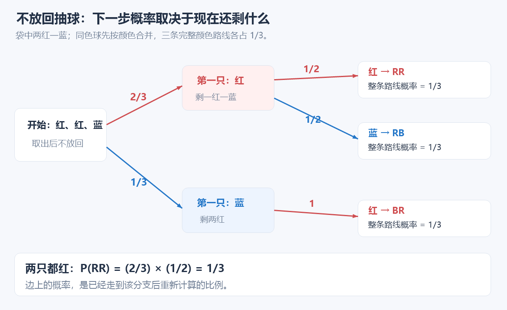
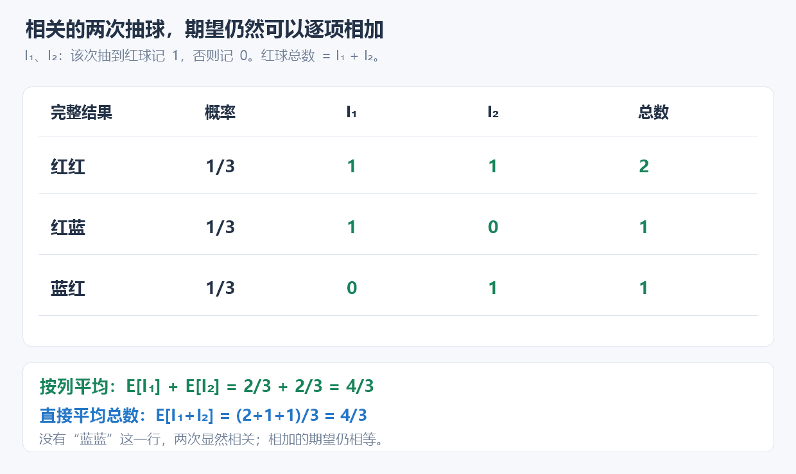
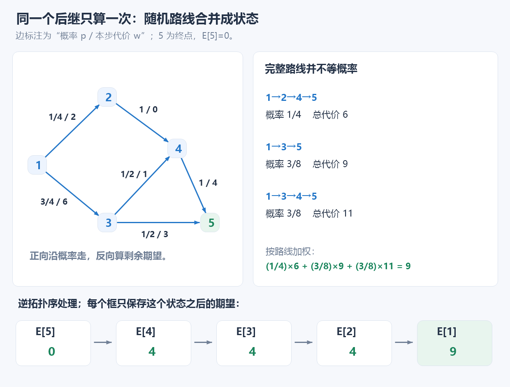
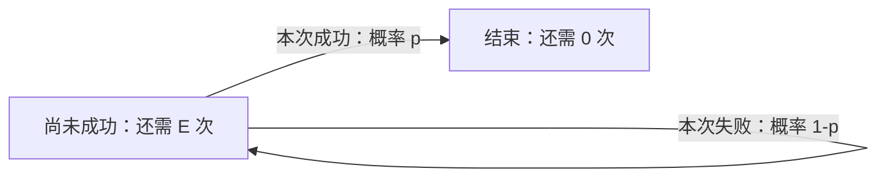
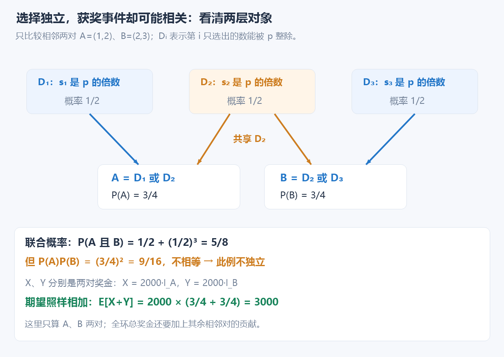

# 7.13 基础概率与期望：按概率加权，再按状态递推

前置：[基础计数](05-basic-counting.md)、[DP 状态与转移](../05-dynamic-programming/01-dp-basics.md)、[拓扑排序](../06-graph-and-tree/05-topological-sort.md)。本节只讨论离散结果、有限期望与简单状态模型。

**概率 P(A)** 表示事件 A 发生的可能程度，取值在 0..1；**随机变量 X** 给每种结果一个数值；**期望 E[X]** 则按这些结果的概率求加权平均。

## 1. 原来的瓶颈：每条随机路线都枚举一遍？

每走到一个岔路口，随机选择下一条边，并付出该边的代价。现在问：到结束时，平均会花多少？

枚举所有完整路线可以计算，但分支不断组合，路线数可能随层数指数增长。重复模拟也能估计，却存在随机误差。

观察到：**如果不同路线到达同一个状态后，剩余过程完全相同，就可以复用该状态的期望剩余代价。**

于是定义状态：
$$
E[u]=\text{从节点 }u\text{ 出发到结束的期望代价}
$$
对于每条可能的下一步，将「边的代价 + 后继状态的期望代价」按转移概率加权求和。

由于状态之间构成 DAG，可以利用拓扑排序确定依赖顺序，逆拓扑序递推计算。

**概率不需要让程序随机执行，而是作为 DP 转移中的权重。**

## 2. 先给代码：DAG 上的期望剩余代价

本实现复用[已有的 topo_sort](../../templates/06-graph-and-tree/topological-sort/topological_sort.hpp)，不重写拓扑算法；默认使用竞赛框架的标准库。可直接包含[配套头文件](../../templates/07-math/probability-expectation/dag_expectation.hpp)。

**输入约定：** 图为 1-based；每个非终点给出全部下一步，概率非负且总和为 1。没有出边就停止，剩余代价为 0。边代价非负、有限；状态必须保留决定后续概率和代价所需的全部信息。

```cpp
struct ProbEdge {
    int v;              // 后继节点
    double cost, p;     // 转移代价、转移概率
};

// 1-based DAG；无出边的点为终点，期望剩余代价为 0。
// 每个非终点的出边概率非负且总和为 1。
// 返回每个点出发的期望剩余代价；存在环或 n < 1 即不存在有效点时返回空数组。
vector<double> dag_expected_cost(const vector<vector<ProbEdge>>& g) {
    int n = (int)g.size() - 1;
    if (n < 1) return {};

    // 提取邻接关系，供已有的拓扑排序函数使用。
    // 只保留终点编号，边的代价和概率仍由 g 保存。
    vector<vector<int>> to(n + 1);
    for (int u = 1; u <= n; ++u)
        for (const auto& e : g[u])
            to[u].push_back(e.v);

    vector<int> order;
    if (!topo_sort(to, order)) return {};

    vector<double> ex(n + 1, 0.0);

    // ex[u] 依赖所有后继的期望，因此逆拓扑序计算。
    for (int i = n - 1; i >= 0; --i) {
        int u = order[i];

        // E[u] = Σ p(u,v) * (cost(u,v) + E[v])
        for (const auto& e : g[u])
            ex[u] += e.p * (e.cost + ex[e.v]);
    }

    return ex;
}
```

**用途速记：** 已知无环状态图、每条转移的概率和代价，返回从各状态出发直到任一终点的期望剩余代价。每个点把各分支的“本步代价＋后续期望”按概率加权；先算后继，再算当前点。

| 变量 | 表示什么 | 为什么需要 |
| --- | --- | --- |
| `g[u]` | 到达 u 后可以采取的全部下一步 | 一轮选择的完整分布 |
| `e.v` | 这一步到达的状态 | 查后续结果 |
| `e.p` | 已在 u 的条件下，选择本条边的概率 | 不是从最初起点到达这条边的总概率 |
| `e.cost` | 本条边产生的代价 | 属于这一分支，要放在括号内加权 |
| `to` | 只存终点编号的依赖图 | 复用 topo_sort；不丢掉 g 的概率与代价 |
| `order` | 原图的完整拓扑序，长度 n | 逆序保证后继先完成 |
| `ex[u]` | 从 u 出发，到结束还要付出的期望代价 | 可以大于 1，不是概率 |

### p 从哪里来：先读随机规则，再填入边

`e.p` 回答的是：**已经站在 u，这一步选择本条边的概率是多少？** 这个数由题目规定的随机选择规则确定；拓扑排序只安排先后，DP 使用已经确定的 p 计算期望。

| 题目怎样描述 | p 怎样得到 |
| --- | --- |
| 等概率随机选择一条出边 | 有 k 条出边，每条 p=1/k |
| 直接给出各条边的概率，例如 0.2、0.3、0.5 | 直接读入并存到 e.p |
| 给出随机规则，例如按权重选择、掷骰子或抽球 | 先按该规则推导每个分支的概率，再存到 e.p |

**只有明确说“等概率选择一条出边”，才能按出度取倒数。** 对节点 u，可写：

```cpp
for (auto& e : g[u])
    e.p = 1.0 / g[u].size();
```

例如有 3 条出边，每条就是 1/3。`1.0` 保证实数除法；终点没有出边，不需要设置概率，循环也不会执行。

若明确规定按非负的**选择权重** q 选边，则要先归一化。记 qₑ 为某条边的选择权重，全部出边权重之和须大于 0：

$$
p_e=\frac{q_e}{\sum_{f\in g[u]}q_f}.
$$

例如权重为 2、3、5，就得到概率 0.2、0.3、0.5。**选择权重与本步代价 e.cost 是不同信息**；不能因为输入有边长，就自行按边长分配概率，除非题目明确这样规定。

对掷骰子、抽球等规则，先确定基本结果是否等可能，以及当前状态下还剩哪些选择；不是简单地数几条出边就一定能得到概率。

> **随机规则决定 p → 检查同一非终点的全部出边概率非负、总和为 1 → DP 按这些权重汇总本步代价与后续期望。**

返回数组长度为 n+1，`ex[0]` 不使用，真正的答案由题目指定起点决定。**无出边状态的 0 是已完成的合法答案，不是“尚未计算”**；有环返回空数组，不能把一部分结果继续输出。

下面先把代码中“概率加权”的含义拆清，再回到图上执行。

## 3. 概率怎样加、怎样乘？

有限个**等可能基本结果**中，事件 A 所占的比例为：

$$
P(A)=\frac{|A|}{|\Omega|}.
$$

例如两次独立公平抛硬币，H 表示正面、T 表示反面，HH、HT、TH、TT 各占 1/4；“正面个数为 0、1、2”却不是三个等概率结果。

“或者”用并集，“并且”用交集；[容斥](07-inclusion-exclusion.md)同样适用于概率：

$$
P(A\cup B)=P(A)+P(B)-P(A\cap B),\qquad
P(\overline A)=1-P(A).
$$

袋中两红一蓝，每次等概率取一只，连续取两只、不放回：



第一只为红后，只剩一红一蓝，因此两只都红的概率为 $\frac23\times\frac12=\frac13$。乘的是**已经到达当前情况后**的概率：

$$
P(A\cap B)=P(A)P(B\mid A),\qquad
P(B\mid A)=\frac{P(A\cap B)}{P(A)}\quad(P(A)\gt0).
$$

$P(B\mid A)$ 就是只在 A 已发生的结果里，重新看 B 的占比。独立时它才等于 P(B)，可直接乘 P(A)P(B)。

| 概念 | 白话含义 | 判准 |
| --- | --- | --- |
| 互斥 | 不能同时发生 | 交集概率为 0 |
| 独立 | 知道一个发生，不改变另一个的概率 | 交集概率等于两者概率之积 |
| 期望线性性 | 总量的期望可拆成各项期望之和 | 不要求各项独立 |

**互斥不等于独立。** 若两个事件各自概率都大于 0，又不能同时发生，交集为 0 就不等于两者概率之积。

## 4. 期望：乘上发生概率，再相加

对所有可能的数值 x，按发生概率加权：

$$
\boxed{E[X]=\sum_x xP(X=x)}.
$$

公平骰子点数的期望是 $(1+2+3+4+5+6)/6=3.5$。**一次不可能掷出 3.5，期望也不是最可能出现的结果。**

```cpp
double ex = 0.0;
for (int i = 0; i < (int)value.size(); ++i)
    ex += value[i] * probability[i];
```

两个数组长度相同，概率非负且总和为 1；value 表示次数、长度还是费用，就决定了这个平均数回答什么。

## 5. 线性性：总量可以拆成每一份贡献

仍看不放回抽球：I₁、I₂ 分别表示第一只、第二只是否为红球，红记 1、蓝记 0，总红球数就是 I₁+I₂。



按总数平均或逐列平均，结果一致：

$$
E[I_1+I_2]=\frac{2+1+1}{3}
=\frac23+\frac23=E[I_1]+E[I_2].
$$

一般地，令 ω 为完整结果、pω 为它的概率，将加法分配到两项：

$$
\begin{aligned}
E[X+Y]
&=\sum_\omega p_\omega\bigl(X(\omega)+Y(\omega)\bigr)\\
&=\sum_\omega p_\omega X(\omega)+\sum_\omega p_\omega Y(\omega)\\
&=E[X]+E[Y].
\end{aligned}
$$

**证明没有使用独立性。** 有限个、期望有限的随机变量都能这样相加；独立性也能保证乘积期望可拆，但加法不需要这项条件。

若 I 表示事件 A 是否发生，发生贡献 1，否则贡献 0：

$$
E[I]=0(1-P(A))+1P(A)=P(A).
$$

发生时贡献 c，则期望贡献是 cP(A)。所以求总个数／总收益期望时，先尝试拆贡献；若还要求完整分布、恰好发生 k 次等信息，往往需要更完整的统计状态。只求期望也可能需要状态递推，取决于每份贡献是否容易单独算出。

## 6. 回到代码：分支加权，得到状态转移

沿用开头定义，E[u] 是已经到达 u 后还要付出的期望代价；到终点无需再走，E[终点]=0。

在 u 选择边 u→v 后，本步代价为 w，再从 v 继续。将这些互斥且完整的下一步按概率加权：

$$
\boxed{E[u]=\sum_{u\to v}p_{u,v}\bigl(w_{u,v}+E[v]\bigr)}.
$$

它对应 `ex[u] += e.p * (e.cost + ex[e.v])`：本步代价属于各自分支，不能不加权就累加。

### 同一张图，跟着代码算一遍



从已经能确定的后继开始：

$$
E[5]=0,\qquad E[4]=4+E[5]=4,\qquad E[2]=0+E[4]=4.
$$

再加权分支：

$$
E[3]=\frac12(1+E[4])+\frac12(3+E[5])=4.
$$

最后回到起点：

$$
E[1]=\frac14(2+E[2])+\frac34(6+E[3])=9.
$$

三条完整路线的概率为 1/4、3/8、3/8，不能把三条路线平均分。状态 2、3 都能进入 4，但从 4 往后的过程相同，E[4] 只算一次。

### 为什么倒着遍历 order？

**u→v 表示从 u 可以走到 v，拓扑序把 u 放在 v 前面；但 E[u] 需要先知道 E[v]，所以逆序处理。**不是按节点编号 n..1 倒着算，而是按真正的拓扑顺序倒着算。

这与[从当前点出发的路径计数](../../patterns/06-graph-and-tree/dag-dp.md#另一种方向从这里出发后面有多少种完成方式)依赖方向相同，只是合并规则不同：

| 所求量 | 每个分支提供什么 | 合并方式 |
| --- | --- | --- |
| 最短／最长代价 | w+dp[v] | min／max |
| 完整路径数量 | ways[v] | 求和 |
| 随机总代价期望 | w+E[v] | 按条件概率加权 |

若每步代价固定为 1，才可借助出边概率和为 1 写成 $E[u]=1+\sum p_{u,v}E[v]$。到达 u 的概率与从 u 出发的剩余期望是两种状态，前者可正向传播，本模型的后者反向汇总。

## 7. 有自环时：先列等式，不能直接套 DAG 循环

每次独立尝试，成功概率固定为 p；失败后回到相同状态。统计首次成功的次数，包含成功那次：



$$
E=1+(1-p)E\quad\Longrightarrow\quad E=\frac1p\qquad(p\gt0).
$$

本次花 1 次，失败后还需 E 次，所以等式右边也含 E。p=0 时不会成功；一般带环过程不能套开篇循环，本节只保留这一个简单代数例子。

## 8. 复杂度、精度与使用边界

| 方法 | 时间 | 额外空间 |
| --- | --- | --- |
| 对 K 个结果按概率加权 | O(K) | O(1) |
| 已知 n 个事件概率，逐项累加贡献期望 | O(n) | O(1)，概率计算成本另计 |
| DAG 期望：n 点 m 边 | O(n+m) | O(n+m)，保存终点邻接表、拓扑数组；输入另计 |

30 轮二选一可能有 $2^{30}$ 条完整选择序列；若真正的状态图只有 100 点、200 边，DAG 方法按这些状态与边处理。**优化来自合并相同未来。**

- 状态要包含决定后续的全部信息；模板把所有无出边点都当终点，调用者须确保符合题意。
- 每个非终点的全部概率非负、总和为 1；不自动归一化。模板只读、无全局缓存，判环后才计算。
- 本篇输出实数，写 `1.0 / k`，避免整数除法；模意义下的概率需题目另行明确，不能混用。

**实数输出习惯：** 概率、期望、几何等允许误差的题，通常写：

```cpp
cout << fixed << setprecision(10) << ans << '\n';
```

fixed 配合 setprecision(10) 是小数点后 10 位。**若题目明确要求两位或其他位数，优先照题意**，例如下题 P4316 仍输出两位；显示更多位不会提升 double 本身的计算精度。

若 n≤200000、边代价≤$10^9$，路径至多 n−1 条边，期望量级不超过约 $2\times10^{14}$；输出位数与计算误差仍要分别检查。更多接口边界见[模板契约](../../templates/07-math/probability-expectation/README.md)。

## 9. 典题与复盘

两题顺序按本篇模型调整：先练 DAG 期望模板调用，再练不需要图状态的收益拆分。本轮提供的两份 solve 保留逻辑和注释，仅统一排版；**只作静态复盘，不编译、运行或对拍这些题目代码，平台结果未单独提供。**

| 顺序 | 题目 | 对应认识 | 复杂度 |
| --- | --- | --- | --- |
| 1 | [P4316 绿豆蛙的归宿](https://www.luogu.com.cn/problem/P4316) | 从随机规则填概率，直接复用逆拓扑期望 | O(n+m) 时间与空间 |
| 2 | [CF621C Wet Shark and Flowers](https://codeforces.com/problemset/problem/621/C) | 质数性质、区间计数、局部贡献与期望线性性 | O(n) 时间、O(n) 空间 |

### 9.1 P4316：直接把等概率出边接到模板

```cpp
void solve() {
    int n, m;
    cin >> n >> m;

    vector<vector<Edge>> g(n + 1);

    for (int i = 0; i < m; ++i) {
        int u, v;
        double w;
        cin >> u >> v >> w;

        g[u].push_back({v, w, 0.0});
    }

    for (int u = 1; u <= n; ++u)
        for (auto& e : g[u])
            e.p = 1.0 / g[u].size();

    auto ex = exp_cost(g);

    cout << fixed << setprecision(2) << ex[1] << '\n';
}
```

**用途速记：** 读入边长后，按照原题“等概率选择一条出边”补齐每条边的概率，再调用通用期望函数，取起点 1 的结果。贴稿的 `Edge`、`exp_cost` 对应本节的 `ProbEdge`、`dag_expected_cost`；直接用模板时对齐名称即可，不另造封装。

有 k 条出边，每条概率就是 1/k，**不是按边长分配概率**。赋值语句在内层循环里，终点没有边时不会执行，也就不会除以 0。

原题保证是 DAG，所有点都能到达终点 n，故合法输入能得到完整结果，n 的剩余期望为 0。求的是期望路径长度，边长仍作为 e.cost；调用者负责建图与填概率，模板负责依赖顺序和加权递推。

原题 n≤100000、m≤2n、非负边长≤$10^9$，输出要求明确为**保留两位小数**，这里的 setprecision(2) 保留。

### 9.2 CF621C：拆成相邻对的奖金贡献

```cpp
void solve() {
    int n;
    ll p;
    cin >> n >> p;

    vector<double> prob(n);

    // prob[i]：第 i 只鲨鱼生成的数字能被 p 整除的概率。
    for (int i = 0; i < n; ++i) {
        ll l, r;
        cin >> l >> r;

        ll cnt = r / p - (l - 1) / p;
        prob[i] = (double)cnt / (r - l + 1);
    }

    double ans = 0;

    // 枚举环上的每一对相邻鲨鱼。
    for (int i = 0; i < n; ++i) {
        int j = (i + 1) % n;

        // 至少一只鲨鱼生成的数字能被 p 整除。
        double cur = 1 - (1 - prob[i]) * (1 - prob[j]);

        // 每对获奖时，两只鲨鱼各获得 1000 美元。
        ans += 2000 * cur;
    }

    cout << fixed << setprecision(10) << ans << '\n';
}
```

**用途速记：** 每个区间先压成“选出的数被质数 p 整除”的概率，再计算环上每一对的获奖概率，乘 2000 后累加。**这里的 p 是质数，prob[i] 才存概率**，与前面的 e.p 分清。

#### Hint：先选对统计对象

一对相邻鲨鱼的乘积满足条件，两只各得 1000，所以**每对贡献 2000**。同一只鲨鱼可以因左右两对分别获奖，不能把它简化为“这只是否至少拿过一次钱”。

若先枚举所有鲨鱼可能取出的数字，组合数为 $\prod_i(r_i-l_i+1)$；即使只枚举相邻两个区间，也可能有约 $10^{18}$ 对取值。现在只求总奖金期望，先研究一对的获奖概率即可。

#### Observation：p 是质数，把“乘积”改成“至少一个有该因子”

$$
\boxed{p\mid ab\iff p\mid a\ \text{或}\ p\mid b\qquad(p\text{ 是质数})}.
$$

把 a、b 分解成质因子，乘积的质因子就是两份拼在一起。要出现质因子 p，它必须已出现在至少一份里。因此不需要真的相乘，也不必保留每个数的具体值，只关心它是否含因子 p。

**质数条件不可省略。** 换成合数 6，2×3 能被 6 整除，2、3 却都不能被 6 整除，原来的“或”就不成立。

#### Solve ①：整除前缀计数，一步算出每只的概率

记 $q_i=P(s_i\bmod p=0)$，即第 i 只选出的数能被 p 整除的概率。区间等概率取整数，分母是区间长度；分子是其中 p 的倍数数量：

$$
cnt_i=\left\lfloor\frac{r_i}{p}\right\rfloor
-\left\lfloor\frac{l_i-1}{p}\right\rfloor.
$$

1..r 中每隔 p 个出现一个倍数，减去 1..l−1 的倍数，就只剩区间内的部分：

$$
\boxed{q_i=\frac{cnt_i}{r_i-l_i+1}}.
$$

每只只做两次整数除法，不遍历区间；`(double)cnt` 让最后一步成为实数除法。这里再次体现**先用数学计数取代逐个枚举**。

#### Solve ②：补集更简单，再用期望线性性汇总

对相邻 i、j，两只独立随机选择；“都不能被 p 整除”可相乘。因此获奖概率为：

$$
P_i=1-(1-q_i)(1-q_j)=q_i+q_j-q_iq_j.
$$

记 $I_i$ 为第 i 对是否获奖的 0／1 标志，$X_i=2000I_i$ 是这一对的奖金，总奖金 $X=\sum_iX_i$：

$$
E[X]=\sum_iE[X_i]
=\boxed{2000\sum_{i=0}^{n-1}\left[1-(1-q_i)(1-q_{(i+1)\bmod n})\right]}.
$$

`j=(i+1)%n` 自动把末尾接回 0，n≥3 时正好检查环上的 n 对，每对一次。这里只需枚举相邻对，**不用像[环形石子合并](../05-dynamic-programming/06-interval-dp.md#82-洛谷-p1880环形石子合并)那样复制数组、枚举断点**；环只是邻接关系，不自动意味着环形 DP。

#### 两层独立性：哪里需要，哪里不需要？

| 计算什么 | 是否使用独立性 | 本题怎样处理 |
| --- | --- | --- |
| 一对的两只都不能整除 | 使用两只随机选择独立 | 乘 (1−qᵢ)(1−qⱼ) |
| 所有相邻对的总奖金期望 | 不要求各对独立 | 逐对期望相加 |

相邻两对共享一只鲨鱼的随机结果，**可能相关**。只看 A=“1、2 获奖”、B=“2、3 获奖”，令 Dᵢ 表示第 i 只的数能被 p 整除：

$$
A=D_1\cup D_2,\qquad B=D_2\cup D_3.
$$



当三个 q 都是 1/2 时，A、B 各有 3/4 概率。二者同时发生，分成两种互斥情况：D₂ 发生；或 D₂ 不发生、D₁ 与 D₃ 都发生：

$$
P(A\cap B)=\frac12+\frac12\cdot\frac12\cdot\frac12
=\frac58\ne\frac34\cdot\frac34=\frac9{16}.
$$

这才证明了这个例子中不独立；**共享变量只提示可能相关，不能仅凭共享就断言所有输入都不独立**。即便相关，总奖金期望仍直接相加，无需额外求 A、B 的联合分布。

#### 样例与留下的思考链

原题样例 1 的三个整除概率均为 1/2，因此：

$$
E[X]=3\times2000\times\left(1-\frac12\cdot\frac12\right)=4500.
$$

这是按题意手算，不是重新运行题目代码。[官方 Tutorial](https://codeforces.com/blog/entry/23196)同样按相邻对拆期望，再用区间倍数计数与补集求局部概率；上文按 Hint → Observation → Solve 重组发现过程。

> **总收益先拆贡献 → 用题目性质缩小每份贡献需要的信息 → 用计数替代枚举 → 算局部概率 → 累加期望。** 不必因为随机事件之间有关联，就先建立联合状态 DP。

## 10. 自查与衔接

1. 为什么不放回抽球时，第二步不能仍使用最初的红球比例？
2. 期望相加为什么不要求独立？若题目只问总收益期望，是否一定需要保存全部收益分布？
3. CF621C 哪一步需要独立性，哪一步不需要？质数若换成合数，原解法为什么可能失效？

**看到随机过程，先明确“求概率还是求某个量的期望”；再问能否逐项拆贡献，或能否按完整状态合并未来。** DAG 模型复用[已有依赖与计算顺序范式](../../patterns/06-graph-and-tree/dag-dp.md#期望剩余代价按概率汇总后继)，本篇不新造万能概率 Pattern，也不展开复杂随机过程。

参考核对：[MIT 条件概率讲义](https://ocw.mit.edu/courses/6-041-probabilistic-systems-analysis-and-applied-probability-spring-2006/resources/lec02/)、[离散随机变量与期望](https://ocw.mit.edu/courses/6-041-probabilistic-systems-analysis-and-applied-probability-spring-2006/resources/lec05/)、[全期望与条件期望](https://ocw.mit.edu/courses/6-041-probabilistic-systems-analysis-and-applied-probability-spring-2006/resources/lec06/)，以及 [Competitive Programmer's Handbook 第 24 章](https://cses.fi/book/book.pdf#page=237)的概率／期望线性性概述。代码、例子与配图自行整理，不照搬课程实例。

[本章索引](README.md) · [期望模板](../../templates/07-math/probability-expectation/README.md)
