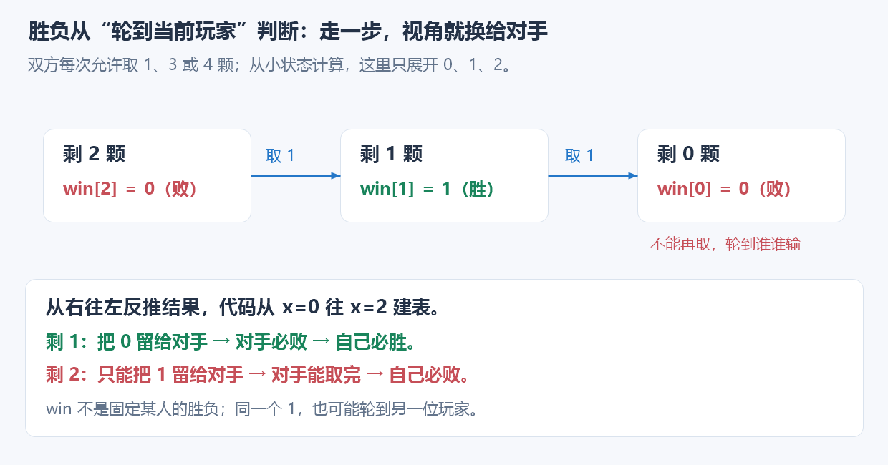
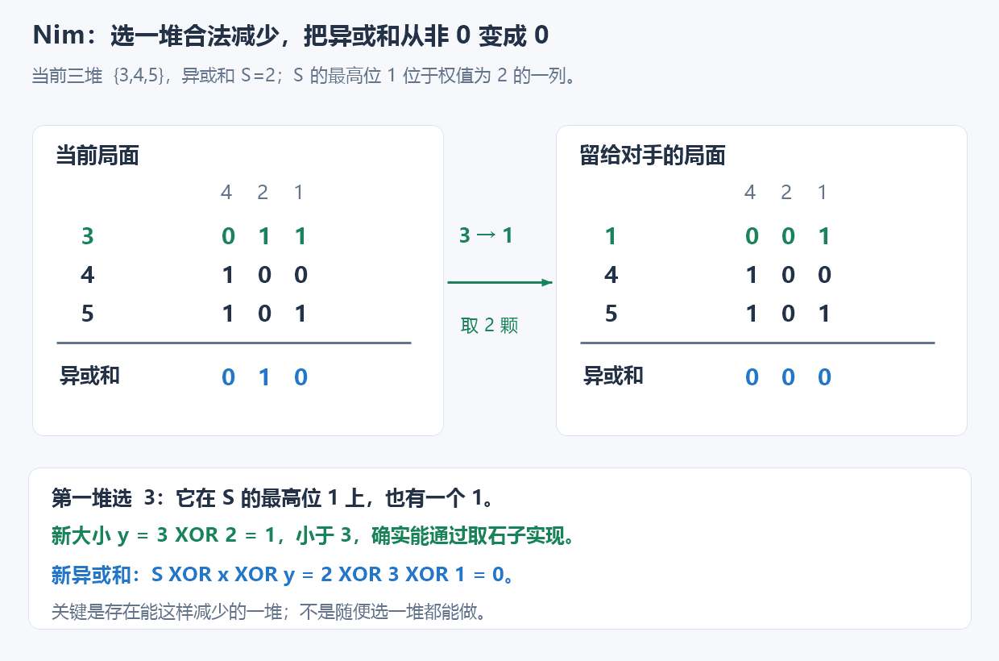
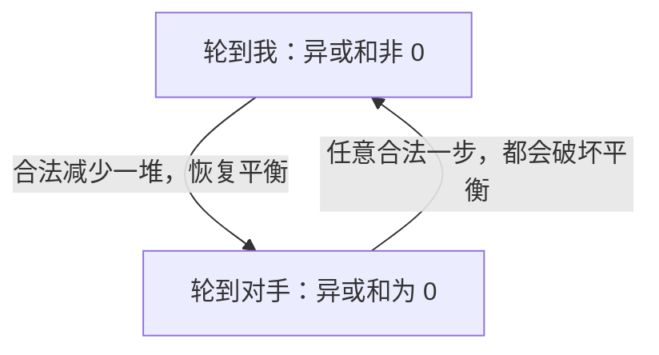
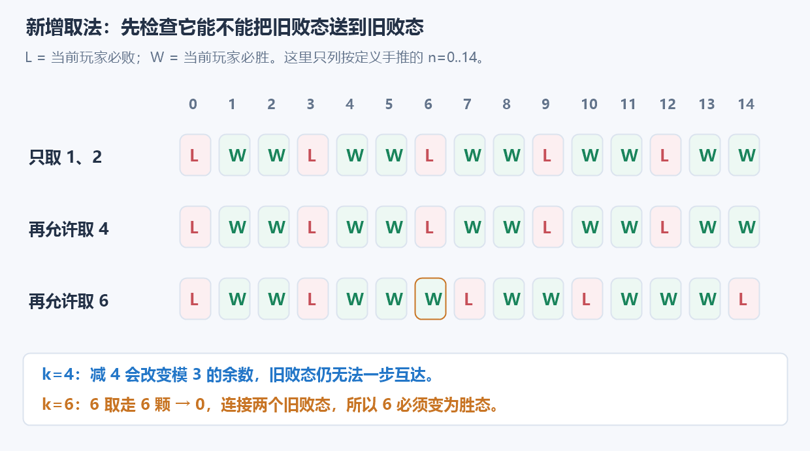
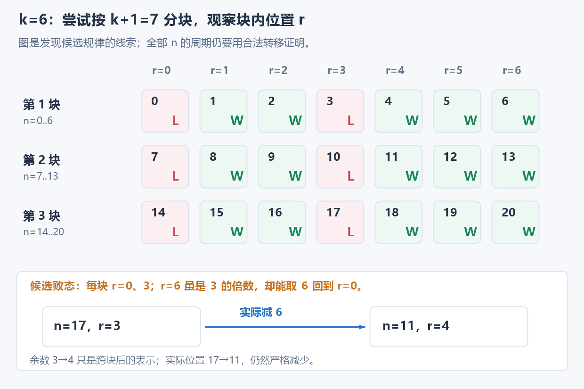
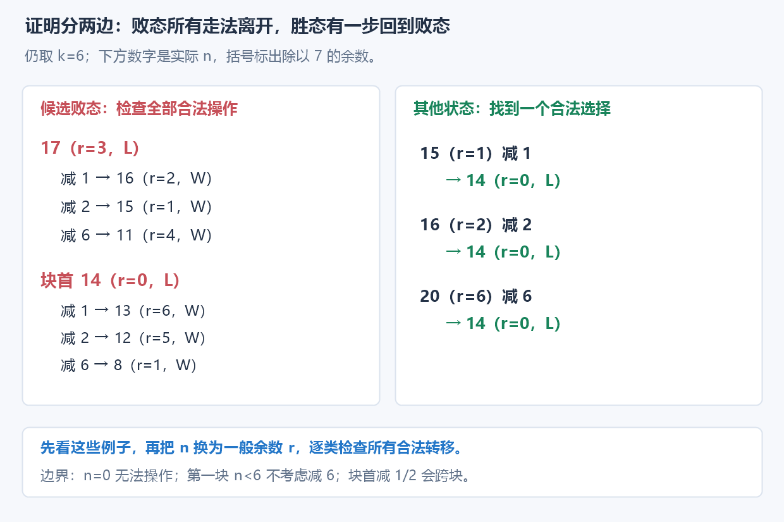

# 7.14 基础博弈：胜负态与 Nim

## 1. 问题引入：自己能选，对手也能选

这里讨论**两人轮流、信息公开、没有随机、必定有限步结束**的游戏；双方在同一局面下拥有相同的合法操作，**无法操作的人输**。

例如一堆石子，每次允许取 1、3 或 4 颗。每次尽量多取并不可靠：剩 5 颗时取 4，会把最后 1 颗留给对手取完；改取 3，反而能把对手逼入败局。**问题不只是“我能走到哪里”，还包括“走过去以后，对手是否有必胜办法”。**

直接展开所有对局会重复遇到相同的剩余数量。既然未来只由剩余石子决定，就把它合并成一个状态，**从不能操作的局面往回推胜负**。多堆石子时状态组合仍可能很多，后面再看满足 Nim 规则时如何用异或直接判定。

## 2. 先给代码：有限取法的单堆胜负表

输入最大石子数 n，以及双方每次允许取走的**正整数**列表 `moves`。先只处理每一步都减少石子数的单堆模型。

```cpp
#include <bits/stdc++.h>
using namespace std;

vector<char> subtraction_wins(int n, const vector<int>& moves) {
    vector<char> win(n + 1, false); // win[0]=false：没有石子可取，当前玩家输。

    for (int x = 1; x <= n; ++x) {
        for (int take : moves) {
            if (take > x) continue;

            // 走到 x-take 后轮到对手；能让对手必败，自己就必胜。
            if (!win[x - take]) {
                win[x] = true;
                break;
            }
        }
    }
    return win;
}
```

**用途速记：** 给出固定的合法取数，计算剩余 0..n 颗时，**轮到当前玩家**是否存在必胜策略。每个状态枚举一步；能把对手送到必败态，就把自己标为必胜，不枚举完整对局。

| 变量 | 含义与范围 |
| --- | --- |
| `n` | 要建表到的最大石子数，n≥0，须能分配 n+1 个位置 |
| `moves` | 每步允许取走的正整数；不要求排序，重复只增加枚举开销 |
| `x` | 当前剩余的石子数，1..n |
| `take` | 本轮尝试取走的数量；超过 x 就不合法 |
| `win[x]` | 剩 x 颗且轮到当前玩家时，是否能够保证获胜；0 为败，1 为胜 |

**这里没有“尚未计算”的哨兵。** 按 x 从小到大枚举，且 take≥1，所以读到的 `win[x-take]` 都已计算完成；`false` 是合法的必败结果。

## 3. 一步之后换了谁：为什么要读 `!win[x-take]`

取法 `{1,3,4}`，先看三个小状态：

- 剩 0：没有合法操作，**当前玩家败**。
- 剩 1：取 1，把 0 留给对手；对手败，所以**当前玩家胜**。
- 剩 2：只能取 1，把 1 留给对手；对手能取完，所以**当前玩家败**。



图中节点的胜负都从“**轮到这个节点的玩家**”出发判断，不固定代表 Alice。于是 `win[1]=true` 并不意味着 Alice 在所有经过 1 的对局中都会赢。

继续建表：

| 剩余 x | 0 | 1 | 2 | 3 | 4 | 5 | 6 | 7 |
| --- | --- | --- | --- | --- | --- | --- | --- | --- |
| `win[x]` | 败 | 胜 | 败 | 胜 | 胜 | 胜 | 胜 | 败 |
| 一个理由 | 无法取 | 留 0 | 只能留 1 | 留 0 | 留 0 | 留 2 | 留 2 | 只能留 6、4、3 |

**当前有 $i$ 个石子，合法取走若干个后，剩余 $j<i$ 个石子的状态就是当前状态的后继。存在一个必败后继，就有安全走法；全部合法后继都必胜，自己才必败。** 对手会选对自己有利的走法，不能只展示一条对手配合的获胜路线。

把数学关系写出来：t 表示本次取数，且 t 必须合法。

$$
\mathrm{win}[x]=
\begin{cases}
0, & \text{没有合法操作},\\
1, & \text{存在合法 }t\text{，使 }\mathrm{win}[x-t]=0,\\
0, & \text{全部合法 }t\text{ 都使 }\mathrm{win}[x-t]=1.
\end{cases}
$$

这就是代码里 `if (!win[x-take])` 的来源。**`break` 只表示已经找到一个必赢选择**，不表示其他走法也会赢。这里的 `win[x]=false` 初始化，正好在所有候选检查失败后保留“必败”。

> **从 0 开始归纳：后继状态都更小，胜负已知；当前玩家选一个让对手必败的后继即可。若没有这样的后继，无论怎样选，对手都有获胜策略。因此这是对双方最优应对的递推，不是概率统计。**

> **找到状态 → 推导转移 → 写成代码：** 剩余数量决定未来；选择一步后视角交给对手；从小状态向大状态计算。它仍是[隐式 DAG 的状态依赖](../../patterns/06-graph-and-tree/dag-dp.md#博弈胜负态依赖后继但切换玩家视角)，只是组合规则变成了“是否存在必败后继”。

## 4. 从建表观察到规律：每次取 1..m 颗

这是另一个常见规则：允许的取数恰好是连续的 1..m，m≥1。例如 m=3，表里每四个状态（从 0 开始）出现一次“败、胜、胜、胜”。

猜测不能直接当结论，需要检查两边：

1. **剩余是 m+1 的倍数：** 任取 1..m 颗，都不再是倍数。
2. **剩余不是倍数：** 取走除以 m+1 的余数，该余数在 1..m，恰好回到倍数。

结合终点 0 是败态，归纳得到：

$$
\mathrm{win}[x]=\bigl(x\bmod(m+1)\ne0\bigr).
$$

**先用小状态找候选规律，再证明“败态走不回败态、胜态能走到败态”。** 规则若改成若干离散取数，不能仍套这个公式；也不能因为几段表重复，就认定所有后面都按同一周期重复。

## 5. Nim：多堆状态太多时，先核对规则

标准 Nim 有多堆石子，每次**只选一堆，取走任意正数颗，可取完**；没有石子可取的人输。各堆非负，允许空堆。

**这里已经换了游戏规则，不能把前面的单堆固定取法与标准 Nim 混用。** 区别不只是“从一堆变成多堆”，还包括“每步允许取多少颗”发生了变化：

| 对比 | 前面的单堆固定取法 | 这里的标准 Nim |
| --- | --- | --- |
| 局面 | 一堆，记录剩余数量 x | 多堆，记录每一堆的大小 |
| 每步选取对象 | 只能操作这一堆 | 只能选择其中一堆，不能同时改多堆 |
| 每步允许取多少 | 必须属于 moves，例如只能取 1、3、4 颗 | 该堆的 1..当前大小，任意正数颗都允许 |
| 如何判断 | 按合法取法枚举后继，计算 win[x] | 满足标准规则后，判断各堆大小的异或和是否为 0 |

例如同样只剩一堆 2 颗：固定取法 `{1,3,4}` 时，只能取 1，先手败；标准 Nim 规则允许一次取完 2 颗，先手胜。**即使堆数相同，取法不同也足以改变胜负。**

两者都可以用胜负态思想理解，但这里的异或结论依赖 Nim 的具体操作。后面恢复平衡时需要把选中的一堆 x 减到某个 y；Nim 允许任取正数，所以只要 y 小于 x 就合法。**若仍限制取走量必须属于 moves，x−y 可能不被允许，原证明就不再适用，不能直接异或原堆大小。**

如果还按完整局面建表，三堆上限分别为 a、b、c 时，就可能有 `(a+1)(b+1)(c+1)` 个组合。堆数、石子数一大，逐局面搜索就不现实。**标准 Nim 可以只看所有堆大小的异或和**：

```cpp
using ll = long long;

bool nim_first_wins(const vector<ll>& piles) {
    ll s = 0;
    for (ll x : piles)
        s ^= x;
    return s != 0;
}
```

**用途速记：** 输入每堆非负石子数，返回标准 Nim 的当前先手是否必胜；异或和为 0 是败态，非 0 是胜态。规则满足前提后，一次扫描就能判断，不需要多维建表。

**判定只做 `s != 0`。** 合法恢复操作的存在性由[后面的完整推导](#6-为什么异或能够决定胜负)保证；函数不必真正执行取石子。

| 变量 | 含义 |
| --- | --- |
| `piles[i]` | 第 i 堆石子数，不是每步最多取多少颗 |
| `s` | 已扫描堆的异或和；扫描完成即整个局面的 Nim 和 |
| 返回 `true` | 当前轮到操作的人能保证获胜，不表示随便取都能赢 |

这里 `s` 是**按位异或**，不是总石子数，也不是奇数堆的个数；相关抵消性质见[位运算：异或](../01-basic-problem-solving/05-bit-operations.md#5-异或抵消与差异)。

## 6. 为什么异或能够决定胜负

代码里的 `return s != 0` 很短，背后需要回答两件事：**异或在这里记录什么，以及这些信息为什么足够判断胜负。** 从容易看懂的局面开始，再走到公式。

### 6.1 从两堆相同出发：寻找能够反复恢复的平衡

两堆都是 3 颗时，后手可以照着先手取：先手从一堆取几颗，后手就在另一堆取同样多。

| 操作 | 第一堆 | 第二堆 |
| --- | --- | --- |
| 初始，轮到先手 | 3 | 3 |
| 先手取 2 | 1 | 3 |
| 后手也取 2 | 1 | 1 |
| 先手取 1 | 0 | 1 |
| 后手也取 1 | 0 | 0 |

具体取数可以不同，但每次后手都能恢复两堆相同，并最终取完。因此两堆相同是先手败局。

> **想找的“平衡”：对手无论怎样走都必须破坏它，而我能通过合法操作恢复它，再交还给对手。**

石子总数描述不了这种区别：`{2,2}` 与 `{1,3}` 总数同为 4，但前者先手败，后者可以把 3 减为 1，将相同的两堆留给对手。

### 6.2 推广到二进制：异或记录每列的奇偶

多堆时，尝试把“相同堆两两配对”放宽为：**二进制的每一列，1 都能两两配对。** 例如 `{1,2,3}` 没有两堆相同，却有下面的结构：

| 每堆或统计结果 | 权值 2 的一列 | 权值 1 的一列 |
| --- | --- | --- |
| 第一堆 1 | 0 | 1 |
| 第二堆 2 | 1 | 0 |
| 第三堆 3 | 1 | 1 |
| 每列 1 的数量 | 2，偶数 | 2，偶数 |
| 该列异或结果 | 0 | 0 |

异或恰好具有这样的性质：**每列有偶数个 1，结果位就是 0；有奇数个 1，结果位就是 1。** 因此，把所有堆异或起来，得到的是各列奇偶性的汇总。

设 S 是所有堆的异或和：

$$
S=0
\iff
\text{二进制每一列都有偶数个 1}.
$$

下面把它叫作**按位平衡**；这不表示每堆一样大，也不表示石子已经取完。`{1,2,3}` 和 `{1,4,5}` 都有石子，但异或和都为 0。

**此时只是找到候选规律，尚未证明它能决定胜负。** 还要确认：平衡一定被破坏，不平衡一定能合法恢复。二进制位只是分析工具，实际操作始终是减少某一堆的整数大小。

### 6.3 为什么平衡一定会被破坏

当前每列都有偶数个 1。对手只修改一堆，将它从 x 减少到 y。

两数不同，二进制至少有一位变化。在任何发生变化的列中，其他堆都没动，只有这一堆的 0/1 翻转，**该列 1 的数量增加或减少 1，必然从偶数变成奇数**。

因此，只改一堆就不可能继续保持全部列平衡。这证明了：

$$
\text{异或和为 0}
\xrightarrow{\text{任意合法一步}}
\text{异或和非 0}.
$$

对应到公式，新异或和 S′ 可以这样计算：先从旧 S 中抵消旧 x，再加入新 y。

$$
S'=S\oplus x\oplus y.
$$

这里利用的是同一个数异或两次会抵消。若 S=0，新结果就是 x 异或 y；合法操作使两数不同，所以结果非 0。

### 6.4 为什么不平衡一定能通过取石子恢复

先看 `{3,4,5}`。图中各堆二进制对齐，S 的结果位为 1，就标出了不平衡的列：



这里只有权值 2 的一列不平衡，将第一堆 3 的该位从 1 翻为 0，得到 1；取走 2 颗即可恢复平衡。

若有多列不平衡，仍只需要修改一堆。**S 中为 1 的位需要翻转，为 0 的位保持不动**；而“异或 1 会翻转，异或 0 保持原样”，所以选中一堆 x 后，目标大小应设为：

$$
y=x\oplus S.
$$

这样每个奇数列都改变一个 0/1，变成偶数列；原来的偶数列完全不动，于是全部恢复平衡。但必须继续检查：**y 是否小于 x，能否真的通过取石子实现？**

这就需要挑选合适的一堆：**找到 S 最左边的 1，也就是权值最大的不平衡列，选择在该列上为 1 的一堆 x。**

该列有奇数个 1，至少存在一个 1，因此一定选得到。对这堆做 `x ^ S` 后：

- 比这一列更高的位：S 都是 0，所以 x 的高位不变。
- 这一列：x 的 1 与 S 的 1 异或，变成 0。
- 更低的位：可以向任一方向翻转。

二进制比较大小，从左往右第一个不同的位置就决定结果。**高位保持，最高变化位从 1 变成 0，已经保证新数更小**，低位怎样变化都无法抵消这个下降。

$$
0\le y\lt x.
$$

因此取走 x−y 颗，就能合法完成这个修改。新异或和也可以代入检验：

$$
S'=S\oplus x\oplus y
=S\oplus x\oplus(x\oplus S)=0.
$$

两次 x 抵消，两次 S 也抵消。这证明了不平衡时**一定存在**合法恢复办法；不表示随便选择一堆都能这样做。

#### 多位翻转时，低位可以变大，但整堆仍然减少

例如 `{5,3,1}` 的异或和是 7。选第一堆 x=5，目标大小为：

$$
y=5\oplus7=2.
$$


从 `101` 变为 `010`，各位的数值变化为：

$$
-4+2-1=-3.
$$

**不是把所有翻转位的权值都加起来当作取走量。** 中间位虽然从 0 变成 1，但整堆从 5 减为 2，实际只需取走 3 颗，没有添加石子。对权值为 $2^d$ 的最高变化位而言，全部更低位即使都增大，增量也至多 $2^d-1$，无法抵消它减少的 $2^d$。

这正是“允许从一堆任取正数颗”的作用：**只要目标整数更小，就能一步到达；不需要逐位执行翻转。**

### 6.5 从恢复平衡到必胜：为什么能一直用下去

前面已经证明两个性质，可以连起来使用：



只要游戏还在继续，就可以反复这样应对。每步石子都减少，所以游戏不可能真的循环；图中循环的是**两类局面之间的关系**。

全空局面异或和为 0，轮到谁谁输。面对非 0 局面的一方始终有合法恢复操作，不会先陷入无石可取；最终由这一方取完，把全空局面留给对手。

所以，初始异或和非 0 时，先手能启动这套策略，必胜；初始异或和为 0 时，先手必须先破坏平衡，对手就能接过这套策略，因此先手必败。

### 6.6 回到代码：只判定，不必实际模拟取石子

本节接口只问当前先手能否必胜。**证明已经保证非 0 时一定有合法选择，所以代码只需计算 s，再判断 `s != 0`，不必真的修改 piles 或演完双方对局。**

`y = x ^ S` 是证明“获胜一步存在”的构造。如果题目额外要求输出一步操作，才需要找一堆满足 `y < x`，取走：

$$
x-y=x-(x\oplus S)
$$

颗。判胜负与输出具体走法是两个不同的任务；当前模板返回的是前者。

> **异或按位记录奇偶，用 0 描述平衡；异或也能精确翻转不平衡列；最高不平衡位保证恢复时整堆变小。** 再结合双方轮流与有限终止，这种平衡才成为胜负判据。

## 7. 复杂度与使用边界

| 方法 | 时间 | 额外空间 | 瓶颈或适用范围 |
| --- | --- | --- | --- |
| 单堆固定取法表 | O(nk+n) | O(n) | k 为 moves 的条目数；逐状态检查取法，另有建表/初始化开销 |
| 取 1..m 的已证明规律 | O(1) | O(1) | 用余数判定，不再建完整表；m+1 须在数值范围内 |
| Nim 异或判定 | O(h) | O(1) | h 为堆数；传入的 piles 存储另计 |

单堆取法非空时通常简写 O(nk)；即使取法为空，也仍要创建并返回 0..n 的结果表。比如 n=$10^5$、k=3，最多约 30 万次候选检查；n=$10^9$ 时，即便只有三个取法，也不能直接建这张表。Nim 有 $10^5$ 堆时只需约 $10^5$ 次异或，**单堆数值大不增加枚举次数**；本实现用 `ll` 存非负堆大小，不计算可能溢出的总和。

- **取法必须为正。** 含 0 或允许增加石子，原来的从小到大依赖可能失效；若可无限循环，还可能出现和局。
- **规则对双方相同。** 操作因人而异时，单看剩余数量可能不够，要考虑当前玩家等信息。
- **Nim 一次只能改一堆，且该堆能任意减少。** 限制取数、一次改多堆、拆堆等变化，不能直接异或原堆大小。
- **胜负规则变化，终点也变化。** 例如一堆 1 颗，“取最后一颗的人输”时先手败，异或却非 0；这已经不符合本节 Nim 前提。
- **不要异或每堆的胜负布尔值。** 两堆 `{1,2}` 各自单独看都必胜，布尔值异或为 0，但标准 Nim 的 `1 ^ 2 = 3`，合起来先手必胜。

本节只建立胜负态与标准 Nim，不据此扩展完整 SG、反常 Nim 或带环博弈实现。

## 8. 典题与复盘

### 8.1 洛谷 P2197：Nim 游戏

[原题](https://www.luogu.com.cn/problem/P2197)。每次只从一堆任取正数颗，无法操作者输，正好满足标准 Nim。每组最多 $10^4$ 堆，每堆为非负整数且不超过 $2^{31}-1$。

#### 实际实现

```cpp
bool nim(const vector<ll>& piles) {
    ll s = 0;
    for (ll x : piles)
        s ^= x;
    return s;
}

void solve() {
    int n;
    cin >> n;

    vector<ll> piles(n);
    for (ll& x : piles)
        cin >> x;

    cout << (nim(piles) ? "Yes\n" : "No\n");
}
```

`nim` 就是开篇 `nim_first_wins` 的缩写命名。**返回类型是 bool，`return s;` 会把 0 转为 false、非 0 转为 true**，因此这里与 `return s != 0;` 等价；不表示把完整异或值返回给调用者。

`solve()` 处理一组，外层按题意读取 T 次调用即可。每组 s 从 0 开始；0 颗的空堆不影响异或，不累计总石子数，也不实际执行取石子。

时间 O(n)，函数额外空间 O(1)，当前读取 piles 的实现整体空间 O(n)。原代码仅整理排版，按规则、返回值和多测职责做静态复盘，未重新编译、运行或对拍，不补记平台 AC。

**收录原因：** 判定所需的不变量一旦完成证明，实际实现可以非常短；理解重点是异或为什么能够代表可恢复的平衡，而非模拟整场游戏。识别与边界提炼到[二进制平衡范式](../../patterns/07-math/critical-condition-in-game.md#从成对响应识别二进制平衡)。

### 8.2 CF 1194D：1-2-K Game

[原题](https://codeforces.com/contest/1194/problem/D)。位置 n 每步减少 1、2 或 k，不能减成负数；Alice 先手，无法操作者输。n 在 0..$10^9$，k 在 3..$10^9$，有多组询问。

**这是前面固定取法胜负表的扩展，取法变为 `{1,2,k}`。** 仍是一堆固定取法，不使用 Nim 异或。关键变化是 n 太大，不能建到 $10^9$ 的表，需要从状态递推中找出并证明可压缩的规律。

#### 整理实现

按给出的参考判定保留实现；下文说明分支与余数的来历，不作为个人赛时原解记录。

```cpp
void solve() {
    ll n, k;
    cin >> n >> k;

    if (k % 3 != 0) {
        cout << (n % 3 ? "Alice" : "Bob") << '\n';
    }
    else {
        ll r = n % (k + 1);
        cout << (r % 3 == 0 && r != k ? "Bob" : "Alice") << '\n';
    }
}
```

**用途速记：** k 不是 3 的倍数时沿用模 3 判断；k 为 3 的倍数时，用 r 记录 n 在长度 k+1 的块内位置，再排除特殊的块尾 r=k。每组时间与额外空间都是 O(1)。

这里的 O(1) 来自**已证明的周期把全部状态压缩成余数**；没有运行到 n 的 DP，也不是把搜索写成更短的循环。两题代码均只做静态复盘，未重新运行；本题参考说明中的判定结论，下面独立按合法后继论证。

#### 第一步：观察小状态，检查旧周期是否还在

只允许取 1、2 时，败态是 0、3、6、9……：非倍数能取 1 或 2 回到倍数，而倍数只能走向非倍数。

加入 k 后，先检查“原败态还能不能直接走到原败态”。下面 L 为败、W 为胜，**均指轮到该状态的玩家**。



**当 k=6，原来的败态 6 能直接取 6 到达败态 0，所以 6 必须改为胜态。后面的分布随之改变；**不能只修正 n=k 一个位置，再继续使用原公式。

**若 k 不是 3 的倍数，旧规律仍成立。** 从 3 的倍数出发，减 1、2 或 k 都无法仍为 3 的倍数；从非倍数出发，仍能取 1 或 2 到达倍数。非法取法直接忽略，0 仍无法操作。因此第一分支就是 `n % 3`。

#### 第二步：从重复现象猜想新周期为 k+1

对旧周期被打破的情况，先固定 k，手工看前面一段状态：k=3 时，取法变为 1、2、3，败态为 0、4、8……；k=6 时，败态为 0、3、7、10、14、17……。后者按长度 7 分块，观察到块内形状重复：



因此先猜想：k 为 3 的倍数时，新的周期可能是 k+1。**此时还不能直接把 n 换成余数；先带着周期猜想，研究一块内部怎样分布。** 取法还提供了一个便于检查的关系：

$$
n-k\equiv n+1\pmod{k+1}.
$$

**取 k 后，余数恰好向右移一格；实际 n 仍减少 k，绝非真的向右移动或增加石子。** 图中 17 减 6 得到 11，从下一块的余数 3 落到上一块的余数 4。

#### 第三步：研究周期内分布，再猜想哪些余数必败

暂按猜想的周期 k+1 分块，令 r=n mod(k+1)。原先要研究整个 n 的范围，现在先盯住一块的 r=0..k：哪些位置看起来是败态，哪些位置需要例外处理？

图中 k=6 时，每块的候选败态落在 r=0、3，而 r=6 是胜态；k=3 时，每块只有 r=0 是候选败态。由这些现象，再提出一般的分布猜想：

$$
\text{败态候选：}\quad
r\in\{0,3,6,\ldots,k-3\}.
$$

**块尾 r=k 虽然也是 3 的倍数，却不是败态**：取 k 可以落到某块的开头，余数为 0。这里仍是猜测，接下来必须证明对所有 n 成立，不能拿图中三块代替证明。

#### 第四步：证明候选分布成立，才能确认周期

下面示意图仍取 k=6。左边看候选败态的三种后继，右边看其余状态怎样选择一步回到败态：



**一、候选败态的所有合法操作，都会离开候选集合。**

| 当前块内位置 | 取 1 后的余数 | 取 2 后的余数 | 取 k 后的余数 |
| --- | --- | --- | --- |
| r=3、6……k−3 | r−1，模 3 余 2 | r−2，模 3 余 1 | r+1，模 3 余 1 |
| r=0，且 n 大于 0 | k，特意排除的块尾 | k−1，模 3 余 2 | 1，模 3 余 1 |

r=0 的减 1、减 2 会跨到上一块，不能直接写成负余数；n=0 无法操作，直接是终点败态。第一块里 n 小于 k 时，取 k 不合法，不纳入转移。

注意**取 k 后是 r+1，未必恰好等于 1**；它的模 3 余数才是 1。r=k 不在当前候选集合里，因此这里不会出现余数向右越过块尾的问题。

**二、不在候选集合里的状态，总有一步合法操作进入候选集合。**

| 当前块内位置 | 选择 | 到达的余数与合法性 |
| --- | --- | --- |
| r mod 3=1 | 取 1 | r−1，在 0..k−3 中且为 3 的倍数；n 至少为 1 |
| r mod 3=2 | 取 2 | r−2，在 0..k−3 中且为 3 的倍数；n 至少为 2 |
| r=k | 取 k | 余数 0；n 至少为 k |

两类情况覆盖了所有余数。结合 0 是败态、每步 n 严格减小，按 n 从小到大归纳，这才证明了所有块共享同一胜负形状。

因此 k 为 3 的倍数时：

$$
r=n\bmod(k+1),\qquad
\mathrm{Lose}(n)\iff(r\bmod3=0)\land(r\ne k).
$$

这正好对应代码第二分支的条件。n=0 时 r=0，输出 Bob；n=k 时能够取 k 到 0，输出 Alice。`ll` 计算 k+1，在本题范围内安全。

#### 最后留下两点

1. **这是开篇单堆固定取法模型的一般扩展。** 仍然可以按 `win[n]` 枚举合法后继；设取法数量为 m，普通建表为 O(nm)，本题取法只有 1、2、k 三种，所以是 O(n)。找到并证明周期后，每组判定降为 **O(1)**。这里 m 是取法数量，k 是特殊取走量，二者不能混为同一个复杂度参数。
2. **从现象到答案的一般思路：** 见[观察状态 → 猜想周期 → 研究块内分布 → 提出候选败态 → 证明成立](../../patterns/07-math/critical-condition-in-game.md#从小状态到周期先检查新增操作是否破坏旧败态)。

## 9. 自查与衔接

1. `win[x-take]=false` 为什么意味着当前玩家存在必胜选择？这里的“当前玩家”是谁？
2. 证明一个候选败态集合时，为什么要同时证明“内部不能一步互达”和“外部能够一步进入”？
3. Nim 的 `x ^ S` 为什么必须小于 x 才能操作？哪些规则改动会使异或原堆大小失效？

两题的识别方法集中到[二进制平衡](../../patterns/07-math/critical-condition-in-game.md#从成对响应识别二进制平衡)与[周期压缩](../../patterns/07-math/critical-condition-in-game.md#从小状态到周期先检查新增操作是否破坏旧败态)：共用“寻找候选败态并证明应对”的主线，状态特征由操作规则决定。

已有 [MEX 博弈临界条件范式](../../patterns/07-math/critical-condition-in-game.md#先分清胜负态与一条获胜路线)讨论的是资源阈值与应对策略，不是 Nim 换皮：**先证明某方能对抗任意回应，不能用一个可行终局代替必胜证明。**

概念核对：[Competitive Programmer's Handbook 第 25.1–25.2 节](https://cses.fi/book/book.pdf#page=245)。本文代码、取法例子与图示自行整理；更一般的 SG 不在本节展开。

[本章索引](README.md) · [基础博弈模板](../../templates/07-math/game-theory/README.md)
