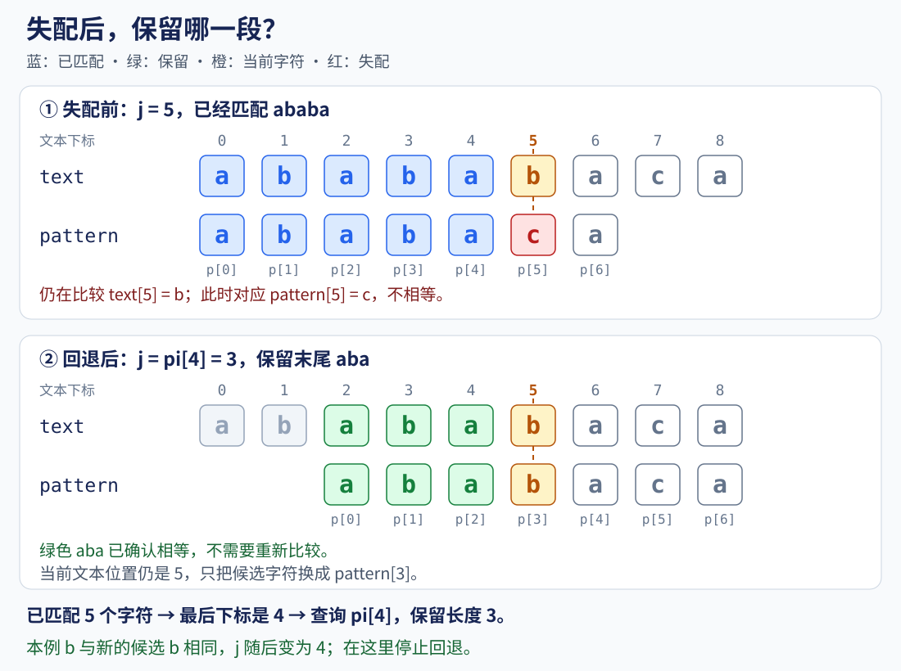
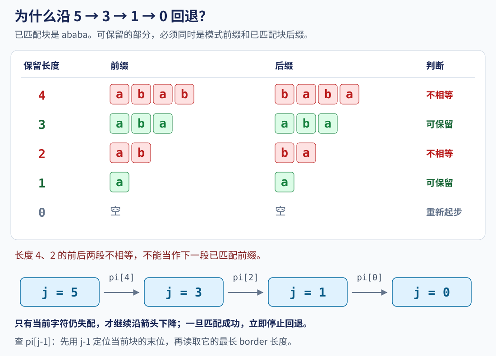

# 8.1 KMP 与前缀函数：失配后保留已经匹配的信息

前置：[string 的下标与基本操作](../01-basic-problem-solving/04-stl/containers/03-string.md)。

承接已有字符串基础，本节统一竞赛中常用的 **0-based 前缀函数 pi**，解释失配回退和重叠匹配。

> **KMP 不只是“失配时跳几格”。关键在于：已经相等的部分，哪些仍然可以保留？**
>
> 先在模式串内部找出这些关系，再用它们指导文本匹配。

## 1. 从重复比较的例子入手

在文本 `abababaca` 中查找模式串 `ababaca`。

先从开头比较，前五个字符 `ababa` 都相同，接下来却遇到：

```text
文本：a b a b a b a c a
模式：a b a b a c a
                ↑
            文本 b，模式 c
```

朴素做法会移动模式串，重新从开头比较。

**但刚才已经确认文本末尾有一段 ababa，能否利用它？**

`ababa` 的后面三个字符是 `aba`，模式串开头三个字符也正好是 `aba`。

所以可以直接保留这三个字符，把模式串调整为：

```text
文本：a b a b a b a c a
模式：    a b a b a c a
          └─aba─┘
            已确认相等
```

接下来仍比较刚才的文本字符 b；它现在对应模式串中的 b，可以继续。

**文本位置不必后退，也不必重新比较已经确定相等的 aba。**

## 2. 前缀、后缀与 border

以 `ababa` 为例：

- 前缀：从开头取一段，例如 `a`、`ab`、`aba`。

- 后缀：取结尾的一段，例如 `a`、`ba`、`aba`。

- **相等的真前后缀**：既是前缀也是后缀，但不能把整个字符串本身算进去，也称 border。

最长相等真前后缀为 `aba`：

$$
\text{长度}=3.
$$

更短的还有 `a`，长度为 1。

**前缀与后缀可以重叠，不要求它们占据互不相交的位置。**

下面几种情况分别看：

| 字符串 | 最长相等真前后缀 | 长度 |
| --- | --- | --- |
| ababa | aba | 3 |
| aaaa | aaa | 3 |
| abcd | 空串 | 0 |
| a | 空串 | 0 |

这里“真”排除了整个字符串；用 0 表示不存在非空 border。

## 3. pi[i] 到底记录什么？

本节所有字符串下标均为 **0-based**。

$$
pi[i]=\text{前缀 p[0..i] 的最长相等真前后缀长度}.
$$

注意它有两层含义：

1. **先只看截至 i 的这一段**，不是总看整个模式串。

2. **数组里存长度，不存最后一个字符的下标。**

例如模式串 `ababaca`：

| i | p[i] | 截至 i 的前缀 | pi[i] |
| --- | --- | --- | --- |
| 0 | a | a | 0 |
| 1 | b | ab | 0 |
| 2 | a | aba | 1 |
| 3 | b | abab | 2 |
| 4 | a | ababa | 3 |
| 5 | c | ababac | 0 |
| 6 | a | ababaca | 1 |

因此：

$$
pi=[0,0,1,2,3,0,1].
$$

`pi[4]=3` 表示 `ababa` 的 border 长度为 3。

border 本身是 `p[0..2]`，不是 `p[0..3]`。

> **长度为 j 的前缀占据下标 0 到 j-1，接下来要比较的字符恰好是 p[j]。**
>
> 这也是代码中长度和下标容易混淆的地方。

## 4. 为什么失配后回到 pi[j-1]？

### 先看失配前后的对齐关系

已经匹配了 `ababa`，下一位文本字符是 b，模式串下一位却是 c。

此时：

$$
j=5.
$$

j 表示已经匹配的长度；已匹配块对应模式串的 `p[0..4]`。

下面将**失配前、回退后**放在一起看。橙色标记的是同一个文本字符，绿色是可以保留的部分。



**移动的是模式串的对齐位置，不是把文本位置退回去。**

保留的 `aba` 已经确认相等，下一步只需比较当前文本字符 b 与新的候选字符 b。

### 为什么查 j-1，而不是 j？

已匹配 5 个字符，它们的模式串下标依次是：

$$
0,\ 1,\ 2,\ 3,\ 4.
$$

因此，要找这个已匹配块的最长 border，应查它的最后一个位置 4。

$$
j=pi[4]=3.
$$

`pi[4]` 告诉的是“能保留的长度为 3”，保留的内容是 `aba`。

> **长度为 j 的块，最后下标是 j-1。**
>
> 所以回退写成 `j=pi[j-1]`；不是随意减一，也不是去查询尚未匹配的下一位。

### 如果仍然失配，再继续回退

**上图在 j=3 时已经匹配成功，不再回退。**

只有当前字符与这个候选仍然不匹配时，才继续寻找 `aba` 自身的 border：

$$
j=pi[2]=1.
$$

此时只保留末尾的 `a`。

若仍然失配，则继续退到 0，再尝试当前字符能否作为新开头。



图中箭头给出**继续失配时的候选链**，不表示每次都必须一路退到 0。

### 为什么不能直接 j--？

可以保留的候选，必须同时满足：

- 是已经匹配块的**后缀**，才能与当前文本接上。

- 是模式串的**前缀**，才能继续从模式开头匹配。

对 `ababa` 而言，长度为 4 的前缀是 `abab`，后缀却是 `baba`，两者不同。

**因此不能仅仅从 5 减到 4，就假装仍有四个字符匹配。** 图中长度 2 也因同样原因被跳过。

`pi[j-1]` 直接给出下一段最长合法候选。

较短候选同时位于较长候选的开头和结尾，因此也必须是较长候选本身的 border。反复沿同一规则回退，就能依次尝试全部可能，不会遗漏。

> **回退改变的是“保留多少已匹配字符”，不是把当前文本字符丢掉。**
>
> 同一个当前字符可能在多个候选上继续失配，所以使用 while，而不是只判断一次 if。

## 5. 构造前缀函数

### 变量与范围

| 变量 | 含义与容量 |
| --- | --- |
| p | 要计算前缀函数的字符串，长度为 m |
| pi | 长度 m，每个位置记录对应前缀的 border 长度 |
| i | 当前要计算的位置，从 1 到 m-1 |
| j | 当前尝试保留的 border 长度，下一字符对应 p[j] |

`pi[0]=0`，因为单个字符没有非空真前后缀。

每次只增加一个字符，最长 border 至多比上一位多 1：

$$
pi[i]\le pi[i-1]+1.
$$

如果新 border 更长，去掉它的最后一个字符，就能在上一位得到一个比 pi[i-1] 更长的 border，与上一位已经取最长矛盾。

因此计算第 i 位时，先尝试延长上一位已经找到的最长 border：

$$
j=pi[i-1].
$$

如果 `p[i]` 与 `p[j]` 相同，原来的 border 就能再延长一个字符。

若不同，则按照上一节的方法回退 j；**当前 i 不变，继续尝试更短的候选。**

### C++11 实现

沿用[竞赛基础框架](../../templates/cpp-contest-template/README.md)。

**输入范围：** 字符串长度可以用 `int` 表示。

```cpp
vector<int> prefix_function(const string& p) {
    int m = static_cast<int>(p.size());
    vector<int> pi(m);

    for (int i = 1; i < m; ++i) {
        int j = pi[i - 1]; // 先尝试延长上一前缀的最长 border

        // j 指向上一个 border 后面的一位（同时表示前 j 位 border 长度为 j，其最长真前后缀长度为 pi[j]）
        // 即尝试匹配位，该位与 i 指向的新位置比较：
        // 比较成功：（未）发生回退后的前缀成功延长匹配新位，
        //			模式串与格式串从相对该长度的位置开始，进入下一轮继续匹配
        // 比较失败：说明往前所有 border 的后一位待匹配位都和新位置失配，
        //		    跳过这位后，下一轮模式串与格式串从头匹配
        while (j > 0 && p[i] != p[j]) {	// while 回退连续失配
            j = pi[j - 1]; // 当前字符不变，换更短的合法候选
        }

        if (p[i] == p[j]) {
            ++j; // 候选成功延长一个字符；j 为 0 时也需要尝试
        }

        pi[i] = j;
    }

    return pi;
}
```

空字符串得到空数组；循环不会进入，也不会访问 `p[0]`。

### 手推一次连续回退

计算 `ababaca` 中的 `c`，此时 `i=5`。

上一前缀是 `ababa`，所以从 `j=3` 开始：

| 当前 j | 比较 | 结果 |
| --- | --- | --- |
| 3 | c 与 p[3] 的 b | 不同，退到 pi[2]=1 |
| 1 | c 与 p[1] 的 b | 不同，退到 pi[0]=0 |
| 0 | c 与 p[0] 的 a | 仍不同，不增加 j |

因此：

$$
pi[5]=0.
$$

这一个位置发生了两次回退，说明 **while 不能随意改为 if**。

## 6. 用同一套回退规则匹配文本

### 两个字符串，两个不同职责

- **text：** 在其中查找，长度为 n。

- **pattern：** 要找的模式串，长度为 m。

- **pi：** **只由 pattern 预处理，不需要为整段 text 重新建一份**。

- **i：** 当前文本下标，只从左向右走。

- **j：** 处理当前字符前，模式串开头已有多少个字符与文本刚处理过的结尾相同。

**匹配前保持 j<m，所以接下来可以安全比较 pattern[j]。**

流程：

1. 先求模式串的 pi，令 j 为 0。

2. 当前字符失配且 j 大于 0，就回退 j，继续比较同一个文本字符。

3. 若当前字符相同，已匹配长度加 1。

4. 若 j 等于 m，说明刚刚找到一个完整匹配，记录起点。

5. 完整匹配后也回退，保留可能与下一次匹配重叠的部分。

### 通用实现：返回全部 0-based 起点

> **空模式串约定：本节函数返回空结果。**

这是接口选择，不是说空串在数学上没有匹配位置。

两道配题均保证输入非空。

```cpp
vector<int> kmp_find_all(const string& text, const string& pattern) {
    vector<int> positions;
    if (pattern.empty()) return positions; // 本接口约定：空模式串不产生结果

    int n = static_cast<int>(text.size());
    int m = static_cast<int>(pattern.size());
    vector<int> pi = prefix_function(pattern);
    int j = 0;

    for (int i = 0; i < n; ++i) {
        while (j > 0 && text[i] != pattern[j]) {
            j = pi[j - 1]; // 只改变已匹配长度，当前文本位置 i 不后退
        }

        if (text[i] == pattern[j]) {
            ++j;
        }

        if (j == m) {
            positions.push_back(i - m + 1); // 匹配结束于 i，向前数 m 个字符
            j = pi[j - 1]; // 保留最长 border，继续寻找可能重叠的下一次匹配
        }
    }

    return positions;
}
```

与前缀函数构造相比，**回退方法没变，只是当前字符来自 text，候选前缀来自 pattern**。

这里直接使用两个字符串，不需要额外拼接分隔符。

函数不修改输入，多次调用的 j、pi 和结果分别重新初始化。

### 完整匹配的起点为什么是 i-m+1？

结束字符下标为 i，总共匹配了 m 个字符：

$$
\text{起点}=i-(m-1)=i-m+1.
$$

例如前面的模式在文本下标 8 结束，模式长度为 7：

$$
8-7+1=2.
$$

所以函数返回 0-based 起点 2。

若题目输出从 1 开始编号的位置，再加 1 得到 3。

**内部计算与题目输出的编号要分开。**

### 对照开头的失配例子

文本为 `abababaca`，模式为 `ababaca`：

| 文本位置 | 行为 | 匹配长度 |
| --- | --- | --- |
| 0..4：ababa | 连续相同 | 0 → 5 |
| 5：b | 与模式的 c 失配，先保留 aba，再匹配 b | 5 → 3 → 4 |
| 6：a | 继续相同 | 4 → 5 |
| 7：c | 继续相同 | 5 → 6 |
| 8：a | 完整匹配，记录起点 2 | 6 → 7，记录后回退到 1 |

**第 5 位文本字符并没有重新读取或跳过，而是在回退后的候选上继续比较。**

## 7. 完整匹配后，为什么仍要回退？

文本为 `aaaaa`，模式为 `aaa`。

全部匹配起点应为：

$$
0,\ 1,\ 2.
$$

第一次完整匹配后，结尾的 `aa` 同时也是模式开头的 `aa`，可以留给下一次匹配。

$$
j=pi[2]=2.
$$

因此下一字符到来时，只需再匹配一个 a，就又找到一次。

**若每次完整匹配后都清零，会漏掉重叠匹配。**

而若不做任何回退，下一轮就可能访问越界的 `pattern[m]`。

回到最长 border，既保留重叠机会，也让下一轮恢复 `j<m` 的约定。

## 8. 为什么两层循环仍然是线性？

单看某个字符，可能在 while 中回退多次。但要看整个过程：

- 外层每处理一个字符，j 最多增加 1。

- while 每执行一次，j 都严格减少。

- j 不会小于 0；减少的总量，不可能超过此前累计增加的总量。

> **嵌套循环不一定意味着平方复杂度。**

这里回退所消耗的长度，来自前面已经增加过的长度。

前缀函数构造耗时 $O(m)$，文本扫描耗时 $O(n)$，所以：

$$
\text{总时间}=O(n+m).
$$

若共有 z 次匹配，返回全部起点需要保存 z 个结果。

代码的额外空间为 **$O(m+z)$**，不包含输入字符串。

只统计次数时可以不保存起点，但本节保留一个主实现；不再复制第二套几乎相同的函数。

定义与符号可对照 [Prefix function 文档](https://cp-algorithms.com/string/prefix-function.html)。本节使用直接扫描文本的实现与独立例子说明回退，不展开拼接法等其他写法。

## 9. 易错点与接口边界

### 失配过程与状态含义

| 容易混淆的地方 | 本节约定 |
| --- | --- |
| j 是最后匹配字符的下标 | j 是已匹配长度，下一个比较 pattern[j] |
| 失配后 j-- | 要跳到合法 border，使用 pi[j-1] |
| 失配只回退一次 | 同一个字符可能多次失配，使用 while |
| i 也跟着回退 | i 只向右走，改变的是保留长度 j |
| j 为 0 就不再比较 | 仍需尝试当前字符能否匹配 pattern[0] |

### 找到结果与接口边界

| 容易混淆的地方 | 本节约定 |
| --- | --- |
| 找到匹配后 j 清零 | 会漏重叠；回到 pi[m-1] |
| 找到匹配后 j 保持 m | 下一字符比较时可能访问 pattern[m] |
| 空文本、模式比文本长 | 非空模式自然得不到结果 |
| 混用其他 next 数组 | 先确认定义、下标与哨兵，不能直接替换 pi |

其他资料可能用 `next` 表示长度、字符下标，或引入 -1 哨兵。

**名字相同不代表含义相同，本节只维护 0-based pi 写法。**

## 10. 典题与复盘

### 10.1 洛谷 P3375：【模板】KMP

[题目链接](https://www.luogu.com.cn/problem/P3375)。

**收获：把“模式串内部的 border”与“模式串在文本中的出现位置”分开，再统一下标约定。**

#### 原实现

原辅助函数名为 `make_pi`、`kmp_all`，分别对应第 5、6 节的 `prefix_function`、`kmp_find_all`。

下方保留原函数及 `solve()`，只调整排版和注释；第二题复用同一个 `make_pi`，不重复展示通用框架。

```cpp
vector<int> make_pi(const string& s) {
    int m = static_cast<int>(s.size());
    vector<int> pi(m);

    for (int i = 1; i < m; ++i) {
        int j = pi[i - 1];

        while (j > 0 && s[j] != s[i]) {
            j = pi[j - 1];
        }

        if (s[j] == s[i])
            ++j;

        pi[i] = j;
    }

    return pi;
}

vector<int> kmp_all(const string& text, const string& pattern) {
    vector<int> positions;
    if (pattern.empty()) return positions;

    int n = static_cast<int>(text.size());
    int m = static_cast<int>(pattern.size());
    vector<int> pi = make_pi(pattern);
    int j = 0;

    for (int i = 0; i < n; ++i) {
        while (j > 0 && text[i] != pattern[j]) {
            j = pi[j - 1];
        }

        if (text[i] == pattern[j])
            ++j;

        if (j == m) {
            positions.push_back(i - m + 1); // 内部仍用 0-based
            j = pi[j - 1]; // 保留 border，继续寻找重叠匹配
        }
    }

    return positions;
}

void solve() {
    string a, b;
    cin >> a >> b;

    auto pos = kmp_all(a, b);

    for (int x : pos)
        cout << x + 1 << '\n'; // 只在输出时转换成题目的 1-based 位置

    auto ret = make_pi(b);

    for (int x : ret)
        cout << x << ' '; // pi 存的是长度，不需要加 1
}
```

#### 两种输出，不能一起加 1

$$
\text{输出出现位置}=\text{内部起点}+1.
$$

出现位置从 0-based 转成 1-based。

$$
\text{输出 border 长度}=pi[i].
$$

长度没有起点编号之分，直接输出。

`make_pi(b)` 在匹配和输出中各计算一次，只增加常数开销，**总时间仍为 $O(n+m)$**；不必为此另造一套算法。

**核验状态：本地核验通过，平台结果未单独记录。**

### 10.2 Codeforces 126B：Password

[题目链接](https://codeforces.com/problemset/problem/126/B)。

寻找最长非空字符串，同时出现在**开头、结尾、内部**；内部那次不从 0 开始，也不在末位结束，三次出现允许重叠。无解输出 `Just a legend`。

**收获：同一张 pi 表既能给出首尾候选链，也能把“内部出现过”压缩为一个长度上限。**

#### 先用一个例子看清分工

取：

$$
s=\text{abcdabcdabcd},\qquad n=12.
$$

它的前缀函数为：

$$
pi=[0,0,0,0,1,2,3,4,5,6,7,8].
$$

最后一项给出全串最长 border；前面的项用来找内部出现的证据。

![CF 126B：pi[10]=7 提供中间出现的前缀，较短前缀从同一位置的开头取得，再沿全串 border 链筛选](assets/kmp-middle-prefix.svg)

#### ① 中间的 pi[i]，具体证明了什么？

设 `pi[i]=k>0`：

$$
s[0..k-1]=s[i-k+1..i].
$$

长度为 k 的开头，确实在以 i 结尾的位置又出现了一次。

**限制 i 不取最后一位：**

$$
i\le n-2.
$$

这次出现就不会以整串最后一个字符结尾。

**真前后缀还保证 k≤i：**

$$
i-k+1\ge1.
$$

这次出现也不会从 0 开始。因此它是一段内部出现，不必再单独排除最初的前缀。

> **不是“中间每项记录某种不同的关系”。每项都记录自己对应前缀的 border；换成整串视角，它恰好提供了一次内部出现的证据。**

#### ② mx 为什么足够？

$$
mx=\max\bigl(pi[0],\ldots,pi[n-2]\bigr).
$$

它是**能在内部出现的最长前缀长度**；n=1 时没有这些位置，代码令 mx 保持 0。

例子中：

$$
pi[10]=7
\quad\Longrightarrow\quad
s[4..10]=s[0..6]=\text{abcdabc}.
$$

在内部位置 4，出现了长度为 7 的前缀。

只取这次出现的**开头四个字符**：

$$
s[4..7]=s[0..3]=\text{abcd}.
$$

起点仍是 4，右端提前，仍在内部。长度 1 到 7 的前缀都能这样取得。

**取的是同一次出现的开头部分，不是末尾部分。**

反过来，若长度 len 的前缀在内部出现，并在下标 i 结束：

$$
pi[i]\ge len
\quad\Longrightarrow\quad
mx\ge len.
$$

因此，对于正长度：

$$
\text{前缀 len 在内部出现}
\quad\Longleftrightarrow\quad
len\le mx.
$$

#### ③ 首尾候选，为什么还要沿 pi 回退？

$$
len=pi[n-1].
$$

这里才使用最后一项，取**全串的最长 border**。

如果内部长度不够支持它：

$$
len>mx
\quad\Longrightarrow\quad
len\leftarrow pi[len-1].
$$

换成下一个更短的首尾候选，而不是任意减少长度。

例子中：

$$
len=8>mx=7.
$$

长度 8 虽然首尾相同，但没有第三次内部出现。

$$
len=pi[7]=4\le7.
$$

长度 4 同时满足首尾与内部要求，答案为 `abcd`。

> **不能直接把 mx 当答案。** 本例 mx=7，但长度 7 不是全串 border。

border 链严格递减，**第一个不超过 mx 的正候选，就是最长答案**；退到 0 则无解。

#### 原实现

复用上面的 `make_pi`。原 `solve()` 逻辑不变，只补充注释和留白。

```cpp
void solve() {
    string s;
    cin >> s;

    auto pi = make_pi(s);
    int mx = 0;

    for (int i = 0; i < s.size() - 1; ++i)
        mx = max(mx, pi[i]); // 不统计末位：不能把后缀自身当成内部出现

    int len = pi[s.size() - 1];

    while (len > mx)
        len = pi[len - 1]; // 只沿合法 border 链退；这里 len > mx >= 0，索引安全

    if (!len) {
        cout << "Just a legend\n";
    } else {
        cout << s.substr(0, len) << '\n';
    }
}
```

原稿的循环比较含有 `int` 与字符串无符号长度的比较，会产生一处类型警告。本题保证非空，逻辑不受影响；整理时可统一长度：

```cpp
int n = static_cast<int>(s.size()); // 本题 n >= 1

for (int i = 0; i < n - 1; ++i)
    mx = max(mx, pi[i]);

int len = pi[n - 1];
```

这里只整理类型，不改变算法。

#### 最后对照

| 信息 | 负责什么 |
| --- | --- |
| `pi[n-1]` 与回退链 | 候选必须是全串 border |
| `max(pi[0..n-2])` | 候选长度能否在内部出现 |
| `len<=mx` | 两种条件相交 |

$$
\text{时间}=O(n),\qquad \text{额外空间}=O(n).
$$

**核验状态：原实现与长度类型整理版均已本地核验，平台结果未单独记录。**

## 11. 自查与后续

1. 为什么 `pi[4]=3` 表示三个字符，而不是下标 0 到 3？

2. 失配时，为什么回退依据是 `pi[j-1]`，不是随意减 1？

3. 文本 `aaaaa`、模式 `aaa`，为什么清零会漏解？

4. 前缀函数构造与文本匹配中，j 的含义有什么共同点？

两题原实现与复盘已整理；下一节按基础链继续[字符串哈希及碰撞边界](02-string-hash.md)。个人掌握仍需通过解释与独立重写核验。

周期、前缀出现次数、Manacher 等按前置关系逐步补充。

本章尚未完结，全章选型留到后面完善。
