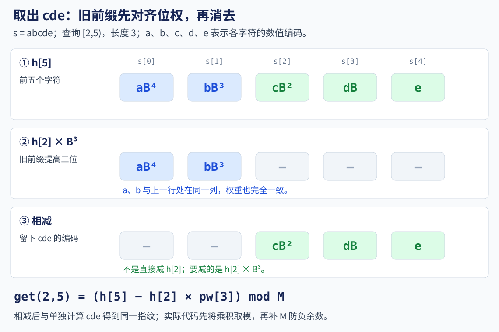

# 8.2 字符串哈希：快速比较子串与碰撞边界

前置：[字符串操作](../01-basic-problem-solving/04-stl/containers/03-string.md)、[前缀和](../02-sequence-techniques/01-prefix-sum.md)、[KMP](01-kmp.md)。

KMP 利用前后缀关系完成匹配；本节换一个角度，给字符串保存一份**与字符顺序有关的数值摘要**，便于反复比较子串。

> **原串相同，哈希一定相同；哈希相同，原串未必相同。**
>
> 哈希是快速筛选工具，不能把“指纹相同”当成无条件的相等证明。

## 1. 从重复比较入手

字符串 `ababa` 中，比较：

$$
s[0..3)=\text{aba},\qquad s[2..5)=\text{aba}.
$$

两段内容相同，但逐字符比较仍要检查三个字符。

如果有很多这样的询问，每次都重新扫描，最坏需要：

$$
O(qn).
$$

这里 n 是原串长度，q 是询问次数；每次可能比较接近 n 个字符。

**希望先花 O(n) 保存信息，再用 O(1) 得到任意子串的指纹。**

本节统一使用 **0-based、左闭右开区间 [l,r)**。字符下标是 `0..n-1`，前缀长度是 `0..n`。

## 2. 为什么不能只累加字符

`ab` 和 `ba` 的字符和相同，却不是同一个字符串。

所以需要让**不同位置有不同的权重**。

先把每个字符映射成正整数。以下公式中的 a、b、c 指字符对应的数值。

$$
H(\text{abc})=(aB^2+bB+c)\bmod M.
$$

B 是固定基数，M 是模数。左边字符的权重更高，顺序因此参与计算。

计算时不用逐项求幂，可以不断在末尾追加字符：

$$
H(\text{ab})=(aB+b)\bmod M.
$$

先把 a 的权重提高一位，再放入 b。

$$
H(\text{abc})=(H(\text{ab})B+c)\bmod M.
$$

每追加一个字符，只需一次乘法和加法；取模防止数值随长度无限增长。

**字符编码、基数和模数必须一致，不同对象的结果才能比较。**

实现使用 `static_cast<unsigned char>(s[i]) + 1`，得到 `1..256` 的编码。大小写、数字和其他字节都能区分；避免 `char` 为有符号类型时产生负数。

这按**字节**处理 `string`，不把 UTF-8 的一个汉字当作一个字符。

## 3. 模型变量与执行流程

### 变量保存什么

- **n**：原串的字节数，也是可查询的右端点上限。

- **h[i]**：前 i 个字符，即 `s[0..i)` 的哈希。`h[0]=0` 表示空前缀。

- **pw[i]**：基数的 i 次幂取模后的值。`pw[0]=1`，用于对子串左边的旧前缀调整权重。

- **l、r**：待查询的区间边界，满足 `0 <= l <= r <= n`；长度为 `r-l`。

**h 和 pw 都按字符串长度分配 n+1 项，不按字符编码或模数大小开数组。**

下面实现保存两套模数下的结果，所以有 `h1/h2` 和 `pw1/pw2`；下标含义完全相同。

### 执行顺序

1. 读取字符串，初始化空前缀与零次幂。

2. 从左到右追加字符，同时保存每个前缀的哈希与基数幂。

3. 查询时用两个前缀取出子串，返回两份哈希。

4. 比较两段时，**先比较长度，再比较两份哈希**；需要严格确定时，还要核对原文。

## 4. 取出子串：先对齐，再相减

普通前缀和可以直接相减；这里每追加字符，前面的权重都会乘 B，因此不能直接写 `h[r]-h[l]`。

例如 `s=abcde`，希望取出 `s[2..5)=cde`：



**先暂时不写取模，观察每个字符的位置。**

$$
h[5]=aB^4+bB^3+cB^2+dB+e.
$$

这是前五个字符的编码。

$$
h[2]=aB+b.
$$

旧前缀只有两个字符，它的 a、b 还没有对齐到上式的位置。

$$
h[2]B^3=aB^4+bB^3.
$$

乘上子串长度对应的幂，旧前缀恰好移到相同权重。

$$
h[5]-h[2]B^3=cB^2+dB+e.
$$

相减后，剩下的正是把 `cde` 单独编码的结果，与它在原串中的起点无关。

一般地，前 r 个字符可以拆成“前 l 个字符”和后面的 `r-l` 个字符：

$$
h[r]\equiv h[l]B^{r-l}+H(s[l..r))\pmod M.
$$

前一段整体提高 `r-l` 位，再接上后一段。

$$
H(s[l..r))=(h[r]-h[l]\cdot pw[r-l])\bmod M.
$$

**这与前缀和相似，但相减前必须先对齐位权；不需要除法或模逆元。**

代码中先把乘积取模，再补 M，避免 C++ 的负余数：

$$
(h[r]-h[l]\cdot pw[r-l]\bmod M+M)\bmod M.
$$

两项都在 `[0,M)`，所以这里加一次 M 就够。

## 5. C++11 实现：双哈希

先理解上一节的一套公式，再将它在两个模数下各算一次。

**接口约定：**字符串长度及 n+1 可用 int 表示，内存足够；`get(l,r)` 接受合法的 0-based 半开区间。

对象保存构造时的字符串快照所对应的哈希表，**不保存原文**。之后修改外部字符串，不会更新这些表；需要重新构造。

依赖 `string、vector、pair`，沿用[竞赛基础框架](../../templates/01-basic-problem-solving/cpp-contest-template/README.md)中的命名空间与头文件。

```cpp
using ll = long long;

struct StringHash {
    // 所有对象共用参数，跨字符串比较时才能保持同一种编码规则
    enum {
        BASE = 911382323,
        MOD1 = 1000000007,
        MOD2 = 1000000009
    };

    int n;
    vector<ll> h1, h2;
    vector<ll> pw1, pw2;

    explicit StringHash(const string& s)
        : n(static_cast<int>(s.size())),
          h1(n + 1), h2(n + 1),
          pw1(n + 1), pw2(n + 1) {
        pw1[0] = pw2[0] = 1;

        for (int i = 0; i < n; ++i) {
            int c = static_cast<unsigned char>(s[i]) + 1;

            // 前 i 个字符后面接上 s[i]，形成前 i+1 个字符
            h1[i + 1] = (h1[i] * BASE + c) % MOD1;
            h2[i + 1] = (h2[i] * BASE + c) % MOD2;

            // 查询时需要把旧前缀整体提高 r-l 位
            pw1[i + 1] = pw1[i] * BASE % MOD1;
            pw2[i + 1] = pw2[i] * BASE % MOD2;
        }
    }

    pair<ll, ll> get(int l, int r) const {
        // 先消去权重对齐后的旧前缀，再把结果调整回非负余数
        ll x = (h1[r] - h1[l] * pw1[r - l] % MOD1 + MOD1) % MOD1;
        ll y = (h2[r] - h2[l] * pw2[r - l] % MOD2 + MOD2) % MOD2;

        return {x, y};
    }
};

// true 只表示长度和两份指纹一致，仍需理解碰撞边界
bool maybe_equal(const StringHash& a, int l1, int r1,
                 const StringHash& b, int l2, int r2) {
    if (r1 - l1 != r2 - l2) return false;

    return a.get(l1, r1) == b.get(l2, r2);
}
```

### 参数的职责与选值

| 常量 | 本节取值 | 职责 |
| --- | --- | --- |
| BASE | 911382323 | 哈希的基数，决定不同位置的权重 |
| MOD1 | 1000000007 | 第一个模数，限定第一份指纹的范围 |
| MOD2 | 1000000009 | 第二个模数，提供另一份指纹 |

**911382323 没有必须使用的特殊含义，也不是基数越大越好。** 更值得记住的是选值原则，而不是这三个数字。

这里的 `enum` 将它们集中定义为**编译期整数常量**，不是创建三个可变成员。也可以在函数或命名空间作用域使用 `constexpr ll` 定义常量；算法不依赖 enum 这种写法。

### 基数为什么大于字符编码

本实现编码范围为 1..256，因此满足：

$$
256<BASE<MOD1<MOD2.
$$

这里看的是**映射后的最大值 256**，不是直接套用小写 ASCII 的最大值 122；若映射为 1..26，就按 26 考虑。

**不取模时，正整数编码小于 BASE，相当于每个字符都占一个合法数位，避免数位越界造成进位混淆。**

例如临时取 `a=1、b=2、c=3`，却选 BASE=2：

$$
H(\text{ac})=1\cdot2+3=5.
$$

c 的编码超过了这个“进制”的数位范围。

$$
H(\text{ba})=2\cdot2+1=5.
$$

还没取模，两段不同内容就已经相同。选择大于编码范围的基数，可以避开这类问题；**取模后仍可能碰撞**。

### 基数为什么小于两个模数

模运算中，真正起作用的是：

$$
BASE\bmod MOD.
$$

例如 `1000000010 % 1000000007 = 3`；名义上的大基数，实际在这个模数下只是 3。

选在两个模数之下，参数更直观，也便于检查乘积范围；还应避免基数取模后变成 0、1 等明显退化的值。

**这两个大小关系都是常用的选参原则，并非所有多项式哈希必须遵守的定律。** 大质数也只是常见选择，不能据此认定指纹均匀或不会碰撞。

### ll 是否足够

本实现的余数均小于相应模数，两个余数相乘满足：

$$
(MOD2-1)^2<1.01\times10^{18}<2^{63}-1.
$$

因此 `h[l]*pw[r-l]` 可用 ll 计算；构造前缀时的 `h[i]*BASE+c` 也在范围内。

**乘法必须从一开始就在 ll 中进行。** 本代码的 h、pw 元素本来就是 ll；更换参数后，需要重新核对中间乘积，不能只看最终余数很小。

### 区间为什么这样传参

由构造式的定义：

$$
h[i]=H(s[0..i)).
$$

**i 表示前缀长度，不是最后一个字符的下标。** h[l] 包含下标 0..l-1，消去它们后，左端从 l 开始。

h[r] 只包含到下标 r-1，因此剩下的是 [l,r)。这就是本接口采用左闭右开的原因；不是哈希算法只能处理这种区间。

| 原题的区间约定 | 本接口传参 | 换算理由 |
| --- | --- | --- |
| 0-based [l,r) | get(l,r) | 与接口相同 |
| 0-based [l,r] | get(l,r+1) | 包含下标 r，前缀长度应到 r+1 |
| 1-based [L,R] | get(L-1,R) | 左端转成下标 L-1，右端所需前缀长度仍为 R |
| 1-based [L,R) | get(L-1,R-1) | 两个边界统一转为 0-based |

**先把原题区间转换为 0-based [l,r)，再调用；不需要改动哈希公式。** 整串传 `get(0,n)`，空区间传 `get(l,l)`。

### 对照下标使用

```cpp
void demo() {
    string s = "ababa";
    StringHash hs(s);

    // [0,3) 与 [2,5) 都是 aba，指纹相同
    cout << maybe_equal(hs, 0, 3, hs, 2, 5) << '\n'; // 1

    // 两个空区间长度都是 0；get(l,l) 返回 {0,0}
    cout << maybe_equal(hs, 1, 1, hs, 4, 4) << '\n'; // 1
}
```

若原题给 **1-based 闭区间 [L,R]**，对应调用：

```cpp
auto key = hs.get(L - 1, R); // [L-1,R)，字符个数仍为 R-L+1
```

不要把闭区间右端点直接套进本节接口，也不要把 `substr(pos,count)` 的第二个参数当作右端点。

## 6. 为什么双哈希也不是严格证明

### 小例子看碰撞

为了手算，临时采用 `a=1、b=2、c=3`，基数 B=5、模数 M=7；这不是实现中的参数或编码。

$$
H(\text{aa})=(1\cdot5+1)\bmod7=6.
$$

`aa` 的指纹是 6。

$$
H(\text{bc})=(2\cdot5+3)\bmod7=6.
$$

`bc` 的指纹也是 6，但原串显然不同。

**取模把大量不同字符串压到有限个数值中，必然可能丢失区分信息。**

### 结果空间与鸽巢原理

两份指纹组合后，可能的数值对最多有：

$$
MOD1\cdot MOD2\approx10^{18}.
$$

**结果空间大，不等于当前映射一定不会碰撞。**

- **不同原串数量超过结果空间：必然发生碰撞。**

- **不同原串数量未超过结果空间：仍可能碰撞，只是不再由数量直接推出必然碰撞。**

这里数的是不同原串，不是包含重复字符串的输入条数。鸽巢原理给出“何时必然碰撞”，没有给出反向的无碰撞保证。

### 概率估算需要哪些假设

在理想模型中，假设一对不同串在每个模数下的碰撞率分别为 1/MOD1、1/MOD2，且两次碰撞事件独立，才可估算：

$$
P(\text{两份同时碰撞})=\frac{1}{MOD1\cdot MOD2}\approx10^{-18}.
$$

**这个估算依赖随机模型，不能直接当成本节固定参数的保证。** 两个模数共用 BASE，也不能自动认定两次碰撞独立。

比较次数、输入分布和参数选择都会影响实际风险；多次比较或成批去重时，还要考虑整体规模，不能把单对概率当成整次程序的误判概率。

随机化基数可以进一步降低被构造碰撞的风险，但仍不是无碰撞证明。

### 哈希表处理冲突，为什么不能消除指纹碰撞

例如线性探测把映射到同一槽位的不同键放到其他槽位；查找时仍需比较键，才能区分它们。

**这解决的是键如何存放和查找，没有改变键本身。**

`unordered_set<string>` 保留原串，哈希分桶后还会比较字符串内容，因此冲突主要影响效率。

如果只保存两份数字，两个不同原串一旦得到相同数值对，容器看到的已经是同一个键；**换槽位也无法恢复丢失的原文信息**。

### 需要严格正确时

- 两段指纹不同，可以直接判不等。

- 两段指纹相同，再逐字符核对，才能确定相等；**最坏比较成本会重新与长度有关**。

- 哈希分桶去重时，同一桶中仍可能有不同原串；若要求严格正确，需要在桶内继续区分原文，不能只保留一个代表后就把整桶都算作相同。

- 单模式精确匹配，可使用已有 [KMP](01-kmp.md#6-用同一套回退规则匹配文本)，它不依赖哈希碰撞假设。

> **双哈希降低碰撞风险；结果空间、鸽巢原理和哈希表的冲突处理，都不能替代原串相等的证明。**

这里只比较使用边界；全章写法成本与场景推荐留到章末统一整理。

## 7. 复杂度与易错点

### 复杂度按哪些量计算

$$
\text{预处理}=O(n),\qquad \text{单次取指纹}=O(1).
$$

两套模数只增加常数；q 次指纹查询总时间为 O(n+q)，额外空间为 O(n)。

**O(1) 指获取和比较指纹，不包含原文复核，也不包含外层枚举。**

如果枚举全部子串，仍有 O(n²) 个候选；若 `substr` 为每段复制字符，还要计入复制长度。

只需要整串指纹时，可以从头滚动计算，不必保留每个前缀；本节保留前缀表，是为了支持任意子串查询。

### 边界检查

| 检查项 | 正确含义 |
| --- | --- |
| h[0] | 空前缀，值为 0 |
| pw[0] | 零次幂，值为 1 |
| get(l,r) | 取 [l,r)，长度 r-l |
| 乘上的幂 | r-l，不是 l 或 r |
| 同串不同位置 | 取出后已消去前面字符的影响，可直接比较 |
| 不同长度 | 比较前单独排除；去重键也应包含长度 |
| 修改原文 | 静态前缀哈希不会自动更新 |
| 指纹大小 | 不代表字符串的字典序大小 |

如果排序指纹只是为了把相同指纹放到一起，不要把排序结果解释成原文的字典序。

### 与 KMP 的场景对照

| 需要解决的问题 | 优先考虑 | 判断依据 |
| --- | --- | --- |
| 固定模式串在一段文本中的全部位置 | [KMP](01-kmp.md#6-用同一套回退规则匹配文本) | 直接做精确匹配，线性处理，允许重叠 |
| 同一模式串匹配多段文本 | KMP 仍适合 | 模式没有变化；如需减少重复预处理，可以复用同一份 pi |
| 反复比较任意两段子串 | 前缀哈希 | 查询位置、长度多变，预处理后快速取得指纹 |
| 许多整串或子串按内容统计类别 | 指纹键＋排序/集合；严格正确时保留原文 | 比较对象很多，不必逐对展开长字符串 |
| 最长真前后缀、border 回退关系 | [前缀函数 pi](01-kmp.md#3-pii-到底记录什么) | 它直接保存前后缀之间的结构关系 |

**“没有指定模式串”可以作为线索，但不能单凭这一点决定用哈希。** 固定模式面对多个文本也能使用 KMP；应关注比较方式与总成本，而不只是字符串数量。

双哈希指**两份哈希结果**，不是“只能处理两个字符串”。本节对象共用参数，可以跨原串比较，但仍需遵守碰撞边界。

这是当前基础模型的局部对照；完整字符串章节的写法成本与场景推荐仍留到章末。

## 8. 典题与复盘

两份原程序的 `StringHash` 与本节通用实现一致，下面复用第 5 节的定义，**只展示 solve()，省略未改动的框架**。整理仅调整排版与注释，原算法不变。

两题均已本地核验，**平台结果未单独记录**。涉及不同内容的区分时，仍保留双哈希的碰撞边界。

### 8.1 [P3370 【模板】字符串哈希](https://www.luogu.com.cn/problem/P3370)

给定 N 个含数字、大小写字母的字符串，统计不同字符串个数；**大小写敏感**。

范围：N≤10⁴，单串长度≤1500。

**收录原因：**把内容较长的对象压成固定大小的比较键，将“判断哪些相同”转成“排序后统计类别”。

#### 原思路与实现

不保存每个原串，而是保存：

$$
\text{key}(s)=(\text{长度},H_1(s),H_2(s)).
$$

长度负责直接区分不同长度，两个哈希负责比较内容；**这是指纹键，不是绝对唯一编码**。

生成键后排序，相同键会相邻，再用 unique 把每类保留一份。

```cpp
void solve() {
    int n;
    cin >> n;

    vector<tuple<int, ll, ll>> hashes;
    hashes.reserve(n);

    while (n--) {
        string s;
        cin >> s;

        StringHash hash(s);
        auto h = hash.get(0, static_cast<int>(s.size()));

        // 先生成固定大小的键，再交给排序与去重
        hashes.emplace_back(make_tuple(
            static_cast<int>(s.size()), h.first, h.second
        ));
    }

    sort(hashes.begin(), hashes.end());

    int ans = static_cast<int>(
        unique(hashes.begin(), hashes.end()) - hashes.begin()
    );

    cout << ans << '\n';
}
```

#### unique 到底做了什么

假设键序列对应 `aba、ba、aba`：

$$
\text{排序后：}\quad F_{\text{ba}},F_{\text{aba}},F_{\text{aba}}.
$$

这里只示意同一键相邻，不表示指纹顺序就是原串字典序。

unique 将不同键移到前部，返回**有效部分之后的位置**。它不会修改 vector 的 size；只求个数时：

```cpp
int count = static_cast<int>(unique(keys.begin(), keys.end()) - keys.begin());
```

若后续需要遍历去重后的整个容器，才继续 erase 尾部。

**先生成指纹，后去重；unique 本身不生成指纹，也不消除碰撞。**

#### 为什么这样计数、还能如何选择

在没有不同原串发生联合指纹碰撞的前提下：

- 同一字符串一定生成同一键，会被合并。

- 不同字符串生成不同键，各自保留。

因此键类别数等于不同字符串数。本地核验使用**保存完整字符串的精确去重**作对照；不由本地通过推断绝对无碰撞。

原方案已经合适，不另造一份近似相同的解法。只需整串指纹时，还可以滚动计算，省去四个前缀/幂数组；这是空间与常数优化，不改变分类模型。

若必须严格区分原串，可以直接保存字符串再排序去重，或使用 `unordered_set<string>`。后者仍会比较原文，不能等同于只保存两份数字。

设总字符数为 S、最长串长度为 L：

$$
\text{时间}=O(S+N\log N),\qquad \text{额外空间}=O(N+L).
$$

每个键定长，排序比较是 O(1)；循环中的哈希对象在本轮结束时释放，不同时保存所有字符串的前缀表。

**状态：复盘完成，本地核验通过；平台结果未单独记录。**

### 8.2 [CF 271D — Good Substrings](https://codeforces.com/problemset/problem/271/D)

给定小写串、26 个字母的好坏标记和上限 k，统计坏字符至多 k 个的不同子串。

范围：串长 n≤1500，`0 <= k <= n`。

**收录原因：**把候选的合法性与内容类别分开处理，先排除无效候选，再复用统一的比较键与去重过程。

#### 从第一题迁移

第一题的候选是输入的整串；本题的候选换成原串中的各个子串。

后半段保持不变：

> **候选生成 → 合法性筛选 → 生成内容键 → 排序 → 去重计数。**

不必逐个比较新子串与之前所有子串，也不必为每个候选复制原文。

#### 原实现

```cpp
void solve() {
    string s, good;
    int k;
    cin >> s >> good >> k;

    int n = static_cast<int>(s.size());
    StringHash hs(s);

    vector<tuple<int, ll, ll>> keys;
    keys.reserve(n * (n + 1) / 2);

    for (int l = 0; l < n; ++l) {
        int bad = 0;

        for (int r = l; r < n; ++r) {
            if (good[s[r] - 'a'] == '0')
                ++bad;

            if (bad > k)
                break;

            // 枚举的 r 是最后一个字符下标；get 的右端不包含，故传 r+1
            auto h = hs.get(l, r + 1);

            keys.emplace_back(
                r - l + 1, h.first, h.second
            );
        }
    }

    sort(keys.begin(), keys.end());

    int ans = static_cast<int>(
        unique(keys.begin(), keys.end()) - keys.begin()
    );

    cout << ans << '\n';
}
```

原程序还定义了 `is_equal`，但这里没有调用；排序直接比较 tuple，不需要逐对调用相等函数。其返回值也只能表示指纹一致，不能升级成精确相等保证。

#### bad 的含义与 break 的依据

固定 l 后，r 每次右移一位；**bad 始终表示当前闭区间 [l,r] 内坏字符的出现次数**。

r 扩展时坏字符数只会不变或增加。因此一旦超过 k，后面更长的候选也不合法，可以直接结束当前 l 的内层循环。

例如 `s=aba`，只有 b 是坏字符、k=0，固定 l=0：

| r | 当前子串 | bad | 处理 |
| --- | --- | --- | --- |
| 0 | a | 0 | 合法，保存键 |
| 1 | ab | 1 | 超限，结束本轮 |
| 2 | aba | 至少 1 | 无需继续检查 |

**能提前退出，依赖合法性随扩展不会恢复；不是所有筛选条件都能这样 break。**

#### 0/1 标记可以直接保留为 string

`good` 本身就是按字母顺序排列的查询表：

```cpp
good[s[r] - 'a'] == '0' // 当前字符是坏字符
good[s[r] - 'a'] == '1' // 当前字符是好字符
```

对于这样连续输入的固定 0/1 标记，直接读入 string 并比较字符即可，不必只为表达真假再转换 bool 数组。

**比较的是字符 '0'/'1'，不是整数 0/1。** 不能直接把 `good[index]` 当布尔值判断，因为字符 '0' 本身也不是数值零。

#### 子串位置与内容类别分开

`ababa` 中 `s[0..3)`、`s[2..5)` 都是 `aba`。

位置不同，但长度和内容相同，生成同一键，只保留一类；键中**不能加入 l、r**，否则会把不同位置的同一内容拆开。

局部维护 bad 判合法，哈希键比较内容；两种状态各有职责。合法性筛选不是哈希实现本身的一部分。

设合法候选数为 K：

$$
K\le\frac{n(n+1)}2.
$$

原代码按这个上限 reserve；n≤1500 时，乘积及答案都在 int 范围内。

$$
\text{时间}=O(n^2+K\log(K+1)),\qquad \text{额外空间}=O(n^2).
$$

枚举最多 O(n²)，每次取指纹 O(1)。原实现预留所有候选的容量，**即使实际 K 很小，reserve 占用的空间仍按 O(n²) 估计**。

最坏可写为 O(n² log(n+1)) 时间、O(n²) 空间。精确子串集合、官方样例与边界用于本地对照，不能据此消除指纹碰撞的理论风险。

**状态：复盘完成，本地核验通过；平台结果未单独记录。**

### 8.3 两题共用的可迁移模型

独立归纳见[筛选候选与比较键：排序去重统计类别](../../patterns/08-strings/filter-key-dedup.md)。

竞赛代码见[字符串双哈希模板](../../templates/08-strings/string-hash/README.md)：`get(l,r)` 返回两份哈希，`key(l,r)` 自动补上长度，减少调用处重复拼 tuple。

## 9. 自查与后续

1. 为什么直接相减 `h[r]-h[l]` 不能得到子串指纹？

2. `h[i]` 的 i 表示字符下标，还是前缀长度？为什么数组需要 n+1 项？

3. 两份指纹相同，和两个原串相同，差在哪里？

4. 单次查询 O(1)，为什么枚举全部子串仍可能很慢？

两题原实现与复盘已整理，并提炼比较键范式和双哈希模板；本地核验通过，平台结果未单独记录。回文半径与精确区间回文判断进一步见 [8.3 Manacher](03-manacher.md)，与通用指纹比较分清用途；不由笔记完成推断已经熟练。

**定义参考：**[String Hashing](https://cp-algorithms.com/string/string-hashing.html) 介绍多项式指纹与碰撞问题。该资料主要按低次幂在前展开；本节采用左端高次幂的追加式写法，子串公式与接口以本文为准，不混用方向。
